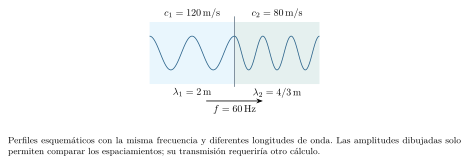
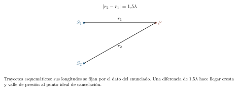
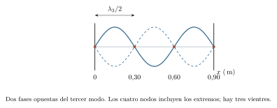
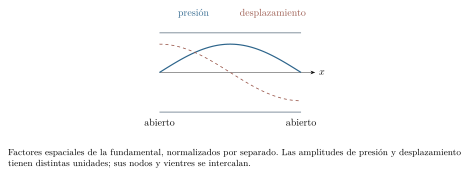

[← Capítulo anterior](capitulo-13.html) · [Índice del libro](index.html) · [Capítulo siguiente →](capitulo-15.html)

Cuando pulsamos una cuerda, una perturbación recorre su longitud mientras cada pequeño tramo se mueve alrededor de su posición de equilibrio. El instrumento responde como un sistema extendido: la tensión comunica el movimiento entre regiones vecinas y las fronteras devuelven parte de lo que llega hasta ellas. La repetición de esas idas y vueltas selecciona las oscilaciones que pueden mantenerse.

La misma idea permitirá estudiar una columna de aire. Seguiremos primero una onda viajera, combinaremos después varias ondas y buscaremos los movimientos compatibles con una cuerda o un tubo. A partir de allí podremos relacionar frecuencia y timbre, calcular intensidades y comprender cómo cambia la frecuencia observada cuando se mueven la fuente, el observador o el medio.

## Una oscilación que se propaga

Una onda mecánica es una perturbación que se propaga mediante las interacciones de un medio material. En una cuerda, el desplazamiento transversal de un punto puede representarse como $y(x,t)$: necesitamos su posición de equilibrio $x$ y el instante $t$ para conocer cuánto se ha apartado de ella. Una fotografía fija $t$ y muestra el perfil espacial; un registro de un punto fijo sigue su movimiento temporal.

Una onda es transversal cuando el desplazamiento local es perpendicular a la propagación. En una onda longitudinal, ambos tienen la misma dirección: así se producen las compresiones y rarefacciones del sonido en el aire. En los modelos lineales que usaremos, las partículas oscilan alrededor de sus posiciones de equilibrio mientras se propagan la perturbación y la energía. La curva de una onda sonora puede representar presión o desplazamiento longitudinal; el eje vertical de esa gráfica expresa una magnitud, aunque las partículas se muevan horizontalmente.

Una forma que viaja hacia $+x$ con rapidez constante $c$ puede escribirse $y=f(x-ct)$: mantener fijo $x-ct$ exige aumentar $x$ a razón $c$. Para una onda sinusoidal,
$$
 y(x,t)=A\cos(kx-\omega t+\phi),\quad
 k=\frac{2\pi}{\lambda},\quad \omega=2\pi f,\quad c=\lambda f=\frac\omega k.
$$
$A$ es la amplitud, $\lambda$ la distancia entre puntos consecutivos en la misma fase y $T=1/f$ el período de oscilación de un punto fijo. Aquí $k$ designa el *número de onda*, medido en $\,\mathrm{rad/m}$. En el capítulo anterior esa letra se empleaba para la rigidez de un resorte; el contexto y las unidades distinguen las dos magnitudes. Con $k,\omega>0$, la combinación $kx+\omega t$ representa propagación hacia $-x$.

Al derivar $y$ respecto del tiempo con $x$ fijo obtenemos la velocidad transversal de un elemento, $v_y=\partial y/\partial t=A\omega\sin(kx-\omega t+\phi)$. El símbolo $\partial$ indica que la otra variable se mantiene fija. La rapidez de propagación $c$ y la rapidez local $|v_y|$ describen procesos diferentes. La primera depende del medio; el máximo de la segunda es $A\omega$ para esta onda.

### Problema resuelto 14.1 · Leer espacio y tiempo por separado {#r14-1}

Una fotografía de una onda muestra crestas consecutivas separadas $0{,}80\,\mathrm{m}$ y desplazamiento máximo $0{,}020\,\mathrm{m}$. Un punto de la cuerda completa un ciclo cada $0{,}0040\,\mathrm{s}$. Determina amplitud, longitud de onda, frecuencia y rapidez de propagación.
*Resolución.* El perfil da $A=0{,}020\,\mathrm{m}$ y $\lambda=0{,}80\,\mathrm{m}$. El registro temporal da $T=0{,}0040\,\mathrm{s}$ y $f=250\,\mathrm{Hz}$. Por tanto,
$$
 c=\lambda f=(0{,}80)(250)=200\,\mathrm{m/s}.
$$
Durante un período el perfil avanza una longitud de onda, mientras el punto observado completa su oscilación. La fotografía aporta una distancia y el registro aporta un tiempo.

{#fig-fp-av-r14-1 fig-alt="Ilustración de Problema resuelto 14.1 · Leer espacio y tiempo por separado. Una fotografía de una onda muestra crestas consecutivas separadas 0,80\\,m y desplazamiento máximo 0,020\\,m. Un punto de la cuerda completa un ciclo cada 0,0040\\,s. Determina amplitud, longitud de onda, frecuencia y rapidez de propagación. Resolución. El perfil da A=0,020\\,m y lambda=0,80\\,m. El registro temporal da"}

### Problema resuelto 14.2 · Dos velocidades en una misma ecuación {#r14-2}

Una cuerda tiene $y=0{,}0030\cos(4\pi x-80\pi t+\pi/6)$ en unidades SI. Halla el sentido de propagación, $\lambda$, $f$, $c$ y la velocidad transversal en $x=1/12\,\mathrm{m}$, $t=0$.

*Resolución.* El signo de $-\omega t$ identifica avance hacia $+x$. Se obtiene $\lambda=2\pi/(4\pi)=0{,}50\,\mathrm{m}$, $f=80\pi/(2\pi)=40\,\mathrm{Hz}$ y $c=20\,\mathrm{m/s}$. Para el movimiento local,
$$
 v_y=0{,}240\pi\sin(4\pi x-80\pi t+\pi/6).
$$
En el punto y momento pedidos la fase es $\pi/2$: el elemento pasa por $y=0$ con $v_y=+0{,}240\pi\,\mathrm{m/s}\simeq+0{,}754\,\mathrm{m/s}$. El perfil se traslada horizontalmente a $20\,\mathrm{m/s}$ y el elemento cruza verticalmente su equilibrio con esa velocidad transversal.

{#fig-fp-av-r14-2 fig-alt="Ilustración de Problema resuelto 14.2 · Dos velocidades en una misma ecuación. Resolución. El signo de -omega t identifica avance hacia +x. Se obtiene lambda=2pi/(4pi)=0,50\\,m, f=80pi/(2pi)=40\\,Hz y c=20\\,m/s. Para el movimiento local, vy=0,240pisin(4pi x-80pi t+pi/6). En el punto y momento pedidos la fase es pi/2: el elemento pasa por y=0 con vy=+0,240pi\\,m/ssimeq+0,754\\,m/s. El perfil se"}

## La rapidez se obtiene del medio

En una cuerda uniforme, la densidad lineal es $\mu=M/L$, en $\,\mathrm{kg/m}$. Denotaremos su tensión por $\mathcal T$ para distinguirla del período. Para pendientes pequeñas, la componente vertical de la tensión es aproximadamente $\mathcal T\,\partial y/\partial x$. Un tramo de longitud $dx$ recibe la diferencia de esas componentes en sus extremos. Su masa es $\mu\,dx$, y Newton da
$$
 \mu\,dx\frac{\partial^2y}{\partial t^2}
 =\mathcal T\frac{\partial^2y}{\partial x^2}\,dx.
$$
Así obtenemos la ecuación de onda lineal y su rapidez:
$$
 \frac{\partial^2y}{\partial t^2}=c^2\frac{\partial^2y}{\partial x^2},
 \qquad c=\sqrt{\frac{\mathcal T}{\mu}}.
$$
El modelo supone tensión aproximadamente constante, cuerda flexible y uniforme, pendiente pequeña y pérdidas despreciables. Al sustituir la onda sinusoidal en la ecuación aparece $\omega^2=c^2k^2$, consistente con $c=\omega/k$. La relación entre inercia y restitución vuelve a fijar el movimiento; ahora intervienen regiones vecinas del medio.

En el sonido longitudinal, la rapidez depende de la respuesta elástica del material y de su densidad. Para un fluido homogéneo, el modelo da $c=\sqrt{B/\rho}$, donde $B$ es su módulo volumétrico en las condiciones del proceso. Usaremos $c=340\,\mathrm{m/s}$ cuando se indique aire, como valor adoptado para los ejercicios. La temperatura y la composición pueden cambiarlo.

Cuando una fuente periódica y una frontera permanecen estacionarias, la oscilación transmitida conserva la frecuencia impuesta por la fuente. Si cambia la rapidez en el segundo medio, cambia la longitud de onda según $\lambda=c/f$. Las amplitudes reflejada y transmitida dependen además del acoplamiento entre los medios.

### Problema resuelto 14.3 · Tensión y masa por unidad de longitud {#r14-3}

Una cuerda uniforme de $1{,}20\,\mathrm{m}$ tiene masa $6{,}0\,\mathrm{g}$ y tensión $80\,\mathrm{N}$. Calcula la rapidez de una onda transversal. ¿Cómo cambia si se cuadruplica la tensión manteniendo $\mu$?

*Resolución.* La densidad lineal es $\mu=0{,}0060/1{,}20=0{,}0050\,\mathrm{kg/m}$. Así,
$$
 c=\sqrt{\frac{80}{0{,}0050}}\simeq126{,}5\,\mathrm{m/s}.
$$
Con tensión $4\mathcal T$, la rapidez se multiplica por $\sqrt4=2$, alcanzando unos $253\,\mathrm{m/s}$. La comparación presupone que el cambio de tensión mantiene aproximadamente la densidad lineal y la validez del modelo. Las dimensiones también concuerdan: $(\,\mathrm{N})/(\,\mathrm{kg/m})=\,\mathrm{m^2/s^2}$.

{#fig-fp-av-r14-3 fig-alt="Ilustración de Problema resuelto 14.3 · Tensión y masa por unidad de longitud. Resolución. La densidad lineal es mu=0,0060/1,20=0,0050\\,kg/m. Así, c=sqrtfrac800,0050simeq126,5\\,m/s. Con tensión 4mathcal T, la rapidez se multiplica por sqrt4=2, alcanzando unos 253\\,m/s. La comparación presupone que el cambio de tensión mantiene aproximadamente la densidad lineal y la validez del modelo. Las"}

### Problema resuelto 14.4 · La frecuencia atraviesa una frontera fija {#r14-4}

Una fuente de $60\,\mathrm{Hz}$ envía ondas desde un medio de rapidez $120\,\mathrm{m/s}$ hacia otro de $80\,\mathrm{m/s}$. Ambos medios y la interfaz están en reposo. Determina las longitudes de onda incidente y transmitida.

*Resolución.* La frontera responde con la periodicidad de la excitación, por lo que $f_2=f_1=60\,\mathrm{Hz}$. Se obtiene $\lambda_1=120/60=2{,}0\,\mathrm{m}$ y $\lambda_2=80/60\simeq1{,}33\,\mathrm{m}$. La razón $\lambda_2/\lambda_1=2/3$ coincide con $c_2/c_1$. Este cálculo determina la separación espacial de fases en cada medio; para conocer amplitudes harían falta propiedades adicionales de la interfaz.

{#fig-fp-av-r14-4 fig-alt="Ilustración de Problema resuelto 14.4 · La frecuencia atraviesa una frontera fija. Resolución. La frontera responde con la periodicidad de la excitación, por lo que f2=f1=60\\,Hz. Se obtiene lambda1=120/60=2,0\\,m y lambda2=80/60simeq1,33\\,m. La razón lambda2/lambda1=2/3 coincide con c2/c1. Este cálculo determina la separación espacial de fases en cada medio; para conocer amplitudes harían falta"}

## Superposición e interferencia

La ecuación de onda anterior es lineal: si $y_1$ y $y_2$ son soluciones, también lo es $y=y_1+y_2$. En un mismo punto y un mismo instante, los desplazamientos se suman con signo. Para perturbaciones pequeñas, este principio permite seguir cada onda durante el encuentro y reconstruir la perturbación resultante.

Las fuerzas y desplazamientos se combinan linealmente; la energía contiene cuadrados. En una cuerda ideal, las energías cinética y elástica por unidad de longitud son $u_K=\mu(\partial y/\partial t)^2/2$ y $u_U=\mathcal T(\partial y/\partial x)^2/2$. Ambas dependen del estado completo, incluidas velocidades y pendientes. Un desplazamiento instantáneo nulo puede coexistir con movimiento local y energía cinética.

Para dos oscilaciones de igual frecuencia que llegan a un punto, $y_1=A_1\cos\theta$ y $y_2=A_2\cos(\theta+\Delta\phi)$, desarrollar el segundo coseno y sumar coeficientes da
$$
 A_R^2=A_1^2+A_2^2+2A_1A_2\cos\Delta\phi.
$$
Con amplitudes iguales, $A_R=2A|\cos(\Delta\phi/2)|$. Las fases iguales producen el máximo $2A$; una diferencia impar de $\pi$ produce cancelación de desplazamiento en ese punto. Para dos fuentes en fase y trayectos comparables en un medio homogéneo, la diferencia de caminos $\Delta r$ aporta $\Delta\phi=2\pi\Delta r/\lambda$, salvo un signo que aquí deja igual el coseno. Las fases iniciales y los posibles cambios al reflejarse también contribuyen.

Una interferencia estable requiere fuentes coherentes: su diferencia de fase debe mantenerse durante la observación. La energía se redistribuye entre regiones; el balance global incluye las fuentes, las ondas y sus fronteras. En acústica conviene precisar asimismo qué campo se representa: presión, desplazamiento o velocidad del medio.

### Problema resuelto 14.5 · Dos pulsos se encuentran {#r14-5}

Dos pulsos transversales viajan en sentidos opuestos por una cuerda ideal. En cierto instante, sus centros coinciden: uno desplazaría ese punto $+3{,}0\,\mathrm{cm}$ y el otro, $-2{,}0\,\mathrm{cm}$. Halla el desplazamiento resultante y explica cómo continúa cada pulso.

*Resolución.* La suma con signo da $y=3{,}0-2{,}0=+1{,}0\,\mathrm{cm}$. En el modelo lineal cada pulso sigue propagándose y recupera su perfil separado después del encuentro. La superposición describe el desplazamiento combinado durante el cruce.

Si dos pulsos iguales y opuestos llegaran a anular todo el perfil en un instante, las velocidades locales podrían seguir siendo distintas de cero: la cuerda atravesaría momentáneamente su configuración recta. Para evaluar la energía habría que incluir esas velocidades. El estado de la cuerda requiere posición y velocidad de cada elemento, como ocurría con un oscilador.

{#fig-fp-av-r14-5 fig-alt="Ilustración de Problema resuelto 14.5 · Dos pulsos se encuentran. Si dos pulsos iguales y opuestos llegaran a anular todo el perfil en un instante, las velocidades locales podrían seguir siendo distintas de cero: la cuerda atravesaría momentáneamente su configuración recta. Para evaluar la energía habría que incluir esas velocidades. El estado de la cuerda requiere posición y"}

### Problema resuelto 14.6 · Una suma que depende de la fase {#r14-6}

Dos ondas coherentes de igual frecuencia producen en un punto oscilaciones de amplitud $4{,}0\,\mathrm{mm}$ cada una, con diferencia de fase $2\pi/3$. Calcula la amplitud resultante.
*Resolución.* La ecuación 14.3 da
$$
 A_R=2(4{,}0)|\cos(\pi/3)|=4{,}0\,\mathrm{mm}.
$$
La resultante tiene la misma amplitud que una contribución aislada. La suma debe incorporar las fases de ambas oscilaciones. Con las mismas amplitudes, cambiar la diferencia de fase a cero produciría $8{,}0\,\mathrm{mm}$; cambiarla a $\pi$ daría amplitud nula.

{#fig-fp-av-r14-6 fig-alt="Ilustración de Problema resuelto 14.6 · Una suma que depende de la fase. Dos ondas coherentes de igual frecuencia producen en un punto oscilaciones de amplitud 4,0\\,mm cada una, con diferencia de fase 2pi/3. Calcula la amplitud resultante. Resolución. La ecuación 14.3 da AR=2(4,0)|cos(pi/3)|=4,0\\,mm. La resultante tiene la misma amplitud que una contribución aislada. La suma debe"}

### Problema resuelto 14.7 · Del camino a la fase {#r14-7}

Dos fuentes sonoras coherentes y en fase emiten a $680\,\mathrm{Hz}$ en aire de rapidez $340\,\mathrm{m/s}$. Un punto recibe ondas de igual amplitud con diferencia de caminos $0{,}75\,\mathrm{m}$. ¿Qué interferencia produce esa diferencia, despreciando reflexiones?

*Resolución.* La longitud de onda es $\lambda=340/680=0{,}50\,\mathrm{m}$. La diferencia representa $1{,}5\lambda$, por lo que $\Delta\phi=3\pi$, equivalente a $\pi$ al restar un ciclo completo. La suma ideal en ese punto es destructiva y la amplitud de presión resultante se anula. El resultado depende de la igualdad de amplitudes y de la coherencia supuestas. Al cambiar de posición cambian los trayectos y puede aparecer refuerzo.

{#fig-fp-av-r14-7 fig-alt="Ilustración de Problema resuelto 14.7 · Del camino a la fase. Resolución. La longitud de onda es lambda=340/680=0,50\\,m. La diferencia representa 1,5lambda, por lo que Deltaphi=3pi, equivalente a pi al restar un ciclo completo. La suma ideal en ese punto es destructiva y la amplitud de presión resultante se anula. El resultado depende de la igualdad de amplitudes y de la"}

## Reflexión, ondas estacionarias y modos normales

En un extremo fijo de una cuerda, el desplazamiento debe ser cero durante todo el tiempo. La onda reflejada se combina con la incidente para cumplir esa condición. Para amplitudes iguales, una pareja adecuada puede escribirse $y_1=A\sin(kx-\omega t)$ y $y_2=A\sin(kx+\omega t)$, cuya suma es
$$
 y(x,t)=2A\sin(kx)\cos(\omega t).
$$
El factor espacial fija la amplitud de cada punto y el temporal describe su oscilación. Los *nodos* permanecen en reposo; los *vientres* o antinodos tienen amplitud máxima. Se trata de una onda estacionaria. Entre nodos consecutivos hay $\lambda/2$; entre un nodo y el vientre vecino, $\lambda/4$.

En una cuerda de longitud $L$ fija en ambos extremos, $\sin(kL)=0$ exige $k_n=n\pi/L$, con $n=1,2,3,\ldots$. Por ello,
$$
 \lambda_n=\frac{2L}{n},\qquad f_n=\frac{nc}{2L}=nf_1.
$$
Cada patrón es un modo normal. La excitación puede producir combinaciones de modos. En una onda estacionaria ideal formada por dos ondas iguales opuestas, el transporte neto medio de energía a lo largo de la cuerda es cero; hay energía almacenada y transferencias locales durante el ciclo.

En un tubo sonoro ideal, una abertura funciona aproximadamente como nodo de presión y vientre de desplazamiento del aire. Un extremo cerrado rígido funciona como vientre de presión y nodo de desplazamiento. Estas condiciones son complementarias porque la presión depende de la compresión del aire. Para un tubo abierto en ambos extremos, $f_n=nc/(2L)$. Para uno cerrado en un extremo y abierto en el otro,
$$
 f_j=\frac{(2j-1)c}{4L},\qquad j=1,2,3,\ldots.
$$
La segunda familia contiene los armónicos impares de su fundamental. La longitud efectiva de un tubo real incluye correcciones en las aberturas; su geometría, sus pérdidas y sus acoplamientos modifican la respuesta. Una excitación periódica próxima a un modo puede producir resonancia, con amplitud limitada por las pérdidas y por la manera de excitar el sistema.

### Problema resuelto 14.8 · Contar nodos incluidos los extremos {#r14-8}

Una cuerda de $0{,}90\,\mathrm{m}$, fija en ambos extremos, tiene rapidez ondulatoria $120\,\mathrm{m/s}$. Calcula su fundamental y describe el tercer modo: frecuencia, longitud de onda, nodos y vientres.

*Resolución.* La fundamental es $f_1=120/(2\times0{,}90)\simeq66{,}7\,\mathrm{Hz}$. El tercer modo tiene $f_3=200\,\mathrm{Hz}$ y $\lambda_3=2(0{,}90)/3=0{,}60\,\mathrm{m}$. Sus nodos están en $x=0$, $0{,}30$, $0{,}60$ y $0{,}90\,\mathrm{m}$: cuatro en total, dos interiores. Los vientres quedan en $0{,}15$, $0{,}45$ y $0{,}75\,\mathrm{m}$. El número de modo cuenta los tres segmentos de media longitud de onda que caben entre los soportes.

{#fig-fp-av-r14-8 fig-alt="Ilustración de Problema resuelto 14.8 · Contar nodos incluidos los extremos. Resolución. La fundamental es f1=120/(2times0,90)simeq66,7\\,Hz. El tercer modo tiene f3=200\\,Hz y lambda3=2(0,90)/3=0,60\\,m. Sus nodos están en x=0, 0,30, 0,60 y 0,90\\,m: cuatro en total, dos interiores. Los vientres quedan en 0,15, 0,45 y 0,75\\,m. El número de modo cuenta los tres segmentos de media longitud de onda"}

### Problema resuelto 14.9 · Un tubo abierto en ambos extremos {#r14-9}

Un tubo ideal de longitud $0{,}85\,\mathrm{m}$ está abierto en ambos extremos y contiene aire con $c=340\,\mathrm{m/s}$. Halla sus tres frecuencias modales más bajas y ubica los nodos de presión de la fundamental.

*Resolución.* La fundamental vale $f_1=340/(2\times0{,}85)=200\,\mathrm{Hz}$ y las siguientes son $400$ y $600\,\mathrm{Hz}$. En la fundamental, la presión tiene nodos en las dos aberturas y un vientre en el centro. El desplazamiento del aire tiene vientres en las aberturas y un nodo central. Cada afirmación debe nombrar la magnitud representada para que la palabra nodo identifique una condición física precisa.

{#fig-fp-av-r14-9 fig-alt="Ilustración de Problema resuelto 14.9 · Un tubo abierto en ambos extremos. Resolución. La fundamental vale f1=340/(2times0,85)=200\\,Hz y las siguientes son 400 y 600\\,Hz. En la fundamental, la presión tiene nodos en las dos aberturas y un vientre en el centro. El desplazamiento del aire tiene vientres en las aberturas y un nodo central. Cada afirmación debe nombrar la magnitud representada"}

### Problema resuelto 14.10 · Cerrar un extremo cambia la familia {#r14-10}

Se cierra rígidamente un extremo del tubo anterior. Conservando $L=0{,}85\,\mathrm{m}$ y $c=340\,\mathrm{m/s}$, determina las tres frecuencias más bajas y distingue modo, armónico y sobretono.

*Resolución.* Ahora $f_1=c/(4L)=100\,\mathrm{Hz}$ y las frecuencias siguientes son $300$ y $500\,\mathrm{Hz}$. Corresponden a los modos primero, segundo y tercero del tubo, y a los armónicos primero, tercero y quinto de la fundamental. El primer sobretono es la primera frecuencia por encima de la fundamental: aquí vale $300\,\mathrm{Hz}$. En el extremo cerrado el desplazamiento se anula; la primera abertura compatible queda a un cuarto de longitud de onda para la fundamental.

{#fig-fp-av-r14-10 fig-alt="Ilustración de Problema resuelto 14.10 · Cerrar un extremo cambia la familia. Resolución. Ahora f1=c/(4L)=100\\,Hz y las frecuencias siguientes son 300 y 500\\,Hz. Corresponden a los modos primero, segundo y tercero del tubo, y a los armónicos primero, tercero y quinto de la fundamental. El primer sobretono es la primera frecuencia por encima de la fundamental: aquí vale 300\\,Hz. En el extremo"}

## Sonido, timbre y batimientos

Una señal periódica puede construirse sumando componentes sinusoidales de frecuencias $f_0$, $2f_0$, $3f_0$, etc. Sus amplitudes relativas y fases determinan la forma temporal. El espectro muestra qué componentes contiene la señal y con qué amplitudes. Dos sonidos pueden compartir fundamental y tener espectros distintos; esa estructura, junto con su evolución temporal y el ataque, contribuye a su timbre. La frecuencia fundamental organiza la periodicidad y se relaciona con la altura musical percibida.

Una señal puede conservar período $1/f_0$ aun cuando la componente de frecuencia $f_0$ tenga amplitud cero. Por ejemplo, componentes de $2f_0$ y $3f_0$ completan respectivamente dos y tres ciclos en ese tiempo; su suma tiene ese período fundamental si ambas están presentes. Identificar la frecuencia más baja presente y determinar el período de toda la señal son operaciones distintas.

Si se superponen dos oscilaciones de igual amplitud y frecuencias próximas, la identidad de suma de cosenos da
$$
 A\cos(2\pi f_1t)+A\cos(2\pi f_2t)
 =2A\cos[\pi(f_1-f_2)t]\cos\!\left[2\pi\frac{f_1+f_2}{2}t\right].
$$
Se oye una oscilación rápida cuya intensidad varía lentamente: aparecen *batimientos* o pulsaciones. Los máximos del módulo de la envolvente se repiten con frecuencia $f_b=|f_1-f_2|$. Un cambio de signo de la envolvente representa un cambio de fase; su módulo vuelve a crecer y produce otro máximo de intensidad.

### Problema resuelto 14.11 · Una misma fundamental, dos espectros {#r14-11}

Dos señales periódicas tienen componentes de $200$, $400$ y $600\,\mathrm{Hz}$. Sus amplitudes relativas son $(1;0{,}3;0{,}1)$ y $(1;0{,}8;0{,}6)$. Compara su período fundamental y su estructura espectral.
*Resolución.* Las tres frecuencias son múltiplos enteros de $200\,\mathrm{Hz}$ y esa componente está presente en ambas. El período fundamental es $1/200=0{,}0050\,\mathrm{s}$. La segunda señal tiene mayor contribución relativa de los armónicos segundo y tercero. Las formas temporales y los timbres pueden diferir aunque compartan fundamental. Para comparar intensidad total haría falta fijar una escala física de amplitudes y la magnitud que representan.

{#fig-fp-av-r14-11 fig-alt="Ilustración de Problema resuelto 14.11 · Una misma fundamental, dos espectros. Dos señales periódicas tienen componentes de 200, 400 y 600\\,Hz. Sus amplitudes relativas son (1;0,3;0,1) y (1;0,8;0,6). Compara su período fundamental y su estructura espectral. Resolución. Las tres frecuencias son múltiplos enteros de 200\\,Hz y esa componente está presente en ambas. El período fundamental es"}

## Intensidad y niveles en decibelios

La intensidad media $I$ es la potencia que atraviesa una superficie perpendicular al flujo por unidad de área, medida en $\,\mathrm{W/m^2}$. Una fuente puntual ideal, de potencia acústica $P$ e irradiación uniforme, reparte esa potencia sobre esferas de área $4\pi r^2$:
$$
 I(r)=\frac{P}{4\pi r^2}.
$$
La relación supone medio homogéneo, pérdidas de propagación despreciables y observación fuera de la región inmediata a la fuente. Reflexiones y direccionalidad pueden producir distribuciones distintas.

Para una onda sonora plana viajera en un medio uniforme, el modelo lineal relaciona intensidad y presión eficaz mediante $I=p_{\mathrm{rms}}^2/(\rho c)$. La presión eficaz es la raíz del promedio temporal del cuadrado de la fluctuación de presión. Para una sinusoide de amplitud $p_m$, $p_{\mathrm{rms}}=p_m/\sqrt2$. La presión y la velocidad de partícula llevan conjuntamente el flujo de energía; en campos estacionarios se requiere estudiar su relación de fase y su producto medio.

El nivel de intensidad sonora se define como
$$
 \beta=10\log_{10}\!\left(\frac I{I_0}\right),\qquad
 I_0=10^{-12}\,\mathrm{W/m^2}.
$$
El valor de referencia fija la escala convencional. De la definición se deduce $\Delta\beta=10\log_{10}(I_2/I_1)$ y, al invertirla, $I=I_0\,10^{\beta/10}$. Un nivel expresa un cociente logarítmico de intensidades. La percepción de sonoridad incorpora además frecuencia, duración y respuesta del oyente.

Las contribuciones de flujo medio se suman vectorialmente cuando los términos cruzados promedian cero, como sucede para señales no correlacionadas. Si las ondas viajeras avanzan en la misma dirección y sentido, sus intensidades escalares se refieren a una misma superficie normal y se suman directamente; después se convierte el resultado a decibelios. Para ondas coherentes, las presiones se combinan con su fase y los términos cruzados pueden reforzar o reducir el resultado. Las direcciones de propagación forman parte de los datos necesarios para interpretar el flujo.

### Problema resuelto 14.12 · Alejarse de una fuente puntual {#r14-12}

Una fuente ideal irradia $0{,}010\,\mathrm{W}$ uniformemente en aire. Calcula la intensidad a $2{,}0$ y $4{,}0\,\mathrm{m}$ y el cambio de nivel entre ambos puntos. Desprecia absorción y reflexiones.

*Resolución.* En las dos distancias,
$$
 I_2=\frac{0{,}010}{4\pi(2)^2}\simeq1{,}99\times10^{-4}\,\mathrm{W/m^2},\qquad
 I_4\simeq4{,}97\times10^{-5}\,\mathrm{W/m^2}.
$$
La segunda intensidad es la cuarta parte de la primera. Por tanto, $\beta_4-\beta_2=10\log_{10}(1/4)\simeq-6{,}02\,\mathrm{dB}$. Los niveles son aproximadamente $83{,}0$ y $77{,}0\,\mathrm{dB}$, respectivamente. La disminución procede de repartir la misma potencia sobre una superficie cuatro veces mayor.

{#fig-fp-av-r14-12 fig-alt="Ilustración de Problema resuelto 14.12 · Alejarse de una fuente puntual. Resolución. En las dos distancias, I2=frac0,0104pi(2)^2simeq1,99times10^-4\\,W/m^2,qquad I4simeq4,97times10^-5\\,W/m^2. La segunda intensidad es la cuarta parte de la primera. Por tanto, beta4-beta2=10log10(1/4)simeq-6,02\\,dB. Los niveles son aproximadamente 83,0 y 77,0\\,dB, respectivamente. La disminución procede de"}

### Problema resuelto 14.13 · Interpretar un aumento de nivel {#r14-13}

Compara las intensidades correspondientes a $60$ y $70\,\mathrm{dB}$. ¿Cuánto aumentaría el nivel de la primera al duplicar su intensidad?

*Resolución.* Invertimos la definición: $I_{60}=10^{-12}10^6=10^{-6}\,\mathrm{W/m^2}$ y $I_{70}=10^{-12}10^7=10^{-5}\,\mathrm{W/m^2}$. El aumento de $10\,\mathrm{dB}$ representa un factor diez. Al duplicar la intensidad de la primera, el incremento es $10\log_{10}2\simeq3{,}01\,\mathrm{dB}$, y el nuevo nivel resulta $63{,}01\,\mathrm{dB}$. Estas operaciones comparan intensidades físicas dentro de la escala definida.

{#fig-fp-av-r14-13 fig-alt="Ilustración de Problema resuelto 14.13 · Interpretar un aumento de nivel. Resolución. Invertimos la definición: I60=10^-1210^6=10^-6\\,W/m^2 y I70=10^-1210^7=10^-5\\,W/m^2. El aumento de 10\\,dB representa un factor diez. Al duplicar la intensidad de la primera, el incremento es 10log102simeq3,01\\,dB, y el nuevo nivel resulta 63,01\\,dB. Estas operaciones comparan intensidades físicas dentro de"}

### Problema resuelto 14.14 · Dos fuentes: importa su correlación {#r14-14}

Dos ondas planas viajeras avanzan en la misma dirección y sentido, en el mismo medio. Cada una produce por separado $60\,\mathrm{dB}$ en el punto de observación. Calcula el nivel conjunto si sus señales son no correlacionadas. Compáralo con dos ondas de igual frecuencia que allí tengan esas amplitudes de presión y lleguen en fase.

*Resolución.* Cada contribución aislada tiene intensidad $I=10^{-6}\,\mathrm{W/m^2}$. En el primer caso se suman intensidades: $I_T=2I$ y $\beta_T=60+10\log_{10}2\simeq63{,}01\,\mathrm{dB}$.

En el segundo caso se suman presiones en fase: la amplitud de presión se duplica. La intensidad de la onda plana resultante, proporcional al cuadrado de esa amplitud, es $4I$. Entonces $\beta_T=60+10\log_{10}4\simeq66{,}02\,\mathrm{dB}$. La fase y la geometría especificadas permiten calcular ese refuerzo. Los dos niveles individuales dejan abierta esa información, por lo que es preciso conocer cómo se relacionan las señales para sumarlas.

{#fig-fp-av-r14-14 fig-alt="Ilustración de Problema resuelto 14.14 · Dos fuentes: importa su correlación. En el segundo caso se suman presiones en fase: la amplitud de presión se duplica. La intensidad de la onda plana resultante, proporcional al cuadrado de esa amplitud, es 4I. Entonces betaT=60+10log104simeq66,02\\,dB. La fase y la geometría especificadas permiten calcular ese refuerzo. Los dos niveles individuales dejan"}

## Doppler: contar frentes desde una referencia común

Consideremos propagación unidimensional y un medio en reposo. Elegimos $+x$ desde la fuente hacia el observador a lo largo del rayo que los conecta. Sean $u_s$ y $u_o$ sus velocidades con signo respecto del medio, y $f_s$ la frecuencia de emisión. Durante un período $T_s$, la fuente avanza $u_sT_s$ y el frente anterior recorre $cT_s$. La separación entre frentes que salen hacia $+x$ es
$$
 \lambda_{+}=(c-u_s)T_s=\frac{c-u_s}{f_s}.
$$
El observador cruza esos frentes con rapidez relativa $c-u_o$. Dividir esa rapidez por la separación da
$$
 f_o=f_s\frac{c-u_o}{c-u_s}.
$$
Usaremos velocidades subsónicas y geometría colineal, con el observador delante de la fuente para la dirección elegida. En esta convención, $u_s>0$ acerca la fuente al observador; $u_o>0$ aleja al observador de la fuente. Una velocidad negativa indica movimiento hacia $-x$. Para otra dirección de propagación se reorienta el eje y se vuelven a asignar los signos.

El movimiento de la fuente cambia la separación de frentes; el del observador cambia la tasa con que los encuentra. Esa diferencia explica la presencia de sus velocidades en lugares distintos de la fórmula. En un viento uniforme de velocidad $w$ respecto del suelo, se pueden convertir las velocidades a la referencia del aire restando $w$. También puede seguirse cada frente respecto del suelo, donde su velocidad en la dirección del viento es $c+w$. Las dos descripciones dan el mismo resultado al usar una sola referencia de manera consistente.

### Problema resuelto 14.15 · Se mueve quien escucha {#r14-15}

Una fuente quieta respecto del aire emite a $500\,\mathrm{Hz}$. Un observador avanza hacia ella a $20\,\mathrm{m/s}$. Con $c=340\,\mathrm{m/s}$, calcula la frecuencia observada y compárala con la de alejarse a esa rapidez.
*Resolución.* Con el eje desde la fuente al observador, acercarse corresponde a $u_o=-20\,\mathrm{m/s}$. Por ello,
$$
 f_o=500\frac{340+20}{340}\simeq529{,}4\,\mathrm{Hz}.
$$
Al alejarse, $u_o=+20\,\mathrm{m/s}$ y $f_o=500(320/340)\simeq470{,}6\,\mathrm{Hz}$. La separación de frentes en el aire sigue siendo $340/500=0{,}680\,\mathrm{m}$; cambia la rapidez con que el observador los cruza.

{#fig-fp-av-r14-15 fig-alt="Ilustración de Problema resuelto 14.15 · Se mueve quien escucha. Una fuente quieta respecto del aire emite a 500\\,Hz. Un observador avanza hacia ella a 20\\,m/s. Con c=340\\,m/s, calcula la frecuencia observada y compárala con la de alejarse a esa rapidez. Resolución. Con el eje desde la fuente al observador, acercarse corresponde a uo=-20\\,m/s. Por ello,"}

### Problema resuelto 14.16 · Se mueve quien emite {#r14-16}

Ahora el observador está quieto en el aire y la fuente de $500\,\mathrm{Hz}$ avanza hacia él a $20\,\mathrm{m/s}$. Calcula la frecuencia recibida. Después considera una fuente que se aleja a la misma rapidez, eligiendo de nuevo el eje desde ella hacia el observador.

*Resolución.* Al acercarse, $u_s=+20\,\mathrm{m/s}$ y la separación de frentes es $\lambda_+=(340-20)/500=0{,}640\,\mathrm{m}$. Así, $f_o=340/0{,}640=531{,}25\,\mathrm{Hz}$. Al alejarse, $u_s=-20\,\mathrm{m/s}$ y resulta
$$
 f_o=500\frac{340}{340+20}\simeq472{,}2\,\mathrm{Hz}.
$$
La comparación con el problema anterior muestra una diferencia pequeña y medible: el movimiento de la fuente modifica la longitud de onda en el medio. La rapidez de propagación respecto del aire se mantiene en $340\,\mathrm{m/s}$ en ambos ensayos.

{#fig-fp-av-r14-16 fig-alt="Ilustración de Problema resuelto 14.16 · Se mueve quien emite. Resolución. Al acercarse, us=+20\\,m/s y la separación de frentes es lambda+=(340-20)/500=0,640\\,m. Así, fo=340/0,640=531,25\\,Hz. Al alejarse, us=-20\\,m/s y resulta fo=500frac340340+20simeq472,2\\,Hz. La comparación con el problema anterior muestra una diferencia pequeña y medible: el movimiento de la fuente modifica la"}

### Problema resuelto 14.17 · Fuente, observador y viento {#r14-17}

Una fuente situada a la izquierda emite a $600\,\mathrm{Hz}$ y se mueve hacia la derecha a $20\,\mathrm{m/s}$ respecto del suelo. Un observador a su derecha avanza también hacia la derecha a $10\,\mathrm{m/s}$. Calcula la frecuencia recibida primero con aire quieto y después con viento uniforme de $10\,\mathrm{m/s}$ hacia la derecha. Usa $c=340\,\mathrm{m/s}$ respecto del aire.

*Resolución.* Sin viento, ambas velocidades se refieren ya al medio y
$$
 f_o=600\frac{340-10}{340-20}=618{,}75\,\mathrm{Hz}.
$$
Con viento, las velocidades respecto del aire pasan a $u_s=20-10=10\,\mathrm{m/s}$ y $u_o=10-10=0$. Se obtiene $f_o=600(340/330)\simeq618{,}18\,\mathrm{Hz}$.

Como comprobación desde el suelo, los frentes avanzan ahora a $350\,\mathrm{m/s}$, la separación es $(350-20)/600=0{,}550\,\mathrm{m}$ y la rapidez de encuentro es $350-10=340\,\mathrm{m/s}$. Su cociente reproduce $618{,}18\,\mathrm{Hz}$. Cada cálculo mantiene todas las velocidades en una misma referencia.

{#fig-fp-av-r14-17 fig-alt="Ilustración de Problema resuelto 14.17 · Fuente, observador y viento. Como comprobación desde el suelo, los frentes avanzan ahora a 350\\,m/s, la separación es (350-20)/600=0,550\\,m y la rapidez de encuentro es 350-10=340\\,m/s. Su cociente reproduce 618,18\\,Hz. Cada cálculo mantiene todas las velocidades en una misma referencia."}

## Una aplicación: afinar con batimientos

La rapidez del sonido, la geometría de la columna de aire y las condiciones en sus extremos fijan sus frecuencias modales. Una excitación próxima a un modo puede producir una respuesta resonante, cuya amplitud depende de las pérdidas y del acoplamiento. Los batimientos permiten comparar una de esas oscilaciones con una referencia cercana. Al observar que las pulsaciones se vuelven más lentas mientras se ajusta el instrumento, inferimos que las frecuencias se aproximan. La frecuencia de batimiento determina el módulo de su diferencia; una segunda observación permite decidir cuál de las dos frecuencias es mayor.

### Problema resuelto 14.18 · Modificar la longitud para alcanzar una referencia {#r14-18}

Un tubo ideal abierto en ambos extremos mide $0{,}85\,\mathrm{m}$ y suena en su fundamental, con $c=340\,\mathrm{m/s}$. Se compara con una referencia de $202\,\mathrm{Hz}$. Calcula los batimientos iniciales y la longitud efectiva necesaria para igualar la referencia. Supón que el ajuste conserva el tipo de frontera y la rapidez del sonido.

*Resolución.* El tubo produce $f_1=340/(2\times0{,}85)=200\,\mathrm{Hz}$. La comparación genera $|202-200|=2\,\mathrm{Hz}$ de batimiento, un máximo de la envolvente cada $0{,}50\,\mathrm{s}$. Para alcanzar la referencia,
$$
 L'=\frac{340}{2(202)}\simeq0{,}8416\,\mathrm{m}.
$$
La longitud debe reducirse unos $0{,}00842\,\mathrm{m}$, es decir, $0{,}842\,\mathrm{cm}$. Acortar el tubo eleva la fundamental en el modelo. Si solo conociéramos los dos batimientos por segundo y la referencia, las frecuencias candidatas del otro sonido serían $200$ y $204\,\mathrm{Hz}$; la longitud inicial proporciona el dato adicional que permite elegir.

{#fig-fp-av-r14-18 fig-alt="Ilustración de Problema resuelto 14.18 · Modificar la longitud para alcanzar una referencia. Resolución. El tubo produce f1=340/(2times0,85)=200\\,Hz. La comparación genera |202-200|=2\\,Hz de batimiento, un máximo de la envolvente cada 0,50\\,s. Para alcanzar la referencia, L'=frac3402(202)simeq0,8416\\,m. La longitud debe reducirse unos 0,00842\\,m, es decir, 0,842\\,cm. Acortar el tubo eleva la fundamental en el"}

## Ejercicios para reconstruir y transferir

Usa modelos lineales, cuerdas uniformes e ideales y tubos de longitud efectiva indicada. Para aire adopta $c=340\,\mathrm{m/s}$, salvo dato distinto. En niveles usa $I_0=10^{-12}\,\mathrm{W/m^2}$. En Doppler, asigna velocidades respecto del medio y elige el eje en la dirección de propagación hacia el observador.

### Ejercicio 14.1 · Un perfil y un registro temporal {#e14-1}

Una onda tiene amplitud $6{,}0\,\mathrm{mm}$, separación entre crestas de $0{,}40\,\mathrm{m}$ y período $0{,}0020\,\mathrm{s}$. Calcula $f$ y $c$, e identifica qué datos pertenecen al perfil espacial.

### Ejercicio 14.2 · Leer una onda que va hacia la izquierda {#e14-2}

Para $y=0{,}0050\sin(10\pi x+40\pi t)$ en SI, determina sentido, longitud de onda, frecuencia, rapidez de propagación y máxima rapidez transversal.

### Ejercicio 14.3 · Interpretar los coeficientes {#e14-3}

Una onda tiene $k=8\pi\,\mathrm{rad/m}$, $\omega=120\pi\,\mathrm{rad/s}$ y $A=0{,}0040\,\mathrm{m}$. Halla $\lambda$, $f$, $c$ y $|v_y|_{\max}$.

### Ejercicio 14.4 · Una cuerda bajo tensión {#e14-4}

Una cuerda de $2{,}0\,\mathrm{m}$ tiene masa $10\,\mathrm{g}$ y tensión $50\,\mathrm{N}$. Determina su densidad lineal y la rapidez ondulatoria.

### Ejercicio 14.5 · Variar la tensión con frecuencia fija {#e14-5}

Se multiplica por nueve la tensión de una cuerda manteniendo su densidad lineal y la frecuencia de la fuente. ¿Por qué factores cambian rapidez y longitud de onda?

### Ejercicio 14.6 · Cambiar de medio {#e14-6}

Una onda sonora de $740\,\mathrm{Hz}$ pasa por una interfaz estacionaria de aire a agua, con rapideces $340$ y $1480\,\mathrm{m/s}$. Calcula la frecuencia transmitida y ambas longitudes de onda.

### Ejercicio 14.7 · Una suma con signo {#e14-7}

En un punto, dos pulsos producen desplazamientos de $+2{,}5$ y $-4{,}0\,\mathrm{cm}$. Halla el desplazamiento total y explica qué información adicional necesitarías para calcular la energía instantánea de la cuerda.

### Ejercicio 14.8 · Un cuarto de ciclo entre contribuciones {#e14-8}

Dos oscilaciones coherentes tienen amplitudes de $3{,}0\,\mathrm{mm}$ y diferencia de fase $\pi/2$. Calcula la amplitud resultante.

### Ejercicio 14.9 · Una diferencia de caminos {#e14-9}

Dos fuentes coherentes en fase llegan con igual amplitud a un punto. Si $\lambda=0{,}60\,\mathrm{m}$ y $\Delta r=0{,}90\,\mathrm{m}$, determina la diferencia de fase y el carácter de la interferencia.

### Ejercicio 14.10 · Amplitudes distintas en oposición {#e14-10}

Dos oscilaciones de amplitudes $5{,}0$ y $3{,}0\,\mathrm{mm}$ llegan con diferencia de fase $\pi$. Calcula la amplitud resultante y la fase de la suma respecto de la contribución mayor.

### Ejercicio 14.11 · Quinto modo de una cuerda {#e14-11}

Una cuerda de $1{,}20\,\mathrm{m}$ fija en ambos extremos tiene $c=96\,\mathrm{m/s}$. Calcula $f_1$, $f_5$ y el número de nodos totales, nodos interiores y vientres del quinto modo.

### Ejercicio 14.12 · Inferir la tensión desde la fundamental {#e14-12}

Una cuerda uniforme de $0{,}75\,\mathrm{m}$ y masa $3{,}0\,\mathrm{g}$ tiene fundamental $100\,\mathrm{Hz}$ con extremos fijos. Calcula su rapidez ondulatoria y la tensión.

### Ejercicio 14.13 · Tres modos de un tubo abierto {#e14-13}

Calcula las tres frecuencias más bajas de un tubo ideal de $0{,}68\,\mathrm{m}$ abierto en ambos extremos.

### Ejercicio 14.14 · Tres modos de un tubo cerrado {#e14-14}

Para la misma longitud del ejercicio anterior, cierra un extremo. Calcula las tres primeras frecuencias y señala el primer sobretono y el tercer armónico.

### Ejercicio 14.15 · La misma fundamental con otras fronteras {#e14-15}

¿Qué longitud efectiva requiere una fundamental de $170\,\mathrm{Hz}$ en un tubo abierto en ambos extremos? ¿Y en uno cerrado en un extremo?

### Ejercicio 14.16 · La periodicidad de un espectro {#e14-16}

Una señal contiene componentes sinusoidales de $400$, $600$ y $800\,\mathrm{Hz}$, todas con amplitud distinta de cero. Determina su frecuencia fundamental de repetición y explica la función de una posible componente de $200\,\mathrm{Hz}$.

### Ejercicio 14.17 · Potencia repartida sobre una esfera {#e14-17}

Una fuente puntual isotrópica emite $0{,}040\,\mathrm{W}$. Calcula intensidad y nivel a $10\,\mathrm{m}$, despreciando absorción y reflexiones.

### Ejercicio 14.18 · Una diferencia de veinte decibelios {#e14-18}

Calcula la intensidad de $80\,\mathrm{dB}$ y su razón respecto de la correspondiente a $60\,\mathrm{dB}$. Justifica el factor obtenido mediante logaritmos.

### Ejercicio 14.19 · Tres fuentes independientes {#e14-19}

Tres ondas viajeras no correlacionadas avanzan en la misma dirección y sentido y producen cada una $55\,\mathrm{dB}$ en el punto de observación. Calcula el nivel conjunto referido a una misma superficie normal a la propagación.

### Ejercicio 14.20 · El observador se acerca y se aleja {#e14-20}

Una fuente quieta en el aire emite $680\,\mathrm{Hz}$. Calcula la frecuencia que recibe un observador al acercarse a $17\,\mathrm{m/s}$ y al alejarse a la misma rapidez.

### Ejercicio 14.21 · La fuente se acerca y se aleja {#e14-21}

Una fuente de $680\,\mathrm{Hz}$ se mueve a $34\,\mathrm{m/s}$ en aire quieto. Un observador permanece quieto. Calcula la frecuencia al aproximarse la fuente y al alejarse.

### Ejercicio 14.22 · Ambos se aproximan {#e14-22}

Una fuente situada a la izquierda emite a $400\,\mathrm{Hz}$ y avanza hacia la derecha a $30\,\mathrm{m/s}$ en aire quieto. El observador a su derecha se mueve hacia la izquierda a $10\,\mathrm{m/s}$. Calcula la frecuencia recibida y muestra los signos elegidos.

### Ejercicio 14.23 · Viento con fuente y observador quietos {#e14-23}

Fuente y observador permanecen quietos respecto del suelo. Entre ellos sopla viento uniforme de $20\,\mathrm{m/s}$ en la dirección fuente--observador. La fuente emite $500\,\mathrm{Hz}$. Calcula la separación de frentes respecto del suelo y la frecuencia recibida.

### Ejercicio 14.24 · Afinar con información incompleta {#e14-24}

Una referencia de $432\,\mathrm{Hz}$ produce tres batimientos por segundo con otra señal. Halla las frecuencias candidatas y el intervalo entre máximos de la envolvente. Si además se sabe que la otra frecuencia es mayor, identifica su valor y la frecuencia media de ambas.

## Soluciones razonadas

### Solución 14.1 {#sol-e14-1}
 El perfil espacial proporciona $A=0{,}0060\,\mathrm{m}$ y $\lambda=0{,}40\,\mathrm{m}$. El período fija $f=1/T=500\,\mathrm{Hz}$; la rapidez es $c=\lambda f=200\,\mathrm{m/s}$. Amplitud y longitud de onda son longitudes con funciones distintas en la descripción.

### Solución 14.2 {#sol-e14-2}
 La combinación $kx+\omega t$ se desplaza hacia $-x$. Se obtiene $\lambda=2\pi/(10\pi)=0{,}20\,\mathrm{m}$, $f=20\,\mathrm{Hz}$ y $c=4{,}0\,\mathrm{m/s}$. La máxima rapidez transversal es $A\omega=0{,}200\pi\,\mathrm{m/s}\simeq0{,}628\,\mathrm{m/s}$, obtenida derivando respecto del tiempo.

### Solución 14.3 {#sol-e14-3}
 La longitud de onda vale $0{,}25\,\mathrm{m}$ y la frecuencia, $60\,\mathrm{Hz}$. Así, $c=15\,\mathrm{m/s}$. El máximo local es $A\omega=0{,}480\pi\,\mathrm{m/s}\simeq1{,}51\,\mathrm{m/s}$. La comparación separa avance del perfil y oscilación del elemento.

### Solución 14.4 {#sol-e14-4}
 La densidad lineal es $\mu=0{,}010/2{,}0=0{,}0050\,\mathrm{kg/m}$. La rapidez resulta $\sqrt{50/0{,}0050}=100\,\mathrm{m/s}$ bajo las hipótesis de cuerda ideal y pendiente pequeña.

### Solución 14.5 {#sol-e14-5}
 La rapidez se multiplica por $\sqrt9=3$. Como la frecuencia se conserva, $\lambda=c/f$ también se multiplica por tres. La amplitud depende de la excitación y del acoplamiento; estos datos fijan las razones de rapidez y longitud de onda.

### Solución 14.6 {#sol-e14-6}
 La frecuencia transmitida es $740\,\mathrm{Hz}$ por la estacionariedad de fuente e interfaz. En aire, $\lambda=340/740\simeq0{,}459\,\mathrm{m}$; en agua, $\lambda=1480/740=2{,}00\,\mathrm{m}$. El cambio de rapidez queda reflejado en la separación espacial de las fases.

### Solución 14.7 {#sol-e14-7}
 La suma es $y=2{,}5-4{,}0=-1{,}5\,\mathrm{cm}$. Para la energía instantánea de un tramo harían falta su velocidad transversal y la pendiente del perfil resultante, además de $\mu$ y $\mathcal T$. El desplazamiento aislado describe una parte de ese estado.

### Solución 14.8 {#sol-e14-8}
 Se obtiene $A_R=2(3{,}0)|\cos(\pi/4)|=3\sqrt2\,\mathrm{mm}\simeq4{,}24\,\mathrm{mm}$. Equivalentemente, sumar los cuadrados de dos coeficientes en cuadratura da $A_R^2=3^2+3^2$.

### Solución 14.9 {#sol-e14-9}
 La diferencia de caminos es $1{,}5\lambda$, así que $\Delta\phi=3\pi$, equivalente a $\pi$ para la interferencia. Las dos contribuciones de igual amplitud se cancelan en ese punto bajo las hipótesis de coherencia y fase inicial común.

### Solución 14.10 {#sol-e14-10}
 La suma equivale a $5\cos\theta+3\cos(\theta+\pi)=2\cos\theta$, con amplitudes en milímetros. La amplitud total es $2{,}0\,\mathrm{mm}$ y la fase coincide con la contribución mayor.

### Solución 14.11 {#sol-e14-11}
 La fundamental es $96/(2\times1{,}20)=40\,\mathrm{Hz}$; el quinto modo tiene $200\,\mathrm{Hz}$. Sus cinco segmentos de media longitud de onda producen seis nodos totales, cuatro interiores y cinco vientres.

### Solución 14.12 {#sol-e14-12}
 La rapidez es $c=2Lf_1=150\,\mathrm{m/s}$. Con $\mu=0{,}0030/0{,}75=0{,}0040\,\mathrm{kg/m}$ se obtiene $\mathcal T=\mu c^2=90\,\mathrm{N}$. Se emplea la longitud vibrante comprendida entre los dos soportes.

### Solución 14.13 {#sol-e14-13}
 La fundamental es $340/(2\times0{,}68)=250\,\mathrm{Hz}$. Las otras dos frecuencias son $500$ y $750\,\mathrm{Hz}$. Los extremos abiertos tienen nodos de presión y vientres de desplazamiento en este modelo.

### Solución 14.14 {#sol-e14-14}
 La fundamental es $340/(4\times0{,}68)=125\,\mathrm{Hz}$. Siguen $375$ y $625\,\mathrm{Hz}$, armónicos tercero y quinto. El primer sobretono y el tercer armónico coinciden aquí en $375\,\mathrm{Hz}$.

### Solución 14.15 {#sol-e14-15}
 En abierto--abierto, $L=c/(2f_1)=1{,}00\,\mathrm{m}$. En cerrado--abierto, $L=c/(4f_1)=0{,}500\,\mathrm{m}$. Cambiar las fronteras cambia la fracción de longitud de onda que cabe en la fundamental.

### Solución 14.16 {#sol-e14-16}
 Las frecuencias son $2$, $3$ y $4$ veces $200\,\mathrm{Hz}$. Su máximo divisor común es $200\,\mathrm{Hz}$, por lo que la señal se repite cada $0{,}0050\,\mathrm{s}$. Una componente de $200\,\mathrm{Hz}$ puede reforzar ese espectro manteniendo el período; la combinación dada ya tiene esa periodicidad fundamental por la presencia conjunta de los múltiplos segundo y tercero.

### Solución 14.17 {#sol-e14-17}
 La intensidad es $I=0{,}040/(4\pi\times10^2)\simeq3{,}18\times10^{-5}\,\mathrm{W/m^2}$. El nivel resulta $10\log_{10}(I/10^{-12})\simeq75{,}0\,\mathrm{dB}$. El área de reparto es la de la esfera completa porque se supuso emisión isotrópica.

### Solución 14.18 {#sol-e14-18}
 A $80\,\mathrm{dB}$, $I=10^{-12}10^8=10^{-4}\,\mathrm{W/m^2}$. A $60\,\mathrm{dB}$, $I=10^{-6}\,\mathrm{W/m^2}$. La razón es $100=10^{(80-60)/10}$: cada aumento de diez decibelios multiplica por diez la intensidad.

### Solución 14.19 {#sol-e14-19}
 Las ondas tienen la misma dirección y sentido y sus señales son no correlacionadas. Sus intensidades se suman sobre la superficie normal común; el nivel total es $55+10\log_{10}3\simeq59{,}77\,\mathrm{dB}$. Cada nivel se convierte en intensidad; la suma física se expresa después en la escala logarítmica.

### Solución 14.20 {#sol-e14-20}
 Acercarse significa $u_o=-17\,\mathrm{m/s}$ y produce $f_o=680(340+17)/340=714\,\mathrm{Hz}$. Alejarse da $u_o=+17\,\mathrm{m/s}$ y $f_o=680(340-17)/340=646\,\mathrm{Hz}$. La fuente quieta mantiene la separación de frentes.

### Solución 14.21 {#sol-e14-21}
 Al aproximarse, $u_s=+34\,\mathrm{m/s}$ y $f_o=680(340)/(340-34)\simeq755{,}6\,\mathrm{Hz}$. Al alejarse, $u_s=-34\,\mathrm{m/s}$ y $f_o=680(340)/(340+34)\simeq618{,}2\,\mathrm{Hz}$. La velocidad de la fuente interviene al calcular el espaciamiento de los frentes.

### Solución 14.22 {#sol-e14-22}
 Elegimos $+x$ de izquierda a derecha. Así, $u_s=+30$ y $u_o=-10\,\mathrm{m/s}$. La frecuencia observada es $400(340+10)/(340-30)\simeq451{,}6\,\mathrm{Hz}$. La aproximación de ambos aumenta la tasa de encuentro respecto de la emisión.

### Solución 14.23 {#sol-e14-23}
 Desde el suelo, los frentes avanzan a $c+w=360\,\mathrm{m/s}$. La fuente quieta los emite separados $\lambda=360/500=0{,}720\,\mathrm{m}$. El observador quieto recibe $360/0{,}720=500\,\mathrm{Hz}$. Desde el aire, ambos se mueven a $-20\,\mathrm{m/s}$ y los factores iguales del numerador y denominador de Doppler se cancelan.

### Solución 14.24 {#sol-e14-24}
 La condición $|f-432|=3$ da $f=429$ o $435\,\mathrm{Hz}$. El intervalo entre máximos es $1/3\,\mathrm{s}\simeq0{,}333\,\mathrm{s}$. El dato de que la otra frecuencia es mayor selecciona $435\,\mathrm{Hz}$ y la frecuencia media es $(432+435)/2=433{,}5\,\mathrm{Hz}$. El módulo de la diferencia y la frecuencia media desempeñan funciones distintas en la señal combinada.

## Una experiencia: medir modos y batimientos

### Longitud, espectro y fronteras

Con una cuerda o una banda elástica bajo tensión moderada, mantén dos extremos sujetos y excita movimientos pequeños. Busca patrones con uno, dos y tres vientres, registra la longitud vibrante y estima las frecuencias mediante un video o un registro de audio. Compara las razones de frecuencias con los enteros $1:2:3$. La elasticidad de la banda puede hacer variar su tensión al ajustar la longitud: registra esa condición para interpretar el ensayo.

Para explorar batimientos, combina dos tonos de frecuencias próximas y amplitudes moderadas, por ejemplo $200$ y $202\,\mathrm{Hz}$, mediante un generador de señales. Observa la envolvente temporal en un registro y cuenta sus máximos durante varios segundos. Compara su separación con $1/|f_1-f_2|$. Después conserva la diferencia y desplaza ambas frecuencias juntas: la rapidez de los batimientos debería mantenerse mientras cambia la oscilación rápida.

Al medir niveles con un teléfono, compara ensayos realizados en la misma configuración y registra la ponderación y la calibración disponibles. La escala de un instrumento concreto puede representar presión sonora ponderada; para confrontarla con el nivel de intensidad de este capítulo hay que identificar la magnitud medida y las condiciones acústicas. Reflexiones, ubicación del micrófono y ruido de fondo aportan parte de la evidencia del experimento.

## Diagnóstico antes de avanzar

Explica: (a) qué distingue $c$ de $\partial y/\partial t$; (b) cómo se relacionan nodo de presión y vientre de desplazamiento en una abertura ideal; (c) qué información necesitas para sumar dos sonidos; (d) cómo asignas los signos en Doppler antes de sustituir velocidades.

**Contraste.** (a) $c$ mide el avance del perfil; la derivada temporal mide el movimiento local del medio. (b) La presión se ajusta aproximadamente a la atmosférica en la abertura mientras el aire puede desplazarse con amplitud grande. (c) Se especifican amplitudes, fases, correlación y direcciones de propagación; para ondas viajeras de igual dirección y sentido con señales no correlacionadas, las intensidades medias se suman antes de convertir a decibelios. (d) Se elige el eje a lo largo de la propagación y se expresan las velocidades de fuente y observador respecto del mismo medio.

**Lecturas de apoyo.** H. D. Young y R. A. Freedman, *Física universitaria*, volumen 1, 12.ª edición, capítulos 15 y 16, pasajes sobre ondas mecánicas, superposición, modos, intensidad, batimientos y Doppler; R. A. Serway y C. Vuille, *Fundamentos de física*, volumen 1, 9.ª edición, secciones 13.7--13.11 y capítulo 14. Los problemas, datos y ayudas visuales de esta entrega son originales.

---

[← Capítulo anterior](capitulo-13.html) · [Índice del libro](index.html) · [Capítulo siguiente →](capitulo-15.html)
