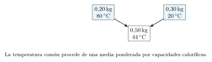
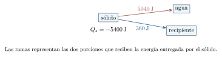

[← Capítulo anterior](capitulo-14.html) · [Índice del libro](index.html) · [Capítulo siguiente →](capitulo-16.html)

Una cuchara sumergida en una taza caliente acaba calentándose. El café se enfría mientras la cuchara recibe energía, y la evolución depende tanto de sus materiales como de las cantidades que ponemos en contacto. Para predecir el resultado necesitamos distinguir la temperatura que alcanza cada cuerpo de la energía que intercambia durante el proceso.

Seguiremos esa diferencia desde la lectura de un termómetro hasta una mezcla con hielo. La energía permitirá decidir cuánto material cambia de fase y qué temperatura final es posible. Después estudiaremos la rapidez del intercambio y buscaremos, en el movimiento de las partículas, una explicación de la temperatura y de la presión de un gas.

## Temperatura, equilibrio e intercambio de energía

Al poner dos cuerpos en contacto térmico, permitimos que intercambien energía debido a su diferencia de temperatura. En un contacto ordinario, la transferencia espontánea neta se dirige del cuerpo de mayor temperatura al de menor temperatura. Cuando alcanzan el equilibrio térmico, esa transferencia neta se anula. Las partículas continúan su movimiento microscópico durante el equilibrio.

La temperatura permite comparar estados mediante esta condición. Si dos sistemas están por separado en equilibrio térmico con un tercero, están también en equilibrio térmico entre sí. Esta propiedad, llamada *principio cero de la termodinámica*, permite utilizar un termómetro como intermediario de la comparación. La lectura corresponde al estado alcanzado por el termómetro; para atribuirla a la muestra necesitamos un contacto suficiente y una perturbación pequeña de la muestra.

La *energía interna*, $U$, describe la energía microscópica del sistema en el estado considerado. Incluye contribuciones de movimiento y de interacción entre sus partículas. La energía cinética de traslación del objeto completo y su energía potencial por la altura del conjunto se contabilizan por separado. La temperatura es una propiedad intensiva: dos porciones de una muestra homogénea en equilibrio tienen la misma temperatura. La energía interna es extensiva para sistemas ordinarios con interacciones de corto alcance: al reunir porciones equivalentes, sus contribuciones se suman, despreciando efectos de superficie.

Llamamos *calor* a la transferencia de energía debida a una diferencia de temperatura. Usaremos $Q>0$ para la energía que recibe el sistema por ese mecanismo y $Q<0$ para la que entrega. El estado del cuerpo tiene energía interna; $Q$ describe lo ocurrido durante un proceso. El trabajo ofrece otro mecanismo de transferencia que estudiaremos junto con los gases en el capítulo siguiente.

### Problema resuelto 15.1 · Seguir una transferencia entre dos cuerpos {#r15-1}

Una pieza de cobre de $0{,}20\,\mathrm{kg}$ está a $60\,{}^\circ\mathrm C$ y una muestra de agua de $0{,}50\,\mathrm{kg}$ a $30\,{}^\circ\mathrm C$. Se ponen en contacto dentro de una envoltura aislante. Durante cierto intervalo el agua recibe $1500\,\mathrm{J}$. Identifica el sentido del intercambio y el signo de $Q$ para cada cuerpo. ¿Qué información permite comparar sus temperaturas y sus energías internas?
*Resolución.* La diferencia de temperatura dirige inicialmente la transferencia del cobre al agua. Para el agua, $Q_a=+1500\,\mathrm{J}$; para el cobre, $Q_c=-1500\,\mathrm{J}$, bajo la hipótesis de intercambio exclusivo entre ambos. Las temperaturas dadas ordenan sus estados térmicos. Comparar energías internas exige además describir la cantidad de materia, el material, la fase y la referencia energética. Las masas por sí solas dejan abierta esa comparación.

{#fig-fp-av-r15-1 fig-alt="Ilustración de Problema resuelto 15.1 · Seguir una transferencia entre dos cuerpos. Una pieza de cobre de 0,20\\,kg está a 60\\,^circmathrm C y una muestra de agua de 0,50\\,kg a 30\\,^circmathrm C. Se ponen en contacto dentro de una envoltura aislante. Durante cierto intervalo el agua recibe 1500\\,J. Identifica el sentido del intercambio y el signo de Q para cada cuerpo. ¿Qué información permite"}

La misma cantidad de energía puede producir cambios de temperatura distintos en dos cuerpos. La respuesta depende de cuánto material hay, de cómo almacena energía y de las condiciones del proceso. Medir esa respuesta será el punto de partida de la calorimetría.

## Escalas y propiedades termométricas

Un termómetro relaciona una propiedad medible con una escala. Podemos observar la longitud de una columna de líquido, la resistencia eléctrica de un sensor o la presión de un gas a volumen fijo. La calibración fija la relación entre la lectura y la temperatura dentro de un intervalo de uso.

Denotaremos por $\theta$ la temperatura Celsius y por $T$ la temperatura absoluta. Sus valores se relacionan mediante
$$
 \frac{T}{\,\mathrm{K}}=\frac{\theta}{{}^\circ\mathrm C}+273{,}15,
 \qquad
 \frac{\theta_F}{{}^\circ\mathrm F}=\frac95\frac{\theta}{{}^\circ\mathrm C}+32.
$$
El kelvin es la unidad de temperatura termodinámica. El desplazamiento de $273{,}15$ fija el origen Celsius respecto del absoluto. El punto de congelación y el de ebullición del agua sirven como referencias aproximadas de laboratorio bajo condiciones especificadas de presión y composición. Las relaciones de conversión anteriores son definiciones exactas entre las escalas.

Al restar dos temperaturas desaparece el desplazamiento entre orígenes. Por eso un aumento de un grado Celsius tiene el mismo tamaño que un aumento de un kelvin. Para diferencias Fahrenheit aparece el factor $9/5$. Los cocientes de temperatura que usaremos en el modelo de gases se forman con temperaturas absolutas.

### Problema resuelto 15.2 · Convertir una lectura y un cambio {#r15-2}

Una muestra está a $-12{,}5\,{}^\circ\mathrm C$ y después aumenta su temperatura $18{,}0\,{}^\circ\mathrm C$. Expresa la lectura inicial en kelvin y Fahrenheit, y el aumento en ambas escalas.
*Resolución.* La lectura inicial es $T_i=260{,}65\,\mathrm{K}$ y $\theta_{F,i}=(9/5)(-12{,}5)+32=9{,}5\,{}^\circ\mathrm F$. Para el cambio, $\Delta T=18{,}0\,\mathrm{K}$ y $\Delta\theta_F=(9/5)(18{,}0)=32{,}4\,{}^\circ\mathrm F$. La temperatura final es $5{,}5\,{}^\circ\mathrm C$, equivalente a $278{,}65\,\mathrm{K}$ y $41{,}9\,{}^\circ\mathrm F$. Restar las lecturas finales e iniciales comprueba ambos aumentos.

{#fig-fp-av-r15-2 fig-alt="Ilustración de Problema resuelto 15.2 · Convertir una lectura y un cambio. Una muestra está a -12,5\\,^circmathrm C y después aumenta su temperatura 18,0\\,^circmathrm C. Expresa la lectura inicial en kelvin y Fahrenheit, y el aumento en ambas escalas. Resolución. La lectura inicial es Ti=260,65\\,K y thetaF,i=(9/5)(-12,5)+32=9,5\\,^circmathrm F. Para el cambio, Delta T=18,0\\,K y"}

### Problema resuelto 15.3 · Calibrar un sensor lineal {#r15-3}

La resistencia de un sensor vale $60\,\Omega$ a $0\,{}^\circ\mathrm C$ y $100\,\Omega$ a $100\,{}^\circ\mathrm C$. Supón una dependencia lineal en ese intervalo. Encuentra la temperatura correspondiente a $85\,\Omega$ y el cambio de temperatura asociado a un aumento de $4\,\Omega$.
*Resolución.* Entre los puntos de calibración, cada grado Celsius corresponde a $(100-60)/100=0{,}40\,\mathrm{\Omega/K}$. Por tanto,
$$
 \theta=\frac{85-60}{0{,}40}\,{}^\circ\mathrm C=62{,}5\,{}^\circ\mathrm C,
 \qquad T=335{,}65\,\mathrm{K}.
$$
El incremento de resistencia corresponde a $\Delta T=4/0{,}40=10\,\mathrm{K}$. La interpolación utiliza la hipótesis lineal; aplicar el sensor fuera del intervalo calibrado requiere estudiar su respuesta allí.

{#fig-fp-av-r15-3 fig-alt="Ilustración de Problema resuelto 15.3 · Calibrar un sensor lineal. La resistencia de un sensor vale 60\\,Omega a 0\\,^circmathrm C y 100\\,Omega a 100\\,^circmathrm C. Supón una dependencia lineal en ese intervalo. Encuentra la temperatura correspondiente a 85\\,Omega y el cambio de temperatura asociado a un aumento de 4\\,Omega. Resolución. Entre los puntos de calibración, cada grado"}

Una lectura térmica también exige atender a la resolución, la calibración y el tiempo de respuesta del instrumento. Un sensor grande puede modificar apreciablemente la temperatura de una muestra pequeña. El equilibrio alcanzado pertenece al sistema formado por ambos, y la estimación del estado inicial necesita incorporar ese efecto.

## Dilatación y geometría de un cuerpo

Muchas dimensiones de los materiales cambian con la temperatura. Para una barra libre, con temperatura aproximadamente uniforme y en un intervalo moderado, podemos representar la variación de longitud mediante
$$
 \Delta L=\alpha L_0\Delta T,\qquad L=L_0(1+\alpha\Delta T).
$$
El coeficiente de dilatación lineal $\alpha$ se mide en $\,\mathrm{K^{-1}}$ y depende del material y del intervalo. En una descripción local, $\alpha=(1/L)(dL/dT)$. La expresión lineal aproxima esa dependencia cuando el cambio relativo de longitud es pequeño.

Si el material es isótropo y se dilata libremente, cada dimensión lineal recibe el mismo factor. Un área se multiplica por $(1+\alpha\Delta T)^2$ y un volumen por $(1+\alpha\Delta T)^3$. Al conservar los términos de primer orden obtenemos $\Delta A\simeq2\alpha A_0\Delta T$ y $\Delta V\simeq3\alpha V_0\Delta T$. La deformación uniforme expande también un agujero practicado en una placa: sus bordes se separan como lo harían los de una región del mismo material que llenara el hueco.

### Problema resuelto 15.4 · Dar espacio a una barra que se calienta {#r15-4}

Una barra de longitud $2{,}00\,\mathrm{m}$ a $20\,{}^\circ\mathrm C$ puede dilatarse libremente. Su coeficiente medio es $12\times10^{-6}\,\mathrm{K^{-1}}$. Calcula el aumento de longitud al llevarla a $70\,{}^\circ\mathrm C$ y la longitud final.
*Resolución.* El cambio es $\Delta T=50\,\mathrm{K}$. Entonces
$$
 \Delta L=(12\times10^{-6})(2{,}00)(50)\,\mathrm{m}
 =1{,}20\times10^{-3}\,\mathrm{m}.
$$
La longitud final es $2{,}00120\,\mathrm{m}$ dentro del modelo. El cambio relativo es $6{,}0\times10^{-4}$, pequeño frente a uno. Una sujeción rígida convertiría parte de esa tendencia de dilatación en esfuerzos internos y requeriría un problema elástico adicional.

{#fig-fp-av-r15-4 fig-alt="Ilustración de Problema resuelto 15.4 · Dar espacio a una barra que se calienta. Una barra de longitud 2,00\\,m a 20\\,^circmathrm C puede dilatarse libremente. Su coeficiente medio es 12times10^-6\\,mathrmK^-1. Calcula el aumento de longitud al llevarla a 70\\,^circmathrm C y la longitud final. Resolución. El cambio es Delta T=50\\,K. Entonces Delta L=(12times10^-6)(2,00)(50)\\,m =1,20times10^-3\\,m. La"}

La expansión de los materiales responde a sus interacciones microscópicas. La variación puede cambiar de signo en ciertos intervalos: el agua líquida cerca de la congelación exige, por ejemplo, considerar su dependencia particular de densidad y temperatura. Cada coeficiente debe acompañarse del material y de las condiciones en que resulta aplicable.

## Capacidad calorífica y balances de calorimetría

Consideremos una muestra que conserva su fase mientras recibe energía por calor bajo condiciones mecánicas especificadas. Su *capacidad calorífica* expresa la energía necesaria por unidad de cambio de temperatura en ese proceso: $C=dQ/dT$. Para una muestra homogénea de masa $m$ definimos el *calor específico* $c=C/m$. Sus unidades son $\,\mathrm{J/K}$ y $\,\mathrm{J/(kg\,K)}$, respectivamente.

Cuando el calor específico es aproximadamente constante en el intervalo,
$$
 Q=mc(T_f-T_i)=C\Delta T.
$$
El signo sale de la diferencia de temperaturas: una muestra que se enfría tiene $Q<0$. En sólidos y líquidos, bajo presión ordinaria y con cambios de volumen pequeños, esta relación ofrece una aproximación útil. En los gases, la expansión puede realizar un trabajo apreciable; la capacidad calorífica debe especificar entonces si se mantiene el volumen, la presión u otra condición.

### Problema resuelto 15.5 · Calcular una energía de calentamiento {#r15-5}

Se calientan $0{,}40\,\mathrm{kg}$ de agua de $15$ a $40\,{}^\circ\mathrm C$. Usa $c=4200\,\mathrm{J/(kg\,K)}$ constante y estima la capacidad calorífica de la muestra y la energía transferida.
*Resolución.* La muestra tiene $C=mc=0{,}40(4200)=1680\,\mathrm{J/K}$. El cambio de temperatura es $25\,\mathrm{K}$, de modo que $Q=1680(25)=42000\,\mathrm{J}$. El valor positivo corresponde a energía recibida. Al duplicar la masa, bajo las mismas condiciones, se duplican tanto la capacidad calorífica como la energía necesaria para ese aumento de temperatura.

{#fig-fp-av-r15-5 fig-alt="Ilustración de Problema resuelto 15.5 · Calcular una energía de calentamiento. Se calientan 0,40\\,kg de agua de 15 a 40\\,^circmathrm C. Usa c=4200\\,J/(kg\\,K) constante y estima la capacidad calorífica de la muestra y la energía transferida. Resolución. La muestra tiene C=mc=0,40(4200)=1680\\,J/K. El cambio de temperatura es 25\\,K, de modo que Q=1680(25)=42000\\,J. El valor positivo corresponde a"}

Cuando conocemos la dependencia con la temperatura, sumamos los aportes de pequeños intervalos:
$$
 Q=m\int_{T_i}^{T_f}c(T)\,dT.
$$
La integral conserva las condiciones del proceso que definen $c(T)$. El calor específico constante reemplaza la función por una aproximación válida en el intervalo elegido.

### Problema resuelto 15.6 · Sumar una capacidad que varía {#r15-6}

Una muestra de $0{,}50\,\mathrm{kg}$ conserva su fase entre $T_0=293{,}15\,\mathrm{K}$ y $333{,}15\,\mathrm{K}$. En ese proceso su calor específico es $c(T)=c_0+a(T-T_0)$, con $c_0=400\,\mathrm{J/(kg\,K)}$ y $a=2{,}0\,\mathrm{J/(kg\,K^2)}$. Calcula el calor recibido.
*Resolución.* Introducimos $u=T-T_0$, que varía de $0$ a $40\,\mathrm{K}$. Integrar da
$$
 Q=m\left[c_0\Delta T+\frac{a}{2}(\Delta T)^2\right]
 =0{,}50[400(40)+1(40^2)]\,\mathrm{J}=8800\,\mathrm{J}.
$$
El calor específico pasa de $400$ a $480\,\mathrm{J/(kg\,K)}$. Al ser lineal, su media en el intervalo es $440\,\mathrm{J/(kg\,K)}$, y multiplicar esa media por la masa y por $40\,\mathrm{K}$ reproduce la integral.

{#fig-fp-av-r15-6 fig-alt="Ilustración de Problema resuelto 15.6 · Sumar una capacidad que varía. Una muestra de 0,50\\,kg conserva su fase entre T0=293,15\\,K y 333,15\\,K. En ese proceso su calor específico es c(T)=c0+a(T-T0), con c0=400\\,J/(kg\\,K) y a=2,0\\,J/(kg\\,K^2). Calcula el calor recibido. Resolución. Introducimos u=T-T0, que varía de 0 a 40\\,K. Integrar da Q=mleft[c0Delta T+fraca2(Delta T)^2right]"}

Para estudiar una mezcla elegimos una frontera que encierre todos los cuerpos participantes. En un calorímetro ideal, el aislamiento hace despreciable el intercambio con el entorno. Si los cambios mecánicos son despreciables, las energías entregadas por unas partes son recibidas por las otras y
$$
 \sum_i Q_i=0.
$$
Cada término lleva su propio signo. Si las partes conservan sus fases y sus capacidades caloríficas son constantes, el equilibrio común satisface
$$
 \sum_i C_i(T_f-T_i)=0,
 \qquad T_f=\frac{\sum_i C_iT_i}{\sum_i C_i}.
$$
La media queda ponderada por capacidades caloríficas. Con capacidades positivas, la temperatura final se sitúa entre las iniciales. Podemos usar lecturas Celsius en este balance de diferencias: el cambio de origen de escala se cancela coherentemente.

### Problema resuelto 15.7 · Mezclar cantidades diferentes de agua {#r15-7}

En un recipiente de capacidad calorífica despreciable y aislado se mezclan $0{,}20\,\mathrm{kg}$ de agua a $80\,{}^\circ\mathrm C$ con $0{,}30\,\mathrm{kg}$ a $20\,{}^\circ\mathrm C$. Usa $c=4200\,\mathrm{J/(kg\,K)}$. Encuentra la temperatura final y el calor de cada porción.
*Resolución.* El balance es $0{,}20c(\theta_f-80)+0{,}30c(\theta_f-20)=0$. El calor específico común se cancela y queda $\theta_f=44\,{}^\circ\mathrm C$. Para la porción caliente, $Q_h=0{,}20(4200)(44-80)=-30240\,\mathrm{J}$; para la fría, $Q_f=0{,}30(4200)(44-20)=+30240\,\mathrm{J}$. Las cantidades se compensan. La temperatura de equilibrio está más cerca de la inicial de la porción de mayor masa.

{#fig-fp-av-r15-7 fig-alt="Ilustración de Problema resuelto 15.7 · Mezclar cantidades diferentes de agua. En un recipiente de capacidad calorífica despreciable y aislado se mezclan 0,20\\,kg de agua a 80\\,^circmathrm C con 0,30\\,kg a 20\\,^circmathrm C. Usa c=4200\\,J/(kg\\,K). Encuentra la temperatura final y el calor de cada porción. Resolución. El balance es 0,20c(thetaf-80)+0,30c(thetaf-20)=0. El calor específico común se"}

El propio recipiente participa cuando su capacidad calorífica es apreciable. También pueden hacerlo el agitador y el termómetro. Podemos reunir sus aportes en una capacidad efectiva medida experimentalmente, siempre que compartan una temperatura aproximadamente uniforme durante el balance considerado.

### Problema resuelto 15.8 · Incluir el recipiente en la mezcla {#r15-8}

Un calorímetro de capacidad $60\,\mathrm{J/K}$ contiene $0{,}20\,\mathrm{kg}$ de agua, ambos a $20\,{}^\circ\mathrm C$. Se añade una pieza de $0{,}20\,\mathrm{kg}$ a $80\,{}^\circ\mathrm C$, con $c_m=500\,\mathrm{J/(kg\,K)}$. El conjunto está aislado. Usa $c_a=4200\,\mathrm{J/(kg\,K)}$ y calcula el equilibrio.
*Resolución.* Agua y calorímetro reúnen $0{,}20(4200)+60=900\,\mathrm{J/K}$; la pieza aporta $0{,}20(500)=100\,\mathrm{J/K}$. Por tanto,
$$
 900(\theta_f-20)+100(\theta_f-80)=0,
 \qquad \theta_f=26\,{}^\circ\mathrm C.
$$
La pieza entrega $5400\,\mathrm{J}$. El agua recibe $5040\,\mathrm{J}$ y el calorímetro $360\,\mathrm{J}$, cuya suma reproduce aquella entrega. El recipiente queda incluido tanto en la frontera como en el cálculo.

{#fig-fp-av-r15-8 fig-alt="Ilustración de Problema resuelto 15.8 · Incluir el recipiente en la mezcla. Un calorímetro de capacidad 60\\,J/K contiene 0,20\\,kg de agua, ambos a 20\\,^circmathrm C. Se añade una pieza de 0,20\\,kg a 80\\,^circmathrm C, con cm=500\\,J/(kg\\,K). El conjunto está aislado. Usa ca=4200\\,J/(kg\\,K) y calcula el equilibrio. Resolución. Agua y calorímetro reúnen 0,20(4200)+60=900\\,J/K; la pieza aporta"}

### Problema resuelto 15.9 · Inferir el calor específico de una muestra {#r15-9}

Un sólido de $0{,}15\,\mathrm{kg}$ a $100\,{}^\circ\mathrm C$ se introduce en $0{,}30\,\mathrm{kg}$ de agua a $20\,{}^\circ\mathrm C$. El calorímetro, inicialmente a $20\,{}^\circ\mathrm C$, tiene capacidad $90\,\mathrm{J/K}$. El equilibrio se alcanza a $25\,{}^\circ\mathrm C$. Estima el calor específico del sólido con $c_a=4200\,\mathrm{J/(kg\,K)}$, aislamiento ideal y fases constantes.
*Resolución.* El agua y el recipiente reciben $[0{,}30(4200)+90](25-20)=6750\,\mathrm{J}$. El sólido entrega esa energía al enfriarse $75\,\mathrm{K}$. De $0{,}15c_s(25-100)=-6750$ resulta $c_s=600\,\mathrm{J/(kg\,K)}$. Esta estimación depende del balance completo. Una pérdida hacia el entorno durante el ensayo modificaría la relación entre el enfriamiento del sólido y la energía recibida por el agua y el calorímetro.

{#fig-fp-av-r15-9 fig-alt="Ilustración de Problema resuelto 15.9 · Inferir el calor específico de una muestra. Un sólido de 0,15\\,kg a 100\\,^circmathrm C se introduce en 0,30\\,kg de agua a 20\\,^circmathrm C. El calorímetro, inicialmente a 20\\,^circmathrm C, tiene capacidad 90\\,J/K. El equilibrio se alcanza a 25\\,^circmathrm C. Estima el calor específico del sólido con ca=4200\\,J/(kg\\,K), aislamiento ideal y fases constantes."}

## Cambios de fase y estados finales posibles

Una sustancia puede recibir energía mientras cambia la proporción de sus fases. En una transición de una sustancia pura a presión fija, cerca del equilibrio, la coexistencia ocurre a una temperatura determinada. Durante la fusión, la energía suministrada transforma sólido en líquido mientras se mantiene esa temperatura. La masa que cambia de fase decide la energía necesaria.

El *calor latente específico* $L$ expresa la energía transferida por unidad de masa en esa transición y bajo esas condiciones. Escribiremos
$$
 Q=+mL\quad\text{en fusión o vaporización},\qquad
 Q=-mL\quad\text{en solidificación o condensación}.
$$
El valor de $L$ se mide en $\,\mathrm{J/kg}$. Para los problemas adoptaremos $c_a=4200\,\mathrm{J/(kg\,K)}$, $c_h=2100\,\mathrm{J/(kg\,K)}$, $L_f=3{,}34\times10^5\,\mathrm{J/kg}$ y $L_v=2{,}26\times10^6\,\mathrm{J/kg}$, correspondientes a aproximaciones para el agua bajo presión atmosférica ordinaria. Usaremos $0\,{}^\circ\mathrm C$ y $100\,{}^\circ\mathrm C$ como temperaturas de transición en ese modelo.

El valor tabulado de calor latente a presión constante incluye el efecto energético de la expansión durante la transición. Por ello, al trabajar con vapor bajo esa presión, mantenemos coherentes el balance térmico y los datos tabulados. En las mezclas ideales trataremos como despreciable la masa de vapor residual sobre el líquido final. En el capítulo siguiente formularemos separadamente los cambios de energía interna y el trabajo de expansión.

### Problema resuelto 15.10 · Calentar hielo hasta obtener agua tibia {#r15-10}

Calcula la energía necesaria para transformar $0{,}10\,\mathrm{kg}$ de hielo a $-10\,{}^\circ\mathrm C$ en agua a $20\,{}^\circ\mathrm C$, usando las constantes indicadas y presión atmosférica fija.
*Resolución.* El recorrido tiene tres etapas. Calentar el hielo hasta la fusión requiere $Q_1=0{,}10(2100)(10)=2100\,\mathrm{J}$. Fundirlo requiere $Q_2=0{,}10(334000)=33400\,\mathrm{J}$. Calentar después el agua requiere $Q_3=0{,}10(4200)(20)=8400\,\mathrm{J}$. En total, $Q=43900\,\mathrm{J}$. Cada etapa usa la propiedad correspondiente a su fase o a su transición; la temperatura permanece en el valor de fusión durante la segunda etapa.

{#fig-fp-av-r15-10 fig-alt="Ilustración de Problema resuelto 15.10 · Calentar hielo hasta obtener agua tibia. Calcula la energía necesaria para transformar 0,10\\,kg de hielo a -10\\,^circmathrm C en agua a 20\\,^circmathrm C, usando las constantes indicadas y presión atmosférica fija. Resolución. El recorrido tiene tres etapas. Calentar el hielo hasta la fusión requiere Q1=0,10(2100)(10)=2100\\,J. Fundirlo requiere"}

En una mezcla con hielo conviene comparar primero dos cantidades: la energía que el agua y el recipiente pueden entregar al llegar a la temperatura de fusión, y la necesaria para llevar el hielo a esa temperatura y fundirlo. Esa comparación selecciona el estado final que debe entrar en la ecuación.

### Problema resuelto 15.11 · Encontrar cuánto hielo se funde {#r15-11}

Un recipiente aislado de capacidad despreciable reúne $0{,}10\,\mathrm{kg}$ de hielo a $0\,{}^\circ\mathrm C$ y $0{,}20\,\mathrm{kg}$ de agua a $30\,{}^\circ\mathrm C$. Determina el estado final.
*Resolución.* Al enfriarse hasta $0\,{}^\circ\mathrm C$, el agua puede entregar $0{,}20(4200)(30)=25200\,\mathrm{J}$. Fundir todo el hielo requeriría $33400\,\mathrm{J}$. La energía disponible permite fundir solo
$$
 m_f=\frac{25200}{334000}\,\mathrm{kg}\simeq0{,}07545\,\mathrm{kg}.
$$
Quedan aproximadamente $0{,}02455\,\mathrm{kg}$ de hielo y $0{,}27545\,\mathrm{kg}$ de agua a $0\,{}^\circ\mathrm C$. El balance térmico fija una masa transformada mientras coexisten ambas fases.

{#fig-fp-av-r15-11 fig-alt="Ilustración de Problema resuelto 15.11 · Encontrar cuánto hielo se funde. Un recipiente aislado de capacidad despreciable reúne 0,10\\,kg de hielo a 0\\,^circmathrm C y 0,20\\,kg de agua a 30\\,^circmathrm C. Determina el estado final. Resolución. Al enfriarse hasta 0\\,^circmathrm C, el agua puede entregar 0,20(4200)(30)=25200\\,J. Fundir todo el hielo requeriría 33400\\,J. La energía disponible"}

### Problema resuelto 15.12 · Comprobar una fusión completa {#r15-12}

Se ponen $0{,}050\,\mathrm{kg}$ de hielo a $-10\,{}^\circ\mathrm C$ en contacto con $0{,}30\,\mathrm{kg}$ de agua a $40\,{}^\circ\mathrm C$. Considera aislamiento y capacidad despreciable del recipiente. Encuentra la temperatura final.
*Resolución.* Enfriar el agua hasta cero liberaría $50400\,\mathrm{J}$. El hielo necesita $0{,}050(2100)(10)=1050\,\mathrm{J}$ para llegar a cero y $16700\,\mathrm{J}$ para fundirse. Quedan $32650\,\mathrm{J}$ para calentar los $0{,}350\,\mathrm{kg}$ de agua finales. Así,
$$
 \theta_f=\frac{32650}{0{,}350(4200)}\,{}^\circ\mathrm C
 \simeq22{,}21\,{}^\circ\mathrm C.
$$
El resultado pertenece al intervalo de agua líquida del modelo y confirma la fusión completa. La suma de las masas se utiliza solo después de haber incorporado el calentamiento y la fusión iniciales del hielo.

{#fig-fp-av-r15-12 fig-alt="Ilustración de Problema resuelto 15.12 · Comprobar una fusión completa. Se ponen 0,050\\,kg de hielo a -10\\,^circmathrm C en contacto con 0,30\\,kg de agua a 40\\,^circmathrm C. Considera aislamiento y capacidad despreciable del recipiente. Encuentra la temperatura final. Resolución. Enfriar el agua hasta cero liberaría 50400\\,J. El hielo necesita 0,050(2100)(10)=1050\\,J para llegar a cero y"}

### Problema resuelto 15.13 · Condensar vapor dentro de agua {#r15-13}

Se introducen $0{,}010\,\mathrm{kg}$ de vapor de agua a $100\,{}^\circ\mathrm C$ en $0{,}20\,\mathrm{kg}$ de agua a $20\,{}^\circ\mathrm C$. Supón que toda la masa queda en un recipiente de capacidad despreciable, aislado térmicamente, a presión atmosférica fija. Comprueba si todo el vapor se condensa y calcula el equilibrio.
*Resolución.* Llevar el agua inicial a $100\,{}^\circ\mathrm C$ requeriría $67200\,\mathrm{J}$, mientras la condensación entrega $22600\,\mathrm{J}$. El equilibrio quedará por debajo de cien y permite la condensación completa. El agua condensada también se enfría. El balance es
$$
 0{,}20(4200)(\theta_f-20)
 =0{,}010(2260000)+0{,}010(4200)(100-\theta_f).
$$
De aquí $882\theta_f=43600$ y $\theta_f\simeq49{,}43\,{}^\circ\mathrm C$. La masa final de líquido es $0{,}210\,\mathrm{kg}$. El resultado utiliza la energía de condensación y la que entrega después esa porción líquida al enfriarse.

{#fig-fp-av-r15-13 fig-alt="Ilustración de Problema resuelto 15.13 · Condensar vapor dentro de agua. Se introducen 0,010\\,kg de vapor de agua a 100\\,^circmathrm C en 0,20\\,kg de agua a 20\\,^circmathrm C. Supón que toda la masa queda en un recipiente de capacidad despreciable, aislado térmicamente, a presión atmosférica fija. Comprueba si todo el vapor se condensa y calcula el equilibrio. Resolución. Llevar el agua"}

La temperatura constante de una transición requiere las condiciones indicadas: sustancia pura, presión aproximadamente fija y evolución cercana al equilibrio. Una mezcla de sustancias, una presión variable o un calentamiento con grandes diferencias internas exige otro modelo de la curva térmica. También la evaporación superficial puede ocurrir por debajo de la temperatura de ebullición, con una tasa dependiente del entorno.

## Cómo y con qué rapidez se transfiere la energía

El balance energético determina cuánto se intercambia entre dos estados. Para conocer la duración necesitamos describir la tasa de transferencia. La *potencia térmica* es $\dot Q=dQ/dt$, medida en watts. Si esa potencia permanece constante, la energía transferida durante un tiempo $t$ es $Q=\dot Q\,t$.

En la *conducción*, las interacciones microscópicas transportan energía a través del material. En los metales contribuyen también los electrones móviles. Para una pared plana homogénea de espesor $L$ y área $A$, con caras a temperaturas uniformes y régimen estacionario unidimensional, la ley de Fourier da la magnitud
$$
 \dot Q=\kappa A\frac{T_h-T_c}{L},\qquad T_h>T_c.
$$
La conductividad $\kappa$ se mide en $\,\mathrm{W/(m\,K)}$. El régimen estacionario mantiene fijo el perfil de temperatura y exige condiciones estables en las caras. El transporte neto se dirige hacia la de menor temperatura. En forma local y con signo, $\dot Q_x=-\kappa A\,dT/dx$.

### Problema resuelto 15.14 · Una pared bajo condiciones estacionarias {#r15-14}

Una pared de área $2{,}0\,\mathrm{m^2}$, espesor $0{,}040\,\mathrm{m}$ y conductividad $0{,}80\,\mathrm{W/(m\,K)}$ mantiene una diferencia entre caras de $20\,\mathrm{K}$. Considera conducción estacionaria, unidimensional y pérdidas laterales despreciables. Calcula la potencia y la energía que atraviesa la pared en diez minutos.
*Resolución.* La potencia es $\dot Q=0{,}80(2{,}0)(20)/0{,}040=800\,\mathrm{W}$. Diez minutos son $600\,\mathrm{s}$, por lo que $Q=800(600)=480000\,\mathrm{J}$. Las temperaturas de las caras son datos mantenidos externamente. Si ambas pertenecieran a cuerpos finitos que se enfrían o calientan, la diferencia variaría y habría que integrar la potencia correspondiente.

{#fig-fp-av-r15-14 fig-alt="Ilustración de Problema resuelto 15.14 · Una pared bajo condiciones estacionarias. Una pared de área 2,0\\,m^2, espesor 0,040\\,m y conductividad 0,80\\,W/(m\\,K) mantiene una diferencia entre caras de 20\\,K. Considera conducción estacionaria, unidimensional y pérdidas laterales despreciables. Calcula la potencia y la energía que atraviesa la pared en diez minutos. Resolución. La potencia es dot"}

Podemos definir una resistencia térmica $R_t=L/(\kappa A)$, con unidades $\,\mathrm{K/W}$. En capas en serie y régimen estacionario atraviesa cada capa la misma potencia. Las diferencias de temperatura se suman y obtenemos $R_{t,\mathrm{total}}=\sum_iR_{t,i}$, despreciando resistencias adicionales de contacto.

### Problema resuelto 15.15 · Localizar la temperatura entre dos capas {#r15-15}

Una pared tiene dos capas de área $2{,}0\,\mathrm{m^2}$: primero un aislante de espesor $0{,}020\,\mathrm{m}$ y $\kappa=0{,}040\,\mathrm{W/(m\,K)}$; después un ladrillo de espesor $0{,}10\,\mathrm{m}$ y $\kappa=0{,}80\,\mathrm{W/(m\,K)}$. La cara del aislante se mantiene a $30\,{}^\circ\mathrm C$ y la exterior del ladrillo a $0\,{}^\circ\mathrm C$. Encuentra la potencia estacionaria y la temperatura de la interfaz, con contacto ideal.
*Resolución.* Las resistencias son $R_1=0{,}25\,\mathrm{K/W}$ y $R_2=0{,}0625\,\mathrm{K/W}$. Por tanto $\dot Q=30/(0{,}3125)=96\,\mathrm{W}$. La caída de temperatura en el aislante es $96(0{,}25)=24\,\mathrm{K}$, y la interfaz está a $6\,{}^\circ\mathrm C$. El ladrillo completa una caída de $96(0{,}0625)=6\,\mathrm{K}$. Una capa con mayor resistencia sostiene una fracción mayor de la diferencia total bajo la misma potencia.

{#fig-fp-av-r15-15 fig-alt="Ilustración de Problema resuelto 15.15 · Localizar la temperatura entre dos capas. Una pared tiene dos capas de área 2,0\\,m^2: primero un aislante de espesor 0,020\\,m y kappa=0,040\\,W/(m\\,K); después un ladrillo de espesor 0,10\\,m y kappa=0,80\\,W/(m\\,K). La cara del aislante se mantiene a 30\\,^circmathrm C y la exterior del ladrillo a 0\\,^circmathrm C. Encuentra la potencia estacionaria y la"}

La *convección* incorpora el transporte de energía por el movimiento de un fluido. Puede surgir por diferencias de densidad bajo gravedad o ser impulsada por un ventilador o una bomba. En la superficie del cuerpo siguen interviniendo intercambios microscópicos; el movimiento renueva el fluido cercano y modifica la tasa. La geometría, la viscosidad y la rapidez del flujo influyen en ese proceso.

La *radiación* transporta energía mediante ondas electromagnéticas y puede propagarse en el vacío. Una superficie a temperatura absoluta $T$ emite una potencia aproximada $\varepsilon\sigma AT^4$, con emisividad $0\leq\varepsilon\leq1$ y constante $\sigma\simeq5{,}67\times10^{-8}\,\mathrm{W/(m^2K^4)}$. Para una superficie gris pequeña en una envoltura grande, isotérmica y que cubre todo su campo de visión, la potencia radiativa neta hacia el entorno es
$$
 \dot Q_{\mathrm{saliente}}=\varepsilon\sigma A(T^4-T_e^4).
$$
La expresión incluye la absorción de la radiación del entorno a temperatura $T_e$. Un resultado negativo corresponde a recepción neta. La misma emisividad para emisión y absorción supone el modelo gris empleado. La dependencia con la cuarta potencia exige usar kelvin.

### Problema resuelto 15.16 · Restar emisión y absorción radiativas {#r15-16}

Una superficie de área $0{,}50\,\mathrm{m^2}$ y emisividad $0{,}80$ se mantiene a $400\,\mathrm{K}$ dentro de una envoltura grande a $300\,\mathrm{K}$. Usa el modelo anterior y calcula la potencia radiativa neta que entrega.
*Resolución.* Sustituir las temperaturas absolutas da
$$
 \dot Q_{\mathrm{saliente}}
 =0{,}80(5{,}67\times10^{-8})(0{,}50)(400^4-300^4)\,\mathrm{W}
 =396{,}9\,\mathrm{W}.
$$
La superficie emite aproximadamente $580{,}6\,\mathrm{W}$ y absorbe $183{,}7\,\mathrm{W}$ del entorno. Su diferencia determina la pérdida neta. Mantener la temperatura de la superficie requiere compensar esa pérdida y cualquier otro intercambio presente.

{#fig-fp-av-r15-16 fig-alt="Ilustración de Problema resuelto 15.16 · Restar emisión y absorción radiativas. Una superficie de área 0,50\\,m^2 y emisividad 0,80 se mantiene a 400\\,K dentro de una envoltura grande a 300\\,K. Usa el modelo anterior y calcula la potencia radiativa neta que entrega. Resolución. Sustituir las temperaturas absolutas da dot Qsaliente =0,80(5,67times10^-8)(0,50)(400^4-300^4)\\,W =396,9\\,W. La"}

En un objeto cotidiano pueden coexistir los tres mecanismos. Una taza entrega energía por conducción a la mesa, por convección al aire y por radiación al entorno. La evaporación del líquido añade otra transferencia asociada al cambio de fase y a la masa que sale. Elegir el mecanismo dominante exige examinar las condiciones de cada caso.

## Temperatura y movimiento microscópico

Para conectar temperatura y movimiento elegimos un modelo preciso: un gas clásico diluido, en equilibrio, con partículas cuya interacción fuera de los choques es despreciable. Supondremos choques elásticos, paredes en reposo y velocidades distribuidas sin una dirección privilegiada. El movimiento térmico se describe respecto del centro de masa del gas; un flujo del conjunto se trata por separado.

Podemos obtener la presión siguiendo una partícula de masa $m_0$ dentro de una caja de longitud $\ell$ en la dirección $x$. Para este cálculo trataremos las partículas como independientes, con vuelos libres entre paredes. Al rebotar en una pared, la componente normal de su momento cambia de signo y transmite un impulso de módulo $2m_0|v_x|$. Entre dos choques sucesivos contra esa misma pared transcurre $2\ell/|v_x|$. El cociente da una contribución media a la fuerza igual a $m_0v_x^2/\ell$. Sumamos las $N$ partículas y dividimos por el área de la pared. Como el volumen es $V=A\ell$, resulta $p=(N/V)m_0\langle v_x^2\rangle$. En un gas diluido con choques mutuos elásticos, el promedio estadístico de los impulsos sobre la pared conduce a la misma relación.

La isotropía reparte por igual el promedio cuadrático entre las tres direcciones, de modo que $\langle v_x^2\rangle=\langle v^2\rangle/3$. Por tanto,
$$
 p=\frac13\frac NVm_0\langle v^2\rangle
 =\frac13\rho\langle v^2\rangle.
$$
Aquí $\rho$ es la densidad de masa del gas. Los choques producen presión aun cuando el promedio vectorial de las velocidades térmicas sea cero: la presión depende de cuadrados positivos de sus componentes.

La relación entre la escala termodinámica y este modelo es
$$
 \left\langle K_{\mathrm{tras}}\right\rangle
 =\frac12m_0\langle v^2\rangle=\frac32k_BT,
 \qquad v_{\mathrm{rms}}=\sqrt{\langle v^2\rangle}
 =\sqrt{\frac{3k_BT}{m_0}}.
$$
Usaremos $k_B=1{,}380649\times10^{-23}\,\mathrm{J/K}$. La rapidez cuadrática media se obtiene promediando primero los cuadrados y extrayendo después la raíz. Cada partícula puede tener una rapidez distinta y cambiarla al chocar con otras; la relación describe el promedio del equilibrio.

### Problema resuelto 15.17 · Comparar partículas a la misma temperatura {#r15-17}

Dos gases ideales clásicos están a $300\,\mathrm{K}$. La masa de una partícula del segundo es siete veces la del primero. Compara sus energías cinéticas medias de traslación y sus rapideces cuadráticas medias. ¿Qué cambia si la temperatura de ambos pasa a $1200\,\mathrm{K}$?
*Resolución.* A la misma temperatura ambos tienen
$$
 \begin{aligned}
 \langle K_{\mathrm{tras}}\rangle&=\tfrac32k_BT\\
 &=\tfrac32(1{,}380649\times10^{-23})(300)\,\mathrm{J}\\
 &\simeq6{,}213\times10^{-21}\,\mathrm{J}.
 \end{aligned}
$$
La rapidez satisface $v_{\mathrm{rms},2}/v_{\mathrm{rms},1}=1/\sqrt7\simeq0{,}378$. Al cuadruplicar la temperatura absoluta, cada energía media se cuadruplica y cada rapidez cuadrática media se duplica. La razón entre las rapideces de las dos especies conserva su valor.

{#fig-fp-av-r15-17 fig-alt="Ilustración de Problema resuelto 15.17 · Comparar partículas a la misma temperatura. Dos gases ideales clásicos están a 300\\,K. La masa de una partícula del segundo es siete veces la del primero. Compara sus energías cinéticas medias de traslación y sus rapideces cuadráticas medias. ¿Qué cambia si la temperatura de ambos pasa a 1200\\,K? Resolución. A la misma temperatura ambos tienen beginaligned"}

Para un gas monoatómico ideal clásico, la contribución interna del modelo es la suma de esas energías de traslación, $U=(3/2)Nk_BT$, con la referencia elegida para las restantes contribuciones constantes. Una molécula puede almacenar además energía de rotación y vibración. En líquidos y sólidos también importan las interacciones entre partículas. La fórmula para la traslación conserva su alcance específico dentro del modelo clásico indicado; describir la energía interna completa exige identificar las contribuciones que resultan accesibles en las condiciones de la muestra.

### Problema resuelto 15.18 · Obtener presión a partir de choques {#r15-18}

En un gas del modelo anterior hay $2{,}5\times10^{25}$ partículas por metro cúbico. Cada una tiene masa $4{,}65\times10^{-26}\,\mathrm{kg}$ y la rapidez cuadrática media es $500\,\mathrm{m/s}$. Calcula la presión y la temperatura. El gas está en reposo macroscópico.
*Resolución.* La densidad es $(2{,}5\times10^{25})(4{,}65\times10^{-26})=1{,}1625\,\mathrm{kg/m^3}$. La ecuación de los choques da
$$
 p=\tfrac13(1{,}1625)(500^2)\,\mathrm{Pa}=96875\,\mathrm{Pa}.
$$
La relación cinética permite despejar $T=m_0v_{\mathrm{rms}}^2/(3k_B)\simeq280{,}67\,\mathrm{K}$. El promedio vectorial térmico es cero y el promedio cuadrático es positivo. Combinar las dos ecuaciones conduce a $pV=Nk_BT$, la relación de estado que estudiaremos con los procesos de gases en el capítulo siguiente.

{#fig-fp-av-r15-18 fig-alt="Ilustración de Problema resuelto 15.18 · Obtener presión a partir de choques. En un gas del modelo anterior hay 2,5times10^25 partículas por metro cúbico. Cada una tiene masa 4,65times10^-26\\,kg y la rapidez cuadrática media es 500\\,m/s. Calcula la presión y la temperatura. El gas está en reposo macroscópico. Resolución. La densidad es (2,5times10^25)(4,65times10^-26)=1,1625\\,kg/m^3. La"}

## Ejercicios para reconstruir y transferir

Usa las constantes de agua y hielo de la sección 15.5, salvo indicación distinta. En calorimetría considera aislamiento y capacidad despreciable del recipiente cuando así se indique. Las cifras corresponden a modelos idealizados; el redondeo expresa la aproximación del cálculo.

### Ejercicio 15.1 · Identificar sistemas y signos {#e15-1}

Una muestra A a $70\,{}^\circ\mathrm C$ entrega $2400\,\mathrm{J}$ por contacto a B, inicialmente a $25\,{}^\circ\mathrm C$, dentro de una envoltura aislante. Asigna el calor de cada una y explica qué información adicional se necesita para calcular sus cambios de temperatura.

### Ejercicio 15.2 · Una lectura y un descenso {#e15-2}

Convierte $35\,{}^\circ\mathrm C$ a kelvin y Fahrenheit. Después expresa un descenso de $15\,{}^\circ\mathrm C$ como diferencia en ambas escalas y comprueba la lectura final.

### Ejercicio 15.3 · Duplicar una temperatura absoluta {#e15-3}

Una muestra está a $20\,{}^\circ\mathrm C$. ¿Qué lectura Celsius corresponde al doble de su temperatura absoluta?

### Ejercicio 15.4 · Interpolar un termómetro {#e15-4}

Una propiedad termométrica vale $20$ unidades a $0\,{}^\circ\mathrm C$ y $80$ a $100\,{}^\circ\mathrm C$. Supón linealidad y encuentra la temperatura correspondiente a una lectura de $47$ unidades, en Celsius y kelvin.

### Ejercicio 15.5 · Una longitud que aumenta {#e15-5}

Una barra libre de $1{,}50\,\mathrm{m}$ tiene $\alpha=20\times10^{-6}\,\mathrm{K^{-1}}$. Encuentra su aumento de longitud para $\Delta T=80\,\mathrm{K}$ y comprueba el cambio relativo.

### Ejercicio 15.6 · El área de un agujero {#e15-6}

Una placa isótropa tiene un agujero de área $0{,}0100\,\mathrm{m^2}$. Con $\alpha=15\times10^{-6}\,\mathrm{K^{-1}}$ y un aumento de $100\,\mathrm{K}$, estima a primer orden el aumento de área y el área final bajo dilatación libre uniforme.

### Ejercicio 15.7 · Capacidad de una muestra {#e15-7}

Una muestra de $0{,}25\,\mathrm{kg}$ tiene calor específico constante $800\,\mathrm{J/(kg\,K)}$. Calcula su capacidad calorífica y la energía que recibe para aumentar $30\,\mathrm{K}$ conservando su fase.

### Ejercicio 15.8 · Calor específico lineal {#e15-8}

Una muestra de $0{,}10\,\mathrm{kg}$ tiene $c(T)=200\,\mathrm{J/(kg\,K)}+[1{,}0\,\mathrm{J/(kg\,K^2)}](T-300\,\mathrm{K})$ en el proceso dado. Calcula el calor recibido entre $300$ y $340\,\mathrm{K}$, manteniendo la misma fase.

### Ejercicio 15.9 · Mezcla de dos porciones {#e15-9}

Se mezclan en un recipiente ideal aislado $0{,}10\,\mathrm{kg}$ de agua a $90\,{}^\circ\mathrm C$ y $0{,}40\,\mathrm{kg}$ a $15\,{}^\circ\mathrm C$. Encuentra la temperatura final y el calor de la porción inicialmente caliente.

### Ejercicio 15.10 · El recipiente también recibe energía {#e15-10}

Un calorímetro de $60\,\mathrm{J/K}$ y $0{,}20\,\mathrm{kg}$ de agua están a $20\,{}^\circ\mathrm C$. Se introduce un sólido de $0{,}30\,\mathrm{kg}$, calor específico $500\,\mathrm{J/(kg\,K)}$ y temperatura $90\,{}^\circ\mathrm C$. Con aislamiento ideal, encuentra el equilibrio y las tres transferencias.

### Ejercicio 15.11 · Inferir una propiedad del sólido {#e15-11}

Un sólido de $0{,}10\,\mathrm{kg}$ a $120\,{}^\circ\mathrm C$ se introduce en $0{,}10\,\mathrm{kg}$ de agua a $20\,{}^\circ\mathrm C$, dentro de un calorímetro de $30\,\mathrm{J/K}$ inicialmente a esa temperatura. El equilibrio aislado se alcanza a $30\,{}^\circ\mathrm C$. Estima el calor específico del sólido.

### Ejercicio 15.12 · Una frontera con pérdida conocida {#e15-12}

Dos cuerpos de capacidades $600$ y $400\,\mathrm{J/K}$ están inicialmente a $80$ y $20\,{}^\circ\mathrm C$. Se equilibran en un recipiente de $200\,\mathrm{J/K}$ inicialmente a $20\,{}^\circ\mathrm C$. Durante el proceso el conjunto entrega $6000\,\mathrm{J}$ al entorno. Encuentra la temperatura común, conservando las fases.

### Ejercicio 15.13 · Llegar hasta la fusión completa {#e15-13}

Determina la energía necesaria para convertir $0{,}20\,\mathrm{kg}$ de hielo a $-5\,{}^\circ\mathrm C$ en agua a $0\,{}^\circ\mathrm C$ bajo las condiciones del modelo.

### Ejercicio 15.14 · Dos fases al final {#e15-14}

Se mezclan $0{,}050\,\mathrm{kg}$ de hielo a $0\,{}^\circ\mathrm C$ y $0{,}10\,\mathrm{kg}$ de agua a $20\,{}^\circ\mathrm C$ en un recipiente ideal aislado. Determina temperatura y masas finales de cada fase.

### Ejercicio 15.15 · Agua líquida después de la mezcla {#e15-15}

En un recipiente ideal aislado se ponen $0{,}050\,\mathrm{kg}$ de hielo a $0\,{}^\circ\mathrm C$ y $0{,}20\,\mathrm{kg}$ de agua a $50\,{}^\circ\mathrm C$. Comprueba la fase final y encuentra su temperatura.

### Ejercicio 15.16 · Extraer energía y congelar una parte {#e15-16}

Se enfrían $0{,}10\,\mathrm{kg}$ de agua desde $20\,{}^\circ\mathrm C$ hasta obtener $0{,}040\,\mathrm{kg}$ de hielo y el resto de agua a $0\,{}^\circ\mathrm C$. Calcula el calor del sistema durante el proceso a presión atmosférica fija.

### Ejercicio 15.17 · Dosificar vapor {#e15-17}

¿Qué masa de vapor a $100\,{}^\circ\mathrm C$ debe condensarse dentro de $0{,}20\,\mathrm{kg}$ de agua a $20\,{}^\circ\mathrm C$ para alcanzar $30\,{}^\circ\mathrm C$? Supón retención completa de la masa, presión atmosférica fija, aislamiento y capacidad despreciable del recipiente.

### Ejercicio 15.18 · Leer una curva de calentamiento {#e15-18}

Una muestra pura de $0{,}050\,\mathrm{kg}$ recibe $80\,\mathrm{W}$ constantes. En un tramo de una sola fase su temperatura sube $0{,}40\,\mathrm{K/s}$; durante una transición posterior a presión fija permanece constante por $100\,\mathrm{s}$. Desprecia pérdidas y capacidad del recipiente. Calcula el calor específico del primer tramo y el calor latente de la transición completa.

### Ejercicio 15.19 · Potencia y tiempo en una pared {#e15-19}

Una pared de área $1{,}0\,\mathrm{m^2}$, espesor $0{,}050\,\mathrm{m}$ y conductividad $0{,}20\,\mathrm{W/(m\,K)}$ mantiene una diferencia entre caras de $15\,\mathrm{K}$. Encuentra la potencia estacionaria y la energía transferida en cinco minutos bajo conducción unidimensional.

### Ejercicio 15.20 · Dos resistencias térmicas {#e15-20}

Dos capas en serie tienen resistencias térmicas $0{,}40$ y $0{,}10\,\mathrm{K/W}$. La primera está del lado de una cara a $25\,{}^\circ\mathrm C$; la segunda termina en una cara a $0\,{}^\circ\mathrm C$. Calcula la potencia estacionaria y la temperatura intermedia con contacto ideal.

### Ejercicio 15.21 · Comparar pérdidas radiativas {#e15-21}

Una misma superficie gris está primero a $400\,\mathrm{K}$ y luego a $600\,\mathrm{K}$ dentro de una envoltura grande a $300\,\mathrm{K}$. Mantén constantes su área y emisividad. ¿Por qué factor cambia su potencia radiativa neta saliente?

### Ejercicio 15.22 · Reconocer mecanismos {#e15-22}

Explica el intercambio predominante al tocar metal y madera a la misma temperatura ambiente, la transferencia entre superficies separadas por vacío y el efecto de un ventilador sobre una superficie caliente. Indica qué condición adicional permitiría calcular una potencia en cada caso.

### Ejercicio 15.23 · Dos proporciones microscópicas {#e15-23}

Un gas ideal clásico pasa de $200$ a $800\,\mathrm{K}$. Encuentra los factores de cambio de la energía cinética media de traslación y de la rapidez cuadrática media. A una misma temperatura, compara después dos especies cuando una partícula A tiene cuatro veces la masa de una B.

### Ejercicio 15.24 · Una presión con velocidad media nula {#e15-24}

Un gas del modelo cinético tiene densidad $1{,}20\,\mathrm{kg/m^3}$ y rapidez cuadrática media $500\,\mathrm{m/s}$. Calcula la presión y explica cómo puede coexistir con un promedio vectorial de velocidades térmicas igual a cero.

## Soluciones razonadas

### Solución 15.1 {#sol-e15-1}
 Para A, $Q_A=-2400\,\mathrm{J}$; para B, $Q_B=+2400\,\mathrm{J}$. La suma es cero para el intercambio interno. Calcular los cambios de temperatura requiere las capacidades caloríficas y comprobar las fases y condiciones de cada cuerpo. La igualdad de las energías intercambiadas es compatible con cambios de temperatura diferentes.

### Solución 15.2 {#sol-e15-2}
 La lectura inicial es $308{,}15\,\mathrm{K}$ y $95\,{}^\circ\mathrm F$. El descenso corresponde a $\Delta T=-15\,\mathrm{K}$ y $\Delta\theta_F=-27\,{}^\circ\mathrm F$. La lectura final es $20\,{}^\circ\mathrm C=293{,}15\,\mathrm{K}=68\,{}^\circ\mathrm F$, que reproduce ambas diferencias.

### Solución 15.3 {#sol-e15-3}
 La temperatura absoluta inicial es $293{,}15\,\mathrm{K}$. Su doble es $586{,}30\,\mathrm{K}$, cuya lectura Celsius es $313{,}15\,{}^\circ\mathrm C$. El factor dos se aplica después de fijar el origen absoluto de la escala.

### Solución 15.4 {#sol-e15-4}
 La pendiente de calibración es $(80-20)/100=0{,}60$ unidades por kelvin. La lectura de $47$ se sitúa $27$ unidades por encima del valor inicial, por lo que $\theta=27/0{,}60=45\,{}^\circ\mathrm C$ y $T=318{,}15\,\mathrm{K}$. El resultado queda entre los puntos de calibración.

### Solución 15.5 {#sol-e15-5}
 El incremento es $\Delta L=(20\times10^{-6})(1{,}50)(80)=0{,}00240\,\mathrm{m}=2{,}40\,\mathrm{mm}$. El cambio relativo es $0{,}00160$. La longitud final del modelo vale $1{,}50240\,\mathrm{m}$, bajo la hipótesis de dilatación libre.

### Solución 15.6 {#sol-e15-6}
 A primer orden, $\Delta A=2(15\times10^{-6})(0{,}0100)(100)=3{,}00\times10^{-5}\,\mathrm{m^2}$. El área final es aproximadamente $0{,}01003\,\mathrm{m^2}$. La expansión uniforme aumenta las dimensiones del hueco junto con las de la placa. Los términos de segundo orden quedan fuera de esta estimación.

### Solución 15.7 {#sol-e15-7}
 La capacidad es $C=0{,}25(800)=200\,\mathrm{J/K}$ y el calor recibido $Q=200(30)=6000\,\mathrm{J}$. El calor específico caracteriza la respuesta por unidad de masa, mientras la capacidad incluye la masa de esta muestra.

### Solución 15.8 {#sol-e15-8}
 Con $u=T-300\,\mathrm{K}$, $Q=0{,}10[200(40)+(1/2)(40^2)]=880\,\mathrm{J}$. El calor específico medio es $220\,\mathrm{J/(kg\,K)}$, que corresponde al punto medio por la dependencia lineal. Multiplicar esa media por $0{,}10\,\mathrm{kg}$ y $40\,\mathrm{K}$ comprueba el resultado.

### Solución 15.9 {#sol-e15-9}
 La temperatura final es $[0{,}10(90)+0{,}40(15)]/0{,}50=30\,{}^\circ\mathrm C$. La porción caliente tiene $Q_h=0{,}10(4200)(30-90)=-25200\,\mathrm{J}$. La porción fría recibe $0{,}40(4200)(30-15)=25200\,\mathrm{J}$.

### Solución 15.10 {#sol-e15-10}
 El agua y el recipiente suman $900\,\mathrm{J/K}$; el sólido, $150\,\mathrm{J/K}$. El balance $900(\theta_f-20)+150(\theta_f-90)=0$ da $30\,{}^\circ\mathrm C$. Las transferencias son $Q_s=-9000\,\mathrm{J}$, $Q_a=+8400\,\mathrm{J}$ y $Q_c=+600\,\mathrm{J}$. Su suma es cero.

### Solución 15.11 {#sol-e15-11}
 El agua y el calorímetro reciben $[0{,}10(4200)+30](30-20)=4500\,\mathrm{J}$. El sólido se enfría $90\,\mathrm{K}$, por lo que $c_s=4500/[0{,}10(90)]=500\,\mathrm{J/(kg\,K)}$. La estimación corresponde al intervalo y a las hipótesis del ensayo.

### Solución 15.12 {#sol-e15-12}
 Para la frontera que encierra cuerpos y recipiente, el calor exterior es $-6000\,\mathrm{J}$. Así, $600(\theta_f-80)+400(\theta_f-20)+200(\theta_f-20)=-6000$. Resulta $\theta_f=45\,{}^\circ\mathrm C$. Las contribuciones son $-21000$, $+10000$ y $+5000\,\mathrm{J}$, cuya suma es $-6000\,\mathrm{J}$.

### Solución 15.13 {#sol-e15-13}
 Calentar el hielo requiere $0{,}20(2100)(5)=2100\,\mathrm{J}$. La fusión completa requiere $0{,}20(334000)=66800\,\mathrm{J}$. El calor total recibido es $68900\,\mathrm{J}$ y el estado final es agua a la temperatura de fusión del modelo.

### Solución 15.14 {#sol-e15-14}
 El agua puede entregar $0{,}10(4200)(20)=8400\,\mathrm{J}$ hasta llegar a cero. Se funden $8400/334000\simeq0{,}02515\,\mathrm{kg}$. Quedan $0{,}02485\,\mathrm{kg}$ de hielo y $0{,}12515\,\mathrm{kg}$ de agua, ambos a $0\,{}^\circ\mathrm C$. La suma de las masas es $0{,}150\,\mathrm{kg}$.

### Solución 15.15 {#sol-e15-15}
 El agua caliente puede entregar $42000\,\mathrm{J}$ hasta cero; fundir el hielo consume $16700\,\mathrm{J}$. La energía restante, $25300\,\mathrm{J}$, calienta $0{,}250\,\mathrm{kg}$ de agua. Por tanto $\theta_f=25300/[0{,}250(4200)]\simeq24{,}10\,{}^\circ\mathrm C$. La temperatura positiva confirma la fusión completa.

### Solución 15.16 {#sol-e15-16}
 El enfriamiento del líquido entrega $0{,}10(4200)(20)=8400\,\mathrm{J}$ y congelar $0{,}040\,\mathrm{kg}$ entrega otros $13360\,\mathrm{J}$. Para el sistema, $Q=-21760\,\mathrm{J}$. El estado final reúne $0{,}040\,\mathrm{kg}$ de hielo y $0{,}060\,\mathrm{kg}$ de agua a cero grados Celsius.

### Solución 15.17 {#sol-e15-17}
 El agua inicial necesita $0{,}20(4200)(10)=8400\,\mathrm{J}$. Cada kilogramo de vapor entrega $2260000+4200(100-30)=2554000\,\mathrm{J/kg}$ al condensarse y enfriarse. La masa requerida es $8400/2554000\simeq0{,}003289\,\mathrm{kg}=3{,}289\,\mathrm{g}$. El equilibrio a treinta grados es compatible con la condensación completa.

### Solución 15.18 {#sol-e15-18}
 En el primer tramo, $\dot Q=C\,dT/dt$ da $C=80/0{,}40=200\,\mathrm{J/K}$ y $c=200/0{,}050=4000\,\mathrm{J/(kg\,K)}$. La transición recibe $80(100)=8000\,\mathrm{J}$, por lo que $L=8000/0{,}050=160000\,\mathrm{J/kg}$. El tramo inclinado mide una capacidad y el horizontal una energía de transformación.

### Solución 15.19 {#sol-e15-19}
 La potencia es $0{,}20(1{,}0)(15)/0{,}050=60\,\mathrm{W}$. Cinco minutos equivalen a $300\,\mathrm{s}$, y la energía transferida es $18000\,\mathrm{J}$. Ambos resultados dependen de que se mantenga la diferencia de temperaturas durante el intervalo.

### Solución 15.20 {#sol-e15-20}
 La resistencia total es $0{,}50\,\mathrm{K/W}$ y la potencia $25/0{,}50=50\,\mathrm{W}$. La primera caída es $50(0{,}40)=20\,\mathrm{K}$, de modo que la interfaz está a $5\,{}^\circ\mathrm C$. La segunda capa completa los $5\,\mathrm{K}$ restantes.

### Solución 15.21 {#sol-e15-21}
 El área, la emisividad y la constante se cancelan. La razón es $(600^4-300^4)/(400^4-300^4)=243/35\simeq6{,}94$. La absorción desde el entorno participa en ambas potencias netas; conservarla en la razón es parte del modelo.

### Solución 15.22 {#sol-e15-22}
 El contacto con la mano produce conducción; las distintas tasas explican la diferente sensación térmica del metal y la madera. En el vacío puede haber intercambio radiativo. Un ventilador renueva el fluido junto a la superficie mediante convección forzada. Calcular potencias requiere temperaturas y propiedades de transporte, además de geometría; para radiación hacen falta también emisividad y entorno radiativo.

### Solución 15.23 {#sol-e15-23}
 La temperatura absoluta se cuadruplica: la energía cinética media de traslación aumenta por cuatro y la rapidez cuadrática media por dos. A igual temperatura, ambas especies tienen la misma energía media de traslación y $v_{\mathrm{rms},A}/v_{\mathrm{rms},B}=1/2$ para una masa por partícula cuatro veces mayor.

### Solución 15.24 {#sol-e15-24}
 La presión es $p=(1/3)(1{,}20)(500^2)=100000\,\mathrm{Pa}$. En equilibrio isotrópico se compensan los promedios con signo de las componentes de velocidad. Sus cuadrados conservan un promedio positivo, que fija la tasa de transferencia de momento a las paredes.

## Una experiencia: medir la respuesta térmica de una muestra

### Experiencia · Del registro de temperatura al balance
Utiliza agua templada, un recipiente aislante, una balanza y un termómetro de resolución conocida. Registra masas y temperaturas iniciales, mezcla dos porciones y mide la temperatura a intervalos regulares. Mantén temperaturas de manipulación segura; las experiencias con vapor requieren equipos de laboratorio adecuados.

Predice el equilibrio y compáralo con el registro. Anota la demora del sensor y el tiempo de mezcla. Estima la capacidad del recipiente mediante calibración o explica su efecto en el balance. Conserva las lecturas originales y sus incertidumbres.

Una temperatura que sigue cambiando puede revelar pérdidas, desigualdades internas o respuesta lenta del sensor. Repite con distintas masas. Con un calentador de potencia conocida, compara la pendiente inicial con $dT/dt=\dot Q/C$ y estudia cómo evoluciona por las pérdidas.

## Diagnóstico antes de avanzar

Un calorímetro de $60\,\mathrm{J/K}$ contiene $0{,}20\,\mathrm{kg}$ de agua, ambos a $20\,{}^\circ\mathrm C$. Se añaden $0{,}020\,\mathrm{kg}$ de hielo a $0\,{}^\circ\mathrm C$ y se alcanza equilibrio con aislamiento ideal. Después un calentador de potencia de entrada $125\,\mathrm{W}$ funciona durante $60\,\mathrm{s}$, y el $80\%$ de esa energía llega al agua y al recipiente. Determina las fases y temperaturas después de cada etapa. Explica cómo cambia el cálculo si queda hielo al comenzar el calentamiento.

**Contraste.** Agua y recipiente pueden entregar $[0{,}20(4200)+60](20)=18000\,\mathrm{J}$ al llegar a cero. La fusión consume $6680\,\mathrm{J}$; los $11320\,\mathrm{J}$ restantes calientan una capacidad final $0{,}220(4200)+60=984\,\mathrm{J/K}$. La primera temperatura es $11320/984\simeq11{,}50\,{}^\circ\mathrm C$, con toda el agua líquida. El calentador recibe $7500\,\mathrm{J}$ y transfiere $6000\,\mathrm{J}$ al conjunto. La segunda temperatura es $17320/984\simeq17{,}60\,{}^\circ\mathrm C$. Si coexistieran agua y hielo al inicio de esa etapa, la energía calentadora se repartiría primero según la fusión pendiente y después según la capacidad de las fases finales.

**Lecturas de apoyo.** H. D. Young y R. A. Freedman, *Física universitaria*, volumen 1, 12.ª edición, capítulo 17, secciones 17.1--17.7; capítulo 18, secciones 18.3--18.4. R. A. Serway y C. Vuille, *Fundamentos de física*, volumen 1, 9.ª edición, secciones 10.1--10.3, 10.5 y 11.1--11.5. Los problemas, datos y ayudas visuales de este capítulo se han preparado para esta obra.

---

[← Capítulo anterior](capitulo-14.html) · [Índice del libro](index.html) · [Capítulo siguiente →](capitulo-16.html)
