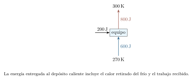
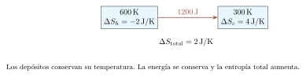
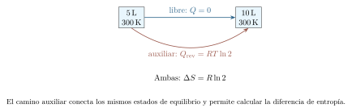

[← Capítulo anterior](capitulo-15.html) · [Índice del libro](index.html) · [Capítulo siguiente →](capitulo-17.html)

Una jeringa tapada permite observar una relación entre volumen y presión: al empujar el émbolo, el aire ofrece una resistencia creciente. La temperatura también interviene. Una compresión rápida puede elevarla; una compresión lenta, en contacto con un baño térmico, permite que el gas entregue energía mientras disminuye su volumen.

Para explicar esas diferencias seguiremos dos preguntas: qué estados puede alcanzar una cantidad de gas y qué intercambios permiten pasar de uno a otro. El trabajo del pistón y la transferencia de calor darán un balance de energía. Al cerrar una trayectoria aparecerá una máquina térmica; al examinar el sentido de sus intercambios necesitaremos el segundo principio y la entropía.

## Describir el estado de un gas

Consideremos un gas que ha alcanzado equilibrio dentro de un recipiente. Su presión $p$, su volumen $V$, su temperatura absoluta $T$ y la cantidad de sustancia $n$ describen aspectos de ese estado. La ecuación de estado relaciona esas variables. En el modelo de gas ideal,
$$
 pV=nRT=Nk_BT.
$$
Aquí $N$ cuenta partículas y $n=N/N_A$ expresa esa cantidad en moles. La constante $R=N_Ak_B$ vincula ambas descripciones. Usaremos $R\simeq8{,}314\,\mathrm{J/(mol\,K)}$ en los cálculos. El número de Avogadro es $N_A=6{,}02214076\times10^{23}\,\mathrm{mol^{-1}}$.

El modelo aproxima un gas suficientemente diluido, con tamaño molecular e interacciones entre partículas pequeños para las condiciones estudiadas. La cercanía a una transición de fase, una densidad elevada o efectos cuánticos importantes exigen una descripción más amplia. Comprobar las condiciones de uso forma parte de interpretar un resultado.

La presión de la ecuación es absoluta, medida respecto del vacío. Un manómetro suele informar la diferencia respecto del ambiente: $p=p_{\mathrm{man}}+p_{\mathrm{amb}}$. La temperatura se expresa en kelvin. En unidades SI, $\,\mathrm{Pa}\,\,\mathrm{m^3}=\,\mathrm{J}$; además, $1\,\mathrm{L}=10^{-3}\,\mathrm{m^3}$ y $1\,\mathrm{kPa}\,\,\mathrm{L}=1\,\mathrm{J}$. Estas relaciones permiten revisar las conversiones antes de sustituir datos.

### Problema resuelto 16.1 · Contar moles a partir de un estado {#r16-1}

Un gas ideal ocupa $12{,}0\,\mathrm{L}$ a $200\,\mathrm{kPa}$ absolutos y $300\,\mathrm{K}$. Estima la cantidad de sustancia y el número de partículas.
*Resolución.* El producto presión por volumen es $200(12)=2400\,\mathrm{J}$. Por tanto,
$$
 n=\frac{2400}{(8{,}314)(300)}\,\mathrm{mol}\simeq0{,}9622\,\mathrm{mol},
 \qquad N=nN_A\simeq5{,}795\times10^{23}.
$$
El volumen describe toda la muestra; el mol permite expresar cuántas partículas contiene. El cálculo presupone que la presión y la temperatura dadas caracterizan el estado de equilibrio.

{#fig-fp-av-r16-1 fig-alt="Ilustración de Problema resuelto 16.1 · Contar moles a partir de un estado. Un gas ideal ocupa 12,0\\,L a 200\\,kPa absolutos y 300\\,K. Estima la cantidad de sustancia y el número de partículas. Resolución. El producto presión por volumen es 200(12)=2400\\,J. Por tanto, n=frac2400(8,314)(300)\\,molsimeq0,9622\\,mol, qquad N=nNAsimeq5,795times10^23. El volumen describe toda la muestra; el mol"}

Cuando la muestra permanece cerrada, $n$ se conserva. Dividir la ecuación entre $T$ proporciona $pV/T=nR$ y permite relacionar dos estados de esa misma cantidad de gas. Si entra o sale materia, conviene escribir la ecuación para cada estado con su propio $n$.

### Problema resuelto 16.2 · Relacionar dos estados de una muestra cerrada {#r16-2}

Una muestra ideal pasa de $100\,\mathrm{kPa}$, $4{,}00\,\mathrm{L}$ y $300\,\mathrm{K}$ a $150\,\mathrm{kPa}$ y $6{,}00\,\mathrm{L}$. Calcula su temperatura final e indica qué información falta para hallar el trabajo.
*Resolución.* La conservación de la cantidad de gas da
$$
 T_f=T_i\frac{p_fV_f}{p_iV_i}
 =300\frac{150(6)}{100(4)}\,\mathrm{K}=675\,\mathrm{K}.
$$
El producto $pV$ aumenta por un factor $2{,}25$, igual al de la temperatura absoluta. Para obtener el trabajo necesitamos describir cómo se mueve la frontera y qué presión externa se opone a ella durante el proceso. Los estados extremos permiten fijar la temperatura final y dejan abierta esa trayectoria.

{#fig-fp-av-r16-2 fig-alt="Ilustración de Problema resuelto 16.2 · Relacionar dos estados de una muestra cerrada. Una muestra ideal pasa de 100\\,kPa, 4,00\\,L y 300\\,K a 150\\,kPa y 6,00\\,L. Calcula su temperatura final e indica qué información falta para hallar el trabajo. Resolución. La conservación de la cantidad de gas da Tf=TifracpfVfpiVi =300frac150(6)100(4)\\,K=675\\,K. El producto pV aumenta por un factor 2,25, igual al de la"}

## El trabajo al cambiar el volumen

Tomemos como sistema el gas dentro de un cilindro. Un pistón de área $A$ se desplaza una distancia $dx$ hacia afuera; el volumen aumenta $dV=A\,dx$. Llamamos $p_{\mathrm{ext}}$ a la presión mecánicamente transmitida en la frontera móvil del sistema. El trabajo que cruza esa frontera es $\delta W=p_{\mathrm{ext}}dV$. Para identificar esta presión con la de una carga exterior distante suponemos un pistón ideal, variación despreciable de su energía cinética y pérdidas mecánicas despreciables. Si el pistón acelera o disipa energía, el trabajo recibido por la carga requiere un balance adicional. Para el trabajo de frontera usamos así
$$
 W=\int_{V_i}^{V_f}p_{\mathrm{ext}}\,dV.
$$
Un valor positivo corresponde a trabajo realizado por el gas; la compresión, con volumen decreciente y presión positiva, produce $W<0$. Este convenio se mantendrá durante todo el capítulo.

En una transformación cuasiestática, el gas atraviesa estados próximos al equilibrio. Si el pistón se mueve con diferencias de presión infinitesimales y fricción despreciable, podemos sustituir $p_{\mathrm{ext}}$ por la presión de equilibrio $p$ del gas. Entonces el trabajo se lee como área orientada bajo la trayectoria del diagrama $p$--$V$. Una línea vertical tiene $dV=0$; un recorrido hacia la derecha aporta área positiva y uno hacia la izquierda, negativa.

En una expansión rápida, la presión del gas puede variar espacialmente; el trabajo exige la fuerza transmitida en su frontera y el desplazamiento correspondiente. Una curva de presión de equilibrio entre los extremos representa una trayectoria idealizada cuya aplicación requiere justificar el proceso.

### Problema resuelto 16.3 · Mover un pistón a presión constante {#r16-3}

Un gas se expande cuasiestáticamente desde $2{,}00$ hasta $5{,}00\,\mathrm{L}$ a $200\,\mathrm{kPa}$ constantes. Calcula el trabajo que entrega y el correspondiente a recorrer la misma transformación en sentido inverso.
*Resolución.* La presión constante sale de la integral:
$$
 W=p(V_f-V_i)=200(5-2)\,\mathrm{J}=600\,\mathrm{J}.
$$
El gas entrega $600\,\mathrm{J}$ al entorno. Al recorrer la misma línea desde $5$ hasta $2\,\mathrm{L}$, $W=200(2-5)=-600\,\mathrm{J}$: el entorno realiza $600\,\mathrm{J}$ de trabajo sobre el gas. El signo se obtiene del desplazamiento de la frontera.

{#fig-fp-av-r16-3 fig-alt="Ilustración de Problema resuelto 16.3 · Mover un pistón a presión constante. Un gas se expande cuasiestáticamente desde 2,00 hasta 5,00\\,L a 200\\,kPa constantes. Calcula el trabajo que entrega y el correspondiente a recorrer la misma transformación en sentido inverso. Resolución. La presión constante sale de la integral: W=p(Vf-Vi)=200(5-2)\\,J=600\\,J. El gas entrega 600\\,J al entorno. Al"}

### Problema resuelto 16.4 · Sumar un área con presión variable {#r16-4}

Durante una expansión cuasiestática la presión aumenta linealmente de $100$ a $300\,\mathrm{kPa}$ mientras el volumen pasa de $2{,}00$ a $6{,}00\,\mathrm{L}$. Encuentra el trabajo e interpreta geométricamente el cálculo.
*Resolución.* El área bajo la recta es un trapecio. Su altura media es $(100+300)/2=200\,\mathrm{kPa}$ y su base es $4{,}00\,\mathrm{L}$. Así,
$$
 W=\frac{p_i+p_f}{2}(V_f-V_i)=200(4)\,\mathrm{J}=800\,\mathrm{J}.
$$
También podemos sumar un rectángulo de $400\,\mathrm{J}$ y un triángulo de $400\,\mathrm{J}$. La presión media aritmética sirve aquí porque la dependencia con $V$ es lineal; una curva general requiere su área o la integral correspondiente.

{#fig-fp-av-r16-4 fig-alt="Ilustración de Problema resuelto 16.4 · Sumar un área con presión variable. Durante una expansión cuasiestática la presión aumenta linealmente de 100 a 300\\,kPa mientras el volumen pasa de 2,00 a 6,00\\,L. Encuentra el trabajo e interpreta geométricamente el cálculo. Resolución. El área bajo la recta es un trapecio. Su altura media es (100+300)/2=200\\,kPa y su base es 4,00\\,L. Así,"}

## La energía que permanece y la que cruza la frontera

En el desarrollo que sigue, el trabajo intercambiado corresponde al trabajo de frontera. La energía interna $U$ caracteriza el estado del sistema; los intercambios por calor y por trabajo describen un proceso. Para una muestra cerrada cuyos cambios de energía cinética y potencial macroscópicas son despreciables, el primer principio toma la forma
$$
 \Delta U=Q-W.
$$
Usamos $Q>0$ para calor recibido y $W>0$ para trabajo entregado. Conservar un mismo sistema y una misma convención permite sumar las etapas sin alterar sus signos. Cuando hay otros trabajos, como el eléctrico o el de un agitador, $W$ representa la suma algebraica de los trabajos entregados; la integral de presión por volumen corresponde únicamente al trabajo de frontera.

Esta forma del balance supone además una frontera cerrada a la materia. Una turbina con flujo continuo requiere incorporar la energía transportada por el fluido que entra y sale. En los modelos de este capítulo seguiremos una cantidad fija de gas o una sustancia de trabajo que completa un ciclo idealizado.

### Problema resuelto 16.5 · Comprimir mientras se entrega calor {#r16-5}

Durante una compresión el entorno realiza $500\,\mathrm{J}$ de trabajo sobre un gas y el gas entrega $120\,\mathrm{J}$ por calor. Calcula el cambio de energía interna.
*Resolución.* Para el gas, $W=-500\,\mathrm{J}$ y $Q=-120\,\mathrm{J}$. El balance da
$$
 \Delta U=-120-(-500)=380\,\mathrm{J}.
$$
La energía interna aumenta: el aporte mecánico supera la energía que sale por calor. En un gas ideal de composición fija ese aumento corresponde a una elevación de temperatura, dentro del modelo de capacidad calorífica empleado.

{#fig-fp-av-r16-5 fig-alt="Ilustración de Problema resuelto 16.5 · Comprimir mientras se entrega calor. Durante una compresión el entorno realiza 500\\,J de trabajo sobre un gas y el gas entrega 120\\,J por calor. Calcula el cambio de energía interna. Resolución. Para el gas, W=-500\\,J y Q=-120\\,J. El balance da Delta U=-120-(-500)=380\\,J. La energía interna aumenta: el aporte mecánico supera la energía que sale por"}

La condición de ser una función de estado tiene una consecuencia práctica. Entre dos estados dados, $\Delta U$ queda fijado, aunque existan varios caminos para conectarlos. Los valores de $Q$ y $W$ pueden cambiar de un camino a otro; su diferencia conserva el cambio de energía interna.

### Problema resuelto 16.6 · Comparar dos caminos entre los mismos estados {#r16-6}

Un gas ideal monoatómico pasa de $A=(2{,}00\,\mathrm{L},100\,\mathrm{kPa})$ a $B=(4{,}00\,\mathrm{L},200\,\mathrm{kPa})$. Un camino eleva primero la presión a volumen fijo y después expande a $200\,\mathrm{kPa}$. Otro expande primero a $100\,\mathrm{kPa}$ y luego eleva la presión a volumen fijo. Compara $W$, $\Delta U$ y $Q$. Usa $U=\tfrac32pV$ más una referencia constante.
*Resolución.* Las etapas verticales aportan trabajo cero. En el camino de presión alta, $W_1=200(4-2)=400\,\mathrm{J}$; en el de presión baja, $W_2=100(4-2)=200\,\mathrm{J}$. Ambos comparten
$$
 \Delta U=\frac32[p_BV_B-p_AV_A]
 =\frac32[200(4)-100(2)]\,\mathrm{J}=900\,\mathrm{J}.
$$
Por el primer principio, $Q_1=900+400=1300\,\mathrm{J}$ y $Q_2=900+200=1100\,\mathrm{J}$. El camino que entrega $200\,\mathrm{J}$ más de trabajo necesita recibir $200\,\mathrm{J}$ más de calor para alcanzar el mismo estado final.

{#fig-fp-av-r16-6 fig-alt="Ilustración de Problema resuelto 16.6 · Comparar dos caminos entre los mismos estados. Un gas ideal monoatómico pasa de A=(2,00\\,L,100\\,kPa) a B=(4,00\\,L,200\\,kPa). Un camino eleva primero la presión a volumen fijo y después expande a 200\\,kPa. Otro expande primero a 100\\,kPa y luego eleva la presión a volumen fijo. Compara W, Delta U y Q. Usa U=tfrac32pV más una referencia constante. Resolución. Las"}

## Capacidades caloríficas de un gas ideal

En un gas ideal de composición fija, la energía interna depende de la temperatura. La relación cinética del capítulo anterior da, para un gas monoatómico clásico, $U=\tfrac32nRT$ más una constante de referencia. Al cambiar la temperatura,
$$
 \Delta U=nC_V\Delta T,\qquad
 C_V=\frac32R\quad\hbox{(monoatómico clásico)}.
$$
En este capítulo $C_V$ y $C_p$ designan capacidades caloríficas *molares*, medidas en $\,\mathrm{J/(mol\,K)}$; la capacidad de toda la muestra incluye el factor $n$. El subíndice de $C_V$ recuerda cómo se determina: a volumen constante, con trabajo de frontera nulo, el calor recibido coincide con $\Delta U$.

Como $U$ depende de $T$, el mismo $nC_V\Delta T$ sirve para obtener su cambio a lo largo de cualquier proceso del gas ideal, cuando $C_V$ puede tomarse constante. Para una dependencia apreciable con la temperatura se usa $\Delta U=n\int C_V(T)\,dT$. La elección del proceso modifica el calor y el trabajo, conservando esa relación entre estados.

A presión constante, el gas además se expande y entrega $W=p\Delta V=nR\Delta T$. Entonces $Q_p=\Delta U+W=n(C_V+R)\Delta T$. Por definición $Q_p=nC_p\Delta T$, de donde
$$
 C_p-C_V=R,\qquad \gamma=\frac{C_p}{C_V}.
$$
Para el modelo monoatómico, $C_p=\tfrac52R$ y $\gamma=5/3$. En un gas diatómico con traslación y rotación activas y vibración despreciable, el modelo clásico da $C_V=\tfrac52R$, $C_p=\tfrac72R$ y $\gamma=7/5$. El intervalo térmico y los grados de libertad disponibles determinan la aproximación apropiada.

### Problema resuelto 16.7 · Elevar la misma temperatura de dos maneras {#r16-7}

Una muestra de $0{,}500\,\mathrm{mol}$ de gas ideal monoatómico aumenta su temperatura $80{,}0\,\mathrm{K}$. Compara el calor requerido a volumen constante y a presión constante, suponiendo sólo trabajo de frontera.
*Resolución.* El cambio de energía interna es el mismo en ambos casos:
$$
 \Delta U=0{,}500\left(\frac32\right)(8{,}314)(80{,}0)
 =498{,}84\,\mathrm{J}.
$$
A volumen constante, $W_V=0$ y $Q_V=498{,}84\,\mathrm{J}$. A presión constante, $W_p=nR\Delta T=332{,}56\,\mathrm{J}$ y $Q_p=831{,}40\,\mathrm{J}$. La diferencia entre los calores coincide con el trabajo de expansión de la segunda transformación.

{#fig-fp-av-r16-7 fig-alt="Ilustración de Problema resuelto 16.7 · Elevar la misma temperatura de dos maneras. Una muestra de 0,500\\,mol de gas ideal monoatómico aumenta su temperatura 80,0\\,K. Compara el calor requerido a volumen constante y a presión constante, suponiendo sólo trabajo de frontera. Resolución. El cambio de energía interna es el mismo en ambos casos: Delta U=0,500left(frac32right)(8,314)(80,0) =498,84\\,J. A"}

## Reconocer y calcular una transformación

Una restricción física permite escoger la relación útil. Un recipiente rígido fija el volumen; un pistón ideal sometido a una carga constante puede mantener la presión; un baño térmico grande puede sostener la temperatura durante un proceso suficientemente lento. El aislamiento térmico favorece una transformación adiabática, definida por $Q=0$.

En una transformación *isócora*, el trabajo de frontera es cero y $Q=\Delta U$. En una *isobárica*, $W=p\Delta V$ y el calor incluye tanto el cambio interno como el trabajo. Una transformación *isotérmica* mantiene $T$ constante; para un gas ideal de composición fija conserva también $U$. Estas condiciones describen magnitudes distintas y permiten deducir qué términos del balance quedan determinados.

### Problema resuelto 16.8 · Recibir calor en un recipiente rígido {#r16-8}

Un mol de gas ideal monoatómico pasa de $300$ a $500\,\mathrm{K}$ dentro de un recipiente rígido. Calcula $W$, $\Delta U$, $Q$ y la razón de presiones. Supón sólo trabajo de frontera.
*Resolución.* La rigidez impone $W=0$. Con $\Delta T=200\,\mathrm{K}$,
$$
 \Delta U=\frac32(1)(8{,}314)(200)=2494{,}2\,\mathrm{J},
 \qquad Q=2494{,}2\,\mathrm{J}.
$$
La ecuación de estado da $p_f/p_i=T_f/T_i=500/300=5/3$. La energía recibida eleva la temperatura y aumenta la presión del gas encerrado.

{#fig-fp-av-r16-8 fig-alt="Ilustración de Problema resuelto 16.8 · Recibir calor en un recipiente rígido. Un mol de gas ideal monoatómico pasa de 300 a 500\\,K dentro de un recipiente rígido. Calcula W, Delta U, Q y la razón de presiones. Supón sólo trabajo de frontera. Resolución. La rigidez impone W=0. Con Delta T=200\\,K, Delta U=frac32(1)(8,314)(200)=2494,2\\,J, qquad Q=2494,2\\,J. La ecuación de estado da"}

### Problema resuelto 16.9 · Repartir energía durante una expansión isobárica {#r16-9}

Un mol de gas ideal monoatómico se expande cuasiestáticamente a presión constante al pasar de $300$ a $450\,\mathrm{K}$. Calcula el trabajo, el cambio interno y el calor recibido.
*Resolución.* La ecuación de estado permite escribir el trabajo sin conocer por separado la presión y los volúmenes:
$$
 W=nR\Delta T=(8{,}314)(150)=1247{,}1\,\mathrm{J}.
$$
El cambio interno es $\Delta U=\tfrac32(8{,}314)(150)=1870{,}65\,\mathrm{J}$. Por tanto, $Q=3117{,}75\,\mathrm{J}$, igual a $nC_p\Delta T$. Dos quintas partes de la energía recibida se entregan como trabajo y tres quintas partes aumentan la energía interna en este modelo.

{#fig-fp-av-r16-9 fig-alt="Ilustración de Problema resuelto 16.9 · Repartir energía durante una expansión isobárica. Un mol de gas ideal monoatómico se expande cuasiestáticamente a presión constante al pasar de 300 a 450\\,K. Calcula el trabajo, el cambio interno y el calor recibido. Resolución. La ecuación de estado permite escribir el trabajo sin conocer por separado la presión y los volúmenes: W=nRDelta T=(8,314)(150)=1247,1\\,J."}

Para una expansión isotérmica cuasiestática y mecánicamente reversible del gas ideal, $p=nRT/V$. Integrar la presión da
$$
 W=nRT\ln\frac{V_f}{V_i},\qquad \Delta U=0,\qquad Q=W.
$$
El logaritmo es natural y su argumento es una razón sin unidades. La presión disminuye mientras aumenta el volumen, de modo que el área requiere integrar una hipérbola. Mantener la temperatura durante la expansión exige que el entorno reponga mediante calor la energía entregada como trabajo.

### Problema resuelto 16.10 · Duplicar el volumen sin cambiar la temperatura {#r16-10}

Una muestra de $0{,}500\,\mathrm{mol}$ de gas ideal se expande reversiblemente a $300\,\mathrm{K}$ hasta duplicar su volumen, en contacto con un baño a esa temperatura. Calcula $W$, $\Delta U$ y $Q$.
*Resolución.* La razón de volúmenes es dos. Entonces
$$
 W=0{,}500(8{,}314)(300)\ln2\,\mathrm{J}
 \simeq864{,}42\,\mathrm{J}.
$$
Como $T$ se conserva, $\Delta U=0$ y $Q\simeq864{,}42\,\mathrm{J}$. La presión final vale la mitad de la inicial. El baño suministra energía durante la expansión mientras el gas mantiene su energía interna.

{#fig-fp-av-r16-10 fig-alt="Ilustración de Problema resuelto 16.10 · Duplicar el volumen sin cambiar la temperatura. Una muestra de 0,500\\,mol de gas ideal se expande reversiblemente a 300\\,K hasta duplicar su volumen, en contacto con un baño a esa temperatura. Calcula W, Delta U y Q. Resolución. La razón de volúmenes es dos. Entonces W=0,500(8,314)(300)ln2\\,J simeq864,42\\,J. Como T se conserva, Delta U=0 y Qsimeq864,42\\,J. La"}

En una transformación adiabática, el primer principio se reduce a $\Delta U=-W$. La condición térmica por sí sola permite que la temperatura cambie. Para obtener una ley de trayectoria añadimos hipótesis: gas ideal, capacidades molares constantes, sólo trabajo de frontera y proceso cuasiestático mecánicamente reversible. Así, $nC_VdT=-p\,dV=-nRT\,dV/V$. Dividiendo e integrando,
$$
 TV^{\gamma-1}=\text{constante},\qquad
 pV^\gamma=\text{constante}.
$$
Se usó $R/C_V=\gamma-1$. La expansión adiabática reversible enfría el gas; la compresión eleva su temperatura. La curva adiabática tiene pendiente $dp/dV=-\gamma p/V$, más pronunciada que la isoterma $dp/dV=-p/V$ que atraviesa el mismo punto. Un proceso rápido puede aproximar $Q=0$ y, a la vez, presentar desequilibrios internos que exijan otro análisis mecánico.

### Problema resuelto 16.11 · Expandir con aislamiento y equilibrio mecánico límite {#r16-11}

Un mol de gas ideal monoatómico se expande adiabática y reversiblemente desde $T_i=400\,\mathrm{K}$, $V_i=10{,}0\,\mathrm{L}$ hasta $V_f=80{,}0\,\mathrm{L}$. Usa capacidades constantes. Calcula la temperatura y presión finales y el trabajo.
*Resolución.* Con $\gamma=5/3$, la razón de volúmenes es ocho y
$$
 T_f=400\left(\frac18\right)^{2/3}\,\mathrm{K}=100\,\mathrm{K}.
$$
La presión inicial es $p_i=(8{,}314)(400)/0{,}010=332560\,\mathrm{Pa}$. La relación adiabática da $p_f=p_i/8^{5/3}=10392{,}5\,\mathrm{Pa}$. También resulta de $p_f=nRT_f/V_f$. Como $Q=0$,
$$
 W=-\Delta U=nC_V(T_i-T_f)
 =\frac32(8{,}314)(300)=3741{,}3\,\mathrm{J}.
$$
El trabajo positivo procede de la disminución de energía interna. Las dos comprobaciones de presión verifican la compatibilidad del estado final con la trayectoria.

{#fig-fp-av-r16-11 fig-alt="Ilustración de Problema resuelto 16.11 · Expandir con aislamiento y equilibrio mecánico límite. Un mol de gas ideal monoatómico se expande adiabática y reversiblemente desde Ti=400\\,K, Vi=10,0\\,L hasta Vf=80,0\\,L. Usa capacidades constantes. Calcula la temperatura y presión finales y el trabajo. Resolución. Con gamma=5/3, la razón de volúmenes es ocho y Tf=400left(frac18right)^2/3\\,K=100\\,K. La presión inicial"}

Una expansión libre ofrece otra situación adiabática. Un tabique separa inicialmente el gas de una región vacía dentro de una envoltura rígida y aislada. Al retirar el tabique, el gas ocupa el espacio disponible. La presión externa que se opone a la expansión es cero, y el recipiente exterior permanece inmóvil. El balance puede aplicarse entre los estados inicial y final de equilibrio aun cuando los estados intermedios sean muy desiguales.

### Problema resuelto 16.12 · Ocupar un espacio vacío {#r16-12}

Un mol de gas ideal a $300\,\mathrm{K}$ ocupa $5{,}00\,\mathrm{L}$ y se expande libremente hasta $10{,}0\,\mathrm{L}$ dentro de una envoltura aislada. Encuentra $Q$, $W$, $\Delta U$, $T_f$ y la razón de presiones.
*Resolución.* El aislamiento da $Q=0$ y la expansión contra el vacío da $W=0$. Por tanto, $\Delta U=0$. Para el gas ideal, esto implica $T_f=300\,\mathrm{K}$; el equilibrio final satisface $p_f/p_i=V_i/V_f=1/2$. La trayectoria real incluye estados de desequilibrio. La relación $pV^\gamma=\text{constante}$ corresponde a las hipótesis de reversibilidad mecánica de la deducción anterior.

{#fig-fp-av-r16-12 fig-alt="Ilustración de Problema resuelto 16.12 · Ocupar un espacio vacío. Un mol de gas ideal a 300\\,K ocupa 5,00\\,L y se expande libremente hasta 10,0\\,L dentro de una envoltura aislada. Encuentra Q, W, Delta U, Tf y la razón de presiones. Resolución. El aislamiento da Q=0 y la expansión contra el vacío da W=0. Por tanto, Delta U=0. Para el gas ideal, esto implica Tf=300\\,K; el equilibrio"}

## Cerrar la trayectoria: ciclos y área neta

En un ciclo la sustancia de trabajo vuelve al estado inicial. Por ello $\Delta U_{\mathrm{ciclo}}=0$ y el primer principio exige $Q_{\mathrm{neto}}=W_{\mathrm{neto}}$. Cada etapa conserva sus propios signos. Una sustancia puede recibir y entregar cantidades importantes de calor y terminar el ciclo con la misma energía interna.

En un ciclo cuasiestático simple, el trabajo neto es el área orientada encerrada en el diagrama $p$--$V$. Un recorrido horario expande a presiones superiores a las de compresión y entrega trabajo neto positivo. Recorrer la misma curva en sentido inverso cambia el signo del trabajo. La geometría ofrece una comprobación independiente de la suma de etapas.

### Problema resuelto 16.13 · Hacer el balance de un ciclo rectangular {#r16-13}

Una muestra de $0{,}100\,\mathrm{mol}$ de gas ideal monoatómico recorre $A\to B\to C\to D\to A$, con estados $A=(2\,\mathrm{L},100\,\mathrm{kPa})$, $B=(2\,\mathrm{L},300\,\mathrm{kPa})$, $C=(6\,\mathrm{L},300\,\mathrm{kPa})$, $D=(6\,\mathrm{L},100\,\mathrm{kPa})$. Calcula $W$, $\Delta U$ y $Q$ por etapa, y el rendimiento $W_{\mathrm{neto}}/Q_{\mathrm{entrada}}$ del ciclo.
*Resolución.* Usamos $U=\tfrac32pV$ más una referencia. Los cambios internos son $600$, $1800$, $-1800$ y $-600\,\mathrm{J}$. Las dos etapas isócoras tienen trabajo cero; en las horizontales, $W_{BC}=300(6-2)=1200\,\mathrm{J}$ y $W_{DA}=100(2-6)=-400\,\mathrm{J}$. Aplicar $Q=\Delta U+W$ completa la tabla de la ayuda.

El trabajo neto es $800\,\mathrm{J}$, también igual al área $(300-100)(6-2)\,\mathrm{J}$. El calor entrante suma $Q_{AB}+Q_{BC}=600+3000=3600\,\mathrm{J}$; salen $1800+1000=2800\,\mathrm{J}$. Así,
$$
 \eta=\frac{800}{3600}=\frac29\simeq0{,}2222=22{,}22\%.
$$
El denominador cuenta todos los aportes positivos de calor. Este ciclo intercambia energía a temperaturas variables; interpretar sus contactos térmicos requiere esa información adicional.

{#fig-fp-av-r16-13 fig-alt="Ilustración de Problema resuelto 16.13 · Hacer el balance de un ciclo rectangular. El trabajo neto es 800\\,J, también igual al área (300-100)(6-2)\\,J. El calor entrante suma QAB+QBC=600+3000=3600\\,J; salen 1800+1000=2800\\,J. Así, eta=frac8003600=frac29simeq0,2222=22,22\\%. El denominador cuenta todos los aportes positivos de calor. Este ciclo intercambia energía a temperaturas variables; interpretar"}

## Máquinas térmicas, refrigeradores y límites

Una máquina térmica cíclica puede recibir una energía $Q_h$ de un depósito caliente y entregar una energía $Q_c$ a un depósito frío, produciendo trabajo $W_{\mathrm{salida}}$. Aquí $Q_h$ y $Q_c$ son *magnitudes positivas*: para la sustancia de trabajo, los calores con signo son $+Q_h$ y $-Q_c$. El balance y el rendimiento quedan
$$
 W_{\mathrm{salida}}=Q_h-Q_c,\qquad
 \eta=\frac{W_{\mathrm{salida}}}{Q_h}=1-\frac{Q_c}{Q_h}.
$$
Un depósito térmico ideal conserva su temperatura mientras entrega o recibe las energías consideradas. Este modelo permite separar las propiedades del ciclo de la evolución térmica de un cuerpo pequeño, cuya temperatura sí cambiaría durante el intercambio.

### Problema resuelto 16.14 · Pasar del ciclo a la potencia {#r16-14}

Una máquina recibe $2400\,\mathrm{J}$ y entrega $1500\,\mathrm{J}$ al depósito frío en cada ciclo. Funciona a $20$ ciclos por segundo. Calcula el trabajo por ciclo, el rendimiento y la potencia mecánica media.
*Resolución.* El trabajo útil por ciclo es $W_{\mathrm{salida}}=2400-1500=900\,\mathrm{J}$. El rendimiento vale $\eta=900/2400=0{,}375=37{,}5\%$. La frecuencia de ciclos da
$$
 P=(900\,\mathrm{J})(20\,\mathrm{s^{-1}})=18000\,\mathrm{W}=18{,}0\,\mathrm{kW}.
$$
La potencia térmica entrante es $48{,}0\,\mathrm{kW}$ y la que sale hacia el depósito frío es $30{,}0\,\mathrm{kW}$; su diferencia reproduce la potencia mecánica.

{#fig-fp-av-r16-14 fig-alt="Ilustración de Problema resuelto 16.14 · Pasar del ciclo a la potencia. Una máquina recibe 2400\\,J y entrega 1500\\,J al depósito frío en cada ciclo. Funciona a 20 ciclos por segundo. Calcula el trabajo por ciclo, el rendimiento y la potencia mecánica media. Resolución. El trabajo útil por ciclo es Wsalida=2400-1500=900\\,J. El rendimiento vale eta=900/2400=0,375=37,5\\%. La frecuencia de"}

El primer principio conserva la energía; el segundo introduce restricciones sobre los procesos capaces de realizar esa conversión. En el enunciado de Kelvin--Planck, una máquina cíclica que produce trabajo a partir de un único depósito térmico necesita algún otro efecto en el entorno: la conversión íntegra del calor tomado de ese único depósito en trabajo, como único resultado, queda excluida. El enunciado de Clausius establece que trasladar calor de un depósito frío a uno caliente requiere una compensación externa, como el suministro de trabajo. Ambas formulaciones expresan restricciones equivalentes.

Para comprender el límite ideal, llamamos *reversible* a un proceso cuya inversión puede restituir tanto el sistema como el entorno a sus estados iniciales. Esto exige diferencias impulsoras infinitesimales y ausencia de disipación. La lentitud puede favorecer el equilibrio, mientras que la fricción mantiene una fuente de irreversibilidad incluso con movimiento lento.

Entre dos depósitos a temperaturas $T_h>T_c>0$, un ciclo reversible de Carnot establece el rendimiento máximo
$$
 \eta\leq\eta_C=1-\frac{T_c}{T_h}.
$$
El ciclo de Carnot de gas ideal combina una expansión isotérmica a $T_h$, una expansión adiabática reversible hasta $T_c$, una compresión isotérmica a $T_c$ y una compresión adiabática reversible de regreso. Las dos adiabáticas dan iguales razones de volumen en las isotermas, y las expresiones logarítmicas del calor conducen a $Q_c/Q_h=T_c/T_h$. El segundo principio extiende el límite a cualquier sustancia de trabajo entre esos dos depósitos. Las temperaturas de la razón son absolutas.

### Problema resuelto 16.15 · Examinar una promesa de rendimiento {#r16-15}

Una máquina opera cíclicamente entre $600$ y $300\,\mathrm{K}$ y recibe $2400\,\mathrm{J}$ por ciclo. Determina el máximo trabajo y examina una propuesta que promete entregar $1500\,\mathrm{J}$ de trabajo mientras cede $900\,\mathrm{J}$ al depósito frío.
*Resolución.* El límite es $\eta_C=1-300/600=0{,}500$. Por tanto, $W_{\max}=1200\,\mathrm{J}$ y el rechazo mínimo de calor es $1200\,\mathrm{J}$. La propuesta conserva la energía, porque $2400=1500+900$, pero su rendimiento es $1500/2400=62{,}5\%$, superior al límite del $50\%$. El segundo principio la excluye bajo las condiciones dadas. La máquina del problema anterior, con $37{,}5\%$, tiene un rendimiento compatible con este límite si opera entre esos depósitos.

{#fig-fp-av-r16-15 fig-alt="Ilustración de Problema resuelto 16.15 · Examinar una promesa de rendimiento. Una máquina opera cíclicamente entre 600 y 300\\,K y recibe 2400\\,J por ciclo. Determina el máximo trabajo y examina una propuesta que promete entregar 1500\\,J de trabajo mientras cede 900\\,J al depósito frío. Resolución. El límite es etaC=1-300/600=0,500. Por tanto, Wmax=1200\\,J y el rechazo mínimo de calor es"}

Un refrigerador emplea trabajo para retirar calor del depósito frío. Si recibe $W_{\mathrm{entrada}}>0$, el balance de magnitudes es $Q_h=Q_c+W_{\mathrm{entrada}}$. Su coeficiente de desempeño se define por el efecto buscado:
$$
 \mathrm{COP}_R=\frac{Q_c}{W_{\mathrm{entrada}}},\qquad
 \mathrm{COP}_{\mathrm{BC}}=\frac{Q_h}{W_{\mathrm{entrada}}}
 =\mathrm{COP}_R+1.
$$
La segunda expresión corresponde a una bomba de calor que se utiliza para calentar. Estos cocientes pueden superar uno porque comparan calor trasladado con trabajo suministrado. Para equipos reversibles entre dos depósitos,
$$
 \mathrm{COP}_{R,\max}=\frac{T_c}{T_h-T_c},\qquad
 \mathrm{COP}_{\mathrm{BC},\max}=\frac{T_h}{T_h-T_c}.
$$
Una diferencia menor entre temperaturas reduce el trabajo mínimo necesario para trasladar una cantidad dada de energía, dentro de este modelo de depósitos ideales.

### Problema resuelto 16.16 · Contar lo que extrae y lo que entrega un refrigerador {#r16-16}

Un refrigerador retira $600\,\mathrm{J}$ de un depósito a $270\,\mathrm{K}$ por ciclo y consume $200\,\mathrm{J}$ de trabajo. Entrega calor a un depósito a $300\,\mathrm{K}$. Calcula los dos coeficientes de desempeño y compáralos con sus límites.
*Resolución.* Se entregan $Q_h=600+200=800\,\mathrm{J}$ al depósito caliente. Así, $\mathrm{COP}_R=600/200=3$ y $\mathrm{COP}_{\mathrm{BC}}=800/200=4$. Los máximos son $270/30=9$ y $300/30=10$, respectivamente. Los valores dados son compatibles con ambos límites; el balance incluye tanto la energía extraída como el trabajo que recibe el equipo.

{#fig-fp-av-r16-16 fig-alt="Ilustración de Problema resuelto 16.16 · Contar lo que extrae y lo que entrega un refrigerador. Un refrigerador retira 600\\,J de un depósito a 270\\,K por ciclo y consume 200\\,J de trabajo. Entrega calor a un depósito a 300\\,K. Calcula los dos coeficientes de desempeño y compáralos con sus límites. Resolución. Se entregan Qh=600+200=800\\,J al depósito caliente. Así, COPR=600/200=3 y COPBC=800/200=4. Los máximos"}

## Entropía y sentido de los procesos

Dos depósitos a distinta temperatura pueden intercambiar calor espontáneamente y conservar la energía total. Esa conservación también se cumpliría si la energía circulara en sentido contrario. Necesitamos una magnitud que distinga el sentido permitido. La entropía $S$ es una función de estado cuyo cambio se obtiene mediante una trayectoria reversible que conecte los estados considerados:
$$
 \Delta S=\int_i^f\frac{\delta Q_{\mathrm{rev}}}{T}.
$$
La unidad es $\,\mathrm{J/K}$. El subíndice indica una condición del camino de cálculo. Para una transferencia reversible a temperatura constante, $\Delta S=Q_{\mathrm{rev}}/T$. Un depósito ideal que recibe un calor con signo $Q$ cambia su entropía en $Q/T$, pues su temperatura permanece fija.

Para un sistema cerrado, el balance de entropía puede escribirse $\Delta S=\int\delta Q/T_b+S_{\mathrm{gen}}$, con $T_b$ la temperatura absoluta de la frontera por donde cruza cada aporte de calor y $S_{\mathrm{gen}}\geq0$ la entropía generada por irreversibilidades. Si hay varios contactos, se suman sus contribuciones. El intercambio puede disminuir la entropía de una parte mientras la generación conserva el signo exigido al conjunto aislado.

La desigualdad de Clausius para un ciclo es
$$
 \oint\frac{\delta Q}{T_b}\leq0.
$$
En un ciclo, el balance anterior da $\oint\delta Q/T_b=-S_{\mathrm{gen}}$. La igualdad expresa generación interna nula para el sistema y la frontera elegidos. La reversibilidad del conjunto requiere además que los intercambios con el entorno se produzcan en condiciones reversibles. Al sumar sistema y entorno de modo que el conjunto quede aislado, resulta $\Delta S_{\mathrm{total}}\geq0$. En un ciclo $\Delta S_{\mathrm{sistema}}=0$ porque el estado vuelve a ser el inicial; el entorno puede conservar un aumento de entropía.

### Problema resuelto 16.17 · Seguir calor entre dos depósitos {#r16-17}

Se transfieren $1200\,\mathrm{J}$ desde un depósito a $600\,\mathrm{K}$ hacia otro a $300\,\mathrm{K}$. Considera el conjunto aislado y desprecia almacenamiento en el elemento que los conecta. Calcula los cambios de entropía y examina el traslado inverso como único efecto.
*Resolución.* Para el caliente, $\Delta S_h=-1200/600=-2{,}00\,\mathrm{J/K}$; para el frío, $\Delta S_c=1200/300=4{,}00\,\mathrm{J/K}$. Así,
$$
 \Delta S_{\mathrm{total}}=2{,}00\,\mathrm{J/K}>0.
$$
El traslado inverso dejaría $\Delta S_{\mathrm{total}}=-2{,}00\,\mathrm{J/K}$ y queda excluido como único efecto del conjunto aislado. Un refrigerador puede transferir calor hacia mayor temperatura porque incorpora trabajo y produce otros cambios en el entorno.

{#fig-fp-av-r16-17 fig-alt="Ilustración de Problema resuelto 16.17 · Seguir calor entre dos depósitos. Se transfieren 1200\\,J desde un depósito a 600\\,K hacia otro a 300\\,K. Considera el conjunto aislado y desprecia almacenamiento en el elemento que los conecta. Calcula los cambios de entropía y examina el traslado inverso como único efecto. Resolución. Para el caliente, Delta Sh=-1200/600=-2,00\\,J/K; para el frío,"}

La entropía también permite estudiar cambios sin calor en la trayectoria real. Como es función de estado, podemos elegir un camino reversible auxiliar para calcularla. En un gas ideal con capacidades constantes, combinar $\delta Q_{\mathrm{rev}}=nC_VdT+p\,dV$ con la ecuación de estado da
$$
 \Delta S=nC_V\ln\frac{T_f}{T_i}+nR\ln\frac{V_f}{V_i}.
$$
El resultado depende de los estados extremos. La expresión contiene dos contribuciones que pueden tener distinto signo. Su interpretación microscópica se relaciona con cuántos estados microscópicos son compatibles con las restricciones macroscópicas; la fórmula $S=k_B\ln\Omega$, para microestados equiprobables en la descripción microcanónica, expresa ese vínculo. La evaluación macroscópica mediante calor reversible conserva un significado preciso aun cuando una imagen cotidiana de «orden» resulte poco informativa.

### Problema resuelto 16.18 · Calcular entropía en una expansión libre {#r16-18}

Retoma la expansión libre de un mol de gas ideal desde $5{,}00$ hasta $10{,}0\,\mathrm{L}$, a temperatura inicial y final de $300\,\mathrm{K}$. Calcula el cambio de entropía del gas y del conjunto aislado.
*Resolución.* Los estados tienen la misma temperatura. Elegimos como camino auxiliar una expansión isotérmica reversible entre esos volúmenes. Su calor sería $Q_{\mathrm{rev}}=nRT\ln2$, de modo que
$$
 \Delta S=\frac{nRT\ln2}{T}=R\ln2
 \simeq5{,}763\,\mathrm{J/K}.
$$
En la expansión libre real, $Q=0$ y $W=0$. La entropía del gas aumenta por generación interna, y el entorno idealmente inalterado tiene cambio cero. Por tanto, $\Delta S_{\mathrm{total}}\simeq5{,}763\,\mathrm{J/K}$. El camino auxiliar permite calcular una diferencia de estado sin sustituir los intercambios efectivos del proceso real.

{#fig-fp-av-r16-18 fig-alt="Ilustración de Problema resuelto 16.18 · Calcular entropía en una expansión libre. Retoma la expansión libre de un mol de gas ideal desde 5,00 hasta 10,0\\,L, a temperatura inicial y final de 300\\,K. Calcula el cambio de entropía del gas y del conjunto aislado. Resolución. Los estados tienen la misma temperatura. Elegimos como camino auxiliar una expansión isotérmica reversible entre esos volúmenes."}

## Ejercicios para reconstruir y transferir

Usa $R=8{,}314\,\mathrm{J/(mol\,K)}$. Las presiones indicadas son absolutas salvo mención de un manómetro. En los modelos de gas, considera muestra cerrada, comportamiento ideal, capacidades constantes y sólo trabajo de frontera, salvo indicación contraria. Conserva el convenio $\Delta U=Q-W$.

### Ejercicio 16.1 · Un estado y una cantidad {#e16-1}

Un gas ocupa $5{,}00\,\mathrm{L}$ a $200\,\mathrm{kPa}$ y $300\,\mathrm{K}$. Calcula $n$ y explica qué condiciones permiten usar la ecuación ideal.

### Ejercicio 16.2 · Leer un manómetro {#e16-2}

Un manómetro indica $80{,}0\,\mathrm{kPa}$ sobre una presión ambiental de $100\,\mathrm{kPa}$. El recipiente contiene gas a $300\,\mathrm{K}$ en $10{,}0\,\mathrm{L}$. Calcula la presión absoluta y $n$.

### Ejercicio 16.3 · Calentar sin cambiar el volumen {#e16-3}

Una muestra cerrada está a $120\,\mathrm{kPa}$ y $300\,\mathrm{K}$. En un recipiente rígido alcanza $450\,\mathrm{K}$. Encuentra la presión final.

### Ejercicio 16.4 · Dos cambios simultáneos {#e16-4}

Un gas cerrado pasa de $110\,\mathrm{kPa}$, $3{,}00\,\mathrm{L}$ y $300\,\mathrm{K}$ a $220\,\mathrm{kPa}$ y $4{,}50\,\mathrm{L}$. Calcula $T_f$.

### Ejercicio 16.5 · Trabajo en una compresión {#e16-5}

Un gas se comprime cuasiestáticamente a $150\,\mathrm{kPa}$ desde $8{,}00$ hasta $3{,}00\,\mathrm{L}$. Calcula el trabajo del gas y el trabajo recibido.

### Ejercicio 16.6 · Una recta descendente {#e16-6}

La presión disminuye linealmente de $300$ a $100\,\mathrm{kPa}$ mientras el volumen aumenta de $2{,}00$ a $8{,}00\,\mathrm{L}$, en un proceso cuasiestático. Calcula el trabajo y su signo.

### Ejercicio 16.7 · Un balance con dos entradas de signo {#e16-7}

Un gas cede $300\,\mathrm{J}$ por calor y recibe $800\,\mathrm{J}$ por trabajo durante una compresión. Encuentra $Q$, $W$ y $\Delta U$.

### Ejercicio 16.8 · Recuperar un intercambio {#e16-8}

Un sistema cerrado recibe $700\,\mathrm{J}$ de calor y aumenta su energía interna $450\,\mathrm{J}$. Calcula el trabajo neto que realiza.

### Ejercicio 16.9 · Dos caminos con el mismo destino {#e16-9}

Entre dos estados, $\Delta U=600\,\mathrm{J}$. Por un camino el gas realiza $250\,\mathrm{J}$ de trabajo; por otro recibe $100\,\mathrm{J}$ de trabajo. Calcula el calor en cada camino y compara sus diferencias.

### Ejercicio 16.10 · Dos capacidades para una muestra {#e16-10}

Dos moles de gas ideal monoatómico aumentan $60{,}0\,\mathrm{K}$. Calcula $\Delta U$, el calor a volumen constante y el calor a presión constante.

### Ejercicio 16.11 · Rotaciones activas {#e16-11}

Una muestra de $0{,}500\,\mathrm{mol}$ de gas diatómico tiene $C_V=5R/2$ y $C_p=7R/2$. Aumenta $40{,}0\,\mathrm{K}$ a presión constante. Calcula $\gamma$, $W$, $\Delta U$ y $Q$.

### Ejercicio 16.12 · Presión como termómetro {#e16-12}

En un recipiente rígido hay $0{,}200\,\mathrm{mol}$ de gas ideal monoatómico a $300\,\mathrm{K}$ y $100\,\mathrm{kPa}$. La presión sube a $150\,\mathrm{kPa}$. Calcula $T_f$, $W$ y $Q$.

### Ejercicio 16.13 · Expandir a presión fija {#e16-13}

Una muestra de $0{,}200\,\mathrm{mol}$ de gas monoatómico ideal pasa de $300$ a $600\,\mathrm{K}$ mediante expansión cuasiestática isobárica. Calcula las tres cantidades del primer principio.

### Ejercicio 16.14 · Cuadruplicar el volumen {#e16-14}

Un gas ideal, con $n=0{,}250\,\mathrm{mol}$, se expande isotérmica y reversiblemente a $400\,\mathrm{K}$ hasta cuadruplicar su volumen. Encuentra $W$, $Q$ y $\Delta U$.

### Ejercicio 16.15 · Una expansión adiabática {#e16-15}

Medio mol de gas monoatómico ideal a $320\,\mathrm{K}$ se expande adiabática y reversiblemente hasta multiplicar su volumen por ocho. Calcula $T_f$, $p_f/p_i$, $Q$ y $W$.

### Ejercicio 16.16 · Retirar un tabique {#e16-16}

Medio mol de gas ideal a $300\,\mathrm{K}$ se expande libremente de $2{,}00$ a $6{,}00\,\mathrm{L}$ dentro de una envoltura rígida y aislada. Encuentra los intercambios, $T_f$ y $p_f/p_i$; explica qué rasgo impide tratar la trayectoria como una adiabática reversible.

### Ejercicio 16.17 · Invertir un ciclo rectangular {#e16-17}

Un ciclo rectangular cuasiestático abarca volúmenes de $2$ y $5\,\mathrm{L}$ y presiones de $100$ y $300\,\mathrm{kPa}$. Se recorre en sentido antihorario. Encuentra $W_{\mathrm{neto}}$, $Q_{\mathrm{neto}}$ y $\Delta U_{\mathrm{ciclo}}$.

### Ejercicio 16.18 · Rendimiento y frecuencia {#e16-18}

Una máquina recibe $5000\,\mathrm{J}$ por ciclo y produce $1500\,\mathrm{J}$ de trabajo. Opera a diez ciclos por segundo. Calcula el calor rechazado, el rendimiento y la potencia útil media.

### Ejercicio 16.19 · Contrastar con Carnot {#e16-19}

Una máquina entre $500$ y $300\,\mathrm{K}$ promete un rendimiento del $45\%$ al recibir $2000\,\mathrm{J}$ por ciclo. Calcula el límite de rendimiento y el mínimo calor que debería rechazar; evalúa la propuesta.

### Ejercicio 16.20 · Dos usos del mismo equipo {#e16-20}

Un equipo retira $900\,\mathrm{J}$ del depósito frío y consume $300\,\mathrm{J}$ de trabajo por ciclo. Calcula el calor entregado al caliente y los coeficientes de desempeño como refrigerador y como bomba de calor.

### Ejercicio 16.21 · Trabajo mínimo para calentar {#e16-21}

Una bomba de calor reversible opera entre $270$ y $300\,\mathrm{K}$ y entrega $3000\,\mathrm{J}$ al depósito caliente en cada ciclo. Encuentra el trabajo mínimo y el calor retirado del depósito frío.

### Ejercicio 16.22 · Un intercambio espontáneo {#e16-22}

Dos depósitos a $450$ y $300\,\mathrm{K}$ intercambian $900\,\mathrm{J}$ desde el caliente al frío. Calcula sus cambios de entropía y el total, considerando aislado el conjunto.

### Ejercicio 16.23 · Un cuerpo alcanza la temperatura de un baño {#e16-23}

Un cuerpo de capacidad calorífica constante $100\,\mathrm{J/K}$ pasa de $300$ a $600\,\mathrm{K}$ por contacto con un depósito a $600\,\mathrm{K}$. Desprecia trabajo y pérdidas. Calcula el calor, la entropía del cuerpo mediante un camino reversible auxiliar y la entropía total. Usa $\int dT/T=\ln T$ para la diferencia logarítmica.

### Ejercicio 16.24 · Una trayectoria auxiliar {#e16-24}

Para la expansión libre del ejercicio 16.16, calcula $\Delta S$ del gas y del conjunto aislado. Describe un camino reversible que permita obtener ese cambio y compara su calor con el del proceso real.

## Soluciones razonadas

### Solución 16.1 {#sol-e16-1}
 El producto $pV=200(5)=1000\,\mathrm{J}$ da $n=1000/[8{,}314(300)]\simeq0{,}4009\,\mathrm{mol}$. El modelo requiere un gas suficientemente diluido y estados de equilibrio, con interacciones y tamaño molecular pequeños para esas condiciones. Las temperaturas son absolutas.

### Solución 16.2 {#sol-e16-2}
 La presión absoluta es $80+100=180\,\mathrm{kPa}$. Así, $n=180(10)/[8{,}314(300)]\simeq0{,}7217\,\mathrm{mol}$. Sumar la presión ambiental permite usar una presión referida al vacío en la ecuación de estado.

### Solución 16.3 {#sol-e16-3}
 Con $n$ y $V$ constantes, $p/T$ se conserva. Resulta $p_f=120(450/300)=180\,\mathrm{kPa}$.

### Solución 16.4 {#sol-e16-4}
 La conservación de $n$ da $T_f=300[220(4{,}50)]/[110(3{,}00)]=900\,\mathrm{K}$. El producto $pV$ se triplica.

### Solución 16.5 {#sol-e16-5}
 El trabajo del gas es $W=150(3-8)=-750\,\mathrm{J}$. El entorno realiza $750\,\mathrm{J}$ de trabajo sobre el gas. Ambos valores describen el mismo intercambio desde sistemas opuestos.

### Solución 16.6 {#sol-e16-6}
 La presión media de la recta es $200\,\mathrm{kPa}$ y el aumento de volumen es $6\,\mathrm{L}$. Por tanto, $W=1200\,\mathrm{J}>0$. Aunque la presión disminuye, la expansión entrega trabajo positivo durante todo el tramo.

### Solución 16.7 {#sol-e16-7}
 Los signos para el gas son $Q=-300\,\mathrm{J}$ y $W=-800\,\mathrm{J}$. El cambio interno es $\Delta U=-300-(-800)=500\,\mathrm{J}$. El aporte mecánico compensa el calor cedido y deja un aumento de energía interna.

### Solución 16.8 {#sol-e16-8}
 De $W=Q-\Delta U$ resulta $W=700-450=250\,\mathrm{J}$. El sistema entrega esa energía neta como trabajo.

### Solución 16.9 {#sol-e16-9}
 Para el primer camino $W_1=250\,\mathrm{J}$ y $Q_1=600+250=850\,\mathrm{J}$. Para el segundo $W_2=-100\,\mathrm{J}$ y $Q_2=600-100=500\,\mathrm{J}$. Las diferencias $Q_1-Q_2$ y $W_1-W_2$ valen ambas $350\,\mathrm{J}$, conservando $\Delta U$.

### Solución 16.10 {#sol-e16-10}
 El cambio interno es $\Delta U=2(3/2)(8{,}314)(60)=1496{,}52\,\mathrm{J}$. A volumen fijo, $Q_V=1496{,}52\,\mathrm{J}$; a presión fija, $Q_p=2(5/2)(8{,}314)(60)=2494{,}20\,\mathrm{J}$. El trabajo de esta última transformación es $997{,}68\,\mathrm{J}$.

### Solución 16.11 {#sol-e16-11}
 $\gamma=(7/2)/(5/2)=7/5$. El trabajo es $W=0{,}500(8{,}314)(40)=166{,}28\,\mathrm{J}$, el cambio interno $\Delta U=0{,}500(5/2)(8{,}314)(40)=415{,}70\,\mathrm{J}$ y el calor $Q=581{,}98\,\mathrm{J}$. Se verifica $Q-W=\Delta U$.

### Solución 16.12 {#sol-e16-12}
 A volumen fijo $T_f/T_i=p_f/p_i=1{,}50$, de donde $T_f=450\,\mathrm{K}$. Como $W=0$, $Q=\Delta U=0{,}200(3/2)(8{,}314)(150)=374{,}13\,\mathrm{J}$.

### Solución 16.13 {#sol-e16-13}
 El aumento de $300\,\mathrm{K}$ da $W=0{,}200(8{,}314)(300)=498{,}84\,\mathrm{J}$, $\Delta U=748{,}26\,\mathrm{J}$ y $Q=1247{,}10\,\mathrm{J}$. Su suma $\Delta U+W$ reproduce el calor a presión constante.

### Solución 16.14 {#sol-e16-14}
 Para el camino reversible, $W=0{,}250(8{,}314)(400)\ln4\simeq1152{,}57\,\mathrm{J}$. La temperatura constante del gas ideal fija $\Delta U=0$ y por ello $Q=W$.

### Solución 16.15 {#sol-e16-15}
 $T_f=320/8^{2/3}=80\,\mathrm{K}$ y $p_f/p_i=8^{-5/3}=1/32$. El aislamiento da $Q=0$ y el trabajo es $W=0{,}500(3/2)(8{,}314)(320-80)=1496{,}52\,\mathrm{J}$. La energía interna disminuye en esa cantidad.

### Solución 16.16 {#sol-e16-16}
 Se tiene $Q=0$ por aislamiento y $W=0$ por expansión contra vacío. Entonces $\Delta U=0$, $T_f=300\,\mathrm{K}$ y $p_f/p_i=2/6=1/3$. Los estados intermedios presentan desequilibrio; la expansión libre tiene una irreversibilidad que se cuantifica en el ejercicio 16.24.

### Solución 16.17 {#sol-e16-17}
 El área encerrada tiene magnitud $(300-100)(5-2)=600\,\mathrm{J}$. La orientación antihoraria da $W_{\mathrm{neto}}=-600\,\mathrm{J}$. Al cerrar el ciclo, $\Delta U=0$ y $Q_{\mathrm{neto}}=-600\,\mathrm{J}$. El conjunto recibe trabajo neto y entrega calor neto.

### Solución 16.18 {#sol-e16-18}
 El calor rechazado es $Q_c=5000-1500=3500\,\mathrm{J}$. El rendimiento es $1500/5000=0{,}300=30{,}0\%$ y la potencia útil $1500(10)=15000\,\mathrm{W}=15{,}0\,\mathrm{kW}$.

### Solución 16.19 {#sol-e16-19}
 $\eta_C=1-300/500=0{,}400=40\%$. Para $Q_h=2000\,\mathrm{J}$, el rechazo mínimo es $Q_{c,\min}=2000(300/500)=1200\,\mathrm{J}$. La promesa del $45\%$ dejaría sólo $1100\,\mathrm{J}$ al depósito frío; excede el rendimiento permitido entre esos depósitos.

### Solución 16.20 {#sol-e16-20}
 $Q_h=900+300=1200\,\mathrm{J}$, $\mathrm{COP}_R=900/300=3$ y $\mathrm{COP}_{\mathrm{BC}}=1200/300=4$. El segundo coeficiente incluye también la energía que llega como trabajo.

### Solución 16.21 {#sol-e16-21}
 El máximo coeficiente como bomba de calor es $300/(300-270)=10$. Así, $W_{\min}=3000/10=300\,\mathrm{J}$ y $Q_c=3000-300=2700\,\mathrm{J}$. El límite se alcanza en el modelo reversible.

### Solución 16.22 {#sol-e16-22}
 Para el caliente, $\Delta S_h=-900/450=-2\,\mathrm{J/K}$; para el frío, $\Delta S_c=900/300=3\,\mathrm{J/K}$. La suma es $1\,\mathrm{J/K}>0$, compatible con el sentido espontáneo indicado.

### Solución 16.23 {#sol-e16-23}
 El cuerpo recibe $Q=C(T_f-T_i)=30000\,\mathrm{J}$. Un camino auxiliar con contactos a temperaturas infinitesimalmente próximas da $\Delta S_{\mathrm{cuerpo}}=C\ln(T_f/T_i)=100\ln2\simeq69{,}315\,\mathrm{J/K}$. El depósito real pierde $30000/600=50\,\mathrm{J/K}$. El total aumenta $19{,}315\,\mathrm{J/K}$ por el intercambio con diferencia finita de temperatura.

### Solución 16.24 {#sol-e16-24}
 Los estados extremos tienen igual temperatura. La expresión del gas ideal da
$$
 \Delta S=nR\ln(V_f/V_i)=0{,}500(8{,}314)\ln3\simeq4{,}567\,\mathrm{J/K}.
$$
 El entorno ideal conserva su estado y el total aumenta lo mismo. Una expansión isotérmica reversible entre los mismos extremos tendría $Q_{\mathrm{rev}}=T\Delta S\simeq1370{,}08\,\mathrm{J}$. La expansión libre real tiene $Q=0$; la generación interna explica su aumento de entropía.

## Una experiencia: comparar dos compresiones

### Experiencia · Registrar estados y tiempos
Utiliza una jeringa de plástico sin aguja, con el extremo cerrado mediante un accesorio adecuado. Trabaja con desplazamientos pequeños y fuerzas moderadas, sin calentar ni presurizar recipientes rígidos. Registra el volumen inicial, comprime lentamente y espera antes de leer el volumen bajo una misma carga. Repite una compresión más rápida y observa la evolución posterior manteniendo la carga.

Compara los tiempos de intercambio térmico y los estados transitorios y finales. Para medir trabajo necesitas además cuantificar la fricción, la presión ambiental y la presión del gas. Registra incertidumbres y condiciones de cada ensayo; un sensor apropiado permite contrastar estados de equilibrio mediante $pV/T$.

## Diagnóstico antes de avanzar

Un mol de gas ideal monoatómico recorre cuasiestáticamente el ciclo $A\to B\to C\to A$, con $A=(10\,\mathrm{L},100\,\mathrm{kPa})$, $B=(10\,\mathrm{L},200\,\mathrm{kPa})$ y $C=(20\,\mathrm{L},200\,\mathrm{kPa})$. El regreso $C\to A$ sigue una recta en el diagrama $p$--$V$. Calcula el balance por etapas, el trabajo neto y el rendimiento. Determina el cambio de entropía del gas al completar el ciclo e indica qué datos hacen falta para hallar el del entorno.

**Contraste.** Los productos $pV$ son $1000$, $2000$ y $4000\,\mathrm{J}$. Los cambios internos son $1500$, $3000$ y $-4500\,\mathrm{J}$. Los trabajos son $0$, $2000$ y $-1500\,\mathrm{J}$, el último por el área orientada del trapecio. Por tanto, los calores son $1500$, $5000$ y $-6000\,\mathrm{J}$. El trabajo neto es $500\,\mathrm{J}$ y el calor entrante suma $6500\,\mathrm{J}$, dando $\eta=1/13\simeq7{,}69\%$. El gas vuelve a su estado inicial y tiene $\Delta S_{\mathrm{ciclo}}=0$. Para calcular el cambio del entorno necesitamos las temperaturas y condiciones de los contactos térmicos; la geometría del ciclo determina el trabajo y deja esa información por especificar.

**Lecturas de apoyo.** H. D. Young y R. A. Freedman, *Física universitaria*, volumen 1, 12.ª edición, sección 18.1 y capítulo 19; capítulo 20, secciones 20.1--20.2 y 20.4--20.7. R. A. Serway y C. Vuille, *Fundamentos de física*, volumen 1, 9.ª edición, secciones 10.4 y 12.1--12.5. Aquí $W$ es trabajo del gas; Serway usa el convenio opuesto. Los problemas y ayudas se han preparado para esta obra.

---

[← Capítulo anterior](capitulo-15.html) · [Índice del libro](index.html) · [Capítulo siguiente →](capitulo-17.html)
