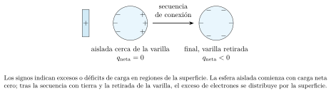
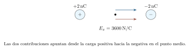

[← Capítulo anterior](capitulo-16.html) · [Índice del libro](index.html) · [Capítulo siguiente →](capitulo-18.html)

Un globo frotado puede atraer pequeños trozos de papel. Para describir el fenómeno necesitamos seguir tanto la carga que adquiere el globo como la redistribución de carga dentro del papel. La interacción depende del signo de las cargas, de su posición y de la respuesta del material.

Empezaremos contando cargas y calculando fuerzas. El campo permitirá describir lo que una configuración produce en cada punto del espacio; el potencial ofrecerá una descripción energética. Al reunir dos conductores separados por un aislante aparecerá el capacitor, que conecta la distribución de carga con el almacenamiento de energía.

## Carga, transferencia y conservación

La carga eléctrica es una propiedad de las partículas. El electrón tiene carga $-e$ y el protón, $+e$, con
$$
 e=1{,}602176634\times10^{-19}\,\mathrm{C}.
$$
El coulomb, símbolo $\,\mathrm{C}$, es la unidad de carga del SI. Un cuerpo ordinario contiene enormes cantidades de cargas de ambos signos. Su carga neta resulta de sumarlas algebraicamente. Un objeto neutro tiene igual cantidad de carga positiva y negativa; esa condición admite redistribuciones internas.

En las electrizaciones habituales de sólidos, algunos electrones se transfieren o se redistribuyen mientras los núcleos permanecen ligados a la estructura. Un déficit de electrones produce carga positiva; un exceso produce carga negativa. La carga neta de un cuerpo ordinario aparece en múltiplos enteros de $e$: $q=ze$, con $z$ entero. Las cargas macroscópicas que escribimos con pocas cifras representan valores redondeados de ese conteo.

La carga total se conserva. Al seleccionar un conjunto aislado eléctricamente, podemos escribir $\sum q_i=\text{constante}$. Si conectamos una parte a tierra o permitimos que entre materia cargada, debemos incluir la carga que cruza esa frontera. El frotamiento puede transferir electrones y modificar las energías de los cuerpos, conservando la carga del conjunto completo.

### Problema resuelto 17.1 · Traducir un conteo de electrones {#r17-1}

Un cuerpo inicialmente neutro pierde $3{,}00\times10^{12}$ electrones. Calcula su carga final y la variación de carga del cuerpo que recibe esos electrones, suponiendo transferencia exclusiva entre ambos.
*Resolución.* Cada electrón que sale retira una carga negativa. El cuerpo queda con
$$
 q=+(3{,}00\times10^{12})e\simeq+4{,}807\times10^{-7}\,\mathrm{C}
 =+0{,}4807\,\mathrm{\mu C}.
$$
El receptor cambia su carga en $-4{,}807\times10^{-7}\,\mathrm{C}$. La suma de ambas variaciones es cero. El signo del cuerpo que pierde electrones se obtiene del balance entre las cargas que permanecen.

{#fig-fp-av-r17-1 fig-alt="Ilustración de Problema resuelto 17.1 · Traducir un conteo de electrones. Un cuerpo inicialmente neutro pierde 3,00times10^12 electrones. Calcula su carga final y la variación de carga del cuerpo que recibe esos electrones, suponiendo transferencia exclusiva entre ambos. Resolución. Cada electrón que sale retira una carga negativa. El cuerpo queda con"}

### Problema resuelto 17.2 · Compartir carga entre dos esferas iguales {#r17-2}

Dos esferas conductoras idénticas tienen cargas aproximadas de $+6{,}00\,\mathrm{nC}$ y $-2{,}00\,\mathrm{nC}$. Se conectan por un hilo conductor de capacitancia despreciable, con las esferas muy separadas, en un entorno simétrico y sin otros cuerpos próximos. Se espera el equilibrio y se retira el hilo. Encuentra las cargas finales y el sentido de transferencia de electrones.
*Resolución.* La carga total es $+4{,}00\,\mathrm{nC}$. La igualdad geométrica y la simetría del entorno permiten que el equilibrio la reparta por igual: cada esfera termina con $+2{,}00\,\mathrm{nC}$. La primera reduce su carga positiva en $4{,}00\,\mathrm{nC}$: recibe electrones de la segunda. El conteo aproximado transferido es $4{,}00\times10^{-9}/e\simeq2{,}497\times10^{10}$.

{#fig-fp-av-r17-2 fig-alt="Ilustración de Problema resuelto 17.2 · Compartir carga entre dos esferas iguales. Dos esferas conductoras idénticas tienen cargas aproximadas de +6,00\\,nC y -2,00\\,nC. Se conectan por un hilo conductor de capacitancia despreciable, con las esferas muy separadas, en un entorno simétrico y sin otros cuerpos próximos. Se espera el equilibrio y se retira el hilo. Encuentra las cargas finales y el"}

La igualdad de cargas del ejemplo procede de la simetría. En conductores de formas o tamaños diferentes, el equilibrio exige igual potencial cuando están conectados; la carga se reparte según la geometría y el entorno. Esta distinción será útil al introducir el potencial.

## Conductores, aislantes y polarización

En un conductor metálico hay electrones capaces de desplazarse por el material. En un aislante, las cargas permanecen ligadas a regiones mucho más pequeñas, aunque pueden desplazarse ligeramente dentro de átomos o moléculas. La respuesta depende también de la temperatura, la humedad y la escala de tiempo del experimento.

Al acercar una carga positiva a un conductor neutro aislado, los electrones móviles se acumulan hacia el lado próximo y dejan un déficit relativo en el lado lejano. La suma de la carga del conductor sigue siendo cero. Esta separación inducida puede originar una fuerza de atracción: el campo de la fuente es mayor en la región próxima, donde predomina la carga de signo opuesto.

En un dieléctrico, la polarización describe desplazamientos relativos de cargas ligadas o la orientación de dipolos moleculares. Puede producir regiones superficiales de signo opuesto y una respuesta colectiva apreciable. El material puede permanecer globalmente neutro durante esa redistribución.

Un conductor en equilibrio electrostático tiene campo cero en el interior de su material y potencial constante en todo él. La componente tangencial del campo en su superficie es cero; una componente tangencial movería sus cargas libres. La carga neta excedente se localiza en las superficies. Una cavidad requiere distinguir el material conductor de la región vacía: una carga dentro de la cavidad puede producir campo allí e inducir cargas en sus paredes.

### Problema resuelto 17.3 · Cargar por inducción y seguir la conexión a tierra {#r17-3}

Una varilla positiva se acerca, sin tocarla, a una esfera metálica inicialmente neutra sobre un soporte aislante. Describe la esfera aislada. Después se conecta a tierra mientras la varilla sigue cerca, se retira primero la conexión a tierra y finalmente se aleja la varilla. Predice el signo de la carga que conserva la esfera.
*Resolución.* Con la esfera aislada, los electrones se desplazan hacia la varilla y aparece déficit de electrones en la región alejada. La carga neta permanece cero. Al conectar a tierra, la atracción de la varilla permite que entren electrones desde la tierra. Retirar la conexión conserva ese exceso en la esfera; al alejar la varilla, los electrones se redistribuyen y la esfera queda con carga neta negativa. La cantidad transferida depende de las dimensiones, distancias y condiciones de conexión. El orden de desconexión fija qué carga queda aislada.

{#fig-fp-av-r17-3 fig-alt="Ilustración de Problema resuelto 17.3 · Cargar por inducción y seguir la conexión a tierra. Una varilla positiva se acerca, sin tocarla, a una esfera metálica inicialmente neutra sobre un soporte aislante. Describe la esfera aislada. Después se conecta a tierra mientras la varilla sigue cerca, se retira primero la conexión a tierra y finalmente se aleja la varilla. Predice el signo de la carga que conserva"}

## Fuerzas entre cargas puntuales

Para dos cargas puntuales en reposo y en el vacío, la ley de Coulomb da la magnitud
$$
 F=k\frac{|q_1q_2|}{r^2},\qquad
 k=\frac{1}{4\pi\varepsilon_0}\simeq9{,}00\times10^9\,\mathrm{N\,m^2/C^2}.
$$
Usaremos ese valor redondeado de $k$ en los problemas de fuerzas y potencial. La permitividad del vacío es aproximadamente $\varepsilon_0=8{,}854\times10^{-12}\,\mathrm{F/m}$. Las dos aproximaciones se emplean con las cifras indicadas en cada cálculo. Las cargas del mismo signo se repelen y las de signos opuestos se atraen, a lo largo de la recta que las une.

Una carga puntual modela un cuerpo cuyas dimensiones son pequeñas frente a las distancias relevantes. Las distribuciones extensas requieren sumar las contribuciones de sus partes; en un conductor próximo a otros cuerpos, la redistribución superficial puede modificar la aproximación de carga concentrada en su centro.

Para incorporar el sentido directamente, si $\vec r_1$ y $\vec r_2$ son posiciones, la fuerza sobre la carga 2 debida a la 1 es
$$
 \vec F_{1\to2}=kq_1q_2
 \frac{\vec r_2-\vec r_1}{|\vec r_2-\vec r_1|^3}.
$$
Con varias cargas, el principio de superposición indica que la fuerza neta es la suma vectorial de las fuerzas individuales. Conviene identificar primero sobre qué cuerpo se calcula, dibujar cada contribución y luego sumar componentes. El signo de una componente representa un sentido respecto de un eje elegido.

### Problema resuelto 17.4 · Dar dirección a una fuerza de Coulomb {#r17-4}

Una carga $q_1=+2{,}00\,\mathrm{\mu C}$ está en $x=0$ y otra $q_2=-3{,}00\,\mathrm{\mu C}$ en $x=0{,}300\,\mathrm{m}$. Calcula la fuerza sobre cada una.
*Resolución.* La magnitud es
$$
 F=\frac{(9{,}00\times10^9)(2{,}00\times10^{-6})(3{,}00\times10^{-6})}{(0{,}300)^2}
 =0{,}600\,\mathrm{N}.
$$
La atracción dirige la fuerza sobre $q_1$ hacia $+x$ y la fuerza sobre $q_2$ hacia $-x$. Son fuerzas iguales en magnitud y opuestas en dirección, aplicadas a cuerpos diferentes. La carga negativa participa en la dirección de la interacción; la magnitud calculada es positiva.

{#fig-fp-av-r17-4 fig-alt="Ilustración de Problema resuelto 17.4 · Dar dirección a una fuerza de Coulomb. Una carga q1=+2,00\\,mu C está en x=0 y otra q2=-3,00\\,mu C en x=0,300\\,m. Calcula la fuerza sobre cada una. Resolución. La magnitud es F=frac(9,00times10^9)(2,00times10^-6)(3,00times10^-6)(0,300)^2 =0,600\\,N. La atracción dirige la fuerza sobre q1 hacia +x y la fuerza sobre q2 hacia -x. Son fuerzas iguales en magnitud"}

### Problema resuelto 17.5 · Encontrar una compensación de fuerzas {#r17-5}

Una carga de $+1{,}00\,\mathrm{\mu C}$ está en el origen. Otras dos cargas fijas son $+4{,}00\,\mathrm{\mu C}$ en $x=-0{,}200\,\mathrm{m}$ y $+9{,}00\,\mathrm{\mu C}$ en $x=0{,}300\,\mathrm{m}$. Calcula la fuerza neta sobre la carga central.
*Resolución.* La carga izquierda repele a la central hacia la derecha:
$$
 F_{x,\mathrm{izq}}=+\frac{(9\times10^9)(4\times10^{-6})(1\times10^{-6})}{0{,}200^2}
 =+0{,}900\,\mathrm{N}.
$$
La carga derecha la repele hacia la izquierda y produce $F_{x,\mathrm{der}}=-0{,}900\,\mathrm{N}$. La suma es cero. Cada interacción permanece presente; sus efectos vectoriales se compensan en esa posición. La estabilidad frente a desplazamientos en otras direcciones requiere examinar el campo alrededor del punto.

{#fig-fp-av-r17-5 fig-alt="Ilustración de Problema resuelto 17.5 · Encontrar una compensación de fuerzas. Una carga de +1,00\\,mu C está en el origen. Otras dos cargas fijas son +4,00\\,mu C en x=-0,200\\,m y +9,00\\,mu C en x=0,300\\,m. Calcula la fuerza neta sobre la carga central. Resolución. La carga izquierda repele a la central hacia la derecha: Fx,izq=+frac(9times10^9)(4times10^-6)(1times10^-6)0,200^2 =+0,900\\,N. La"}

### Problema resuelto 17.6 · Sumar fuerzas en dos dimensiones {#r17-6}

Una carga de prueba $+1{,}00\,\mathrm{\mu C}$ está en el origen. Una carga fija $+2{,}00\,\mathrm{\mu C}$ está en $(0{,}300\,\mathrm{m},0)$ y otra $-4{,}00\,\mathrm{\mu C}$ en $(0,0{,}400\,\mathrm{m})$. Calcula la fuerza neta sobre la carga del origen.
*Resolución.* La primera fuente repele hacia $-x$, con magnitud $0{,}200\,\mathrm{N}$. La segunda atrae hacia $+y$, con magnitud $0{,}225\,\mathrm{N}$. Por tanto,
$$
 \vec F=(-0{,}200\,\hat\imath+0{,}225\,\hat\jmath)\,\mathrm{N},
 \qquad |\vec F|=\sqrt{0{,}200^2+0{,}225^2}\,\mathrm{N}\simeq0{,}3010\,\mathrm{N}.
$$
El vector está en el segundo cuadrante, a $48{,}37^\circ$ sobre el semieje negativo de $x$, equivalente a $131{,}63^\circ$ desde $+x$. El dibujo del cuadrante permite elegir correctamente el ángulo al usar la tangente.

{#fig-fp-av-r17-6 fig-alt="Ilustración de Problema resuelto 17.6 · Sumar fuerzas en dos dimensiones. Una carga de prueba +1,00\\,mu C está en el origen. Una carga fija +2,00\\,mu C está en (0,300\\,m,0) y otra -4,00\\,mu C en (0,0,400\\,m). Calcula la fuerza neta sobre la carga del origen. Resolución. La primera fuente repele hacia -x, con magnitud 0,200\\,N. La segunda atrae hacia +y, con magnitud 0,225\\,N. Por tanto, vec"}

## El campo como propiedad de la configuración fuente

Una misma configuración de cargas puede ejercer fuerzas diferentes sobre cuerpos de prueba diferentes. Al dividir la fuerza por la carga de prueba obtenemos una descripción del efecto de las fuentes en ese punto:
$$
 \vec E=\frac{\vec F}{q_0},\qquad \vec F=q_0\vec E.
$$
La carga de prueba debe perturbar de manera despreciable la configuración fuente. El campo apunta en el sentido de la fuerza que experimentaría una carga positiva. Una carga negativa recibe una fuerza opuesta al campo. La unidad es $\,\mathrm{N/C}$, equivalente a $\,\mathrm{V/m}$.

Una fuente puntual $Q$, situada en $\vec r_Q$, produce
$$
 \vec E(\vec r)=kQ\frac{\vec r-\vec r_Q}{|\vec r-\vec r_Q|^3}.
$$
Las contribuciones de varias fuentes se suman vectorialmente. La expresión se evalúa en el punto de observación y excluye el campo propio de la carga sobre la que después calculamos una fuerza.

Las líneas de campo ayudan a representar esa distribución: su tangente indica la dirección local y su sentido corresponde al de $\vec E$. Para una fuente positiva aislada salen radialmente y para una negativa entran. En electrostática, dos líneas de campo se cruzarían sólo si asignáramos dos direcciones al mismo campo no nulo, de modo que la representación conserva una dirección única en cada punto regular. La trayectoria de una partícula depende además de su velocidad inicial, su masa, el signo de su carga y las otras fuerzas presentes.

### Problema resuelto 17.7 · Separar campo y fuerza de prueba {#r17-7}

Una carga fuente $Q=-2{,}00\,\mathrm{nC}$ está en el origen. Calcula el campo en $x=0{,}300\,\mathrm{m}$ y la fuerza sobre una carga de prueba $q_0=-3{,}00\,\mathrm{nC}$ colocada allí.
*Resolución.* El campo apunta hacia la fuente negativa:
$$
 E_x=-\frac{(9\times10^9)(2\times10^{-9})}{0{,}300^2}
 =-200\,\mathrm{N/C}.
$$
La fuerza es $F_x=q_0E_x=(-3\times10^{-9})(-200)=+6{,}00\times10^{-7}\,\mathrm{N}$. La fuente determina el campo; el signo de la carga de prueba invierte el sentido de la fuerza respecto de él.

{#fig-fp-av-r17-7 fig-alt="Ilustración de Problema resuelto 17.7 · Separar campo y fuerza de prueba. Una carga fuente Q=-2,00\\,nC está en el origen. Calcula el campo en x=0,300\\,m y la fuerza sobre una carga de prueba q0=-3,00\\,nC colocada allí. Resolución. El campo apunta hacia la fuente negativa: Ex=-frac(9times10^9)(2times10^-9)0,300^2 =-200\\,N/C. La fuerza es Fx=q0Ex=(-3times10^-9)(-200)=+6,00times10^-7\\,N. La"}

### Problema resuelto 17.8 · Localizar un punto de campo nulo {#r17-8}

Dos cargas fijas positivas, $+4{,}00\,\mathrm{nC}$ y $+1{,}00\,\mathrm{nC}$, se encuentran en $x=0$ y $x=0{,}600\,\mathrm{m}$. Localiza el punto finito donde el campo total se anula.
*Resolución.* Entre las cargas, los campos tienen sentidos opuestos. Fuera de ese intervalo apuntan en el mismo sentido, por lo que buscamos $0<x<0{,}600$. Igualar magnitudes da
$$
 \frac{4}{x^2}=\frac{1}{(0{,}600-x)^2},
 \qquad \frac{2}{x}=\frac{1}{0{,}600-x}.
$$
Las distancias son positivas en el intervalo seleccionado. Resulta $x=0{,}400\,\mathrm{m}$. Allí cada fuente produce $225\,\mathrm{N/C}$ y ambas contribuciones se compensan. La mayor distancia a la carga mayor equilibra su mayor magnitud.

{#fig-fp-av-r17-8 fig-alt="Ilustración de Problema resuelto 17.8 · Localizar un punto de campo nulo. Dos cargas fijas positivas, +4,00\\,nC y +1,00\\,nC, se encuentran en x=0 y x=0,600\\,m. Localiza el punto finito donde el campo total se anula. Resolución. Entre las cargas, los campos tienen sentidos opuestos. Fuera de ese intervalo apuntan en el mismo sentido, por lo que buscamos 0<x<0,600. Igualar magnitudes da"}

### Problema resuelto 17.9 · Sumar el campo en el centro de un dipolo {#r17-9}

Un dipolo tiene $+2{,}00\,\mathrm{nC}$ en $x=-0{,}100\,\mathrm{m}$ y $-2{,}00\,\mathrm{nC}$ en $x=+0{,}100\,\mathrm{m}$. Encuentra el campo en el origen.
*Resolución.* La fuente positiva produce campo hacia la derecha y la negativa también, porque desde el origen se apunta hacia ella. Cada contribución vale $(9\times10^9)(2\times10^{-9})/0{,}100^2=1800\,\mathrm{N/C}$. Por ello,
$$
 \vec E=3600\,\hat\imath\,\mathrm{N/C}.
$$
La suma algebraica de las cargas fuente es cero y la suma de sus campos en ese punto es distinta de cero. Para obtener el campo intervienen las posiciones y las direcciones de cada contribución.

{#fig-fp-av-r17-9 fig-alt="Ilustración de Problema resuelto 17.9 · Sumar el campo en el centro de un dipolo. Un dipolo tiene +2,00\\,nC en x=-0,100\\,m y -2,00\\,nC en x=+0,100\\,m. Encuentra el campo en el origen. Resolución. La fuente positiva produce campo hacia la derecha y la negativa también, porque desde el origen se apunta hacia ella. Cada contribución vale (9times10^9)(2times10^-9)/0,100^2=1800\\,N/C. Por ello, vec"}

## Potencial, energía y trabajo

En un campo electrostático, el trabajo de la fuerza eléctrica depende de los extremos del desplazamiento. Esto permite definir una energía potencial $U$ y un potencial $V$ de modo que, para una carga de prueba $q$ en fuentes fijas,
$$
 \Delta U=q\Delta V,\qquad W_{\mathrm{el}}=-\Delta U=q(V_i-V_f).
$$
El potencial es energía potencial por unidad de carga, medido en volt: $1\,\mathrm{V}=1\,\mathrm{J/C}$. Es una magnitud escalar y su referencia de cero puede elegirse. Cambiar esa referencia conserva las diferencias de potencial y los trabajos calculados.

Para una distribución localizada de cargas puntuales, escoger $V=0$ en el infinito proporciona
$$
 V(P)=k\sum_i\frac{Q_i}{r_i}.
$$
Aquí se suman contribuciones escalares con el signo de cada fuente. El campo requiere una suma vectorial con dependencia $1/r^2$, mientras que el potencial suma términos proporcionales a $1/r$. El valor del potencial en un punto y su variación espacial cumplen funciones diferentes en la descripción.

### Problema resuelto 17.10 · Mover una carga negativa hacia menor potencial {#r17-10}

Una fuente fija $Q=+3{,}00\,\mathrm{nC}$ está en el origen. Una carga de prueba $q=-2{,}00\,\mathrm{nC}$ pasa de $r_i=0{,}200\,\mathrm{m}$ a $r_f=0{,}400\,\mathrm{m}$. Calcula los potenciales, el cambio de energía potencial y el trabajo eléctrico, con referencia en el infinito.
*Resolución.* Los potenciales son $V_i=kQ/r_i=135\,\mathrm{V}$ y $V_f=67{,}5\,\mathrm{V}$. Así, $\Delta V=-67{,}5\,\mathrm{V}$ y
$$
 \Delta U=(-2\times10^{-9})(-67{,}5)\,\mathrm{J}
 =+1{,}35\times10^{-7}\,\mathrm{J}.
$$
El trabajo eléctrico es $-1{,}35\times10^{-7}\,\mathrm{J}$. La atracción sobre la carga negativa se opone a su desplazamiento hacia afuera; la energía potencial aumenta. Un traslado lento exigiría un trabajo externo positivo de igual magnitud.

{#fig-fp-av-r17-10 fig-alt="Ilustración de Problema resuelto 17.10 · Mover una carga negativa hacia menor potencial. Una fuente fija Q=+3,00\\,nC está en el origen. Una carga de prueba q=-2,00\\,nC pasa de ri=0,200\\,m a rf=0,400\\,m. Calcula los potenciales, el cambio de energía potencial y el trabajo eléctrico, con referencia en el infinito. Resolución. Los potenciales son Vi=kQ/ri=135\\,V y Vf=67,5\\,V. Así, Delta V=-67,5\\,V y Delta"}

### Problema resuelto 17.11 · Comparar potencial cero y campo no nulo {#r17-11}

Para el dipolo del problema 17.9, calcula el potencial del origen con referencia en el infinito. Una carga de prueba $+1{,}00\,\mathrm{nC}$ se coloca allí: encuentra su energía potencial de interacción con las fuentes y su fuerza inicial.
*Resolución.* Las contribuciones al potencial son $+180\,\mathrm{V}$ y $-180\,\mathrm{V}$. Su suma es $V=0$. Con esa referencia, la energía de interacción de la carga de prueba es $U=qV=0$. El campo hallado antes es $3600\,\hat\imath\,\mathrm{N/C}$, por lo que la fuerza vale $+3{,}60\times10^{-6}\,\hat\imath\,\mathrm{N}$. Un valor cero del potencial fija un nivel energético local; la fuerza se relaciona con cómo cambia ese potencial alrededor del punto.

{#fig-fp-av-r17-11 fig-alt="Ilustración de Problema resuelto 17.11 · Comparar potencial cero y campo no nulo. Para el dipolo del problema 17.9, calcula el potencial del origen con referencia en el infinito. Una carga de prueba +1,00\\,nC se coloca allí: encuentra su energía potencial de interacción con las fuentes y su fuerza inicial. Resolución. Las contribuciones al potencial son +180\\,V y -180\\,V. Su suma es V=0. Con esa"}

Cuando calculamos la energía de una configuración completa, contamos cada par una vez. Para tres cargas puntuales, excluyendo sus autoenergías,
$$
 U_{\mathrm{config}}=k\left(\frac{q_1q_2}{r_{12}}+
 \frac{q_1q_3}{r_{13}}+\frac{q_2q_3}{r_{23}}\right).
$$
Esta energía describe el trabajo externo de ensamblar lentamente la configuración desde cargas separadas en el infinito, con sus energías cinéticas finales despreciables. Los términos negativos representan pares atractivos en esa elección de referencia.

### Problema resuelto 17.12 · Contar pares al ensamblar una configuración {#r17-12}

Tres cargas fijas están en una recta: $q_1=+2{,}00\,\mathrm{nC}$ en $x=0$, $q_2=+3{,}00\,\mathrm{nC}$ en $x=0{,}300\,\mathrm{m}$ y $q_3=-1{,}00\,\mathrm{nC}$ en $x=0{,}600\,\mathrm{m}$. Calcula la energía de interacción de la configuración.
*Resolución.* Las distancias entre pares son $0{,}300$, $0{,}600$ y $0{,}300\,\mathrm{m}$. Los tres términos valen, respectivamente, $+180$, $-30$ y $-90\,\mathrm{nJ}$. Entonces $U_{\mathrm{config}}=+60\,\mathrm{nJ}$. Si colocamos primero $q_1$ y $q_2$, el trabajo externo es $180\,\mathrm{nJ}$; añadir después $q_3$ aporta $-120\,\mathrm{nJ}$. Esa suma reproduce el resultado y cuenta cada par exactamente una vez.

{#fig-fp-av-r17-12 fig-alt="Ilustración de Problema resuelto 17.12 · Contar pares al ensamblar una configuración. Tres cargas fijas están en una recta: q1=+2,00\\,nC en x=0, q2=+3,00\\,nC en x=0,300\\,m y q3=-1,00\\,nC en x=0,600\\,m. Calcula la energía de interacción de la configuración. Resolución. Las distancias entre pares son 0,300, 0,600 y 0,300\\,m. Los tres términos valen, respectivamente, +180, -30 y -90\\,nJ. Entonces"}

## Leer equipotenciales y predecir movimientos

Una superficie equipotencial reúne puntos con el mismo valor de $V$. Mover una carga entre dos de esos puntos conserva su energía potencial eléctrica y da trabajo eléctrico neto cero. El campo en un punto regular es perpendicular a la superficie equipotencial y apunta hacia potenciales decrecientes.

Esta relación se expresa sin cálculo diferencial en un campo uniforme: sobre un tramo paralelo al eje $x$, $\Delta V=-E_x\Delta x$. Así, una caída mayor de potencial en una distancia menor corresponde a una componente de campo mayor. En una distribución general, las equipotenciales próximas señalan un gradiente más intenso cuando se comparan iguales diferencias de potencial. La relación local es $E_x=-dV/dx$; en tres dimensiones se escribe $\vec E=-\nabla V$.

La fuerza sobre una carga positiva apunta hacia potencial decreciente y sobre una negativa hacia potencial creciente. El movimiento posterior incorpora también la velocidad inicial. Una partícula puede cruzar una equipotencial con distintas direcciones; para seguirla de manera controlada, las fuerzas externas deben sostener la trayectoria que se haya impuesto.

### Problema resuelto 17.13 · Obtener un campo a partir de una pendiente {#r17-13}

En una región el potencial depende sólo de $x$ mediante $V(x)=120\,\mathrm{V}-(300\,\mathrm{V/m})x$. Calcula el campo y el trabajo eléctrico sobre $q=-2{,}00\,\mathrm{\mu C}$ al llevarla de $x=0$ a $x=0{,}200\,\mathrm{m}$.
*Resolución.* La pendiente es $-300\,\mathrm{V/m}$, de modo que $\vec E=+300\,\hat\imath\,\mathrm{N/C}$. La fuerza sobre la carga negativa es $-6{,}00\times10^{-4}\,\hat\imath\,\mathrm{N}$. El potencial cae $60\,\mathrm{V}$, por lo que $\Delta U=(-2\times10^{-6})(-60)=+120\,\mathrm{\mu J}$ y $W_{\mathrm{el}}=-120\,\mathrm{\mu J}$. El signo del trabajo también se obtiene porque la fuerza y el desplazamiento tienen sentidos opuestos.

{#fig-fp-av-r17-13 fig-alt="Ilustración de Problema resuelto 17.13 · Obtener un campo a partir de una pendiente. En una región el potencial depende sólo de x mediante V(x)=120\\,V-(300\\,V/m)x. Calcula el campo y el trabajo eléctrico sobre q=-2,00\\,mu C al llevarla de x=0 a x=0,200\\,m. Resolución. La pendiente es -300\\,V/m, de modo que vec E=+300\\,hatimath\\,N/C. La fuerza sobre la carga negativa es -6,00times10^-4\\,hatimath\\,N. El"}

Si la fuerza eléctrica es la única que realiza trabajo, la conservación de la energía da $\Delta K=-q\Delta V$. Para una partícula soltada desde el reposo, el valor final $K_f$ debe resultar no negativo. Un resultado negativo indica que los extremos propuestos exigen energía adicional para alcanzarse desde ese estado inicial. En un movimiento con otras fuerzas se incorporan sus trabajos al mismo balance.

### Problema resuelto 17.14 · Pasar de una diferencia de potencial a una rapidez {#r17-14}

Una partícula de masa $1{,}00\times10^{-6}\,\mathrm{kg}$ y carga $+2{,}00\,\mathrm{nC}$ se suelta desde el reposo en un punto a $300\,\mathrm{V}$ y alcanza otro a $100\,\mathrm{V}$. Supón fuentes fijas y trabajo gravitacional despreciable. Calcula su rapidez final. Compara con una partícula de igual masa y carga $-2{,}00\,\mathrm{nC}$ que se suelta a $100\,\mathrm{V}$ y alcanza $300\,\mathrm{V}$ bajo las mismas hipótesis.
*Resolución.* Para la primera, $\Delta V=-200\,\mathrm{V}$ y $K_f=-q\Delta V=4{,}00\times10^{-7}\,\mathrm{J}$. Entonces
$$
 v_f=\sqrt{\frac{2K_f}{m}}=\sqrt{0{,}800}\,\mathrm{m/s}
 \simeq0{,}8944\,\mathrm{m/s}.
$$
Para la segunda, tanto la carga como el cambio de potencial invierten su signo. El producto $q\Delta V$ conserva el valor $-4{,}00\times10^{-7}\,\mathrm{J}$ y la rapidez final es la misma. El balance energético determina la rapidez para los extremos alcanzados; la trayectoria concreta depende de la geometría del campo.

{#fig-fp-av-r17-14 fig-alt="Ilustración de Problema resuelto 17.14 · Pasar de una diferencia de potencial a una rapidez. Una partícula de masa 1,00times10^-6\\,kg y carga +2,00\\,nC se suelta desde el reposo en un punto a 300\\,V y alcanza otro a 100\\,V. Supón fuentes fijas y trabajo gravitacional despreciable. Calcula su rapidez final. Compara con una partícula de igual masa y carga -2,00\\,nC que se suelta a 100\\,V y alcanza 300\\,V bajo"}

## Capacitancia y energía almacenada

Dos conductores separados por un aislante pueden mantener cargas $+Q$ y $-Q$ y una diferencia de potencial. Ese sistema forma un capacitor o condensador. En el modelo lineal, con geometría y material fijos, definimos
$$
 C=\frac{Q}{\Delta V}.
$$
Aquí $Q$ es la magnitud positiva de la carga de una placa y $\Delta V$ la diferencia de potencial positiva entre ambas. El farad es $1\,\mathrm{F}=1\,\mathrm{C/V}$. Usaremos con frecuencia microfarad, nanofarad y picofarad: $10^{-6}$, $10^{-9}$ y $10^{-12}\,\mathrm{F}$.

La capacitancia depende de la geometría y de la respuesta del material entre conductores. Para un capacitor lineal, cambiar la carga modifica proporcionalmente la diferencia de potencial; el cociente permanece fijo. Un capacitor descargado conserva su capacitancia como propiedad de esa configuración, entendida mediante su respuesta al recibir carga.

Cargarlo exige trasladar carga entre placas contra una diferencia de potencial que aumenta. Cuando se ha transferido una carga intermedia $q$, esa diferencia es $q/C$. La acumulación del trabajo desde cero hasta $Q$ da
$$
 U=\int_0^Q\frac{q}{C}\,dq=\frac{Q^2}{2C}
 =\frac12Q\Delta V=\frac12C(\Delta V)^2.
$$
Esta energía corresponde al capacitor lineal, tomando cero en el estado descargado. Su cálculo usa la diferencia de potencial instantánea durante la carga; una fuente ideal que mantiene un voltaje fijo puede intercambiar además energía con otros elementos del circuito.

### Problema resuelto 17.15 · Distinguir carga de placa y carga total {#r17-15}

Un capacitor de $2{,}00\,\mathrm{\mu F}$ está conectado a $12{,}0\,\mathrm{V}$. Calcula las cargas de sus placas, la carga neta del par y la energía almacenada.
*Resolución.* La magnitud de cada carga es $Q=C\Delta V=(2{,}00\,\mathrm{\mu F})(12{,}0\,\mathrm{V})=24{,}0\,\mathrm{\mu C}$. Las placas tienen $+24{,}0$ y $-24{,}0\,\mathrm{\mu C}$ y la carga neta del conjunto es cero. La energía vale $U=\tfrac12(2{,}00\times10^{-6})(12{,}0)^2=144\,\mathrm{\mu J}$. La separación de cargas permite almacenar energía aunque la suma algebraica de ambas cargas sea cero.

{#fig-fp-av-r17-15 fig-alt="Ilustración de Problema resuelto 17.15 · Distinguir carga de placa y carga total. Un capacitor de 2,00\\,mu F está conectado a 12,0\\,V. Calcula las cargas de sus placas, la carga neta del par y la energía almacenada. Resolución. La magnitud de cada carga es Q=CDelta V=(2,00\\,mu F)(12,0\\,V)=24,0\\,mu C. Las placas tienen +24,0 y -24,0\\,mu C y la carga neta del conjunto es cero. La energía vale"}

Para placas planas paralelas de área $A$, separación $d$ mucho menor que sus dimensiones laterales y vacío entre ellas, despreciamos los efectos de borde. Cada lámina extensa aporta un campo de magnitud $\sigma/(2\varepsilon_0)$, con $\sigma=Q/A$; entre las placas las contribuciones se suman y dan $E=Q/(\varepsilon_0A)$. Con $\Delta V=Ed$ resulta
$$
 C_0=\varepsilon_0\frac{A}{d}.
$$
El aire puede aproximarse al vacío en condiciones ordinarias apropiadas. Aumentar el área aumenta la capacitancia y aumentar la separación la reduce. El subíndice cero identificará el valor con vacío cuando comparemos materiales dieléctricos.

### Problema resuelto 17.16 · Comprobar un capacitor mediante su campo {#r17-16}

Dos placas paralelas en vacío tienen $A=0{,}0200\,\mathrm{m^2}$, $d=1{,}00\,\mathrm{mm}$ y $\Delta V=100\,\mathrm{V}$. Desprecia bordes. Calcula $C$, $Q$, $E$ y $U$ con $\varepsilon_0=8{,}854\times10^{-12}\,\mathrm{F/m}$.
*Resolución.* La capacitancia es $C=\varepsilon_0A/d=1{,}7708\times10^{-10}\,\mathrm{F}=177{,}08\,\mathrm{pF}$. Así, $Q=C\Delta V=17{,}708\,\mathrm{nC}$ y $E=\Delta V/d=1{,}00\times10^5\,\mathrm{V/m}$. La energía es $U=\tfrac12C(\Delta V)^2=8{,}854\times10^{-7}\,\mathrm{J}$. Sustituir $Q/(\varepsilon_0A)$ reproduce el campo y comprueba la relación entre la carga y la geometría.

{#fig-fp-av-r17-16 fig-alt="Ilustración de Problema resuelto 17.16 · Comprobar un capacitor mediante su campo. Dos placas paralelas en vacío tienen A=0,0200\\,m^2, d=1,00\\,mm y Delta V=100\\,V. Desprecia bordes. Calcula C, Q, E y U con varepsilon0=8,854times10^-12\\,F/m. Resolución. La capacitancia es C=varepsilon0A/d=1,7708times10^-10\\,F=177,08\\,pF. Así, Q=CDelta V=17,708\\,nC y E=Delta V/d=1,00times10^5\\,V/m. La energía es"}

## Cambiar el material y combinar capacitores

Al llenar el espacio entre placas con un dieléctrico lineal, homogéneo e isótropo, su polarización modifica el campo. En el modelo de placas ideales, la capacitancia pasa a $C=\kappa C_0$, con $\kappa$ la permitividad relativa. Mantener fija la carga reduce el campo y el voltaje por un factor $\kappa$. Mantener fija la diferencia de potencial exige que la fuente entregue carga adicional.

Antes de calcular una modificación conviene identificar la conexión. Un capacitor aislado conserva la carga libre de sus placas; uno conectado a una batería ideal conserva su diferencia de potencial. Las expresiones de energía son equivalentes, pero la condición física decide qué variables permanecen constantes durante el cambio.

### Problema resuelto 17.17 · Insertar el mismo dieléctrico con dos conexiones {#r17-17}

Un capacitor ideal tiene $C_0=100\,\mathrm{pF}$ y está inicialmente a $200\,\mathrm{V}$. Un dieléctrico de $\kappa=4$ llena lentamente el espacio entre placas. Compara el estado final cuando se desconecta antes la batería y cuando permanece conectado a una batería ideal de $200\,\mathrm{V}$.
*Resolución.* Inicialmente $Q_0=20{,}0\,\mathrm{nC}$ y $U_0=2{,}00\,\mathrm{\mu J}$. En ambos casos $C_f=400\,\mathrm{pF}$. Aislado, mantiene $Q_f=20{,}0\,\mathrm{nC}$; entonces $\Delta V_f=50{,}0\,\mathrm{V}$ y $U_f=0{,}500\,\mathrm{\mu J}$. Conectado, mantiene $\Delta V_f=200\,\mathrm{V}$; así, $Q_f=80{,}0\,\mathrm{nC}$ y $U_f=8{,}00\,\mathrm{\mu J}$.

En una inserción ideal sin disipación, el caso aislado permite entregar $1{,}50\,\mathrm{\mu J}$ de trabajo mecánico al exterior. Con batería, la fuente entrega $(200)(60{,}0\times10^{-9})=12{,}0\,\mathrm{\mu J}$: $6{,}00\,\mathrm{\mu J}$ aumentan la energía del capacitor y $6{,}00\,\mathrm{\mu J}$ pueden entregarse como trabajo mecánico. La conexión determina también el balance energético.

{#fig-fp-av-r17-17 fig-alt="Ilustración de Problema resuelto 17.17 · Insertar el mismo dieléctrico con dos conexiones. En una inserción ideal sin disipación, el caso aislado permite entregar 1,50\\,mu J de trabajo mecánico al exterior. Con batería, la fuente entrega (200)(60,0times10^-9)=12,0\\,mu J: 6,00\\,mu J aumentan la energía del capacitor y 6,00\\,mu J pueden entregarse como trabajo mecánico. La conexión determina también el"}

Si dos capacitores se conectan a los mismos dos nodos, están en paralelo y comparten $\Delta V$. Las cargas que entrega la fuente se suman: $Q_1+Q_2=(C_1+C_2)\Delta V$, de donde $C_{\mathrm{eq}}=C_1+C_2$. En serie, un nodo intermedio inicialmente neutro y aislado obliga a que las placas internas adquieran cargas opuestas de igual magnitud. Cada capacitor tiene la misma magnitud $Q$ y los voltajes se suman. Así,
$$
 \frac{1}{C_{\mathrm{eq}}}=\frac{1}{C_1}+\frac{1}{C_2}.
$$
Estas relaciones describen las conexiones y el estado electrostático alcanzado. La evolución temporal de la carga se estudiará con los circuitos. Si el nodo intermedio tiene una carga neta inicial, se debe incorporar esa carga al balance del nodo.

### Problema resuelto 17.18 · Comparar una conexión en serie y otra en paralelo {#r17-18}

Dos capacitores ideales de $2{,}00$ y $6{,}00\,\mathrm{\mu F}$ se conectan primero en serie a $12{,}0\,\mathrm{V}$, con nodo intermedio inicialmente neutro. Encuentra la capacitancia equivalente, las cargas, los voltajes y la energía total. Compara con conectarlos en paralelo a la misma fuente, partiendo de capacitores descargados en cada montaje.
*Resolución.* En serie, $C_{\mathrm{eq}}=(2\cdot6)/(2+6)=1{,}50\,\mathrm{\mu F}$. La carga de cada capacitor tiene magnitud $Q=1{,}50(12{,}0)=18{,}0\,\mathrm{\mu C}$. Los voltajes son $9{,}00$ y $3{,}00\,\mathrm{V}$, cuya suma es $12{,}0\,\mathrm{V}$. Las energías son $81{,}0$ y $27{,}0\,\mathrm{\mu J}$; el total, $108\,\mathrm{\mu J}$, coincide con $\tfrac12C_{\mathrm{eq}}(12{,}0)^2$.

En paralelo, $C_{\mathrm{eq}}=8{,}00\,\mathrm{\mu F}$; las cargas tienen magnitudes $24{,}0$ y $72{,}0\,\mathrm{\mu C}$ y el total suministrado a las placas positivas es $96{,}0\,\mathrm{\mu C}$. La energía final es $576\,\mathrm{\mu J}$. Los dos montajes reciben distintas cargas y energías de la fuente durante su preparación.

{#fig-fp-av-r17-18 fig-alt="Ilustración de Problema resuelto 17.18 · Comparar una conexión en serie y otra en paralelo. En paralelo, Ceq=8,00\\,mu F; las cargas tienen magnitudes 24,0 y 72,0\\,mu C y el total suministrado a las placas positivas es 96,0\\,mu C. La energía final es 576\\,mu J. Los dos montajes reciben distintas cargas y energías de la fuente durante su preparación."}

## Ejercicios para reconstruir y transferir

Usa $k=9{,}00\times10^9\,\mathrm{N\,m^2/C^2}$, $e=1{,}602176634\times10^{-19}\,\mathrm{C}$ y $\varepsilon_0=8{,}854\times10^{-12}\,\mathrm{F/m}$. Considera fuentes fijas, pruebas de perturbación despreciable y cargas puntuales en vacío en los problemas de Coulomb. Para potencial de fuentes localizadas toma cero en el infinito, salvo indicación distinta. Los capacitores son ideales y lineales.

### Ejercicio 17.1 · Un exceso de electrones {#e17-1}

Un cuerpo tiene carga $-8{,}01088317\times10^{-10}\,\mathrm{C}$. Calcula su exceso de electrones respecto del estado neutro.

### Ejercicio 17.2 · Equilibrar dos esferas {#e17-2}

Dos esferas conductoras idénticas, muy separadas en un entorno simétrico, tienen $+10\,\mathrm{nC}$ y $-4\,\mathrm{nC}$. Se conectan, alcanzan equilibrio y se desconectan. Calcula las cargas finales y describe la transferencia de electrones.

### Ejercicio 17.3 · Invertir el signo de la varilla {#e17-3}

Una varilla negativa se acerca sin contacto a un conductor neutro aislado. Describe la redistribución. Después se conecta a tierra, se retira primero la conexión y finalmente la varilla. Predice la carga neta conservada y explica el papel de la tierra.

### Ejercicio 17.4 · Dos cargas positivas {#e17-4}

Dos cargas de $+1{,}00$ y $+2{,}00\,\mathrm{\mu C}$ distan $0{,}300\,\mathrm{m}$. Calcula la fuerza sobre cada una, con dirección y sentido.

### Ejercicio 17.5 · Escalar cargas y distancias {#e17-5}

La distancia entre dos cargas se triplica. Además, la magnitud de la primera se duplica y la de la segunda se triplica, conservando sus signos. Encuentra el factor de cambio de la fuerza y describe el efecto de cada modificación por separado.

### Ejercicio 17.6 · Dos fuerzas en el mismo sentido {#e17-6}

Una carga $+2{,}00\,\mathrm{nC}$ está en el origen; otras dos cargas fijas son $+3{,}00\,\mathrm{nC}$ en $x=-0{,}100\,\mathrm{m}$ y $-12{,}0\,\mathrm{nC}$ en $x=0{,}200\,\mathrm{m}$. Calcula la fuerza neta sobre la central.

### Ejercicio 17.7 · Una resultante diagonal {#e17-7}

Una carga de prueba $+1{,}00\,\mathrm{nC}$ está en el origen. Dos fuentes de $+2{,}00\,\mathrm{nC}$ están en $(0{,}300\,\mathrm{m},0)$ y $(0,0{,}300\,\mathrm{m})$. Calcula las componentes y la magnitud de la fuerza sobre la prueba.

### Ejercicio 17.8 · Campo y fuerza con signo {#e17-8}

Una fuente de $+8{,}00\,\mathrm{nC}$ está en el origen. Halla el campo en $x=0{,}400\,\mathrm{m}$ y la fuerza sobre $-2{,}00\,\mathrm{nC}$ colocados allí.

### Ejercicio 17.9 · Multiplicar un vector por una carga {#e17-9}

En un punto, $\vec E=(300\hat\imath-400\hat\jmath)\,\mathrm{N/C}$. Calcula la fuerza y su magnitud para $q=-2{,}00\,\mathrm{\mu C}$.

### Ejercicio 17.10 · El punto medio de dos cargas iguales {#e17-10}

Dos cargas positivas iguales están en $x=-0{,}200\,\mathrm{m}$ y $x=+0{,}200\,\mathrm{m}$. Determina el campo en el origen y la fuerza sobre una carga de prueba de cualquiera de los dos signos situada allí.

### Ejercicio 17.11 · Potencial de una fuente negativa {#e17-11}

Una fuente de $-4{,}00\,\mathrm{nC}$ produce un potencial a $0{,}200\,\mathrm{m}$. Calcúlalo y encuentra la energía potencial de interacción de una prueba de $+3{,}00\,\mathrm{nC}$ colocada allí.

### Ejercicio 17.12 · Un dipolo y dos sumas {#e17-12}

Las cargas $+3{,}00\,\mathrm{nC}$ y $-3{,}00\,\mathrm{nC}$ están en $x=0$ y $x=0{,}400\,\mathrm{m}$. Calcula el potencial y el campo en el punto medio. Encuentra la fuerza sobre una prueba de $+1{,}00\,\mathrm{nC}$.

### Ejercicio 17.13 · Trabajo con una carga negativa {#e17-13}

Una carga $-2{,}00\,\mathrm{\mu C}$ se lleva de un punto a $20\,\mathrm{V}$ a otro a $80\,\mathrm{V}$. Calcula $\Delta U$ y el trabajo eléctrico.

### Ejercicio 17.14 · Tres pares iguales {#e17-14}

Tres cargas de $+1{,}00\,\mathrm{nC}$ ocupan los vértices de un triángulo equilátero de lado $0{,}300\,\mathrm{m}$. Calcula la energía de interacción de la configuración.

### Ejercicio 17.15 · Un mapa de potencial uniforme {#e17-15}

El potencial depende sólo de $x$ y vale $90$, $60$ y $30\,\mathrm{V}$ en $x=0$, $0{,}100$ y $0{,}200\,\mathrm{m}$, con dependencia lineal. Encuentra el campo y el trabajo eléctrico sobre una carga de $+1{,}00\,\mathrm{\mu C}$ que se desplaza paralelamente al eje $y$.

### Ejercicio 17.16 · Comparar dos separaciones entre niveles {#e17-16}

Un potencial que depende sólo de $x$ vale $100\,\mathrm{V}$ en $x=0$, $80\,\mathrm{V}$ en $x=0{,}100\,\mathrm{m}$ y $60\,\mathrm{V}$ en $x=0{,}150\,\mathrm{m}$. Supón que es lineal dentro de cada intervalo. Calcula el campo en cada tramo y explica dónde es más intenso.

### Ejercicio 17.17 · Una rapidez por energía {#e17-17}

Una partícula de $2{,}00\times10^{-6}\,\mathrm{kg}$ y $+1{,}00\,\mathrm{\mu C}$ se suelta desde el reposo a $200\,\mathrm{V}$ y alcanza $100\,\mathrm{V}$. Si sólo la fuerza eléctrica realiza trabajo, calcula su rapidez final.

### Ejercicio 17.18 · Carga y energía de un capacitor {#e17-18}

Un capacitor de $3{,}00\,\mathrm{\mu F}$ tiene $20{,}0\,\mathrm{V}$ entre sus placas. Calcula la magnitud de sus cargas y la energía almacenada.

### Ejercicio 17.19 · Placas con vacío {#e17-19}

Un capacitor de placas paralelas tiene $A=0{,}0100\,\mathrm{m^2}$ y $d=2{,}00\,\mathrm{mm}$. A $200\,\mathrm{V}$, calcula $C$, $Q$, $E$ y $U$, despreciando bordes.

### Ejercicio 17.20 · Separar placas de un capacitor aislado {#e17-20}

Un capacitor de placas paralelas tiene inicialmente $C_i=200\,\mathrm{pF}$ y $\Delta V_i=100\,\mathrm{V}$. Se desconecta y se duplica lentamente la separación, manteniendo área y medio. Encuentra $C_f$, $Q_f$, $\Delta V_f$, $U_i$ y $U_f$. Interpreta el cambio de energía.

### Ejercicio 17.21 · Separar placas con la batería conectada {#e17-21}

Repite la modificación geométrica anterior manteniendo conectada una batería ideal de $100\,\mathrm{V}$. Calcula $C_f$, $Q_f$ y $U_f$, e indica el sentido de transferencia de carga respecto de la fuente.

### Ejercicio 17.22 · Insertar un aislante polarizable {#e17-22}

Un capacitor aislado tiene $C_0=100\,\mathrm{pF}$ y carga de placa $Q=10{,}0\,\mathrm{nC}$. Un dieléctrico de $\kappa=5$ llena el espacio entre placas. Calcula la capacitancia, la diferencia de potencial y la energía finales, comparándolas con las iniciales.

### Ejercicio 17.23 · Dos capacitores en paralelo {#e17-23}

Capacitores de $2{,}00$ y $4{,}00\,\mathrm{\mu F}$ están conectados en paralelo a $9{,}00\,\mathrm{V}$. Calcula $C_{\mathrm{eq}}$, las cargas de placa y la energía total.

### Ejercicio 17.24 · Dos capacitores en serie {#e17-24}

Capacitores de $3{,}00$ y $6{,}00\,\mathrm{\mu F}$ están conectados en serie a $9{,}00\,\mathrm{V}$, con nodo intermedio inicialmente neutro. Calcula la capacitancia equivalente, la carga, los voltajes y la energía total.

## Soluciones razonadas

### Solución 17.1 {#sol-e17-1}
 El signo negativo corresponde a exceso de electrones. El conteo es $N=|q|/e=5{,}00\times10^9$. Se divide una carga en coulomb entre la carga de un electrón en la misma unidad.

### Solución 17.2 {#sol-e17-2}
 La carga total es $+6\,\mathrm{nC}$; por simetría, cada esfera termina con $+3\,\mathrm{nC}$. La esfera inicialmente a $+10\,\mathrm{nC}$ recibe electrones que reducen su carga en $7\,\mathrm{nC}$. La segunda pierde esos electrones y pasa de $-4$ a $+3\,\mathrm{nC}$.

### Solución 17.3 {#sol-e17-3}
 La varilla repele electrones hacia el lado lejano y deja carga positiva relativa en el próximo. Aislado, el conductor mantiene carga neta cero. La conexión a tierra permite que salgan electrones; desconectarla antes de retirar la varilla conserva un déficit de electrones y, por tanto, carga neta positiva.

### Solución 17.4 {#sol-e17-4}
 La magnitud es $F=(9\times10^9)(1\times10^{-6})(2\times10^{-6})/0{,}300^2=0{,}200\,\mathrm{N}$. Las fuerzas son repulsivas, iguales en magnitud y opuestas en sentido sobre la recta que une las cargas.

### Solución 17.5 {#sol-e17-5}
 Triplicar la distancia aporta el factor $1/9$; duplicar una carga aporta dos y triplicar la otra aporta tres. El factor total es $6/9=2/3$. El tipo de interacción, atractivo o repulsivo, se conserva porque se mantienen los signos.

### Solución 17.6 {#sol-e17-6}
 La carga izquierda repele la central hacia $+x$, con $5{,}40\times10^{-6}\,\mathrm{N}$. La derecha la atrae en el mismo sentido, con igual magnitud. Así, $F_x=+1{,}08\times10^{-5}\,\mathrm{N}$. Se suman las contribuciones después de establecer sus sentidos.

### Solución 17.7 {#sol-e17-7}
 Cada fuente repele la prueba alejándola de su eje positivo. Las componentes son $F_x=F_y=-2{,}00\times10^{-7}\,\mathrm{N}$. La magnitud es $2{,}00\sqrt2\times10^{-7}\,\mathrm{N}\simeq2{,}828\times10^{-7}\,\mathrm{N}$, dirigida al tercer cuadrante.

### Solución 17.8 {#sol-e17-8}
 El campo es $E_x=kQ/r^2=+450\,\mathrm{N/C}$. La prueba negativa experimenta $F_x=(-2\times10^{-9})(450)=-9{,}00\times10^{-7}\,\mathrm{N}$, hacia la fuente positiva.

### Solución 17.9 {#sol-e17-9}
 Multiplicar ambas componentes por la carga da $\vec F=(-6{,}00\times10^{-4}\hat\imath+8{,}00\times10^{-4}\hat\jmath)\,\mathrm{N}$. Su magnitud es $1{,}00\times10^{-3}\,\mathrm{N}$. El campo tiene magnitud $500\,\mathrm{N/C}$ y la fuerza apunta en sentido opuesto.

### Solución 17.10 {#sol-e17-10}
 Las fuentes producen campos de igual magnitud y sentidos opuestos en el origen. Su suma es cero y la fuerza eléctrica sobre una prueba de cualquiera de los dos signos es cero allí. La descripción del movimiento tras una perturbación exige estudiar otros puntos del campo.

### Solución 17.11 {#sol-e17-11}
 $V=kQ/r=-180\,\mathrm{V}$. La energía de interacción de la prueba es $U=qV=(3\times10^{-9})(-180)=-5{,}40\times10^{-7}\,\mathrm{J}$. El signo se refiere al cero energético elegido en el infinito.

### Solución 17.12 {#sol-e17-12}
 A $0{,}200\,\mathrm{m}$ de cada fuente, los potenciales $+135$ y $-135\,\mathrm{V}$ suman cero. Los campos apuntan ambos de la fuente positiva a la negativa y suman $1350\,\mathrm{N/C}$ hacia $+x$. La fuerza sobre la prueba positiva es $+1{,}35\times10^{-6}\hat\imath\,\mathrm{N}$.

### Solución 17.13 {#sol-e17-13}
 $\Delta V=60\,\mathrm{V}$, por lo que $\Delta U=(-2\times10^{-6})(60)=-120\,\mathrm{\mu J}$. El trabajo eléctrico es $+120\,\mathrm{\mu J}$. Para una carga negativa, ir hacia mayor potencial reduce la energía potencial eléctrica.

### Solución 17.14 {#sol-e17-14}
 Hay tres pares, cada uno a $0{,}300\,\mathrm{m}$. Cada término vale $30{,}0\,\mathrm{nJ}$; sumarlos da $U=90{,}0\,\mathrm{nJ}$. Los tres términos son positivos porque todos los pares reúnen cargas del mismo signo.

### Solución 17.15 {#sol-e17-15}
 La pendiente del potencial es $-300\,\mathrm{V/m}$, así que $\vec E=+300\hat\imath\,\mathrm{N/C}$. Un desplazamiento paralelo a $y$ mantiene $x$ y el potencial: $\Delta V=0$ y $W_{\mathrm{el}}=0$. La fuerza eléctrica es perpendicular al desplazamiento impuesto.

### Solución 17.16 {#sol-e17-16}
 En el primer tramo, $E_x=-(80-100)/0{,}100=+200\,\mathrm{V/m}$. En el segundo, $E_x=-(60-80)/0{,}050=+400\,\mathrm{V/m}$. La misma caída de $20\,\mathrm{V}$ ocurre en la mitad de distancia, por lo que el segundo campo tiene doble magnitud. Las expresiones valen dentro de los intervalos lineales del modelo.

### Solución 17.17 {#sol-e17-17}
 La energía cinética final es $K_f=-q\Delta V=(1\times10^{-6})(100)=1{,}00\times10^{-4}\,\mathrm{J}$. Con $K_f=mv_f^2/2$, resulta $v_f=10{,}0\,\mathrm{m/s}$.

### Solución 17.18 {#sol-e17-18}
 $Q=C\Delta V=60{,}0\,\mathrm{\mu C}$ y $U=\tfrac12C(\Delta V)^2=600\,\mathrm{\mu J}$. Las placas tienen cargas opuestas de esa magnitud.

### Solución 17.19 {#sol-e17-19}
 La capacitancia es $C=\varepsilon_0A/d=44{,}27\,\mathrm{pF}$. La carga es $Q=C(200)=8{,}854\,\mathrm{nC}$, el campo $E=200/0{,}002=1{,}00\times10^5\,\mathrm{V/m}$ y la energía $U=\tfrac12C(200)^2=0{,}8854\,\mathrm{\mu J}$.

### Solución 17.20 {#sol-e17-20}
 Duplicar $d$ reduce la capacitancia a $100\,\mathrm{pF}$. La carga aislada permanece en $20{,}0\,\mathrm{nC}$; el voltaje pasa a $200\,\mathrm{V}$. La energía aumenta de $1{,}00$ a $2{,}00\,\mathrm{\mu J}$. En un cambio cuasiestático ideal sin disipación, ese aumento procede del trabajo externo de separar las placas contra su atracción.

### Solución 17.21 {#sol-e17-21}
 $C_f=100\,\mathrm{pF}$ y el voltaje permanece en $100\,\mathrm{V}$. Por tanto, $Q_f=10{,}0\,\mathrm{nC}$ y $U_f=0{,}500\,\mathrm{\mu J}$. La magnitud de la carga de cada placa disminuye y la batería recibe energía durante el cambio. Con voltaje fijo, su intercambio energético es distinto del cambio de energía del capacitor porque interviene también trabajo mecánico.

### Solución 17.22 {#sol-e17-22}
 Inicialmente $\Delta V_0=100\,\mathrm{V}$ y $U_0=0{,}500\,\mathrm{\mu J}$. La inserción da $C_f=500\,\mathrm{pF}$ y conserva $Q=10{,}0\,\mathrm{nC}$. Entonces $\Delta V_f=20{,}0\,\mathrm{V}$ y $U_f=0{,}100\,\mathrm{\mu J}$. La capacitancia se multiplica por cinco y voltaje y energía se reducen por ese factor a carga fija.

### Solución 17.23 {#sol-e17-23}
 En paralelo $C_{\mathrm{eq}}=6{,}00\,\mathrm{\mu F}$ y ambos voltajes son $9{,}00\,\mathrm{V}$. Las cargas de placa tienen magnitudes $18{,}0$ y $36{,}0\,\mathrm{\mu C}$, sumando $54{,}0\,\mathrm{\mu C}$ en las placas positivas. La energía total es $\tfrac12(6\times10^{-6})(9)^2=243\,\mathrm{\mu J}$.

### Solución 17.24 {#sol-e17-24}
 En serie $C_{\mathrm{eq}}=(3\cdot6)/(3+6)=2{,}00\,\mathrm{\mu F}$. La carga tiene magnitud $18{,}0\,\mathrm{\mu C}$ en cada capacitor. Los voltajes son $6{,}00$ y $3{,}00\,\mathrm{V}$; las energías, $54{,}0$ y $27{,}0\,\mathrm{\mu J}$. El total $81{,}0\,\mathrm{\mu J}$ coincide con $\tfrac12C_{\mathrm{eq}}(9)^2$.

## Una experiencia: observar una redistribución

### Experiencia · Atracción y modelo de materia
Frota suavemente una regla de plástico con un paño seco y acércala a pequeños trozos de papel sin tocarlos. Registra la distancia aproximada a la que comienza la respuesta y repite con materiales y tamaños distintos. Mantén el montaje alejado de equipos electrónicos sensibles y de sustancias inflamables; trabaja únicamente con electrización por frotamiento, sin fuentes de alta tensión.

Describe qué observación respalda una atracción y qué información adicional haría falta para determinar la carga neta del papel. La polarización ofrece una explicación de la atracción inicial de un cuerpo neutro. Si después hay contacto, incluye la posible transferencia de carga en el análisis. Registra humedad, materiales y secuencia de contactos: esas condiciones afectan la repetibilidad.

## Diagnóstico antes de avanzar

Un capacitor ideal de $20{,}0\,\mathrm{pF}$ se carga a $100\,\mathrm{V}$ y se desconecta. Después se inserta un dieléctrico de $\kappa=2$ que llena el espacio entre placas. Calcula cargas, voltajes y energías antes y después. En el estado final, una carga de prueba de $-1{,}00\,\mathrm{pC}$ se desplaza de la placa de menor potencial a la de mayor potencial, tratando el campo del capacitor como inalterado. Calcula el cambio de su energía potencial y el trabajo eléctrico.

**Contraste.** Inicialmente $Q=2{,}00\,\mathrm{nC}$ y $U=0{,}100\,\mathrm{\mu J}$. Tras la inserción, $C=40{,}0\,\mathrm{pF}$, la carga libre conserva su magnitud, el voltaje vale $50{,}0\,\mathrm{V}$ y la energía es $0{,}0500\,\mathrm{\mu J}$. En el modelo de prueba, $\Delta U=q\Delta V=(-1{,}00\times10^{-12})(50{,}0)=-5{,}00\times10^{-11}\,\mathrm{J}$ y $W_{\mathrm{el}}=+5{,}00\times10^{-11}\,\mathrm{J}$. La prueba tiene una carga mucho menor que la de las placas; el cálculo supone perturbación despreciable. El balance de energía de la inserción y el del traslado de la prueba describen dos procesos diferentes.

**Lecturas de apoyo.** H. D. Young y R. A. Freedman, *Física universitaria*, volumen 2, 12.ª edición, secciones 21.1--21.7, capítulo 23 y secciones 24.1--24.4. R. A. Serway y C. Vuille, *Fundamentos de física*, volumen 2, 9.ª edición, secciones 15.1--15.6 y 16.1--16.4, 16.6--16.10. Los problemas, datos y ayudas visuales se han preparado para esta obra.

---

[← Capítulo anterior](capitulo-16.html) · [Índice del libro](index.html) · [Capítulo siguiente →](capitulo-18.html)
