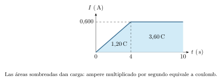
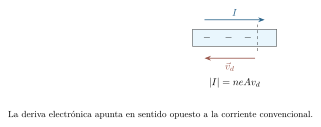
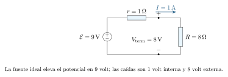
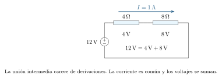
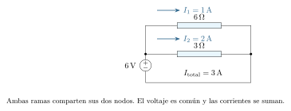
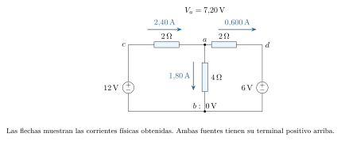

[← Capítulo anterior](capitulo-17.html) · [Índice del libro](index.html) · [Capítulo siguiente →](capitulo-19.html)

Al conectar una pila a un resistor, las cargas del conductor adquieren un movimiento de deriva y la pila comienza a entregar energía. Para describir lo que ocurre necesitamos conocer cuánta carga atraviesa cada sección por segundo y qué energía se transfiere por unidad de carga. Esas dos preguntas conducirán a la corriente y al voltaje de los elementos.

Un circuito puede dibujarse de muchas maneras conservando sus conexiones. Aprenderemos a reconocerlas, a seguir el potencial por distintos recorridos y a comprobar que la energía entregada por las fuentes coincide con la que reciben los otros elementos. Las mediciones entrarán en esa misma descripción: al conectar un instrumento también estamos modificando la red.

## Corriente: seguir la carga que atraviesa una sección

Imaginemos una sección transversal fija de un cable. La carga que la atraviesa durante un intervalo permite definir la corriente media,
$$
 I_{\mathrm{med}}=\frac{\Delta Q}{\Delta t},\qquad
 I(t)=\frac{dQ}{dt}.
$$
El ampere, símbolo $\,\mathrm{A}$, equivale a un coulomb por segundo. La función $Q(t)$ cuenta la transferencia acumulada con signo respecto de un sentido elegido. Una corriente de $0{,}20\,\mathrm{A}$ mantenida durante $5\,\mathrm{s}$ corresponde al paso de $1\,\mathrm{C}$ de carga convencional en ese sentido. Para una corriente variable, la carga transferida es el área con signo bajo su gráfica:
$$
 \Delta Q=\int_{t_i}^{t_f}I(t)\,dt.
$$

El sentido convencional de la corriente es el del transporte de carga positiva. En un metal, los portadores móviles son electrones: su deriva apunta en sentido opuesto. En una disolución pueden contribuir iones de ambos signos; un ion positivo hacia la derecha y uno negativo hacia la izquierda aportan corriente convencional hacia la derecha. Al asignar una flecha a una rama fijamos una referencia. Un valor negativo del cálculo indica corriente convencional en el sentido contrario.

### Problema resuelto 18.1 · Contar la transferencia de carga {#r18-1}

Un cable metálico conduce una corriente constante de $0{,}250\,\mathrm{A}$ durante $120\,\mathrm{s}$. Halla la carga convencional transferida y el número neto de electrones que atraviesa una sección. Usa $e=1{,}602176634\times10^{-19}\,\mathrm{C}$.
*Resolución.* La corriente fija una tasa de transferencia, de modo que
$$
 \Delta Q=I\Delta t=(0{,}250)(120)=30{,}0\,\mathrm{C},
 \qquad N=\frac{|\Delta Q|}{e}\simeq1{,}87\times10^{20}.
$$
Los electrones cruzan en sentido opuesto a la flecha de corriente. El conteo expresa el transporte neto durante esos dos minutos; en el cable hay además movimiento microscópico en muchas direcciones.

{#fig-fp-av-r18-1 fig-alt="Ilustración de Problema resuelto 18.1 · Contar la transferencia de carga. Un cable metálico conduce una corriente constante de 0,250\\,A durante 120\\,s. Halla la carga convencional transferida y el número neto de electrones que atraviesa una sección. Usa e=1,602176634times10^-19\\,C. Resolución. La corriente fija una tasa de transferencia, de modo que Delta Q=IDelta t=(0,250)(120)=30,0\\,C,"}

### Problema resuelto 18.2 · Acumular carga con una corriente variable {#r18-2}

Una corriente aumenta linealmente de cero a $0{,}600\,\mathrm{A}$ entre $t=0$ y $t=4{,}00\,\mathrm{s}$, y conserva ese valor hasta $t=10{,}0\,\mathrm{s}$. Calcula la carga transferida y la corriente media de los diez segundos.
*Resolución.* El primer intervalo aporta el área de un triángulo y el segundo, la de un rectángulo:
$$
 \Delta Q=\frac12(4{,}00)(0{,}600)+(6{,}00)(0{,}600)
 =1{,}20+3{,}60=4{,}80\,\mathrm{C}.
$$
La corriente media es $4{,}80/10{,}0=0{,}480\,\mathrm{A}$. El área reúne la transferencia de ambos intervalos y permite compararla con una corriente constante equivalente en ese tiempo.

{#fig-fp-av-r18-2 fig-alt="Ilustración de Problema resuelto 18.2 · Acumular carga con una corriente variable. Una corriente aumenta linealmente de cero a 0,600\\,A entre t=0 y t=4,00\\,s, y conserva ese valor hasta t=10,0\\,s. Calcula la carga transferida y la corriente media de los diez segundos. Resolución. El primer intervalo aporta el área de un triángulo y el segundo, la de un rectángulo: Delta"}

En un modelo uniforme, con $n$ portadores por unidad de volumen, carga de magnitud $|q|$, sección $A$ y rapidez de deriva $v_d$, durante $\Delta t$ atraviesan la sección los portadores contenidos en un volumen $Av_d\Delta t$. Por tanto, la magnitud de la corriente es
$$
 |I|=n|q|Av_d.
$$
La rapidez de deriva describe un promedio del movimiento. Al cerrar un interruptor, el campo electromagnético se reorganiza a lo largo del circuito y pone en deriva cargas que ya estaban distribuidas por él. La propagación de esa perturbación depende del medio y de la geometría; puede ser mucho más rápida que la deriva de cada electrón. La corriente mide transferencia de carga por tiempo, mientras que $v_d$ mide distancia por tiempo.

En un conductor resistivo con corriente estacionaria hay un campo eléctrico interno que sostiene esa deriva. La condición de campo cero del capítulo anterior corresponde al equilibrio electrostático. Las interacciones de los portadores con el material transfieren energía a sus grados de libertad microscópicos y permiten una deriva media estable.

### Problema resuelto 18.3 · Obtener una rapidez de deriva {#r18-3}

Un conductor contiene $n=8{,}00\times10^{28}\,\mathrm{m^{-3}}$ electrones móviles, tiene sección $1{,}00\,\mathrm{mm^2}$ y conduce $1{,}60\,\mathrm{A}$. Calcula la rapidez de deriva.
*Resolución.* La conversión de área es $1\,\mathrm{mm^2}=10^{-6}\,\mathrm{m^2}$. Así,
$$
 v_d=\frac{1{,}60}{(8{,}00\times10^{28})e(10^{-6})}
 \simeq1{,}25\times10^{-4}\,\mathrm{m/s}.
$$
Un desplazamiento medio de un metro a esa rapidez tomaría aproximadamente $8{,}01\times10^3\,\mathrm{s}$, unas $2{,}23\,\mathrm{h}$. Ese tiempo caracteriza el desplazamiento medio de portadores, y la respuesta eléctrica del circuito se establece mediante la propagación del campo.

{#fig-fp-av-r18-3 fig-alt="Ilustración de Problema resuelto 18.3 · Obtener una rapidez de deriva. Un conductor contiene n=8,00times10^28\\,mathrmm^-3 electrones móviles, tiene sección 1,00\\,mm^2 y conduce 1,60\\,A. Calcula la rapidez de deriva. Resolución. La conversión de área es 1\\,mm^2=10^-6\\,m^2. Así, vd=frac1,60(8,00times10^28)e(10^-6) simeq1,25times10^-4\\,m/s. Un desplazamiento medio de un metro a esa rapidez"}

## Resistencia, material y temperatura

Para estudiar un elemento de dos terminales, llamemos $a$ al terminal por el que entra la corriente de referencia $I$ y definamos $V_{ab}=V_a-V_b$. En un resistor óhmico, dentro del intervalo de operación y temperatura considerado,
$$
 V_{ab}=RI.
$$
La resistencia $R$ se mide en ohms: $1\,\mathrm{\Omega}=1\,\mathrm{V/A}$. La gráfica de $V_{ab}$ frente a $I$ es una recta que pasa por el origen, con pendiente $R$. Cuando $R>0$, la corriente convencional atraviesa el resistor hacia potenciales menores.

La proporcionalidad expresa un comportamiento experimental de determinados elementos bajo condiciones dadas. El cociente $V/I$ también puede calcularse en un punto de operación de un dispositivo de respuesta curva, pero ese valor por sí solo describe únicamente ese punto. Una lámpara incandescente, por ejemplo, cambia considerablemente su temperatura al variar la corriente y presenta una relación voltaje--corriente que exige tomar en cuenta ese calentamiento.

### Problema resuelto 18.4 · Reconocer una respuesta óhmica {#r18-4}

Manteniendo la temperatura de un elemento, se miden los pares $(I,V)=(0{,}050\,\mathrm{A},1{,}00\,\mathrm{V})$, $(0{,}100\,\mathrm{A},2{,}00\,\mathrm{V})$ y $(0{,}150\,\mathrm{A},3{,}00\,\mathrm{V})$. Encuentra su resistencia y predice la corriente a $4{,}00\,\mathrm{V}$ si la proporcionalidad continúa.
*Resolución.* Los tres cocientes son iguales: $V/I=20{,}0\,\mathrm{\Omega}$. Los puntos son compatibles con un modelo óhmico en el intervalo medido. Su prolongación hasta $4{,}00\,\mathrm{V}$ da $I=4{,}00/20{,}0=0{,}200\,\mathrm{A}$. La predicción mantiene explícitas la temperatura y la continuidad del modelo fuera de los datos medidos.

{#fig-fp-av-r18-4 fig-alt="Ilustración de Problema resuelto 18.4 · Reconocer una respuesta óhmica. Manteniendo la temperatura de un elemento, se miden los pares (I,V)=(0,050\\,A,1,00\\,V), (0,100\\,A,2,00\\,V) y (0,150\\,A,3,00\\,V). Encuentra su resistencia y predice la corriente a 4,00\\,V si la proporcionalidad continúa. Resolución. Los tres cocientes son iguales: V/I=20,0\\,Omega. Los puntos son compatibles con un"}

Para un alambre homogéneo, de sección uniforme, longitud $L$ y resistividad $\rho$,
$$
 R=\rho\frac{L}{A}.
$$
La resistividad, en $\,\mathrm{\Omega\,m}$, caracteriza la respuesta del material en las condiciones indicadas. Al aumentar la longitud se suma resistencia a lo largo del recorrido; al aumentar el área se ofrecen más caminos de transporte simultáneo. La resistencia depende de ambos aspectos geométricos. Si la sección es circular, $A=\pi d^2/4$, y duplicar el diámetro multiplica el área por cuatro.

### Problema resuelto 18.5 · Cambiar la geometría conservando material {#r18-5}

Un alambre tiene $\rho=2{,}00\times10^{-8}\,\mathrm{\Omega\,m}$, longitud $2{,}00\,\mathrm{m}$ y sección $0{,}500\,\mathrm{mm^2}$. Se fabrica con el mismo volumen otro alambre de longitud $4{,}00\,\mathrm{m}$. Supón resistividad y temperatura constantes. Calcula ambas resistencias.
*Resolución.* Inicialmente,
$$
 R=\frac{(2{,}00\times10^{-8})(2{,}00)}{0{,}500\times10^{-6}}
 =0{,}0800\,\mathrm{\Omega}.
$$
Conservar $AL$ exige reducir la sección a $0{,}250\,\mathrm{mm^2}$. La nueva longitud se duplica y el área se reduce a la mitad, de modo que $R'=4R=0{,}320\,\mathrm{\Omega}$. Hay que seguir los dos cambios geométricos.

{#fig-fp-av-r18-5 fig-alt="Ilustración de Problema resuelto 18.5 · Cambiar la geometría conservando material. Un alambre tiene rho=2,00times10^-8\\,Omega\\,m, longitud 2,00\\,m y sección 0,500\\,mm^2. Se fabrica con el mismo volumen otro alambre de longitud 4,00\\,m. Supón resistividad y temperatura constantes. Calcula ambas resistencias. Resolución. Inicialmente, R=frac(2,00times10^-8)(2,00)0,500times10^-6 =0,0800\\,Omega."}

En muchos metales, para un intervalo de temperatura suficientemente limitado, se usa la aproximación lineal
$$
 R(T)\simeq R_0[1+\alpha(T-T_0)].
$$
Aquí $R_0$ corresponde a $T_0$ y $\alpha$ es el coeficiente referido a esa temperatura, con unidades $\,\mathrm{K^{-1}}$ o $\,\mathrm{{}^{\circ}C^{-1}}$ para diferencias de temperatura. Su empleo supone que la respuesta puede aproximarse por una recta en el intervalo dado; también suele despreciar la pequeña contribución del cambio geométrico. Otros materiales pueden tener coeficientes de distinto signo y respuestas que requieren otro modelo.

### Problema resuelto 18.6 · Incluir el calentamiento de un resistor {#r18-6}

Un resistor tiene $R_0=10{,}0\,\mathrm{\Omega}$ a $20{,}0\,{}^{\circ}\mathrm C$ y $\alpha=4{,}00\times10^{-3}\,\mathrm{K^{-1}}$. El modelo lineal es válido hasta $70{,}0\,{}^{\circ}\mathrm C$. Halla su resistencia a esa temperatura y la corriente si se mantienen $6{,}00\,\mathrm{V}$ entre sus terminales.
*Resolución.* El aumento de temperatura es $50{,}0\,\mathrm{K}$. Por tanto,
$$
 R=10{,}0[1+(0{,}00400)(50{,}0)]=12{,}0\,\mathrm{\Omega},
 \qquad I=\frac{6{,}00}{12{,}0}=0{,}500\,\mathrm{A}.
$$
A $20\,{}^{\circ}\mathrm C$ la misma diferencia de potencial produciría $0{,}600\,\mathrm{A}$. El modelo relaciona el estado térmico con la corriente; para predecir cómo se alcanza esa temperatura haría falta además estudiar los intercambios térmicos.

{#fig-fp-av-r18-6 fig-alt="Ilustración de Problema resuelto 18.6 · Incluir el calentamiento de un resistor. Un resistor tiene R0=10,0\\,Omega a 20,0\\,^circmathrm C y alpha=4,00times10^-3\\,mathrmK^-1. El modelo lineal es válido hasta 70,0\\,^circmathrm C. Halla su resistencia a esa temperatura y la corriente si se mantienen 6,00\\,V entre sus terminales. Resolución. El aumento de temperatura es 50,0\\,K. Por tanto,"}

## Fuentes: energía por unidad de carga

Un resistor con corriente transforma energía eléctrica en energía interna. Para sostener el proceso, el circuito necesita una fuente que transfiera energía a los portadores mediante procesos químicos, mecánicos u otros. La fuerza electromotriz, o fem, se define como la energía que esos procesos aportan por unidad de carga transportada en el sentido de elevación de potencial de la fuente ideal:
$$
 \mathcal E=\frac{W_{\mathrm{fuente}}}{Q}.
$$
Su unidad es el volt. El nombre histórico designa una energía por carga. Una fuente ideal mantiene entre sus terminales el voltaje $\mathcal E$; la corriente depende de la red conectada. Los alambres ideales de nuestros esquemas tienen resistencia despreciable y cada tramo conectado sin elementos intermedios constituye un mismo nodo, de potencial único dentro de este modelo.

En los esquemas, un rectángulo representa un resistor y un círculo con signos $+$ y $-$ representa una fuente ideal de voltaje. Los puntos sólidos señalan uniones de conductores. Los instrumentos de medición aparecerán como círculos con las letras A o V.

Una fuente real puede representarse, en un intervalo de operación, mediante una fem ideal $\mathcal E$ en serie con una resistencia interna $r$. Durante la descarga, si sale una corriente $I$ por el terminal positivo, su voltaje terminal es
$$
 V_{\mathrm{term}}=\mathcal E-Ir.
$$
Al conectar un resistor externo $R$, el balance por unidad de carga da $\mathcal E=I(R+r)$, luego $I=\mathcal E/(R+r)$. En circuito abierto, la corriente estacionaria es cero y el modelo da $V_{\mathrm{term}}=\mathcal E$. La fem y $r$ de una pila real pueden cambiar con su estado de carga, su temperatura y el régimen de uso.

### Problema resuelto 18.7 · Separar voltaje terminal y fem {#r18-7}

Una fuente tiene $\mathcal E=9{,}00\,\mathrm{V}$ y $r=1{,}00\,\mathrm{\Omega}$. Alimenta un resistor de $8{,}00\,\mathrm{\Omega}$. Calcula la corriente, el voltaje terminal y la energía transferida por coulomb en cada parte.
*Resolución.* La corriente es
$$
 I=\frac{9{,}00}{8{,}00+1{,}00}=1{,}00\,\mathrm{A},
 \qquad V_{\mathrm{term}}=9{,}00-(1{,}00)(1{,}00)=8{,}00\,\mathrm{V}.
$$
Por cada coulomb convencional, los procesos de la fuente entregan $9\,\mathrm{J}$; el resistor externo recibe $8\,\mathrm{J}$ y la resistencia interna, $1\,\mathrm{J}$. El voltaje terminal también se comprueba con $IR=8\,\mathrm{V}$.

{#fig-fp-av-r18-7 fig-alt="Ilustración de Problema resuelto 18.7 · Separar voltaje terminal y fem. Una fuente tiene mathcal E=9,00\\,V y r=1,00\\,Omega. Alimenta un resistor de 8,00\\,Omega. Calcula la corriente, el voltaje terminal y la energía transferida por coulomb en cada parte. Resolución. La corriente es I=frac9,008,00+1,00=1,00\\,A, qquad Vterm=9,00-(1,00)(1,00)=8,00\\,V. Por cada coulomb convencional, los"}

### Problema resuelto 18.8 · Inferir un modelo de fuente a partir de mediciones {#r18-8}

Una fuente en descarga presenta $2{,}90\,\mathrm{V}$ cuando entrega $0{,}200\,\mathrm{A}$ y $2{,}60\,\mathrm{V}$ cuando entrega $0{,}800\,\mathrm{A}$. Supón constantes $\mathcal E$ y $r$ entre ambas mediciones. Halla sus valores.
*Resolución.* Al restar $V_1=\mathcal E-I_1r$ y $V_2=\mathcal E-I_2r$, resulta
$$
 r=\frac{2{,}90-2{,}60}{0{,}800-0{,}200}
 =0{,}500\,\mathrm{\Omega}.
$$
Entonces $\mathcal E=2{,}90+(0{,}200)(0{,}500)=3{,}00\,\mathrm{V}$. En la gráfica de voltaje terminal frente a corriente, la ordenada en el origen es $\mathcal E$ y la pendiente es $-r$.

{#fig-fp-av-r18-8 fig-alt="Ilustración de Problema resuelto 18.8 · Inferir un modelo de fuente a partir de mediciones. Una fuente en descarga presenta 2,90\\,V cuando entrega 0,200\\,A y 2,60\\,V cuando entrega 0,800\\,A. Supón constantes mathcal E y r entre ambas mediciones. Halla sus valores. Resolución. Al restar V1=mathcal E-I1r y V2=mathcal E-I2r, resulta r=frac2,90-2,600,800-0,200 =0,500\\,Omega. Entonces mathcal"}

## Potencia y energía transferida

Si una carga $\Delta Q$ atraviesa un elemento desde $a$ hacia $b$, la disminución de su energía potencial es $V_{ab}\Delta Q$. Con la corriente de referencia entrando por $a$, la potencia eléctrica recibida por el elemento es
$$
 P=V_{ab}I.
$$
Esta convención permite interpretar el signo: $P>0$ corresponde a recepción de energía eléctrica y $P<0$, a entrega. En un resistor óhmico, sustituir $V_{ab}=RI$ produce
$$
 P=I^2R=\frac{V_{ab}^2}{R}.
$$
Las tres expresiones se refieren al mismo estado de operación. Para comparar estados, hay que identificar qué mantiene el circuito: una fuente de voltaje fijo y una fuente de corriente fija conducen a comparaciones diferentes.

En régimen constante, la energía transferida durante $\Delta t$ es $E_{\mathrm{trans}}=P\Delta t$. Si la potencia varía, se integra sobre el tiempo. El joule es la unidad SI; el kilowatt-hora es otra unidad de energía, con
$$
 1\,\mathrm{kWh}=10^3\,\mathrm{W}\times3600\,\mathrm{s}=3{,}60\times10^6\,\mathrm{J}.
$$
El producto potencia por tiempo mide una acumulación. Al hablar de consumo de energía, seguimos su transferencia y transformación en el dispositivo y su entorno, de acuerdo con la conservación de la energía estudiada en los capítulos anteriores.

### Problema resuelto 18.9 · Pasar de voltaje y resistencia a energía {#r18-9}

Un resistor óhmico de $24{,}0\,\mathrm{\Omega}$ se mantiene a $12{,}0\,\mathrm{V}$ durante $5{,}00\,\mathrm{min}$. Supón resistencia constante. Calcula corriente, potencia y energía en joules y kilowatt-horas.
*Resolución.* La corriente es $I=12{,}0/24{,}0=0{,}500\,\mathrm{A}$. La potencia recibida es $P=VI=(12{,}0)(0{,}500)=6{,}00\,\mathrm{W}$. En $300\,\mathrm{s}$ se transfieren
$$
 E_{\mathrm{trans}}=(6{,}00)(300)=1{,}80\times10^3\,\mathrm{J}
 =5{,}00\times10^{-4}\,\mathrm{kWh}.
$$
Si la temperatura del resistor permaneciera constante, esa energía tendría que salir hacia el entorno a la misma tasa media a la que entra, una vez alcanzado el régimen térmico estacionario.

{#fig-fp-av-r18-9 fig-alt="Ilustración de Problema resuelto 18.9 · Pasar de voltaje y resistencia a energía. Un resistor óhmico de 24,0\\,Omega se mantiene a 12,0\\,V durante 5,00\\,min. Supón resistencia constante. Calcula corriente, potencia y energía en joules y kilowatt-horas. Resolución. La corriente es I=12,0/24,0=0,500\\,A. La potencia recibida es P=VI=(12,0)(0,500)=6,00\\,W. En 300\\,s se transfieren"}

### Problema resuelto 18.10 · Comparar potencias y explicitar qué se mantiene {#r18-10}

Compara resistores de $6{,}00\,\mathrm{\Omega}$ y $12{,}0\,\mathrm{\Omega}$ cuando cada uno se conecta por separado a $6{,}00\,\mathrm{V}$. Repite la comparación si una fuente mantiene $0{,}500\,\mathrm{A}$ en cada ensayo.
*Resolución.* A voltaje fijo, $P=V^2/R$: las potencias son $6{,}00\,\mathrm{W}$ y $3{,}00\,\mathrm{W}$, respectivamente. A corriente fija, $P=I^2R$: son $1{,}50\,\mathrm{W}$ y $3{,}00\,\mathrm{W}$. En el segundo ensayo la fuente ajusta el voltaje a $3{,}00\,\mathrm{V}$ o $6{,}00\,\mathrm{V}$ para sostener la misma corriente. La condición impuesta por la fuente determina cómo cambia la potencia.

{#fig-fp-av-r18-10 fig-alt="Ilustración de Problema resuelto 18.10 · Comparar potencias y explicitar qué se mantiene. Compara resistores de 6,00\\,Omega y 12,0\\,Omega cuando cada uno se conecta por separado a 6,00\\,V. Repite la comparación si una fuente mantiene 0,500\\,A en cada ensayo. Resolución. A voltaje fijo, P=V^2/R: las potencias son 6,00\\,W y 3,00\\,W, respectivamente. A corriente fija, P=I^2R: son 1,50\\,W y 3,00\\,W. En el"}

## Reconocer conexiones y reducir una red

La información decisiva de un esquema reside en qué terminales están conectados. Dos resistores están en serie cuando comparten una unión sin derivaciones y, por tanto, llevan la misma corriente en régimen estacionario. El voltaje entre los extremos del conjunto se obtiene sumando las caídas:
$$
 V=IR_1+IR_2=I(R_1+R_2),\qquad
 R_{\mathrm{eq,serie}}=\sum_i R_i.
$$
El equivalente reproduce la relación entre el voltaje aplicado al conjunto y la corriente que entra por sus terminales. La suma es mayor que cualquiera de sus resistencias positivas individuales.

### Problema resuelto 18.11 · Repartir voltajes en una conexión en serie {#r18-11}

Una fuente ideal de $12{,}0\,\mathrm{V}$ alimenta resistores de $4{,}00\,\mathrm{\Omega}$ y $8{,}00\,\mathrm{\Omega}$ en serie. Calcula la corriente, los voltajes y las potencias.
*Resolución.* La resistencia equivalente es $12{,}0\,\mathrm{\Omega}$ y la corriente común, $1{,}00\,\mathrm{A}$. Los voltajes son $4{,}00\,\mathrm{V}$ y $8{,}00\,\mathrm{V}$; su suma recupera los $12{,}0\,\mathrm{V}$ de la fuente. Las potencias son $4{,}00\,\mathrm{W}$ y $8{,}00\,\mathrm{W}$, que suman los $12{,}0\,\mathrm{W}$ entregados. En cada resistor entra y sale la misma corriente: la transferencia de energía se manifiesta en la caída de potencial.

{#fig-fp-av-r18-11 fig-alt="Ilustración de Problema resuelto 18.11 · Repartir voltajes en una conexión en serie. Una fuente ideal de 12,0\\,V alimenta resistores de 4,00\\,Omega y 8,00\\,Omega en serie. Calcula la corriente, los voltajes y las potencias. Resolución. La resistencia equivalente es 12,0\\,Omega y la corriente común, 1,00\\,A. Los voltajes son 4,00\\,V y 8,00\\,V; su suma recupera los 12,0\\,V de la fuente. Las potencias"}

Dos resistores están en paralelo cuando sus terminales se conectan a los mismos dos nodos. Ambos tienen el mismo voltaje $V$ y las corrientes de rama se suman a la entrada. Así,
$$
 I=\frac{V}{R_1}+\frac{V}{R_2},\qquad
 \frac{1}{R_{\mathrm{eq,paralelo}}}=\sum_i\frac{1}{R_i}.
$$
Para dos resistores, $R_{\mathrm{eq}}=R_1R_2/(R_1+R_2)$. Agregar una rama conductora ofrece otra vía a la corriente y reduce la resistencia equivalente por debajo de la menor resistencia individual positiva. Esa conclusión supone los mismos dos nodos de comparación.

### Problema resuelto 18.12 · Repartir corrientes en una conexión en paralelo {#r18-12}

Resistores de $6{,}00\,\mathrm{\Omega}$ y $3{,}00\,\mathrm{\Omega}$ se conectan en paralelo a una fuente ideal de $6{,}00\,\mathrm{V}$. Obtén las corrientes y verifica la potencia total.
*Resolución.* Cada rama tiene $6{,}00\,\mathrm{V}$. Sus corrientes son $I_1=6/6=1{,}00\,\mathrm{A}$ e $I_2=6/3=2{,}00\,\mathrm{A}$. La fuente entrega $I=3{,}00\,\mathrm{A}$, coherente con $R_{\mathrm{eq}}=2{,}00\,\mathrm{\Omega}$. Las potencias son $6{,}00\,\mathrm{W}$ y $12{,}0\,\mathrm{W}$, cuya suma $18{,}0\,\mathrm{W}$ coincide con $VI$. Cada rama aporta su propia transferencia de energía por segundo.

{#fig-fp-av-r18-12 fig-alt="Ilustración de Problema resuelto 18.12 · Repartir corrientes en una conexión en paralelo. Resistores de 6,00\\,Omega y 3,00\\,Omega se conectan en paralelo a una fuente ideal de 6,00\\,V. Obtén las corrientes y verifica la potencia total. Resolución. Cada rama tiene 6,00\\,V. Sus corrientes son I1=6/6=1,00\\,A e I2=6/3=2,00\\,A. La fuente entrega I=3,00\\,A, coherente con Req=2,00\\,Omega. Las potencias son"}

Para reducir una red mixta, conviene marcar primero los nodos unidos por alambres ideales y buscar grupos que satisfagan las condiciones anteriores. Después de cada sustitución se vuelve a examinar la conexión. Una vez obtenida la corriente total, se recorre la reducción en sentido inverso para recuperar voltajes y corrientes de rama. La posición de los símbolos en la página puede cambiar libremente mientras se conserven esos nodos.

### Problema resuelto 18.13 · Resolver un circuito mixto y reconstruir sus ramas {#r18-13}

Una fuente ideal de $12{,}0\,\mathrm{V}$ alimenta $R_0=2{,}00\,\mathrm{\Omega}$ en serie con el paralelo de $R_1=6{,}00\,\mathrm{\Omega}$ y $R_2=3{,}00\,\mathrm{\Omega}$. Calcula todas las corrientes y potencias.
*Resolución.* El paralelo equivale a $2{,}00\,\mathrm{\Omega}$, así que el conjunto equivale a $4{,}00\,\mathrm{\Omega}$ y toma $3{,}00\,\mathrm{A}$. En $R_0$ caen $(3)(2)=6{,}00\,\mathrm{V}$ y quedan $6{,}00\,\mathrm{V}$ para el paralelo. Sus corrientes son $1{,}00\,\mathrm{A}$ y $2{,}00\,\mathrm{A}$, cuya suma recupera los $3{,}00\,\mathrm{A}$ de entrada. Las potencias resultan
$$
 P_0=18{,}0\,\mathrm{W},\qquad P_1=6{,}00\,\mathrm{W},\qquad
 P_2=12{,}0\,\mathrm{W}.
$$
La suma es $36{,}0\,\mathrm{W}=(12{,}0\,\mathrm{V})(3{,}00\,\mathrm{A})$. Conocer únicamente la resistencia equivalente permite calcular la corriente total; reconstruir la red permite conocer el estado de cada elemento.

{#fig-fp-av-r18-13 fig-alt="Ilustración de Problema resuelto 18.13 · Resolver un circuito mixto y reconstruir sus ramas. Una fuente ideal de 12,0\\,V alimenta R0=2,00\\,Omega en serie con el paralelo de R1=6,00\\,Omega y R2=3,00\\,Omega. Calcula todas las corrientes y potencias. Resolución. El paralelo equivale a 2,00\\,Omega, así que el conjunto equivale a 4,00\\,Omega y toma 3,00\\,A. En R0 caen (3)(2)=6,00\\,V y quedan 6,00\\,V para el"}

## Leyes de Kirchhoff y elección de signos

La conservación de la carga en una región que contiene una unión exige
$$
 \frac{dQ_{\mathrm{nodo}}}{dt}=\sum I_{\mathrm{entra}}-\sum I_{\mathrm{sale}}.
$$
En el régimen estacionario que estudiamos, la carga del nodo permanece constante y la suma de corrientes entrantes iguala la de salientes. Esta es la ley de nodos de Kirchhoff. La pequeña redistribución superficial que establece los campos y potenciales del circuito ocurre durante el proceso de conexión; el modelo estacionario describe el estado posterior.

La ley de recorridos cerrados establece que la suma algebraica de cambios de potencial en un lazo es cero. Se aplica aquí al modelo de elementos concentrados, con régimen estacionario y efectos de inducción variables despreciables. Partir de un punto y regresar al mismo punto exige recuperar su potencial. Una fuente ideal se representa por un aumento $+\mathcal E$ al recorrerla del terminal negativo al positivo, o por $-\mathcal E$ en el recorrido opuesto. En un resistor, avanzar en el sentido de su corriente de referencia aporta $-IR$, y avanzar al contrario aporta $+IR$.

Las flechas y los sentidos de recorrido pueden elegirse antes de conocer la solución. Lo necesario es conservarlos en todas las ecuaciones. Los resultados con signo permiten recuperar el sentido físico y comprobar que cada resistor recibe potencia $I^2R$. Una red con varios lazos puede resolverse mediante ecuaciones de nodos o mediante un conjunto independiente de ecuaciones de lazo, junto con las relaciones entre corrientes.

### Problema resuelto 18.14 · Resolver un nodo alimentado por dos fuentes {#r18-14}

Toma un nodo inferior $b$ como $0\,\mathrm{V}$. Una fuente ideal fija un terminal $c$ a $12{,}0\,\mathrm{V}$ y otra fija un terminal $d$ a $6{,}00\,\mathrm{V}$. Hay un resistor de $2{,}00\,\mathrm{\Omega}$ entre $c$ y un nodo $a$, uno de $2{,}00\,\mathrm{\Omega}$ entre $a$ y $d$, y uno de $4{,}00\,\mathrm{\Omega}$ entre $a$ y $b$. Los terminales negativos de ambas fuentes están unidos a $b$. Halla el potencial de $a$ y las corrientes.
*Resolución.* Definimos las tres corrientes de referencia saliendo de $a$. La ley de nodos da
$$
 \frac{V_a-12}{2}+\frac{V_a-6}{2}+\frac{V_a}{4}=0,
 \qquad 5V_a=36,\qquad V_a=7{,}20\,\mathrm{V}.
$$
En la rama hacia $c$ se obtiene $-2{,}40\,\mathrm{A}$: físicamente entran $2{,}40\,\mathrm{A}$ desde la fuente de $12\,\mathrm{V}$. Salen $0{,}600\,\mathrm{A}$ hacia $d$ y $1{,}80\,\mathrm{A}$ hacia $b$. Se verifica $2{,}40=0{,}600+1{,}80$.

La fuente de $12\,\mathrm{V}$ entrega $28{,}8\,\mathrm{W}$. La de $6\,\mathrm{V}$ recibe $3{,}60\,\mathrm{W}$, pues la corriente entra por su terminal positivo. Los resistores reciben $11{,}52\,\mathrm{W}$, $0{,}720\,\mathrm{W}$ y $12{,}96\,\mathrm{W}$, que suman $25{,}20\,\mathrm{W}$. El balance es $28{,}8=25{,}2+3{,}6$. La fuente ideal receptora representa un elemento capaz de absorber esa energía; la posibilidad de recargar una batería concreta exige además que su tecnología y control lo permitan.

{#fig-fp-av-r18-14 fig-alt="Ilustración de Problema resuelto 18.14 · Resolver un nodo alimentado por dos fuentes. La fuente de 12\\,V entrega 28,8\\,W. La de 6\\,V recibe 3,60\\,W, pues la corriente entra por su terminal positivo. Los resistores reciben 11,52\\,W, 0,720\\,W y 12,96\\,W, que suman 25,20\\,W. El balance es 28,8=25,2+3,6. La fuente ideal receptora representa un elemento capaz de absorber esa energía; la posibilidad de"}

También podemos resolver el problema anterior con dos corrientes de lazo, $i_1$ en el lazo izquierdo e $i_2$ en el derecho, ambas en sentido horario. El resistor central conduce $i_1-i_2$ hacia abajo. Las ecuaciones son $6i_1-4i_2=12$ y $-4i_1+6i_2=-6$. Dan $i_1=2{,}40\,\mathrm{A}$ e $i_2=0{,}600\,\mathrm{A}$. El mismo circuito admite distintas incógnitas; los voltajes y las corrientes físicas coinciden.

### Problema resuelto 18.15 · Interpretar una corriente de referencia negativa {#r18-15}

Dos fuentes ideales de $12{,}0\,\mathrm{V}$ y $9{,}00\,\mathrm{V}$ se conectan en oposición en un único lazo, con una resistencia total de $3{,}00\,\mathrm{\Omega}$. Elige como referencia una corriente que recorra la fuente de $9\,\mathrm{V}$ de negativo a positivo y la de $12\,\mathrm{V}$ de positivo a negativo. Calcula e interpreta el resultado.
*Resolución.* Con esa referencia, la ecuación del lazo es
$$
 9-12-3I=0,\qquad I=-1{,}00\,\mathrm{A}.
$$
La corriente real tiene magnitud $1{,}00\,\mathrm{A}$ y sentido opuesto al elegido: sale del terminal positivo de la fuente de $12\,\mathrm{V}$ y entra en el positivo de la de $9\,\mathrm{V}$. La primera entrega $12{,}0\,\mathrm{W}$, la segunda recibe $9{,}00\,\mathrm{W}$ y el resistor recibe $3{,}00\,\mathrm{W}$. La ecuación con signo conserva la elección inicial y el balance de energía verifica su interpretación.

{#fig-fp-av-r18-15 fig-alt="Ilustración de Problema resuelto 18.15 · Interpretar una corriente de referencia negativa. Dos fuentes ideales de 12,0\\,V y 9,00\\,V se conectan en oposición en un único lazo, con una resistencia total de 3,00\\,Omega. Elige como referencia una corriente que recorra la fuente de 9\\,V de negativo a positivo y la de 12\\,V de positivo a negativo. Calcula e interpreta el resultado. Resolución. Con esa referencia,"}

## Medir también forma parte del circuito

Un amperímetro se intercala en la rama cuya corriente se quiere medir. En el modelo ideal su resistencia es cero, así que reemplaza un tramo de alambre sin añadir caída de potencial. Un voltímetro se conecta entre los dos puntos cuyo voltaje se quiere conocer; en el modelo ideal su resistencia es infinita y su corriente es cero. Esas idealizaciones permiten atribuir la lectura al circuito original.

Los instrumentos reales tienen resistencias de entrada finitas y otras limitaciones. Para incluir su efecto, se incorporan como elementos de la red: la resistencia del amperímetro queda en serie y la del voltímetro, en paralelo con la parte medida. La precisión del valor mostrado y la perturbación que produce el instrumento son cuestiones relacionadas, pero diferentes. Un instrumento puede leer con mucha precisión el voltaje del circuito que él mismo ha modificado.

### Problema resuelto 18.16 · Comparar amperímetros ideal y real {#r18-16}

Una fuente ideal de $6{,}00\,\mathrm{V}$ alimenta un resistor de $30{,}0\,\mathrm{\Omega}$. Un voltímetro ideal se conecta entre los extremos del resistor. Halla las lecturas con un amperímetro ideal en serie y luego con uno de resistencia $2{,}00\,\mathrm{\Omega}$.
*Resolución.* Con instrumentos ideales, el amperímetro lee $6/30=0{,}200\,\mathrm{A}$ y el voltímetro, $6{,}00\,\mathrm{V}$. Con el amperímetro real, la resistencia total pasa a $32{,}0\,\mathrm{\Omega}$, luego
$$
 I=\frac{6{,}00}{32{,}0}=0{,}1875\,\mathrm{A},\qquad
 V_R=(0{,}1875)(30{,}0)=5{,}625\,\mathrm{V}.
$$
Los otros $0{,}375\,\mathrm{V}$ caen en el amperímetro. La corriente disminuye un $6{,}25\%$ respecto del circuito con amperímetro ideal. El voltímetro continúa conectado exclusivamente entre los extremos del resistor de $30\,\mathrm{\Omega}$.

{#fig-fp-av-r18-16 fig-alt="Ilustración de Problema resuelto 18.16 · Comparar amperímetros ideal y real. Una fuente ideal de 6,00\\,V alimenta un resistor de 30,0\\,Omega. Un voltímetro ideal se conecta entre los extremos del resistor. Halla las lecturas con un amperímetro ideal en serie y luego con uno de resistencia 2,00\\,Omega. Resolución. Con instrumentos ideales, el amperímetro lee 6/30=0,200\\,A y el voltímetro,"}

### Problema resuelto 18.17 · Calcular el efecto de conectar un voltímetro {#r18-17}

Dos resistores de $10{,}0\,\mathrm{k\Omega}$ están en serie a una fuente ideal de $9{,}00\,\mathrm{V}$. Se conecta un voltímetro de resistencia $10{,}0\,\mathrm{k\Omega}$ entre los extremos del resistor inferior. Calcula su lectura y compárala con el voltaje anterior a conectarlo.
*Resolución.* Antes de medir, la corriente es $9/20\,000=0{,}450\,\mathrm{mA}$ y cada resistor tiene $4{,}50\,\mathrm{V}$. Al conectar el instrumento, este queda en paralelo con el resistor inferior: ambos equivalen a $5{,}00\,\mathrm{k\Omega}$. La corriente que pasa por el resistor superior aumenta a $9/15\,000=0{,}600\,\mathrm{mA}$. El voltaje inferior y la lectura son
$$
 V_{\mathrm{lectura}}=(0{,}600\,\mathrm{mA})(5{,}00\,\mathrm{k\Omega})=3{,}00\,\mathrm{V}.
$$
Por el resistor inferior y por el voltímetro pasan $0{,}300\,\mathrm{mA}$ en cada rama. La lectura es dos tercios del voltaje previo. Una resistencia de entrada mucho mayor que la del tramo medido reduciría esta perturbación.

{#fig-fp-av-r18-17 fig-alt="Ilustración de Problema resuelto 18.17 · Calcular el efecto de conectar un voltímetro. Dos resistores de 10,0\\,kOmega están en serie a una fuente ideal de 9,00\\,V. Se conecta un voltímetro de resistencia 10,0\\,kOmega entre los extremos del resistor inferior. Calcula su lectura y compárala con el voltaje anterior a conectarlo. Resolución. Antes de medir, la corriente es 9/20\\,000=0,450\\,mA y cada"}

## Límites de operación y decisiones de diseño

Las ecuaciones de una red deben contrastarse con los límites de sus componentes. Un resistor tiene una potencia nominal que depende de las condiciones térmicas especificadas; los cables y las fuentes también tienen límites de corriente. Para un resistor ideal de valor constante, una cota de potencia $P_{\max}$ permite obtener $|I|\leq\sqrt{P_{\max}/R}$ y $|V|\leq\sqrt{P_{\max}R}$. En un montaje real se consideran además tolerancias, ventilación y condiciones de uso.

La conexión directa de un amperímetro de baja resistencia entre los terminales de una fuente crea una rama de corriente potencialmente muy elevada. Su lugar de medición es en serie, con rango, bornes y protección apropiados. Un cortocircuito ofrece un camino de resistencia pequeña que puede llevar la fuente y los conductores fuera de sus límites. En el modelo de fuente con resistencia interna, $I=\mathcal E/(R+r)$ aumenta al reducirse $R$; cerca del cortocircuito pueden hacerse importantes efectos térmicos y limitaciones que ese modelo simple omite.

Los límites nominales de un componente y la seguridad de una persona describen problemas diferentes. Esta depende de la trayectoria de corriente, del contacto, del entorno y del tiempo de exposición, entre otros factores. Las prácticas de este capítulo se restringen a fuentes de laboratorio de baja tensión y energía limitada o a simulaciones, con supervisión y componentes adecuados. Las instalaciones conectadas a la red requieren personal competente y protecciones reglamentarias. El cálculo elemental de un circuito sirve para interpretar su funcionamiento dentro de las hipótesis establecidas.

### Problema resuelto 18.18 · Comprobar límites en una red de baja tensión {#r18-18}

Una fuente regulada mantiene $12{,}0\,\mathrm{V}$ hasta una corriente total de $50{,}0\,\mathrm{mA}$. Se conectan ramas iguales, cada una con un resistor de $1{,}20\,\mathrm{k\Omega}$ y potencia nominal $0{,}250\,\mathrm{W}$ en las condiciones especificadas. Calcula el máximo número de ramas permitido por esos dos límites ideales y el estado de operación con cuatro ramas. Supón valores exactos para esta comprobación.
*Resolución.* Cada rama toma $12/1200=0{,}0100\,\mathrm{A}$ y recibe $12^2/1200=0{,}120\,\mathrm{W}$, dentro de la potencia indicada. El límite de corriente admite $50/10=5$ ramas en este modelo. Con cuatro ramas,
$$
 R_{\mathrm{eq}}=300\,\mathrm{\Omega},\qquad I_{\mathrm{total}}=40{,}0\,\mathrm{mA},
 \qquad P_{\mathrm{total}}=0{,}480\,\mathrm{W}.
$$
Quedan $10{,}0\,\mathrm{mA}$ hasta la cota de corriente. Una sexta rama exigiría $60\,\mathrm{mA}$ si el voltaje continuara en $12\,\mathrm{V}$, y esa exigencia supera el intervalo regulado declarado. El estado real entonces dependería de la respuesta de protección de la fuente. La comprobación realizada usa las condiciones nominales dadas; un diseño concreto debe incluir sus tolerancias y condiciones térmicas.

{#fig-fp-av-r18-18 fig-alt="Ilustración de Problema resuelto 18.18 · Comprobar límites en una red de baja tensión. Una fuente regulada mantiene 12,0\\,V hasta una corriente total de 50,0\\,mA. Se conectan ramas iguales, cada una con un resistor de 1,20\\,kOmega y potencia nominal 0,250\\,W en las condiciones especificadas. Calcula el máximo número de ramas permitido por esos dos límites ideales y el estado de operación con cuatro"}

## Ejercicios para reconstruir y transferir

Usa $e=1{,}602176634\times10^{-19}\,\mathrm{C}$. Supón alambres ideales, resistores óhmicos de valor constante y fuentes ideales, salvo indicación explícita. Las fem indicadas son positivas del terminal negativo al positivo. Representa los nodos antes de reducir una red.

### Ejercicio 18.1 · Una corriente durante un intervalo {#e18-1}

Por un cable metálico pasan $0{,}0800\,\mathrm{A}$ durante $75{,}0\,\mathrm{s}$. Calcula la carga convencional transferida y el conteo neto de electrones que cruza una sección.

### Ejercicio 18.2 · El área de un trapecio {#e18-2}

Una corriente aumenta linealmente desde $0{,}200\,\mathrm{A}$ a $0{,}600\,\mathrm{A}$ en $5{,}00\,\mathrm{s}$. Halla la carga transferida y la corriente media.

### Ejercicio 18.3 · Deriva y sección {#e18-3}

Un conductor tiene $n=5{,}00\times10^{28}\,\mathrm{m^{-3}}$ electrones móviles, sección $2{,}00\,\mathrm{mm^2}$ y corriente $0{,}800\,\mathrm{A}$. Calcula $v_d$ y predice su cambio si la sección se reduce a la mitad manteniendo $n$ e $I$.

### Ejercicio 18.4 · Una recta de operación {#e18-4}

A temperatura fija se miden $(V,I)=(2{,}00\,\mathrm{V},0{,}100\,\mathrm{A})$, $(4{,}00\,\mathrm{V},0{,}200\,\mathrm{A})$ y $(6{,}00\,\mathrm{V},0{,}300\,\mathrm{A})$. Halla $R$ y la corriente predicha a $12{,}0\,\mathrm{V}$ si continúa el modelo óhmico.

### Ejercicio 18.5 · Tres cocientes diferentes {#e18-5}

Un dispositivo presenta $(V,I)=(1{,}00\,\mathrm{V},0{,}100\,\mathrm{A})$, $(2{,}00\,\mathrm{V},0{,}160\,\mathrm{A})$ y $(3{,}00\,\mathrm{V},0{,}200\,\mathrm{A})$. Calcula $V/I$ en cada punto y evalúa si un único resistor óhmico representa los tres datos exactamente.

### Ejercicio 18.6 · Resistencia de un alambre {#e18-6}

Un alambre uniforme tiene $\rho=1{,}50\times10^{-6}\,\mathrm{\Omega\,m}$, $L=0{,}800\,\mathrm{m}$ y $A=0{,}200\,\mathrm{mm^2}$. Calcula su resistencia.

### Ejercicio 18.7 · Triplicar la longitud con el mismo volumen {#e18-7}

Se rehace un alambre con el triple de longitud y el mismo volumen. Se conservan material, temperatura y resistividad. Encuentra $A'/A$ y $R'/R$.

### Ejercicio 18.8 · Una resistencia a otra temperatura {#e18-8}

Un resistor tiene $100\,\mathrm{\Omega}$ a $20{,}0\,{}^{\circ}\mathrm C$ y $\alpha=3{,}00\times10^{-3}\,\mathrm{K^{-1}}$. Calcula $R$ a $70{,}0\,{}^{\circ}\mathrm C$ usando el modelo lineal en ese intervalo.

### Ejercicio 18.9 · Una fuente con resistencia interna {#e18-9}

Una fuente de fem $6{,}00\,\mathrm{V}$ y resistencia interna $0{,}500\,\mathrm{\Omega}$ alimenta $2{,}50\,\mathrm{\Omega}$. Halla $I$, $V_{\mathrm{term}}$, la potencia aportada por la fem y las potencias recibidas por ambas resistencias.

### Ejercicio 18.10 · Dos mediciones de una fuente {#e18-10}

Una fuente en descarga tiene $4{,}40\,\mathrm{V}$ al entregar $0{,}200\,\mathrm{A}$ y $4{,}00\,\mathrm{V}$ al entregar $0{,}600\,\mathrm{A}$. Obtén $\mathcal E$ y $r$ en el modelo lineal.

### Ejercicio 18.11 · Energía en un resistor {#e18-11}

Un resistor de $50{,}0\,\mathrm{\Omega}$ permanece a $10{,}0\,\mathrm{V}$ durante $15{,}0\,\mathrm{min}$. Calcula $I$, $P$ y la energía en joules y kilowatt-horas.

### Ejercicio 18.12 · Potencia y tiempo de uso {#e18-12}

Un dispositivo recibe una potencia constante de $60{,}0\,\mathrm{W}$ durante $2{,}00\,\mathrm{h}$. Expresa la energía transferida en kilowatt-horas y joules.

### Ejercicio 18.13 · Reducir resistencia a voltaje fijo {#e18-13}

Un resistor conectado a una fuente de voltaje fijo se reemplaza por otro cuya resistencia es la mitad. Halla los factores de cambio de corriente y potencia.

### Ejercicio 18.14 · Dos resistores en serie {#e18-14}

Una fuente de $24{,}0\,\mathrm{V}$ alimenta resistores de $3{,}00\,\mathrm{\Omega}$ y $9{,}00\,\mathrm{\Omega}$ en serie. Calcula corriente, voltajes y potencias individuales.

### Ejercicio 18.15 · Dos resistores en paralelo {#e18-15}

Resistores de $4{,}00\,\mathrm{\Omega}$ y $12{,}0\,\mathrm{\Omega}$ comparten los terminales de una fuente de $12{,}0\,\mathrm{V}$. Halla $R_{\mathrm{eq}}$, corrientes y potencia total.

### Ejercicio 18.16 · Reconstruir un circuito mixto {#e18-16}

Una fuente de $21{,}0\,\mathrm{V}$ alimenta $3{,}00\,\mathrm{\Omega}$ en serie con el paralelo de $6{,}00\,\mathrm{\Omega}$ y $12{,}0\,\mathrm{\Omega}$. Encuentra las corrientes, los voltajes y las potencias de los tres resistores.

### Ejercicio 18.17 · Leer conexiones por sus nodos {#e18-17}

Un resistor de $2{,}00\,\mathrm{\Omega}$ conecta $a$ con $b$ y uno de $4{,}00\,\mathrm{\Omega}$ conecta $b$ con $c$. Solo esos dos elementos llegan a $b$. Un tercer resistor de $6{,}00\,\mathrm{\Omega}$ conecta $a$ con $c$. Encuentra la resistencia equivalente entre $a$ y $c$ y dibuja una representación del circuito.

### Ejercicio 18.18 · Balance de corrientes en una unión {#e18-18}

En régimen estacionario entran $0{,}700\,\mathrm{A}$ en un nodo. Salen $0{,}200\,\mathrm{A}$ por una rama y $0{,}100\,\mathrm{A}$ por otra. Halla la corriente de una tercera rama y su sentido.

### Ejercicio 18.19 · Un nodo entre dos fuentes {#e18-19}

Repite la conexión del problema 18.14 con $V_c=10{,}0\,\mathrm{V}$, $V_d=4{,}00\,\mathrm{V}$, resistores laterales de $2{,}00\,\mathrm{\Omega}$ y resistor central de $5{,}00\,\mathrm{\Omega}$. Halla $V_a$ y las corrientes físicas de las tres ramas.

### Ejercicio 18.20 · Fuentes en oposición {#e18-20}

En un único lazo hay fuentes ideales de $8{,}00\,\mathrm{V}$ y $5{,}00\,\mathrm{V}$ en oposición, y una resistencia total de $6{,}00\,\mathrm{\Omega}$. Halla la corriente e identifica la potencia entregada o recibida por cada elemento.

### Ejercicio 18.21 · La resistencia del amperímetro {#e18-21}

Una fuente de $5{,}00\,\mathrm{V}$ alimenta $9{,}00\,\mathrm{\Omega}$. Se intercala en serie un amperímetro de $1{,}00\,\mathrm{\Omega}$ y se mide con un voltímetro ideal el voltaje del resistor de $9\,\mathrm{\Omega}$. Halla ambas lecturas y compáralas con las del amperímetro ideal.

### Ejercicio 18.22 · Un voltímetro sobre un divisor {#e18-22}

Una fuente de $12{,}0\,\mathrm{V}$ alimenta en serie un resistor superior de $20{,}0\,\mathrm{k\Omega}$ y uno inferior de $10{,}0\,\mathrm{k\Omega}$. Un voltímetro de $20{,}0\,\mathrm{k\Omega}$ se conecta en paralelo con el inferior. Halla el voltaje inferior antes y después de conectar el instrumento.

### Ejercicio 18.23 · Comprobar corriente y potencia nominal {#e18-23}

Una fuente regulada de $5{,}00\,\mathrm{V}$ admite hasta $40{,}0\,\mathrm{mA}$. Cada rama conectada en paralelo contiene $500\,\mathrm{\Omega}$ con potencia nominal $0{,}250\,\mathrm{W}$. Usando los valores indicados como exactos, calcula el máximo número de ramas compatible con ambos límites y la potencia total en ese estado.

### Ejercicio 18.24 · Abrir una rama de un paralelo {#e18-24}

Resistores de $6{,}00\,\mathrm{\Omega}$ y $3{,}00\,\mathrm{\Omega}$ están en paralelo a $6{,}00\,\mathrm{V}$. La rama de $3\,\mathrm{\Omega}$ queda abierta. Compara corrientes y potencias totales antes y después, y explica qué ocurre con la corriente del resistor de $6\,\mathrm{\Omega}$.

## Soluciones razonadas

### Solución 18.1 {#sol-e18-1}
 La transferencia convencional es $\Delta Q=(0{,}0800)(75{,}0)=6{,}00\,\mathrm{C}$. El conteo neto es $N=6/e\simeq3{,}74\times10^{19}$ electrones, con deriva opuesta al sentido convencional.

### Solución 18.2 {#sol-e18-2}
 La corriente media de una variación lineal es la media de los extremos: $I_{\mathrm{med}}=(0{,}200+0{,}600)/2=0{,}400\,\mathrm{A}$. El área del trapecio da $\Delta Q=(0{,}400)(5{,}00)=2{,}00\,\mathrm{C}$.

### Solución 18.3 {#sol-e18-3}
 $v_d=I/(neA)=0{,}800/[(5{,}00\times10^{28})e(2{,}00\times10^{-6})]\simeq4{,}99\times10^{-5}\,\mathrm{m/s}$. Mantener la corriente con la mitad de sección exige duplicar la rapidez de deriva, a $9{,}99\times10^{-5}\,\mathrm{m/s}$.

### Solución 18.4 {#sol-e18-4}
 Los tres cocientes dan $R=20{,}0\,\mathrm{\Omega}$. La prolongación del modelo a $12{,}0\,\mathrm{V}$ predice $I=0{,}600\,\mathrm{A}$ bajo las condiciones estipuladas.

### Solución 18.5 {#sol-e18-5}
 Los cocientes son $10{,}0\,\mathrm{\Omega}$, $12{,}5\,\mathrm{\Omega}$ y $15{,}0\,\mathrm{\Omega}$. La resistencia que reproduce cada punto cambia entre ellos; los tres datos requieren una respuesta más general que un único resistor óhmico de valor fijo.

### Solución 18.6 {#sol-e18-6}
 Convertir el área da $A=2{,}00\times10^{-7}\,\mathrm{m^2}$. Así, $R=(1{,}50\times10^{-6})(0{,}800)/(2{,}00\times10^{-7})=6{,}00\,\mathrm{\Omega}$.

### Solución 18.7 {#sol-e18-7}
 Conservar volumen implica $A'L'=AL$, luego $A'/A=1/3$. La razón de resistencias es $(L'/L)(A/A')=3\times3=9$.

### Solución 18.8 {#sol-e18-8}
 El incremento térmico es $50{,}0\,\mathrm{K}$. Resulta $R=100[1+(0{,}00300)(50{,}0)]=115\,\mathrm{\Omega}$.

### Solución 18.9 {#sol-e18-9}
 $I=6/(2{,}50+0{,}500)=2{,}00\,\mathrm{A}$ y $V_{\mathrm{term}}=IR=5{,}00\,\mathrm{V}$. La fem aporta $\mathcal EI=12{,}0\,\mathrm{W}$; las resistencias reciben $I^2r=2{,}00\,\mathrm{W}$ e $I^2R=10{,}0\,\mathrm{W}$. Las potencias recibidas suman la entregada.

### Solución 18.10 {#sol-e18-10}
 $r=(4{,}40-4{,}00)/(0{,}600-0{,}200)=1{,}00\,\mathrm{\Omega}$ y $\mathcal E=4{,}40+(0{,}200)(1{,}00)=4{,}60\,\mathrm{V}$. Ambos puntos satisfacen $V=\mathcal E-Ir$.

### Solución 18.11 {#sol-e18-11}
 $I=10/50=0{,}200\,\mathrm{A}$ y $P=VI=2{,}00\,\mathrm{W}$. En $900\,\mathrm{s}$ se transfieren $1800\,\mathrm{J}=5{,}00\times10^{-4}\,\mathrm{kWh}$.

### Solución 18.12 {#sol-e18-12}
 $E_{\mathrm{trans}}=(0{,}0600\,\mathrm{kW})(2{,}00\,\mathrm{h})=0{,}120\,\mathrm{kWh}=4{,}32\times10^5\,\mathrm{J}$. La duración convierte la potencia en energía acumulada.

### Solución 18.13 {#sol-e18-13}
 A voltaje fijo, $I=V/R$ y $P=V^2/R$. Reducir la resistencia a la mitad duplica ambas magnitudes.

### Solución 18.14 {#sol-e18-14}
 $R_{\mathrm{eq}}=12{,}0\,\mathrm{\Omega}$ e $I=2{,}00\,\mathrm{A}$. Los voltajes son $6{,}00\,\mathrm{V}$ y $18{,}0\,\mathrm{V}$, y las potencias, $12{,}0\,\mathrm{W}$ y $36{,}0\,\mathrm{W}$. Sus sumas verifican $24\,\mathrm{V}$ y $48\,\mathrm{W}=VI$.

### Solución 18.15 {#sol-e18-15}
 El paralelo equivale a $3{,}00\,\mathrm{\Omega}$. Las corrientes son $3{,}00\,\mathrm{A}$ y $1{,}00\,\mathrm{A}$, con total $4{,}00\,\mathrm{A}$. La potencia total es $48{,}0\,\mathrm{W}$, igual a la suma de $36{,}0\,\mathrm{W}$ y $12{,}0\,\mathrm{W}$.

### Solución 18.16 {#sol-e18-16}
 El paralelo equivale a $4{,}00\,\mathrm{\Omega}$ y el total a $7{,}00\,\mathrm{\Omega}$. La corriente total es $3{,}00\,\mathrm{A}$. En el resistor de $3\,\mathrm{\Omega}$ caen $9{,}00\,\mathrm{V}$ y se reciben $27{,}0\,\mathrm{W}$. El paralelo tiene $12{,}0\,\mathrm{V}$: pasan $2{,}00\,\mathrm{A}$ por $6\,\mathrm{\Omega}$ y $1{,}00\,\mathrm{A}$ por $12\,\mathrm{\Omega}$, con potencias $24{,}0\,\mathrm{W}$ y $12{,}0\,\mathrm{W}$. La suma es $63{,}0\,\mathrm{W}=(21)(3)$.

### Solución 18.17 {#sol-e18-17}
 El nodo $b$ sin derivación pone en serie $2\,\mathrm{\Omega}$ y $4\,\mathrm{\Omega}$, con equivalente $6\,\mathrm{\Omega}$ entre $a$ y $c$. Esa rama está en paralelo con el tercer resistor de $6\,\mathrm{\Omega}$, y el conjunto equivale a $3{,}00\,\mathrm{\Omega}$. El dibujo puede mostrar dos caminos de $a$ a $c$, uno con los dos resistores consecutivos y el otro con el tercero.

### Solución 18.18 {#sol-e18-18}
 La corriente restante sale del nodo y vale $0{,}700-0{,}200-0{,}100=0{,}400\,\mathrm{A}$. Con ella se conserva la carga del nodo en el régimen dado.

### Solución 18.19 {#sol-e18-19}
 La ecuación $(V_a-10)/2+(V_a-4)/2+V_a/5=0$ da $V_a=35/6\,\mathrm{V}\simeq5{,}83\,\mathrm{V}$. Desde el terminal de $10\,\mathrm{V}$ entran $25/12\,\mathrm{A}\simeq2{,}08\,\mathrm{A}$; salen $11/12\,\mathrm{A}\simeq0{,}917\,\mathrm{A}$ hacia el de $4\,\mathrm{V}$ y $7/6\,\mathrm{A}\simeq1{,}17\,\mathrm{A}$ hacia el nodo inferior. Los valores exactos verifican el balance.

### Solución 18.20 {#sol-e18-20}
 La fem neta en el sentido impulsado por la fuente de $8\,\mathrm{V}$ es $8-5=3\,\mathrm{V}$, de modo que $I=3/6=0{,}500\,\mathrm{A}$. La fuente mayor entrega $4{,}00\,\mathrm{W}$, la menor recibe $2{,}50\,\mathrm{W}$ y el resistor recibe $1{,}50\,\mathrm{W}$.

### Solución 18.21 {#sol-e18-21}
 La resistencia total es $10\,\mathrm{\Omega}$ y el amperímetro lee $0{,}500\,\mathrm{A}$. El voltímetro lee $(0{,}500)(9)=4{,}50\,\mathrm{V}$. Con amperímetro ideal las lecturas serían $5/9\,\mathrm{A}\simeq0{,}556\,\mathrm{A}$ y $5{,}00\,\mathrm{V}$.

### Solución 18.22 {#sol-e18-22}
 Sin voltímetro, el divisor da $V=12(10)/(20+10)=4{,}00\,\mathrm{V}$. Conectado el instrumento, la parte inferior equivale a $(10)(20)/(10+20)=20/3\,\mathrm{k\Omega}$. El voltaje inferior es $12(20/3)/(20+20/3)=3{,}00\,\mathrm{V}$. La corriente del resistor superior aumenta de $0{,}400\,\mathrm{mA}$ a $0{,}450\,\mathrm{mA}$.

### Solución 18.23 {#sol-e18-23}
 Cada rama toma $5/500=10{,}0\,\mathrm{mA}$ y recibe $5^2/500=0{,}0500\,\mathrm{W}$. La cota de corriente admite cuatro ramas, con potencia total $0{,}200\,\mathrm{W}$. Una quinta exigiría $50{,}0\,\mathrm{mA}$ si la fuente mantuviera su voltaje, fuera del intervalo declarado.

### Solución 18.24 {#sol-e18-24}
 Antes de la apertura, las corrientes de rama son $1{,}00\,\mathrm{A}$ y $2{,}00\,\mathrm{A}$, con total $3{,}00\,\mathrm{A}$ y potencia $18{,}0\,\mathrm{W}$. Después solo conduce el resistor de $6\,\mathrm{\Omega}$: el total pasa a $1{,}00\,\mathrm{A}$ y $6{,}00\,\mathrm{W}$. Su propia corriente permanece en $1{,}00\,\mathrm{A}$ porque conserva $6\,\mathrm{V}$ entre sus terminales con la fuente ideal indicada.

## Una experiencia: reconstruir conexiones y comprobar lecturas

### Experiencia · Dos dibujos del mismo circuito
Usa un simulador o un equipo docente con fuente regulada de baja tensión y limitación de corriente, bajo supervisión. En el montaje físico, selecciona resistores y rangos de instrumentos apropiados con el docente y realiza las conexiones con la fuente desconectada. Se excluyen los experimentos con la red eléctrica.

Dibuja dos resistores en serie y después cambia su posición en el papel conservando exactamente los nodos. Predice corrientes y voltajes antes de observar las lecturas. Repite el procedimiento con una conexión en paralelo. En cada caso, contrasta la suma de caídas de potencial de un recorrido cerrado y el balance de corrientes de una unión. Para estudiar el efecto de los instrumentos, modifica sus resistencias de entrada en la simulación y vuelve a calcular la red resultante. Registra qué conexiones conservaste, qué condición mantuvo la fuente y qué cambió al medir.

## Diagnóstico antes de avanzar

Una fuente de $\mathcal E=12{,}0\,\mathrm{V}$ y $r=1{,}00\,\mathrm{\Omega}$ alimenta un resistor de $3{,}00\,\mathrm{\Omega}$ en serie con el paralelo de $12{,}0\,\mathrm{\Omega}$ y $6{,}00\,\mathrm{\Omega}$. Halla las corrientes, el voltaje terminal y las potencias. Predice qué leería un voltímetro ideal sobre el paralelo y cómo cambiaría esa lectura si la rama de $6\,\mathrm{\Omega}$ quedara abierta.

**Contraste.** El paralelo equivale a $4\,\mathrm{\Omega}$; la resistencia externa es $7\,\mathrm{\Omega}$ y la total, $8\,\mathrm{\Omega}$. La corriente es $1{,}50\,\mathrm{A}$ y el voltaje terminal, $10{,}5\,\mathrm{V}$. El resistor de $3\,\mathrm{\Omega}$ tiene $4{,}50\,\mathrm{V}$ y el paralelo, $6{,}00\,\mathrm{V}$. Sus corrientes son $0{,}500\,\mathrm{A}$ y $1{,}00\,\mathrm{A}$. La fuente aporta $18{,}0\,\mathrm{W}$; la resistencia interna recibe $2{,}25\,\mathrm{W}$ y las externas, $6{,}75\,\mathrm{W}$, $3{,}00\,\mathrm{W}$ y $6{,}00\,\mathrm{W}$, que suman $15{,}75\,\mathrm{W}$. El voltímetro ideal lee $6{,}00\,\mathrm{V}$. Al abrir la rama de $6\,\mathrm{\Omega}$, la resistencia total pasa a $16\,\mathrm{\Omega}$, la corriente baja a $0{,}750\,\mathrm{A}$ y la lectura sobre el resistor restante de $12\,\mathrm{\Omega}$ aumenta a $9{,}00\,\mathrm{V}$. La menor corriente total reduce las caídas en las resistencias que quedan en serie con él. Su potencia aumenta de $3{,}00\,\mathrm{W}$ a $6{,}75\,\mathrm{W}$.

**Lecturas de apoyo.** H. D. Young y R. A. Freedman, *Física universitaria*, volumen 2, 12.ª edición, capítulo 25 y secciones 26.1--26.3. R. A. Serway y C. Vuille, *Fundamentos de física*, volumen 2, 9.ª edición, secciones 17.1--17.6, 18.1--18.4 y 18.6--18.7. Los problemas, los datos y las ayudas visuales de este capítulo se han preparado para esta obra.

---

[← Capítulo anterior](capitulo-17.html) · [Índice del libro](index.html) · [Capítulo siguiente →](capitulo-19.html)
