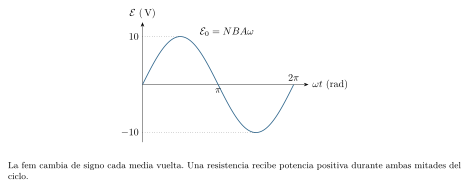

[← Capítulo anterior](capitulo-18.html) · [Índice del libro](index.html) · [Capítulo siguiente →](capitulo-20.html)

Una corriente desvía una brújula y un imán en movimiento puede producir corriente en una bobina. El primer fenómeno permite reconocer el campo magnético de las cargas que se mueven; el segundo conecta la variación de ese campo con la transferencia de energía eléctrica. Su descripción exige seguir direcciones, orientar superficies y distinguir el valor de una magnitud de su rapidez de cambio.

La fuerza magnética relaciona el movimiento de una carga con el campo que encuentra. Una corriente reúne muchas cargas en movimiento y produce a su vez un campo; al estudiar cuánto atraviesa una superficie aparece el flujo magnético. Su variación conecta el movimiento mecánico con la generación eléctrica. El almacenamiento de energía en bobinas y la propagación de ondas electromagnéticas amplían esa relación entre corrientes y campos.

## Campo magnético y fuerza sobre una carga

Una pequeña brújula orienta su aguja según el campo magnético local. Representamos ese campo mediante un vector $\vec B$ en cada punto. Fuera de un imán de barra, sus líneas salen por el polo norte y entran por el sur; dentro continúan cerrando los recorridos. En la descripción clásica usada aquí, el flujo magnético neto a través de una superficie cerrada es cero. Las líneas dibujadas representan la dirección y la distribución del campo, y su densidad gráfica permite comparar intensidades dentro de una misma representación.

La unidad SI del campo magnético es el tesla, símbolo $\,\mathrm{T}$. Su efecto sobre una partícula con carga $q$ y velocidad $\vec v$, medidas en un mismo sistema de referencia, está descrito por
$$
 \vec F_B=q\,\vec v\times\vec B,\qquad
 F_B=|q|vB\sin\theta.
$$
El ángulo $\theta$ se mide entre $\vec v$ y $\vec B$. El producto vectorial señala una dirección perpendicular a ambos. Para una carga positiva, la regla de la mano derecha se aplica girando los dedos desde $\vec v$ hacia $\vec B$ por el ángulo menor; el pulgar señala $\vec v\times\vec B$. Una carga negativa invierte ese sentido. En ejes derechos, $\hat\imath\times\hat\jmath=\hat k$, $\hat\jmath\times\hat k=\hat\imath$ y $\hat k\times\hat\imath=\hat\jmath$; invertir el orden cambia el signo.

Un punto dentro de un círculo, $\odot$, representa una flecha que sale de la página hacia el lector. Una cruz, $\otimes$, representa una flecha que entra. Esta convención permitirá dibujar tres direcciones espaciales en una página. De la fórmula se obtiene $1\,\mathrm{T}=1\,\mathrm{N/(A\,m)}$.

### Problema resuelto 19.1 · Obtener la fuerza y su dirección {#r19-1}

Una carga $q=+2{,}00\,\mathrm{nC}$ tiene velocidad $\vec v=(3{,}00\times10^5\,\mathrm{m/s})\hat\imath$ en un campo $\vec B=(0{,}400\,\mathrm{T})\hat k$. Halla la fuerza y describe qué cambiaría para una carga de igual magnitud y signo negativo.
*Resolución.* El producto $\hat\imath\times\hat k=-\hat\jmath$ fija el sentido. Así,
$$
 \vec F_B=-(2{,}00\times10^{-9})(3{,}00\times10^5)(0{,}400)\hat\jmath
 =-(2{,}40\times10^{-4}\,\mathrm{N})\hat\jmath.
$$
Para la carga negativa, la fuerza apunta hacia $+y$ y conserva la magnitud. En ambos casos es perpendicular a la velocidad instantánea.

{#fig-fp-av-r19-1 fig-alt="Ilustración de Problema resuelto 19.1 · Obtener la fuerza y su dirección. Una carga q=+2,00\\,nC tiene velocidad vec v=(3,00times10^5\\,m/s)hatimath en un campo vec B=(0,400\\,T)hat k. Halla la fuerza y describe qué cambiaría para una carga de igual magnitud y signo negativo. Resolución. El producto hatimathtimeshat k=-hatjmath fija el sentido. Así, vec"}

La fuerza magnética es cero para una carga en reposo y para un movimiento paralelo o antiparalelo al campo. Su magnitud es máxima cuando la velocidad es perpendicular. Además, su potencia instantánea sobre una partícula puntual es
$$
 P_B=\vec F_B\cdot\vec v=q(\vec v\times\vec B)\cdot\vec v=0.
$$
Por tanto, la fuerza magnética por sí sola conserva la energía cinética de la partícula y puede modificar la dirección de su velocidad. Si también hay campo eléctrico, la fuerza total es $q(\vec E+\vec v\times\vec B)$ y la potencia eléctrica $q\vec E\cdot\vec v$ puede cambiar esa energía. En los circuitos inducidos, el campo eléctrico permitirá transferir energía a los portadores.

### Problema resuelto 19.2 · Usar la componente perpendicular {#r19-2}

Una carga de $+4{,}00\,\mathrm{nC}$ se mueve a $2{,}00\times10^4\,\mathrm{m/s}$ formando $30{,}0^\circ$ con un campo de $0{,}500\,\mathrm{T}$. Calcula la magnitud de la fuerza y compárala con los casos paralelo y perpendicular.
*Resolución.* La componente perpendicular es $v_\perp=v\sin30^\circ=1{,}00\times10^4\,\mathrm{m/s}$. Por tanto,
$$
 F_B=|q|v_\perp B=2{,}00\times10^{-5}\,\mathrm{N}.
$$
En el caso paralelo la fuerza es cero. Con la misma rapidez y orientación perpendicular al campo, alcanza $4{,}00\times10^{-5}\,\mathrm{N}$. El ángulo controla qué parte del movimiento participa en la fuerza.

{#fig-fp-av-r19-2 fig-alt="Ilustración de Problema resuelto 19.2 · Usar la componente perpendicular. Una carga de +4,00\\,nC se mueve a 2,00times10^4\\,m/s formando 30,0^circ con un campo de 0,500\\,T. Calcula la magnitud de la fuerza y compárala con los casos paralelo y perpendicular. Resolución. La componente perpendicular es vperp=vsin30^circ=1,00times10^4\\,m/s. Por tanto, FB=|q|vperp B=2,00times10^-5\\,N. En el caso"}

## Trayectorias y campos cruzados

Consideremos un campo magnético uniforme y estático, con fuerza eléctrica, gravedad y pérdidas radiativas despreciables. Si la velocidad inicial es perpendicular al campo, la fuerza permanece perpendicular al movimiento y actúa como fuerza centrípeta. En el régimen no relativista,
$$
 |q|vB=\frac{mv^2}{r},\qquad
 r=\frac{mv}{|q|B},\qquad T=\frac{2\pi m}{|q|B}.
$$
La rapidez permanece constante y el sentido de giro depende del signo de la carga. El período se obtiene con $T=2\pi r/v$: en este modelo es independiente de la rapidez. Estas expresiones requieren velocidades suficientemente pequeñas frente a la rapidez de la luz para emplear la mecánica newtoniana.

Si la velocidad tiene componentes $v_\perp$ y $v_\parallel$, la primera produce el movimiento circular y la segunda permanece constante a lo largo del campo. La trayectoria resulta helicoidal, con radio $mv_\perp/(|q|B)$ y avance por vuelta, o paso, $h=v_\parallel T$. El campo fija un eje espacial; descomponer el movimiento respecto de ese eje permite reconstruir la trayectoria.

### Problema resuelto 19.3 · Calcular una órbita circular de un protón {#r19-3}

Un protón entra perpendicularmente en un campo uniforme de $0{,}200\,\mathrm{T}$ con rapidez $2{,}00\times10^6\,\mathrm{m/s}$. Usa $m_p=1{,}67\times10^{-27}\,\mathrm{kg}$ y $e=1{,}602176634\times10^{-19}\,\mathrm{C}$. Halla radio, período y energía cinética.
*Resolución.* Con las condiciones del modelo,
$$
 r=\frac{(1{,}67\times10^{-27})(2{,}00\times10^6)}{e(0{,}200)}
 \simeq0{,}104\,\mathrm{m},\qquad
 T=\frac{2\pi(1{,}67\times10^{-27})}{e(0{,}200)}
 \simeq3{,}27\times10^{-7}\,\mathrm{s}.
$$
La energía cinética es $K=\tfrac12m_pv^2=3{,}34\times10^{-15}\,\mathrm{J}$ y conserva ese valor en la órbita idealizada. La rapidez es aproximadamente $0{,}0067$ veces la de la luz, compatible con la aproximación usada. Para un campo saliente y velocidad inicial hacia la derecha, la trayectoria comienza curvándose hacia abajo.

{#fig-fp-av-r19-3 fig-alt="Ilustración de Problema resuelto 19.3 · Calcular una órbita circular de un protón. Un protón entra perpendicularmente en un campo uniforme de 0,200\\,T con rapidez 2,00times10^6\\,m/s. Usa mp=1,67times10^-27\\,kg y e=1,602176634times10^-19\\,C. Halla radio, período y energía cinética. Resolución. Con las condiciones del modelo, r=frac(1,67times10^-27)(2,00times10^6)e(0,200) simeq0,104\\,m,qquad"}

Los campos eléctrico y magnético también pueden producir fuerzas que se compensen. Si ambos campos son perpendiculares entre sí y a la velocidad seleccionada, sus magnitudes se igualan cuando $|q|E=|q|vB$, de donde $v=E/B$. La compensación vectorial exige además que $\vec E$ apunte en sentido opuesto a $\vec v\times\vec B$. Esa geometría define un selector de velocidades para partículas cargadas.

### Problema resuelto 19.4 · Seleccionar una velocidad con dos campos {#r19-4}

En una región, $\vec E=(3{,}00\times10^4\,\mathrm{V/m})\hat\jmath$ y $\vec B=(0{,}100\,\mathrm{T})\hat k$. Un haz entra con velocidad hacia $+x$. Halla la rapidez que permite atravesar la región sin desviación y el sentido de la fuerza sobre un protón que entra a $4{,}00\times10^5\,\mathrm{m/s}$.
*Resolución.* La fuerza eléctrica sobre el protón apunta hacia $+y$ y la magnética hacia $-y$. La compensación ocurre a
$$
 v=\frac{E}{B}=3{,}00\times10^5\,\mathrm{m/s}.
$$
Para la rapidez mayor, $F_y=e(E-vB)=e(30\,000-40\,000)\simeq-1{,}60\times10^{-15}\,\mathrm{N}$. El haz positivo se desvía hacia $-y$. Con la rapidez seleccionada, la compensación funciona también para una carga negativa, porque ambas fuerzas invierten su sentido.

{#fig-fp-av-r19-4 fig-alt="Ilustración de Problema resuelto 19.4 · Seleccionar una velocidad con dos campos. En una región, vec E=(3,00times10^4\\,V/m)hatjmath y vec B=(0,100\\,T)hat k. Un haz entra con velocidad hacia +x. Halla la rapidez que permite atravesar la región sin desviación y el sentido de la fuerza sobre un protón que entra a 4,00times10^5\\,m/s. Resolución. La fuerza eléctrica sobre el protón apunta hacia +y y la"}

## Fuerza sobre conductores y giro de una espira

Una corriente representa el transporte de muchos portadores. Al sumar sus fuerzas magnéticas y considerar su interacción con el material conductor, obtenemos para un tramo recto en un campo externo uniforme
$$
 \vec F=I\,\vec\ell\times\vec B.
$$
El vector $\vec\ell$ tiene la longitud del tramo y apunta según la corriente convencional, con $I$ tomado positivo en ese sentido. El modelo considera el campo externo sobre el conductor; al estudiar dos alambres, cada uno siente el campo generado por el otro. En una geometría general se suman las contribuciones $I\,d\vec\ell\times\vec B$.

### Problema resuelto 19.5 · Encontrar la fuerza sobre un tramo de alambre {#r19-5}

Un tramo recto de $0{,}400\,\mathrm{m}$ lleva $3{,}00\,\mathrm{A}$ hacia $+x$ en un campo uniforme de $0{,}200\,\mathrm{T}$ dirigido hacia $+z$. Halla su fuerza magnética.
*Resolución.* El tramo y el campo son perpendiculares, de modo que $F=I\ell B=(3{,}00)(0{,}400)(0{,}200)=0{,}240\,\mathrm{N}$. El producto $\hat\imath\times\hat k=-\hat\jmath$ da
$$
 \vec F=-(0{,}240\,\mathrm{N})\hat\jmath.
$$
Invertir la corriente o invertir el campo invierte la fuerza. Si ambos cambian simultáneamente de sentido, se conserva la fuerza inicial.

{#fig-fp-av-r19-5 fig-alt="Ilustración de Problema resuelto 19.5 · Encontrar la fuerza sobre un tramo de alambre. Un tramo recto de 0,400\\,m lleva 3,00\\,A hacia +x en un campo uniforme de 0,200\\,T dirigido hacia +z. Halla su fuerza magnética. Resolución. El tramo y el campo son perpendiculares, de modo que F=Iell B=(3,00)(0,400)(0,200)=0,240\\,N. El producto hatimathtimeshat k=-hatjmath da vec F=-(0,240\\,N)hatjmath. Invertir la"}

En una espira cerrada sometida a un campo uniforme, las fuerzas sobre sus lados suman cero, aunque pueden formar un par. Para una bobina plana de $N$ vueltas, cada una de área $A$, definimos el momento magnético
$$
 \vec\mu=NIA\,\hat n,\qquad
 \vec\tau=\vec\mu\times\vec B,\qquad
 \tau=NIAB\sin\theta.
$$
La normal $\hat n$ se determina enrollando los dedos de la mano derecha según la corriente: el pulgar señala la normal positiva. Aquí $\theta$ es el ángulo entre esa normal y el campo. El par tiende a alinear $\vec\mu$ con $\vec B$. Con corriente mantenida y la referencia habitual, la energía de orientación es $U=-\vec\mu\cdot\vec B$; la alineación paralela corresponde a un mínimo. Esta relación describe la orientación de un dipolo en un campo externo dado.

### Problema resuelto 19.6 · Calcular el par sobre una bobina {#r19-6}

Una bobina plana de 20 vueltas lleva $0{,}500\,\mathrm{A}$ y cada vuelta abarca $0{,}0200\,\mathrm{m^2}$. Su normal forma $30{,}0^\circ$ con un campo uniforme de $0{,}300\,\mathrm{T}$. Calcula el momento magnético, el par y la energía de orientación.
*Resolución.* La magnitud del momento es $\mu=(20)(0{,}500)(0{,}0200)=0{,}200\,\mathrm{A\,m^2}$. Entonces,
$$
 \tau=(0{,}200)(0{,}300)\sin30^\circ=0{,}0300\,\mathrm{N\,m},
 \qquad U=-(0{,}200)(0{,}300)\cos30^\circ\simeq-0{,}0520\,\mathrm{J}.
$$
El par modifica la orientación hacia la alineación paralela. El ángulo de la fórmula se refiere a la normal; el plano de la bobina forma el ángulo complementario con el campo.

{#fig-fp-av-r19-6 fig-alt="Ilustración de Problema resuelto 19.6 · Calcular el par sobre una bobina. Una bobina plana de 20 vueltas lleva 0,500\\,A y cada vuelta abarca 0,0200\\,m^2. Su normal forma 30,0^circ con un campo uniforme de 0,300\\,T. Calcula el momento magnético, el par y la energía de orientación. Resolución. La magnitud del momento es mu=(20)(0,500)(0,0200)=0,200\\,A\\,m^2. Entonces,"}

## Campos generados por corrientes

Alrededor de un alambre recto largo, las líneas de campo son círculos centrados en su eje. La mano derecha vuelve a fijar un sentido: el pulgar señala la corriente convencional y los dedos, el campo que la rodea. A distancia $r$ del eje, por fuera de un alambre delgado en el vacío o aproximadamente en aire,
$$
 B=\frac{\mu_0I}{2\pi r}.
$$
En los cálculos emplearemos $\mu_0\simeq4\pi\times10^{-7}\,\mathrm{T\,m/A}$. La aproximación de hilo largo requiere que los extremos estén muy alejados en comparación con $r$. Un núcleo magnético o una geometría diferente puede modificar el campo de forma importante.

### Problema resuelto 19.7 · Dar magnitud y sentido al campo de un hilo {#r19-7}

Un alambre recto muy largo lleva $5{,}00\,\mathrm{A}$ hacia $+y$. Calcula su campo a $0{,}0500\,\mathrm{m}$ a la derecha del eje, despreciando otros campos.
*Resolución.* La magnitud es
$$
 B=\frac{(4\pi\times10^{-7})(5{,}00)}{2\pi(0{,}0500)}
 =2{,}00\times10^{-5}\,\mathrm{T}=20{,}0\,\mathrm{\mu T}.
$$
La regla de la mano derecha da sentido entrante en la página, $-z$, en el punto situado a la derecha. En un punto simétrico a la izquierda, el campo tiene igual magnitud y sentido saliente.

{#fig-fp-av-r19-7 fig-alt="Ilustración de Problema resuelto 19.7 · Dar magnitud y sentido al campo de un hilo. Un alambre recto muy largo lleva 5,00\\,A hacia +y. Calcula su campo a 0,0500\\,m a la derecha del eje, despreciando otros campos. Resolución. La magnitud es B=frac(4pitimes10^-7)(5,00)2pi(0,0500) =2,00times10^-5\\,T=20,0\\,mu T. La regla de la mano derecha da sentido entrante en la página, -z, en el punto situado a la"}

Los campos producidos por varias corrientes se suman vectorialmente. Dos alambres paralelos se ejercen fuerzas: las corrientes del mismo sentido se atraen y las opuestas se repelen. Para alambres muy largos, separados una distancia $d$ y en las condiciones anteriores, la magnitud por unidad de longitud es
$$
 \frac{F}{\ell}=I_2B_1=\frac{\mu_0I_1I_2}{2\pi d}.
$$
La dirección se obtiene aplicando $I_2\vec\ell\times\vec B_1$ al segundo alambre y repitiendo para el primero.

### Problema resuelto 19.8 · Superponer campos y calcular la fuerza entre hilos {#r19-8}

Dos hilos muy largos, paralelos al eje $y$, están en $x=-0{,}100\,\mathrm{m}$ y $x=+0{,}100\,\mathrm{m}$. Cada uno lleva $4{,}00\,\mathrm{A}$ hacia $+y$. Calcula el campo en el punto medio, el campo en $x=0{,}300\,\mathrm{m}$ y la fuerza por longitud entre los hilos.
*Resolución.* En el punto medio, cada hilo aporta $8{,}00\,\mathrm{\mu T}$: el izquierdo produce campo entrante y el derecho, saliente. Se compensan. En $x=0{,}300\,\mathrm{m}$, las distancias son $0{,}400\,\mathrm{m}$ y $0{,}200\,\mathrm{m}$; ambos campos entran en la página y sus magnitudes son $2{,}00\,\mathrm{\mu T}$ y $4{,}00\,\mathrm{\mu T}$. El campo total allí es $(6{,}00\,\mathrm{\mu T})(-\hat k)$.

La separación entre hilos es $d=0{,}200\,\mathrm{m}$, luego $F/\ell=(4\pi\times10^{-7})(4)(4)/[2\pi(0{,}200)]=1{,}60\times10^{-5}\,\mathrm{N/m}$. Las corrientes del mismo sentido se atraen. La distancia entre los alambres y la distancia de cada alambre al punto de observación cumplen funciones distintas en estos cálculos.

{#fig-fp-av-r19-8 fig-alt="Ilustración de Problema resuelto 19.8 · Superponer campos y calcular la fuerza entre hilos. La separación entre hilos es d=0,200\\,m, luego F/ell=(4pitimes10^-7)(4)(4)/[2pi(0,200)]=1,60times10^-5\\,N/m. Las corrientes del mismo sentido se atraen. La distancia entre los alambres y la distancia de cada alambre al punto de observación cumplen funciones distintas en estos cálculos."}

En el centro de una espira circular de radio $a$, el campo tiene magnitud $B=\mu_0I/(2a)$ y dirección normal al plano, según la corriente. Para $N$ vueltas circulares coincidentes o suficientemente próximas, se multiplica por $N$. Un solenoide largo reúne muchas vueltas a lo largo de una longitud $\ell_s$. Lejos de sus extremos, con devanado denso y núcleo de aire, su campo interior es aproximadamente uniforme:
$$
 B\simeq\mu_0\frac{N}{\ell_s}I.
$$
Esta aproximación depende de la densidad de vueltas por longitud y de que la longitud sea grande frente al radio. La regla de la mano derecha aplicada a las vueltas determina la dirección del campo interior.

### Problema resuelto 19.9 · Estimar el campo interior de un solenoide {#r19-9}

Un solenoide de aire tiene 500 vueltas distribuidas uniformemente en $0{,}500\,\mathrm{m}$, radio $0{,}0100\,\mathrm{m}$ y corriente $0{,}400\,\mathrm{A}$. Estima su campo cerca del centro.
*Resolución.* Hay $N/\ell_s=1000\,\mathrm{m^{-1}}$ vueltas por longitud. La longitud es 50 veces el radio, y el punto central está lejos de los extremos en esa escala. El modelo de solenoide largo da
$$
 B\simeq(4\pi\times10^{-7})(1000)(0{,}400)
 \simeq5{,}03\times10^{-4}\,\mathrm{T}=0{,}503\,\mathrm{mT}.
$$
El valor describe el interior próximo al centro. Cerca de los extremos aparecen variaciones espaciales y un campo exterior que el modelo interior uniforme deja fuera de su cálculo.

{#fig-fp-av-r19-9 fig-alt="Ilustración de Problema resuelto 19.9 · Estimar el campo interior de un solenoide. Un solenoide de aire tiene 500 vueltas distribuidas uniformemente en 0,500\\,m, radio 0,0100\\,m y corriente 0,400\\,A. Estima su campo cerca del centro. Resolución. Hay N/ells=1000\\,mathrmm^-1 vueltas por longitud. La longitud es 50 veces el radio, y el punto central está lejos de los extremos en esa escala. El modelo"}

## Flujo: orientar una superficie

Para comparar el campo que atraviesa una superficie plana, elegimos primero una normal unitaria $\hat n$ y definimos su vector área $\vec A=A\hat n$. En un campo uniforme, el flujo magnético es
$$
 \Phi_B=\vec B\cdot\vec A=BA\cos\theta.
$$
El ángulo $\theta$ se mide entre el campo y la normal. El weber, $\,\mathrm{Wb}$, equivale a $\,\mathrm{T\,m^2}$. El flujo es positivo cuando el campo atraviesa la superficie según la normal elegida, negativo en el sentido opuesto y cero si el campo es paralelo al plano. Invertir la normal cambia el signo del flujo y conserva la situación física.

Un campo que varía de un punto a otro exige dividir la superficie en pequeñas áreas y sumar sus contribuciones orientadas: $\Phi_B=\int_S\vec B\cdot d\vec A$. La fórmula $BA\cos\theta$ corresponde al caso uniforme. Para una bobina de $N$ vueltas atravesadas por el mismo flujo, el enlace de flujo es $N\Phi_B$. Cuando las vueltas enlazan flujos diferentes, se suman los flujos de todas ellas.

### Problema resuelto 19.10 · Distinguir el ángulo con el plano y con la normal {#r19-10}

Una superficie de $0{,}0300\,\mathrm{m^2}$ está en un campo uniforme de $0{,}400\,\mathrm{T}$. El campo forma $60{,}0^\circ$ con la normal positiva, equivalentes a $30{,}0^\circ$ con el plano. Calcula el flujo y el valor referido a la normal opuesta.
*Resolución.* El ángulo de la fórmula es el de la normal:
$$
 \Phi_B=(0{,}400)(0{,}0300)\cos60^\circ
 =6{,}00\times10^{-3}\,\mathrm{Wb}.
$$
Con la normal opuesta, el ángulo pasa a $120^\circ$ y el flujo resulta $-6{,}00\times10^{-3}\,\mathrm{Wb}$. La elección de orientación fija el signo con el que describimos el mismo campo y la misma superficie.

{#fig-fp-av-r19-10 fig-alt="Ilustración de Problema resuelto 19.10 · Distinguir el ángulo con el plano y con la normal. Una superficie de 0,0300\\,m^2 está en un campo uniforme de 0,400\\,T. El campo forma 60,0^circ con la normal positiva, equivalentes a 30,0^circ con el plano. Calcula el flujo y el valor referido a la normal opuesta. Resolución. El ángulo de la fórmula es el de la normal: PhiB=(0,400)(0,0300)cos60^circ"}

### Problema resuelto 19.11 · Separar flujo por vuelta y enlace de flujo {#r19-11}

Una vuelta plana abarca $0{,}0100\,\mathrm{m^2}$ en un campo uniforme de $0{,}200\,\mathrm{T}$, paralelo a su normal positiva. Compara el flujo por vuelta y el enlace total para bobinas ideales de 1, 50 y 100 vueltas iguales en ese mismo campo prescrito.
*Resolución.* Cada vuelta enlaza $\Phi_B=BA=2{,}00\times10^{-3}\,\mathrm{Wb}$. Los enlaces totales son $0{,}00200\,\mathrm{Wb}$, $0{,}100\,\mathrm{Wb}$ y $0{,}200\,\mathrm{Wb}$. El número de vueltas es adimensional. Aumentarlo suma más contribuciones iguales al enlace, manteniendo el flujo por cada vuelta bajo las condiciones dadas.

{#fig-fp-av-r19-11 fig-alt="Ilustración de Problema resuelto 19.11 · Separar flujo por vuelta y enlace de flujo. Una vuelta plana abarca 0,0100\\,m^2 en un campo uniforme de 0,200\\,T, paralelo a su normal positiva. Compara el flujo por vuelta y el enlace total para bobinas ideales de 1, 50 y 100 vueltas iguales en ese mismo campo prescrito. Resolución. Cada vuelta enlaza PhiB=BA=2,00times10^-3\\,Wb. Los enlaces totales son"}

## Faraday y Lenz: responder a un cambio de flujo

Una bobina puede presentar fem inducida cuando cambia el flujo que enlaza, sea por variación del campo, del área o de la orientación. Para fijar los signos, elegimos una normal y asociamos el sentido positivo del recorrido mediante la mano derecha: los dedos recorren la frontera en sentido positivo mientras el pulgar señala la normal. En una vista desde el extremo hacia el que apunta esa normal, el recorrido positivo es antihorario.

La ley de Faraday para $N$ vueltas con flujo común es
$$
 \mathcal E=-N\frac{d\Phi_B}{dt},\qquad
 \mathcal E_{\mathrm{med}}=-N\frac{\Phi_f-\Phi_i}{\Delta t}.
$$
El signo expresa la ley de Lenz. En un circuito resistivo cerrado, la corriente inducida genera un campo que se opone al cambio del flujo externo que origina la respuesta. Si aumenta un flujo saliente, la corriente crea campo entrante; si disminuye ese mismo flujo saliente, crea campo saliente. En ambos casos interviene el cambio respecto del estado anterior.

La fem se refiere a un recorrido orientado. En una espira fija atravesada por un campo magnético variable, el campo eléctrico inducido puede realizar trabajo alrededor del recorrido cerrado:
$$
 \oint\vec E\cdot d\vec\ell=-\frac{d\Phi_B}{dt}.
$$
El símbolo $\oint$ indica la suma integral por la curva cerrada. Este campo eléctrico tiene circulación y su descripción completa requiere conservar el recorrido, además de los puntos extremos. La suma de diferencias de potencial usada en el capítulo anterior se aplicó a redes con efectos de inducción variables despreciables. Cuando incluimos una fem inducida en una ecuación de circuito, incorporamos precisamente esa transferencia de energía por unidad de carga.

### Problema resuelto 19.12 · Obtener fem y sentido de corriente en una bobina fija {#r19-12}

Una bobina fija de 40 vueltas tiene área $0{,}0200\,\mathrm{m^2}$ por vuelta y resistencia total $4{,}00\,\mathrm{\Omega}$. El campo externo uniforme sale de la página y aumenta linealmente de $0{,}100\,\mathrm{T}$ a $0{,}400\,\mathrm{T}$ en $0{,}300\,\mathrm{s}$. Elige normal saliente y desprecia la autoinducción. Calcula la fem y la corriente durante el aumento.
*Resolución.* El cambio de flujo por vuelta es $\Delta\Phi=(0{,}0200)(0{,}400-0{,}100)=0{,}00600\,\mathrm{Wb}$. Como el aumento es lineal,
$$
 \mathcal E=-\frac{(40)(0{,}00600)}{0{,}300}=-0{,}800\,\mathrm{V},
 \qquad I=\frac{\mathcal E}{R}=-0{,}200\,\mathrm{A}.
$$
La referencia positiva es antihoraria; la corriente física es horaria y crea campo entrante, que se opone al aumento del flujo saliente. La energía que recibe el resistor procede del sistema que mantiene la variación del campo externo.

{#fig-fp-av-r19-12 fig-alt="Ilustración de Problema resuelto 19.12 · Obtener fem y sentido de corriente en una bobina fija. Una bobina fija de 40 vueltas tiene área 0,0200\\,m^2 por vuelta y resistencia total 4,00\\,Omega. El campo externo uniforme sale de la página y aumenta linealmente de 0,100\\,T a 0,400\\,T en 0,300\\,s. Elige normal saliente y desprecia la autoinducción. Calcula la fem y la corriente durante el aumento. Resolución. El"}

### Problema resuelto 19.13 · Distinguir una tasa instantánea de una tasa media {#r19-13}

Una bobina fija tiene $N=10$, área por vuelta $0{,}0300\,\mathrm{m^2}$ y resistencia total $3{,}00\,\mathrm{\Omega}$. Con normal saliente, el campo externo es $B(t)=0{,}200\,\mathrm{T}+(0{,}100\,\mathrm{T/s^2})t^2$, saliente. Desprecia la autoinducción. Halla la fem y la corriente a $t=2{,}00\,\mathrm{s}$, y la fem media entre cero y ese instante.
*Resolución.* La derivada es $dB/dt=(0{,}200\,\mathrm{T/s^2})t$. Así, $\mathcal E(t)=-NA\,dB/dt=-(0{,}0600\,\mathrm{V/s})t$. A los dos segundos se obtiene $\mathcal E=-0{,}120\,\mathrm{V}$ e $I=-0{,}0400\,\mathrm{A}$, de sentido horario. La fem media es
$$
 \mathcal E_{\mathrm{med}}=-NA\frac{B(2)-B(0)}{2{,}00\,\mathrm{s}}
 =-0{,}0600\,\mathrm{V}.
$$
En $t=0$ hay campo y flujo, mientras que la fem instantánea es cero porque la pendiente en ese instante es cero. El valor de la pendiente permite distinguir la inducción instantánea del flujo existente.

{#fig-fp-av-r19-13 fig-alt="Ilustración de Problema resuelto 19.13 · Distinguir una tasa instantánea de una tasa media. Una bobina fija tiene N=10, área por vuelta 0,0300\\,m^2 y resistencia total 3,00\\,Omega. Con normal saliente, el campo externo es B(t)=0,200\\,T+(0,100\\,T/s^2)t^2, saliente. Desprecia la autoinducción. Halla la fem y la corriente a t=2,00\\,s, y la fem media entre cero y ese instante. Resolución. La derivada es"}

### Problema resuelto 19.14 · Inducir fem al cambiar la orientación {#r19-14}

Una espira de $0{,}0400\,\mathrm{m^2}$ gira en un campo uniforme estático de $0{,}500\,\mathrm{T}$. El ángulo de su normal con el campo aumenta monótonamente de $0^\circ$ a $90^\circ$ en $0{,}200\,\mathrm{s}$. Su resistencia total es $4{,}00\,\mathrm{\Omega}$. Desprecia autoinducción. Calcula la fem media y la carga neta transferida, con el sentido positivo ligado a la normal escogida durante el giro.
*Resolución.* El flujo cambia de $0{,}0200\,\mathrm{Wb}$ a cero. Por tanto,
$$
 \mathcal E_{\mathrm{med}}=-\frac{0-0{,}0200}{0{,}200}=+0{,}100\,\mathrm{V},
 \qquad \Delta Q=\int I\,dt=-\frac{\Delta\Phi}{R}=+0{,}00500\,\mathrm{C}.
$$
La carga neta depende del cambio total de flujo y de la resistencia constante. La fem instantánea depende también de la rapidez angular durante el giro. El campo conserva su valor; la orientación es la que modifica el flujo enlazado.

{#fig-fp-av-r19-14 fig-alt="Ilustración de Problema resuelto 19.14 · Inducir fem al cambiar la orientación. Una espira de 0,0400\\,m^2 gira en un campo uniforme estático de 0,500\\,T. El ángulo de su normal con el campo aumenta monótonamente de 0^circ a 90^circ en 0,200\\,s. Su resistencia total es 4,00\\,Omega. Desprecia autoinducción. Calcula la fem media y la carga neta transferida, con el sentido positivo ligado a la normal"}

## Movimiento, generación y balance de energía

Una varilla conductora que se desplaza en un campo magnético ofrece otra forma de producir separación de carga. Para una varilla de longitud $\ell$, perpendicular a su velocidad y al campo, la magnitud de la fem de movimiento es $B\ell v$. Los portadores sienten la contribución $q\vec v\times\vec B$. En circuito abierto, la redistribución de carga puede establecer un campo eléctrico que la compensa; bajo esas condiciones, el voltaje entre extremos tiene magnitud $B\ell v$ después del transitorio.

Si la varilla cierra un circuito de rieles, su movimiento modifica el área enlazada y la ley de Faraday da el mismo resultado. Con resistencia total $R$, autoinducción despreciable y velocidad mantenida, la corriente tiene magnitud $I=B\ell v/R$. La fuerza magnética sobre la varilla se opone al movimiento en el caso de generación resistiva. El agente que la arrastra aporta la potencia $F_{\mathrm{ext}}v$, que coincide con $I^2R$ en este modelo.

### Problema resuelto 19.15 · Vincular la fem de movimiento con el trabajo mecánico {#r19-15}

Una varilla vertical de longitud $0{,}300\,\mathrm{m}$ se mueve a $2{,}00\,\mathrm{m/s}$ hacia la derecha sobre rieles horizontales. Un resistor a la izquierda cierra el circuito, de resistencia total $3{,}00\,\mathrm{\Omega}$. Un campo uniforme de $0{,}500\,\mathrm{T}$ sale de la página. Desprecia rozamiento y autoinducción. Calcula fem, corriente, fuerza de arrastre necesaria y potencia.
*Resolución.* El área aumenta, de modo que aumenta el flujo saliente. La corriente inducida es horaria y baja por la varilla. Su extremo inferior es el de mayor potencial. Las magnitudes son
$$
 |\mathcal E|=B\ell v=0{,}300\,\mathrm{V},\quad
 |I|=0{,}100\,\mathrm{A},\quad F_B=I\ell B=0{,}0150\,\mathrm{N}.
$$
La fuerza magnética sobre la varilla apunta a la izquierda; el agente externo debe ejercer $0{,}0150\,\mathrm{N}$ hacia la derecha para mantener la velocidad. Su potencia es $(0{,}0150)(2{,}00)=0{,}0300\,\mathrm{W}$, igual a $I^2R=(0{,}100)^2(3{,}00)$. La energía térmica procede del trabajo de arrastre.

{#fig-fp-av-r19-15 fig-alt="Ilustración de Problema resuelto 19.15 · Vincular la fem de movimiento con el trabajo mecánico. Una varilla vertical de longitud 0,300\\,m se mueve a 2,00\\,m/s hacia la derecha sobre rieles horizontales. Un resistor a la izquierda cierra el circuito, de resistencia total 3,00\\,Omega. Un campo uniforme de 0,500\\,T sale de la página. Desprecia rozamiento y autoinducción. Calcula fem, corriente, fuerza de arrastre"}

La expresión $q\vec v\times\vec B$ emplea la velocidad total de cada portador y conserva potencia magnética instantánea cero sobre esa partícula. En el conductor móvil, el balance incluye además el movimiento macroscópico del material, sus restricciones sobre los portadores y el campo eléctrico. El trabajo externo que mantiene el movimiento permite la transferencia de energía a la corriente y al resistor. Analizar el sistema completo conecta el resultado de arrastre con la propiedad de la fuerza sobre una carga individual.

Una bobina que gira en un campo uniforme funciona como generador. Si su normal forma el ángulo $\theta=\omega t$ con el campo, su enlace de flujo es $NBA\cos(\omega t)$ y
$$
 \mathcal E(t)=NBA\omega\sin(\omega t).
$$
La fem cambia de signo cada media vuelta. Con un circuito puramente resistivo y efectos inductivos despreciables, la corriente tiene la misma dependencia temporal. La potencia recibida por el resistor es siempre $I^2R\geq0$, aunque cambie el sentido de la corriente. Mantener el giro bajo carga exige aporte mecánico de energía.

### Problema resuelto 19.16 · Obtener una fem alterna de una bobina giratoria {#r19-16}

Un generador ideal tiene 50 vueltas de $0{,}0100\,\mathrm{m^2}$ cada una en un campo de $0{,}200\,\mathrm{T}$. Gira a $100\,\mathrm{rad/s}$, con la normal inicialmente paralela al campo. Alimenta una resistencia total de $20{,}0\,\mathrm{\Omega}$ y se desprecian efectos inductivos. Halla la fem máxima, la frecuencia, la corriente máxima y la potencia media recibida por la resistencia.
*Resolución.* La amplitud es $\mathcal E_0=NBA\omega=10{,}0\,\mathrm{V}$ y la frecuencia, $f=\omega/(2\pi)\simeq15{,}9\,\mathrm{Hz}$. Así,
$$
 \mathcal E(t)=(10{,}0\,\mathrm{V})\sin(100t),\qquad
 I(t)=(0{,}500\,\mathrm{A})\sin(100t),
$$
con $t$ en segundos. La potencia instantánea es $(5{,}00\,\mathrm{W})\sin^2(100t)$. Sobre un período completo, el promedio de $\sin^2$ es $1/2$, luego $P_{\mathrm{med}}=2{,}50\,\mathrm{W}$. En operación ideal periódica, esa es también la potencia mecánica media aportada al generador.

{#fig-fp-av-r19-16 fig-alt="Ilustración de Problema resuelto 19.16 · Obtener una fem alterna de una bobina giratoria. Un generador ideal tiene 50 vueltas de 0,0100\\,m^2 cada una en un campo de 0,200\\,T. Gira a 100\\,rad/s, con la normal inicialmente paralela al campo. Alimenta una resistencia total de 20,0\\,Omega y se desprecian efectos inductivos. Halla la fem máxima, la frecuencia, la corriente máxima y la potencia media recibida"}

## Autoinducción y campos que se propagan

La corriente de una bobina produce su propio campo y su propio enlace de flujo. Si el material responde linealmente y la geometría permanece fija, podemos escribir $N\Phi_{\mathrm{propio}}=LI$. La inductancia $L$ se mide en henrys, con $1\,\mathrm{H}=1\,\mathrm{V\,s/A}$. La variación de corriente produce una fem de autoinducción
$$
 \mathcal E_{\mathrm{propia}}=-L\frac{dI}{dt}.
$$
Para un inductor ideal sin resistencia, usando la convención de corriente que entra por el terminal $a$, el voltaje terminal es $V_{ab}=L\,dI/dt$. El signo positivo de este voltaje y el negativo de la fem propia describen el mismo fenómeno con referencias diferentes: el voltaje aplicado sostiene el aumento de corriente frente a la fem inducida. La potencia recibida es $LI\,dI/dt$ y, al acumularla desde corriente cero,
$$
 U_B=\int_0^I LI'\,dI'=\frac12LI^2.
$$
Esta energía está asociada al campo magnético y puede devolverse al circuito cuando disminuye la corriente. En problemas anteriores se ha despreciado la autoinducción para aislar el efecto del flujo externo y obtener $I=\mathcal E/R$ de manera inmediata. Incluir $L$ permite estudiar también los transitorios.

### Problema resuelto 19.17 · Calcular la respuesta de un inductor ideal {#r19-17}

Un inductor ideal de $0{,}200\,\mathrm{H}$ aumenta linealmente su corriente de $0{,}500\,\mathrm{A}$ a $2{,}50\,\mathrm{A}$ en $0{,}0400\,\mathrm{s}$. Halla la fem propia, el voltaje terminal con convención receptora y el cambio de energía almacenada.
*Resolución.* La tasa es $dI/dt=2{,}00/0{,}0400=50{,}0\,\mathrm{A/s}$. Por tanto, $\mathcal E_{\mathrm{propia}}=-10{,}0\,\mathrm{V}$ y $V_{ab}=+10{,}0\,\mathrm{V}$. Las energías son
$$
 \begin{gathered}
 U_i=0{,}0250\,\mathrm{J},\quad U_f=0{,}625\,\mathrm{J},\\
 \Delta U_B=+0{,}600\,\mathrm{J}.
 \end{gathered}
$$
La potencia recibida durante el intervalo aumenta con $I$; su integral entrega esos $0{,}600\,\mathrm{J}$ al campo del inductor.

{#fig-fp-av-r19-17 fig-alt="Ilustración de Problema resuelto 19.17 · Calcular la respuesta de un inductor ideal. Un inductor ideal de 0,200\\,H aumenta linealmente su corriente de 0,500\\,A a 2,50\\,A en 0,0400\\,s. Halla la fem propia, el voltaje terminal con convención receptora y el cambio de energía almacenada. Resolución. La tasa es dI/dt=2,00/0,0400=50,0\\,A/s. Por tanto, mathcal Epropia=-10,0\\,V y Vab=+10,0\\,V. Las energías"}

La inducción enlaza también circuitos distintos: al cambiar la corriente de una bobina puede cambiar el flujo que atraviesa otra y producir en ella una fem. El acoplamiento depende de la geometría y del material entre ambas. Esa transferencia permite comprender el principio de un transformador, donde un régimen variable sostiene el intercambio entre circuitos.

La descripción se amplía con las ecuaciones de Maxwell. La ley de Gauss eléctrica relaciona el flujo eléctrico con la carga encerrada. Su versión magnética expresa flujo neto cero a través de superficies cerradas. La ley de Faraday vincula la circulación eléctrica con la variación del flujo magnético. La ley de Ampère--Maxwell relaciona la circulación magnética tanto con la corriente de conducción como con la variación del flujo eléctrico.

Un capacitor que se carga ayuda a comprender este último término. Por los cables circula corriente mientras cambia el campo eléctrico entre las placas. En el espacio entre las placas de un capacitor ideal cambia el flujo eléctrico mientras en sus superficies se acumulan cargas opuestas. La contribución de Maxwell permite obtener una descripción magnética consistente al considerar superficies que atraviesan el cable o el espacio entre placas. Las variaciones de ambos campos forman parte de una misma descripción electromagnética.

En el vacío, las ecuaciones admiten ondas que transportan energía mediante campos eléctricos y magnéticos variables, relacionados por las leyes de Maxwell. Para una onda plana progresiva, $\vec E$ y $\vec B$ son perpendiculares entre sí y a la propagación, oscilan en fase y cumplen $E_0=cB_0$. La dirección de propagación coincide con $\vec E\times\vec B$. Su rapidez es $c=1/\sqrt{\mu_0\varepsilon_0}$, donde $\varepsilon_0$ es la permitividad del vacío. En los cálculos usaremos $c\simeq3{,}00\times10^8\,\mathrm{m/s}$. La relación ondulatoria $c=\lambda f$ conecta frecuencia y longitud de onda. Radio, microondas y luz visible pertenecen a esta misma familia de campos, con distintas frecuencias.

### Problema resuelto 19.18 · Relacionar los campos de una onda electromagnética {#r19-18}

Una onda plana en el vacío tiene frecuencia $100\,\mathrm{MHz}$ y amplitud eléctrica $E_0=6{,}00\,\mathrm{V/m}$. En un punto y un instante con campos no nulos, $\vec E$ apunta hacia $+y$ y $\vec B$ hacia $+z$. Halla su longitud de onda, amplitud magnética y dirección de propagación.
*Resolución.* La frecuencia es $1{,}00\times10^8\,\mathrm{Hz}$, luego
$$
 \lambda=\frac{c}{f}=3{,}00\,\mathrm{m},\qquad
 B_0=\frac{E_0}{c}=2{,}00\times10^{-8}\,\mathrm{T}=20{,}0\,\mathrm{nT}.
$$
El producto $\hat\jmath\times\hat k=\hat\imath$ indica propagación hacia $+x$. Cuando ambos campos invierten simultáneamente su signo durante la oscilación, su producto vectorial conserva ese sentido. Las dos amplitudes pertenecen a la misma onda y están relacionadas por su propagación en el vacío.

{#fig-fp-av-r19-18 fig-alt="Ilustración de Problema resuelto 19.18 · Relacionar los campos de una onda electromagnética. Una onda plana en el vacío tiene frecuencia 100\\,MHz y amplitud eléctrica E0=6,00\\,V/m. En un punto y un instante con campos no nulos, vec E apunta hacia +y y vec B hacia +z. Halla su longitud de onda, amplitud magnética y dirección de propagación. Resolución. La frecuencia es 1,00times10^8\\,Hz, luego"}

## Ejercicios para reconstruir y transferir

Usa $e=1{,}602176634\times10^{-19}\,\mathrm{C}$, $m_p=1{,}67\times10^{-27}\,\mathrm{kg}$, $\mu_0\simeq4\pi\times10^{-7}\,\mathrm{T\,m/A}$ y $c\simeq3{,}00\times10^8\,\mathrm{m/s}$. Los ejes son derechos. Supón régimen no relativista, campos prescritos y modelos geométricos ideales en las condiciones indicadas. En los circuitos inducidos resistivos, desprecia la autoinducción salvo indicación contraria.

### Ejercicio 19.1 · Una carga negativa en movimiento {#e19-1}

Una carga $-3{,}00\,\mathrm{nC}$ se mueve con $\vec v=(2{,}00\times10^5\,\mathrm{m/s})\hat\imath$ en $\vec B=(0{,}100\,\mathrm{T})\hat k$. Halla $\vec F_B$.

### Ejercicio 19.2 · Comparar dos ángulos {#e19-2}

Una carga de magnitud $2{,}00\,\mathrm{\mu C}$ se mueve a $1000\,\mathrm{m/s}$ en un campo de $0{,}200\,\mathrm{T}$. Calcula la fuerza para ángulos de $90^\circ$ y $30^\circ$ entre velocidad y campo.

### Ejercicio 19.3 · Calcular por componentes {#e19-3}

Una carga $+1{,}00\,\mathrm{nC}$ tiene $\vec v=(2\hat\imath+3\hat\jmath)10^4\,\mathrm{m/s}$ en $\vec B=(0{,}200\,\mathrm{T})\hat k$. Obtén la fuerza por componentes y verifica $\vec F_B\cdot\vec v=0$.

### Ejercicio 19.4 · Una órbita circular {#e19-4}

Un protón entra perpendicularmente en $B=0{,}100\,\mathrm{T}$ con rapidez $1{,}00\times10^6\,\mathrm{m/s}$. Halla radio y período de su órbita ideal.

### Ejercicio 19.5 · Agregar movimiento paralelo {#e19-5}

El protón del ejercicio anterior tiene además componente de velocidad $v_\parallel=2{,}00\times10^5\,\mathrm{m/s}$ a lo largo del campo; conserva $v_\perp=1{,}00\times10^6\,\mathrm{m/s}$. Halla el radio y el avance de la hélice en una vuelta.

### Ejercicio 19.6 · Un selector para ambos signos {#e19-6}

Un haz entra hacia $+x$ en campos $\vec E=(2{,}00\times10^4\,\mathrm{V/m})\hat\jmath$ y $\vec B=(0{,}0500\,\mathrm{T})\hat k$. Halla la rapidez sin desviación y explica qué sucede con partículas negativas a esa misma velocidad.

### Ejercicio 19.7 · Una fuerza sobre un conductor {#e19-7}

Un tramo de $0{,}500\,\mathrm{m}$ conduce $2{,}00\,\mathrm{A}$ hacia $+y$ en $\vec B=(0{,}300\,\mathrm{T})\hat\imath$. Halla magnitud y sentido de la fuerza.

### Ejercicio 19.8 · Par y orientación de una bobina {#e19-8}

Una bobina de 10 vueltas, área $0{,}0500\,\mathrm{m^2}$ por vuelta y corriente $0{,}200\,\mathrm{A}$ está en $B=0{,}400\,\mathrm{T}$. Calcula el par para ángulos de $90^\circ$ y $0^\circ$ entre normal y campo. Identifica la orientación de energía mínima.

### Ejercicio 19.9 · Campo de un hilo recto {#e19-9}

Un hilo muy largo lleva $3{,}00\,\mathrm{A}$ hacia arriba en la página. Halla su campo a $0{,}0200\,\mathrm{m}$ a la derecha y a igual distancia a la izquierda, en aire.

### Ejercicio 19.10 · Campo en el centro de una espira {#e19-10}

Una espira circular de radio $0{,}100\,\mathrm{m}$ lleva $4{,}00\,\mathrm{A}$ en sentido antihorario vista de frente. Calcula el campo en su centro y su sentido.

### Ejercicio 19.11 · Un solenoide largo {#e19-11}

Un solenoide de aire tiene 1000 vueltas en $0{,}400\,\mathrm{m}$ y conduce $0{,}200\,\mathrm{A}$. Su radio es mucho menor que su longitud. Estima el campo interior lejos de los extremos.

### Ejercicio 19.12 · Superposición y fuerza entre hilos {#e19-12}

Dos hilos paralelos muy largos separados $0{,}100\,\mathrm{m}$ llevan $3{,}00\,\mathrm{A}$ en el mismo sentido. Halla el campo en el punto medio y la fuerza por longitud. Predice qué cambia si se invierte una corriente, manteniendo su magnitud.

### Ejercicio 19.13 · Flujo con normal orientada {#e19-13}

Un campo uniforme de $0{,}300\,\mathrm{T}$ forma $60{,}0^\circ$ con la normal positiva de un área plana de $0{,}0200\,\mathrm{m^2}$. Calcula el flujo y su valor con la normal opuesta.

### Ejercicio 19.14 · Un ángulo dado con el plano {#e19-14}

El campo uniforme de $0{,}400\,\mathrm{T}$ forma $30{,}0^\circ$ con un plano de área $0{,}0500\,\mathrm{m^2}$. Escoge la normal que forme ángulo agudo con el campo y calcula el flujo.

### Ejercicio 19.15 · Ochenta vueltas en el mismo campo {#e19-15}

Una bobina tiene 80 vueltas, cada una de área $0{,}0100\,\mathrm{m^2}$, en $B=0{,}250\,\mathrm{T}$ paralelo a la normal positiva. Halla flujo por vuelta y enlace total.

### Ejercicio 19.16 · Un flujo saliente que aumenta {#e19-16}

Una bobina fija de 20 vueltas, área por vuelta $0{,}0400\,\mathrm{m^2}$ y resistencia total $8{,}00\,\mathrm{\Omega}$ está en un campo saliente que aumenta linealmente de $0{,}100\,\mathrm{T}$ a $0{,}300\,\mathrm{T}$ en $0{,}200\,\mathrm{s}$. Con normal saliente, calcula fem, corriente y sentido físico.

### Ejercicio 19.17 · Un flujo saliente que disminuye {#e19-17}

Una bobina fija de 10 vueltas, área por vuelta $0{,}0200\,\mathrm{m^2}$ y resistencia total $4{,}00\,\mathrm{\Omega}$ está en un campo saliente que disminuye linealmente de $0{,}500\,\mathrm{T}$ a $0{,}100\,\mathrm{T}$ en $0{,}400\,\mathrm{s}$. Con normal saliente, halla fem y corriente.

### Ejercicio 19.18 · Derivar un campo que varía con el tiempo {#e19-18}

Una bobina fija de 5 vueltas y área $0{,}100\,\mathrm{m^2}$ por vuelta tiene normal saliente. El campo saliente es $B(t)=0{,}400\,\mathrm{T}+(0{,}0200\,\mathrm{T/s^3})t^3$. Halla la fem a $2{,}00\,\mathrm{s}$ y la fem media entre cero y ese instante.

### Ejercicio 19.19 · Una media vuelta y un instante de flujo cero {#e19-19}

Una bobina de 10 vueltas y área $0{,}0200\,\mathrm{m^2}$ por vuelta gira uniformemente en $B=0{,}500\,\mathrm{T}$. Su normal pasa de $\theta=0$ a $\theta=\pi$ en $0{,}500\,\mathrm{s}$. Calcula la fem media y la fem instantánea cuando $\theta=\pi/2$, con el sentido positivo asociado a la normal.

### Ejercicio 19.20 · Arrastrar una varilla y calentar un resistor {#e19-20}

Repite la geometría del problema 19.15 con $\ell=0{,}400\,\mathrm{m}$, $v=3{,}00\,\mathrm{m/s}$, $B=0{,}250\,\mathrm{T}$ y resistencia total $6{,}00\,\mathrm{\Omega}$. Halla fem, corriente, fuerza de arrastre y potencia mecánica.

### Ejercicio 19.21 · Una varilla en circuito abierto {#e19-21}

Una varilla vertical aislada de $0{,}200\,\mathrm{m}$ se mueve a $4{,}00\,\mathrm{m/s}$ hacia la derecha en un campo de $0{,}500\,\mathrm{T}$ saliente. Después del transitorio de redistribución, halla el voltaje entre extremos, su polaridad y la corriente longitudinal sostenida en el modelo ideal abierto.

### Ejercicio 19.22 · Amplitudes de un generador {#e19-22}

Un generador ideal tiene 100 vueltas de $0{,}00500\,\mathrm{m^2}$ cada una, $B=0{,}400\,\mathrm{T}$ y $\omega=50{,}0\,\mathrm{rad/s}$. Alimenta una resistencia total de $10{,}0\,\mathrm{\Omega}$, con efectos inductivos despreciables. Calcula fem máxima, frecuencia, corriente máxima y potencia media.

### Ejercicio 19.23 · Disminuir la corriente de un inductor {#e19-23}

Un inductor ideal de $0{,}0500\,\mathrm{H}$ reduce linealmente su corriente de $3{,}00\,\mathrm{A}$ a $1{,}00\,\mathrm{A}$ en $0{,}0200\,\mathrm{s}$. Halla la fem propia, el voltaje terminal con convención receptora y el cambio de energía almacenada.

### Ejercicio 19.24 · Otra onda electromagnética {#e19-24}

Una onda plana en el vacío tiene $f=60{,}0\,\mathrm{MHz}$ y $E_0=9{,}00\,\mathrm{V/m}$. En un punto e instante, $\vec E$ apunta hacia $+x$ y $\vec B$ hacia $-z$. Halla $\lambda$, $B_0$ y la dirección de propagación.

## Soluciones razonadas

### Solución 19.1 {#sol-e19-1}
 El producto $\hat\imath\times\hat k=-\hat\jmath$, multiplicado por una carga negativa, da sentido $+y$. La fuerza es $\vec F_B=(6{,}00\times10^{-5}\,\mathrm{N})\hat\jmath$.

### Solución 19.2 {#sol-e19-2}
 Para $90^\circ$, $F=(2\times10^{-6})(1000)(0{,}200)=4{,}00\times10^{-4}\,\mathrm{N}$. Para $30^\circ$, el factor seno reduce el valor a $2{,}00\times10^{-4}\,\mathrm{N}$.

### Solución 19.3 {#sol-e19-3}
 $\vec F_B=(6\hat\imath-4\hat\jmath)10^{-6}\,\mathrm{N}$. El producto escalar es $(6\times10^{-6})(2\times10^4)-(4\times10^{-6})(3\times10^4)=0$. La potencia magnética instantánea es cero.

### Solución 19.4 {#sol-e19-4}
 $r=m_pv/(eB)\simeq0{,}104\,\mathrm{m}$ y $T=2\pi m_p/(eB)\simeq6{,}55\times10^{-7}\,\mathrm{s}$. La fuerza cambia la dirección y conserva la rapidez en el modelo dado.

### Solución 19.5 {#sol-e19-5}
 El radio permanece en $0{,}104\,\mathrm{m}$ porque depende de $v_\perp$. El período es el del ejercicio anterior y el paso es $h=v_\parallel T\simeq(2{,}00\times10^5)(6{,}55\times10^{-7})=0{,}131\,\mathrm{m}$.

### Solución 19.6 {#sol-e19-6}
 $v=E/B=4{,}00\times10^5\,\mathrm{m/s}$. La fuerza eléctrica y la magnética se compensan también para partículas negativas a esa velocidad: ambas cambian de sentido al cambiar el signo de la carga.

### Solución 19.7 {#sol-e19-7}
 $F=I\ell B=(2{,}00)(0{,}500)(0{,}300)=0{,}300\,\mathrm{N}$. El producto $\hat\jmath\times\hat\imath=-\hat k$ fija sentido entrante, $-z$.

### Solución 19.8 {#sol-e19-8}
 $\mu=NIA=0{,}100\,\mathrm{A\,m^2}$. El par a $90^\circ$ es $0{,}0400\,\mathrm{N\,m}$ y a $0^\circ$ es cero. La energía $U=-\mu B\cos\theta$ es mínima para normal y campo paralelos con el mismo sentido.

### Solución 19.9 {#sol-e19-9}
 $B=\mu_0I/(2\pi r)=3{,}00\times10^{-5}\,\mathrm{T}=30{,}0\,\mathrm{\mu T}$. A la derecha entra en la página y a la izquierda sale, según la mano derecha con el pulgar hacia arriba.

### Solución 19.10 {#sol-e19-10}
 $B=\mu_0I/(2a)=8\pi\times10^{-6}\,\mathrm{T}\simeq25{,}1\,\mathrm{\mu T}$. La corriente antihoraria produce campo saliente en el centro.

### Solución 19.11 {#sol-e19-11}
 $B\simeq\mu_0(N/\ell_s)I=(4\pi\times10^{-7})(1000/0{,}400)(0{,}200)\simeq6{,}28\times10^{-4}\,\mathrm{T}=0{,}628\,\mathrm{mT}$, dentro de la región aproximada indicada.

### Solución 19.12 {#sol-e19-12}
 En el punto medio, cada hilo aporta $12{,}0\,\mathrm{\mu T}$ y los campos se compensan. La fuerza por longitud es $\mu_0(3)(3)/[2\pi(0{,}100)]=1{,}80\times10^{-5}\,\mathrm{N/m}$, atractiva. Al invertir una corriente, los campos en el punto medio se suman y dan magnitud $24{,}0\,\mathrm{\mu T}$; la fuerza conserva su magnitud y pasa a ser repulsiva.

### Solución 19.13 {#sol-e19-13}
 $\Phi_B=(0{,}300)(0{,}0200)\cos60^\circ=3{,}00\times10^{-3}\,\mathrm{Wb}$. La normal opuesta da $-3{,}00\times10^{-3}\,\mathrm{Wb}$.

### Solución 19.14 {#sol-e19-14}
 El ángulo con la normal escogida es $60^\circ$. Resulta $\Phi_B=(0{,}400)(0{,}0500)\cos60^\circ=0{,}0100\,\mathrm{Wb}$.

### Solución 19.15 {#sol-e19-15}
 El flujo por vuelta es $0{,}250(0{,}0100)=0{,}00250\,\mathrm{Wb}$ y el enlace total, $80\Phi_B=0{,}200\,\mathrm{Wb}$. Se mantiene separado el flujo individual de su suma sobre las vueltas.

### Solución 19.16 {#sol-e19-16}
 $\mathcal E=-NA\Delta B/\Delta t=-(20)(0{,}0400)(0{,}200)/0{,}200=-0{,}800\,\mathrm{V}$. La corriente es $-0{,}100\,\mathrm{A}$ respecto del recorrido antihorario: físicamente gira en sentido horario y produce campo entrante.

### Solución 19.17 {#sol-e19-17}
 $\mathcal E=-(10)(0{,}0200)(0{,}100-0{,}500)/0{,}400=+0{,}200\,\mathrm{V}$. La corriente es $+0{,}0500\,\mathrm{A}$, antihoraria. Su campo saliente se opone a la disminución del flujo externo saliente.

### Solución 19.18 {#sol-e19-18}
 $dB/dt=(0{,}0600\,\mathrm{T/s^3})t^2$. A $2\,\mathrm{s}$, $\mathcal E=-(5)(0{,}100)(0{,}240)=-0{,}120\,\mathrm{V}$. La fem media es $-(5)(0{,}100)[B(2)-B(0)]/2=-0{,}0400\,\mathrm{V}$. La pendiente inicial es cero y la fem instantánea inicial también.

### Solución 19.19 {#sol-e19-19}
 El flujo por vuelta pasa de $+0{,}0100\,\mathrm{Wb}$ a $-0{,}0100\,\mathrm{Wb}$, así que $\mathcal E_{\mathrm{med}}=-(10)(-0{,}0200)/0{,}500=+0{,}400\,\mathrm{V}$. Como $\omega=2\pi\,\mathrm{rad/s}$, al pasar por $\theta=\pi/2$ la fem es $NBA\omega=0{,}200\pi\,\mathrm{V}\simeq0{,}628\,\mathrm{V}$. El flujo cero en ese instante coincide con una rapidez de cambio máxima en magnitud.

### Solución 19.20 {#sol-e19-20}
 $|\mathcal E|=B\ell v=0{,}300\,\mathrm{V}$ e $|I|=0{,}0500\,\mathrm{A}$, horario. La fuerza magnética es $(0{,}0500)(0{,}400)(0{,}250)=0{,}00500\,\mathrm{N}$ hacia la izquierda y el arrastre requerido tiene esa magnitud hacia la derecha. La potencia mecánica es $0{,}0150\,\mathrm{W}=I^2R$.

### Solución 19.21 {#sol-e19-21}
 El voltaje tiene magnitud $B\ell v=(0{,}500)(0{,}200)(4{,}00)=0{,}400\,\mathrm{V}$. El producto $\vec v\times\vec B$ apunta hacia abajo para carga positiva, por lo que el extremo inferior queda a mayor potencial. En el estado abierto ideal, la corriente longitudinal sostenida es cero.

### Solución 19.22 {#sol-e19-22}
 $\mathcal E_0=NBA\omega=(100)(0{,}400)(0{,}00500)(50{,}0)=10{,}0\,\mathrm{V}$. La frecuencia es $50/(2\pi)\simeq7{,}96\,\mathrm{Hz}$ y la amplitud de corriente es $1{,}00\,\mathrm{A}$. La potencia media es $\mathcal E_0^2/(2R)=5{,}00\,\mathrm{W}$.

### Solución 19.23 {#sol-e19-23}
 La tasa es $(1-3)/0{,}0200=-100\,\mathrm{A/s}$. La fem propia es $+5{,}00\,\mathrm{V}$ y el voltaje receptor, $-5{,}00\,\mathrm{V}$. Las energías inicial y final son $0{,}225\,\mathrm{J}$ y $0{,}0250\,\mathrm{J}$, con $\Delta U_B=-0{,}200\,\mathrm{J}$. El inductor ideal devuelve esa energía al circuito.

### Solución 19.24 {#sol-e19-24}
 $\lambda=c/f=5{,}00\,\mathrm{m}$ y $B_0=E_0/c=3{,}00\times10^{-8}\,\mathrm{T}=30{,}0\,\mathrm{nT}$. El producto $\hat\imath\times(-\hat k)=+\hat\jmath$ indica propagación hacia $+y$.

## Una experiencia: observar el sentido de la inducción

### Experiencia · Un imán y una bobina de demostración
Usa un simulador o un equipo docente de bobina, imán y medidor sensible, bajo supervisión. Trabaja con el equipo desconectado de la red y con imanes apropiados para la demostración. Acerca lentamente un polo del imán a la bobina y registra el signo de la lectura; mantenlo quieto y después aléjalo. Repite con el otro polo, conservando las conexiones del instrumento.

Antes de cada movimiento, dibuja el campo del imán en la bobina, decide si su flujo aumenta o disminuye y predice el campo de la corriente inducida. Relaciona el signo observado con los terminales del medidor. En el modelo de bobina resistiva, una lectura durante el movimiento refleja la variación de flujo; una vez detenido el imán y extinguido el transitorio, la corriente vuelve a cero. Compara desplazamientos semejantes realizados en tiempos distintos y registra qué ocurre con la lectura máxima.

## Diagnóstico antes de avanzar

Una bobina fija de 30 vueltas y $0{,}0200\,\mathrm{m^2}$ por vuelta tiene resistencia total $3{,}00\,\mathrm{\Omega}$. Su normal positiva sale de la página. El campo externo saliente es $B(t)=0{,}100\,\mathrm{T}+(0{,}200\,\mathrm{T/s})t$ entre cero y $1{,}00\,\mathrm{s}$, y después permanece constante. Desprecia autoinducción. Calcula fem, corriente, carga neta transferida y energía recibida por el resistor durante el primer segundo. Predice la respuesta posterior e interpreta qué cambia si se invierte la normal de referencia.

**Contraste.** Durante la rampa, $\mathcal E=-NA\,dB/dt=-0{,}120\,\mathrm{V}$ e $I=-0{,}0400\,\mathrm{A}$, de sentido horario. La carga convencional transferida con signo es $-0{,}0400\,\mathrm{C}$ y la energía recibida es $I^2R\Delta t=0{,}00480\,\mathrm{J}$. El flujo por vuelta aumenta de $0{,}00200\,\mathrm{Wb}$ a $0{,}00600\,\mathrm{Wb}$. Después de la rampa, el flujo conserva ese valor, la fem es cero y la corriente es cero en el modelo sin autoinducción. Invertir la normal invierte los signos del flujo, la fem y la corriente de referencia, manteniendo la misma corriente física durante la rampa y la misma energía térmica. La energía proviene del sistema externo que produce la variación de campo, a través del campo eléctrico inducido.

**Lecturas de apoyo.** H. D. Young y R. A. Freedman, *Física universitaria*, volumen 2, 12.ª edición, capítulos 27--29, secciones 30.2--30.3 y 32.1--32.2. R. A. Serway y C. Vuille, *Fundamentos de física*, volumen 2, 9.ª edición, capítulo 19, secciones 20.1--20.5, 20.7 y 21.8--21.11. Los problemas, los datos y las ayudas visuales de este capítulo se han preparado para esta obra.

---

[← Capítulo anterior](capitulo-18.html) · [Índice del libro](index.html) · [Capítulo siguiente →](capitulo-20.html)
