[← Capítulo anterior](capitulo-19.html) · [Índice del libro](index.html) · [Capítulo siguiente →](capitulo-21.html)

Una cuchara sumergida parece quebrarse en la superficie del agua. Una lente proyecta la imagen de una ventana sobre una hoja y dos rendijas iluminadas producen franjas claras y oscuras. Cada observación revela una relación entre la propagación de la luz, los materiales y la geometría del montaje.

El modelo de rayos permite localizar imágenes y seguir cambios de dirección. La descripción ondulatoria explica la superposición y la extensión de los haces al atravesar aberturas. Elegir la escala adecuada conecta ambas descripciones: una lente puede formar una imagen cuyo detalle queda limitado por la difracción.

## Rayos, reflexión e imagen en un espejo plano

Un rayo representa la dirección local de propagación de la luz. En un medio homogéneo e isótropo, los rayos son rectos. La óptica geométrica ofrece una buena aproximación cuando las longitudes características de aberturas, obstáculos y superficies son grandes frente a la longitud de onda, y se estudian trayectorias e imágenes lejos de detalles de difracción. Un haz contiene muchos rayos; el dibujo de una sola línea selecciona una dirección.

En cada punto de una superficie trazamos una recta perpendicular, llamada normal. El ángulo de incidencia $\theta_i$ y el de reflexión $\theta_r$ se miden desde esa normal. La ley de reflexión establece
$$
\theta_r=\theta_i.
$$
El rayo incidente, el reflejado y la normal pertenecen al mismo plano. En una superficie rugosa, cada pequeña zona cumple esta ley con su propia normal; las distintas orientaciones distribuyen la luz reflejada en muchas direcciones. Esa reflexión difusa permite ver una hoja desde diferentes lugares.

### Problema resuelto 20.1. Construir el rayo reflejado desde la normal {#r20-1}
Un rayo incide sobre un espejo plano formando $35{,}0^\circ$ con su superficie. Determina los ángulos de incidencia y reflexión y el ángulo entre las dos ramas del trazado, vistas desde el punto de incidencia.
*Resolución.* La normal forma $90^\circ$ con la superficie, por lo que $\theta_i=90^\circ-35^\circ=55{,}0^\circ$. La ley de reflexión da $\theta_r=55{,}0^\circ$. Las ramas incidente y reflejada, dirigidas desde el punto hacia sus respectivos lados, abarcan $2\theta_i=110^\circ$. Dibujar primero la normal fija la referencia angular.

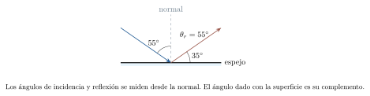{#fig-fp-av-r20-1 fig-alt="Ilustración de Problema resuelto 20.1. Construir el rayo reflejado desde la normal. En cada punto de una superficie trazamos una recta perpendicular, llamada normal. El ángulo de incidencia thetai y el de reflexión thetar se miden desde esa normal. La ley de reflexión establece thetar=thetai. El rayo incidente, el reflejado y la normal pertenecen al mismo plano. En una superficie rugosa, cada pequeña"}

Un punto luminoso envía luz en muchas direcciones. Después de reflejarse en un espejo plano, los rayos que llegan al ojo divergen como si procedieran de un punto situado detrás del espejo. Sus prolongaciones hacia atrás se cortan en una *imagen virtual*. Una imagen real corresponde a la convergencia efectiva de los rayos y puede recibirse sobre una pantalla colocada en ese lugar. La imagen virtual se observa mirando el sistema óptico; su posición se obtiene prolongando los rayos.

La simetría de la reflexión coloca la imagen de un espejo plano a la misma distancia detrás de la superficie que el objeto delante. Conserva el tamaño y la orientación vertical. Cada punto cambia su coordenada perpendicular al plano del espejo; esa inversión espacial explica la apariencia especular.

### Problema resuelto 20.2. Seguir la imagen cuando se acerca el objeto {#r20-2}
Una persona está a $1{,}20\,\mathrm{m}$ de un espejo plano fijo y avanza $0{,}300\,\mathrm{m}$ hacia él. Halla la separación entre la persona y su imagen antes y después del movimiento.
*Resolución.* Al comienzo, la imagen está a $1{,}20\,\mathrm{m}$ detrás del espejo y la separación es $2{,}40\,\mathrm{m}$. Al final, la persona queda a $0{,}900\,\mathrm{m}$ delante y la imagen a $0{,}900\,\mathrm{m}$ detrás: la separación es $1{,}80\,\mathrm{m}$. La imagen se desplaza $0{,}300\,\mathrm{m}$ hacia el plano por el lado posterior. La separación disminuye $0{,}600\,\mathrm{m}$.

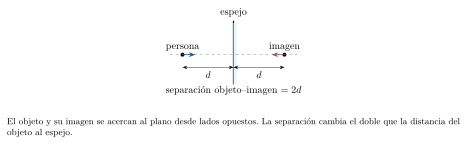{#fig-fp-av-r20-2 fig-alt="Ilustración de Problema resuelto 20.2. Seguir la imagen cuando se acerca el objeto. La simetría de la reflexión coloca la imagen de un espejo plano a la misma distancia detrás de la superficie que el objeto delante. Conserva el tamaño y la orientación vertical. Cada punto cambia su coordenada perpendicular al plano del espejo; esa inversión espacial explica la apariencia especular."}

## Refracción y reflexión interna total

El índice de refracción de un medio transparente se define como $n=c/v$, donde $v$ es la rapidez de fase de la luz en ese medio y $c\simeq3{,}00\times10^8\,\mathrm{m/s}$ es la rapidez en el vacío. En los materiales considerados aquí, el índice es positivo y depende de la frecuencia. La continuidad temporal de la oscilación en una interfaz estacionaria conserva la frecuencia $f$. La relación $v=\lambda f$ determina entonces el cambio de longitud de onda:
$$
v=\frac{c}{n},\qquad f=\frac{c}{\lambda_0},\qquad \lambda=\frac{\lambda_0}{n}.
$$
El subíndice cero designa la longitud de onda en el vacío. Para los cálculos de este capítulo, el aire se aproxima por $n=1$.

### Problema resuelto 20.3. Conservar la frecuencia al entrar en vidrio {#r20-3}
Una luz de longitud de onda en el vacío $600\,\mathrm{nm}$ entra en un vidrio de índice $1{,}50$. Calcula su frecuencia, rapidez y longitud de onda interior.
*Resolución.* Con $600\,\mathrm{nm}=6{,}00\times10^{-7}\,\mathrm{m}$,
$$
\begin{gathered}
f=5{,}00\times10^{14}\,\mathrm{Hz},\\
v=2{,}00\times10^8\,\mathrm{m/s},\\
\lambda=400\,\mathrm{nm}.
\end{gathered}
$$
La frecuencia conserva su valor al cruzar la interfaz. La rapidez y la longitud de onda se reducen por el factor $1/n$.

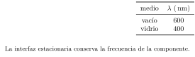{#fig-fp-av-r20-3 fig-alt="Ilustración de Problema resuelto 20.3. Conservar la frecuencia al entrar en vidrio. El índice de refracción de un medio transparente se define como n=c/v, donde v es la rapidez de fase de la luz en ese medio y csimeq3,00times10^8\\,m/s es la rapidez en el vacío. En los materiales considerados aquí, el índice es positivo y depende de la frecuencia. La continuidad temporal de la oscilación en una"}

La ley de Snell relaciona las direcciones a ambos lados de una interfaz entre medios homogéneos e isótropos:
$$
n_1\sin\theta_1=n_2\sin\theta_2.
$$
Ambos ángulos se miden con la normal. Al pasar a un índice mayor, el rayo transmitido se acerca a ella; al pasar a un índice menor, se aleja. Para incidencia normal la dirección se conserva, aunque cambien rapidez y longitud de onda. En general, una parte de la energía se refleja y otra se transmite. Snell determina la dirección de la transmisión; calcular las fracciones de energía requiere información adicional sobre los campos y la polarización.

### Problema resuelto 20.4. Refractar un rayo hacia la normal {#r20-4}
Un rayo en aire incide a $45{,}0^\circ$ sobre vidrio de índice $1{,}50$. Calcula el ángulo refractado y verifica hacia qué lado cambia la dirección.
*Resolución.* De Snell,
$$
\sin\theta_2=\frac{1}{1{,}50}\sin45^\circ=0{,}4714,
\qquad\theta_2\simeq28{,}1^\circ.
$$
El ángulo menor confirma el acercamiento a la normal. La reflexión parcial, cuando está presente, conserva $45^\circ$ con la normal en el aire. Los dos ángulos describen ramas distintas del haz.

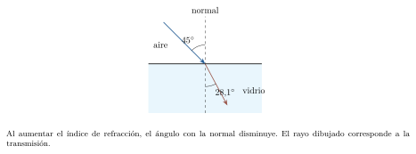{#fig-fp-av-r20-4 fig-alt="Ilustración de Problema resuelto 20.4. Refractar un rayo hacia la normal. La ley de Snell relaciona las direcciones a ambos lados de una interfaz entre medios homogéneos e isótropos: n1sintheta1=n2sintheta2. Ambos ángulos se miden con la normal. Al pasar a un índice mayor, el rayo transmitido se acerca a ella; al pasar a un índice menor, se aleja. Para incidencia normal la dirección se"}

Cuando $n_1>n_2$, el ángulo refractado alcanza $90^\circ$ para el ángulo crítico $\theta_c$:
$$
\sin\theta_c=\frac{n_2}{n_1},\qquad n_1>n_2.
$$
Para $\theta_1>\theta_c$ ocurre reflexión interna total. En el modelo de interfaz plana entre medios transparentes, con el segundo medio suficientemente extenso, la potencia reflejada iguala la incidente. En el segundo medio existe un campo evanescente, cuya amplitud decae con la distancia a la interfaz. El ángulo crítico marca el límite de la rama refractada propagante. Las fibras ópticas guían luz mediante sucesivas reflexiones internas bajo las condiciones adecuadas de índices y ángulos.

### Problema resuelto 20.5. Decidir si existe un rayo transmitido propagante {#r20-5}
Un haz viaja desde vidrio de índice $1{,}50$ hacia aire. Compara incidencias de $40{,}0^\circ$ y $45{,}0^\circ$.
*Resolución.* El límite es $\theta_c=\arcsin(1/1{,}50)\simeq41{,}8^\circ$. Para $40^\circ$,
$$
\theta_2=\arcsin(1{,}50\sin40^\circ)
\simeq74{,}6^\circ.
$$
La incidencia de $45^\circ$ supera el límite y produce reflexión interna total. Allí $1{,}50\sin45^\circ>1$ identifica el dominio fuera de la transmisión propagante.

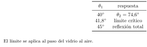{#fig-fp-av-r20-5 fig-alt="Ilustración de Problema resuelto 20.5. Decidir si existe un rayo transmitido propagante. Cuando n1>n2, el ángulo refractado alcanza 90^circ para el ángulo crítico thetac: sinthetac=fracn2n1,qquad n1>n2. Para theta1>thetac ocurre reflexión interna total. En el modelo de interfaz plana entre medios transparentes, con el segundo medio suficientemente extenso, la potencia reflejada iguala la incidente. En el"}

## Espejos esféricos y aumento lateral

Un espejo esférico tiene un eje principal que pasa por su vértice y su centro de curvatura. Para rayos próximos al eje y con ángulos pequeños, llamados paraxiales, un espejo cóncavo concentra un haz paralelo en el foco. Su distancia focal es $f=R/2$, positiva para el cóncavo. Un espejo convexo hace divergir ese haz; sus prolongaciones pasan por un foco virtual, con $f<0$. La aproximación paraxial reduce las aberraciones que aparecen al usar zonas alejadas del eje.

Usaremos la convención de *distancias reales positivas*: $s>0$ para un objeto real que envía rayos incidentes al espejo; $s'>0$ para una imagen real delante de él, en el lado de los rayos reflejados, y $s'<0$ para una imagen virtual detrás. Las alturas se miden con signo respecto del eje. En esta convención,
$$
\frac1s+\frac1{s'}=\frac1f,\qquad
m=\frac{h'}h=-\frac{s'}s.
$$
El aumento $m>0$ indica imagen derecha respecto del objeto; $m<0$, imagen invertida. Su magnitud compara tamaños. Para construir una imagen bastan dos rayos: uno paralelo al eje se refleja pasando por el foco o alejándose de su prolongación; uno dirigido al centro de curvatura retorna sobre su trayectoria. También puede usarse un rayo que llegue al vértice: se refleja simétricamente respecto del eje, que allí coincide con la normal. El cruce de los rayos reflejados, o de sus prolongaciones, localiza la imagen.

### Problema resuelto 20.6. Proyectar con un espejo cóncavo {#r20-6}
Un espejo cóncavo tiene $f=20{,}0\,\mathrm{cm}$. Un objeto real de $4{,}00\,\mathrm{cm}$ de altura está a $60{,}0\,\mathrm{cm}$ del vértice. Halla posición, altura y naturaleza de la imagen.
*Resolución.* Todas las distancias se expresan en centímetros:
$$
\frac1{s'}=\frac1{20}-\frac1{60}=\frac1{30},\qquad
s'=30{,}0\,\mathrm{cm},\qquad m=-\frac{30}{60}=-0{,}500.
$$
La imagen es real, está delante del espejo y tiene $h'=-2{,}00\,\mathrm{cm}$. El signo de la altura indica inversión. Una pantalla situada a $30\,\mathrm{cm}$ puede recibir la imagen dentro de la aproximación paraxial.

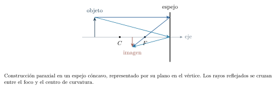{#fig-fp-av-r20-6 fig-alt="Ilustración de Problema resuelto 20.6. Proyectar con un espejo cóncavo. Usaremos la convención de distancias reales positivas: s>0 para un objeto real que envía rayos incidentes al espejo; s'>0 para una imagen real delante de él, en el lado de los rayos reflejados, y s'<0 para una imagen virtual detrás. Las alturas se miden con signo respecto del eje. En esta convención,"}

### Problema resuelto 20.7. Localizar una imagen virtual en un espejo convexo {#r20-7}
Un espejo convexo tiene $f=-15{,}0\,\mathrm{cm}$. Frente a él hay un objeto de altura $6{,}00\,\mathrm{cm}$ a $s=30{,}0\,\mathrm{cm}$. Determina su imagen.
*Resolución.* La focal negativa expresa la divergencia:
$$
\frac1{s'}=-\frac1{15}-\frac1{30}=-\frac1{10},\qquad
s'=-10{,}0\,\mathrm{cm},\qquad m=+\frac13.
$$
La imagen virtual queda $10{,}0\,\mathrm{cm}$ detrás del espejo, es derecha y tiene altura $2{,}00\,\mathrm{cm}$. Las prolongaciones de los rayos reflejados se encuentran en ese punto. El signo positivo del aumento concuerda con el trazado.

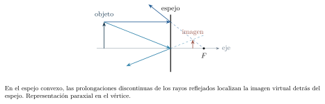{#fig-fp-av-r20-7 fig-alt="Ilustración de Problema resuelto 20.7. Localizar una imagen virtual en un espejo convexo. Usaremos la convención de distancias reales positivas: s>0 para un objeto real que envía rayos incidentes al espejo; s'>0 para una imagen real delante de él, en el lado de los rayos reflejados, y s'<0 para una imagen virtual detrás. Las alturas se miden con signo respecto del eje. En esta convención,"}

## Lentes delgadas y convención de signos

Una lente desvía luz por refracción en sus superficies. El modelo de lente delgada aproxima su espesor como pequeño frente a las distancias relevantes y trabaja con rayos paraxiales. Consideraremos lentes en aire por ambos lados. Una lente convergente tiene focal $f>0$ y una divergente $f<0$. La acción depende tanto de las superficies como de los índices de la lente y del entorno.

Para cada lente se toma $s>0$ cuando el objeto real está en el lado de incidencia. Una imagen real en el lado de salida tiene $s'>0$; una imagen virtual en el lado de incidencia tiene $s'<0$. La ecuación y el aumento conservan la forma
$$
\frac1s+\frac1{s'}=\frac1f,\qquad m=-\frac{s'}s.
$$
El significado geométrico de los lados se adapta a la transmisión a través de la lente. Un rayo paralelo al eje sale por el foco posterior de una convergente; en una divergente, su prolongación hacia atrás pasa por el foco del lado de incidencia. Un rayo por el centro óptico atraviesa la lente delgada con dirección aproximadamente constante. Esos dos rayos permiten construir las imágenes de los ejemplos siguientes.

### Problema resuelto 20.8. Formar una imagen real aumentada {#r20-8}
Una lente convergente de $f=12{,}0\,\mathrm{cm}$ recibe luz de un objeto de $2{,}00\,\mathrm{cm}$ de altura situado a $18{,}0\,\mathrm{cm}$. Halla la imagen y la posición de una pantalla para verla proyectada.
*Resolución.* Como el objeto está entre $f$ y $2f$,
$$
\frac1{s'}=\frac1{12}-\frac1{18}=\frac1{36},\qquad
s'=36{,}0\,\mathrm{cm},\qquad m=-2{,}00.
$$
La imagen real se forma al otro lado de la lente, es invertida y tiene altura $h'=-4{,}00\,\mathrm{cm}$. La pantalla se coloca a $36{,}0\,\mathrm{cm}$ de la lente. El trazado concuerda con el aumento de tamaño.

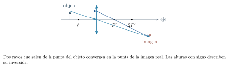{#fig-fp-av-r20-8 fig-alt="Ilustración de Problema resuelto 20.8. Formar una imagen real aumentada. Para cada lente se toma s>0 cuando el objeto real está en el lado de incidencia. Una imagen real en el lado de salida tiene s'>0; una imagen virtual en el lado de incidencia tiene s'<0. La ecuación y el aumento conservan la forma frac1s+frac1s'=frac1f,qquad m=-fracs's. El significado geométrico de los lados se adapta"}

### Problema resuelto 20.9. Usar una convergente como lupa {#r20-9}
Un objeto de $2{,}00\,\mathrm{cm}$ de altura se coloca a $6{,}00\,\mathrm{cm}$ de una lente convergente de focal $10{,}0\,\mathrm{cm}$. Determina su imagen y explica cómo observarla.
*Resolución.* El objeto queda dentro de la distancia focal:
$$
\frac1{s'}=\frac1{10}-\frac1{6}=-\frac1{15},\qquad
s'=-15{,}0\,\mathrm{cm},\qquad m=+2{,}50.
$$
La imagen virtual está en el lado del objeto, a $15{,}0\,\mathrm{cm}$ de la lente, y tiene altura $5{,}00\,\mathrm{cm}$. Se observa mirando desde el lado de salida. El ojo recibe rayos divergentes cuyas prolongaciones sitúan la imagen. Este aumento lateral describe tamaños; el aumento angular de una lupa también depende de la posición del ojo y de la referencia de observación.

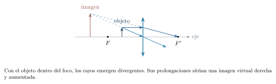{#fig-fp-av-r20-9 fig-alt="Ilustración de Problema resuelto 20.9. Usar una convergente como lupa. Para cada lente se toma s>0 cuando el objeto real está en el lado de incidencia. Una imagen real en el lado de salida tiene s'>0; una imagen virtual en el lado de incidencia tiene s'<0. La ecuación y el aumento conservan la forma frac1s+frac1s'=frac1f,qquad m=-fracs's. El significado geométrico de los lados se adapta"}

### Problema resuelto 20.10. Interpretar una focal negativa {#r20-10}
Una lente divergente de focal $-20{,}0\,\mathrm{cm}$ tiene un objeto real a $30{,}0\,\mathrm{cm}$. Calcula posición y aumento.
*Resolución.* Con la convención declarada,
$$
\frac1{s'}=-\frac1{20}-\frac1{30}
=-\frac1{12}.
$$
Así, $s'=-12{,}0\,\mathrm{cm}$ y $m=+0{,}400$. La imagen es virtual, derecha y reducida. Queda entre la lente y el foco del lado del objeto.

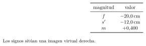{#fig-fp-av-r20-10 fig-alt="Ilustración de Problema resuelto 20.10. Interpretar una focal negativa. Para cada lente se toma s>0 cuando el objeto real está en el lado de incidencia. Una imagen real en el lado de salida tiene s'>0; una imagen virtual en el lado de incidencia tiene s'<0. La ecuación y el aumento conservan la forma frac1s+frac1s'=frac1f,qquad m=-fracs's. El significado geométrico de los lados se adapta"}

Si un objeto real está justo en el foco de una lente convergente, los rayos emergentes de cada punto son paralelos. La ecuación da $1/s'=0$, expresado como imagen en el infinito. Para enfocar un objeto muy lejano, los rayos incidentes son aproximadamente paralelos y la imagen se forma cerca del plano focal posterior. Una cámara modifica la separación entre la lente y el sensor para ajustar el enfoque a otras distancias.

## Sistemas de lentes y potencia óptica

En un sistema de dos lentes se sigue la luz en su orden de propagación. La primera imagen actúa como objeto de la segunda. Conviene ubicar las lentes y las imágenes en un eje de posiciones $x$, y luego asignar $s$ y $s'$ para cada elemento. Si los rayos llegan a la segunda lente divergiendo desde un punto anterior a ella, su objeto es real. Si llegan convergiendo hacia un punto posterior, ese punto es un objeto virtual y se usa $s<0$ para la segunda lente. El aumento total es el producto de los aumentos de las etapas.

### Problema resuelto 20.11. Reconstruir una imagen en dos etapas {#r20-11}
Dos lentes convergentes de focal $10{,}0\,\mathrm{cm}$ están en $x_1=0$ y $x_2=35{,}0\,\mathrm{cm}$. Un objeto de altura $4{,}00\,\mathrm{cm}$ está en $x=-30{,}0\,\mathrm{cm}$. La luz viaja hacia $+x$. Halla las dos imágenes y el aumento final.
*Resolución.* Para la primera lente, $s_1=30\,\mathrm{cm}$ y $1/s'_1=1/10-1/30=1/15$, luego la imagen intermedia está en $x=15\,\mathrm{cm}$. Su aumento es $m_1=-15/30=-0{,}500$. Ese punto está $20\,\mathrm{cm}$ antes de la segunda lente, de modo que $s_2=20\,\mathrm{cm}$. Por tanto,
$$
s'_2=20{,}0\,\mathrm{cm},\qquad x_{\mathrm{final}}=55{,}0\,\mathrm{cm},
\qquad m_2=-1,\qquad m=m_1m_2=+0{,}500.
$$
La imagen final es real y derecha respecto del objeto original, con altura $2{,}00\,\mathrm{cm}$. Cada etapa invierte la orientación; el producto registra ambas inversiones.

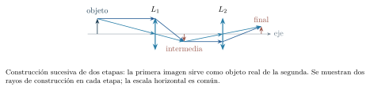{#fig-fp-av-r20-11 fig-alt="Ilustración de Problema resuelto 20.11. Reconstruir una imagen en dos etapas. En un sistema de dos lentes se sigue la luz en su orden de propagación. La primera imagen actúa como objeto de la segunda. Conviene ubicar las lentes y las imágenes en un eje de posiciones x, y luego asignar s y s' para cada elemento. Si los rayos llegan a la segunda lente divergiendo desde un punto anterior a ella,"}

La potencia óptica $P=1/f$, con $f$ en metros, se mide en dioptrías: $1\,\mathrm{D}=1\,\mathrm{m^{-1}}$. Una potencia positiva corresponde a una lente convergente y una negativa a una divergente. Para lentes delgadas en contacto, en el mismo medio y dentro de la aproximación paraxial, las potencias se suman: $P_{\mathrm{eq}}=P_1+P_2$. La separación finita entre lentes requiere el tratamiento por etapas o una fórmula que incluya esa separación.

### Problema resuelto 20.12. Combinar potencias en contacto {#r20-12}
Dos lentes delgadas en aire se colocan en contacto. Sus focales son $+20{,}0\,\mathrm{cm}$ y $-30{,}0\,\mathrm{cm}$. Halla la potencia y la focal equivalentes.
*Resolución.* Al convertir las focales a metros, $P_1=+5{,}00\,\mathrm{D}$ y $P_2=-3{,}33\,\mathrm{D}$. Entonces,
$$
P_{\mathrm{eq}}=+1{,}67\,\mathrm{D},
\qquad f_{\mathrm{eq}}=+0{,}600\,\mathrm{m}.
$$
El conjunto conserva acción convergente y presenta una focal mayor que la de la primera lente aislada. Se han sumado potencias con signo.

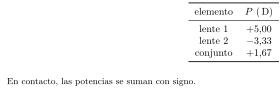{#fig-fp-av-r20-12 fig-alt="Ilustración de Problema resuelto 20.12. Combinar potencias en contacto. La potencia óptica P=1/f, con f en metros, se mide en dioptrías: 1\\,D=1\\,mathrmm^-1. Una potencia positiva corresponde a una lente convergente y una negativa a una divergente. Para lentes delgadas en contacto, en el mismo medio y dentro de la aproximación paraxial, las potencias se suman: Peq=P1+P2. La separación"}

## Interferencia y doble rendija

Los campos de dos ondas luminosas se superponen. Para obtener un patrón estable, su diferencia de fase debe mantenerse suficientemente definida durante la observación: esa relación se llama coherencia. Dos rendijas iluminadas por una misma fuente apropiada pueden actuar como fuentes coherentes. La frecuencia común, la polarización compatible y una diferencia de fase estable permiten observar franjas de interferencia.

Consideremos dos rendijas estrechas separadas una distancia $d$, iluminadas en fase con luz monocromática, y una pantalla lejana a distancia $L$. En la dirección $\theta$, medida desde el eje central perpendicular al plano de las rendijas, la diferencia de caminos es aproximadamente $\delta=d\sin\theta$. Los máximos y mínimos de interferencia cumplen
$$
\begin{aligned}
d\sin\theta&=m\lambda &&\text{(máximos)},\quad m=0,\pm1,\pm2,\ldots,\\
d\sin\theta&=(m+\tfrac12)\lambda &&\text{(mínimos)},\quad m\in\mathbb Z.
\end{aligned}
$$
Aquí $\lambda$ es la longitud de onda en el medio que llena los caminos. El patrón completo incluye también la difracción de cada rendija de ancho finito. La aproximación de fuentes estrechas describe las franjas dentro de su envolvente.

En una pantalla plana, $y=L\tan\theta$. Para $|y|\ll L$, $\sin\theta\simeq\tan\theta\simeq y/L$ y
$$
y_m\simeq\frac{m\lambda L}{d},\qquad
\Delta y\simeq\frac{\lambda L}{d}.
$$
Así aparecen franjas aproximadamente equidistantes cerca del centro. Para ángulos grandes se conservan la condición angular y la relación con la tangente. Con haces de igual intensidad individual $I_0$, la intensidad ideal es $I=4I_0\cos^2(\Delta\varphi/2)$, con $\Delta\varphi=2\pi\delta/\lambda$. Los mínimos redistribuyen la energía en el patrón; al considerar todo el sistema se mantiene el balance energético.

### Problema resuelto 20.13. Medir una longitud de onda con franjas {#r20-13}
Dos rendijas separadas $0{,}250\,\mathrm{mm}$ producen franjas con luz de $500\,\mathrm{nm}$ en aire. La pantalla está a $2{,}00\,\mathrm{m}$. Calcula la separación entre máximos y la posición del máximo $m=2$.
*Resolución.* En metros, $d=2{,}50\times10^{-4}$ y $\lambda=5{,}00\times10^{-7}$. Por tanto,
$$
\Delta y=\frac{(5{,}00\times10^{-7})(2{,}00)}{2{,}50\times10^{-4}}
=4{,}00\,\mathrm{mm},\qquad y_2=8{,}00\,\mathrm{mm}.
$$
El cociente $y_2/L=0{,}00400$ respalda la aproximación de ángulos pequeños. Si se mide $y_2$, la misma relación permite despejar $\lambda=y_2d/(2L)$.

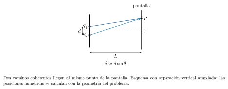{#fig-fp-av-r20-13 fig-alt="Ilustración de Problema resuelto 20.13. Medir una longitud de onda con franjas. En una pantalla plana, y=Ltantheta. Para |y|ll L, sinthetasimeqtanthetasimeq y/L y ymsimeqfracmlambda Ld,qquad Delta ysimeqfraclambda Ld. Así aparecen franjas aproximadamente equidistantes cerca del centro. Para ángulos grandes se conservan la condición angular y la relación con la tangente. Con haces de igual"}

### Problema resuelto 20.14. Sumergir todo el montaje de interferencia {#r20-14}
El montaje del problema 20.13, incluidos los caminos hasta la pantalla, se llena con un medio transparente homogéneo de índice $4/3$ para esa luz. Se conservan la geometría y la frecuencia de la fuente. Halla la nueva separación entre máximos.
*Resolución.* La longitud de onda se reduce a $\lambda=500/(4/3)=375\,\mathrm{nm}$. Así,
$$
\Delta y_{\mathrm{medio}}=\frac{\Delta y_{\mathrm{aire}}}{n}
=3{,}00\,\mathrm{mm}.
$$
La frecuencia permanece en $c/\lambda_0=6{,}00\times10^{14}\,\mathrm{Hz}$. El patrón se contrae porque los mismos incrementos de diferencia de fase requieren menores diferencias geométricas de caminos. Se ha supuesto que ambos recorridos están enteramente en el mismo medio.

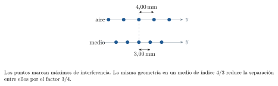{#fig-fp-av-r20-14 fig-alt="Ilustración de Problema resuelto 20.14. Sumergir todo el montaje de interferencia. En una pantalla plana, y=Ltantheta. Para |y|ll L, sinthetasimeqtanthetasimeq y/L y ymsimeqfracmlambda Ld,qquad Delta ysimeqfraclambda Ld. Así aparecen franjas aproximadamente equidistantes cerca del centro. Para ángulos grandes se conservan la condición angular y la relación con la tangente. Con haces de igual"}

## Difracción y resolución

Una abertura iluminada produce un haz con extensión angular. La superposición de las contribuciones de distintas zonas de la abertura determina la difracción. Para una rendija de ancho $a$, con iluminación monocromática uniforme y observación en campo lejano, los mínimos satisfacen
$$
a\sin\theta=p\lambda,\qquad p=\pm1,\pm2,\ldots.
$$
El centro, $\theta=0$, es un máximo. La cancelación del primer mínimo puede entenderse dividiendo la rendija en dos mitades: a cada punto de una mitad le corresponde otro, separado $a/2$, cuya diferencia de caminos es $\lambda/2$ cuando $a\sin\theta=\lambda$. Las contribuciones emparejadas llegan en oposición de fase. El valor $p=0$ pertenece al máximo central y se trata por separado.

En una pantalla lejana y para ángulos pequeños, los primeros mínimos están en $y_{\pm1}\simeq\pm\lambda L/a$. El ancho del máximo central entre ellos es $2\lambda L/a$. La condición práctica de campo lejano es $L\gg a^2/\lambda$, o un montaje óptico que observe el patrón angular mediante una lente. Reducir $a$ aumenta la extensión angular del máximo central.

### Problema resuelto 20.15. Calcular el ancho del máximo central {#r20-15}
Una rendija de ancho $0{,}100\,\mathrm{mm}$ se ilumina con luz de $600\,\mathrm{nm}$ en aire. La pantalla está a $2{,}00\,\mathrm{m}$. Halla el primer mínimo positivo y el ancho central.
*Resolución.* El cociente $\lambda/a=0{,}00600$ corresponde a un ángulo pequeño. Por ello,
$$
y_1\simeq\frac{(6{,}00\times10^{-7})(2{,}00)}{1{,}00\times10^{-4}}
=0{,}0120\,\mathrm{m},\qquad 2y_1=24{,}0\,\mathrm{mm}.
$$
Los primeros mínimos están a $\pm12{,}0\,\mathrm{mm}$. Además, $a^2/\lambda\simeq0{,}0167\,\mathrm{m}$, mucho menor que $L$, coherente con campo lejano. El máximo central ocupa el intervalo entre esos dos mínimos.

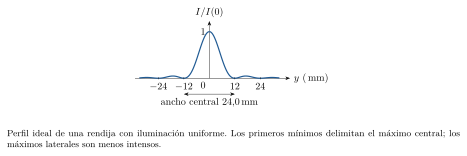{#fig-fp-av-r20-15 fig-alt="Ilustración de Problema resuelto 20.15. Calcular el ancho del máximo central. En una pantalla lejana y para ángulos pequeños, los primeros mínimos están en ypm1simeqpmlambda L/a. El ancho del máximo central entre ellos es 2lambda L/a. La condición práctica de campo lejano es Lgg a^2/lambda, o un montaje óptico que observe el patrón angular mediante una lente. Reducir a aumenta la extensión"}

Una abertura circular forma un disco central de difracción rodeado por anillos. Para una abertura ideal de diámetro $D$ con iluminación uniforme, el primer mínimo está a un ángulo pequeño $\theta\simeq1{,}22\lambda/D$, en radianes. El criterio de Rayleigh considera apenas resueltas dos fuentes puntuales incoherentes de brillo comparable cuando el máximo de una coincide con el primer mínimo de la otra:
$$
\theta_{\min}\simeq1{,}22\frac{\lambda}{D}.
$$
Es un criterio convencional para ese patrón ideal. Las aberraciones, el contraste, el detector y la atmósfera también influyen en la resolución de un instrumento real. El aumento agranda una imagen; la resolución determina qué detalles próximos pueden distinguirse.

### Problema resuelto 20.16. Distinguir aumento de resolución {#r20-16}
Un instrumento ideal tiene abertura circular de diámetro $5{,}00\,\mathrm{mm}$ y observa luz de $550\,\mathrm{nm}$ en aire. Dos fuentes puntuales incoherentes, de brillo comparable, están separadas transversalmente $1{,}00\,\mathrm{m}$ a $10{,}0\,\mathrm{km}$. Aplica Rayleigh y halla el diámetro mínimo ideal para alcanzar su separación angular.
*Resolución.* La separación angular es $\alpha\simeq1/10\,000=1{,}00\times10^{-4}\,\mathrm{rad}$. La abertura dada produce
$$
\theta_{\min}=1{,}22\frac{550\times10^{-9}}{5{,}00\times10^{-3}}
=1{,}342\times10^{-4}\,\mathrm{rad}.
$$
Como $\alpha<\theta_{\min}$, la pareja queda por debajo del umbral de Rayleigh. Para alcanzar ese umbral se requiere $D=1{,}22\lambda/\alpha=6{,}71\,\mathrm{mm}$. Aumentar la imagen con la misma abertura conserva la relación angular entre separación y difracción.

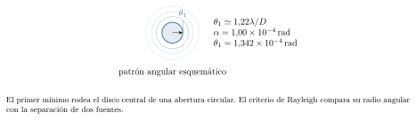{#fig-fp-av-r20-16 fig-alt="Ilustración de Problema resuelto 20.16. Distinguir aumento de resolución. Una abertura circular forma un disco central de difracción rodeado por anillos. Para una abertura ideal de diámetro D con iluminación uniforme, el primer mínimo está a un ángulo pequeño thetasimeq1,22lambda/D, en radianes. El criterio de Rayleigh considera apenas resueltas dos fuentes puntuales incoherentes de brillo"}

## Dispersión, espectro y color

La dispersión es la dependencia del índice con la frecuencia. En muchos vidrios transparentes y dentro del visible, el índice para luz violeta es mayor que para roja: la luz violeta cambia más su dirección al atravesar un prisma. Cada componente cumple Snell con su propio índice. La luz blanca contiene un conjunto amplio de frecuencias; un prisma puede separar sus componentes en distintas direcciones.

En un prisma de ángulo de vértice $A$, situado en aire, los ángulos internos cumplen $r_1+r_2=A$. La desviación total es $\delta=i+e-A$, donde $i$ y $e$ son los ángulos externos con las normales. En el recorrido simétrico de desviación mínima, $i=e$ y $r_1=r_2=A/2$, de modo que
$$
\delta_{\min}=2\arcsin\!\left(n\sin\frac A2\right)-A.
$$
Esta expresión requiere un recorrido transmitido y el ajuste de orientación correspondiente a cada índice.

### Problema resuelto 20.17. Comparar la desviación mínima de dos colores {#r20-17}
Un prisma de $A=60{,}0^\circ$ tiene índices $n_r=1{,}50$ para luz roja y $n_v=1{,}53$ para violeta. Calcula la desviación mínima de cada componente al ajustar el prisma por separado para cada una.
*Resolución.* Como $\sin(A/2)=0{,}500$,
$$
\begin{aligned}
\delta_{r,\min}&=2\arcsin(0{,}750)-60^\circ\simeq37{,}2^\circ,\\
\delta_{v,\min}&=2\arcsin(0{,}765)-60^\circ\simeq39{,}8^\circ.
\end{aligned}
$$
La diferencia entre los dos mínimos es aproximadamente $2{,}63^\circ$. El mayor índice violeta exige mayor desviación mínima. Estas mediciones corresponden a dos orientaciones ajustadas; la separación simultánea a una orientación fija se obtiene aplicando Snell en ambas caras para ese montaje.

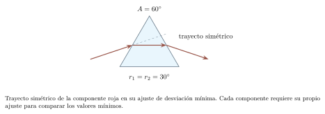{#fig-fp-av-r20-17 fig-alt="Ilustración de Problema resuelto 20.17. Comparar la desviación mínima de dos colores. En un prisma de ángulo de vértice A, situado en aire, los ángulos internos cumplen r1+r2=A. La desviación total es delta=i+e-A, donde i y e son los ángulos externos con las normales. En el recorrido simétrico de desviación mínima, i=e y r1=r2=A/2, de modo que deltamin=2arcsin\\!left(nsinfrac A2right)-A. Esta expresión"}

El espectro describe cómo se distribuye la radiación entre frecuencias o longitudes de onda. Para una componente monocromática visible, la frecuencia conserva su identidad al atravesar una interfaz estacionaria; las etiquetas de color se suelen asociar a su longitud de onda en el vacío. El color percibido depende del espectro que llega al ojo, de la respuesta de sus receptores y de las condiciones de observación. Mezclas espectrales diferentes pueden producir apariencias de color semejantes.

La amplitud del campo influye en la intensidad: para una misma onda en un mismo medio, la intensidad es proporcional al cuadrado de la amplitud. La frecuencia y la composición espectral aportan información distinta. Bajo iluminación blanca, un objeto puede reflejar selectivamente unas componentes y absorber otras; la iluminación modifica el espectro disponible. Estas relaciones permiten explicar colores de fuentes, filtros y superficies con sus respectivos mecanismos físicos.

### Problema resuelto 20.18. Separar frecuencia, longitud de onda e intensidad {#r20-18}
Dos haces monocromáticos tienen longitudes de onda en el vacío $450\,\mathrm{nm}$ y $650\,\mathrm{nm}$. En un vidrio sus índices son $1{,}52$ y $1{,}50$, respectivamente. Halla sus frecuencias y longitudes de onda interiores. Describe qué ocurre con la intensidad de cada haz si su amplitud eléctrica se duplica en el mismo medio.
*Resolución.* Para la componente de $450\,\mathrm{nm}$, $f=c/\lambda_0\simeq6{,}67\times10^{14}\,\mathrm{Hz}$ y $\lambda=450/1{,}52\simeq296\,\mathrm{nm}$. Para la de $650\,\mathrm{nm}$, $f\simeq4{,}62\times10^{14}\,\mathrm{Hz}$ y $\lambda\simeq433\,\mathrm{nm}$. Cada frecuencia conserva su valor en el vidrio. La longitud interior de $296\,\mathrm{nm}$ corresponde aquí a la componente visible de $450\,\mathrm{nm}$ en el vacío. Duplicar la amplitud multiplica por cuatro la intensidad de cada haz y conserva su frecuencia.

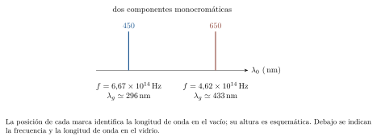{#fig-fp-av-r20-18 fig-alt="Ilustración de Problema resuelto 20.18. Separar frecuencia, longitud de onda e intensidad. La amplitud del campo influye en la intensidad: para una misma onda en un mismo medio, la intensidad es proporcional al cuadrado de la amplitud. La frecuencia y la composición espectral aportan información distinta. Bajo iluminación blanca, un objeto puede reflejar selectivamente unas componentes y absorber otras; la"}

## Ejercicios para reconstruir y transferir

Usa $c=3{,}00\times10^8\,\mathrm{m/s}$ y $n_{\mathrm{aire}}=1$. En espejos esféricos y lentes delgadas, trabaja en régimen paraxial con la convención de distancias reales positivas de este capítulo. Para interferencia, supone fuentes coherentes en fase y polarizaciones compatibles. En los cálculos de franjas y difracción sobre pantallas, verifica la aproximación de ángulos pequeños.

### Ejercicio 20.1. Reconocer la referencia angular {#e20-1}
Un rayo forma $20{,}0^\circ$ con la superficie de un espejo plano. Dibuja la normal y calcula los ángulos de incidencia y reflexión.

### Ejercicio 20.2. Separación en un espejo plano {#e20-2}
Un objeto está a $0{,}800\,\mathrm{m}$ de un espejo plano fijo. Se aleja de él $0{,}250\,\mathrm{m}$. Halla la separación final objeto–imagen y su cambio.

### Ejercicio 20.3. Rapidez y longitud de onda {#e20-3}
Una luz de $540\,\mathrm{nm}$ en el vacío entra en un medio de índice $1{,}80$. Halla frecuencia, rapidez y longitud de onda interior.

### Ejercicio 20.4. Entrada en agua {#e20-4}
Un rayo entra desde aire en agua de índice $4/3$ con incidencia de $30{,}0^\circ$. Calcula el ángulo refractado.

### Ejercicio 20.5. Salir a través de caras paralelas {#e20-5}
Un rayo entra desde aire a una lámina de vidrio de caras paralelas, índice $1{,}50$, con incidencia de $30{,}0^\circ$. Calcula los ángulos interiores y de salida al aire. Explica la relación entre las direcciones incidente y emergente.

### Ejercicio 20.6. Límite crítico en agua {#e20-6}
Un haz pasa de agua, $n=4/3$, hacia aire. Halla el ángulo crítico y clasifica incidencias de $45{,}0^\circ$ y $50{,}0^\circ$.

### Ejercicio 20.7. Imagen en un espejo cóncavo {#e20-7}
Un objeto de altura $3{,}00\,\mathrm{cm}$ está a $40{,}0\,\mathrm{cm}$ de un espejo cóncavo de focal $15{,}0\,\mathrm{cm}$. Halla $s'$, $m$ y $h'$ y clasifica la imagen.

### Ejercicio 20.8. Objeto dentro del foco de un espejo {#e20-8}
Un objeto está a $5{,}00\,\mathrm{cm}$ de un espejo cóncavo de focal $10{,}0\,\mathrm{cm}$. Obtén posición y aumento de la imagen y describe cómo se construye con rayos.

### Ejercicio 20.9. Espejo convexo {#e20-9}
Un espejo convexo tiene radio de curvatura de magnitud $40{,}0\,\mathrm{cm}$. Un objeto real está a $60{,}0\,\mathrm{cm}$. Determina focal con signo, posición y aumento.

### Ejercicio 20.10. Una lente con objeto en el doble del foco {#e20-10}
Una lente convergente de focal $8{,}00\,\mathrm{cm}$ tiene un objeto de altura $2{,}50\,\mathrm{cm}$ a $16{,}0\,\mathrm{cm}$. Halla su imagen.

### Ejercicio 20.11. Imagen virtual aumentada {#e20-11}
Una lente convergente tiene focal $15{,}0\,\mathrm{cm}$ y objeto a $10{,}0\,\mathrm{cm}$. Halla posición y aumento, y explica desde qué lado se observa la imagen virtual.

### Ejercicio 20.12. Imagen en una lente divergente {#e20-12}
Un objeto real a $20{,}0\,\mathrm{cm}$ de una lente divergente produce una imagen a $s'=-5{,}00\,\mathrm{cm}$. Halla la focal y el aumento.

### Ejercicio 20.13. Ajustar una proyección {#e20-13}
Un objeto y una pantalla están separados $90{,}0\,\mathrm{cm}$. Se desea una imagen real con aumento lateral $m=-2{,}00$ usando una lente delgada. Halla la distancia objeto–lente y la focal requerida.

### Ejercicio 20.14. Sumar potencias con signo {#e20-14}
Dos lentes delgadas en contacto tienen potencias $+4{,}00\,\mathrm{D}$ y $-1{,}50\,\mathrm{D}$. Calcula la focal equivalente y clasifica el conjunto.

### Ejercicio 20.15. Una imagen intermedia como objeto real {#e20-15}
Repite el problema 20.11 con la segunda lente en $x_2=45{,}0\,\mathrm{cm}$, conservando ambas focales y la posición y altura del objeto. Halla la posición final y el aumento total.

### Ejercicio 20.16. Objeto virtual para la segunda lente {#e20-16}
Una primera lente haría converger un haz hacia $x=30{,}0\,\mathrm{cm}$. Antes de llegar allí, el haz atraviesa una segunda lente convergente en $x=20{,}0\,\mathrm{cm}$, de focal $10{,}0\,\mathrm{cm}$. Asigna $s_2$ con signo y halla la nueva posición de convergencia.

### Ejercicio 20.17. Máximos y mínimos de doble rendija {#e20-17}
Dos rendijas separadas $0{,}300\,\mathrm{mm}$ se iluminan con luz de $600\,\mathrm{nm}$ en aire. La pantalla está a $1{,}50\,\mathrm{m}$. Halla la separación entre máximos y la posición del primer mínimo positivo.

### Ejercicio 20.18. Obtener una longitud de onda {#e20-18}
Un máximo de orden $m=3$ está a $9{,}00\,\mathrm{mm}$ del centro, con $d=0{,}400\,\mathrm{mm}$ y $L=2{,}00\,\mathrm{m}$. Calcula la longitud de onda en aire.

### Ejercicio 20.19. Inferir un índice desde las franjas {#e20-19}
Al llenar por completo un montaje de doble rendija con un medio homogéneo, la separación entre máximos pasa de $4{,}50\,\mathrm{mm}$ en aire a $3{,}00\,\mathrm{mm}$. La frecuencia y la geometría se conservan. Halla el índice del medio.

### Ejercicio 20.20. Ancho de una rendija {#e20-20}
Con luz de $500\,\mathrm{nm}$ en aire y pantalla a $2{,}00\,\mathrm{m}$, el primer mínimo de una rendija está a $10{,}0\,\mathrm{mm}$ del centro. Halla el ancho de la rendija y el ancho del máximo central.

### Ejercicio 20.21. Cambiar la abertura {#e20-21}
Una rendija de $0{,}200\,\mathrm{mm}$ iluminada con $600\,\mathrm{nm}$ en aire tiene pantalla a $1{,}00\,\mathrm{m}$. Halla el ancho central y predice su valor al reducir la rendija a $0{,}100\,\mathrm{mm}$.

### Ejercicio 20.22. Resolver dos fuentes con una abertura circular {#e20-22}
Una abertura ideal de diámetro $10{,}0\,\mathrm{mm}$ observa luz de $500\,\mathrm{nm}$ en aire. Halla el umbral de Rayleigh y decide si dos fuentes puntuales incoherentes de brillo comparable, con separación angular $8{,}00\times10^{-5}\,\mathrm{rad}$, lo superan.

### Ejercicio 20.23. Índice de un prisma {#e20-23}
Un prisma en aire tiene $A=60{,}0^\circ$ y desviación mínima medida $40{,}0^\circ$ para una componente monocromática. Obtén el índice de refracción para esa componente.

### Ejercicio 20.24. Espectro y amplitud {#e20-24}
Una luz monocromática de $600\,\mathrm{nm}$ en el vacío se propaga en un vidrio de índice $1{,}50$. Halla frecuencia y longitud de onda interior. Si la amplitud eléctrica se reduce a la mitad en ese mismo medio, calcula la razón de intensidades y explica qué propiedad espectral conserva.

## Soluciones razonadas

### Solución 20.1 {#sol-e20-1}
 La perpendicular al espejo fija $\theta_i=90^\circ-20^\circ=70{,}0^\circ$. La reflexión conserva ese ángulo: $\theta_r=70{,}0^\circ$. Ambos se señalan entre cada rama y la normal.

### Solución 20.2 {#sol-e20-2}
 La distancia final al espejo es $1{,}05\,\mathrm{m}$. La imagen queda a igual distancia detrás y la separación final es $2{,}10\,\mathrm{m}$. La separación inicial era $1{,}60\,\mathrm{m}$, por lo que aumenta $0{,}500\,\mathrm{m}$.

### Solución 20.3 {#sol-e20-3}
 $f=c/\lambda_0\simeq5{,}56\times10^{14}\,\mathrm{Hz}$, $v=c/1{,}80\simeq1{,}67\times10^8\,\mathrm{m/s}$ y $\lambda=540/1{,}80=300\,\mathrm{nm}$. La frecuencia es común a ambos medios.

### Solución 20.4 {#sol-e20-4}
 $\sin\theta_2=(3/4)\sin30^\circ=0{,}375$. Resulta $\theta_2\simeq22{,}0^\circ$, más cerca de la normal.

### Solución 20.5 {#sol-e20-5}
 Dentro del vidrio, $\theta_g=\arcsin(\sin30^\circ/1{,}50)\simeq19{,}5^\circ$. Las normales de ambas caras son paralelas, de modo que la segunda incidencia interior también es $19{,}5^\circ$. Al salir, $\sin\theta_{\mathrm{salida}}=1{,}50\sin\theta_g=0{,}500$, luego sale a $30{,}0^\circ$. El rayo emergente es paralelo al incidente, con un desplazamiento lateral que depende del espesor.

### Solución 20.6 {#sol-e20-6}
 $\theta_c=\arcsin(3/4)\simeq48{,}6^\circ$. A $45^\circ$ hay transmisión propagante, con $\theta_2\simeq70{,}5^\circ$, además de reflexión parcial. A $50^\circ$ hay reflexión interna total en el modelo de interfaz descrito.

### Solución 20.7 {#sol-e20-7}
 $1/s'=1/15-1/40=1/24$, de donde $s'=24{,}0\,\mathrm{cm}$. El aumento es $m=-24/40=-0{,}600$ y $h'=-1{,}80\,\mathrm{cm}$. La imagen real e invertida se forma delante del espejo.

### Solución 20.8 {#sol-e20-8}
 $1/s'=1/10-1/5=-1/10$, así que $s'=-10{,}0\,\mathrm{cm}$ y $m=+2{,}00$. La imagen virtual, derecha y aumentada, queda detrás del espejo. Se construye prolongando hacia atrás dos rayos reflejados.

### Solución 20.9 {#sol-e20-9}
 El espejo convexo tiene $f=-20{,}0\,\mathrm{cm}$. Entonces $1/s'=-1/20-1/60=-1/15$, $s'=-15{,}0\,\mathrm{cm}$ y $m=+0{,}250$. La imagen es virtual, derecha y reducida.

### Solución 20.10 {#sol-e20-10}
 $1/s'=1/8-1/16=1/16$, de modo que $s'=16{,}0\,\mathrm{cm}$. Con $m=-1$, la imagen es real, invertida y de altura $h'=-2{,}50\,\mathrm{cm}$, al otro lado de la lente.

### Solución 20.11 {#sol-e20-11}
 $1/s'=1/15-1/10=-1/30$, por lo que $s'=-30{,}0\,\mathrm{cm}$ y $m=+3{,}00$. La imagen es virtual y derecha. Se mira desde el lado de salida de la luz; sus rayos divergentes parecen proceder de la imagen del lado del objeto.

### Solución 20.12 {#sol-e20-12}
 $1/f=1/20-1/5=-3/20\,\mathrm{cm^{-1}}$, luego $f=-20/3\,\mathrm{cm}\simeq-6{,}67\,\mathrm{cm}$. El aumento es $m=-(-5)/20=+0{,}250$, coherente con una imagen virtual reducida.

### Solución 20.13 {#sol-e20-13}
 De $s'/s=2$ y $s+s'=90\,\mathrm{cm}$ se obtiene $s=30{,}0\,\mathrm{cm}$ y $s'=60{,}0\,\mathrm{cm}$. La focal es $f=ss'/(s+s')=20{,}0\,\mathrm{cm}$. La imagen real está invertida y duplica el tamaño.

### Solución 20.14 {#sol-e20-14}
 $P_{\mathrm{eq}}=4{,}00-1{,}50=+2{,}50\,\mathrm{D}$. Su focal es $f=1/P=+0{,}400\,\mathrm{m}$. El signo positivo identifica acción convergente bajo las hipótesis de lentes en contacto.

### Solución 20.15 {#sol-e20-15}
 La imagen intermedia permanece en $x=15\,\mathrm{cm}$, con $m_1=-0{,}500$. Para la segunda lente, $s_2=45-15=30\,\mathrm{cm}$, luego $s'_2=15\,\mathrm{cm}$ y $m_2=-0{,}500$. La imagen final está en $x=60{,}0\,\mathrm{cm}$ y el aumento total es $+0{,}250$, con altura $1{,}00\,\mathrm{cm}$.

### Solución 20.16 {#sol-e20-16}
 El punto hacia el que converge el haz está $10\,\mathrm{cm}$ después de la segunda lente: es un objeto virtual para ella, con $s_2=-10\,\mathrm{cm}$. La ecuación da $1/s'_2=1/10-1/(-10)=1/5$. La convergencia final ocurre $5{,}00\,\mathrm{cm}$ después de esa lente, en $x=25{,}0\,\mathrm{cm}$. El signo del objeto registra la convergencia previa.

### Solución 20.17 {#sol-e20-17}
 $\Delta y=\lambda L/d=(600\times10^{-9})(1{,}50)/(0{,}300\times10^{-3})=3{,}00\,\mathrm{mm}$. El primer mínimo positivo está a la mitad: $y=1{,}50\,\mathrm{mm}$. Su cociente con $L$ es $0{,}00100$, dentro de ángulos pequeños.

### Solución 20.18 {#sol-e20-18}
 $\lambda=y_3d/(3L)=(9{,}00\times10^{-3})(0{,}400\times10^{-3})/(3\times2{,}00)=600\,\mathrm{nm}$. El cociente $y_3/L=0{,}00450$ respalda la aproximación usada.

### Solución 20.19 {#sol-e20-19}
 Como $\Delta y_{\mathrm{medio}}=\Delta y_{\mathrm{aire}}/n$, resulta $n=4{,}50/3{,}00=1{,}50$. La longitud de onda se reduce en esa proporción y la frecuencia se conserva.

### Solución 20.20 {#sol-e20-20}
 $a\simeq\lambda L/y_1=(500\times10^{-9})(2{,}00)/(0{,}0100)=1{,}00\times10^{-4}\,\mathrm{m}=0{,}100\,\mathrm{mm}$. El ancho central es $2y_1=20{,}0\,\mathrm{mm}$. Aquí $y_1/L=0{,}00500$ y $a^2/\lambda=0{,}0200\,\mathrm{m}\ll L$.

### Solución 20.21 {#sol-e20-21}
 Al principio, $2\lambda L/a=6{,}00\,\mathrm{mm}$. Al reducir $a$ a la mitad, el ancho central se duplica hasta $12{,}0\,\mathrm{mm}$. Los ángulos de los primeros mínimos son aproximadamente $0{,}00300$ y $0{,}00600\,\mathrm{rad}$, ambos pequeños.

### Solución 20.22 {#sol-e20-22}
 $\theta_{\min}=1{,}22(500\times10^{-9})/(10{,}0\times10^{-3})=6{,}10\times10^{-5}\,\mathrm{rad}$. La separación dada es mayor: las fuentes superan el umbral ideal de Rayleigh en estas condiciones.

### Solución 20.23 {#sol-e20-23}
 Al despejar, $n=\sin[(\delta_{\min}+A)/2]/\sin(A/2)=\sin50^\circ/\sin30^\circ\simeq1{,}532$. El índice corresponde a la componente usada en la medición y al recorrido de desviación mínima.

### Solución 20.24 {#sol-e20-24}
 $f=5{,}00\times10^{14}\,\mathrm{Hz}$ y $\lambda=400\,\mathrm{nm}$. Como $I\propto E_0^2$ en el mismo medio, $I_{\mathrm{final}}/I_{\mathrm{inicial}}=(1/2)^2=1/4$. La frecuencia, que caracteriza esa componente espectral, conserva su valor.

## Una experiencia: localizar una imagen real

### Una lente y una pantalla de papel
Usa una lupa convergente, una hoja blanca y un objeto bien iluminado, como una figura junto a una lámpara LED difusa. Trabaja con luz ambiental o una fuente de baja potencia. Mantén la lente orientada hacia el objeto y desplaza la hoja al otro lado hasta obtener una imagen definida. Mide las distancias aproximadas $s$ y $s'$ desde la lente y estima $f=ss'/(s+s')$.

Repite con tres posiciones del objeto, manteniéndolo más lejos que la focal estimada. Registra tamaño, orientación y distancia de la imagen. Compara los valores de $f$ e identifica la incertidumbre al localizar la máxima nitidez y al medir desde una lente de espesor finito. Luego coloca el objeto dentro de la distancia focal y observa a través de la lupa desde el lado de salida: dibuja las prolongaciones que explican la imagen virtual. Para cuidar los ojos y evitar concentraciones intensas de luz, realiza toda la experiencia con fuentes difusas y mantén la lente alejada de la dirección del Sol.

## Diagnóstico antes de avanzar

Una lente convergente ideal de focal $10{,}0\,\mathrm{cm}$ forma en aire la imagen de un objeto de $2{,}00\,\mathrm{cm}$ de altura situado a $30{,}0\,\mathrm{cm}$. Su abertura circular tiene diámetro $5{,}00\,\mathrm{mm}$ y se usa luz de $500\,\mathrm{nm}$ en el vacío. Calcula la posición y la altura de la imagen. Estima el radio del disco de difracción hasta el primer mínimo en el plano de imagen usando $r\simeq1{,}22\lambda s'/D$. Después, en un montaje independiente de doble rendija con la misma luz, $d=0{,}250\,\mathrm{mm}$ y $L=1{,}00\,\mathrm{m}$, calcula la separación entre máximos. Explica qué cambia al reducir cada abertura o separación a la mitad.

**Contraste.** La ecuación de lentes da $s'=15{,}0\,\mathrm{cm}$ y $m=-0{,}500$, por lo que $h'=-1{,}00\,\mathrm{cm}$: la imagen es real e invertida. Su radio de difracción ideal es $r\simeq1{,}22(500\times10^{-9})(0{,}150)/(0{,}00500)=18{,}3\,\mathrm{\mu m}$. Reducir el diámetro $D$ a la mitad duplica ese radio hasta $36{,}6\,\mathrm{\mu m}$, conservando la posición geométrica paraxial. En el montaje de doble rendija, $\Delta y=\lambda L/d=2{,}00\,\mathrm{mm}$; reducir $d$ a la mitad duplica la separación a $4{,}00\,\mathrm{mm}$. El primer cambio ensancha la respuesta de una abertura circular y el segundo redistribuye las franjas de dos fuentes coherentes. Las dos predicciones proceden de la superposición ondulatoria aplicada a geometrías diferentes.

**Lecturas de apoyo.** H. D. Young y R. A. Freedman, *Física universitaria*, volumen 2, 12.ª edición, secciones 33.1–33.4, 34.1–34.4, 35.1–35.3, 36.1–36.3 y 36.7. R. A. Serway y C. Vuille, *Fundamentos de física*, volumen 2, 9.ª edición, capítulos 22–24 y sección 25.6. Los problemas, los datos y las ayudas visuales de este capítulo se han preparado para esta obra.

---

[← Capítulo anterior](capitulo-19.html) · [Índice del libro](index.html) · [Capítulo siguiente →](capitulo-21.html)
