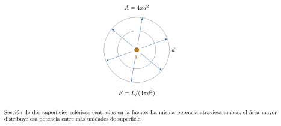

[← Capítulo anterior](capitulo-20.html) · [Índice del libro](index.html) · [Capítulo siguiente →](capitulo-22.html)

Una estrella puede aparecer como un punto y ofrecer, aun así, información sobre su distancia, su temperatura y su movimiento. Esa información llega distribuida entre posiciones angulares, intensidades y longitudes de onda. Las mediciones adquieren significado al relacionarlas mediante geometría, gravitación y modelos de emisión.

La inferencia astronómica reúne observaciones distintas de un mismo objeto. Una paralaje permite convertir un flujo recibido en luminosidad; un espectro aporta una temperatura y una velocidad radial; una órbita puede revelar masas. Cada relación conserva las condiciones que permiten usarla y transmite parte de la incertidumbre de los datos al resultado.

## Distancias y tiempos de viaje de la luz

La unidad astronómica, símbolo internacional $\mathrm{au}$, es una unidad de longitud definida exactamente por $1\,\mathrm{au}=149\,597\,870\,700\,\mathrm{m}$. Su escala corresponde aproximadamente a la separación media entre la Tierra y el Sol. En cálculos de tres cifras significativas usaremos $1\,\mathrm{au}\simeq1{,}496\times10^{11}\,\mathrm{m}$ y $c\simeq3{,}00\times10^8\,\mathrm{m/s}$. Una señal luminosa recorre una distancia $d$ en el tiempo
$$
t=\frac dc.
$$
La ecuación supone propagación aproximadamente rectilínea en el vacío, con distancia y movimiento de los extremos tratados según el modelo indicado. Para una señal que va y regresa, el tiempo total comprende los dos trayectos.

### Problema resuelto 21.1 · Estimar el tiempo de una señal solar {#r21-1}
Calcula cuánto tarda la luz en recorrer $1{,}00\,\mathrm{au}$ y cuánto tardaría un intercambio de ida y vuelta entre dos puntos fijos separados esa distancia.
*Resolución.* Con las aproximaciones declaradas,
$$
t=\frac{1{,}496\times10^{11}}{3{,}00\times10^8}
\simeq499\,\mathrm{s}=8{,}31\,\mathrm{min}.
$$
El recorrido de ida y vuelta tiene longitud $2d$, de modo que tarda aproximadamente $997\,\mathrm{s}=16{,}6\,\mathrm{min}$. Cada tiempo corresponde a la trayectoria indicada.

{#fig-fp-av-r21-1 fig-alt="Ilustración de Problema resuelto 21.1 · Estimar el tiempo de una señal solar. La unidad astronómica, símbolo internacional au, es una unidad de longitud definida exactamente por 1\\,au=149\\,597\\,870\\,700\\,m. Su escala corresponde aproximadamente a la separación media entre la Tierra y el Sol. En cálculos de tres cifras significativas usaremos 1\\,ausimeq1,496times10^11\\,m y"}

El año luz es la distancia que recorre la luz en el vacío durante un año juliano de $365{,}25$ días, es decir, $31\,557\,600\,\mathrm{s}$. Su valor es aproximadamente $9{,}461\times10^{15}\,\mathrm{m}$. Una distancia de cuatro años luz corresponde a un tiempo de viaje de cuatro años en el modelo de extremos fijos. La imagen recibida permite estudiar el estado emisor asociado a ese tiempo de propagación.

El parsec, símbolo $\mathrm{pc}$, está ligado a la medición angular de distancias. Su definición exacta es $1\,\mathrm{pc}=(648\,000/\pi)\,\mathrm{au}$, aproximadamente $3{,}086\times10^{16}\,\mathrm{m}$ o $3{,}262$ años luz. El segundo de arco, $1''=1/3600$ de grado, es una unidad angular. En radianes, $1''=\pi/648\,000\simeq4{,}848\times10^{-6}$. Esta pequeña unidad permite expresar desplazamientos aparentes de estrellas.

### Problema resuelto 21.2 · Expresar una distancia estelar en varias escalas {#r21-2}
Una estrella está a $2{,}50\,\mathrm{pc}$. Expresa esa distancia en metros, unidades astronómicas y años luz. Estima el tiempo de viaje de la señal recibida, suponiendo distancia constante.
*Resolución.* Con las equivalencias redondeadas,
$$
d\simeq7{,}72\times10^{16}\,\mathrm{m}
\simeq5{,}16\times10^5\,\mathrm{au}
\simeq8{,}16\text{ años luz}.
$$
El tiempo de propagación es aproximadamente $8{,}16$ años. Las tres longitudes describen la misma separación y permiten compararla con escalas terrestres, orbitales y de propagación.

{#fig-fp-av-r21-2 fig-alt="Ilustración de Problema resuelto 21.2 · Expresar una distancia estelar en varias escalas. El parsec, símbolo pc, está ligado a la medición angular de distancias. Su definición exacta es 1\\,pc=(648\\,000/pi)\\,au, aproximadamente 3,086times10^16\\,m o 3,262 años luz. El segundo de arco, 1''=1/3600 de grado, es una unidad angular. En radianes, 1''=pi/648\\,000simeq4,848times10^-6. Esta pequeña unidad permite"}

## Paralaje: una distancia a partir de un ángulo

Al observar un objeto desde posiciones distintas, su dirección cambia respecto de un fondo más lejano. Ese efecto geométrico se llama paralaje. Para una estrella, el desplazamiento anual debido a la órbita terrestre se describe mediante el ángulo de paralaje $p$, asociado a una base de $1\,\mathrm{au}$. En la geometría ideal con la línea de base perpendicular a la dirección central, $\tan p=(1\,\mathrm{au})/d$. Como $p$ es muy pequeño,
$$
p\ (\mathrm{rad})\simeq\frac{1\,\mathrm{au}}d,
\qquad d\ (\mathrm{pc})\simeq\frac{1}{p\ (\mathrm{arcsec})}.
$$
La definición del parsec fija la conversión a partir de un radián y una unidad astronómica; la forma recíproca procede de la aproximación angular. A esta escala, la diferencia respecto de la tangente resulta despreciable para la precisión de los ejercicios.

Dos posiciones de observación separadas por medio año pueden abarcar una base de $2\,\mathrm{au}$. En una orientación favorable, el desplazamiento angular extremo a extremo es $2p$. La paralaje $p$ representa la semiamplitud del movimiento aparente correspondiente. En una dirección general, la proyección de la órbita produce una elipse aparente y las observaciones se ajustan teniendo en cuenta su geometría.

### Problema resuelto 21.3 · Convertir una paralaje en distancia {#r21-3}
Se ha obtenido una paralaje anual de $0{,}0500''$ para una estrella cercana. Calcula su distancia en parsecs y años luz.
*Resolución.* La paralaje indicada es $p$, por lo que
$$
d\simeq\frac1{0{,}0500}=20{,}0\,\mathrm{pc}
\simeq65{,}2\text{ años luz}.
$$
Una paralaje menor corresponde a una distancia mayor. La medición angular conecta la posición aparente con una escala de longitud conocida: la unidad astronómica.

{#fig-fp-av-r21-3 fig-alt="Ilustración de Problema resuelto 21.3 · Convertir una paralaje en distancia. Dos posiciones de observación separadas por medio año pueden abarcar una base de 2\\,au. En una orientación favorable, el desplazamiento angular extremo a extremo es 2p. La paralaje p representa la semiamplitud del movimiento aparente correspondiente. En una dirección general, la proyección de la órbita produce una"}

### Problema resuelto 21.4 · Reconocer la semiamplitud de la oscilación anual {#r21-4}
En un montaje ideal favorable, dos observaciones separadas por medio año muestran un desplazamiento extremo a extremo de $0{,}0800''$, una vez separado el movimiento propio de la estrella. Halla la paralaje y la distancia.
*Resolución.* El desplazamiento observado equivale a $2p$. Por tanto,
$$
p=0{,}0400'',\qquad d\simeq\frac1{0{,}0400}=25{,}0\,\mathrm{pc}.
$$
El movimiento propio es el cambio secular de dirección aparente debido al movimiento relativo de la estrella. La oscilación de paralaje repite su geometría anualmente; las mediciones en varias fechas permiten ajustar ambas contribuciones.

{#fig-fp-av-r21-4 fig-alt="Ilustración de Problema resuelto 21.4 · Reconocer la semiamplitud de la oscilación anual. Dos posiciones de observación separadas por medio año pueden abarcar una base de 2\\,au. En una orientación favorable, el desplazamiento angular extremo a extremo es 2p. La paralaje p representa la semiamplitud del movimiento aparente correspondiente. En una dirección general, la proyección de la órbita produce una"}

La función recíproca amplifica la importancia de la incertidumbre cuando la paralaje es pequeña. Para un valor positivo $p$ medido con incertidumbre pequeña $\Delta p\ll p$, la propagación lineal da $\Delta d/d\simeq\Delta p/p$. Un intervalo de paralaje $[p-\Delta p,p+\Delta p]$ se transforma en el intervalo asimétrico de distancias $[1/(p+\Delta p),1/(p-\Delta p)]$, usando las unidades de la ecuación anterior. Con grandes errores relativos, el análisis de distancias incorpora el modelo estadístico de la medición y otra información disponible.

### Problema resuelto 21.5 · Transmitir la incertidumbre de una paralaje {#r21-5}
Un ajuste entrega $p=40{,}0\,\mathrm{mas}$, con intervalo considerado de $38{,}0$ a $42{,}0\,\mathrm{mas}$. Un milisegundo de arco, $1\,\mathrm{mas}$, equivale a $0{,}001''$. Calcula la distancia central y transforma los extremos del intervalo.
*Resolución.* El valor central es $p=0{,}0400''$, luego $d=25{,}0\,\mathrm{pc}$. Los límites se invierten al tomar recíprocos:
$$
\begin{gathered}
d_{\min}=1/0{,}0420\simeq23{,}8\,\mathrm{pc},\\
d_{\max}=1/0{,}0380\simeq26{,}3\,\mathrm{pc}.
\end{gathered}
$$
La estimación lineal es $\Delta d\simeq25(2/40)=1{,}25\,\mathrm{pc}$. El intervalo transformado conserva su ligera asimetría.

{#fig-fp-av-r21-5 fig-alt="Ilustración de Problema resuelto 21.5 · Transmitir la incertidumbre de una paralaje. La función recíproca amplifica la importancia de la incertidumbre cuando la paralaje es pequeña. Para un valor positivo p medido con incertidumbre pequeña Delta pll p, la propagación lineal da Delta d/dsimeqDelta p/p. Un intervalo de paralaje [p-Delta p,p+Delta p] se transforma en el intervalo asimétrico de distancias"}

## Tamaño angular y resolución de los instrumentos

Una separación angular $\theta$ entre dos puntos, observados a distancia común $d$, corresponde a una separación transversal $\ell\simeq d\theta$ cuando $\theta\ll1$ se expresa en radianes. La misma geometría permite relacionar el diámetro angular completo $\Theta$ de un disco con su diámetro físico $D_\star$:
$$
D_\star\simeq d\Theta,\qquad R_\star\simeq\frac{d\Theta}{2}.
$$
La conversión entre parsecs, segundos de arco y unidades astronómicas ofrece una forma práctica: $D_\star\ (\mathrm{au})\simeq d\ (\mathrm{pc})\,\Theta\ (\mathrm{arcsec})$.

La resolución angular caracteriza qué estructuras próximas permite distinguir un instrumento en condiciones dadas. Para una abertura circular ideal, iluminación monocromática y dos fuentes puntuales incoherentes de brillo comparable, el criterio de Rayleigh del capítulo 20 da $\theta_{\min}\simeq1{,}22\lambda/D_{\mathrm{tel}}$. Aquí $D_{\mathrm{tel}}$ es el diámetro de abertura. La precisión con que se estima la posición de una fuente también depende de la señal, la calibración y el ajuste de su perfil. Una buena estimación del centro de una imagen puede alcanzar incertidumbres inferiores al ancho de ese perfil. Esa posibilidad es relevante al medir paralajes.

### Problema resuelto 21.6 · Estimar la abertura requerida para separar dos fuentes {#r21-6}
Dos fuentes puntuales incoherentes, de brillo comparable, tienen separación $0{,}100''$. Estima el diámetro mínimo de una abertura circular ideal para alcanzar el umbral de Rayleigh a $550\,\mathrm{nm}$.
*Resolución.* La separación en radianes es $\theta=(0{,}100)(4{,}848\times10^{-6})=4{,}848\times10^{-7}$. Entonces,
$$
D_{\mathrm{tel}}\simeq\frac{1{,}22(550\times10^{-9})}{4{,}848\times10^{-7}}
\simeq1{,}38\,\mathrm{m}.
$$
La estimación describe el límite por difracción del instrumento ideal. La turbulencia atmosférica, las aberraciones y la respuesta del detector forman parte de la evaluación de un telescopio real.

{#fig-fp-av-r21-6 fig-alt="Ilustración de Problema resuelto 21.6 · Estimar la abertura requerida para separar dos fuentes. La resolución angular caracteriza qué estructuras próximas permite distinguir un instrumento en condiciones dadas. Para una abertura circular ideal, iluminación monocromática y dos fuentes puntuales incoherentes de brillo comparable, el criterio de Rayleigh del capítulo 20 da thetaminsimeq1,22lambda/Dtel. Aquí Dtel es"}

### Problema resuelto 21.7 · Pasar de diámetro angular a radio físico {#r21-7}
Una estrella está a $10{,}0\,\mathrm{pc}$ y presenta un diámetro angular completo de $1{,}00\,\mathrm{mas}$. Estima su diámetro y su radio mediante el modelo de disco pequeño.
*Resolución.* Como $\Theta=0{,}00100''$,
$$
D_\star\simeq(10{,}0)(0{,}00100)\,\mathrm{au}=0{,}0100\,\mathrm{au},
\qquad R_\star\simeq7{,}48\times10^8\,\mathrm{m}.
$$
El radio es la mitad del diámetro físico, $0{,}00500\,\mathrm{au}$. La medida angular utilizada abarca el disco completo; esa elección fija el factor dos.

{#fig-fp-av-r21-7 fig-alt="Ilustración de Problema resuelto 21.7 · Pasar de diámetro angular a radio físico. La resolución angular caracteriza qué estructuras próximas permite distinguir un instrumento en condiciones dadas. Para una abertura circular ideal, iluminación monocromática y dos fuentes puntuales incoherentes de brillo comparable, el criterio de Rayleigh del capítulo 20 da thetaminsimeq1,22lambda/Dtel. Aquí Dtel es"}

## Órbitas y masas: una aplicación de Kepler

La gravitación del capítulo 11 permite inferir masas a partir de órbitas. En un sistema aislado de dos cuerpos, el movimiento relativo describe una elipse de semieje mayor $a$. Su período satisface
$$
T^2=\frac{4\pi^2a^3}{G(M+m)}.
$$
Para un planeta de masa pequeña frente a la estrella, $M+m\simeq M$. En una binaria estelar se conserva la suma de ambas masas. El semieje de la órbita relativa es $a=a_1+a_2$, donde $a_1$ y $a_2$ describen las órbitas respecto del centro de masas. La relación $M a_1=m a_2$ permite repartir la masa total entre los componentes.

Con períodos en años, semiejes en unidades astronómicas y masas expresadas en masas solares, la normalización usual, a la precisión de estos problemas, es
$$
\left(\frac T{1\text{ año}}\right)^2
\simeq\frac{[a/(1\,\mathrm{au})]^3}{(M+m)/M_\odot}.
$$
Usaremos esta forma redondeada en las comparaciones. $M_\odot$ designa la masa solar. Para una órbita elíptica, $a$ es el promedio de las distancias de periastro y apoastro; en una órbita circular coincide con el radio. La reconstrucción de una órbita observada también considera su inclinación y su proyección en el cielo.

### Problema resuelto 21.8 · Comparar períodos alrededor de otra estrella {#r21-8}
Un planeta de masa despreciable frente a su estrella tiene semieje mayor $4{,}00\,\mathrm{au}$. La masa estelar es $2{,}00M_\odot$. Calcula el período y compáralo con el de una órbita de igual semieje alrededor de una estrella de masa $M_\odot$.
*Resolución.* La normalización da $T^2\simeq4^3/2=32\text{ años}^2$, luego $T\simeq5{,}66$ años. Para una masa solar, $T\simeq\sqrt{64}=8{,}00$ años. A semieje fijo, el período varía como $M^{-1/2}$; el aumento de masa reduce el tiempo orbital por el factor $1/\sqrt2$.

{#fig-fp-av-r21-8 fig-alt="Ilustración de Problema resuelto 21.8 · Comparar períodos alrededor de otra estrella. Con períodos en años, semiejes en unidades astronómicas y masas expresadas en masas solares, la normalización usual, a la precisión de estos problemas, es left(frac T1 añoright)^2 simeqfrac[a/(1\\,au)]^3(M+m)/Modot. Usaremos esta forma redondeada en las comparaciones. Modot designa la masa solar. Para una órbita"}

### Problema resuelto 21.9 · Obtener las masas de una binaria idealizada {#r21-9}
Dos estrellas tienen período $5{,}00$ años y semieje mayor de la órbita relativa $a=5{,}00\,\mathrm{au}$. Sus semiejes respecto del centro de masas cumplen $a_1/a_2=2{,}00$. Halla la masa total y las masas individuales.
*Resolución.* Primero se usa la órbita relativa:
$$
\frac{M_1+M_2}{M_\odot}\simeq\frac{5^3}{5^2}=5{,}00.
$$
La relación $M_1a_1=M_2a_2$ da $M_2/M_1=2$. Por tanto, $M_1\simeq1{,}67M_\odot$ y $M_2\simeq3{,}33M_\odot$. La estrella más masiva describe la órbita menor alrededor del centro de masas. La suma $a_1+a_2$ vale $5\,\mathrm{au}$.

{#fig-fp-av-r21-9 fig-alt="Ilustración de Problema resuelto 21.9 · Obtener las masas de una binaria idealizada. Con períodos en años, semiejes en unidades astronómicas y masas expresadas en masas solares, la normalización usual, a la precisión de estos problemas, es left(frac T1 añoright)^2 simeqfrac[a/(1\\,au)]^3(M+m)/Modot. Usaremos esta forma redondeada en las comparaciones. Modot designa la masa solar. Para una órbita"}

### Problema resuelto 21.10 · Inferir una masa central desde una órbita {#r21-10}
Un planeta de masa despreciable recorre una órbita de semieje $3{,}00\,\mathrm{au}$ con período $6{,}00$ años. Estima la masa de su estrella y predice el período de otro planeta con semieje $1{,}00\,\mathrm{au}$ alrededor de ella.
*Resolución.* De la ecuación normalizada,
$$
\frac M{M_\odot}\simeq\frac{3^3}{6^2}
=0{,}750.
$$
Para el segundo planeta, $T^2\simeq1/0{,}750$ en años cuadrados, así que $T\simeq1{,}15$ años. La masa obtenida pertenece al mismo sistema central en ambas predicciones.

{#fig-fp-av-r21-10 fig-alt="Ilustración de Problema resuelto 21.10 · Inferir una masa central desde una órbita. Con períodos en años, semiejes en unidades astronómicas y masas expresadas en masas solares, la normalización usual, a la precisión de estos problemas, es left(frac T1 añoright)^2 simeqfrac[a/(1\\,au)]^3(M+m)/Modot. Usaremos esta forma redondeada en las comparaciones. Modot designa la masa solar. Para una órbita"}

## Luminosidad y flujo recibido

La luminosidad $L$ es la potencia total radiada por una fuente. El flujo radiativo recibido $F$ es la potencia que atraviesa una unidad de área de un detector orientado perpendicularmente a la propagación; se mide en $\,\mathrm{W/m^2}$. Para una fuente isotrópica a distancia $d$, la energía emitida se distribuye sobre una esfera de área $4\pi d^2$. En un entorno transparente y aproximadamente estático,
$$
F=\frac{L}{4\pi d^2},\qquad L=4\pi d^2F.
$$
Aquí $L$ y $F$ son bolométricos: integran todas las longitudes de onda. Una observación a través de un filtro mide solo una banda y requiere una conversión apropiada para obtener el flujo bolométrico. El polvo interestelar y la atmósfera pueden absorber o dispersar luz; las aplicaciones siguientes suponen que esos efectos son despreciables o que el flujo ya ha sido corregido.

Para comparar potencias se usa la luminosidad solar nominal, $L_\odot^{\mathrm N}=3{,}828\times10^{26}\,\mathrm{W}$, fijada por la Unión Astronómica Internacional como factor de conversión. En los problemas escribiremos $L_\odot$ para esta referencia. Las variaciones físicas del Sol se estudian mediante mediciones y sus incertidumbres.

### Problema resuelto 21.11 · Calcular la irradiancia a una unidad astronómica {#r21-11}
Modela la emisión solar como isotrópica, con luminosidad $L_\odot=3{,}828\times10^{26}\,\mathrm{W}$. Calcula el flujo a $1{,}00\,\mathrm{au}$, antes de cualquier interacción con la atmósfera.
*Resolución.* La potencia atraviesa una esfera centrada en el Sol:
$$
F=\frac{3{,}828\times10^{26}}{4\pi(1{,}496\times10^{11})^2}
\simeq1{,}36\times10^3\,\mathrm{W/m^2}.
$$
Un detector de $1\,\mathrm{m^2}$ perpendicular a los rayos recibe aproximadamente $1{,}36\,\mathrm{kW}$ en este modelo. La inclinación de una superficie y el paso por la atmósfera modifican la potencia que llega a una superficie terrestre.

{#fig-fp-av-r21-11 fig-alt="Ilustración de Problema resuelto 21.11 · Calcular la irradiancia a una unidad astronómica. Para comparar potencias se usa la luminosidad solar nominal, Lodot^mathrm N=3,828times10^26\\,W, fijada por la Unión Astronómica Internacional como factor de conversión. En los problemas escribiremos Lodot para esta referencia. Las variaciones físicas del Sol se estudian mediante mediciones y sus incertidumbres."}

### Problema resuelto 21.12 · Reconstruir una luminosidad estelar {#r21-12}
Una estrella a $10{,}0\,\mathrm{pc}$ produce flujo bolométrico corregido $F=1{,}28\times10^{-9}\,\mathrm{W/m^2}$. Estima su luminosidad en vatios y en luminosidades solares.
*Resolución.* La distancia es $d=3{,}086\times10^{17}\,\mathrm{m}$. Por tanto,
$$
L=4\pi(3{,}086\times10^{17})^2(1{,}28\times10^{-9})
\simeq1{,}53\times10^{27}\,\mathrm{W}\simeq4{,}00L_\odot.
$$
La distancia convierte la potencia recibida por área en una potencia de emisión. Para una misma medición de $F$, una distancia inferida mayor llevaría a una luminosidad mayor, proporcional a $d^2$.

{#fig-fp-av-r21-12 fig-alt="Ilustración de Problema resuelto 21.12 · Reconstruir una luminosidad estelar. Para comparar potencias se usa la luminosidad solar nominal, Lodot^mathrm N=3,828times10^26\\,W, fijada por la Unión Astronómica Internacional como factor de conversión. En los problemas escribiremos Lodot para esta referencia. Las variaciones físicas del Sol se estudian mediante mediciones y sus incertidumbres."}

### Problema resuelto 21.13 · Comparar dos estrellas de igual flujo aparente {#r21-13}
Dos estrellas isotrópicas A y B producen el mismo flujo bolométrico recibido. Sus luminosidades son $L_A=L_\odot$ y $L_B=4L_\odot$. Si A está a $10{,}0\,\mathrm{pc}$, halla la distancia de B.
*Resolución.* Al igualar flujos,
$$
\frac{L_A}{d_A^2}=\frac{L_B}{d_B^2},
\qquad\frac{d_B}{d_A}=\sqrt{\frac{L_B}{L_A}}=2.
$$
Así, $d_B=20{,}0\,\mathrm{pc}$. La mayor potencia de B compensa exactamente la mayor superficie esférica sobre la que se reparte. Una distancia o una luminosidad conocida aporta la información adicional para interpretar el flujo.

{#fig-fp-av-r21-13 fig-alt="Ilustración de Problema resuelto 21.13 · Comparar dos estrellas de igual flujo aparente. Para comparar potencias se usa la luminosidad solar nominal, Lodot^mathrm N=3,828times10^26\\,W, fijada por la Unión Astronómica Internacional como factor de conversión. En los problemas escribiremos Lodot para esta referencia. Las variaciones físicas del Sol se estudian mediante mediciones y sus incertidumbres."}

## Espectro térmico, temperatura y radio

Un cuerpo negro es un modelo de materia en equilibrio térmico que absorbe toda la radiación incidente y emite un espectro térmico determinado por su temperatura. El continuo de muchas estrellas puede aproximarse por un espectro térmico; las líneas y otros efectos de sus atmósferas añaden estructura. La ley de desplazamiento de Wien relaciona la temperatura absoluta con la longitud de onda del máximo de la distribución espectral por unidad de longitud de onda:
$$
\lambda_{\max}T=b,\qquad b\simeq2{,}898\times10^{-3}\,\mathrm{m\,K}.
$$
Se especifica la representación espectral porque las distribuciones por unidad de frecuencia y por unidad de longitud de onda alcanzan su máximo en posiciones diferentes al transformarse entre sí. La aplicación de Wien utiliza un continuo corregido por la respuesta instrumental y la absorción en el trayecto. Los colores aparentes reúnen información de bandas y de percepción visual; inferir una temperatura a partir de ellos exige un modelo espectral y del medio.

### Problema resuelto 21.14 · Inferir una temperatura desde un continuo térmico {#r21-14}
El continuo de una estrella, aproximado por un cuerpo negro y expresado por unidad de longitud de onda, tiene máximo en $500\,\mathrm{nm}$ una vez corregida la propagación. Calcula la temperatura del modelo.
*Resolución.* Con $\lambda_{\max}=5{,}00\times10^{-7}\,\mathrm{m}$,
$$
T=\frac{2{,}898\times10^{-3}}{5{,}00\times10^{-7}}
\simeq5{,}80\times10^3\,\mathrm{K}.
$$
La temperatura caracteriza el continuo térmico idealizado. Ese continuo abarca un intervalo amplio de longitudes de onda; la posición del máximo identifica una propiedad de su distribución.

{#fig-fp-av-r21-14 fig-alt="Ilustración de Problema resuelto 21.14 · Inferir una temperatura desde un continuo térmico. Un cuerpo negro es un modelo de materia en equilibrio térmico que absorbe toda la radiación incidente y emite un espectro térmico determinado por su temperatura. El continuo de muchas estrellas puede aproximarse por un espectro térmico; las líneas y otros efectos de sus atmósferas añaden estructura. La ley de"}

La ley de Stefan–Boltzmann da la potencia emitida por unidad de superficie de un cuerpo negro, $F_{\mathrm{sup}}=\sigma T^4$, con $\sigma\simeq5{,}670\times10^{-8}\,\mathrm{W\,m^{-2}\,K^{-4}}$. Para una estrella esférica de radio $R$,
$$
L=4\pi R^2\sigma T_{\mathrm{ef}}^4.
$$
La temperatura efectiva $T_{\mathrm{ef}}$ es la temperatura del cuerpo negro que emitiría la misma potencia bolométrica por unidad de superficie estelar. Esta definición resulta útil incluso cuando el espectro real posee líneas y otras desviaciones respecto del continuo ideal. En los ejemplos de cuerpo negro identificaremos la temperatura de Wien con la efectiva, dentro del modelo.

### Problema resuelto 21.15 · Separar los efectos de radio y temperatura {#r21-15}
Una estrella B tiene temperatura efectiva doble y luminosidad 36 veces mayor que una estrella A. Modela ambas como esferas y compara sus radios y sus potencias emitidas por unidad de superficie.
*Resolución.* Al dividir las leyes de emisión,
$$
\frac{L_B}{L_A}=\left(\frac{R_B}{R_A}\right)^2
\left(\frac{T_B}{T_A}\right)^4,
\qquad 36=16\left(\frac{R_B}{R_A}\right)^2.
$$
Resulta $R_B/R_A=1{,}50$. La superficie total aumenta por un factor $2{,}25$ y la potencia emitida por unidad de superficie por un factor $2^4=16$. Su producto recupera el factor 36 de luminosidad.

{#fig-fp-av-r21-15 fig-alt="Ilustración de Problema resuelto 21.15 · Separar los efectos de radio y temperatura. La ley de Stefan–Boltzmann da la potencia emitida por unidad de superficie de un cuerpo negro, Fsup=sigma T^4, con sigmasimeq5,670times10^-8\\,mathrmW\\,m^-2\\,K^-4. Para una estrella esférica de radio R, L=4pi R^2sigma Tef^4. La temperatura efectiva Tef es la temperatura del cuerpo negro que emitiría la misma potencia"}

### Problema resuelto 21.16 · Obtener un radio con distancia, flujo y temperatura {#r21-16}
Una estrella está a $10{,}0\,\mathrm{pc}$, tiene flujo bolométrico corregido $1{,}00\times10^{-9}\,\mathrm{W/m^2}$ y temperatura efectiva $6000\,\mathrm{K}$. Estima luminosidad, radio y diámetro angular completo, usando el modelo esférico.
*Resolución.* Primero,
$$
L=4\pi d^2F\simeq1{,}20\times10^{27}\,\mathrm{W}.
$$
Al combinar esa expresión con Stefan–Boltzmann,
$$
R=d\sqrt{\frac{F}{\sigma T_{\mathrm{ef}}^4}}
\simeq1{,}14\times10^9\,\mathrm{m}.
$$
El diámetro angular es $\Theta\simeq2R/d\simeq7{,}38\times10^{-9}\,\mathrm{rad}\simeq1{,}52\,\mathrm{mas}$. Las unidades de $F$ y de $\sigma T^4$ son iguales, por lo que su cociente es adimensional. La distancia fija la escala lineal del radio inferido.

{#fig-fp-av-r21-16 fig-alt="Ilustración de Problema resuelto 21.16 · Obtener un radio con distancia, flujo y temperatura. La ley de Stefan–Boltzmann da la potencia emitida por unidad de superficie de un cuerpo negro, Fsup=sigma T^4, con sigmasimeq5,670times10^-8\\,mathrmW\\,m^-2\\,K^-4. Para una estrella esférica de radio R, L=4pi R^2sigma Tef^4. La temperatura efectiva Tef es la temperatura del cuerpo negro que emitiría la misma potencia"}

## Líneas espectrales y velocidad radial

Un espectro registra cómo se distribuye la radiación con la longitud de onda o la frecuencia. Los átomos y los iones emiten y absorben en transiciones características, que producen líneas espectrales. Un continuo que atraviesa gas adecuado puede presentar líneas de absorción. Al identificar varias líneas de una misma especie y compararlas con referencias de laboratorio, se obtiene información sobre composición y movimiento.

Definimos el corrimiento espectral como
$$
z=\frac{\lambda_{\mathrm{obs}}-\lambda_0}{\lambda_0}.
$$
$\lambda_0$ es la longitud de onda de referencia en reposo y $\lambda_{\mathrm{obs}}$ la observada, expresadas ambas en la misma convención, aquí en el vacío. Para movimiento radial con rapidez pequeña frente a $c$ y corrimiento dominado por Doppler,
$$
v_r\simeq cz,\qquad |v_r|\ll c.
$$
La velocidad radial positiva indica alejamiento y da $z>0$, con longitudes de onda mayores. La negativa indica acercamiento y da $z<0$. Las componentes transversales requieren otras mediciones, como el movimiento propio junto con la distancia. El ajuste corrige el movimiento del observador y fija un sistema de referencia.

### Problema resuelto 21.17 · Comprobar un mismo corrimiento con dos líneas {#r21-17}
Dos líneas de reposo $500{,}00\,\mathrm{nm}$ y $600{,}00\,\mathrm{nm}$ se observan en $500{,}10\,\mathrm{nm}$ y $600{,}12\,\mathrm{nm}$. Supón un corrimiento Doppler radial dominante, con los datos ya corregidos al sistema de referencia elegido. Estima $z$ y $v_r$ para cada línea.
*Resolución.* Los cambios absolutos son distintos y las razones coinciden:
$$
z_1=\frac{0{,}10}{500{,}00}=2{,}00\times10^{-4},\qquad
z_2=\frac{0{,}12}{600{,}00}=2{,}00\times10^{-4}.
$$
Ambas líneas dan $v_r\simeq(3{,}00\times10^8)(2{,}00\times10^{-4})=+60{,}0\,\mathrm{km/s}$. El signo indica alejamiento y $|v_r|/c=0{,}000200$ respalda la aproximación. La coincidencia de varias líneas ayuda a comprobar su identificación y su corrimiento común.

{#fig-fp-av-r21-17 fig-alt="Ilustración de Problema resuelto 21.17 · Comprobar un mismo corrimiento con dos líneas. Definimos el corrimiento espectral como z=fraclambdaobs-lambda0lambda0. lambda0 es la longitud de onda de referencia en reposo y lambdaobs la observada, expresadas ambas en la misma convención, aquí en el vacío. Para movimiento radial con rapidez pequeña frente a c y corrimiento dominado por Doppler, vrsimeq cz,qquad"}

Los corrimientos también pueden contener contribuciones gravitatorias y, para fuentes cosmológicas, la expansión del universo. Su interpretación usa modelos específicos y sistemas de referencia apropiados. La relación $v_r\simeq cz$ de este capítulo se aplica a la velocidad radial local en el régimen indicado. Las observaciones de galaxias lejanas se estudian mediante una descripción cosmológica de la propagación y de la distancia.

## Reunir observaciones para construir un modelo estelar

Una distancia geométrica permite pasar del flujo a la luminosidad. Un modelo de emisión relaciona luminosidad, temperatura y radio. Una órbita añade información dinámica sobre la masa. Estas inferencias utilizan datos complementarios y se pueden contrastar: un radio obtenido por emisión térmica predice un diámetro angular que puede compararse con una medición independiente.

La secuencia de cálculo conserva las dependencias. De $L=4\pi d^2F$ se deduce que un error relativo pequeño en $d$ contribuye aproximadamente con el doble al error relativo de $L$ cuando $F$ se mantiene fijo. De $R=d\sqrt{F/(\sigma T^4)}$ resulta $R\propto d\sqrt F/T^2$. A flujo y distancia fijos, una temperatura efectiva mayor lleva a un radio inferido menor. La evaluación conjunta considera incertidumbres, correlaciones y correcciones de propagación.

### Problema resuelto 21.18 · Reconstruir las propiedades de una estrella idealizada {#r21-18}
Un conjunto de observaciones entrega $p=0{,}0500''$, flujo bolométrico corregido $F=3{,}20\times10^{-10}\,\mathrm{W/m^2}$ y máximo del continuo térmico por unidad de longitud de onda en $483\,\mathrm{nm}$, referido al marco de reposo de la estrella. Una línea de reposo $500{,}00\,\mathrm{nm}$ aparece en $499{,}95\,\mathrm{nm}$. Estima distancia, temperatura, luminosidad, radio y velocidad radial. Supón esfera térmica, emisión isotrópica y Doppler radial de baja velocidad.
*Resolución.* La geometría da $d=20{,}0\,\mathrm{pc}=6{,}172\times10^{17}\,\mathrm{m}$. Wien entrega $T=b/\lambda_{\max}=6000\,\mathrm{K}$. Con esos datos,
$$
\begin{aligned}
L&=4\pi d^2F\simeq1{,}53\times10^{27}\,\mathrm{W}\simeq4{,}00L_\odot,\\
R&=d\sqrt{\frac{F}{\sigma T^4}}\simeq1{,}29\times10^9\,\mathrm{m}.
\end{aligned}
$$
La línea tiene $z=-0{,}05/500=-1{,}00\times10^{-4}$ y, por tanto, $v_r\simeq-30{,}0\,\mathrm{km/s}$: la estrella se acerca en el sistema de referencia elegido. El diámetro angular predicho es $\Theta\simeq2R/d\simeq0{,}861\,\mathrm{mas}$. Cada propiedad se apoya en una combinación identificable de datos y supuestos.

{#fig-fp-av-r21-18 fig-alt="Ilustración de Problema resuelto 21.18 · Reconstruir las propiedades de una estrella idealizada. La secuencia de cálculo conserva las dependencias. De L=4pi d^2F se deduce que un error relativo pequeño en d contribuye aproximadamente con el doble al error relativo de L cuando F se mantiene fijo. De R=dsqrtF/(sigma T^4) resulta Rpropto dsqrt F/T^2. A flujo y distancia fijos, una temperatura efectiva mayor lleva a"}

## Ejercicios para reconstruir y transferir

Usa $c=3{,}00\times10^8\,\mathrm{m/s}$, $1\,\mathrm{au}=1{,}496\times10^{11}\,\mathrm{m}$, $1\,\mathrm{pc}=3{,}086\times10^{16}\,\mathrm{m}\simeq3{,}262$ años luz, $1''=4{,}848\times10^{-6}\,\mathrm{rad}$, $L_\odot=3{,}828\times10^{26}\,\mathrm{W}$, $b=2{,}898\times10^{-3}\,\mathrm{m\,K}$ y $\sigma=5{,}670\times10^{-8}\,\mathrm{W\,m^{-2}\,K^{-4}}$. Las órbitas se ajustan al modelo aislado de dos cuerpos y a la normalización redondeada de Kepler. Los flujos son bolométricos y están corregidos por propagación, salvo indicación expresa.

### Ejercicio 21.1 · Una señal de ida {#e21-1}
Una señal luminosa recorre $3{,}00\,\mathrm{au}$ en el vacío entre puntos tratados como fijos. Estima su tiempo de viaje en minutos.

### Ejercicio 21.2 · Medir por eco {#e21-2}
Un pulso tarda $1200\,\mathrm{s}$ en ir hasta un reflector y volver. Desprecia el movimiento de los extremos. Halla la distancia al reflector en metros y unidades astronómicas.

### Ejercicio 21.3 · Una distancia en parsecs {#e21-3}
Expresa $5{,}00\,\mathrm{pc}$ en metros y años luz. Estima el tiempo de propagación asociado a esa distancia constante.

### Ejercicio 21.4 · Convertir una unidad angular {#e21-4}
Expresa $2{,}00\,\mathrm{mas}$ en segundos de arco, grados y radianes. Describe qué magnitud mide cada unidad.

### Ejercicio 21.5 · Paralaje anual {#e21-5}
Una estrella tiene paralaje $0{,}125''$. Halla su distancia en parsecs y años luz.

### Ejercicio 21.6 · Dos extremos del desplazamiento anual {#e21-6}
Una geometría favorable produce desplazamiento extremo a extremo $0{,}0200''$ entre observaciones separadas por medio año, con movimiento propio ya separado. Halla $p$ y $d$.

### Ejercicio 21.7 · Comparar incertidumbres relativas {#e21-7}
Dos medidas tienen paralajes $50{,}0\,\mathrm{mas}$ y $5{,}00\,\mathrm{mas}$, ambas con incertidumbre pequeña estimada de $0{,}500\,\mathrm{mas}$. Obtén las distancias centrales y las incertidumbres relativas lineales en distancia.

### Ejercicio 21.8 · Invertir un intervalo {#e21-8}
Una paralaje central de $20{,}0\,\mathrm{mas}$ tiene intervalo considerado $[18{,}0,22{,}0]\,\mathrm{mas}$. Transforma ese intervalo a distancias y compara con la estimación lineal.

### Ejercicio 21.9 · Diámetro de un disco estelar {#e21-9}
Una estrella a $25{,}0\,\mathrm{pc}$ tiene diámetro angular completo $0{,}800\,\mathrm{mas}$. Halla su diámetro y su radio físicos.

### Ejercicio 21.10 · Resolución por difracción {#e21-10}
Una abertura circular ideal de $2{,}00\,\mathrm{m}$ observa a $500\,\mathrm{nm}$. Calcula el umbral de Rayleigh en radianes y segundos de arco para dos fuentes puntuales incoherentes de brillo comparable.

### Ejercicio 21.11 · Órbita alrededor de una estrella más masiva {#e21-11}
Un planeta de masa despreciable tiene semieje $2{,}00\,\mathrm{au}$ alrededor de una estrella de $2{,}00M_\odot$. Estima el período.

### Ejercicio 21.12 · Masa central desde período y semieje {#e21-12}
Un planeta ligero tiene semieje $4{,}00\,\mathrm{au}$ y período $8{,}00$ años. Estima la masa estelar.

### Ejercicio 21.13 · Una binaria con masas distintas {#e21-13}
Una binaria tiene semieje relativo $6{,}00\,\mathrm{au}$ y período $6{,}00$ años. Además, $a_1/a_2=2{,}00$. Halla masa total, masas individuales y semiejes individuales.

### Ejercicio 21.14 · Semieje de una órbita elíptica {#e21-14}
Un planeta ligero orbita una estrella de $M_\odot$. Sus distancias extremas son $1{,}00\,\mathrm{au}$ y $3{,}00\,\mathrm{au}$. Halla semieje mayor y período en el modelo de dos cuerpos.

### Ejercicio 21.15 · La misma potencia a mayor distancia {#e21-15}
Una estrella produce $8{,}00\times10^{-10}\,\mathrm{W/m^2}$ a cierta distancia. ¿Qué flujo produciría una fuente idéntica situada tres veces más lejos, bajo las mismas condiciones de propagación?

### Ejercicio 21.16 · Luminosidad a partir de flujo y paralaje {#e21-16}
Una estrella tiene $p=0{,}100''$ y flujo bolométrico corregido $2{,}00\times10^{-10}\,\mathrm{W/m^2}$. Halla su luminosidad y exprésala en $L_\odot$.

### Ejercicio 21.17 · Igual flujo, distintas luminosidades {#e21-17}
Dos estrellas de luminosidades $L_A=L_\odot$ y $L_B=9L_\odot$ producen el mismo flujo. Si A está a $12{,}0\,\mathrm{pc}$, halla la distancia de B.

### Ejercicio 21.18 · Corregir una transmisión parcial {#e21-18}
El flujo observado de una estrella es $6{,}00\times10^{-11}\,\mathrm{W/m^2}$. Un modelo de propagación indica que llega el $75{,}0\%$ del flujo bolométrico que alcanzaría al observador por un trayecto transparente. Calcula el flujo corregido y el factor por el que cambiaría la luminosidad inferida a distancia fija.

### Ejercicio 21.19 · Dos máximos térmicos {#e21-19}
Dos continuos ideales, por unidad de longitud de onda, tienen máximos en $966\,\mathrm{nm}$ y $483\,\mathrm{nm}$, referidos a sus respectivos marcos de reposo. Obtén sus temperaturas y su razón.

### Ejercicio 21.20 · Misma luminosidad con temperaturas distintas {#e21-20}
Dos estrellas esféricas tienen igual luminosidad y $T_B=2T_A$. Halla $R_B/R_A$ y la razón de potencias emitidas por unidad de superficie.

### Ejercicio 21.21 · Sensibilidad del radio a la temperatura {#e21-21}
En el problema 21.16, conserva distancia y flujo y sustituye $T_{\mathrm{ef}}=6000\,\mathrm{K}$ por $6600\,\mathrm{K}$. Obtén la razón entre el radio nuevo y el anterior y estima el radio nuevo.

### Ejercicio 21.22 · Una línea desplazada hacia longitudes menores {#e21-22}
Una línea de reposo $600{,}00\,\mathrm{nm}$ se observa en $599{,}94\,\mathrm{nm}$. Calcula $z$ y $v_r$ bajo Doppler radial de baja velocidad y explica el signo.

### Ejercicio 21.23 · Predecir la posición de una línea {#e21-23}
Una estrella se aleja con $v_r=+90{,}0\,\mathrm{km/s}$. Predice la posición de una línea de reposo $500{,}00\,\mathrm{nm}$ con la aproximación de baja velocidad.

### Ejercicio 21.24 · Contrastar dos identificaciones de líneas {#e21-24}
Se proponen líneas de reposo $500{,}00\,\mathrm{nm}$ y $600{,}00\,\mathrm{nm}$ para dos líneas observadas en $500{,}10\,\mathrm{nm}$ y $600{,}18\,\mathrm{nm}$. Calcula el $z$ que daría cada identificación y decide si un único corrimiento Doppler reproduce exactamente ambos datos. Trata los valores como exactos para esta comparación.

## Soluciones razonadas

### Solución 21.1 {#sol-e21-1}
 $t=d/c=3(1{,}496\times10^{11})/(3{,}00\times10^8)=1496\,\mathrm{s}\simeq24{,}9\,\mathrm{min}$. La trayectoria indicada es de ida.

### Solución 21.2 {#sol-e21-2}
 El pulso recorre $2d$, de modo que $d=ct/2=1{,}80\times10^{11}\,\mathrm{m}\simeq1{,}20\,\mathrm{au}$. El factor dos procede de sumar ida y regreso.

### Solución 21.3 {#sol-e21-3}
 $d=5(3{,}086\times10^{16})=1{,}543\times10^{17}\,\mathrm{m}\simeq16{,}3$ años luz. Para distancia constante, la propagación tarda aproximadamente $16{,}3$ años.

### Solución 21.4 {#sol-e21-4}
 $2{,}00\,\mathrm{mas}=0{,}00200''=5{,}56\times10^{-7}\,\mathrm{grados}\simeq9{,}70\times10^{-9}\,\mathrm{rad}$. Las tres unidades expresan un ángulo, que puede describir una separación entre direcciones de observación.

### Solución 21.5 {#sol-e21-5}
 $d\simeq1/0{,}125=8{,}00\,\mathrm{pc}\simeq26{,}1$ años luz. La ecuación emplea la paralaje anual $p$.

### Solución 21.6 {#sol-e21-6}
 El desplazamiento favorable es $2p$, luego $p=0{,}0100''$ y $d\simeq100\,\mathrm{pc}$. La base de los dos extremos es el diámetro orbital en la orientación supuesta.

### Solución 21.7 {#sol-e21-7}
 Las distancias centrales son $20{,}0\,\mathrm{pc}$ y $200\,\mathrm{pc}$. Las incertidumbres relativas aproximadas son $0{,}500/50{,}0=1{,}00\%$ y $0{,}500/5{,}00=10{,}0\%$. Para la segunda, el carácter aproximado de la linealización es más relevante. Las incertidumbres absolutas lineales serían $0{,}200\,\mathrm{pc}$ y $20{,}0\,\mathrm{pc}$.

### Solución 21.8 {#sol-e21-8}
 El centro es $d=50{,}0\,\mathrm{pc}$. El intervalo se transforma en $[1/0{,}0220,1/0{,}0180]\,\mathrm{pc}\simeq[45{,}5,55{,}6]\,\mathrm{pc}$. La estimación lineal es $\Delta d\simeq50(2/20)=5{,}00\,\mathrm{pc}$; los extremos exactos del intervalo muestran la asimetría de la transformación.

### Solución 21.9 {#sol-e21-9}
 El diámetro es $D_\star\simeq25(0{,}000800)\,\mathrm{au}=0{,}0200\,\mathrm{au}\simeq2{,}99\times10^9\,\mathrm{m}$. El radio es $0{,}0100\,\mathrm{au}\simeq1{,}50\times10^9\,\mathrm{m}$.

### Solución 21.10 {#sol-e21-10}
 $\theta_{\min}\simeq1{,}22(500\times10^{-9})/2=3{,}05\times10^{-7}\,\mathrm{rad}$. Al dividir por $4{,}848\times10^{-6}\,\mathrm{rad}$ por segundo de arco se obtiene $0{,}0629''$.

### Solución 21.11 {#sol-e21-11}
 $T^2\simeq2^3/2=4$ en años cuadrados, por lo que $T\simeq2{,}00$ años. El denominador incorpora la masa de la estrella del sistema.

### Solución 21.12 {#sol-e21-12}
 $M/M_\odot\simeq a^3/T^2=4^3/8^2=1{,}00$. La órbita permite inferir una masa aproximadamente solar con los supuestos indicados.

### Solución 21.13 {#sol-e21-13}
 La masa total es $(6^3/6^2)M_\odot=6{,}00M_\odot$. Como $M_2/M_1=a_1/a_2=2$, resulta $M_1=2{,}00M_\odot$ y $M_2=4{,}00M_\odot$. Con $a_1+a_2=6\,\mathrm{au}$ se obtiene $a_1=4{,}00\,\mathrm{au}$ y $a_2=2{,}00\,\mathrm{au}$. Los productos $M_1a_1$ y $M_2a_2$ coinciden.

### Solución 21.14 {#sol-e21-14}
 $a=(1+3)/2=2{,}00\,\mathrm{au}$. La normalización solar da $T\simeq\sqrt{2^3}=2{,}83$ años. Las distancias extremas determinan el semieje requerido por Kepler.

### Solución 21.15 {#sol-e21-15}
 La superficie de distribución aumenta por $3^2=9$, así que $F_2=F_1/9\simeq8{,}89\times10^{-11}\,\mathrm{W/m^2}$. La luminosidad de la fuente conserva su valor en la comparación.

### Solución 21.16 {#sol-e21-16}
 La paralaje da $d=10{,}0\,\mathrm{pc}$. Por tanto, $L=4\pi(3{,}086\times10^{17})^2(2{,}00\times10^{-10})\simeq2{,}39\times10^{26}\,\mathrm{W}\simeq0{,}625L_\odot$.

### Solución 21.17 {#sol-e21-17}
 Al igualar flujos, $d_B/d_A=\sqrt{9}=3$, luego $d_B=36{,}0\,\mathrm{pc}$. La mayor luminosidad compensa una distancia tres veces mayor.

### Solución 21.18 {#sol-e21-18}
 $F_{\mathrm{corr}}=F_{\mathrm{obs}}/0{,}750=8{,}00\times10^{-11}\,\mathrm{W/m^2}$. A distancia fija, la luminosidad inferida aumenta por $1/0{,}750=4/3$, aproximadamente un $33{,}3\%$.

### Solución 21.19 {#sol-e21-19}
 Wien entrega $T_A=b/(966\times10^{-9})=3000\,\mathrm{K}$ y $T_B=b/(483\times10^{-9})=6000\,\mathrm{K}$. La razón es $T_B/T_A=2{,}00$, inversa a la razón de longitudes de onda de los máximos.

### Solución 21.20 {#sol-e21-20}
 Al conservar $L$, se cumple $(R_B/R_A)^2(2)^4=1$. Por tanto, $R_B/R_A=1/4$. La potencia por unidad de superficie aumenta por 16 y el área total se reduce por ese mismo factor.

### Solución 21.21 {#sol-e21-21}
 $R\propto T^{-2}$ a distancia y flujo fijos. Así, $R_{\mathrm{nuevo}}/R_{\mathrm{anterior}}=(6000/6600)^2=100/121\simeq0{,}826$. Aplicado al radio sin redondear del problema, se obtiene aproximadamente $9{,}41\times10^8\,\mathrm{m}$.

### Solución 21.22 {#sol-e21-22}
 $z=(599{,}94-600{,}00)/600{,}00=-1{,}00\times10^{-4}$. Entonces $v_r\simeq-30{,}0\,\mathrm{km/s}$. La longitud menor corresponde a acercamiento en el sistema de referencia considerado.

### Solución 21.23 {#sol-e21-23}
 $z\simeq v_r/c=90/(3{,}00\times10^5)=3{,}00\times10^{-4}$, usando velocidades en $\,\mathrm{km/s}$. Por tanto, $\lambda_{\mathrm{obs}}\simeq\lambda_0(1+z)=500{,}15\,\mathrm{nm}$. La línea se desplaza hacia longitudes mayores.

### Solución 21.24 {#sol-e21-24}
 La primera identificación da $z_1=0{,}10/500=2{,}00\times10^{-4}$ y la segunda $z_2=0{,}18/600=3{,}00\times10^{-4}$. Esos valores implican velocidades radiales distintas, $60{,}0$ y $90{,}0\,\mathrm{km/s}$. Los datos tratados como exactos exigen revisar la identificación o el modelo de un único corrimiento. En una observación real también se cuantifican errores de calibración y medida.

## Una experiencia: medir un desplazamiento de paralaje

### Dos puntos de observación y un objeto cercano
Coloca un lápiz vertical frente a un fondo con marcas más lejanas. Observa sucesivamente desde dos puntos separados por una base conocida $B$, conservando una orientación de referencia. Registra la dirección hacia la punta del lápiz en cada posición mediante fotografías con el mismo encuadre de referencia o un transportador sencillo. Describe cómo cambia el desplazamiento al duplicar la distancia al lápiz, manteniendo la base.

En una disposición simétrica, con el lápiz frente al punto medio de la base, el ángulo total entre las dos visuales es $\Delta\theta$ y la distancia perpendicular es $d=(B/2)/\tan(\Delta\theta/2)\simeq B/\Delta\theta$ para ángulos pequeños. Mide al menos tres veces, estima la dispersión y compara con una medición directa de $d$. En el caso estelar, la base de dos posiciones terrestres opuestas es aproximadamente $2\,\mathrm{au}$ y el ángulo total favorable es $2p$: la misma geometría recupera $d\simeq(1\,\mathrm{au})/p$.

## Diagnóstico antes de avanzar

Una estrella idealizada tiene paralaje $0{,}100''$, flujo bolométrico corregido $F=2{,}00\times10^{-10}\,\mathrm{W/m^2}$ y continuo de cuerpo negro con máximo por unidad de longitud de onda en $966\,\mathrm{nm}$, referido a su reposo. Una línea de reposo $600{,}00\,\mathrm{nm}$ aparece en $600{,}06\,\mathrm{nm}$. Calcula distancia, temperatura, luminosidad, radio y velocidad radial. Un planeta de masa despreciable tiene órbita de semieje $1{,}00\,\mathrm{au}$ y período $2{,}00$ años alrededor de la estrella. Estima la masa central. Identifica qué medición sustenta cada inferencia.

**Contraste.** La paralaje da $d=10{,}0\,\mathrm{pc}$. Wien da $T=3000\,\mathrm{K}$. El flujo y la distancia entregan $L\simeq2{,}39\times10^{26}\,\mathrm{W}\simeq0{,}625L_\odot$. Con $R=d\sqrt{F/(\sigma T^4)}$ se obtiene $R\simeq2{,}04\times10^9\,\mathrm{m}$. La línea tiene $z=0{,}06/600=1{,}00\times10^{-4}$, de donde $v_r\simeq+30{,}0\,\mathrm{km/s}$, con alejamiento. Kepler entrega $M/M_\odot\simeq1^3/2^2=0{,}250$. La masa proviene de la dinámica orbital; el radio y la luminosidad se apoyan en geometría y emisión. Estos datos constituyen un modelo de observación idealizado; evaluar su correspondencia con una población estelar real requiere información adicional sobre estructura y evolución.

**Lecturas de apoyo.** H. D. Young y R. A. Freedman, *Física universitaria*, volumen 2, 12.ª edición, secciones 36.7 y 38.8. R. A. Serway y C. Vuille, *Fundamentos de física*, volumen 2, 9.ª edición, secciones 25.6 y 27.1. Las equivalencias astronómicas siguen las resoluciones de la UAI de 2012 y 2015; las referencias precisas y los recursos de ESA y NASA consultados se consignan en el informe de fuentes adjunto. Los problemas y las ayudas visuales se han preparado para esta obra.

---

[← Capítulo anterior](capitulo-20.html) · [Índice del libro](index.html) · [Capítulo siguiente →](capitulo-22.html)
