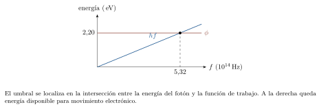
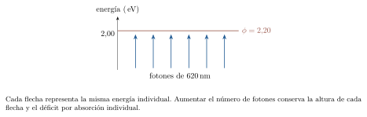
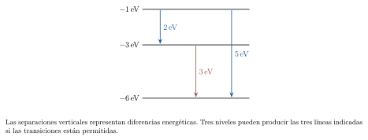
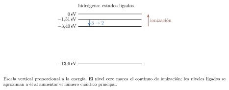
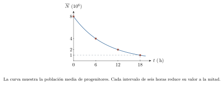
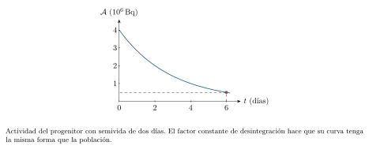
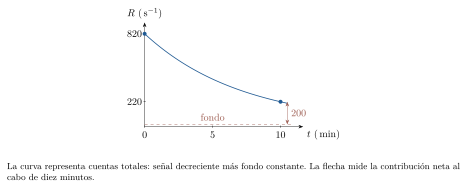

[← Capítulo anterior](capitulo-21.html) · [Índice del libro](index.html) · [Capítulo siguiente →](capitulo-23.html)

Una superficie iluminada puede emitir electrones; un gas excitado produce líneas de colores definidos; una muestra radiactiva transforma parte de sus núcleos con un ritmo estadístico característico. En cada caso, la observación permite establecer relaciones entre cantidades medibles y estructura de la materia. La energía sigue proporcionando un hilo conductor, ahora acompañada por la cuantización y la probabilidad.

La física moderna amplía los modelos de movimiento, radiación y materia al estudiar velocidades comparables con la de la luz y procesos atómicos y nucleares. Los modelos clásicos conservan su utilidad en los regímenes donde sus predicciones alcanzan la precisión requerida. Elegir un modelo exige identificar la escala del proceso, la interacción relevante y la observación que se desea explicar.

## Escalas y alcance de los modelos

Una predicción física tiene un dominio de aplicación y una precisión. La mecánica de Newton describe con gran exactitud numerosos movimientos cotidianos cuando la rapidez es pequeña respecto de $c$ y las condiciones gravitatorias admiten el tratamiento clásico. La relatividad especial relaciona las mediciones de observadores inerciales y establece la misma rapidez de la luz en el vacío para todos ellos. El cociente $\beta=v/c$ ayuda a valorar las correcciones relativistas.

Un factor que aparece en las relaciones relativistas es
$$
\gamma=\frac{1}{\sqrt{1-v^2/c^2}}.
$$
Para $v/c$ pequeño, su desarrollo comienza con $\gamma\simeq1+v^2/(2c^2)$. Así se puede estimar el tamaño de algunas correcciones antes de efectuar un cálculo completo. La exigencia experimental también importa: una corrección pequeña puede ser medible en instrumentos precisos. En este capítulo utilizaremos este factor para comparar escalas; el desarrollo sistemático de la relatividad corresponde a un curso posterior.

### Problema resuelto 22.1 · Comparar dos velocidades {#r22-1}
Calcula $\gamma$ para $v=0{,}0100c$ y para $v=0{,}800c$. Interpreta cuánto se aparta de uno en cada caso.
*Resolución.* La sustitución en la ecuación da $\gamma\simeq1{,}000050$ y $\gamma=1{,}6667$, respectivamente. Los excesos relativos respecto de uno son aproximadamente $0{,}00500\%$ y $66{,}7\%$. La primera rapidez permite aproximar este factor por uno con un error pequeño; la segunda exige conservar la relación relativista. El porcentaje calculado corresponde a este factor y sirve como criterio inicial de escala.

{#fig-fp-av-r22-1 fig-alt="Ilustración de Problema resuelto 22.1 · Comparar dos velocidades. Un factor que aparece en las relaciones relativistas es gamma=frac1sqrt1-v^2/c^2. Para v/c pequeño, su desarrollo comienza con gammasimeq1+v^2/(2c^2). Así se puede estimar el tamaño de algunas correcciones antes de efectuar un cálculo completo. La exigencia experimental también importa: una corrección pequeña puede"}

La física cuántica describe estados y probabilidades de resultados de medida. Una escala útil para materia con momento $p$ es la longitud de onda de de Broglie, $\lambda_{\mathrm{dB}}=h/p$. Para velocidades pequeñas frente a $c$, $p\simeq mv$. Al comparar esa longitud con la separación de rendijas o la escala espacial de un sistema se puede valorar la posibilidad de observar interferencia. El contraste depende también de la preparación del estado y de las interacciones con el entorno.

Usaremos valores redondeados $c=2{,}998\times10^8\,\mathrm{m/s}$, $h=6{,}626\times10^{-34}\,\mathrm{J\,s}$, $e=1{,}602\times10^{-19}\,\mathrm{C}$ y $m_e=9{,}109\times10^{-31}\,\mathrm{kg}$. En electronvoltios, $h\simeq4{,}136\times10^{-15}\,\mathrm{eV\,s}$ y $hc\simeq1240\,\mathrm{eV\,nm}$. Los resultados conservarán la precisión de estas aproximaciones. El símbolo $e$ representa la magnitud positiva de la carga electrónica.

### Problema resuelto 22.2 · Reconocer una escala ondulatoria de materia {#r22-2}
Compara $\lambda_{\mathrm{dB}}$ de un electrón con $v=1{,}00\times10^6\,\mathrm{m/s}$ y la de una pelota de $0{,}100\,\mathrm{kg}$ con $v=1{,}00\,\mathrm{m/s}$.
*Resolución.* Ambas velocidades permiten usar $p\simeq mv$. Para el electrón,
$$
\lambda_{\mathrm{dB}}=\frac{6{,}626\times10^{-34}}{(9{,}109\times10^{-31})(1{,}00\times10^6)}
\simeq7{,}27\times10^{-10}\,\mathrm{m}.
$$
Para la pelota resulta $6{,}63\times10^{-33}\,\mathrm{m}$. La longitud del electrón es comparable con distancias interatómicas; su difracción puede estudiarse con estructuras apropiadas. La escala de la pelota es extraordinariamente menor que sus dimensiones y que las aberturas de un montaje cotidiano. Esta comparación explica la pertinencia de descripciones diferentes para las dos situaciones.

{#fig-fp-av-r22-2 fig-alt="Ilustración de Problema resuelto 22.2 · Reconocer una escala ondulatoria de materia. Usaremos valores redondeados c=2,998times10^8\\,m/s, h=6,626times10^-34\\,J\\,s, e=1,602times10^-19\\,C y me=9,109times10^-31\\,kg. En electronvoltios, hsimeq4,136times10^-15\\,eV\\,s y hcsimeq1240\\,eV\\,nm. Los resultados conservarán la precisión de estas aproximaciones. El símbolo e representa la magnitud positiva de la"}

## Fotones: energía de la radiación y potencia de un haz

Un fotón es un cuanto del campo electromagnético. Su energía y su momento están relacionados con la frecuencia y la longitud de onda de la radiación. En el vacío,
$$
E_\gamma=hf=\frac{hc}{\lambda},\qquad c=\lambda f.
$$
La frecuencia determina la energía intercambiada en un proceso de absorción de un fotón. La propagación y la interferencia conservan su descripción ondulatoria en los experimentos correspondientes. El modelo cuántico vincula ambos aspectos y permite calcular probabilidades de detección.

El electronvoltio es una unidad de energía: $1\,\mathrm{eV}=1{,}602\times10^{-19}\,\mathrm{J}$ con el redondeo adoptado. Corresponde al cambio de energía de una carga de magnitud $e$ al atravesar una diferencia de potencial de un voltio. Es útil para expresar energías atómicas. Para convertir una energía en joules a electronvoltios se divide por la energía equivalente de un electronvoltio.

### Problema resuelto 22.3 · Calcular la energía de un fotón verde {#r22-3}
Un haz tiene longitud de onda en el vacío $500\,\mathrm{nm}$. Determina la frecuencia y la energía de cada fotón en joules y electronvoltios.
*Resolución.* Primero se convierte $\lambda=5{,}00\times10^{-7}\,\mathrm{m}$. Así,
$$
f=\frac{2{,}998\times10^8}{5{,}00\times10^{-7}}
=5{,}996\times10^{14}\,\mathrm{Hz},\qquad
E_\gamma\simeq3{,}97\times10^{-19}\,\mathrm{J}.
$$
Dividiendo por $1{,}602\times10^{-19}\,\mathrm{J/eV}$ se obtiene $E_\gamma\simeq2{,}48\,\mathrm{eV}$. La forma abreviada $1240/500=2{,}48$ entrega el mismo valor a la precisión indicada.

{#fig-fp-av-r22-3 fig-alt="Ilustración de Problema resuelto 22.3 · Calcular la energía de un fotón verde. El electronvoltio es una unidad de energía: 1\\,eV=1,602times10^-19\\,J con el redondeo adoptado. Corresponde al cambio de energía de una carga de magnitud e al atravesar una diferencia de potencial de un voltio. Es útil para expresar energías atómicas. Para convertir una energía en joules a electronvoltios se divide"}

### Problema resuelto 22.4 · Comparar fotones de dos longitudes de onda {#r22-4}
Dos fuentes emiten en $400\,\mathrm{nm}$ y $800\,\mathrm{nm}$. Compara las energías por fotón y el número de fotones emitidos por segundo si las potencias son iguales.
*Resolución.* Las energías son $1240/400=3{,}10\,\mathrm{eV}$ y $1240/800=1{,}55\,\mathrm{eV}$. Un fotón de $400\,\mathrm{nm}$ transporta el doble de energía. La potencia es energía por unidad de tiempo, de modo que una fuente de igual potencia en $800\,\mathrm{nm}$ emite el doble de fotones por segundo. La energía individual y el ritmo de emisión describen propiedades distintas del haz.

{#fig-fp-av-r22-4 fig-alt="Ilustración de Problema resuelto 22.4 · Comparar fotones de dos longitudes de onda. El electronvoltio es una unidad de energía: 1\\,eV=1,602times10^-19\\,J con el redondeo adoptado. Corresponde al cambio de energía de una carga de magnitud e al atravesar una diferencia de potencial de un voltio. Es útil para expresar energías atómicas. Para convertir una energía en joules a electronvoltios se divide"}

Si un haz monocromático de potencia $P$ contiene fotones de energía $E_\gamma$, su tasa media de fotones es $\dot N=P/E_\gamma$. La intensidad media, para iluminación uniforme de un área $S$, es $I=P/S$. A frecuencia fija, aumentar la intensidad aumenta el número de fotones incidentes por unidad de área y tiempo. Esta separación entre energía individual y tasa de llegada será decisiva al estudiar la emisión electrónica.

### Problema resuelto 22.5 · Contar fotones a partir de una potencia {#r22-5}
Un haz de $620\,\mathrm{nm}$ lleva $2{,}00\,\mathrm{mW}$. Calcula su tasa de fotones y la cantidad que incide durante $5{,}00\,\mathrm{s}$.
*Resolución.* Cada fotón tiene $E_\gamma\simeq1240/620=2{,}00\,\mathrm{eV}=3{,}204\times10^{-19}\,\mathrm{J}$. Por tanto,
$$
\dot N=\frac{2{,}00\times10^{-3}}{3{,}204\times10^{-19}}
\simeq6{,}24\times10^{15}\,\mathrm{s^{-1}}.
$$
En cinco segundos llegan aproximadamente $3{,}12\times10^{16}$ fotones. Estos valores representan cantidades medias para potencia constante y radiación monocromática.

{#fig-fp-av-r22-5 fig-alt="Ilustración de Problema resuelto 22.5 · Contar fotones a partir de una potencia. Si un haz monocromático de potencia P contiene fotones de energía Egamma, su tasa media de fotones es dot N=P/Egamma. La intensidad media, para iluminación uniforme de un área S, es I=P/S. A frecuencia fija, aumentar la intensidad aumenta el número de fotones incidentes por unidad de área y tiempo. Esta separación"}

## Efecto fotoeléctrico y frecuencia umbral

El efecto fotoeléctrico externo consiste en la emisión de electrones desde una superficie al absorber radiación. La función de trabajo $\phi$ es la energía mínima necesaria para extraer un electrón desde el material en las condiciones de su superficie. Su valor depende del material y de su estado superficial. Para luz monocromática en el régimen de absorción de un fotón por electrón, el balance energético de Einstein es
$$
K_{\max}=hf-\phi.
$$
Esta expresión corresponde al régimen de emisión, $hf\geq\phi$. El valor máximo se asocia a los electrones que escapan con el menor costo energético efectivo. La distribución de energías iniciales y las pérdidas dentro del sólido producen electrones de energías menores.

La frecuencia umbral satisface $hf_0=\phi$, y la longitud de onda umbral en el vacío es $\lambda_0=hc/\phi$. La emisión de este modelo requiere $f\geq f_0$, equivalente a $\lambda\leq\lambda_0$. La igualdad representa el límite ideal con energía cinética máxima nula. La detección de una corriente apreciable exige además tasas de emisión y condiciones de colección adecuadas.

### Problema resuelto 22.6 · Hallar el umbral de una superficie {#r22-6}
Una superficie tiene función de trabajo $\phi=2{,}20\,\mathrm{eV}$. Calcula $f_0$ y $\lambda_0$.
*Resolución.* Con unidades de electronvoltios,
$$
f_0=\frac{2{,}20}{4{,}136\times10^{-15}}
\simeq5{,}32\times10^{14}\,\mathrm{Hz},\qquad
\lambda_0\simeq\frac{1240}{2{,}20}=564\,\mathrm{nm}.
$$
Las frecuencias mayores aportan más energía por fotón que el costo mínimo de extracción. En longitudes de onda, esa condición corresponde a valores menores que el umbral calculado.

{#fig-fp-av-r22-6 fig-alt="Ilustración de Problema resuelto 22.6 · Hallar el umbral de una superficie. La frecuencia umbral satisface hf0=phi, y la longitud de onda umbral en el vacío es lambda0=hc/phi. La emisión de este modelo requiere fgeq f0, equivalente a lambdaleqlambda0. La igualdad representa el límite ideal con energía cinética máxima nula. La detección de una corriente apreciable exige además tasas de emisión"}

### Problema resuelto 22.7 · Distribuir la energía de un fotón absorbido {#r22-7}
Se ilumina la superficie anterior con $400\,\mathrm{nm}$. Calcula la energía cinética máxima y expresa el balance físico.
*Resolución.* El fotón lleva $3{,}10\,\mathrm{eV}$. La extracción requiere $2{,}20\,\mathrm{eV}$ y queda
$$
K_{\max}=3{,}10-2{,}20=0{,}900\,\mathrm{eV}
=1{,}44\times10^{-19}\,\mathrm{J}.
$$
El balance $3{,}10=2{,}20+0{,}900$, en electronvoltios, asigna la energía entre extracción y movimiento del electrón más energético. Las energías cinéticas de los demás electrones emitidos pueden ser menores.

{#fig-fp-av-r22-7 fig-alt="Ilustración de Problema resuelto 22.7 · Distribuir la energía de un fotón absorbido. La frecuencia umbral satisface hf0=phi, y la longitud de onda umbral en el vacío es lambda0=hc/phi. La emisión de este modelo requiere fgeq f0, equivalente a lambdaleqlambda0. La igualdad representa el límite ideal con energía cinética máxima nula. La detección de una corriente apreciable exige además tasas de emisión"}

### Problema resuelto 22.8 · Examinar una iluminación de baja frecuencia {#r22-8}
La misma superficie recibe luz de $620\,\mathrm{nm}$. Se aumenta diez veces la intensidad manteniendo la longitud de onda. Predice el resultado del modelo de un fotón.
*Resolución.* Cada fotón tiene $2{,}00\,\mathrm{eV}$, por debajo de $\phi=2{,}20\,\mathrm{eV}$. El balance presenta un déficit de $0{,}200\,\mathrm{eV}$ por evento de absorción individual. La intensidad multiplicada por diez proporciona diez veces más fotones por unidad de área y tiempo, cada uno con la misma energía. La emisión fotoeléctrica de un fotón queda fuera de las condiciones energéticas de este caso. Procesos multifotónicos a intensidades altas requieren otro tratamiento.

{#fig-fp-av-r22-8 fig-alt="Ilustración de Problema resuelto 22.8 · Examinar una iluminación de baja frecuencia. La frecuencia umbral satisface hf0=phi, y la longitud de onda umbral en el vacío es lambda0=hc/phi. La emisión de este modelo requiere fgeq f0, equivalente a lambdaleqlambda0. La igualdad representa el límite ideal con energía cinética máxima nula. La detección de una corriente apreciable exige además tasas de emisión"}

La observación reúne tres dependencias: el umbral está ligado a la superficie, la energía cinética máxima aumenta con la frecuencia y la corriente de saturación crece con el flujo de fotones, a frecuencia fija por encima del umbral y en condiciones estables. El modelo clásico de absorción continua por un electrón ligado conduce a otras dependencias y tiempos de acumulación. La comparación experimental de esas predicciones motivó la descripción mediante fotones. Las ondas electromagnéticas clásicas siguen describiendo la propagación de numerosos haces y sus patrones de interferencia.

## Potencial de frenado e interpretación de datos

Una diferencia de potencial que se opone al movimiento de los electrones permite medir su energía máxima. El potencial de frenado $V_s$ se define aquí como la magnitud positiva de la tensión retardadora que lleva la fotocorriente al límite de corte. En la geometría ideal de colección,
$$
eV_s=K_{\max},\qquad V_s=\frac he f-\frac\phi e.
$$
El signo del voltaje de un electrodo depende de la referencia elegida; $V_s$ expresa una magnitud. El voltímetro y la superficie pueden introducir potenciales de contacto que un experimento real debe considerar. Los ejemplos adoptan datos ya corregidos.

### Problema resuelto 22.9 · Relacionar frenado y rapidez electrónica {#r22-9}
Para $K_{\max}=0{,}900\,\mathrm{eV}$, calcula $V_s$ y la rapidez máxima mediante $K=mv^2/2$. Comprueba el régimen de la aproximación.
*Resolución.* El valor numérico de $V_s$ en voltios es $0{,}900$. En unidades del SI,
$$
v_{\max}=\sqrt{\frac{2(0{,}900)(1{,}602\times10^{-19})}{9{,}109\times10^{-31}}}
\simeq5{,}63\times10^5\,\mathrm{m/s}.
$$
El cociente $v/c\simeq1{,}88\times10^{-3}$ justifica la energía cinética clásica a la precisión usada. El frenado mide energía; la rapidez se infiere incorporando la masa del electrón y una relación dinámica válida.

{#fig-fp-av-r22-9 fig-alt="Ilustración de Problema resuelto 22.9 · Relacionar frenado y rapidez electrónica. Una diferencia de potencial que se opone al movimiento de los electrones permite medir su energía máxima. El potencial de frenado Vs se define aquí como la magnitud positiva de la tensión retardadora que lleva la fotocorriente al límite de corte. En la geometría ideal de colección, eVs=Kmax,qquad Vs=frac he f-fracphi"}

### Problema resuelto 22.10 · Inferir una pendiente y una función de trabajo {#r22-10}
Se miden $V_s=0{,}400\,\mathrm{V}$ con $f=6{,}00\times10^{14}\,\mathrm{Hz}$ y $V_s=1{,}230\,\mathrm{V}$ con $f=8{,}00\times10^{14}\,\mathrm{Hz}$. Ajusta la recta a estos datos idealizados y estima $h$, $\phi$ y $f_0$.
*Resolución.* La pendiente es $a=\Delta V_s/\Delta f=4{,}15\times10^{-15}\,\mathrm{V\,s}$. De $V_s=af+b$ resulta $b=-2{,}09\,\mathrm{V}$. Así, $h=ea\simeq6{,}65\times10^{-34}\,\mathrm{J\,s}$, $\phi=2{,}09\,\mathrm{eV}$ y $f_0=-b/a\simeq5{,}04\times10^{14}\,\mathrm{Hz}$. La estimación de $h$ refleja la precisión de los datos propuestos. La recta física de frenado se utiliza en el intervalo con emisión.

{#fig-fp-av-r22-10 fig-alt="Ilustración de Problema resuelto 22.10 · Inferir una pendiente y una función de trabajo. Una diferencia de potencial que se opone al movimiento de los electrones permite medir su energía máxima. El potencial de frenado Vs se define aquí como la magnitud positiva de la tensión retardadora que lleva la fotocorriente al límite de corte. En la geometría ideal de colección, eVs=Kmax,qquad Vs=frac he f-fracphi"}

Una serie de varios puntos permite estimar pendiente, dispersión e incertidumbre. La prolongación algebraica de la recta hacia frecuencias menores que $f_0$ sirve para localizar el intercepto; la fotocorriente de un fotón presenta su corte en el umbral. A frecuencia e intensidad fijas, modificar el potencial colector cambia cuántos electrones alcanzan el electrodo. Con colección suficiente se llega a la corriente de saturación. Cada medición debe distinguir estas variables de control.

## Espectros de líneas y niveles de energía

Un átomo aislado posee estados ligados con energías discretas. Una transición radiativa entre dos estados intercambia un fotón cuya energía coincide con la diferencia de energías del átomo, dentro de la aproximación que desprecia el retroceso. Para emisión desde $E_i$ hacia $E_f<E_i$,
$$
hf=E_i-E_f>0.
$$
En absorción, el fotón aporta la energía para pasar a un estado de mayor energía. Las probabilidades y reglas de selección determinan cuáles transiciones aparecen con intensidad apreciable. Un diagrama de niveles enumera energías posibles; las flechas indican procesos entre estados.

La distribución espacial de un electrón en un estado atómico se expresa mediante una función de onda y probabilidades de posición. Los niveles del hidrógeno también admiten una aproximación histórica de Bohr, que predice bien varias energías y frecuencias. La descripción cuántica de los estados incorpora distribuciones espaciales y propiedades adicionales. Un diagrama de energías se interpreta con este significado de estados y diferencias energéticas.

### Problema resuelto 22.11 · Asociar tres diferencias de energía a tres líneas {#r22-11}
Un sistema ideal tiene estados de $-6{,}00$, $-3{,}00$ y $-1{,}00\,\mathrm{eV}$. Supón permitidas las tres transiciones descendentes. Calcula las longitudes de onda.
*Resolución.* Desde el estado superior al intermedio se liberan $2{,}00\,\mathrm{eV}$; del intermedio al inferior, $3{,}00\,\mathrm{eV}$; y del superior al inferior, $5{,}00\,\mathrm{eV}$. Por $\lambda=hc/\Delta E$,
$$
\lambda_{32}=620\,\mathrm{nm},\qquad
\lambda_{21}\simeq413\,\mathrm{nm},\qquad
\lambda_{31}=248\,\mathrm{nm}.
$$
La suma $2+3=5$ corresponde a las energías de las transiciones. Las longitudes de onda se relacionan mediante sus inversas: $1/248=1/620+1/(1240/3)$ al conservar los valores sin redondear.

{#fig-fp-av-r22-11 fig-alt="Ilustración de Problema resuelto 22.11 · Asociar tres diferencias de energía a tres líneas. La distribución espacial de un electrón en un estado atómico se expresa mediante una función de onda y probabilidades de posición. Los niveles del hidrógeno también admiten una aproximación histórica de Bohr, que predice bien varias energías y frecuencias. La descripción cuántica de los estados incorpora"}

### Problema resuelto 22.12 · Estudiar una línea del hidrógeno {#r22-12}
Usa $E_n=-13{,}6\,\mathrm{eV}/n^2$ para la transición del hidrógeno $n=3$ a $n=2$. Calcula la energía y longitud de onda del fotón. Estima también la energía de ionización desde $n=2$.
*Resolución.* La energía emitida es
$$
\Delta E=13{,}6\left(\frac1{2^2}-\frac1{3^2}\right)
\simeq1{,}89\,\mathrm{eV},\qquad \lambda\simeq656\,\mathrm{nm}.
$$
El estado $n=2$ tiene $E_2=-3{,}40\,\mathrm{eV}$. El límite de ionización se sitúa en $E=0$, de modo que requiere $3{,}40\,\mathrm{eV}$. El cero de energía corresponde al electrón y al protón separados en reposo relativo en este modelo. Los valores negativos expresan estados ligados.

{#fig-fp-av-r22-12 fig-alt="Ilustración de Problema resuelto 22.12 · Estudiar una línea del hidrógeno. La distribución espacial de un electrón en un estado atómico se expresa mediante una función de onda y probabilidades de posición. Los niveles del hidrógeno también admiten una aproximación histórica de Bohr, que predice bien varias energías y frecuencias. La descripción cuántica de los estados incorpora"}

### Problema resuelto 22.13 · Comparar una emisión directa y una cascada {#r22-13}
El sistema del problema 22.11 pasa de $-1{,}00$ a $-6{,}00\,\mathrm{eV}$. Compara la emisión directa con el paso por el estado intermedio. Cuenta fotones y energía total.
*Resolución.* La transición directa produce un fotón de $5{,}00\,\mathrm{eV}$ y $248\,\mathrm{nm}$. La cascada produce dos: uno de $2{,}00\,\mathrm{eV}$ y otro de $3{,}00\,\mathrm{eV}$. La suma de sus energías es $5{,}00\,\mathrm{eV}$. Ambas rutas conectan los mismos estados inicial y final y conservan la energía. La distribución entre fotones depende de la ruta de transición.

{#fig-fp-av-r22-13 fig-alt="Ilustración de Problema resuelto 22.13 · Comparar una emisión directa y una cascada. La distribución espacial de un electrón en un estado atómico se expresa mediante una función de onda y probabilidades de posición. Los niveles del hidrógeno también admiten una aproximación histórica de Bohr, que predice bien varias energías y frecuencias. La descripción cuántica de los estados incorpora"}

La posición de una línea informa sobre una diferencia de energías; su intensidad depende además de poblaciones, probabilidades de transición y condiciones de excitación. Una muestra gaseosa tenue y una fuente térmica densa presentan espectros diferentes por su estructura y sus interacciones. La observación de líneas de emisión y absorción permite identificar especies y estudiar su estado físico, con las correcciones de movimiento consideradas en el capítulo anterior.

## Núcleos y transformaciones radiactivas

El núcleo atómico contiene protones y neutrones. El número atómico $Z$ cuenta protones y determina el elemento; el número másico $A$ cuenta nucleones, $A=Z+N$. La notación ${}^{A}_{Z}X$ identifica un nucleido. Los isótopos de un elemento comparten $Z$ y tienen distintos números de neutrones. Las energías y transformaciones nucleares corresponden a grados de libertad del núcleo, mientras los espectros atómicos ordinarios reflejan principalmente cambios de los estados electrónicos.

La radiactividad es la transformación espontánea de núcleos inestables con emisión de partículas o radiación. En una desintegración alfa se emite un núcleo de helio ${}^{4}_{2}\mathrm{He}$; el núcleo hijo tiene $A-4$ y $Z-2$. En beta menos, un neutrón del núcleo se transforma en un protón con emisión de un electrón y un antineutrino electrónico. El hijo conserva $A$ y aumenta $Z$ en uno. En una transición gamma, el núcleo libera energía electromagnética y conserva $A$ y $Z$. La conservación de carga, energía y momento permite analizar cada proceso.

### Problema resuelto 22.14 · Seguir dos transformaciones nucleares {#r22-14}
Completa la cadena alfa y beta menos que comienza en ${}^{238}_{92}\mathrm U$. Verifica los números másicos y las cargas.
*Resolución.* En la emisión alfa,
$$
{}^{238}_{92}\mathrm U\longrightarrow{}^{234}_{90}\mathrm{Th}
+{}^{4}_{2}\mathrm{He}.
$$
Se cumple $238=234+4$ y $92=90+2$. En la transformación beta menos posterior,
$$
{}^{234}_{90}\mathrm{Th}\longrightarrow{}^{234}_{91}\mathrm{Pa}
+{}^{0}_{-1}e+\bar\nu_e.
$$
La carga se conserva porque $90=91-1$; el número de nucleones permanece en 234. El electrón y el antineutrino son productos de la transformación. Las ecuaciones identifican especies y balances; la distribución de energías requiere datos nucleares adicionales.

{#fig-fp-av-r22-14 fig-alt="Ilustración de Problema resuelto 22.14 · Seguir dos transformaciones nucleares. La radiactividad es la transformación espontánea de núcleos inestables con emisión de partículas o radiación. En una desintegración alfa se emite un núcleo de helio ^42He; el núcleo hijo tiene A-4 y Z-2. En beta menos, un neutrón del núcleo se transforma en un protón con emisión de un electrón y un antineutrino"}

## Semivida, actividad y predicción estadística

Para una población de núcleos del mismo radionucleido, cada núcleo superviviente tiene una probabilidad aproximadamente $\lambda\,\Delta t$ de transformarse durante un intervalo corto $\Delta t$. La constante de desintegración $\lambda$ tiene dimensión de tiempo inverso. Bajo condiciones de desintegración independiente y $\lambda$ constante, la población media de núcleos progenitores sigue
$$
\overline N(t)=N_0e^{-\lambda t}
=N_0\left(\frac12\right)^{t/T_{1/2}},\qquad
T_{1/2}=\frac{\ln2}{\lambda}.
$$
La semivida $T_{1/2}$ es el intervalo en que la población media de progenitores se reduce a la mitad. Para muestras con muchos núcleos, las fluctuaciones relativas suelen ser pequeñas y se usa $N(t)$ para esa población macroscópica. Cada núcleo posee un tiempo de transformación aleatorio. La probabilidad de supervivencia hasta $t$ es $e^{-\lambda t}$.

Algunos textos llaman vida media al período de semidesintegración. Aquí reservamos *semivida* para $T_{1/2}$ y *tiempo de vida medio* para $\tau=1/\lambda$. Este último es el promedio estadístico de los tiempos de supervivencia. Su relación es $T_{1/2}=\tau\ln2$. Explicitar ambas definiciones permite interpretar correctamente datos y gráficas.

### Problema resuelto 22.15 · Calcular la población tras varias semividas {#r22-15}
Una muestra ideal contiene inicialmente $8{,}00\times10^6$ núcleos progenitores con semivida $6{,}00\,\mathrm{h}$. Calcula la población media después de $18{,}0\,\mathrm{h}$ y la fracción transformada.
*Resolución.* Transcurren $18/6=3$ semividas. Por tanto,
$$
\overline N=8{,}00\times10^6\left(\frac12\right)^3
=1{,}00\times10^6.
$$
Permanece $1/8=12{,}5\%$ de los progenitores y se ha transformado $7/8=87{,}5\%$. La población de hijos debe analizarse según su estabilidad y la cadena de transformaciones. La expresión utilizada sigue a los progenitores de la muestra inicial.

{#fig-fp-av-r22-15 fig-alt="Ilustración de Problema resuelto 22.15 · Calcular la población tras varias semividas. Algunos textos llaman vida media al período de semidesintegración. Aquí reservamos semivida para T1/2 y tiempo de vida medio para tau=1/lambda. Este último es el promedio estadístico de los tiempos de supervivencia. Su relación es T1/2=tauln2. Explicitar ambas definiciones permite interpretar correctamente datos y"}

La actividad $\mathcal A$ es la tasa media de desintegraciones de la especie considerada: $\mathcal A=\lambda\overline N$. Su unidad SI es el becquerel, $1\,\mathrm{Bq}=1\,\mathrm{s^{-1}}$, correspondiente a una desintegración por segundo en promedio. Si $\lambda$ es constante, actividad y población disminuyen con el mismo factor. Un detector registra una fracción de los eventos emitidos, condicionada por eficiencia, geometría y fondo. La actividad de una cadena puede incluir contribuciones de varios radionucleidos.

### Problema resuelto 22.16 · Obtener actividad y tiempos característicos {#r22-16}
Una muestra de un único radionucleido tiene $N_0=1{,}00\times10^{12}$ núcleos y semivida de $2{,}00$ días. Calcula $\lambda$, $\tau$, $\mathcal A_0$ y la actividad a los seis días. Considera un día de $86400\,\mathrm{s}$.
*Resolución.* La semivida equivale a $172800\,\mathrm{s}$. Así,
$$
\lambda=\frac{\ln2}{172800}\simeq4{,}01\times10^{-6}\,\mathrm{s^{-1}},
\qquad\tau=\frac1\lambda\simeq2{,}89\text{ días}.
$$
La actividad inicial es $\mathcal A_0=\lambda N_0\simeq4{,}01\times10^6\,\mathrm{Bq}$. A los seis días han transcurrido tres semividas, por lo que $\mathcal A=\mathcal A_0/8\simeq5{,}01\times10^5\,\mathrm{Bq}$. Los tiempos representan propiedades estadísticas de la población de progenitores.

{#fig-fp-av-r22-16 fig-alt="Ilustración de Problema resuelto 22.16 · Obtener actividad y tiempos característicos. La actividad mathcal A es la tasa media de desintegraciones de la especie considerada: mathcal A=lambdaoverline N. Su unidad SI es el becquerel, 1\\,Bq=1\\,mathrms^-1, correspondiente a una desintegración por segundo en promedio. Si lambda es constante, actividad y población disminuyen con el mismo factor. Un detector"}

### Problema resuelto 22.17 · Estimar una semivida desde cuentas corregidas {#r22-17}
Un detector registra una tasa total de $820\,\mathrm{s^{-1}}$ al inicio y $220\,\mathrm{s^{-1}}$ tras $10{,}0\,\mathrm{min}$. El fondo constante es $20{,}0\,\mathrm{s^{-1}}$. Estima la semivida del progenitor, suponiendo eficiencia y geometría constantes y una única contribución radiactiva.
*Resolución.* Las tasas netas son $800\,\mathrm{s^{-1}}$ y $200\,\mathrm{s^{-1}}$. Su razón $1/4$ corresponde a dos semividas. En consecuencia, $T_{1/2}=5{,}00\,\mathrm{min}$. La forma logarítmica reproduce el resultado:
$$
T_{1/2}=\frac{t\ln2}{\ln(R_0/R_t)}
=\frac{10{,}0\ln2}{\ln4}=5{,}00\,\mathrm{min}.
$$
La corrección de fondo permite asociar la razón de cuentas con la razón de actividades. Una medición real requiere además tiempos de conteo suficientes para estimar la incertidumbre estadística.

{#fig-fp-av-r22-17 fig-alt="Ilustración de Problema resuelto 22.17 · Estimar una semivida desde cuentas corregidas. La actividad mathcal A es la tasa media de desintegraciones de la especie considerada: mathcal A=lambdaoverline N. Su unidad SI es el becquerel, 1\\,Bq=1\\,mathrms^-1, correspondiente a una desintegración por segundo en promedio. Si lambda es constante, actividad y población disminuyen con el mismo factor. Un detector"}

El modelo exponencial supone una población bien definida, ausencia de aporte de progenitores y una constante de desintegración estable para el proceso considerado. La producción de núcleos, el crecimiento de hijos radiactivos y las mezclas de especies originan curvas distintas. Una gráfica de $\ln N$ frente a $t$ permite contrastar la forma exponencial mediante una recta de pendiente $-\lambda$. Para pocos núcleos se deben estudiar probabilidades y fluctuaciones de los conteos individuales.

## Conectar mediciones, balances y modelos

La energía del fotón conecta el espectro con la extracción electrónica y con las diferencias entre niveles. La tasa de llegada de fotones conecta potencia y corriente, al incorporar la eficiencia del dispositivo. La desintegración añade una predicción estadística: el balance energético de un evento y la evolución de una población responden a preguntas complementarias. La conservación de energía puede aplicarse a cada proceso, mientras las probabilidades describen qué eventos aparecen y con qué frecuencia.

### Problema resuelto 22.18 · De una transición atómica a una fotocorriente {#r22-18}
Una fuente ideal produce una línea de $4{,}00\,\mathrm{eV}$ mediante transiciones atómicas y entrega $1{,}00\,\mathrm{mW}$ de esa línea a una superficie con $\phi=2{,}50\,\mathrm{eV}$. La probabilidad efectiva de emitir y recoger un electrón por fotón incidente es $0{,}100$. Calcula longitud de onda, potencial de frenado y corriente de saturación.
*Resolución.* La línea corresponde a $\lambda=1240/4=310\,\mathrm{nm}$. El balance fotoeléctrico da $K_{\max}=1{,}50\,\mathrm{eV}$ y $V_s=1{,}50\,\mathrm{V}$. La tasa de fotones es
$$
\dot N_\gamma=\frac{1{,}00\times10^{-3}}{4(1{,}602\times10^{-19})}
\simeq1{,}56\times10^{15}\,\mathrm{s^{-1}}.
$$
La tasa de electrones recogidos es $0{,}100\dot N_\gamma$, y la corriente resulta $i=e(0{,}100)\dot N_\gamma=2{,}50\times10^{-5}\,\mathrm{A}=25{,}0\,\mathrm{\mu A}$. El potencial de frenado informa sobre la energía máxima individual; la corriente combina energía, potencia y eficiencia.

{#fig-fp-av-r22-18 fig-alt="Ilustración de Problema resuelto 22.18 · De una transición atómica a una fotocorriente. La energía del fotón conecta el espectro con la extracción electrónica y con las diferencias entre niveles. La tasa de llegada de fotones conecta potencia y corriente, al incorporar la eficiencia del dispositivo. La desintegración añade una predicción estadística: el balance energético de un evento y la evolución de"}

Al analizar datos conviene escribir el observable y las condiciones de cada ecuación. Una energía cinética máxima exige fotones por encima del umbral; un espectro de líneas informa sobre diferencias entre estados; una semivida caracteriza una población de progenitores bajo el modelo indicado. Estas relaciones permiten construir explicaciones que enlazan las mediciones con propiedades de la materia y delimitan la precisión de las inferencias.

## Ejercicios para desarrollar autonomía

### Ejercicio 22.1 · Valorar una corrección relativista {#e22-1}
Calcula $\gamma$ para $v=0{,}600c$ y el porcentaje en que supera a uno. Explica qué indica sobre aproximar este factor por uno.

### Ejercicio 22.2 · Cambiar el momento de una partícula {#e22-2}
Una partícula tiene longitud de onda de de Broglie $0{,}200\,\mathrm{nm}$. ¿Cuál será su longitud de onda si su momento se triplica? Fundamenta mediante la relación correspondiente.

### Ejercicio 22.3 · Calcular energía y frecuencia {#e22-3}
Para luz de $400\,\mathrm{nm}$ en el vacío, calcula frecuencia y energía por fotón en electronvoltios y joules.

### Ejercicio 22.4 · Convertir una energía en longitud de onda {#e22-4}
Un fotón lleva $2{,}50\,\mathrm{eV}$. Calcula su longitud de onda en el vacío y la energía de cuatro de esos fotones.

### Ejercicio 22.5 · Relacionar potencia y ritmo de llegada {#e22-5}
Un haz de $500\,\mathrm{nm}$ tiene potencia $1{,}00\,\mathrm{mW}$. Estima cuántos fotones llegan en $2{,}00\,\mathrm{s}$. Usa $hc=1240\,\mathrm{eV\,nm}$.

### Ejercicio 22.6 · Mantener la potencia al cambiar el color {#e22-6}
Se sustituye un haz de $450\,\mathrm{nm}$ por otro de $900\,\mathrm{nm}$ con igual potencia. Compara las energías por fotón y sus tasas de llegada.

### Ejercicio 22.7 · Obtener un umbral {#e22-7}
Una superficie tiene $\phi=2{,}00\,\mathrm{eV}$. Calcula $f_0$ y $\lambda_0$. Indica la condición de emisión en términos de frecuencia.

### Ejercicio 22.8 · Determinar la energía cinética máxima {#e22-8}
La superficie del ejercicio anterior recibe $400\,\mathrm{nm}$. Calcula $K_{\max}$ y $V_s$ en el modelo ideal.

### Ejercicio 22.9 · Interpretar el aumento de intensidad {#e22-9}
Una superficie con $\phi=2{,}50\,\mathrm{eV}$ recibe $600\,\mathrm{nm}$. Evalúa la posibilidad de emisión de un fotón. Describe qué magnitud cambia al duplicar la intensidad a longitud de onda fija.

### Ejercicio 22.10 · Inferir una función de trabajo {#e22-10}
Con luz de $300\,\mathrm{nm}$ se mide $V_s=1{,}20\,\mathrm{V}$. Calcula $\phi$ y la longitud de onda umbral. Usa los valores sin redondear durante el cálculo.

### Ejercicio 22.11 · Obtener una rapidez desde el frenado {#e22-11}
Se mide $V_s=2{,}00\,\mathrm{V}$. Calcula la rapidez máxima de los fotoelectrones y $v/c$ mediante la aproximación clásica.

### Ejercicio 22.12 · Distinguir frecuencia e intensidad {#e22-12}
Una superficie con $\phi=2{,}00\,\mathrm{eV}$ recibe inicialmente fotones de $3{,}00\,\mathrm{eV}$. Se comparan dos cambios: duplicar la intensidad a frecuencia fija y elevar la energía por fotón a $4{,}00\,\mathrm{eV}$ con la misma tasa de fotones. Calcula el potencial de frenado en ambos casos y explica la corriente de saturación para eficiencia constante.

### Ejercicio 22.13 · Leer un diagrama de niveles {#e22-13}
Dos niveles tienen energías $-5{,}00$ y $-2{,}00\,\mathrm{eV}$. Calcula la longitud de onda de emisión en la transición descendente y la energía necesaria para la absorción inversa.

### Ejercicio 22.14 · Analizar una transición al estado fundamental {#e22-14}
Para hidrógeno con $E_n=-13{,}6\,\mathrm{eV}/n^2$, calcula la energía y longitud de onda de la transición $n=2$ a $n=1$.

### Ejercicio 22.15 · Contar fotones de una cascada {#e22-15}
Un sistema tiene niveles $0$, $2{,}00$ y $5{,}00\,\mathrm{eV}$. Desde el superior desciende al fundamental pasando por el intermedio. Calcula las dos energías emitidas, sus longitudes de onda y la energía total.

### Ejercicio 22.16 · Reconstruir una diferencia de energías {#e22-16}
Una línea de absorción tiene longitud de onda $620\,\mathrm{nm}$. Si el estado inicial está en $-4{,}00\,\mathrm{eV}$, determina la energía del estado final. Supón una transición de un fotón y retroceso despreciable.

### Ejercicio 22.17 · Identificar un hijo alfa {#e22-17}
En una emisión alfa de ${}^{226}_{88}\mathrm{Ra}$, determina $A$, $Z$ y número de neutrones del hijo. El elemento con $Z=86$ es radón.

### Ejercicio 22.18 · Completar una transformación beta menos {#e22-18}
Completa la ecuación de desintegración beta menos de ${}^{14}_{6}\mathrm C$. El elemento con $Z=7$ es nitrógeno. Verifica la conservación de carga.

### Ejercicio 22.19 · Calcular la fracción de progenitores {#e22-19}
Un radionucleido tiene semivida de $3{,}00\,\mathrm{h}$. Calcula la fracción de progenitores que permanece tras $12{,}0\,\mathrm{h}$ y la que se ha transformado.

### Ejercicio 22.20 · Invertir la ley exponencial {#e22-20}
Una muestra conserva $1/32$ de sus progenitores después de $20{,}0$ días. Calcula la semivida y el tiempo de vida medio.

### Ejercicio 22.21 · Calcular actividad en becquereles {#e22-21}
Una muestra de semivida $10{,}0\,\mathrm{s}$ contiene inicialmente $1{,}00\times10^6$ núcleos. Calcula la actividad inicial y a los $20{,}0\,\mathrm{s}$.

### Ejercicio 22.22 · Restar un fondo de conteo {#e22-22}
Las tasas totales de un detector son $510\,\mathrm{s^{-1}}$ y $135\,\mathrm{s^{-1}}$, separadas por $8{,}00\,\mathrm{min}$. El fondo constante es $10{,}0\,\mathrm{s^{-1}}$. Estima la semivida con eficiencia y geometría constantes.

### Ejercicio 22.23 · Interpretar una supervivencia individual {#e22-23}
Un núcleo tiene semivida $4{,}00\,\mathrm{h}$. Calcula la probabilidad de supervivencia hasta ocho horas y la probabilidad de sobrevivir cuatro horas adicionales, condicionada a haber sobrevivido las primeras ocho. Explica el significado estadístico.

### Ejercicio 22.24 · Conectar un espectro con un detector {#e22-24}
Una línea de $248\,\mathrm{nm}$ entrega $0{,}800\,\mathrm{mW}$ a una superficie con $\phi=2{,}00\,\mathrm{eV}$. La eficiencia efectiva de emisión y colección es $0{,}250$. Calcula energía por fotón, potencial de frenado y corriente de saturación.

## Soluciones razonadas

### Solución 22.1 {#sol-e22-1}
 $\gamma=1/\sqrt{1-0{,}600^2}=1{,}25$. Supera a uno en $25{,}0\%$, una corrección relevante para cantidades que contienen este factor.

### Solución 22.2 {#sol-e22-2}
 Como $\lambda=h/p$, triplicar $p$ divide la longitud por tres: $\lambda'=0{,}0667\,\mathrm{nm}$. El resultado se refiere al momento, con independencia de la relación concreta entre momento y rapidez.

### Solución 22.3 {#sol-e22-3}
 $f=c/\lambda\simeq7{,}50\times10^{14}\,\mathrm{Hz}$. La energía es $hc/\lambda\simeq3{,}10\,\mathrm{eV}\simeq4{,}97\times10^{-19}\,\mathrm{J}$. La conversión a metros precede al cálculo en el SI.

### Solución 22.4 {#sol-e22-4}
 $\lambda=1240/2{,}50=496\,\mathrm{nm}$. Cuatro fotones suman $10{,}0\,\mathrm{eV}=1{,}60\times10^{-18}\,\mathrm{J}$; cada fotón conserva su energía individual.

### Solución 22.5 {#sol-e22-5}
 Cada fotón lleva $2{,}48\,\mathrm{eV}=3{,}97296\times10^{-19}\,\mathrm{J}$. La energía total incidente es $Pt=2{,}00\times10^{-3}\,\mathrm{J}$. El cociente da aproximadamente $5{,}03\times10^{15}$ fotones.

### Solución 22.6 {#sol-e22-6}
 Al duplicarse $\lambda$, la energía por fotón se reduce a la mitad. Para mantener $P=\dot N E_\gamma$, la tasa de llegada se duplica. La energía total recibida por segundo conserva su valor.

### Solución 22.7 {#sol-e22-7}
 $f_0=2/(4{,}136\times10^{-15})\simeq4{,}84\times10^{14}\,\mathrm{Hz}$ y $\lambda_0=1240/2=620\,\mathrm{nm}$. La condición energética de emisión es $f\geq f_0$ en el modelo de un fotón.

### Solución 22.8 {#sol-e22-8}
 El fotón aporta $3{,}10\,\mathrm{eV}$, por lo que $K_{\max}=1{,}10\,\mathrm{eV}$ y $V_s=1{,}10\,\mathrm{V}$. La función de trabajo consume la parte restante de la energía.

### Solución 22.9 {#sol-e22-9}
 $E_\gamma=1240/600\simeq2{,}07\,\mathrm{eV}<2{,}50\,\mathrm{eV}$. La energía individual queda por debajo del umbral. Duplicar la intensidad duplica el flujo de fotones con la misma energía individual; la condición de emisión de un fotón sigue incumplida.

### Solución 22.10 {#sol-e22-10}
 $\phi=1240/300-1{,}20=2{,}9333\ldots\,\mathrm{eV}\simeq2{,}93\,\mathrm{eV}$. La longitud umbral es $1240/(2{,}9333\ldots)\simeq423\,\mathrm{nm}$. Se conserva precisión interna para calcular el cociente final.

### Solución 22.11 {#sol-e22-11}
 $K_{\max}=2{,}00\,\mathrm{eV}$ y $v_{\max}=\sqrt{2eV_s/m_e}\simeq8{,}39\times10^5\,\mathrm{m/s}$. El cociente es $v/c\simeq2{,}80\times10^{-3}$, compatible con el cálculo clásico a esta precisión.

### Solución 22.12 {#sol-e22-12}
 Inicialmente $V_s=(3-2)\,\mathrm{V}=1{,}00\,\mathrm{V}$. Duplicar la intensidad a frecuencia fija conserva ese valor y duplica la corriente de saturación bajo los supuestos dados. Con fotones de $4{,}00\,\mathrm{eV}$, $V_s=2{,}00\,\mathrm{V}$. La misma tasa de fotones y la misma eficiencia conservan la corriente de saturación, aunque la potencia del haz aumenta.

### Solución 22.13 {#sol-e22-13}
 La diferencia descendente es $3{,}00\,\mathrm{eV}$ y produce $\lambda=1240/3\simeq413\,\mathrm{nm}$. La absorción inversa requiere un fotón de $3{,}00\,\mathrm{eV}$ que eleva el átomo al estado superior.

### Solución 22.14 {#sol-e22-14}
 $\Delta E=13{,}6(1-1/4)=10{,}2\,\mathrm{eV}$ y $\lambda=1240/10{,}2\simeq122\,\mathrm{nm}$. La transición tiene mayor diferencia energética y menor longitud de onda que la de $n=3$ a $n=2$.

### Solución 22.15 {#sol-e22-15}
 Se emiten $3{,}00\,\mathrm{eV}$ al bajar de 5 a 2 y $2{,}00\,\mathrm{eV}$ al bajar de 2 a 0. Las longitudes son aproximadamente $413\,\mathrm{nm}$ y $620\,\mathrm{nm}$. Los dos fotones suman $5{,}00\,\mathrm{eV}$.

### Solución 22.16 {#sol-e22-16}
 El fotón aporta $1240/620=2{,}00\,\mathrm{eV}$. El estado final tiene energía $-4+2=-2{,}00\,\mathrm{eV}$. La absorción aumenta la energía del átomo en la cantidad recibida.

### Solución 22.17 {#sol-e22-17}
 El hijo es ${}^{222}_{86}\mathrm{Rn}$: tiene $A=226-4=222$, $Z=88-2=86$ y $N=222-86=136$ neutrones. La partícula alfa contiene los otros cuatro nucleones y dos protones.

### Solución 22.18 {#sol-e22-18}
 ${}^{14}_{6}\mathrm C\longrightarrow{}^{14}_{7}\mathrm N+{}^{0}_{-1}e+\bar\nu_e$. La carga se conserva como $6=7-1$ y el número de nucleones permanece en 14. La conversión de un neutrón en protón explica el aumento de $Z$.

### Solución 22.19 {#sol-e22-19}
 Transcurren cuatro semividas y permanece $(1/2)^4=1/16=6{,}25\%$. La fracción transformada es $15/16=93{,}75\%$. Ambas fracciones se refieren a la población inicial de progenitores.

### Solución 22.20 {#sol-e22-20}
 Como $1/32=2^{-5}$, han transcurrido cinco semividas. Así, $T_{1/2}=4{,}00$ días y $\tau=T_{1/2}/\ln2\simeq5{,}77$ días. Los dos tiempos caracterizan aspectos distintos de la misma distribución exponencial.

### Solución 22.21 {#sol-e22-21}
 $\lambda=\ln2/10\simeq0{,}0693\,\mathrm{s^{-1}}$. Por tanto, $\mathcal A_0\simeq6{,}93\times10^4\,\mathrm{Bq}$. A los veinte segundos quedan $1/4$ de los progenitores y la actividad es aproximadamente $1{,}73\times10^4\,\mathrm{Bq}$.

### Solución 22.22 {#sol-e22-22}
 Las tasas netas son $500\,\mathrm{s^{-1}}$ y $125\,\mathrm{s^{-1}}$. La reducción a un cuarto corresponde a dos semividas en ocho minutos, de modo que $T_{1/2}=4{,}00\,\mathrm{min}$. El fondo se resta antes de formar la razón.

### Solución 22.23 {#sol-e22-23}
 La supervivencia hasta ocho horas tiene probabilidad $2^{-8/4}=1/4$. Condicionada a esa supervivencia, la probabilidad de otras cuatro horas es $2^{-4/4}=1/2$. La independencia temporal del riesgo del modelo exponencial mantiene la misma probabilidad de supervivencia durante intervalos iguales.

### Solución 22.24 {#sol-e22-24}
 La energía individual es $1240/248=5{,}00\,\mathrm{eV}$. El balance da $K_{\max}=3{,}00\,\mathrm{eV}$ y $V_s=3{,}00\,\mathrm{V}$. La corriente es $i=e\eta P/E_\gamma=\eta P/(5{,}00\,\mathrm{V})=4{,}00\times10^{-5}\,\mathrm{A}=40{,}0\,\mathrm{\mu A}$. La eficiencia multiplica la tasa incidente para obtener la tasa de electrones recogidos.

## Una experiencia: representar una población que se transforma

### Semividas con monedas y variación entre ensayos
Reúne cien monedas o fichas con dos caras equiprobables. Lánzalas, retira las que muestran una cara elegida y vuelve a lanzar únicamente las supervivientes. Registra la población después de cada ronda hasta completar seis. Repite el experimento varias veces y compara los conteos y su promedio con $100(1/2)^n$ para la ronda $n$.

Cada ficha superviviente tiene probabilidad $1/2$ de permanecer en la ronda siguiente. Una ronda representa una semivida de la población media. El procedimiento describe tiempos discretos y reproduce la supervivencia en esos instantes; los tiempos nucleares reales se modelan de forma continua. Dibuja la curva media y los resultados individuales. Explica por qué los ensayos difieren y por qué una ficha que ha sobrevivido varias rondas mantiene la misma probabilidad en el lanzamiento siguiente. El modelo usa independencia y equilibrio entre las dos caras.

## Diagnóstico antes de avanzar

Un sistema emite una línea al pasar de $-1{,}00$ a $-5{,}00\,\mathrm{eV}$. La línea entrega $0{,}600\,\mathrm{mW}$ a una superficie con $\phi=2{,}50\,\mathrm{eV}$ y eficiencia efectiva de emisión y colección $0{,}200$. Calcula longitud de onda, energía cinética máxima, potencial de frenado y corriente de saturación. En otro experimento, una muestra de un único radionucleido tiene actividad inicial de $800\,\mathrm{Bq}$ y semivida de $3{,}00\,\mathrm{h}$. Calcula su actividad a las nueve horas y la probabilidad de supervivencia de un progenitor durante ese intervalo. Explica qué cantidades describen eventos individuales y cuáles describen tasas medias.

**Contraste.** La diferencia entre niveles es $4{,}00\,\mathrm{eV}$, por lo que $\lambda=310\,\mathrm{nm}$. El balance fotoeléctrico entrega $K_{\max}=1{,}50\,\mathrm{eV}$ y $V_s=1{,}50\,\mathrm{V}$. La corriente resulta $i=e\eta P/E_\gamma=30{,}0\,\mathrm{\mu A}$. La muestra radiactiva atraviesa tres semividas y su actividad se reduce a $100\,\mathrm{Bq}$. La probabilidad individual de supervivencia es $1/8$. Las energías se asignan a transiciones o electrones; potencia, corriente y actividad describen tasas medias. La probabilidad de supervivencia caracteriza la incertidumbre sobre la transformación de un núcleo individual.

**Lecturas de apoyo.** H. D. Young y R. A. Freedman, *Física universitaria*, volumen 2, 12.ª edición, secciones 37.3, 38.2, 38.3, 38.5, 39.1, 43.3 y 43.4. R. A. Serway y C. Vuille, *Fundamentos de física*, volumen 2, 9.ª edición, secciones 26.4, 27.2, 27.6, 28.2, 28.3, 29.3 y 29.4. El informe de fuentes precisa los pasajes cotejados y las constantes del SI. Los problemas, la experiencia y las ayudas visuales se han preparado para esta obra.

---

[← Capítulo anterior](capitulo-21.html) · [Índice del libro](index.html) · [Capítulo siguiente →](capitulo-23.html)
