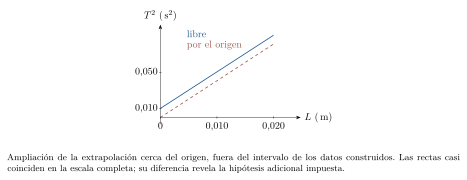
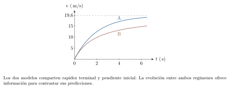
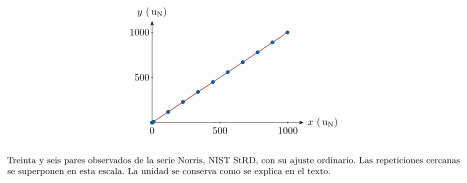
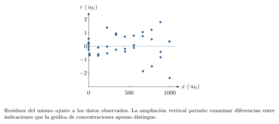

[← Capítulo anterior](capitulo-22.html) · [Índice del libro](index.html)

Dos grupos pueden medir el mismo péndulo y obtener valores ligeramente distintos de la aceleración gravitatoria. Para entender la diferencia hace falta reconstruir sus mediciones: qué longitud tomaron, cómo contaron las oscilaciones, qué instrumentos usaron y qué relación eligieron para calcular el resultado. La conclusión adquiere fuerza cuando esos pasos quedan disponibles para otra persona.

Este capítulo reúne herramientas desarrolladas a lo largo del libro y las lleva a una investigación pequeña. El péndulo permitirá estudiar mediciones y ajustes; una serie pública de calibración aportará datos observados; la caída de un cuerpo servirá para comprobar algoritmos. Los ejemplos didácticos usan datos construidos y los identifican expresamente. El trabajo experimental del lector producirá sus propios registros y sus propias conclusiones.

## De una pregunta a un procedimiento de medida

Una pregunta experimental se vuelve operacional cuando precisa una magnitud que se medirá, una variable que se modificará y condiciones que se mantendrán controladas. Para un péndulo simple, la pregunta puede ser: ¿cómo depende el período de la longitud efectiva, al mantener pequeña la amplitud angular? La longitud efectiva va desde el punto de suspensión hasta el centro de masas de la pesa. El período es el tiempo de una oscilación completa, con regreso a la misma posición y sentido de movimiento.

El modelo de pequeña amplitud relaciona ambas magnitudes mediante $T=2\pi\sqrt{L/g}$. Supone una pesa de dimensiones pequeñas frente a $L$, un hilo de masa despreciable, un soporte estable y pérdidas débiles durante la medida. Una amplitud inicial próxima a cinco grados facilita esa aproximación. Conviene registrar también la amplitud para valorar su posible influencia. La pesa debe ser ligera, estar sujeta a un soporte firme y oscilar sobre una zona despejada.

En el capítulo 1 expresamos la información de medición mediante intervalos compatibles. En $(10{,}0\pm0{,}2)\,\mathrm{cm}$, la semianchura de $0{,}2\,\mathrm{cm}$ delimita el intervalo adoptado. Al sumar longitudes con cotas de $0{,}2$ y $0{,}3\,\mathrm{cm}$, la suma tiene una cota conservadora de $0{,}5\,\mathrm{cm}$. En este capítulo describimos la incertidumbre estándar mediante desviaciones estándar: para estimaciones independientes con incertidumbres estándar de $0{,}2$ y $0{,}3\,\mathrm{cm}$, la suma tiene $u=\sqrt{0{,}2^2+0{,}3^2}\,\mathrm{cm}\simeq0{,}36\,\mathrm{cm}$. Las contribuciones correlacionadas incorporan $2\operatorname{cov}(x,y)$ a la varianza de la suma. Una cota se convierte en incertidumbre estándar al adoptar una distribución: para una uniforme de semianchura $a$, $u=a/\sqrt3$. Una contribución de calibración común permanece al repetir la medida. Cada informe precisa la interpretación de $\pm$ y las hipótesis que sostienen su cálculo.

### Problema resuelto 23.1 · Convertir una pregunta sobre el péndulo en un protocolo {#r23-1}
Se dispone de una regla, un cronómetro y un péndulo con longitud cercana a un metro. Propón una medición del período y distingue variables y controles.
*Resolución.* Se mide $L$ hasta el centro de la pesa y se registra el tiempo $t_{20}$ de veinte oscilaciones completas. Se calcula $T=t_{20}/20$. Para estudiar la dependencia con $L$ se eligen varias longitudes, conservando la pesa, el soporte y una amplitud inicial próxima a cinco grados. Se repite cada cronometraje, se anota el instrumento y se describe el criterio de inicio y final. El promedio temporal y la dispersión permitirán caracterizar la repetibilidad.

{#fig-fp-av-r23-1 fig-alt="Ilustración de Problema resuelto 23.1 · Convertir una pregunta sobre el péndulo en un protocolo. En el capítulo 1 expresamos la información de medición mediante intervalos compatibles. En (10,0pm0,2)\\,cm, la semianchura de 0,2\\,cm delimita el intervalo adoptado. Al sumar longitudes con cotas de 0,2 y 0,3\\,cm, la suma tiene una cota conservadora de 0,5\\,cm. En este capítulo describimos la incertidumbre estándar"}

Una observación registra un resultado: una longitud, una lectura o una secuencia de posiciones. La explicación vincula esos registros con un modelo. En el experimento, un período mayor al aumentar $L$ constituye una tendencia observada. La ecuación del péndulo propone una relación cuantitativa que permite contrastar esa tendencia. Conservar ambas capas de información ayuda a revisar el razonamiento.

Para $n$ repeticiones independientes $t_i$, la media es $\bar t=(\sum t_i)/n$, la desviación muestral es $s_t=\sqrt{\sum(t_i-\bar t)^2/(n-1)}$ y la incertidumbre estándar de la media debida a repetibilidad es $u_{\bar t}=s_t/\sqrt n$. El factor $\sqrt n$ corresponde a esa componente aleatoria. Las contribuciones comunes de calibración, longitud o procedimiento requieren estimaciones propias.

### Problema resuelto 23.2 · Estimar la repetibilidad del cronometraje {#r23-2}
En un ejemplo didáctico construido, cinco tiempos de veinte oscilaciones son $40{,}10$, $40{,}20$, $40{,}30$, $40{,}20$ y $40{,}20\,\mathrm{s}$. Calcula la media, la desviación muestral y la componente de incertidumbre de $T$ asociada a la media temporal.
*Resolución.* La media es $\bar t=40{,}20\,\mathrm{s}$. La suma de desviaciones cuadradas es $0{,}0200\,\mathrm{s^2}$, de modo que $s_t=0{,}0707\,\mathrm{s}$ y $u_{\bar t}=0{,}0316\,\mathrm{s}$. Al dividir por veinte,
$$
T=2{,}0100\,\mathrm{s},\qquad u_T=\frac{0{,}0316}{20}\simeq0{,}0016\,\mathrm{s}.
$$
El resultado temporal, considerando esta componente, se expresa como $(2{,}0100\pm0{,}0016)\,\mathrm{s}$. Las cifras adicionales permiten mostrar la estimación de repetibilidad; una evaluación completa incorporará las demás contribuciones.

{#fig-fp-av-r23-2 fig-alt="Ilustración de Problema resuelto 23.2 · Estimar la repetibilidad del cronometraje. Para n repeticiones independientes ti, la media es bar t=(sum ti)/n, la desviación muestral es st=sqrtsum(ti-bar t)^2/(n-1) y la incertidumbre estándar de la media debida a repetibilidad es ubar t=st/sqrt n. El factor sqrt n corresponde a esa componente aleatoria. Las contribuciones comunes de calibración, longitud o"}

## Tablas, transformaciones y gráficas fieles

Una tabla de trabajo conserva los registros originales, las unidades y las transformaciones usadas. Para el péndulo conviene guardar $L$, cada tiempo de varias oscilaciones, el número de oscilaciones y las estimaciones de incertidumbre. A partir de ellos se calculan $T$ y $T^2$. La relación esperada se vuelve lineal al representar $T^2$ frente a $L$:
$$
T^2=\frac{4\pi^2}{g}L.
$$
Esta transformación conserva la relación física y modifica la escala de incertidumbre de la variable vertical. Para incertidumbres pequeñas, $u_{T^2}\simeq2|T|u_T$. El resultado procede de la sensibilidad de $T^2$ ante un pequeño cambio de $T$.

### Problema resuelto 23.3 · Representar una medición con su incertidumbre {#r23-3}
Para un punto didáctico, $L=(0{,}800\pm0{,}002)\,\mathrm{m}$ y $T=(1{,}800\pm0{,}010)\,\mathrm{s}$, donde las incertidumbres son estándar. Obtén el punto y las barras para la gráfica $T^2$ frente a $L$.
*Resolución.* Se calcula $T^2=3{,}240\,\mathrm{s^2}$ y $u_{T^2}\simeq2(1{,}800)(0{,}010)=0{,}036\,\mathrm{s^2}$. El punto es $(0{,}800\,\mathrm{m},3{,}240\,\mathrm{s^2})$, con barra horizontal de semiancho $0{,}002\,\mathrm{m}$ y vertical de semiancho $0{,}036\,\mathrm{s^2}$. Estas barras representan incertidumbres estándar de las coordenadas. Su interpretación probabilística completa depende de las distribuciones y del procedimiento de estimación.

{#fig-fp-av-r23-3 fig-alt="Ilustración de Problema resuelto 23.3 · Representar una medición con su incertidumbre. Una tabla de trabajo conserva los registros originales, las unidades y las transformaciones usadas. Para el péndulo conviene guardar L, cada tiempo de varias oscilaciones, el número de oscilaciones y las estimaciones de incertidumbre. A partir de ellos se calculan T y T^2. La relación esperada se vuelve lineal al"}

Los ejes identifican magnitud y unidad; la escala debe permitir distinguir los datos y su incertidumbre. Los puntos medidos se muestran como tales. Una línea puede representar un modelo ajustado o una interpolación declarada. La superficie bajo una gráfica de velocidad frente a tiempo tiene además una interpretación física: el desplazamiento. Con datos discretos, una aproximación por trapecios supone variación lineal entre mediciones contiguas.

### Problema resuelto 23.4 · Integrar una gráfica de velocidad muestreada {#r23-4}
Una serie construida da $v=1{,}0$, $3{,}1$, $4{,}9$ y $7{,}0\,\mathrm{m/s}$ en $t=0$, $1$, $2$ y $3\,\mathrm{s}$. Estima el desplazamiento mediante trapecios.
*Resolución.* Cada intervalo dura un segundo. Por tanto,
$$
\Delta x\simeq\frac{1{,}0+3{,}1}{2}(1)
+\frac{3{,}1+4{,}9}{2}(1)+\frac{4{,}9+7{,}0}{2}(1)
=12{,}0\,\mathrm{m}.
$$
La unidad resulta de multiplicar velocidad por tiempo. El cálculo es exacto para la interpolación lineal elegida. El movimiento real entre muestras puede introducir una diferencia que se estudia aumentando la frecuencia de muestreo o proponiendo un modelo dinámico.

{#fig-fp-av-r23-4 fig-alt="Ilustración de Problema resuelto 23.4 · Integrar una gráfica de velocidad muestreada. Los ejes identifican magnitud y unidad; la escala debe permitir distinguir los datos y su incertidumbre. Los puntos medidos se muestran como tales. Una línea puede representar un modelo ajustado o una interpolación declarada. La superficie bajo una gráfica de velocidad frente a tiempo tiene además una interpretación"}

## Ajuste lineal, parámetros y residuos

El ajuste de una recta $y=ax+b$ busca parámetros que aproximen los datos según un criterio declarado. Los mínimos cuadrados ordinarios minimizan $S=\sum_i[y_i-(ax_i+b)]^2$. Para pesos iguales y abscisas con incertidumbre despreciable frente al efecto de la incertidumbre vertical, las estimaciones son
$$
a=\frac{\sum_i(x_i-\bar x)(y_i-\bar y)}{\sum_i(x_i-\bar x)^2},
\qquad b=\bar y-a\bar x.
$$
El modelo estadístico usual escribe cada dato como la predicción de una recta poblacional más un error de media cero. Para el ajuste considerado, esos errores se suponen independientes y con varianza común. Los residuos se calculan respecto de la recta estimada y permiten examinar las hipótesis mediante sus patrones; el ajuste introduce relaciones entre ellos. Incertidumbres verticales muy distintas sugieren pesos diferentes; incertidumbres horizontales relevantes requieren un tratamiento que incorpore ambas coordenadas. En el péndulo, $a$ tiene unidades $\,\mathrm{s^2/m}$ y el modelo ideal da $g=4\pi^2/a$.

### Problema resuelto 23.5 · Estimar g a partir de cinco puntos {#r23-5}
Usa los cinco pares didácticos de la tabla, construidos para este capítulo, con $x=L$ e $y=T^2$. Ajusta $y=ax+b$ y obtén $g$.
*Resolución.* Las medias son $\bar x=0{,}600\,\mathrm{m}$ y $\bar y=2{,}434\,\mathrm{s^2}$. Las sumas centradas son $S_{xx}=0{,}400\,\mathrm{m^2}$ y $S_{xy}=1{,}616\,\mathrm{m\,s^2}$. Así,
$$
a=4{,}040\,\mathrm{s^2/m},\quad b=0{,}0100\,\mathrm{s^2},
\qquad g\simeq9{,}772\,\mathrm{m/s^2}.
$$
La pendiente determina $g$ bajo las hipótesis del péndulo y del ajuste. El intercepto queda disponible para examinar el comportamiento del modelo y del procedimiento.

{#fig-fp-av-r23-5 fig-alt="Ilustración de Problema resuelto 23.5 · Estimar g a partir de cinco puntos. El ajuste de una recta y=ax+b busca parámetros que aproximen los datos según un criterio declarado. Los mínimos cuadrados ordinarios minimizan S=sumi[yi-(axi+b)]^2. Para pesos iguales y abscisas con incertidumbre despreciable frente al efecto de la incertidumbre vertical, las estimaciones son a=fracsumi(xi-bar"}

El residuo $r_i=y_i-(ax_i+b)$ expresa la separación vertical entre cada dato y la predicción ajustada. Su signo indica el lado de la recta y su unidad coincide con la de $y$. Una gráfica de residuos puede revelar curvatura, dispersión variable o dependencia con el orden de medida. La presencia de un patrón orienta nuevas pruebas del modelo, de los instrumentos o de las variables de control.

### Problema resuelto 23.6 · Examinar residuos y dispersión del ajuste {#r23-6}
Calcula los residuos del ajuste anterior y estima la desviación residual $s_r$ y la incertidumbre de la pendiente debida a la dispersión, con $s_r=\sqrt{\sum r_i^2/(n-2)}$ y $u_a=s_r/\sqrt{S_{xx}}$.
*Resolución.* En orden creciente de longitud, los residuos son $0{,}002$, $-0{,}004$, $0{,}004$, $-0{,}004$ y $0{,}002\,\mathrm{s^2}$. Su suma es cero por la condición de mínimos cuadrados asociada al intercepto libre; esta restricción pertenece al ajuste. Su suma de cuadrados es $5{,}60\times10^{-5}\,\mathrm{s^4}$. Resulta
$$
s_r\simeq0{,}00432\,\mathrm{s^2},\qquad
u_a\simeq0{,}00683\,\mathrm{s^2/m}.
$$
La incertidumbre asociada de $g$ es $u_g\simeq(g/a)u_a\simeq0{,}017\,\mathrm{m/s^2}$. Esta es una estimación condicionada al modelo estadístico adoptado y a tratar las longitudes como abscisas conocidas. La calibración de longitudes y los efectos de amplitud requieren componentes adicionales para un resultado experimental completo.

{#fig-fp-av-r23-6 fig-alt="Ilustración de Problema resuelto 23.6 · Examinar residuos y dispersión del ajuste. El residuo ri=yi-(axi+b) expresa la separación vertical entre cada dato y la predicción ajustada. Su signo indica el lado de la recta y su unidad coincide con la de y. Una gráfica de residuos puede revelar curvatura, dispersión variable o dependencia con el orden de medida. La presencia de un patrón orienta nuevas"}

### Problema resuelto 23.7 · Comparar una recta libre con una recta por el origen {#r23-7}
Repite el ajuste de los cinco pares imponiendo $b=0$. Usa $a_0=(\sum x_iy_i)/(\sum x_i^2)$ y compara el valor de $g$.
*Resolución.* Las sumas dan $\sum x_i^2=2{,}20\,\mathrm{m^2}$ y $\sum x_iy_i=8{,}918\,\mathrm{m\,s^2}$. Por tanto, $a_0\simeq4{,}05364\,\mathrm{s^2/m}$ y $g_0\simeq9{,}739\,\mathrm{m/s^2}$. La diferencia respecto del ajuste libre es aproximadamente $-0{,}033\,\mathrm{m/s^2}$. Imponer el origen incorpora una hipótesis adicional. La elección se justifica mediante el modelo, el origen de las coordenadas y la evaluación de posibles desplazamientos de medida. Un intercepto distinto de cero ofrece una pista que se estudia con esas comprobaciones.

{#fig-fp-av-r23-7 fig-alt="Ilustración de Problema resuelto 23.7 · Comparar una recta libre con una recta por el origen. El residuo ri=yi-(axi+b) expresa la separación vertical entre cada dato y la predicción ajustada. Su signo indica el lado de la recta y su unidad coincide con la de y. Una gráfica de residuos puede revelar curvatura, dispersión variable o dependencia con el orden de medida. La presencia de un patrón orienta nuevas"}

## Incertidumbres de magnitudes indirectas

La incertidumbre estándar caracteriza la dispersión atribuida a una magnitud mediante una desviación estándar. Para $z=x+y$ o $z=x-y$, con entradas independientes, $u_z=\sqrt{u_x^2+u_y^2}$. Para $q=Cx^\alpha y^\beta$, una aproximación lineal en incertidumbres relativas pequeñas da
$$
\left(\frac{u_q}{|q|}\right)^2\simeq
\left(\alpha\frac{u_x}{x}\right)^2+
\left(\beta\frac{u_y}{y}\right)^2.
$$
La fórmula supone entradas independientes y una constante $C$ tratada como conocida. Se puede obtener desarrollando el cambio de $q$ ante pequeños cambios de las entradas y sumando sus varianzas. Una cota máxima de error corresponde a otro criterio de combinación y debe identificarse como tal.

### Problema resuelto 23.8 · Combinar dos longitudes independientes {#r23-8}
La distancia desde el soporte hasta la parte superior de una pesa es $\ell=(0{,}800\pm0{,}002)\,\mathrm{m}$ y desde allí hasta su centro de masas es $d=(0{,}025\pm0{,}001)\,\mathrm{m}$. Las incertidumbres son estándar e independientes. Calcula la longitud efectiva.
*Resolución.* La longitud es $L=\ell+d=0{,}825\,\mathrm{m}$. Su incertidumbre es
$$
u_L=\sqrt{0{,}002^2+0{,}001^2}\,\mathrm{m}
\simeq0{,}0022\,\mathrm{m}.
$$
Con dos cifras significativas en la incertidumbre, el resultado se puede escribir $(0{,}8250\pm0{,}0022)\,\mathrm{m}$. La suma geométrica exige describir con precisión los extremos de cada medición.

{#fig-fp-av-r23-8 fig-alt="Ilustración de Problema resuelto 23.8 · Combinar dos longitudes independientes. La incertidumbre estándar caracteriza la dispersión atribuida a una magnitud mediante una desviación estándar. Para z=x+y o z=x-y, con entradas independientes, uz=sqrtux^2+uy^2. Para q=Cx^alpha y^beta, una aproximación lineal en incertidumbres relativas pequeñas da left(fracuq|q|right)^2simeq"}

### Problema resuelto 23.9 · Obtener densidad e incertidumbre de un cilindro {#r23-9}
Un cilindro macizo tiene $m=(54{,}0\pm0{,}1)\,\mathrm{g}$, diámetro $d=(2{,}000\pm0{,}010)\,\mathrm{cm}$ y altura $H=(3{,}000\pm0{,}020)\,\mathrm{cm}$. Calcula $\rho$ y su incertidumbre estándar, suponiendo entradas independientes y forma cilíndrica ideal.
*Resolución.* El volumen es $V=\pi d^2H/4\simeq9{,}425\,\mathrm{cm^3}$ y la densidad $\rho=4m/(\pi d^2H)\simeq5{,}7296\,\mathrm{g/cm^3}$. Los exponentes dan
$$
\frac{u_\rho}{\rho}\simeq
\sqrt{\left(\frac{0{,}1}{54{,}0}\right)^2+
\left(\frac{2(0{,}010)}{2{,}000}\right)^2+
\left(\frac{0{,}020}{3{,}000}\right)^2}
\simeq0{,}0122.
$$
Así, $u_\rho\simeq0{,}070\,\mathrm{g/cm^3}$ y se informa $(5{,}730\pm0{,}070)\,\mathrm{g/cm^3}$. El factor dos del diámetro procede de su exponente en el volumen. Su contribución domina entre las tres consideradas.

{#fig-fp-av-r23-9 fig-alt="Ilustración de Problema resuelto 23.9 · Obtener densidad e incertidumbre de un cilindro. La incertidumbre estándar caracteriza la dispersión atribuida a una magnitud mediante una desviación estándar. Para z=x+y o z=x-y, con entradas independientes, uz=sqrtux^2+uy^2. Para q=Cx^alpha y^beta, una aproximación lineal en incertidumbres relativas pequeñas da left(fracuq|q|right)^2simeq"}

Cuando dos mediciones comparten una contribución, su relación estadística modifica la combinación. Para una diferencia $D=x-y$, $u_D^2=u_x^2+u_y^2-2\operatorname{cov}(x,y)$. La covarianza registra la variación conjunta. Un desplazamiento aditivo común se cancela al restar las lecturas; una incertidumbre de escala multiplicativa sigue otra relación.

### Problema resuelto 23.10 · Reconocer una contribución común que se cancela {#r23-10}
Dos lecturas de una misma regla son $x=0{,}500\,\mathrm{m}$ e $y=0{,}300\,\mathrm{m}$. Cada una tiene una contribución independiente de $0{,}001\,\mathrm{m}$ y ambas comparten el mismo desplazamiento de cero, de incertidumbre estándar $0{,}002\,\mathrm{m}$. Calcula $D=x-y$ y su incertidumbre.
*Resolución.* En el modelo $x=x_\mathrm{real}+\delta+\epsilon_x$ e $y=y_\mathrm{real}+\delta+\epsilon_y$, la diferencia elimina $\delta$. Quedan las dos contribuciones independientes, por lo que
$$
D=0{,}200\,\mathrm{m},\qquad
u_D=\sqrt{2}(0{,}001)\,\mathrm{m}\simeq0{,}0014\,\mathrm{m}.
$$
La covarianza común equivale a $u_\delta^2$ y reproduce esta cancelación en la fórmula general. El modelo de error compartido debe justificarse para el instrumento y las lecturas concretas.

{#fig-fp-av-r23-10 fig-alt="Ilustración de Problema resuelto 23.10 · Reconocer una contribución común que se cancela. Cuando dos mediciones comparten una contribución, su relación estadística modifica la combinación. Para una diferencia D=x-y, uD^2=ux^2+uy^2-2cov(x,y). La covarianza registra la variación conjunta. Un desplazamiento aditivo común se cancela al restar las lecturas; una incertidumbre de escala multiplicativa sigue otra"}

## Dimensiones, límites y comparación de modelos

Las dimensiones permiten comprobar la compatibilidad entre magnitudes antes de ajustar parámetros. Los límites examinan cómo se comporta una expresión en regímenes conocidos. El orden de magnitud compara la predicción con escalas físicas razonables. Estos controles se complementan con los datos: varias expresiones pueden compartir dimensiones y límites y diferir en su evolución intermedia.

### Problema resuelto 23.11 · Examinar dos expresiones para el período {#r23-11}
Se proponen $T_A=2\pi\sqrt{L/g}$ y $T_B=2\pi L/g$ para un período. Comprueba sus dimensiones y calcula la primera para $L=1{,}00\,\mathrm{m}$ y $g=9{,}80\,\mathrm{m/s^2}$.
*Resolución.* El cociente $L/g$ tiene dimensión $\mathrm T^2$. Su raíz cuadrada posee dimensión temporal, compatible con $T_A$. La expresión $T_B$ conserva dimensión de tiempo al cuadrado y exige una modificación para representar un período. Para la primera,
$$
T_A=2\pi\sqrt{\frac{1{,}00}{9{,}80}}\simeq2{,}01\,\mathrm{s}.
$$
La consistencia dimensional establece una condición necesaria. La relación con el péndulo exige además la derivación dinámica y la evaluación experimental de sus hipótesis.

{#fig-fp-av-r23-11 fig-alt="Ilustración de Problema resuelto 23.11 · Examinar dos expresiones para el período. Las dimensiones permiten comprobar la compatibilidad entre magnitudes antes de ajustar parámetros. Los límites examinan cómo se comporta una expresión en regímenes conocidos. El orden de magnitud compara la predicción con escalas físicas razonables. Estos controles se complementan con los datos: varias expresiones"}

### Problema resuelto 23.12 · Distinguir modelos con los mismos límites {#r23-12}
Para una caída desde reposo se proponen $v_A=g\tau(1-e^{-t/\tau})$ y $v_B=gt/(1+t/\tau)$, con $g=9{,}80\,\mathrm{m/s^2}$ y $\tau=2{,}00\,\mathrm{s}$. Compara el comienzo, el límite a tiempos grandes y el valor en $t=1{,}00\,\mathrm{s}$.
*Resolución.* Para $t/\tau$ pequeño, ambas expresiones comienzan con $v\simeq gt$. A tiempos grandes, ambas se aproximan a $g\tau=19{,}6\,\mathrm{m/s}$. En un segundo,
$$
v_A\simeq7{,}71\,\mathrm{m/s},\qquad v_B\simeq6{,}53\,\mathrm{m/s}.
$$
Los datos en el régimen intermedio permiten distinguirlas. La primera surge de $dv/dt=g-v/\tau$, correspondiente a rozamiento lineal por unidad de masa. La segunda describe otra evolución. Compartir el comienzo y el límite terminal deja abierta la selección física entre ambas.

{#fig-fp-av-r23-12 fig-alt="Ilustración de Problema resuelto 23.12 · Distinguir modelos con los mismos límites. Las dimensiones permiten comprobar la compatibilidad entre magnitudes antes de ajustar parámetros. Los límites examinan cómo se comporta una expresión en regímenes conocidos. El orden de magnitud compara la predicción con escalas físicas razonables. Estos controles se complementan con los datos: varias expresiones"}

## Integración numérica y estudio de convergencia

Un algoritmo de integración aproxima la evolución temporal mediante pasos finitos. Para una caída con coordenada $y$ positiva hacia abajo y aceleración $a(v)$, el método de Euler explícito usa los valores del instante anterior:
$$
y_{n+1}=y_n+v_n\Delta t,\qquad
v_{n+1}=v_n+a(v_n)\Delta t.
$$
Las dos actualizaciones parten del mismo estado $(y_n,v_n)$. Usar la velocidad recién actualizada en la primera ecuación define otro método. El estudio de convergencia compara resultados al reducir $\Delta t$ manteniendo los mismos datos iniciales, parámetros y tiempo final. Cuando existe una solución analítica, permite calcular directamente el error numérico.

### Problema resuelto 23.13 · Probar convergencia en caída con aceleración constante {#r23-13}
Aplica Euler explícito a $a=g=10{,}0\,\mathrm{m/s^2}$, con $y_0=v_0=0$, hasta $t_f=1{,}00\,\mathrm{s}$. Compara pasos de $0{,}250$, $0{,}125$ y $0{,}0625\,\mathrm{s}$ con la solución analítica.
*Resolución.* En cada paso la velocidad aumenta $g\Delta t$. Al sumar las velocidades previas para la posición se obtiene
$$
y_N=\frac{g\Delta t^2N(N-1)}2
=\frac{g t_f^2}{2}-\frac{g t_f\Delta t}{2}.
$$
La solución exacta es $y(t_f)=5{,}00\,\mathrm{m}$. Los errores de posición son $1{,}25$, $0{,}625$ y $0{,}3125\,\mathrm{m}$. Cada reducción del paso a la mitad reduce el error a la mitad. La velocidad final es $10{,}0\,\mathrm{m/s}$ en los tres casos.

{#fig-fp-av-r23-13 fig-alt="Ilustración de Problema resuelto 23.13 · Probar convergencia en caída con aceleración constante. Un algoritmo de integración aproxima la evolución temporal mediante pasos finitos. Para una caída con coordenada y positiva hacia abajo y aceleración a(v), el método de Euler explícito usa los valores del instante anterior: yn+1=yn+vnDelta t,qquad vn+1=vn+a(vn)Delta t. Las dos actualizaciones parten del mismo estado"}

### Problema resuelto 23.14 · Integrar una caída con rozamiento lineal {#r23-14}
Usa $a(v)=g-v/\tau$, con $g=10{,}0\,\mathrm{m/s^2}$, $\tau=1{,}00\,\mathrm{s}$ y reposo inicial. Calcula la rapidez en $t_f=2{,}00\,\mathrm{s}$ con Euler para pasos de $0{,}500$, $0{,}250$ y $0{,}125\,\mathrm{s}$.
*Resolución.* La recurrencia es $v_{n+1}=(1-\Delta t/\tau)v_n+g\Delta t$. Su aplicación entrega $9{,}375$, $8{,}99887$ y $8{,}81933\,\mathrm{m/s}$. La solución analítica del modelo es
$$
v(2)=g\tau(1-e^{-2/\tau})\simeq8{,}64665\,\mathrm{m/s}.
$$
Los errores son aproximadamente $0{,}72835$, $0{,}35222$ y $0{,}17268\,\mathrm{m/s}$; sus razones sucesivas son cercanas a dos. Para esta ecuación, Euler es estable si $|1-\Delta t/\tau|<1$ y se acerca de forma monótona a la rapidez terminal cuando $0<\Delta t\leq\tau$. La elección del paso atiende tanto a estabilidad como a precisión.

{#fig-fp-av-r23-14 fig-alt="Ilustración de Problema resuelto 23.14 · Integrar una caída con rozamiento lineal. Un algoritmo de integración aproxima la evolución temporal mediante pasos finitos. Para una caída con coordenada y positiva hacia abajo y aceleración a(v), el método de Euler explícito usa los valores del instante anterior: yn+1=yn+vnDelta t,qquad vn+1=vn+a(vn)Delta t. Las dos actualizaciones parten del mismo estado"}

### Problema resuelto 23.15 · Usar la energía como control de un algoritmo {#r23-15}
En la caída sin rozamiento del problema 23.13, toma $m=1{,}00\,\mathrm{kg}$ y $U=-mgy$, con cero inicial. Calcula la energía mecánica numérica final para los pasos estudiados.
*Resolución.* La velocidad final da $K=mv^2/2=50{,}0\,\mathrm{J}$. Para $\Delta t=0{,}250\,\mathrm{s}$, $y_N=3{,}75\,\mathrm{m}$ y $U=-37{,}5\,\mathrm{J}$, luego $E_N=12{,}5\,\mathrm{J}$. Los otros pasos dan $E_N=6{,}25$ y $3{,}125\,\mathrm{J}$. El valor exacto es $E=0$ durante toda la caída. La deriva numérica se reduce con el paso y ofrece un control adicional de la aproximación. En el sistema con rozamiento, el balance incorpora la energía transferida por esa interacción.

{#fig-fp-av-r23-15 fig-alt="Ilustración de Problema resuelto 23.15 · Usar la energía como control de un algoritmo. Un algoritmo de integración aproxima la evolución temporal mediante pasos finitos. Para una caída con coordenada y positiva hacia abajo y aceleración a(v), el método de Euler explícito usa los valores del instante anterior: yn+1=yn+vnDelta t,qquad vn+1=vn+a(vn)Delta t. Las dos actualizaciones parten del mismo estado"}

La convergencia comprueba cómo un algoritmo aproxima las ecuaciones elegidas. La correspondencia de esas ecuaciones con un objeto físico se evalúa mediante mediciones, parámetros y condiciones del experimento. La carpeta de laboratorio adjunta incluye un programa Python con Euler explícito, sus parámetros, tablas de convergencia y pruebas frente a las soluciones analíticas. El código utiliza la biblioteca estándar y conserva los datos iniciales en su documentación.

## Una serie observada: calibración de instrumentos

La colección pública StRD del NIST incluye la serie Norris, con 36 pares observados de una calibración de monitores de ozono. La variable $x$ corresponde a la medición de concentración del NIST y $y$ a la del instrumento del cliente. La ficha proporciona su significado y valores numéricos. Conservaremos su unidad de concentración como $u_N$; una conversión al SI exige documentar la escala física original. La carpeta de datos contiene los pares en el orden publicado, con su fuente y fecha de consulta.

Para comparar procedimientos numéricos, NIST publica parámetros certificados del ajuste ordinario $y=ax+b$. Esa certificación se refiere al resultado del cálculo para esa serie y ese modelo. Una calibración metrológica completa incorpora además la incertidumbre de la referencia, la del instrumento y las condiciones de uso.

### Problema resuelto 23.16 · Reproducir un ajuste con datos públicos {#r23-16}
Ajusta los 36 pares Norris suministrados en el archivo adjunto y compara la pendiente, el intercepto y la desviación residual con los valores publicados.
*Resolución.* Aplicando las sumas centradas de la ecuación 23.2 se obtiene
$$
a\simeq1{,}002116818,\qquad b\simeq-0{,}262323074\,\mathrm{u_N},
\qquad s_r\simeq0{,}884796396\,\mathrm{u_N}.
$$
La pendiente es adimensional porque ambas coordenadas usan la misma unidad. El programa adjunto reproduce estos resultados y los compara con los certificados. Para el par publicado $x=884{,}6\,\mathrm{u_N}$, $y=888{,}0\,\mathrm{u_N}$, el residuo es aproximadamente $+1{,}790\,\mathrm{u_N}$. La gráfica de residuos conserva la variación que resulta difícil de percibir en la escala completa de concentraciones.

{#fig-fp-av-r23-16 fig-alt="Ilustración de Problema resuelto 23.16 · Reproducir un ajuste con datos públicos. Para comparar procedimientos numéricos, NIST publica parámetros certificados del ajuste ordinario y=ax+b. Esa certificación se refiere al resultado del cálculo para esa serie y ese modelo. Una calibración metrológica completa incorpora además la incertidumbre de la referencia, la del instrumento y las condiciones de"}

### Problema resuelto 23.17 · Invertir una relación de calibración {#r23-17}
Con el ajuste anterior, estima la lectura equivalente de la referencia para una indicación del cliente $y=500{,}0\,\mathrm{u_N}$. Explica qué información permitiría evaluar la incertidumbre de la estimación.
*Resolución.* La inversión de la recta da
$$
x_{\mathrm{est}}=\frac{y-b}{a}
=\frac{500{,}0+0{,}262323074}{1{,}002116818}
\simeq499{,}206\,\mathrm{u_N}.
$$
Las cifras mostradas permiten verificar el cálculo. Un informe de medida necesita estimar la incertidumbre de la nueva lectura, la dispersión residual, la incertidumbre de los parámetros y su covarianza, junto con la contribución de la referencia. La inversión algebraica entrega el valor central condicionado al ajuste.

{#fig-fp-av-r23-17 fig-alt="Ilustración de Problema resuelto 23.17 · Invertir una relación de calibración. Para comparar procedimientos numéricos, NIST publica parámetros certificados del ajuste ordinario y=ax+b. Esa certificación se refiere al resultado del cálculo para esa serie y ese modelo. Una calibración metrológica completa incorpora además la incertidumbre de la referencia, la del instrumento y las condiciones de"}

## Una conclusión que otra persona pueda reconstruir

Un informe reproducible reúne la pregunta, el procedimiento, los datos originales, las transformaciones, el modelo y una conclusión cuyo alcance corresponde a las evidencias. Un lector debe poder identificar el significado de cada columna y reconstruir cada cantidad final. Los cambios de datos, criterios de exclusión y versiones del programa se registran para que las decisiones queden trazables.

### Problema resuelto 23.18 · Redactar una conclusión con sus condiciones {#r23-18}
Usa $L=(0{,}800\pm0{,}002)\,\mathrm{m}$ y $T=(1{,}800\pm0{,}010)\,\mathrm{s}$, con incertidumbres estándar independientes, para informar una estimación de $g$. Elabora una conclusión breve e identifica un control pendiente.
*Resolución.* Del modelo de pequeña amplitud,
$$
g=\frac{4\pi^2L}{T^2}\simeq9{,}748\,\mathrm{m/s^2},\qquad
\frac{u_g}{g}\simeq\sqrt{\left(\frac{0{,}002}{0{,}800}\right)^2+
\left(\frac{2(0{,}010)}{1{,}800}\right)^2}.
$$
Resulta $u_g\simeq0{,}11\,\mathrm{m/s^2}$. Una conclusión posible es: «Con el modelo de péndulo simple a pequeña amplitud y las incertidumbres indicadas, los datos construidos entregan $g=(9{,}75\pm0{,}11)\,\mathrm{m/s^2}$, con incertidumbre estándar. El resultado depende de la longitud hasta el centro de masas y del período medido. Para una experiencia real se evaluarán la amplitud, la calibración y la repetibilidad con registros propios». Cada condición orienta una comprobación concreta.

{#fig-fp-av-r23-18 fig-alt="Ilustración de Problema resuelto 23.18 · Redactar una conclusión con sus condiciones. Un informe reproducible reúne la pregunta, el procedimiento, los datos originales, las transformaciones, el modelo y una conclusión cuyo alcance corresponde a las evidencias. Un lector debe poder identificar el significado de cada columna y reconstruir cada cantidad final. Los cambios de datos, criterios de exclusión"}

En un proyecto breve conviene empezar con una pregunta acotada y conservar desde el principio los registros que permitirán responderla. La revisión de dimensiones, residuos, incertidumbres y convergencia actúa sobre partes distintas del razonamiento. Al reunirlas, la explicación física queda abierta a nuevas mediciones y a una revisión fundamentada.

## Ejercicios para desarrollar autonomía

### Ejercicio 23.1 · Precisar una variable experimental {#e23-1}
Formula una pregunta sobre la dependencia del período del péndulo con la amplitud. Identifica la variable que se modifica, la que se mide y dos controles.

### Ejercicio 23.2 · Estimar una media y su incertidumbre {#e23-2}
Tres tiempos construidos de quince oscilaciones son $30{,}0$, $30{,}2$ y $30{,}4\,\mathrm{s}$. Calcula media, desviación muestral, incertidumbre estándar de la media y período con su componente de repetibilidad.

### Ejercicio 23.3 · Interpretar la resolución de una regla {#e23-3}
Una regla redondea al milímetro más próximo. Modela el error de redondeo como uniforme entre $-0{,}5$ y $+0{,}5\,\mathrm{mm}$. Usa $u=a/\sqrt3$ para una distribución uniforme en $[-a,a]$ y calcula su incertidumbre estándar.

### Ejercicio 23.4 · Transformar una barra de incertidumbre {#e23-4}
Para $T=(1{,}50\pm0{,}02)\,\mathrm{s}$, calcula $T^2$ y su incertidumbre estándar por aproximación lineal.

### Ejercicio 23.5 · Integrar velocidades discretas {#e23-5}
Las velocidades construidas son $0$, $2$ y $4\,\mathrm{m/s}$ en $t=0$, $1$ y $2\,\mathrm{s}$. Calcula el desplazamiento por trapecios e identifica la hipótesis entre muestras.

### Ejercicio 23.6 · Hallar una pendiente con unidades {#e23-6}
Una recta de $T^2$ frente a $L$ pasa por $(0{,}250\,\mathrm{m},1{,}010\,\mathrm{s^2})$ y $(0{,}750\,\mathrm{m},3{,}030\,\mathrm{s^2})$. Calcula pendiente, intercepto y $g$ inferido.

### Ejercicio 23.7 · Calcular e interpretar un residuo {#e23-7}
Para $L=0{,}600\,\mathrm{m}$ se obtiene $T^2=2{,}460\,\mathrm{s^2}$. Calcula el residuo respecto de $T^2=(4{,}040\,\mathrm{s^2/m})L+0{,}010\,\mathrm{s^2}$ e interpreta su signo.

### Ejercicio 23.8 · Propagar la incertidumbre de una pendiente {#e23-8}
Un ajuste entrega $a=(4{,}00\pm0{,}04)\,\mathrm{s^2/m}$. Calcula $g=4\pi^2/a$ y la componente de incertidumbre que proviene de $a$.

### Ejercicio 23.9 · Examinar una extrapolación {#e23-9}
Una recta empírica es $T^2=(4{,}10\,\mathrm{s^2/m})L-0{,}020\,\mathrm{s^2}$. Encuentra dónde cruza el eje $L$ y analiza su extrapolación hasta $L=0$ como modelo de período al cuadrado.

### Ejercicio 23.10 · Combinar dos mediciones independientes {#e23-10}
Dos segmentos miden $(20{,}0\pm0{,}2)\,\mathrm{cm}$ y $(30{,}0\pm0{,}3)\,\mathrm{cm}$. Calcula su suma con incertidumbre estándar independiente.

### Ejercicio 23.11 · Calcular una incertidumbre de área {#e23-11}
Un rectángulo tiene lados $a=(10{,}0\pm0{,}1)\,\mathrm{cm}$ y $b=(5{,}00\pm0{,}05)\,\mathrm{cm}$, independientes. Calcula área e incertidumbre estándar.

### Ejercicio 23.12 · Reconocer la sensibilidad de una potencia {#e23-12}
El radio de una esfera es $(2{,}00\pm0{,}01)\,\mathrm{cm}$. Calcula el volumen y su incertidumbre estándar mediante aproximación lineal.

### Ejercicio 23.13 · Cambiar una contribución común {#e23-13}
Dos lecturas comparten un error aditivo $\delta$ con incertidumbre estándar $0{,}20\,\mathrm{cm}$. Sus otras contribuciones son despreciables. Calcula la incertidumbre debida a $\delta$ en la suma y en la diferencia.

### Ejercicio 23.14 · Comprobar dimensiones y escala {#e23-14}
Para una caída desde reposo se propone $y=gt^2/2$. Verifica dimensiones y calcula la distancia para $g=10{,}0\,\mathrm{m/s^2}$ y $t=0{,}200\,\mathrm{s}$.

### Ejercicio 23.15 · Usar un límite terminal {#e23-15}
En el modelo $dv/dt=g-v/\tau$, con $g=9{,}80\,\mathrm{m/s^2}$ y $\tau=0{,}500\,\mathrm{s}$, calcula la rapidez terminal y la aceleración cuando $v=2{,}45\,\mathrm{m/s}$.

### Ejercicio 23.16 · Dar los primeros pasos de Euler {#e23-16}
Usa Euler explícito con $g=10{,}0\,\mathrm{m/s^2}$, $\Delta t=0{,}100\,\mathrm{s}$ y $y_0=v_0=0$. Calcula posición y velocidad en los dos primeros pasos.

### Ejercicio 23.17 · Estimar una tolerancia de paso {#e23-17}
Para caída con aceleración constante y Euler explícito, el error de posición en $t_f$ tiene magnitud $gt_f\Delta t/2$. Con $g=10{,}0\,\mathrm{m/s^2}$ y $t_f=1{,}00\,\mathrm{s}$, determina un paso que dé error de posición menor o igual que $0{,}050\,\mathrm{m}$ y alcance exactamente el tiempo final.

### Ejercicio 23.18 · Comparar errores de dos mallas {#e23-18}
Una aproximación tiene errores de $0{,}080$ y $0{,}020\,\mathrm{m}$ al usar pasos $h$ y $h/2$. Estima el orden observado mediante $p=\log_2(|e_h/e_{h/2}|)$. Explica el alcance de esa estimación.

### Ejercicio 23.19 · Examinar estabilidad en rozamiento lineal {#e23-19}
Para $\tau=1{,}00\,\mathrm{s}$, calcula el factor $q=1-\Delta t/\tau$ con $\Delta t=0{,}500$, $1{,}50$ y $2{,}50\,\mathrm{s}$. Describe cómo evoluciona la diferencia respecto de la rapidez terminal en cada caso.

### Ejercicio 23.20 · Calcular una deriva energética {#e23-20}
En caída libre con $m=1{,}00\,\mathrm{kg}$ y $g=10{,}0\,\mathrm{m/s^2}$, Euler explícito entrega al segundo $v=10{,}0\,\mathrm{m/s}$ e $y=4{,}50\,\mathrm{m}$. Calcula $E=mv^2/2-mgy$ y compara con la energía inicial nula.

### Ejercicio 23.21 · Revisar un par de datos observados {#e23-21}
Para el par Norris $x=0{,}2\,\mathrm{u_N}$, $y=0{,}1\,\mathrm{u_N}$, calcula el residuo de $y=1{,}002116818x-0{,}262323074\,\mathrm{u_N}$. Identifica el significado de ambas variables.

### Ejercicio 23.22 · Aplicar una calibración sencilla {#e23-22}
Una calibración didáctica da $y=1{,}020x+0{,}500\,\mathrm{V}$, con ambas variables en voltios. Para $y=5{,}600\,\mathrm{V}$, calcula la lectura equivalente $x$.

### Ejercicio 23.23 · Separar dispersión y contribución común {#e23-23}
Una media tiene componente aleatoria de incertidumbre $0{,}040\,\mathrm{s}$ y una componente de calibración independiente de $0{,}030\,\mathrm{s}$. Calcula la combinación y el valor que quedaría si una repetición ampliada redujera la componente aleatoria a $0{,}020\,\mathrm{s}$.

### Ejercicio 23.24 · Hacer reconstruible una conclusión {#e23-24}
Un informe afirma: «La simulación confirma el movimiento con precisión». Reescribe la conclusión incorporando el modelo $a=g-v/\tau$, $g=10{,}0\,\mathrm{m/s^2}$, $\tau=1{,}00\,\mathrm{s}$, reposo inicial, $t_f=2{,}00\,\mathrm{s}$ y Euler con $\Delta t=0{,}125\,\mathrm{s}$. Usa el resultado del problema 23.14 y propone una comprobación experimental adicional.

## Soluciones razonadas

### Solución 23.1 {#sol-e23-1}
 Una pregunta posible es: «¿Cómo cambia $T$ al variar la amplitud inicial entre cinco y veinte grados?». Se modifica la amplitud, se mide el período y se conservan la longitud efectiva y la misma pesa. Registrar el procedimiento de liberación permite estudiar también su repetibilidad.

### Solución 23.2 {#sol-e23-2}
 $\bar t=30{,}2\,\mathrm{s}$, $s_t=0{,}200\,\mathrm{s}$ y $u_{\bar t}=0{,}200/\sqrt3\simeq0{,}115\,\mathrm{s}$. El período es $T=30{,}2/15\simeq2{,}0133\,\mathrm{s}$ y su componente de incertidumbre es $u_T\simeq0{,}0077\,\mathrm{s}$. Se informa $(2{,}0133\pm0{,}0077)\,\mathrm{s}$ para esa componente.

### Solución 23.3 {#sol-e23-3}
 El semiancho es $a=0{,}5\,\mathrm{mm}$. Por tanto, $u=0{,}5/\sqrt3\simeq0{,}289\,\mathrm{mm}=2{,}89\times10^{-4}\,\mathrm{m}$. La resolución y la incertidumbre estándar se vinculan aquí mediante la distribución uniforme declarada.

### Solución 23.4 {#sol-e23-4}
 $T^2=2{,}25\,\mathrm{s^2}$ y $u_{T^2}\simeq2(1{,}50)(0{,}02)=0{,}06\,\mathrm{s^2}$. La barra vertical tiene ese semiancho en la gráfica transformada.

### Solución 23.5 {#sol-e23-5}
 Los trapecios aportan $(0+2)/2=1\,\mathrm{m}$ y $(2+4)/2=3\,\mathrm{m}$, para un total de $4\,\mathrm{m}$. La interpolación adoptada hace variar linealmente la velocidad en cada intervalo.

### Solución 23.6 {#sol-e23-6}
 $a=(3{,}030-1{,}010)/(0{,}750-0{,}250)=4{,}040\,\mathrm{s^2/m}$. El intercepto es cero para esos dos puntos. Entonces $g=4\pi^2/4{,}040\simeq9{,}772\,\mathrm{m/s^2}$, condicionado al modelo del péndulo.

### Solución 23.7 {#sol-e23-7}
 La predicción es $4{,}040(0{,}600)+0{,}010=2{,}434\,\mathrm{s^2}$. El residuo es $+0{,}026\,\mathrm{s^2}$, de modo que el punto queda por encima de la recta.

### Solución 23.8 {#sol-e23-8}
 $g\simeq9{,}8696\,\mathrm{m/s^2}$ y $u_g=(g/a)u_a\simeq0{,}0987\,\mathrm{m/s^2}$. Con redondeo coherente, $(9{,}87\pm0{,}10)\,\mathrm{m/s^2}$ representa la componente procedente de la pendiente.

### Solución 23.9 {#sol-e23-9}
 El cruce está en $L=0{,}020/4{,}10\simeq0{,}00488\,\mathrm{m}$. En $L=0$ la extrapolación produce $T^2=-0{,}020\,\mathrm{s^2}$. Un período real al cuadrado tiene valor positivo o nulo; esa extrapolación queda fuera de una interpretación física directa. El ajuste puede evaluarse en el intervalo de longitudes que sustentan sus datos.

### Solución 23.10 {#sol-e23-10}
 La suma es $50{,}0\,\mathrm{cm}$ y $u=\sqrt{0{,}2^2+0{,}3^2}\simeq0{,}36\,\mathrm{cm}$. Un reporte coherente es $(50{,}00\pm0{,}36)\,\mathrm{cm}$, bajo independencia.

### Solución 23.11 {#sol-e23-11}
 $A=50{,}0\,\mathrm{cm^2}$. La incertidumbre relativa es $\sqrt{(0{,}1/10)^2+(0{,}05/5)^2}\simeq0{,}0141$, por lo que $u_A\simeq0{,}71\,\mathrm{cm^2}$. Se puede escribir $(50{,}00\pm0{,}71)\,\mathrm{cm^2}$.

### Solución 23.12 {#sol-e23-12}
 $V=4\pi r^3/3\simeq33{,}510\,\mathrm{cm^3}$. La incertidumbre relativa es $3u_r/r=0{,}0150$, y $u_V\simeq0{,}50\,\mathrm{cm^3}$. El resultado es $(33{,}51\pm0{,}50)\,\mathrm{cm^3}$.

### Solución 23.13 {#sol-e23-13}
 En la suma aparece $2\delta$, con incertidumbre $2u_\delta=0{,}40\,\mathrm{cm}$. En la diferencia la contribución común se cancela y aporta cero. Otros efectos del instrumento requerirían componentes propias.

### Solución 23.14 {#sol-e23-14}
 $[g][t]^2=(\mathrm L\mathrm T^{-2})\mathrm T^2=\mathrm L$. La predicción es $y=10(0{,}200)^2/2=0{,}200\,\mathrm{m}$.

### Solución 23.15 {#sol-e23-15}
 La condición terminal $a=0$ da $v_\infty=g\tau=4{,}90\,\mathrm{m/s}$. Para $v=2{,}45\,\mathrm{m/s}$, $a=9{,}80-2{,}45/0{,}500=4{,}90\,\mathrm{m/s^2}$, hacia abajo con la convención elegida.

### Solución 23.16 {#sol-e23-16}
 Primer paso: $y_1=0$ y $v_1=1{,}00\,\mathrm{m/s}$. Segundo paso: $y_2=0{,}100\,\mathrm{m}$ y $v_2=2{,}00\,\mathrm{m/s}$. Cada posición usa la velocidad del estado anterior.

### Solución 23.17 {#sol-e23-17}
 $gt_f\Delta t/2\leq0{,}050\,\mathrm{m}$ exige $\Delta t\leq0{,}0100\,\mathrm{s}$. Elegir $0{,}0100\,\mathrm{s}$ produce cien pasos y un error de $0{,}050\,\mathrm{m}$ al tiempo final.

### Solución 23.18 {#sol-e23-18}
 La razón de errores es cuatro y $p=\log_2 4=2$. Es un orden observado para esos pasos y ese problema; se contrasta con refinamientos adicionales y con el régimen asintótico del método.

### Solución 23.19 {#sol-e23-19}
 Los factores son $0{,}500$, $-0{,}500$ y $-1{,}50$. El primero reduce la diferencia de forma monótona; el segundo alterna su signo y reduce su magnitud; el tercero alterna el signo y aumenta la magnitud. La condición $|q|<1$ explica las dos primeras evoluciones estables.

### Solución 23.20 {#sol-e23-20}
 $K=50{,}0\,\mathrm{J}$ y $U=-45{,}0\,\mathrm{J}$, de modo que $E=5{,}00\,\mathrm{J}$. La diferencia respecto del valor inicial es una deriva del resultado numérico para el sistema conservativo.

### Solución 23.21 {#sol-e23-21}
 La predicción es $-0{,}0618997\,\mathrm{u_N}$ y el residuo $0{,}1-(-0{,}0618997)\simeq+0{,}161900\,\mathrm{u_N}$. $x$ corresponde a la referencia NIST y $y$ a la lectura del cliente. Las variables conservan la unidad de concentración de la serie.

### Solución 23.22 {#sol-e23-22}
 $x=(5{,}600-0{,}500)/1{,}020=5{,}000\,\mathrm{V}$. La inversión se aplica al rango y las condiciones para los que se obtuvo la recta.

### Solución 23.23 {#sol-e23-23}
 La combinación inicial es $\sqrt{0{,}040^2+0{,}030^2}=0{,}050\,\mathrm{s}$. Al reducir la componente aleatoria, la combinación pasa a $0{,}036\,\mathrm{s}$, obtenida al sumar cuadráticamente $0{,}020\,\mathrm{s}$ y $0{,}030\,\mathrm{s}$. La componente común de calibración mantiene su valor al ampliar las repeticiones.

### Solución 23.24 {#sol-e23-24}
 Una redacción posible es: «Euler explícito, con paso $0{,}125\,\mathrm{s}$, da $v(2\,\mathrm{s})=8{,}81933\,\mathrm{m/s}$ para el modelo y las condiciones indicadas. La solución analítica da $8{,}64665\,\mathrm{m/s}$, con error numérico de $+0{,}17268\,\mathrm{m/s}$. Los pasos de $0{,}500$ y $0{,}250\,\mathrm{s}$ presentan errores mayores y la reducción observada es aproximadamente de primer orden». Una prueba física adicional mediría velocidades y estimaría $\tau$ para el cuerpo y el medio elegidos.

## Una experiencia: un pequeño estudio reproducible del péndulo

### De los registros propios a una conclusión revisable
Prepara un péndulo ligero con soporte firme y zona de oscilación despejada. Elige al menos cinco longitudes, mide hasta el centro de masas y registra la amplitud inicial próxima a cinco grados. Cronometra veinte oscilaciones completas y realiza al menos cinco repeticiones por longitud. Alterna el orden de longitudes para examinar posibles cambios del procedimiento durante la sesión.

Conserva los tiempos originales en una tabla con fecha, instrumentos, unidades y criterio de conteo. Calcula $T$, su repetibilidad y $T^2$. Estima también la contribución de la longitud y del instrumento temporal, indicando cómo las obtuviste. Traza la gráfica con barras de incertidumbre y examina si sus tamaños permiten el ajuste ordinario o requieren otro tratamiento. Compara un ajuste libre con el paso por el origen y dibuja los residuos.

Redacta una conclusión que informe el valor inferido de $g$, las componentes incluidas en su incertidumbre y las condiciones del modelo. Adjunta datos, fórmulas o programa y decisiones de análisis. La carpeta de laboratorio ofrece archivos didácticos y un ejemplo computacional; los registros de esta experiencia corresponden a las mediciones que realice cada grupo.

## Diagnóstico de cierre del recorrido

Un grupo obtiene $a=(4{,}050\pm0{,}020)\,\mathrm{s^2/m}$ al ajustar $T^2$ frente a $L$. La incertidumbre indicada procede de la dispersión del ajuste. Calcula $g$ y esa componente de incertidumbre. El grupo también implementa Euler explícito para caída sin rozamiento con $g=10{,}0\,\mathrm{m/s^2}$, reposo inicial y $t_f=1{,}00\,\mathrm{s}$, y obtiene $y=4{,}50\,\mathrm{m}$ para $\Delta t=0{,}100\,\mathrm{s}$ y $y=4{,}75\,\mathrm{m}$ para $\Delta t=0{,}050\,\mathrm{s}$. Calcula los errores y su razón. Formula una conclusión sobre el algoritmo y otra sobre la estimación experimental, precisando qué información adicional permite evaluar esta última.

**Contraste.** La pendiente entrega $g=4\pi^2/4{,}050\simeq9{,}748\,\mathrm{m/s^2}$ y $u_g\simeq(g/a)(0{,}020)\simeq0{,}048\,\mathrm{m/s^2}$. Esta componente depende de las hipótesis del ajuste. La caída analítica alcanza $5{,}00\,\mathrm{m}$; los errores son $-0{,}500$ y $-0{,}250\,\mathrm{m}$, con razón de magnitudes dos. Los resultados muestran convergencia de primer orden de la posición en ese caso. La estimación experimental requiere además registros originales, medición de la longitud efectiva, amplitudes, calibración y evaluación de las incertidumbres omitidas. Las dos conclusiones corresponden a comprobaciones diferentes del estudio.

**Lecturas y datos de apoyo.** Las relaciones del péndulo y de la caída retoman los capítulos de oscilaciones y dinámica del proyecto, cotejados con los textos de Sears–Zemansky y Serway–Vuille en su desarrollo. El tratamiento del ajuste y de incertidumbre se apoya en el *NIST/SEMATECH e-Handbook of Statistical Methods*, apartados sobre mínimos cuadrados y propagación de incertidumbre. Los datos observados proceden de NIST StRD, serie Norris. El informe de fuentes adjunto precisa enlaces, metadatos y alcance de las consultas. El resto de los datos de práctica y las ayudas visuales se preparó para esta obra.

---

[← Capítulo anterior](capitulo-22.html) · [Índice del libro](index.html)
