El dominio, la imagen y el gráfico determinan el objeto de estudio del cálculo. Las simetrías, la periodicidad, la monotonía y las operaciones con funciones preparan el análisis de su variación.

**Grabaciones de referencia:** [grabación de la cátedra 5.1](https://www.youtube.com/watch?v=qbH2dSX-oYk), [grabación de la cátedra 5.2](https://www.youtube.com/watch?v=NEYH4Qw4QK4).

*Procedencia de este tramo: cátedra 5.1.*

## De las funciones generales a las funciones reales de variable real

### Correspondencia e imagen única
**En la cátedra (03:33–06:51).** Dados dos conjuntos $A$ y $B$, una **función** $f:A\to B$ es una asignación que, a cada $x\in A$, hace corresponder exactamente un elemento $f(x)\in B$. La condición puede expresarse mediante

$$
\boxed{\forall x\in A\ \exists!y\in B\quad y=f(x).}
$$

El conjunto $A$ es el **dominio** y $B$ el **codominio**. La imagen de un elemento $x$ es el valor único $f(x)$ que le corresponde. La notación $f:A\to B$ expresa la elección de estos conjuntos junto con la ley de asignación. El conjunto de valores realmente obtenidos es la **imagen** o recorrido: $f(A)=\{f(x):x\in A\}$.

La especificidad del cálculo de este curso es trabajar con $A\subseteq\mathbb R$ y habitualmente $B=\mathbb R$. Escribiremos

$$
\boxed{f:A\subseteq\mathbb R\longrightarrow\mathbb R,\qquad x\longmapsto f(x).}
$$

El profesor vincula la *unicidad* con la posibilidad de dar nombre a los valores asignados y recuerda que, en álgebra, el dominio y el codominio pueden ser conjuntos de naturaleza arbitraria.

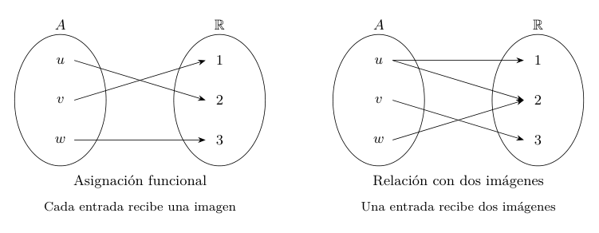{#fig-ic2021-c05-f01 fig-alt="La función asocia una imagen a cada entrada del dominio."}

*Figura 1. Una asignación funcional da una imagen a cada entrada; la segunda correspondencia ilustra cómo pueden intervenir varias imágenes de una misma entrada en una relación general.*

### El dominio natural de una fórmula
**En la cátedra (06:51–10:32).** En numerosos ejercicios se proporciona solamente una ley $f(x)$ y se pide determinar **todos los números reales en los que la expresión produce un valor real definido**. Este conjunto es el dominio natural de la fórmula, teniendo en cuenta las operaciones utilizadas.

Las condiciones aparecen simultáneamente y se resuelven como un sistema lógico: los radicandos de raíces cuadradas deben ser mayores o iguales que cero; los denominadores deben tener inverso multiplicativo, es decir, ser distintos de cero. Cuando coinciden radicales y cocientes, se imponen ambas condiciones.

**Primer ejemplo: raíz cuadrada.** Para $f(x)=\sqrt{x}$, el radicando es real no negativo exactamente en el intervalo

$$\boxed{\operatorname{Dom}(f)=[0,\infty).}$$

**Segundo ejemplo: raíz de una cuadrática.** Sea $g(x)=\sqrt{1-x^2}$. Su dominio se obtiene resolviendo una inecuación estudiada durante la segunda semana:

$$
1-x^2\geq0\ \Longleftrightarrow\ x^2\leq1
\ \Longleftrightarrow\ -1\leq x\leq1.
$$

Por consiguiente,

$$\boxed{\operatorname{Dom}(g)=[-1,1].}$$

El número $0$ pertenece a ese dominio y $g(0)=1$, como aclara el profesor a raíz de una pregunta. Los extremos pertenecen también porque la raíz cuadrada de cero está definida.

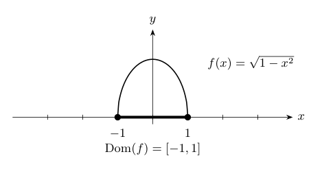{#fig-ic2021-c05-f02 fig-alt="Gráfico de la raíz de uno menos x al cuadrado con dominio cerrado."}

*Figura 2. El dominio de $g(x)=\sqrt{1-x^2}$ es $[-1,1]$; su grafo describe la semicircunferencia superior de radio uno.*

**Tercer ejemplo: denominadores.** La clase examina una expresión cuyo denominador se anula en $x=1$. En cualquier función racional de la forma $h(x)=u(x)/(x-1)$, la condición de definición incluye $x\ne1$; si $u$ está definida en todo $\mathbb R$, el dominio será $\mathbb R\setminus\{1\}$. El numerador exacto de ese ejemplo no queda suficientemente establecido por el reconocimiento oral; esta escritura es una formulación editorial del criterio explicado.

### Simplificar una fórmula y conservar su dominio
**En la cátedra (10:38–14:23).** Compare las asignaciones naturales

$$
f(x)=\frac{x+1}{x+1},\qquad g(x)=1.
$$

Sus dominios son respectivamente

$$
\operatorname{Dom}(f)=\mathbb R\setminus\{-1\},\qquad
\operatorname{Dom}(g)=\mathbb R.
$$

En cada $x\in\operatorname{Dom}(f)$ se tiene $f(x)=g(x)=1$. La distinción esencial reside en el dominio: ambas fórmulas definen **funciones diferentes** cuando se les asignan sus dominios naturales. La simplificación cancela un factor que tiene inverso para $x\ne-1$ y conserva el valor en esos puntos.

Formalmente, si $g|_{\operatorname{Dom}(f)}$ denota la restricción de $g$ al dominio de $f$, entonces

$$
\boxed{f=g|_{\mathbb R\setminus\{-1\}}.}
$$

Esta igualdad expresa exactamente en qué sentido puede utilizarse la fórmula simplificada dentro de una ecuación o inecuación sin alterar la condición original.

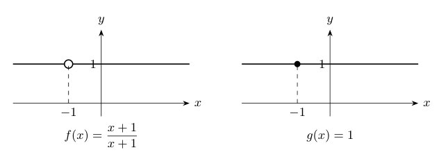{#fig-ic2021-c05-f03 fig-alt="Dos gráficas con la misma altura y dominios diferentes."}

*Figura 3. La expresión $(x+1)/(x+1)$ presenta un punto excluido sobre la recta $y=1$. La función constante $g(x)=1$ contiene ese punto.*

### Una raíz con valor absoluto en el denominador
**En la cátedra (14:23–16:19).** El profesor presenta un cuarto problema de dominio cuyo radicando se describe oralmente como $(x+1)/|x-2|-2$. Lo deja a los estudiantes como aplicación de inecuaciones con módulo. Bajo esa lectura del enunciado,

$$
F(x)=\sqrt{\frac{x+1}{|x-2|}-2}
$$

requiere, simultáneamente, $x\ne2$ y $(x+1)/|x-2|\geq2$. El docente **plantea** esta inecuación durante la sesión; el cálculo siguiente es una **demostración editorial** de la tarea.

Como $|x-2|>0$ para $x\ne2$, la desigualdad equivale a $x+1\geq2|x-2|$. Dividimos por el punto de cambio de signo de $x-2$:

- Para $x<2$, tenemos $|x-2|=2-x$ y $x+1\geq4-2x$, que equivale a $x\geq1$. La solución de este caso es $[1,2)$.
- Para $x>2$, $|x-2|=x-2$ y $x+1\geq2x-4$, equivalente a $x\leq5$. La solución de este caso es $(2,5]$.

De ahí se obtiene

$$
\boxed{\operatorname{Dom}(F)=[1,2)\cup(2,5].}
$$

Este ejemplo hace visible la naturaleza **acumulativa** del cálculo: estudiar una función puede exigir volver a resolver una inecuación de semanas anteriores.

## Grafo, ceros y signo de una función

### Del dominio al plano
**En la cátedra (16:20–21:15).** El **grafo** de una función real $f:A\to\mathbb R$ es el conjunto de pares ordenados

$$
\boxed{G_f=\{(x,f(x)):x\in A\}\subseteq\mathbb R^2.}
$$

Este conjunto traduce la ley de la función a la geometría analítica: cada abscisa $x\in A$ señala una altura $y=f(x)$. Por ejemplo, $f(x)=x^2$ tiene dominio $\mathbb R$ y grafo parabólico.

La ecuación $y^2=x$ representa una parábola horizontal. Para $x=4$ admite las ordenadas $y=2$ y $y=-2$; por ello, la curva completa corresponde a un **lugar geométrico con dos puntos de igual abscisa**. Las ramas $y=\sqrt x$ e $y=-\sqrt x$ son, cada una por separado, grafos de funciones definidas en $[0,\infty)$.

Una recta vertical $x=c$ corta al grafo de una función exactamente en un punto cuando $c\in A$. Es la **prueba de la recta vertical**, deducida directamente de la unicidad de la imagen.

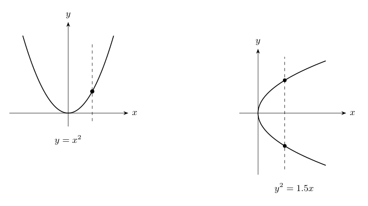{#fig-ic2021-c05-f04 fig-alt="Una parábola vertical es grafo de función y una horizontal requiere separar ramas."}

*Figura 4. La recta vertical auxiliar cruza una vez el grafo de $y=x^2$ y dos veces el lugar $y^2=1.5x$ para determinadas abscisas.*

### Ceros y regiones de signo
**En la cátedra (21:16–29:47).** Los **ceros** de $f$ son los elementos del dominio con imagen igual a cero:

$$
\boxed{Z(f)=\{x\in A:f(x)=0\}.}
$$

Geométricamente son las abscisas de las intersecciones entre $G_f$ y el eje horizontal. Los conjuntos de positividad y negatividad son, respectivamente,

$$
\boxed{P(f)=\{x\in A:f(x)>0\},\quad N(f)=\{x\in A:f(x)<0\}.}
$$

Los tres conjuntos $P(f)$, $Z(f)$ y $N(f)$ dividen el dominio según la tricotomía del valor real $f(x)$. También se pueden estudiar $f(x)\geq0$ y $f(x)\leq0$, incorporando los ceros a las regiones respectivas.

Para la función cuadrática $q(x)=ax^2+bx+c$, determinar los ceros equivale a resolver la **ecuación cuadrática** $ax^2+bx+c=0$. Determinar dónde es positiva o negativa lleva a las **inecuaciones cuadráticas**. La clase recuerda que el discriminante $\Delta=b^2-4ac$ permite clasificar las raíces cuando $a\ne0$.

**Ejemplo de consolidación.** Para $q(x)=x^2-1$,

$$
q(x)=(x-1)(x+1),\qquad Z(q)=\{-1,1\}.
$$

La regla de los signos proporciona

$$
P(q)=(-\infty,-1)\cup(1,\infty),\qquad
N(q)=(-1,1).
$$

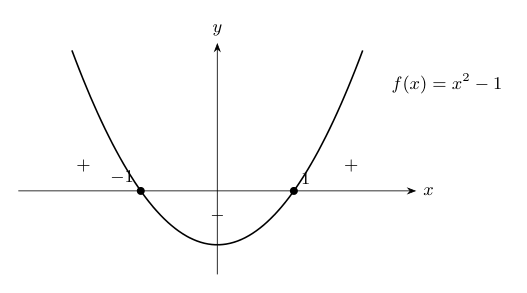{#fig-ic2021-c05-f05 fig-alt="Ceros y regiones de signo de la cuadrática x al cuadrado menos uno."}

*Figura 5. La parábola corta el eje horizontal en $-1$ y $1$. Su signo es positivo en las dos zonas exteriores y negativo en el intervalo central.*

El profesor insiste en que las herramientas algebraicas permiten determinar ceros que pueden resultar poco visibles en un gráfico digital. El grafo constituye el resultado del análisis, y la fórmula es el medio para justificarlo.

## Paridad e imparidad

### Funciones pares
**En la cátedra (29:47–34:21).** La paridad combina una simetría del dominio con una igualdad entre imágenes. Una función $f:A\to\mathbb R$ es **par** cuando se cumplen

$$
\boxed{\begin{aligned}
&x\in A\ \Longrightarrow\ -x\in A,\\
&f(-x)=f(x)\quad\text{para todo }x\in A.
\end{aligned}}
$$

La primera propiedad establece que el dominio es simétrico respecto de cero. La segunda refleja cada punto $(x,f(x))$ del grafo en el punto $(-x,f(x))$. **El grafo de una función par es simétrico respecto del eje vertical**.

### Funciones impares
**En la cátedra (34:21–36:40).** Una función $f:A\to\mathbb R$ es **impar** cuando su dominio es simétrico y

$$
\boxed{f(-x)=-f(x)\quad\text{para cada }x\in A.}
$$

Por tanto, junto al punto $(x,f(x))$ aparece $(-x,-f(x))$. La simetría se realiza respecto del **origen**, mediante un giro de $180^\circ$ en el plano. Si $0\in A$, la igualdad $f(0)=-f(0)$ implica necesariamente $f(0)=0$.

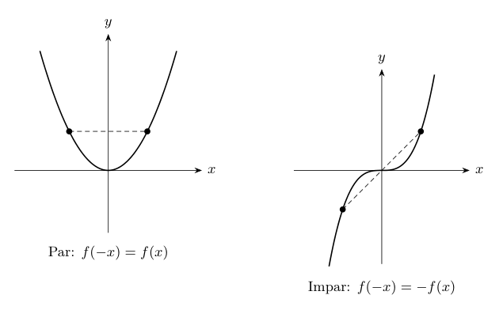{#fig-ic2021-c05-f06 fig-alt="Simetría de una función par respecto del eje y y de una impar respecto del origen."}

*Figura 6. A la izquierda, la simetría axial de $x^2$; a la derecha, la simetría central de $x^3$.*

### Ejemplos con potencias y módulo
**En la cátedra (36:41–43:13).** La primera función considerada es

$$
f(x)=x^8+x^2+|x|+1,\qquad\operatorname{Dom}(f)=\mathbb R.
$$

Sustituyendo $-x$ por $x$ en la ley y usando las propiedades de las potencias y el valor absoluto,

$$
\begin{aligned}
f(-x)&=(-x)^8+(-x)^2+|-x|+1\\
&=x^8+x^2+|x|+1=f(x).
\end{aligned}
$$

Así, $f$ es par. El profesor relaciona la denominación con el comportamiento de las potencias de exponente par y recuerda que $|x|$ también satisface esa simetría.

El segundo ejemplo es

$$
g(x)=x^9+x^3+x,\qquad\operatorname{Dom}(g)=\mathbb R.
$$

En este caso,

$$
\begin{aligned}
g(-x)&=(-x)^9+(-x)^3+(-x)\\
&=-x^9-x^3-x=-g(x).
\end{aligned}
$$

Por ello $g$ es impar. **El tercer ejemplo, un cociente de expresiones impares, se deja en la clase como ejercicio**: los signos que aparecen al sustituir $-x$ se cancelan en el cociente, siempre sobre un dominio simétrico que permita dividir.

**Demostración desarrollada.** Si $f$ y $g$ son impares en un dominio común simétrico $A$ y $g(x)\ne0$ en un subconjunto simétrico $D\subseteq A$, entonces

$$
\frac{f(-x)}{g(-x)}=\frac{-f(x)}{-g(x)}=\frac{f(x)}{g(x)}\quad(x\in D).
$$

El cociente es par. Análogamente, la suma de funciones pares es par, la de impares es impar, y el producto de dos funciones impares es par. La simetría del dominio común debe comprobarse en cada caso.

### Un teorema anunciado: descomposición par–impar
**En la cátedra (43:13–43:35).** San Martín propone estudiar el hecho de que una función con dominio $\mathbb R$ admite una descomposición única en la suma de una función par y otra impar. La demostración siguiente es **ampliación editorial**.

Sea $f:\mathbb R\to\mathbb R$ y definamos

$$
\boxed{f_{\mathrm{par}}(x)=\frac{f(x)+f(-x)}2,\qquad
f_{\mathrm{impar}}(x)=\frac{f(x)-f(-x)}2.}
$$

Sustituir $-x$ en las fórmulas prueba que la primera es par y la segunda impar. Sumando,

$$f_{\mathrm{par}}(x)+f_{\mathrm{impar}}(x)=f(x).$$

Para verificar la unicidad, suponga $f=u+v$ con $u$ par y $v$ impar. Entonces $f(-x)=u(x)-v(x)$. Al sumar o restar estas igualdades se determina forzosamente $u=f_{\mathrm{par}}$ y $v=f_{\mathrm{impar}}$.

## Periodicidad

### Repetición de los valores de la función
**En la cátedra (43:43–51:28).** El profesor define la periodicidad hacia adelante: una función $f:A\to\mathbb R$ tiene **periodo positivo** $p>0$ cuando

$$
\boxed{\forall x\in A:\quad x+p\in A\quad\text{y}\quad f(x+p)=f(x).}
$$

La condición del dominio permite reiterar la igualdad. Si $x\in A$, entonces $x+p$, $x+2p$, $x+3p$, etc., pertenecen también a $A$, y

$$
\boxed{f(x+np)=f(x)\qquad(n\in\mathbb N_0).}
$$

El gráfico repite horizontalmente el mismo tramo cada $p$ unidades. San Martín compara este fenómeno con los diarios que vuelven a aparecer después de un intervalo fijo, aunque señala que la repetición matemática exige **igualdad exacta de los valores**.

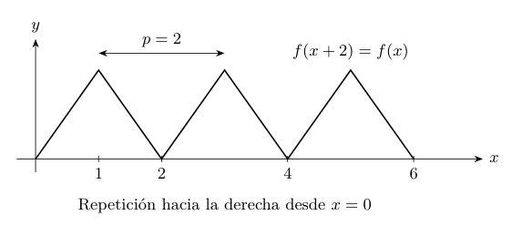{#fig-ic2021-c05-f07 fig-alt="Función periódica por repetición de un mismo tramo cada dos unidades."}

*Figura 7. Una función periódica de periodo $2$ definida desde $x=0$; se repite la figura triangular hacia los valores crecientes de $x$.*

**Precisión editorial sobre convenciones.** Esta formulación de la clase es deliberadamente **unilateral**: asegura la repetición para $x+np$ con $n\geq0$. Es habitual en otros textos exigir que el dominio sea invariante bajo traslaciones en ambos sentidos, $x\in A\iff x+p\in A$, y que la igualdad de imágenes valga en todo $A$. Esta segunda convención se usa, por ejemplo, para funciones definidas en $\mathbb R$. En estas notas se conserva la definición dada en la grabación y se indica cuándo se emplea otra.

**Ejemplo editorial.** Una función triangular de periodo $2$, definida en $[0,\infty)$, se puede expresar para cada entero $k\geq0$ mediante

$$
f(x)=\begin{cases}
x-2k,&2k\leq x\leq2k+1,\\
2k+2-x,&2k+1\leq x\leq2k+2.
\end{cases}
$$

La fórmula reproduce exactamente los mismos valores cuando la variable aumenta dos unidades.

## Crecimiento y decrecimiento

### Comparación de imágenes en un subconjunto
**En la cátedra (56:36–1:08:40).** Sea $f:A\to\mathbb R$ y $I\subseteq A$, usualmente un intervalo. La función es **creciente en $I$** si

$$
\boxed{\forall x_1,x_2\in I:\quad x_1<x_2\ \Longrightarrow\ f(x_1)\leq f(x_2).}
$$

Es **decreciente en $I$** si

$$
\boxed{\forall x_1,x_2\in I:\quad x_1<x_2\ \Longrightarrow\ f(x_1)\geq f(x_2).}
$$

Las dos comparaciones parten de **la misma hipótesis $x_1<x_2$**. Al avanzar en la variable hacia valores mayores, la imagen de una función creciente conserva o aumenta su valor; la de una decreciente conserva o disminuye su valor. Si las desigualdades entre las imágenes son estrictas para $x_1<x_2$, hablamos de *creciente estricta* y *decreciente estricta*, respectivamente.

Una función constante en $I$ satisface simultáneamente las dos definiciones porque $f(x_1)=f(x_2)$ para todos los pares. Por ejemplo, una recta $f(x)=mx+n$ es creciente cuando $m\geq0$ y decreciente cuando $m\leq0$. Las funciones de pendiente cero realizan ambas propiedades.

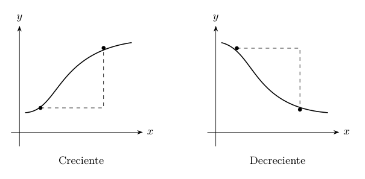{#fig-ic2021-c05-f08 fig-alt="Comparación de imágenes en funciones crecientes y decrecientes."}

*Figura 8. Para $x_1<x_2$, la comparación de las dos ordenadas determina el sentido de la monotonía.*

San Martín enfatiza que muchas funciones son crecientes **en ciertos intervalos** y decrecientes **en otros**. Una descomposición del dominio en intervalos adecuados permite estudiar estas propiedades localmente.

### Ejemplo fácil: $f(x)=x^3+x$
**En la cátedra (1:09:21–1:17:52).** La función

$$f(x)=x^3+x$$

está definida en $\mathbb R$, tiene un único cero en $x=0$, pues $x^3+x=x(x^2+1)$ y $x^2+1>0$, y es impar: $f(-x)=-f(x)$. El profesor demuestra su crecimiento en $[0,\infty)$ mediante reglas elementales de las desigualdades.

Para $0\leq x_1<x_2$, las propiedades del orden aseguran

$$
x_1^3<x_2^3\qquad\text{y}\qquad x_1<x_2.
$$

Sumando ambas desigualdades miembro a miembro,

$$
x_1^3+x_1<x_2^3+x_2,
$$

es decir,

$$\boxed{f(x_1)<f(x_2).}$$

La clase utiliza después la simetría impar para trazar el resto del grafo. **Demostración desarrollada para todo $\mathbb R$:** dados cualesquiera $x_1<x_2$, factorizar la diferencia ofrece una prueba global directa:

$$
\begin{aligned}
f(x_2)-f(x_1)
&=(x_2-x_1)\bigl(x_2^2+x_1x_2+x_1^2+1\bigr),\\
x_2^2+x_1x_2+x_1^2
&=\tfrac12\bigl((x_1+x_2)^2+x_1^2+x_2^2\bigr)\geq0.
\end{aligned}
$$

Ambos factores de la primera línea son positivos, por lo que $f$ es **estrictamente creciente en $\mathbb R$**.

### Ejemplo difícil: $g(x)=x^3-x$
**En la cátedra (1:18:04–1:23:40).** Ahora la función

$$g(x)=x^3-x=x(x-1)(x+1)$$

es también impar y tiene dominio $\mathbb R$, pero sus ceros son $-1$, $0$ y $1$. El intento de probar crecimiento a partir de las dos desigualdades $x_1^3<x_2^3$ y $x_1<x_2$ tropieza con la necesidad de **restarlas**: la resta de desigualdades con el mismo sentido produce comparaciones cruzadas y no determina directamente el signo de $g(x_2)-g(x_1)$.

El profesor analiza explícitamente esa dificultad y presenta una técnica general que permite estudiar su signo.

### La técnica especial: diferencia de imágenes y pendiente secante
**En la cátedra (1:23:43–1:31:20).** Para $x_1<x_2$ en un intervalo de estudio, el denominador $x_2-x_1$ es positivo. Por eso la diferencia $f(x_2)-f(x_1)$ y el cociente

$$
\boxed{Q_f(x_1,x_2)=\frac{f(x_2)-f(x_1)}{x_2-x_1}}
$$

poseen el mismo signo. El profesor lo reconoce como la **pendiente de la recta secante** al grafo de la función por los puntos $(x_1,f(x_1))$ y $(x_2,f(x_2))$. Así se vincula la teoría de las funciones con la geometría analítica de la Cátedra 3.2.

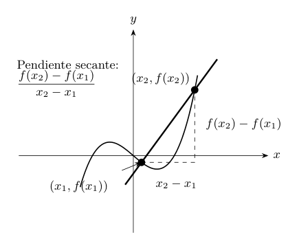{#fig-ic2021-c05-f09 fig-alt="Recta secante al grafo de una función y cociente incremental."}

*Figura 9. El cociente de diferencias es la pendiente de la secante. Su signo permite determinar el orden entre las imágenes.*

Aplicando la técnica a $g(x)=x^3-x$:

$$
\begin{aligned}
Q_g(x_1,x_2)
&=\frac{(x_2^3-x_2)-(x_1^3-x_1)}{x_2-x_1}\\
&=\frac{(x_2^3-x_1^3)-(x_2-x_1)}{x_2-x_1}\\
&=\frac{(x_2-x_1)(x_2^2+x_1x_2+x_1^2-1)}{x_2-x_1}\\
&=\boxed{x_1^2+x_1x_2+x_2^2-1.}
\end{aligned}
$$

**Este es el resultado al que llega la demostración oral.** El signo de $Q_g$ depende de las dos abscisas, y el profesor deja como **tarea explícita** demostrar que $g$ es creciente en $[1,\infty)$, anunciando que la clase siguiente determinará con mayor precisión dónde cambia el crecimiento.

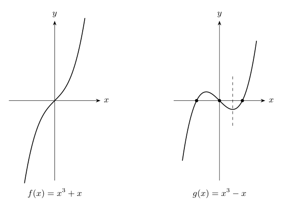{#fig-ic2021-c05-f10 fig-alt="Comparación de los grafos de x al cubo más x y x al cubo menos x."}

*Figura 10. $x^3+x$ asciende en toda la recta; $x^3-x$ presenta tres ceros y diferentes tramos de monotonía.*

### La tarea del profesor y su solución
**Tarea de la clase (1:31:20).** Probar que $g(x)=x^3-x$ es creciente en $[1,\infty)$.

**Solución editorial.** Si $1\leq x_1<x_2$, entonces $x_1^2\geq1$, $x_1x_2>1$ y $x_2^2>1$. En consecuencia,

$$
Q_g(x_1,x_2)=x_1^2+x_1x_2+x_2^2-1>0.
$$

Como $x_2-x_1>0$, obtenemos $g(x_2)>g(x_1)$. Por lo tanto, $g$ es **estrictamente creciente** en todo $[1,\infty)$, tal como se solicitaba.

### Los intervalos exactos — ampliación editorial
La pregunta que el docente reserva para la siguiente clase se puede resolver también con las herramientas algebraicas ya disponibles, sin recurrir a derivadas. Sea

$$c=\frac1{\sqrt3}>0.$$

Para $c\leq x_1<x_2$, cada uno de los productos $x_1^2$, $x_1x_2$ y $x_2^2$ es al menos $c^2=1/3$, y alguno lo supera. Por tanto, $Q_g(x_1,x_2)>0$. El mismo argumento se aplica a $x_1<x_2\leq-c$, porque las dos abscisas son negativas y sus cuadrados y producto son positivos.

En el intervalo central $[-c,c]$ se cumple

$$
x_1^2+x_1x_2+x_2^2\leq 3c^2=1,
$$

con igualdad únicamente cuando ambos números coinciden en uno de los extremos con el mismo signo. Como el estudio exige $x_1<x_2$, la desigualdad es estricta: $Q_g(x_1,x_2)<0$. En consecuencia,

$$
\boxed{\begin{aligned}
&g\text{ es estrictamente creciente en }(-\infty,-c]\text{ y }[c,\infty),\\
&g\text{ es estrictamente decreciente en }[-c,c],\quad c=1/\sqrt3.
\end{aligned}}
$$

En los puntos de transición, $g(-c)=2/(3\sqrt3)$ y $g(c)=-2/(3\sqrt3)$. Esta solución exacta es una **anticipación editorial**: se incluye para completar el método, aunque la sesión termina antes de desarrollarla.

## Solucionario completo

### E1. Radicando lineal
La raíz cuadrada está definida cuando $x+3\geq0$, condición equivalente a $x\geq-3$. Por tanto, $\boxed{\operatorname{Dom}(f)=[-3,\infty)}$. El extremo pertenece al dominio y $f(-3)=0$.

### E2. Radicando cuadrático
Se impone $9-x^2\geq0$, es decir, $x^2\leq9$. Por la factorización $9-x^2=(3-x)(3+x)$, la solución es $-3\leq x\leq3$. Así $\boxed{\operatorname{Dom}(g)=[-3,3]}$. Además, si $y=g(x)$, entonces $y\geq0$ y $x^2+y^2=9$, de donde el grafo es la semicircunferencia superior de radio $3$.

### E3. Denominador de segundo grado
La factorización $x^2-4=(x-2)(x+2)$ localiza los ceros del denominador en $2$ y $-2$. Los demás valores del denominador tienen inverso. Por tanto,

$$\boxed{\operatorname{Dom}(h)=(-\infty,-2)\cup(-2,2)\cup(2,\infty).}$$

### E4. Simplificación y restricción
Factorizamos $x^2-1=(x-1)(x+1)$. Para $x\ne1$,

$$f(x)=\frac{(x-1)(x+1)}{x-1}=x+1=g(x).$$

Sin embargo, $\operatorname{Dom}(f)=\mathbb R\setminus\{1\}$ y $\operatorname{Dom}(g)=\mathbb R$. Las funciones coinciden en el dominio de $f$, y su relación precisa es $f=g|_{\mathbb R\setminus\{1\}}$. En el grafo de $f$ el punto $(1,2)$ está excluido.

### E5. Radicando con módulo
Se exige $|x-2|>0$ y $(x+1)/|x-2|-2\geq0$. Al multiplicar por el denominador positivo se llega a $x+1\geq2|x-2|$. En $x<2$ resulta $3x\geq3$, es decir $x\in[1,2)$; en $x>2$ resulta $x\leq5$, de donde $x\in(2,5]$. La unión proporciona $\boxed{[1,2)\cup(2,5]}$.

### E6. Dos ramas de una parábola
Para $x=4$, la condición $x=y^2$ da $y^2=4$, con $y=2$ y $y=-2$. Por tanto, el lugar contiene los dos puntos $(4,2)$ y $(4,-2)$. Las dos funciones $f_+(x)=\sqrt x$ y $f_-(x)=-\sqrt x$, ambas de dominio $[0,\infty)$, generan dos grafos cuya unión es exactamente el lugar geométrico original.

### E7. Ceros y signo
$\,q(x)=x^2-4=(x-2)(x+2)$, luego los ceros son $-2$ y $2$. El producto es positivo cuando $x<-2$ o $x>2$ y negativo cuando $-2<x<2$. Así,

$$\boxed{Z(q)=\{-2,2\},\quad P(q)=(-\infty,-2)\cup(2,\infty),\quad N(q)=(-2,2).}$$

### E8. Dos paridades
Los dominios son $\mathbb R$. La sustitución $-x$ da $(-x)^6+|-x|+3=x^6+|x|+3$, de modo que $f$ es par. Para $g$, $(-x)^5+(-x)=-(x^5+x)$, luego $g$ es impar. En cada prueba se comprueba tanto la simetría del dominio como la igualdad requerida.

### E9. Cero de una función impar
Puesto que $0\in\mathbb R$ y la función es impar, $f(0)=-f(0)$. Sumando $f(0)$ a ambos miembros obtenemos $2f(0)=0$ y, al dividir por $2\ne0$, concluimos $\boxed{f(0)=0}$.

### E10. Cociente de impares
Si $f(-x)=-f(x)$ y $g(-x)=-g(x)$, para todo $x$ con $g(x)\ne0$ tenemos $f(-x)/g(-x)=f(x)/g(x)$; además, $g(-x)\ne0$ simultáneamente. La razón es par. En el ejemplo $h(x)=x^3/(x|x|)$, se requiere $x\ne0$ y se simplifica a $x^2/|x|=|x|$ sobre ese dominio. Por tanto, $h$ es par en $\mathbb R\setminus\{0\}$ y su grafo tiene el origen excluido.

### E11. Descomposición par e impar
$\,f(-x)=x^2-3x+2$. Así,

$$f_{\mathrm{par}}(x)=\frac{f(x)+f(-x)}2=x^2+2,\qquad f_{\mathrm{impar}}(x)=\frac{f(x)-f(-x)}2=3x.$$

La suma recupera $x^2+3x+2$; el primer término es par y el segundo impar. La fórmula prueba su unicidad.

### E12. Repetición de un tramo
Si $x\in[2k,2k+1]$, entonces $x+2\in[2(k+1),2(k+1)+1]$ y ambas fórmulas dan $f(x+2)=(x+2)-2(k+1)=x-2k=f(x)$. Si $x\in[2k+1,2k+2]$, $f(x+2)=2(k+1)+2-(x+2)=2k+2-x=f(x)$. En ambos casos $x+2\in[0,\infty)$, de manera que $2$ es un periodo en el sentido de la clase.

### E13. Rectas y monotonía
Para $x_1<x_2$ se tiene $f(x_2)-f(x_1)=m(x_2-x_1)$. Como $x_2-x_1>0$, la diferencia comparte el signo de $m$. Si $m>0$, la función es estrictamente creciente; si $m<0$, estrictamente decreciente. Cuando $m=0$, la función es constante y satisface ambas definiciones no estrictas. Por consiguiente, es creciente para $m\geq0$ y decreciente para $m\leq0$.

### E14. Crecimiento global de $x^3+x$
Si $x_1<x_2$, entonces

$$f(x_2)-f(x_1)=(x_2-x_1)(x_2^2+x_1x_2+x_1^2+1).$$

El primer factor es positivo. Para el segundo, $x_1^2+x_1x_2+x_2^2=\tfrac12((x_1+x_2)^2+x_1^2+x_2^2)\geq0$, así que el segundo factor es al menos $1$. El producto es estrictamente positivo. Esta prueba algebraica vale en todo $\mathbb R$.

### E15. La tarea de la clase
La factorización de diferencias de cubos lleva a

$$Q_g(x_1,x_2)=x_1^2+x_1x_2+x_2^2-1.$$

Para $1\leq x_1<x_2$, tenemos $x_1^2\geq1$, $x_1x_2>1$ y $x_2^2>1$, por lo que $Q_g>0$. El denominador original $x_2-x_1$ es positivo y por tanto $g(x_2)-g(x_1)>0$. La función es estrictamente creciente en $[1,\infty)$.

### E16. Monotonía exacta sin derivadas
Sea $c=1/\sqrt3$. De la fórmula anterior, para $c\leq x_1<x_2$ cada término cuadrático o producto es al menos $c^2$, con alguno estrictamente mayor, por lo que $Q_g>0$. El mismo razonamiento vale para $x_1<x_2\leq-c$: los cuadrados y el producto de negativos son positivos, con magnitud al menos $c^2$. En $[-c,c]$, cada cuadrado es a lo más $c^2$ y el producto es a lo más $c^2$, de modo que $Q_g\leq0$; la igualdad exigiría $x_1=x_2=c$ o $x_1=x_2=-c$, excluidos por $x_1<x_2$. Se concluye

$$\boxed{\begin{gathered}
\text{Crecimiento estricto: }(-\infty,-1/\sqrt3],\ [1/\sqrt3,\infty),\\
\text{Decrecimiento estricto: }[-1/\sqrt3,1/\sqrt3].
\end{gathered}}$$

*Procedencia de este tramo: cátedra 5.2.*

## Una pregunta que continúa la clase anterior

**En la cátedra (09:12–11:29).** La clase anterior terminó con la función

$$\boxed{f(x)=x^3-x,\qquad\operatorname{Dom}(f)=\mathbb R.}$$

Se identificaron sus ceros $-1,0,1$, su carácter impar y una estrategia para estudiar el crecimiento a partir de dos puntos del dominio $x_1<x_2$. La pendiente de la recta secante que une $(x_1,f(x_1))$ con $(x_2,f(x_2))$ es

$$S_f(x_1,x_2)=\frac{f(x_2)-f(x_1)}{x_2-x_1}.$$

El denominador es **estrictamente positivo**, de modo que $S_f$ tiene el mismo signo que $f(x_2)-f(x_1)$. La factorización de la diferencia de cubos conduce a

$$
\begin{aligned}
S_f(x_1,x_2)
&=\frac{x_2^3-x_1^3-(x_2-x_1)}{x_2-x_1}\\
&=\frac{(x_2-x_1)(x_2^2+x_1x_2+x_1^2-1)}{x_2-x_1}\\
&=\boxed{x_1^2+x_1x_2+x_2^2-1}.
\end{aligned}
$$

Para demostrar que $f$ es estrictamente creciente en un intervalo $I$, basta establecer $S_f(x_1,x_2)>0$ para **cada par** $x_1,x_2\in I$ con $x_1<x_2$; para el decrecimiento estricto, se busca $S_f(x_1,x_2)<0$. Esta es la «técnica especial» de San Martín: una comparación de imágenes transformada en un problema de signos mediante factorización.

## La ubicación exacta de los intervalos de crecimiento

### Un intervalo inicial: $[1,\infty)$
**En la cátedra (11:29–17:01).** Sean $1\le x_1<x_2$. Por las reglas del orden,

$$x_1^2\ge1,\qquad x_2^2>1,\qquad x_1x_2>1.$$

Al sumar, $x_1^2+x_1x_2+x_2^2-1>2>0$. Por tanto, $f$ es **estrictamente creciente en $[1,\infty)$**. La prueba retoma la tarea formulada al final de la Cátedra 5.1 y enseña a conservar la desigualdad estricta durante productos y sumas.

### Afinar el umbral
**En la cátedra (17:03–23:02).** La elección $1$ funciona, pero podemos estudiar intervalos que comiencen antes. Sea $a>0$ y consideremos $a\le x_1<x_2$. Entonces

$$x_1^2\ge a^2,\qquad x_2^2>a^2,\qquad x_1x_2>a^2,$$

por lo que

$$S_f(x_1,x_2)>3a^2-1.$$

Para que esta última cota asegure positividad, el profesor busca el valor límite que satisface $3a^2-1=0$. Se obtiene

$$\boxed{a=\frac1{\sqrt3}=\frac{\sqrt3}{3}.}$$

Si $x_1<x_2$ pertenecen a $[a,\infty)$, la desigualdad precedente es estricta aun si $x_1=a$; así, $S_f>0$. Concluimos que $f$ es **estrictamente creciente en $[1/\sqrt3,\infty)$**. Se ha ampliado el intervalo inicial.

### El intervalo de decrecimiento
**En la cátedra (23:04–29:51).** Ahora sean $0\le x_1<x_2\le a$. Se verifican las cotas

$$x_1^2<a^2,\qquad x_2^2\le a^2,\qquad x_1x_2<a^2.$$

Se sigue que

$$S_f(x_1,x_2)<3a^2-1=0.$$

Por consiguiente, $f$ es **estrictamente decreciente en $[0,1/\sqrt3]$**. El valor $a$ es un extremo incluido en dos intervalos diferentes; cada afirmación de monotonía compara *pares de puntos* del intervalo correspondiente.

### Simetría y panorama global
**Demostración desarrollada y ampliación editorial.** Como $f(-x)=-f(x)$, su gráfica es simétrica respecto del origen. Esta simetría transporta el decrecimiento de $[0,a]$ a $[-a,0]$ y el crecimiento de $[a,\infty)$ a $(-\infty,-a]$. Juntando los tramos contiguos,

$$
\boxed{\begin{array}{ll}
\text{estrictamente creciente}&\text{en }(-\infty,-a]\text{ y }[a,\infty),\\
\text{estrictamente decreciente}&\text{en }[-a,a].
\end{array}}
$$

Los valores extremos se calculan directamente, **sin derivadas**:

$$f(a)=a\left(\frac13-1\right)=-\frac{2}{3\sqrt3},\qquad
f(-a)=\frac{2}{3\sqrt3}.$$

En consecuencia, la gráfica tiene un **máximo local** en $(-a,2/(3\sqrt3))$ y un **mínimo local** en $(a,-2/(3\sqrt3))$. El profesor describe su gráfico y anticipa el nexo con la derivada; la terminología y verificación algebraica explícita de los extremos se incluyen aquí como ampliación editorial.

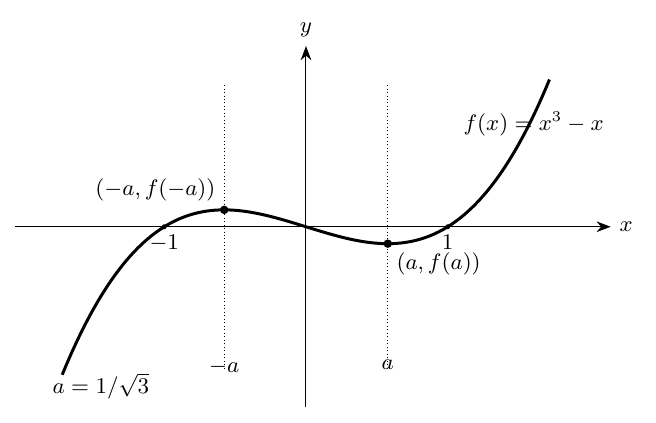{#fig-ic2021-c05-f11 fig-alt="Gráfica de la cúbica x al cubo menos x, con ceros y cambios de monotonía."}

*Figura 1. Tres ceros y los dos umbrales $\pm1/\sqrt3$ que delimitan tramos de crecimiento y decrecimiento.*

### Una fórmula que anticipa la derivada
**En la cátedra (35:56–40:02).** El profesor observa que la ecuación $3x^2-1=0$ determina precisamente las abscisas de cambio de crecimiento. Compara esta expresión con el polinomio original $x^3-x$ y con el ejemplo $x^2-x$, cuyo vértice tiene abscisa $1/2$ y cuya ecuación asociada es $2x-1=0$. La clase **anuncia** que la teoría de derivadas permitirá estudiar sistemáticamente esta relación; todavía no define ni utiliza la derivada.

**Ampliación editorial.** Al aproximar algebraicamente el cociente secante $S_f(x,x+h)$, con $h\ne0$, se obtiene

$$S_f(x,x+h)=3x^2+3xh+h^2-1.$$

Su parte que persiste cuando $h$ se hace arbitrariamente pequeño es $3x^2-1$. Esta comprobación motiva la expresión anunciada y preserva el orden del curso: la definición formal de derivada se estudiará más adelante.

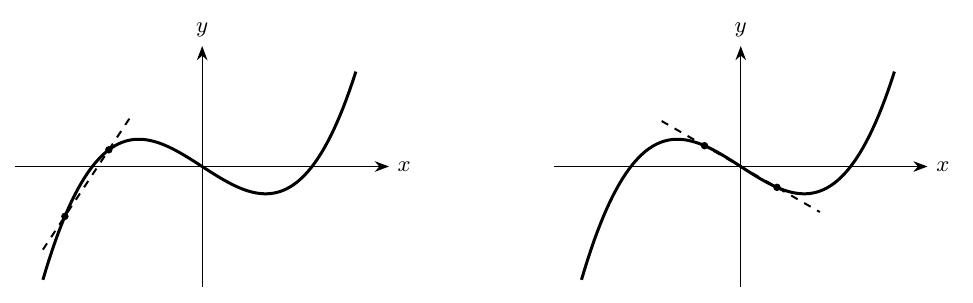{#fig-ic2021-c05-f12 fig-alt="Dos secantes de una función con pendientes de signos diferentes."}

*Figura 2. El signo de la pendiente secante detecta el crecimiento en el intervalo correspondiente.*

## Primeras familias de funciones conocidas

### Funciones constantes
**En la cátedra (40:10–42:12).** Dado $c\in\mathbb R$, la función constante $f(x)=c$ tiene dominio $\mathbb R$, imagen $\{c\}$ y grafo la recta horizontal $y=c$. Es **par** porque $f(-x)=f(x)$; para $c=0$ es también **impar**, dado que $f(-x)=-f(x)=0$. Como toda pareja de imágenes coincide, es creciente y decreciente en sentido débil, y satisface ambas desigualdades por igualdad.

### Potencias de exponente natural positivo
**En la cátedra (42:12–48:55).** Para $n\in\{1,2,3,\ldots\}$ consideramos

$$\boxed{p_n(x)=x^n,\qquad\operatorname{Dom}(p_n)=\mathbb R.}$$

Si $n$ es par, $p_n(-x)=p_n(x)$, y su imagen es $[0,\infty)$. Si $n$ es impar, $p_n(-x)=-p_n(x)$, y su imagen es $\mathbb R$. Todas las potencias son estrictamente crecientes en $[0,\infty)$. Para los exponentes impares el crecimiento se prolonga a toda la recta real; para los pares, la función es estrictamente decreciente en $(-\infty,0]$.

**Demostración desarrollada.** Si $0\le x_1<x_2$, y $n$ es natural positivo, entonces $x_1^n<x_2^n$: se puede usar la factorización

$$x_2^n-x_1^n=(x_2-x_1)\sum_{j=0}^{n-1}x_2^{n-1-j}x_1^j>0,$$

pues el primer factor es positivo y la suma contiene el término $x_2^{n-1}>0$ (para $n=1$, la suma es $1$). El profesor obtiene esa misma comparación por multiplicaciones sucesivas de desigualdades positivas.

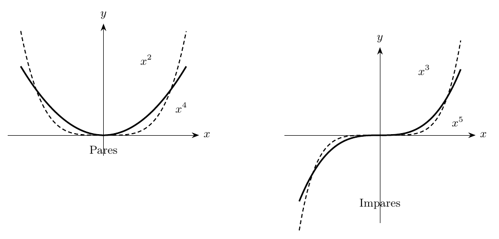{#fig-ic2021-c05-f13 fig-alt="Funciones x, x al cuadrado, x al cubo y x a la cuarta."}

*Figura 3. Potencias pares e impares: distinta simetría respecto del eje vertical y del origen.*

### Raíces de índice par e impar
**En la cátedra (48:55–56:42).** El problema $x^n=y$ se aborda según la paridad de $n$. Para $n$ par y $y>0$, aparecen dos soluciones reales opuestas; para $y=0$, la solución es $x=0$. La **raíz enésima principal** $\sqrt[n]{y}$ designa la solución **no negativa**. Para $n$ impar, la función potencia es biyectiva de $\mathbb R$ en $\mathbb R$ y cada $y$ tiene una única raíz real.

Por tanto, para $n\ge2$,

$$\operatorname{Dom}(\sqrt[n]{\cdot})=
\begin{cases}
[0,\infty),&n\text{ par},\\
\mathbb R,&n\text{ impar}.
\end{cases}$$

La ecuación $y=\sqrt[n]{x}$ equivale a $x=y^n$ junto con la condición $y\ge0$ cuando $n$ es par. La representación gráfica se obtiene intercambiando las coordenadas: la función inversa refleja el grafo respecto de $y=x$, con la restricción correspondiente para las potencias pares.

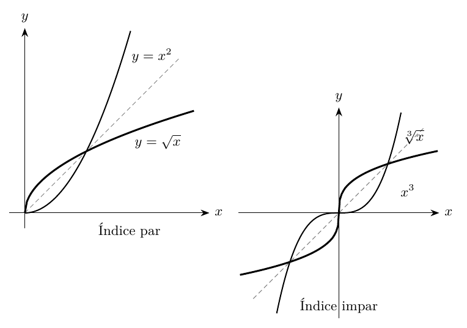{#fig-ic2021-c05-f14 fig-alt="Gráficos de raíz cuadrada y raíz cúbica y su relación con la diagonal y igual x."}

*Figura 4. La reflexión respecto de $y=x$ relaciona la potencia y la raíz correspondiente.*

## Álgebra de funciones y dominios

### Suma, resta y producto
**En la cátedra (56:56–1:02:06).** Sean $f:A\to\mathbb R$ y $g:B\to\mathbb R$, con $A,B\subseteq\mathbb R$. La suma se define mediante

$$(f+g)(x)=f(x)+g(x).$$

Para evaluar esta expresión es necesario disponer simultáneamente de $f(x)$ y $g(x)$; ello ocurre exactamente cuando $x\in A\cap B$. Se obtiene

$$\boxed{\operatorname{Dom}(f+g)=A\cap B.}$$

Con el mismo criterio se define la resta $f-g$ y el producto $fg$, ambos sobre $A\cap B$. El profesor destaca el valor lógico de la conjunción «$x\in A$ **y** $x\in B$» frente a una unión de dominios.

**Ejemplo de la cátedra.** Si $f(x)=\sqrt{x}$ y $g(x)=\sqrt{-x}$, entonces

$$A=[0,\infty),\qquad B=(-\infty,0],\qquad A\cap B=\{0\}.$$

Así, $f+g$ está definida únicamente en $\{0\}$ y $(f+g)(0)=0$.

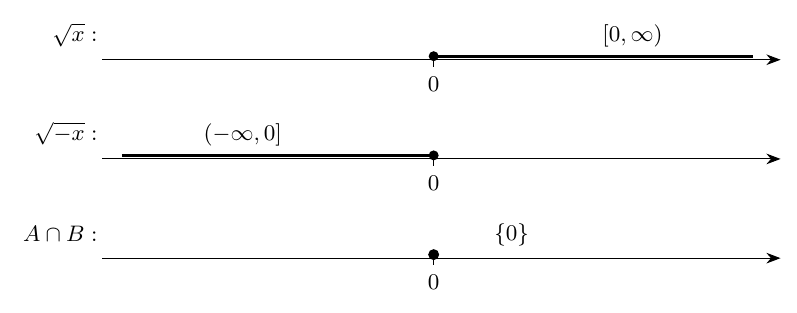{#fig-ic2021-c05-f15 fig-alt="Intersección de dominios de raíz de x y raíz de menos x."}

*Figura 5. La intersección de los semiejes de definición es el origen.*

### Cociente y ceros del denominador
**En la cátedra (1:02:14–1:06:46).** El cociente de dos funciones se define sobre los puntos de $A\cap B$ donde $g(x)$ es un real distinto de cero:

$$\left(\frac fg\right)(x)=\frac{f(x)}{g(x)},\qquad
\boxed{\operatorname{Dom}(f/g)=(A\cap B)\setminus Z_g},$$

siendo $Z_g=\{x\in B:g(x)=0\}$ el **conjunto de ceros de $g$**. Esta expresión diferencia dos operaciones: comprobar que el denominador tiene una imagen y comprobar que dicha imagen admite inverso multiplicativo.

**Ejemplo de la cátedra.** Para $h(x)=\sqrt{x}/(x-1)$, el dominio del numerador es $[0,\infty)$, el del denominador considerado como función $x\mapsto x-1$ es $\mathbb R$, y su conjunto de ceros es $\{1\}$. En consecuencia,

$$\boxed{\operatorname{Dom}(h)=[0,1)\cup(1,\infty).}$$

**Ampliación editorial.** La ley obtenida tras una simplificación algebraica se interpreta sobre el dominio original de la función. Por ejemplo, $r(x)=(x^2-1)/(x-1)$ tiene dominio $\mathbb R\setminus\{1\}$ y coincide con $x+1$ para $x\ne1$; la función lineal $x+1$ tiene dominio $\mathbb R$. Sus grafos difieren en el punto $(1,2)$.

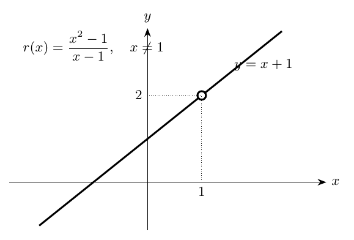{#fig-ic2021-c05-f16 fig-alt="Función racional simplificable y punto excluido."}

*Figura 6. Un factor algebraico común puede simplificarse manteniendo la exclusión del punto del dominio original.*

### La composición como continuidad temática
La clase anuncia que las funciones pueden combinarse mediante sumas, restas, productos, cocientes y **composición**. El desarrollo sistemático de esta última operación **no se realiza en el fragmento estudiado**; por fidelidad a la fuente, queda señalado como contenido posterior, sin atribuirle una demostración al profesor.

## Polinomios y funciones racionales

**En la cátedra (1:12:24–1:18:19).** Una **función polinómica** posee ley

$$P(x)=a_0+a_1x+\cdots+a_nx^n,\qquad a_j\in\mathbb R,$$

con dominio $\mathbb R$. La función de grado uno proporciona una recta; la de grado dos, una parábola; y la de grado tres puede presentar tramos de crecimiento distintos, como el ejemplo $x^3-x$.

Una **función racional** se obtiene como cociente de dos polinomios:

$$R(x)=\frac{P(x)}{Q(x)},\qquad Q\not\equiv0,
\qquad\boxed{\operatorname{Dom}(R)=\mathbb R\setminus\{x:Q(x)=0\}.}$$

El denominador puede ser un polinomio de grado diferente del numerador. Un estudio gráfico riguroso empieza por dominio y ceros, continúa con signos y crecimiento y examina el comportamiento cerca de los puntos excluidos y para abscisas muy grandes.

## Estudio completo de la función $\boldsymbol{2x/(x+1)}$

**En la cátedra (1:18:19–1:43:18).** El ejemplo final retoma simultáneamente las herramientas adquiridas:

$$\boxed{F(x)=\frac{2x}{x+1}.}$$

### Dominio, cero, paridad y signo
El denominador se anula en $x=-1$, de modo que

$$\boxed{\operatorname{Dom}(F)=(-\infty,-1)\cup(-1,\infty).}$$

El numerador se anula en $x=0$, que pertenece al dominio. Así, el único cero es $0$. La función es positiva cuando numerador y denominador tienen el mismo signo, y negativa cuando sus signos son diferentes:

$$
\boxed{\begin{aligned}
F(x)>0&\iff x\in(-\infty,-1)\cup(0,\infty),\\
F(x)<0&\iff x\in(-1,0),\\
F(x)=0&\iff x=0.
\end{aligned}}
$$

La función es **ni par ni impar**: el dominio contiene $1$ y excluye $-1$, por lo cual carece de la simetría necesaria para cualquiera de las dos paridades. El profesor propone verificar esa condición antes de invertir tiempo en la sustitución algebraica $x\mapsto-x$.

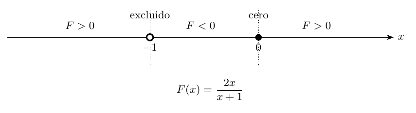{#fig-ic2021-c05-f17 fig-alt="Tabla de signos de dos x sobre x más uno."}

*Figura 7. Puntos relevantes $-1$ (excluido) y $0$ (cero); signos positivos y negativos en los intervalos correspondientes.*

### Crecimiento en cada componente del dominio
**En la cátedra (1:24:45–1:32:41).** Sean $x_1<x_2$ pertenecientes al dominio. La diferencia de imágenes tiene cociente

$$
\begin{aligned}
\frac{F(x_2)-F(x_1)}{x_2-x_1}
&=\frac{\frac{2x_2}{x_2+1}-\frac{2x_1}{x_1+1}}{x_2-x_1}\\
&=\frac{2x_2(x_1+1)-2x_1(x_2+1)}{(x_2-x_1)(x_2+1)(x_1+1)}\\
&=\boxed{\frac{2}{(x_1+1)(x_2+1)}}.
\end{aligned}
$$

Si ambos puntos pertenecen a $(-1,\infty)$, los dos factores del denominador son positivos y el cociente es positivo. Si ambos pertenecen a $(-\infty,-1)$, los dos factores son negativos y su producto vuelve a ser positivo. Por tanto,

$$\boxed{F\text{ es estrictamente creciente en cada intervalo }(-\infty,-1)\text{ y }(-1,\infty).}$$

**Precisión editorial.** La propiedad es una afirmación sobre **cada componente**, y no sobre la totalidad de $\mathbb R\setminus\{-1\}$. Por ejemplo, $-2<0$, pero $F(-2)=4>0=F(0)$. Es decir, $F$ no es creciente sobre su dominio completo según la definición con comparación de todos los pares.

### Forma equivalente y asíntota horizontal
**En la cátedra (1:33:24–1:37:23).** La identidad

$$\boxed{F(x)=\frac{2(x+1)-2}{x+1}=2-\frac{2}{x+1}}$$

hace visible la proximidad de la función a la altura $2$ para abscisas de gran valor absoluto. Si $x>-1$, la cantidad $2/(x+1)$ es positiva y $F(x)<2$. Si $x<-1$, es negativa y $F(x)>2$. En ambos extremos del eje horizontal, la diferencia $|F(x)-2|=2/|x+1|$ puede hacerse tan pequeña como se desee eligiendo $|x+1|$ suficientemente grande.

Se dice que

$$\boxed{y=2\quad\text{es una asíntota horizontal de }F.}$$

En esta sesión el profesor explica el comportamiento por números grandes; la teoría general de **límites** queda para más adelante. La igualdad $F(x)=2$ implicaría $-2/(x+1)=0$, imposible para todo $x$ del dominio; la altura $2$ es también el único valor real excluido de la imagen de $F$.

### Aproximación a $x=-1$ y asíntota vertical
**En la cátedra (1:38:21–1:41:08).** Escribimos $x=-1+\delta$, donde $\delta\ne0$. Entonces

$$\boxed{F(-1+\delta)=2-\frac2\delta.}$$

Cuando $\delta$ es positivo y muy pequeño, $-2/\delta$ es negativo de magnitud muy grande; cuando $\delta$ es negativo y de pequeña magnitud, el cociente $-2/\delta$ es positivo y de magnitud muy grande. Por ello la rama derecha desciende indefinidamente y la rama izquierda asciende indefinidamente al aproximarse a $-1$:

$$\boxed{x=-1\quad\text{es una asíntota vertical de }F.}$$

**Ampliación editorial.** Las afirmaciones se podrán formalizar mediante los límites laterales

$$\lim_{x\to-1^-}F(x)=+\infty,\qquad
\lim_{x\to-1^+}F(x)=-\infty,\qquad
\lim_{x\to\pm\infty}F(x)=2.$$

Se incluyen como notación anticipatoria: los límites no son todavía parte de la teoría desarrollada en la clase.

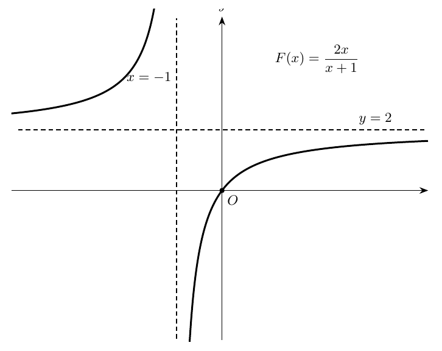{#fig-ic2021-c05-f18 fig-alt="Gráfico completo de la racional con sus dos asíntotas."}

*Figura 8. La función atraviesa el origen, tiene asíntotas $x=-1$ e $y=2$ y crece estrictamente a ambos lados del punto excluido.*

### Advertencia sobre los ceros del denominador
**En la cátedra (1:41:08–1:43:18).** El profesor anuncia criterios para estudiar funciones racionales más generales y observa que una raíz del denominador conduce al comportamiento típico de una asíntota vertical cuando el numerador conserva allí un valor distinto de cero. Un factor común puede modificar ese diagnóstico.

**Ampliación editorial.** Si $P$ y $Q$ tienen un factor común $(x-a)$, el cociente puede tener en $a$ una **discontinuidad removible**, como en $(x^2-1)/(x-1)$. Si, después de simplificar factores comunes, el denominador conserva $(x-a)$ y el numerador vale un número distinto de cero en $a$, entonces existe una asíntota vertical en $x=a$. La distinción previene la generalización indebida de que todo cero del denominador causa necesariamente una asíntota vertical.

## Síntesis, dificultades técnicas y continuidad

En esta clase confluyen el lenguaje de las funciones, la lógica de los dominios y la geometría analítica. Para el crecimiento, comparar $f(x_1)$ con $f(x_2)$ equivale a estudiar una pendiente secante. Para construir funciones nuevas mediante operaciones, la intersección de dominios es la condición constitutiva del cálculo simultáneo; el cociente añade la exigencia de un denominador con inverso. Para las funciones racionales, el estudio de signos, del crecimiento y de las asíntotas se apoya en una reescritura algebraica apropiada.

El profesor anuncia dos desarrollos posteriores: **derivadas**, que formalizarán el comportamiento de las pendientes cuando los puntos se acercan, y **límites**, que permitirán dar una definición precisa a la proximidad a las asíntotas. La siguiente semana del curso se dedica a **trigonometría**. Esos anticipos se conservan como tales, manteniendo la distinción entre conocimiento previo, resultados efectivamente desarrollados y herramientas por estudiar.

**Referencia:** Jorge San Martín, «IC2021: Cátedra 5.2. Viernes 12:00», grabación [NEYH4Qw4QK4](https://www.youtube.com/watch?v=NEYH4Qw4QK4). Edición monocromática IC2021, A4, 11 puntos, Latin Modern, márgenes 2,35 cm. Las ilustraciones se preparan en TikZ vectorial y sus equivalentes PNG se integran en la bóveda mediante enlaces relativos `figuras/IC2021_Catedra_5_2/`.

## Taller de problemas y soluciones

Los ejercicios se presentan a continuación según la fuente de origen; las ampliaciones editoriales de cada apuntes permanecen expresamente identificadas.

### Ejercicios de consolidación — cátedra 5.1

Los dieciséis enunciados siguientes son **ejercicios editoriales**, seleccionados para practicar los conceptos de la sesión y sus relaciones. Incluyen soluciones completas. Los ejemplos de la grabación que se reutilizan se indican en la solución, distinguiendo el razonamiento original de los pasos añadidos.

**E1.** Hallar el dominio de $f(x)=\sqrt{x+3}$ y expresar el resultado como intervalo.

**E2.** Determinar el dominio de $g(x)=\sqrt{9-x^2}$ y describir su grafo.

**E3.** Resolver el dominio de $h(x)=1/(x^2-4)$.

**E4.** Establecer los dominios naturales de $f(x)=(x^2-1)/(x-1)$ y $g(x)=x+1$; explicar su relación.

**E5.** Determinar el dominio de $r(x)=\sqrt{(x+1)/|x-2|-2}$.

**E6.** Demostrar por qué el conjunto $\{(x,y):x=y^2\}$ contiene dos puntos con abscisa $4$ y construir dos funciones cuyas gráficas cubran el lugar.

**E7.** Hallar ceros, conjunto de positividad y conjunto de negatividad de $q(x)=x^2-4$.

**E8.** Clasificar la paridad de $f(x)=x^6+|x|+3$ y de $g(x)=x^5+x$.

**E9.** Justificar que una función impar definida en $\mathbb R$ tiene al cero como uno de sus ceros.

**E10.** Demostrar que el cociente de dos funciones impares es par sobre su dominio común de definición, y encontrar el dominio de $h(x)=x^3/(x|x|)$.

**E11.** Construir la descomposición par e impar de $f(x)=x^2+3x+2$.

**E12.** Comprobar que la función triangular descrita en la sección 4 tiene periodo $2$ en $[0,\infty)$.

**E13.** Decidir cuándo la función lineal $f(x)=mx+n$ es creciente, decreciente o ambas en $\mathbb R$.

**E14.** Demostrar que $f(x)=x^3+x$ es estrictamente creciente en $\mathbb R$ sin utilizar derivadas.

**E15.** Para $g(x)=x^3-x$, factorizar $Q_g(x_1,x_2)$ y demostrar estrictamente el crecimiento en $[1,\infty)$.

**E16.** Determinar, sin derivadas, los intervalos exactos de crecimiento y decrecimiento de $g(x)=x^3-x$.

### Ejercicios complementarios con soluciones — cátedra 5.2

Los dieciocho ejercicios siguientes son **material editorial de estudio**, preparado a partir de los conceptos de la sesión. Sus enunciados y resoluciones se diferencian de las preguntas de la pizarra de San Martín.

### E1. Calcular tres pendientes secantes de $x^3-x$
Para $f(x)=x^3-x$, calcular $S_f(0,1)$, $S_f(0,1/2)$ y $S_f(1,2)$.

**Solución.** $f(0)=0$, $f(1)=0$, $f(1/2)=1/8-1/2=-3/8$, $f(2)=6$. Así

$$S_f(0,1)=0,\qquad S_f(0,1/2)=-\frac34,\qquad S_f(1,2)=6.$$

La existencia de secantes con pendientes distintas confirma la necesidad de estudiar la monotonía por intervalos.

### E2. Determinar el umbral positivo de $x^3-x$
Resolver $3a^2-1=0$ para $a>0$.

**Solución.** $a^2=1/3$, de donde $a=1/\sqrt3$. El signo de $a$ selecciona la solución positiva y proporciona el extremo de los intervalos de crecimiento analizados en la clase.

### E3. Verificar los valores extremos de la cúbica
Calcular $f(\pm1/\sqrt3)$ para $f(x)=x^3-x$.

**Solución.** $f(a)=a(a^2-1)=-2a/3=-2/(3\sqrt3)$. Por imparidad, $f(-a)=2/(3\sqrt3)$.

### E4. Demostrar crecimiento de una potencia impar
Probar sin derivadas que $x\mapsto x^3$ es estrictamente creciente en $\mathbb R$.

**Solución.** Para $u<v$,

$$v^3-u^3=(v-u)(u^2+uv+v^2).$$

El primer factor es positivo. El segundo se puede escribir como $(u+v/2)^2+3v^2/4\ge0$ y solo vale cero cuando $u=v=0$, incompatible con $u<v$. Luego $v^3-u^3>0$.

### E5. Paridad de potencias
Clasificar $p_4(x)=x^4$ y $p_5(x)=x^5$.

**Solución.** Los dominios son $\mathbb R$. $p_4(-x)=p_4(x)$, luego $p_4$ es par. $p_5(-x)=-p_5(x)$, luego $p_5$ es impar.

### E6. Raíz cuarta de un número positivo
Resolver $x^4=16$ en $\mathbb R$ e indicar la raíz cuarta principal.

**Solución.** $x^4=16$ equivale a $|x|=2$, de modo que el conjunto solución es $\{-2,2\}$. La raíz cuarta principal $\sqrt[4]{16}=2$.

### E7. Raíz cúbica de un real negativo
Resolver $x^3=-27$ e identificar el dominio de $x\mapsto\sqrt[3]{x}$.

**Solución.** $x=-3$ es la única solución real por el crecimiento estricto de la función cúbica. El dominio de la raíz cúbica es $\mathbb R$.

### E8. Dominio de la suma de dos radicales
Determinar el dominio natural de $h(x)=\sqrt{x-1}+\sqrt{5-x}$.

**Solución.** Ambas expresiones están definidas simultáneamente cuando $x\ge1$ y $x\le5$, por lo cual $\operatorname{Dom}(h)=[1,5]$.

### E9. Intersección de dominios en un solo punto
Determinar $\operatorname{Dom}(\sqrt{x}+\sqrt{-x})$.

**Solución.** El primer radicando exige $x\ge0$ y el segundo $x\le0$. La intersección contiene exactamente $x=0$, así que $\operatorname{Dom}=\{0\}$.

### E10. Dominio de un cociente con raíz
Determinar el dominio de $h(x)=\sqrt{x}/(x-1)$.

**Solución.** Se requiere $x\ge0$ y $x-1\ne0$. Por tanto, $\operatorname{Dom}(h)=[0,1)\cup(1,\infty)$.

### E11. Simplificación y dominio original
Estudiar $r(x)=(x^2-9)/(x-3)$.

**Solución.** $\operatorname{Dom}(r)=\mathbb R\setminus\{3\}$, y para esos valores $r(x)=x+3$. En $(3,6)$ el grafo de la recta resultante presenta un punto excluido; la función $x\mapsto x+3$ con dominio $\mathbb R$ es una extensión de $r$.

### E12. Signos de la función racional de clase
Resolver $2x/(x+1)\ge0$.

**Solución.** El cociente es positivo en $(-\infty,-1)\cup(0,\infty)$ y vale cero en $x=0$. El punto $-1$ está excluido. Luego

$$\boxed{S=(-\infty,-1)\cup[0,\infty).}$$

### E13. Una desigualdad racional estricta
Resolver $2x/(x+1)<0$.

**Solución.** Los signos de numerador y denominador difieren únicamente para $-1<x<0$. El conjunto solución es $(-1,0)$.

### E14. Cociente de diferencias de la racional
Calcular $[F(v)-F(u)]/(v-u)$ para $F(x)=2x/(x+1)$ y $u<v$ dentro de su dominio.

**Solución.** Unificando denominadores,

$$\frac{F(v)-F(u)}{v-u}=\frac{2v(u+1)-2u(v+1)}{(v-u)(v+1)(u+1)}=\frac{2}{(u+1)(v+1)}.$$

El signo depende de los lados de $-1$ en que se sitúen $u$ y $v$.

### E15. Monotonía local versus comparación global
Comprobar que $F$ es creciente en cada componente de su dominio y dar un par que descarte crecimiento global.

**Solución.** Para puntos de una misma componente, $(u+1)(v+1)>0$; así $F(v)>F(u)$. Sin embargo, $-2<0$ y $F(-2)=4>F(0)=0$. Por tanto, la propiedad no se extiende a toda la unión del dominio.

### E16. Dos asíntotas a partir de una identidad exacta
Para $F(x)=2-2/(x+1)$, determinar las rectas a las que se aproxima la gráfica cuando $|x|$ aumenta y cuando $x$ se aproxima a $-1$.

**Solución.** La distancia vertical a $y=2$ vale $2/|x+1|$ y se hace pequeña si $|x+1|$ aumenta; la asíntota horizontal es $y=2$. Cuando $x=-1+\delta$, la expresión $2-2/\delta$ crece ilimitadamente en magnitud al reducir $|\delta|$; la asíntota vertical es $x=-1$.

### E17. Calcular la imagen de la racional
Hallar el conjunto imagen de $F(x)=2x/(x+1)$.

**Solución.** La igualdad $y=2x/(x+1)$ equivale a $(y-2)x=-y$. Para $y\ne2$, existe una única solución $x=-y/(y-2)$, que nunca vale $-1$ (esa igualdad forzaría $0=2$). Para $y=2$, la ecuación resulta imposible. En consecuencia, $\operatorname{Im}(F)=\mathbb R\setminus\{2\}$.

### E18. Distinguir un punto excluido y una asíntota
Comparar $r(x)=(x^2-1)/(x-1)$ y $s(x)=1/(x-1)$ cerca de $x=1$.

**Solución.** Para $x\ne1$, $r(x)=x+1$ y se aproxima al valor finito $2$, conservando el punto $(1,2)$ excluido; su grafo tiene un **agujero**. La función $s$ posee un numerador constante distinto de cero, y su valor absoluto $1/|x-1|$ puede crecer cuanto se quiera al acercarse a $1$; $x=1$ es una **asíntota vertical** de $s$.

---

---

*Este capítulo pertenece a la edición temática no oficial del curso IC2021. [Índice del libro](index.qmd) · [Fuentes y concordancia](apendices.qmd).*
