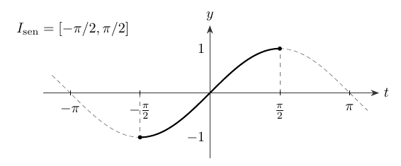
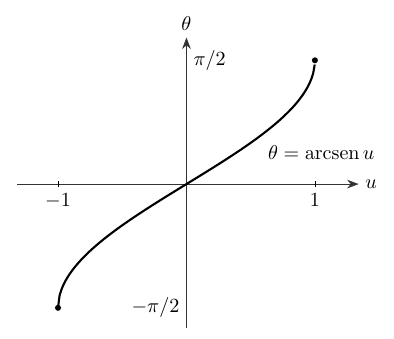
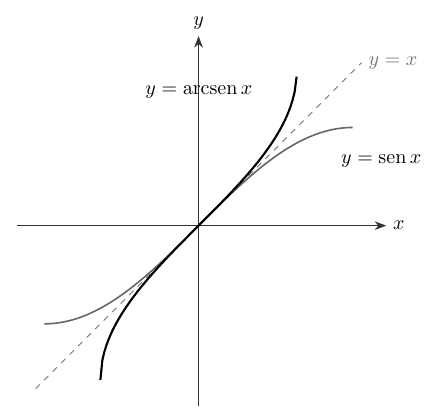
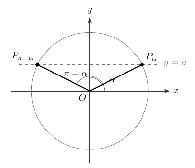
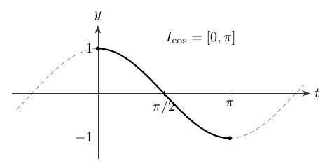
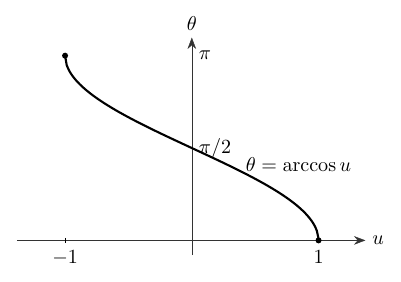
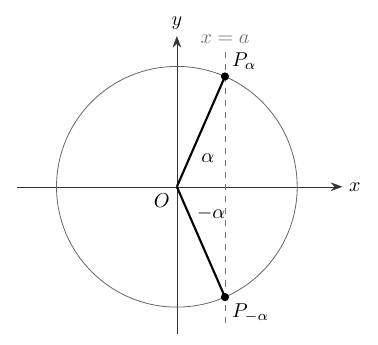
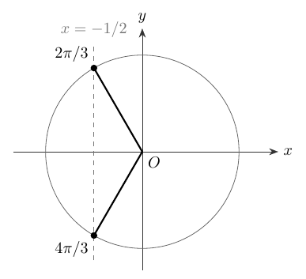
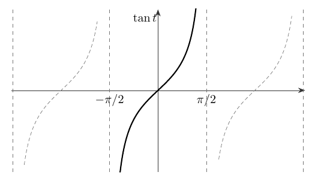
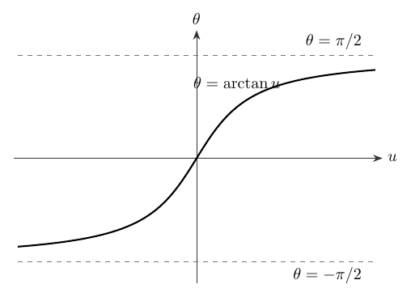

Al restringir el dominio de ciertas funciones trigonométricas se obtienen funciones inversas. Esta construcción permite definir ramas principales y resolver ecuaciones con todas sus familias de soluciones.

**Grabaciones de referencia:** [grabación de la cátedra 7.2](https://www.youtube.com/watch?v=EoIVowNQD70).

*Procedencia de este tramo: cátedra 7.2.*

## De la unicidad a la función inversa

**En la cátedra (10:31–13:35).** La sesión concluye la semana de trigonometría estudiando las funciones inversas de seno, coseno y tangente, y las ecuaciones que esas inversas permiten resolver. El problema generador es sencillo de formular: dado un número real $a$, hallar **todos** los ángulos $x$ que satisfacen una de las condiciones

$$\operatorname{sen}x=a,\qquad \cos x=a,\qquad \tan x=a.$$

La cuestión comprende dos niveles: localizar una solución distinguida y describir la familia completa. San Martín recuerda la relación entre **inyectividad y unicidad** y entre **sobreyectividad y existencia**, ya estudiada en álgebra.

Una aplicación $f:A\to B$ es **biyectiva** cuando cada $b\in B$ tiene exactamente un antecedente $a\in A$ tal que $f(a)=b$. La función inversa $f^{-1}:B\to A$ asigna a cada $b$ ese antecedente único. Gráficamente, los puntos $(a,b)$ del grafo de $f$ corresponden a los puntos $(b,a)$ del grafo de $f^{-1}$.

Las funciones seno y coseno tienen valores en $[-1,1]$ y repiten sus valores después de una vuelta completa. Por ello, el profesor escoge **intervalos de restricción** en los que cada altura aparece exactamente una vez, y fija $[-1,1]$ como codominio de esas ramas. La tangente toma todos los valores reales y repite sus valores cada $\pi$; para ella bastará escoger una rama entre dos asíntotas consecutivas.

**Ampliación editorial — convención de escritura.** El símbolo $f^{-1}$ designa la función inversa de $f$; en particular, $\operatorname{arcsen}$, $\arccos$ y $\arctan$ designan *ángulos*. Las funciones recíprocas son $1/\operatorname{sen}x$, $1/\cos x$ y $1/\tan x$, con sus propios dominios. Esta distinción permite leer correctamente las expresiones que aparecerán a continuación.

## La rama principal del seno y el arcoseno

**En la cátedra (13:35–31:19).** Para $x\in[-\pi/2,\pi/2]$, el seno es estrictamente creciente y recorre una vez todas las alturas comprendidas entre $-1$ y $1$. Además, este intervalo incorpora el primer cuadrante, indispensable para la trigonometría de triángulos rectángulos. De aquí nace la función restringida

$$s:\left[-\frac\pi2,\frac\pi2\right]\longrightarrow[-1,1],\qquad s(x)=\operatorname{sen}x.$$

{#fig-ic2021-c08-f01 fig-alt="La rama del seno que se escoge para la inversión"}

La aplicación $s$ es biyectiva. Su inversa, llamada **arcoseno**, tiene la correspondencia

$$\boxed{\operatorname{arcsen}:[-1,1]\longrightarrow\left[-\frac\pi2,\frac\pi2\right].}$$

Para cada $a\in[-1,1]$, el valor $\operatorname{arcsen}(a)$ es el único ángulo $\alpha\in[-\pi/2,\pi/2]$ tal que $\operatorname{sen}\alpha=a$. Esta formulación determina simultáneamente el dominio, el recorrido y la ley de la inversa.

**Ejemplos de la cátedra.** El profesor recupera las alturas de los ángulos elementales:

$$
\operatorname{arcsen}\left(\frac12\right)=\frac\pi6,\quad
\operatorname{arcsen}\left(\frac{\sqrt2}{2}\right)=\frac\pi4,\quad
\operatorname{arcsen}\left(-\frac{\sqrt3}{2}\right)=-\frac\pi3.
$$

{#fig-ic2021-c08-f02 fig-alt="La gráfica creciente del arcoseno"}

El profesor construye el gráfico de la inversa intercambiando las coordenadas del seno restringido. Es una reflexión respecto de la recta $y=x$: el punto $(\pi/2,1)$ pasa a $(1,\pi/2)$, y $(-\pi/2,-1)$ pasa a $(-1,-\pi/2)$.

{#fig-ic2021-c08-f03 fig-alt="Reflexión de la curva restringida respecto de la diagonal"}

**Demostración desarrollada.** Como el seno es impar, si $\alpha\in[-\pi/2,\pi/2]$ tiene seno $a$, entonces $-\alpha$ pertenece al mismo intervalo y tiene seno $-a$. La unicidad de la inversa da

$$\boxed{\operatorname{arcsen}(-a)=-\operatorname{arcsen}(a)\qquad(-1\leq a\leq1).}$$

Las dos identidades de composición deben leerse con sus dominios:

$$\operatorname{sen}(\operatorname{arcsen} a)=a\quad(a\in[-1,1]),$$
$$\operatorname{arcsen}(\operatorname{sen}x)=x\quad\left(x\in[-\frac\pi2,\frac\pi2]\right).$$

Para un ángulo exterior al intervalo principal, $\operatorname{arcsen}(\operatorname{sen}x)$ devuelve el **representante principal** que tiene su misma altura. Esta propiedad conecta con la ecuación general de la sección siguiente.

## Resolver completamente $\operatorname{sen}x=a$

**En la cátedra (31:19–47:27).** Cuando $|a|>1$, el problema carece de soluciones reales por la acotación del seno. Para cada $a\in[-1,1]$, existe la solución principal

$$\alpha=\operatorname{arcsen}(a)\in[-\pi/2,\pi/2].$$

En el círculo unitario, la condición $\operatorname{sen}x=a$ describe la intersección de la circunferencia con la recta horizontal $y=a$. Para $-1<a<1$ aparecen, en general, dos puntos por vuelta. Si el primero tiene ángulo $\alpha$, el simétrico respecto del eje vertical tiene ángulo $\pi-\alpha$.

{#fig-ic2021-c08-f04 fig-alt="Dos puntos del círculo con igual seno"}

La figura presenta $a>0$. La misma expresión $\pi-\alpha$ funciona cuando $a<0$: entonces $\alpha$ es negativo y la segunda dirección se obtiene en el tercer cuadrante. La escritura con ángulos orientados conserva los signos sin introducir valores absolutos artificiales.

**Demostración desarrollada.** La simetría y la periodicidad producen las dos familias

$$
\boxed{\begin{aligned}
x&=\alpha+2k\pi,\\
x&=\pi-\alpha+2k\pi,
\end{aligned}\qquad k\in\mathbb Z.}
$$

El profesor presenta una notación unificada. Cuando $k$ es par, $(-1)^k=1$; cuando $k$ es impar, $(-1)^k=-1$. Así, todos los valores se reúnen en

$$\boxed{x=k\pi+(-1)^k\operatorname{arcsen}(a),\qquad k\in\mathbb Z,\quad |a|\leq1.}$$

Si $a=1$ o $a=-1$, las familias describen repetidamente un mismo punto por vuelta. La fórmula conserva su validez; en esos extremos la línea horizontal es tangente al círculo.

**Analogía desarrollada en la cátedra (47:47–54:50).** Para resolver $x^2=a$, primero se obtiene la raíz principal $\sqrt a$ sobre $[0,\infty)$; después se recuperan ambas posibilidades mediante $x=\pm\sqrt a$ (para $a>0$). En las ecuaciones trigonométricas, la función inversa proporciona asimismo una solución principal, mientras que las simetrías y la periodicidad generan las demás. Por ejemplo, $\operatorname{arcsen}(1/2)=\pi/6$, y la ecuación $\operatorname{sen}x=1/2$ tiene soluciones $\pi/6+2k\pi$ y $5\pi/6+2k\pi$.

## El coseno restringido y el arcocoseno

**En la cátedra (54:50–1:10:33).** La elección natural para el coseno es la rama del primer y segundo cuadrantes. En el intervalo $[0,\pi]$ la función es estrictamente decreciente y recorre todas las alturas del $1$ al $-1$:

$$c:[0,\pi]\longrightarrow[-1,1],\qquad c(x)=\cos x.$$

{#fig-ic2021-c08-f05 fig-alt="Esquema matemático: La rama invertible del coseno"}

Su inversa recibe el nombre **arcocoseno**:

$$\boxed{\arccos:[-1,1]\longrightarrow[0,\pi].}$$

Para cada $a\in[-1,1]$, $\arccos(a)$ es el único ángulo $\alpha\in[0,\pi]$ que satisface $\cos\alpha=a$. El recorrido de esta función es enteramente no negativo: en particular, el arcocoseno de un número negativo corresponde a un ángulo del **segundo cuadrante**.

$$
\arccos(1)=0,\quad
\arccos\left(\frac12\right)=\frac\pi3,\quad
\arccos(0)=\frac\pi2,\quad
\arccos\left(-\frac12\right)=\frac{2\pi}{3},\quad
\arccos(-1)=\pi.
$$

{#fig-ic2021-c08-f06 fig-alt="Gráfica decreciente del arcocoseno"}

**Ampliación editorial.** La simetría del círculo respecto del eje vertical muestra que $\cos(\pi-\alpha)=-\cos\alpha$. Como ambos ángulos principales pertenecen a $[0,\pi]$, resulta

$$\arccos(-a)=\pi-\arccos(a),\qquad a\in[-1,1].$$

Las identidades de composición son

$$\cos(\arccos a)=a\ (a\in[-1,1]),\qquad
\arccos(\cos x)=x\ (x\in[0,\pi]).$$

## Resolver completamente $\cos x=a$

**En la cátedra (1:10:33–1:22:43).** La condición de existencia vuelve a ser $|a|\leq1$. Si se cumple, el ángulo principal es

$$\alpha=\arccos(a)\in[0,\pi].$$

En el círculo unitario, la ecuación $\cos x=a$ selecciona la recta vertical $x=a$. Los dos puntos de intersección se reflejan en el eje horizontal; sus ángulos son $\alpha$ y $-\alpha$.

{#fig-ic2021-c08-f07 fig-alt="Dos direcciones que tienen el mismo coseno"}

Por la paridad del coseno y la periodicidad, todas las soluciones se expresan como

$$\boxed{x=2k\pi\pm\arccos(a),\qquad k\in\mathbb Z,\quad |a|\leq1.}$$

El signo $\pm$ señala **dos familias** de soluciones. En los valores $a=1$ y $a=-1$ las familias pueden coincidir, ya que los puntos correspondientes están situados sobre el eje horizontal.

Una comprobación útil de la clase es $\cos x=-1/2$: el ángulo principal es $2\pi/3$, y las direcciones de una vuelta son $2\pi/3$ y $4\pi/3$. Ambas quedan incluidas en $2k\pi\pm2\pi/3$.

{#fig-ic2021-c08-f08 fig-alt="Los dos ángulos para coseno igual a menos un medio"}

## La tangente restringida y la arcotangente

**En la cátedra (1:22:43–1:27:06).** La tangente presenta asíntotas verticales en los ángulos $\pi/2+k\pi$. Entre $-\pi/2$ y $\pi/2$ es estrictamente creciente, recorre todos los valores reales y su dominio es abierto en ambos extremos:

$$t:\left(-\frac\pi2,\frac\pi2\right)\longrightarrow\mathbb R,\qquad t(x)=\tan x.$$

{#fig-ic2021-c08-f09 fig-alt="Rama principal de la tangente y asíntotas"}

La función inversa es la **arcotangente**,

$$\boxed{\arctan:\mathbb R\longrightarrow\left(-\frac\pi2,\frac\pi2\right).}$$

Por ejemplo,

$$\arctan(0)=0,\quad \arctan(1)=\frac\pi4,\quad
\arctan(-1)=-\frac\pi4,\quad
\arctan(\sqrt3)=\frac\pi3.$$

{#fig-ic2021-c08-f10 fig-alt="Arcotangente y sus dos asíntotas horizontales"}

**Demostración desarrollada.** Si $a\in\mathbb R$ y $\alpha=\arctan(a)$, entonces $\tan\alpha=a$. Como la tangente tiene período $\pi$, las soluciones completas son

$$\boxed{x=\arctan(a)+k\pi,\qquad k\in\mathbb Z,\quad a\in\mathbb R.}$$

La arcotangente es impar; por consiguiente $\arctan(-a)=-\arctan(a)$. A diferencia del arcoseno y el arcocoseno, admite cualquier real como argumento.

## Una tabla para orientar las ecuaciones

| Función principal | Dominio de la inversa | Recorrido de la inversa | Solución general de $f(x)=a$ |
|:---|:---|:---|:---|
| $\operatorname{arcsen}$ | $[-1,1]$ | $[-\pi/2,\pi/2]$ | $k\pi+(-1)^k\operatorname{arcsen}(a)$ |
| $\arccos$ | $[-1,1]$ | $[0,\pi]$ | $2k\pi\pm\arccos(a)$ |
| $\arctan$ | $\mathbb R$ | $(-\pi/2,\pi/2)$ | $\arctan(a)+k\pi$ |

En todas las expresiones $k\in\mathbb Z$. El primer paso de la resolución consiste en verificar que el dato $a$ pertenezca al conjunto imagen de la función original. El segundo localiza un ángulo principal mediante la inversa. El tercero aplica las simetrías y el período adecuados.

**Ampliación editorial — criterio de comprobación.** Sustituir la fórmula de una familia en la ecuación original permite confirmar la corrección. Por ejemplo,

$$\operatorname{sen}\bigl(\pi-\operatorname{arcsen}(a)\bigr)=a,\quad
\cos\bigl(-\arccos(a)\bigr)=a,\quad
\tan\bigl(\arctan(a)+k\pi\bigr)=a.$$

Estas identidades proporcionan una verificación inmediata, mientras que el gráfico del círculo y la periodicidad justifican que se ha recuperado el **conjunto completo** de soluciones.

## Ejemplo final de la grabación: una ecuación compuesta

**En la cátedra (1:27:13–1:40:50).** San Martín propone resolver

$$\boxed{1+\operatorname{sen}x+\cos x+\operatorname{sen}(2x)+\cos(2x)=0.}$$

La estrategia central es transformar las funciones del ángulo doble mediante

$$\operatorname{sen}(2x)=2\operatorname{sen}x\cos x,\qquad
\cos(2x)=\cos^2x-\operatorname{sen}^2x.$$

**Desarrollo de la demostración.** Escribimos $s=\operatorname{sen}x$ y $c=\cos x$, de manera que $s^2+c^2=1$. Entonces la ecuación se convierte, por equivalencias, en

$$
\begin{aligned}
0&=1+s+c+2sc+c^2-s^2\\
 &=s+c+2sc+2c^2\\
 &=(s+c)(1+2c).
\end{aligned}
$$

Así, el problema inicial equivale a resolver cualquiera de las dos ecuaciones

$$\operatorname{sen}x+\cos x=0\qquad\text{o}\qquad 1+2\cos x=0.$$

La grabación resuelve explícitamente la segunda y enseña a transformar la primera mediante el factor $\sqrt2/2$, dejando parte del despeje final indicado. Completamos ambas familias a continuación.

**Primera familia — ampliación editorial.** La identidad de adición para el coseno da

$$
\frac{\sqrt2}{2}(\cos x+\operatorname{sen}x)
=\cos x\cos\frac\pi4+\operatorname{sen}x\operatorname{sen}\frac\pi4
=\cos\left(x-\frac\pi4\right).
$$

Por ello $\cos(x-\pi/4)=0$, de donde $x-\pi/4=\pi/2+k\pi$. La primera familia puede escribirse como

$$\boxed{x=-\frac\pi4+k\pi,\qquad k\in\mathbb Z.}$$

La fórmula obtenida directamente, $x=3\pi/4+k\pi$, describe el mismo conjunto después de cambiar el índice $k$.

**Segunda familia — en la cátedra y desarrollo editorial.** La condición $1+2\cos x=0$ conduce a $\cos x=-1/2$. Como $\arccos(-1/2)=2\pi/3$,

$$\boxed{x=2k\pi\pm\frac{2\pi}{3},\qquad k\in\mathbb Z.}$$

**Respuesta completa.** El conjunto buscado es la unión de esas tres progresiones angulares:

$$\boxed{S=\left\{-\frac\pi4+k\pi:k\in\mathbb Z\right\}
\cup\left\{2k\pi\pm\frac{2\pi}{3}:k\in\mathbb Z\right\}.}$$

La igualdad de la expresión original con el producto factorizado es una **identidad** válida para todo ángulo real; cada transformación ha preservado el conjunto de soluciones.

## Propuesta final de la clase: una combinación lineal

**En la cátedra (1:41:08–1:41:35).** San Martín deja planteada otra ecuación:

$$\sqrt3\cos x+\operatorname{sen}x=1.$$

Sugiere reconocer en sus coeficientes valores de seno y coseno de un ángulo elemental y reducir así el ejercicio a una sola función trigonométrica.

**Ampliación editorial — resolución.** Recordando que $\cos(\pi/6)=\sqrt3/2$ y $\operatorname{sen}(\pi/6)=1/2$,

$$\sqrt3\cos x+\operatorname{sen}x
=2\left(\cos x\cos\frac\pi6+\operatorname{sen}x\operatorname{sen}\frac\pi6\right)
=2\cos\left(x-\frac\pi6\right).$$

Así $\cos(x-\pi/6)=1/2$, con soluciones

$$x-\frac\pi6=2k\pi\pm\frac\pi3.$$

Por tanto,

$$\boxed{x=\frac\pi2+2k\pi\quad\text{o}\quad x=-\frac\pi6+2k\pi,\qquad k\in\mathbb Z.}$$

**Ampliación editorial — principio reusable.** Para constantes reales $A,B$ con $R=\sqrt{A^2+B^2}>0$, hay un ángulo $\varphi$ que satisface $\cos\varphi=A/R$ y $\operatorname{sen}\varphi=B/R$. Entonces

$$A\cos x+B\operatorname{sen}x=R\cos(x-\varphi).$$

Esta construcción, apoyada en el círculo unitario, transforma una combinación lineal de seno y coseno en una sola función con un desplazamiento angular. Es también el fundamento del método para resolver $A\cos x+B\operatorname{sen}x=C$: la existencia de soluciones se determina comparando $|C|$ con $R$.

## Balance y tránsito al siguiente tema

**En la cátedra y consultas finales (1:41:35–1:52:35).** Con las inversas de seno, coseno y tangente termina el bloque de trigonometría que entra en el segundo control del curso. En las consultas finales se mencionan cambios de calendario, la devolución de tareas y la próxima unidad dedicada al axioma del supremo. Estas intervenciones ofrecen contexto académico de 2021 y se consignan aquí únicamente como continuidad del itinerario, sin transformarlas en contenido matemático nuevo de esta sesión.

El argumento que organiza la clase puede resumirse de forma afirmativa: **elegir una rama biyectiva, determinar su inversa, obtener un ángulo principal y reconstruir la totalidad de soluciones por simetría y periodicidad**. Esa secuencia permite resolver ecuaciones desde la geometría del círculo y las propiedades de las funciones. La factorización del ejercicio final muestra, además, que las identidades trigonométricas y el álgebra de funciones trabajan conjuntamente.

## Taller de problemas y soluciones

Los ejercicios se presentan a continuación según la fuente de origen; las ampliaciones editoriales de cada apuntes permanecen expresamente identificadas.

### Problemas complementarios resueltos — cátedra 7.2

Los siguientes problemas son **originales de esta edición**. Se organizan como una prolongación graduada de la clase: primero inversión, luego familias de soluciones y, finalmente, ecuaciones que necesitan identidades. Cada respuesta incluye el argumento que determina el conjunto completo de soluciones.

### Ángulos principales
Calcular $\operatorname{arcsen}(1/2)$ y $\operatorname{arcsen}(-\sqrt2/2)$. **Solución.** En $[-\pi/2,\pi/2]$, el ángulo con seno $1/2$ es $\pi/6$ y el de seno $-\sqrt2/2$ es $-\pi/4$. Por tanto,

$$\operatorname{arcsen}(1/2)=\pi/6,\qquad\operatorname{arcsen}(-\sqrt2/2)=-\pi/4.$$

### El segundo cuadrante
Calcular $\arccos(-1/2)$. **Solución.** El arcocoseno entrega un ángulo de $[0,\pi]$; la abscisa $-1/2$ corresponde a $2\pi/3$. Así, $\arccos(-1/2)=2\pi/3$.

### El representante principal de un seno
Calcular $\operatorname{arcsen}(\operatorname{sen}(5\pi/6))$. **Solución.** $\operatorname{sen}(5\pi/6)=1/2$, de modo que el representante principal es $\pi/6$. El ángulo inicial y el principal comparten altura en el círculo.

### El representante principal de un coseno
Calcular $\arccos(\cos(5\pi/3))$. **Solución.** El coseno vale $1/2$, y el único ángulo de $[0,\pi]$ con ese coseno es $\pi/3$.

### La tangente y su período
Calcular $\arctan(\tan(3\pi/4))$. **Solución.** $\tan(3\pi/4)=-1$, y la arcotangente pertenece al intervalo abierto $(-\pi/2,\pi/2)$; por ello el resultado es $-\pi/4$.

### Una ecuación del seno con dos familias
Resolver $\operatorname{sen}x=1/2$. **Solución.** El ángulo principal es $\pi/6$. Las soluciones son

$$x=\frac\pi6+2k\pi\quad\text{o}\quad x=\frac{5\pi}{6}+2k\pi,\qquad k\in\mathbb Z.$$

### Seno negativo
Resolver $\operatorname{sen}x=-\sqrt3/2$. **Solución.** La rama principal da $\alpha=-\pi/3$. Por la reflexión $\pi-\alpha=4\pi/3$, resulta

$$x=-\frac\pi3+2k\pi\quad\text{o}\quad x=\frac{4\pi}{3}+2k\pi,\qquad k\in\mathbb Z.$$

### Coseno negativo
Resolver $\cos x=-\sqrt2/2$. **Solución.** $\alpha=\arccos(-\sqrt2/2)=3\pi/4$. Por paridad y periodicidad,

$$x=2k\pi\pm\frac{3\pi}{4},\qquad k\in\mathbb Z.$$

### Extremos de la función coseno
Resolver $\cos x=1$. **Solución.** El único punto del círculo con abscisa $1$ es $(1,0)$. Se alcanza después de cualquier número entero de vueltas:

$$x=2k\pi,\qquad k\in\mathbb Z.$$

### Tangente y soluciones periódicas
Resolver $\tan x=\sqrt3$. **Solución.** La solución principal es $\pi/3$; las restantes se obtienen sumando múltiplos de $\pi$:

$$x=\frac\pi3+k\pi,\qquad k\in\mathbb Z.$$

### Una tangente del ángulo doble
Resolver $\tan(2x)=1$. **Solución.** $2x=\pi/4+k\pi$, así que

$$x=\frac\pi8+\frac{k\pi}{2},\qquad k\in\mathbb Z.$$

### Los ceros del seno del ángulo doble
Resolver $\operatorname{sen}(2x)=0$. **Solución.** Los ceros del seno son los múltiplos enteros de $\pi$, luego $2x=k\pi$ y

$$x=\frac{k\pi}{2},\qquad k\in\mathbb Z.$$

### Dos funciones con el mismo valor
Resolver $\operatorname{sen}x=\cos x$. **Solución.** Como un ángulo que satisface la igualdad tiene $\cos x\ne0$, la división por el coseno es legítima. La condición es $\tan x=1$, de donde

$$x=\frac\pi4+k\pi,\qquad k\in\mathbb Z.$$

### Una ecuación con el seno al cuadrado
Resolver $\operatorname{sen}^2x=1/4$. **Solución.** La ecuación equivale a $\operatorname{sen}x=1/2$ o $\operatorname{sen}x=-1/2$. Las cuatro direcciones de cada vuelta se condensan en

$$x=k\pi\pm\frac\pi6,\qquad k\in\mathbb Z.$$

### Una suma que vale uno
Resolver $\operatorname{sen}x+\cos x=1$. **Solución.** Por la identidad de adición, $\operatorname{sen}x+\cos x=\sqrt2\operatorname{sen}(x+\pi/4)$. Por tanto $\operatorname{sen}(x+\pi/4)=1/\sqrt2$, y

$$x=2k\pi\quad\text{o}\quad x=\frac\pi2+2k\pi,\qquad k\in\mathbb Z.$$

### El coseno de un ángulo y de su doble
Resolver $\cos(2x)=\cos x$. **Solución.** Escribiendo $c=\cos x$ y usando $\cos(2x)=2c^2-1$, obtenemos

$$2c^2-c-1=(2c+1)(c-1)=0.$$

Por tanto, $\cos x=1$ o $\cos x=-1/2$. El conjunto solución es

$$x=2k\pi\quad\text{o}\quad x=2k\pi\pm\frac{2\pi}{3},\qquad k\in\mathbb Z.$$

### Una ecuación cuadrática en el seno
Resolver $2\operatorname{sen}^2x+\operatorname{sen}x-1=0$. **Solución.** El cambio $s=\operatorname{sen}x$ lleva a $(2s-1)(s+1)=0$. Así, $s=1/2$ o $s=-1$. Las soluciones son

$$x=\frac\pi6+2k\pi,\quad x=\frac{5\pi}{6}+2k\pi,\quad
x=\frac{3\pi}{2}+2k\pi,\qquad k\in\mathbb Z.$$

### Dominio exacto de una identidad de composición
Determinar todos los reales $x$ para los que $\operatorname{arcsen}(\operatorname{sen}x)=x$. **Solución.** El arcoseno toma valores precisamente en $[-\pi/2,\pi/2]$. Dentro de ese intervalo es inversa del seno restringido y la igualdad se cumple. Fuera de él, el miembro izquierdo permanece en el intervalo y, por tanto, difiere del ángulo $x$. La respuesta es

$$\boxed{x\in[-\pi/2,\pi/2].}$$

### Resolver una ecuación con parámetro
Para $a\in\mathbb R$, resolver $\cos x=2a-1$. **Solución.** Hay soluciones reales exactamente cuando $-1\leq2a-1\leq1$, esto es, cuando $0\leq a\leq1$. Para esos parámetros,

$$x=2k\pi\pm\arccos(2a-1),\qquad k\in\mathbb Z.$$

### Generalizar el último ejercicio de la cátedra
Dados $A,B,C\in\mathbb R$ con $A^2+B^2>0$, estudiar $A\cos x+B\operatorname{sen}x=C$. **Solución.** Elegimos $R=\sqrt{A^2+B^2}$ y un ángulo $\varphi$ de coseno $A/R$ y seno $B/R$. La ecuación se transforma en

$$\cos(x-\varphi)=\frac{C}{R}.$$

Tiene soluciones cuando $|C|\leq R$, en cuyo caso

$$\boxed{x=\varphi+2k\pi\pm\arccos(C/R),\qquad k\in\mathbb Z.}$$

Este procedimiento proporciona una forma sistemática de reconocer el factor de normalización que San Martín propone buscar en la última parte de la grabación.

---

---

*Este capítulo pertenece a la edición temática no oficial del curso IC2021. [Índice del libro](index.qmd) · [Fuentes y concordancia](apendices.qmd).*
