El axioma del supremo expresa una propiedad fundamental del continuo real. Desde ella se estudian cotas, extremos, números naturales, inducción y la propiedad arquimediana.

**Grabaciones de referencia:** [grabación de la cátedra 8.1](https://www.youtube.com/watch?v=U2nQmKdc_lo), [grabación de la cátedra 8.2](https://www.youtube.com/watch?v=Q-gZ2Ja3kCg).

*Procedencia de este tramo: cátedra 8.1.*

## El problema generador: completar los números reales

**En la cátedra (06:38–10:54).** El profesor vuelve al problema abierto desde el comienzo del curso: la estructura de los números reales se ha descrito como un **cuerpo ordenado**, pero aún falta la propiedad que hace de ese cuerpo un **cuerpo ordenado completo**. Los primeros axiomas establecieron las operaciones y el orden; el **axioma 8** expresará una propiedad adicional que permite justificar la existencia de números cuya presencia se había utilizado informalmente en los problemas anteriores.

La pregunta que guía la clase es concreta: *¿cómo se puede demostrar que existe un número real positivo cuyo cuadrado vale 2?* El cálculo algebraico permite manipular expresiones con $\sqrt2$ una vez admitida su existencia. La nueva tarea consiste en **obtener esa existencia a partir de una propiedad del sistema real**. Para ello será necesario conocer qué significa que un conjunto esté acotado y qué número especial recibe el nombre de *supremo*.

La estrategia pedagógica de San Martín consiste en comenzar por relaciones familiares de orden y avanzar hasta una afirmación de existencia: pasar de «un número está por encima de todos los elementos» a «entre todas las cotas superiores existe una menor».

## Cotas superiores e inferiores

### Cota superior y conjunto acotado superiormente
**En la cátedra (10:54–20:03).** Sea $A\subseteq\mathbb R$ un conjunto **no vacío**. Un real $M$ es una **cota superior de $A$** cuando cada elemento de $A$ satisface $x\leq M$. Se escribe

$$\boxed{M\text{ es cota superior de }A\iff (\forall x\in A)\ x\leq M.}$$

El conjunto $A$ es **acotado superiormente** cuando posee al menos una cota superior, esto es,

$$\boxed{(\exists M\in\mathbb R)(\forall x\in A)\ x\leq M.}$$

El real $M$ pertenece a $\mathbb R$; su función es **dominar simultáneamente todos los elementos** de $A$. Su pertenencia a $A$ constituye una pregunta distinta. También importa el orden de los cuantificadores: aquí existe **un mismo** $M$ que sirve para **cada** $x\in A$.

La diferencia se ve al comparar

$$
\underbrace{(\exists M)(\forall x\in A)\ x\le M}_{\text{acotación superior}}
\qquad\text{y}\qquad
\underbrace{(\forall x\in A)(\exists M)\ x\le M}_{\text{afirmación elemental}}.
$$

En la segunda afirmación, $M$ puede elegirse nuevamente para cada $x$; por ejemplo, $M=x+1$. La primera exige una **cota común**.

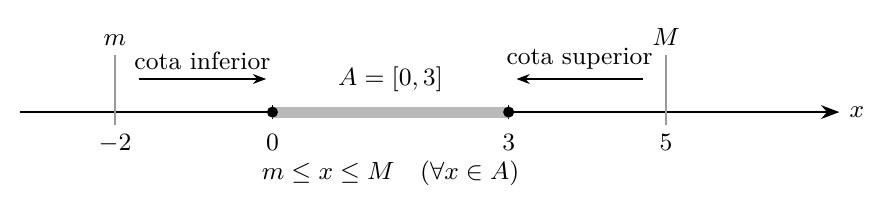{#fig-ic2021-c09-f01 fig-alt="Cotas superiores e inferiores de un conjunto, con números de referencia"}

### Cota inferior y conjunto acotado inferiormente
**En la cátedra (20:03–23:33).** Un real $m$ es una **cota inferior de $A$** cuando se cumple $m\leq x$ para cada $x\in A$:

$$\boxed{m\text{ es cota inferior de }A\iff(\forall x\in A)\ m\leq x.}$$

El conjunto es **acotado inferiormente** cuando existe tal $m$. Diremos que un conjunto es **acotado** cuando dispone de cotas inferiores y superiores; equivalentemente, cuando existen reales $m,M$ tales que

$$\forall x\in A,\qquad m\le x\le M.$$

La representación geométrica ubica las cotas superiores a la derecha de todos los elementos del conjunto y las cotas inferiores a la izquierda de todos ellos. Esta imagen funciona aun cuando $A$ sea una unión de intervalos, una sucesión de puntos o un conjunto descrito mediante una desigualdad.

### Leer las desigualdades: estricto implica débil
**En la cátedra (23:33–31:37).** El profesor dedica un pasaje a un error habitual: creer que $x<10$ impide escribir $x\leq10$. La relación débil tiene el significado lógico

$$x\leq y\quad\iff\quad (x<y)\ \lor\ (x=y).$$

Por tanto, $x<y$ **implica** $x\leq y$. Esta implicación se utiliza constantemente al comprobar que un número es cota superior; por ejemplo, de $0\leq x<1$ se deduce $x\leq1$.

**Ejemplos de la cátedra.** Para $A=[0,1]$, el real $10$ es una cota superior porque todos los puntos de $A$ son menores que 10. También lo son 1, 2, 11 y cualquier número superior a 1. Para

$$B=[0,1]\cup[3,4],$$

el número 2 domina los elementos del primer intervalo, pero $B$ contiene los números del segundo intervalo. En cambio, 4, 5 y 10 sí son cotas superiores de $B$.

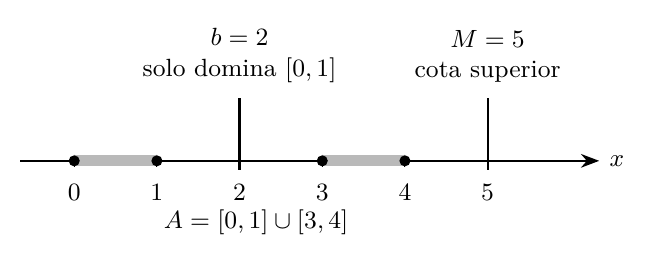{#fig-ic2021-c09-f02 fig-alt="Una unión de intervalos y la ubicación de cotas posibles"}

### Una cota genera nuevas cotas
**Demostración desarrollada (34:08–44:05).** Si $M$ es cota superior de $A$ y $T\geq M$, entonces $T$ también es cota superior. En efecto, para cada $x\in A$,

$$x\leq M\leq T,$$

de donde $x\leq T$. En particular, $M+1$, $M+\tfrac12$ y $M+10^6$ son cotas superiores. A estas cotas más grandes, obtenidas inmediatamente a partir de una conocida, el profesor las llama pedagógicamente *cotas triviales*.

La información matemática más precisa aparece al encontrar una **cota superior menor**. El problema del supremo consistirá precisamente en encontrar la menor de todas ellas.

De manera simétrica, si $m$ es cota inferior de $A$ y $t\le m$, entonces $t$ también es cota inferior. Las cotas inferiores más informativas son las mayores.

## Máximo y mínimo: una cota perteneciente al conjunto

**En la cátedra (44:05–48:52).** El real $M$ es el **máximo** de $A$ cuando cumple simultáneamente

$$\boxed{M\in A\qquad\text{y}\qquad(\forall x\in A)\ x\le M.}$$

El real $m$ es el **mínimo** de $A$ cuando

$$\boxed{m\in A\qquad\text{y}\qquad(\forall x\in A)\ m\le x.}$$

Estas definiciones combinan una propiedad **comparativa** (ser cota) y una propiedad **de pertenencia**. El máximo es un elemento que domina todos los elementos del conjunto; el mínimo pertenece al conjunto y es dominado por cada elemento suyo.

Para $A=[0,1]$, tenemos

$$\max A=1,\qquad\min A=0.$$

Esos mismos valores son también cotas superior e inferior. Para $B=[0,1)$, el número 0 es mínimo y el número 1 es cota superior. La apertura del extremo derecho modifica la cuestión del máximo: ningún punto de $B$ ocupa esa posición.

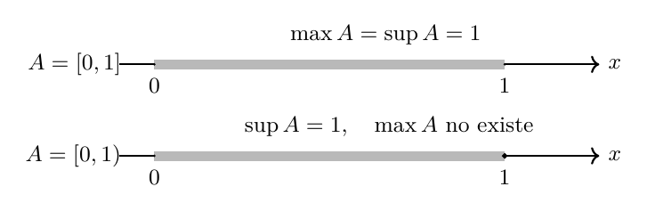{#fig-ic2021-c09-f03 fig-alt="Máximo de un intervalo cerrado y ausencia de máximo en el abierto por la derecha"}

### Por qué $[0,1)$ tiene supremos posibles, pero carece de máximo
**En la cátedra (48:52–59:20).** Los números $0.9$, $0.99$, $0.999$, etc., son elementos de $[0,1)$ y cada uno admite elementos mayores dentro del conjunto. San Martín presenta la escritura $0.\overline9=1$ como **motivación decimal**, separada de la demostración exacta. El valor 1 ya era una cota superior conocida.

La demostración decisiva evita la notación decimal. Tomemos cualquier $b<1$. Si además $b<0$, el elemento $0\in[0,1)$ satisface $0>b$. Si $0\le b<1$, consideremos el punto medio entre $b$ y 1:

$$c=\frac{b+1}{2}.$$

Entonces

$$b<c<1,$$

de modo que $c\in[0,1)$ y $c>b$. En ambos casos, $b$ queda superado por un elemento del conjunto. Por consiguiente, **todo número menor que 1 falla como cota superior**, mientras que 1 sí es una cota superior.

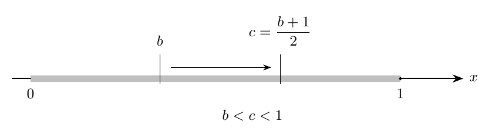{#fig-ic2021-c09-f04 fig-alt="El punto medio que supera a cualquier candidato menor que 1"}

Este argumento prepara el concepto de *menor cota superior*: 1 lo es para $[0,1)$ y la pertenencia del número 1 al conjunto no interviene en ese carácter.

## Supremo e ínfimo: extremos de las cotas

### El supremo
**En la cátedra (59:20–1:01:01).** Un real $s$ es el **supremo** de $A$, escrito $s=\sup A$, cuando satisface dos propiedades:

1. $s$ es una cota superior de $A$;
2. $s$ es menor o igual que cualquier cota superior de $A$.

En símbolos:

$$\boxed{\begin{aligned}
(\forall x\in A)&\quad x\leq s,\\
(\forall M\in\mathbb R)&\quad\bigl[(\forall x\in A)\ x\leq M\bigr]\Longrightarrow s\leq M.
\end{aligned}}$$

**Definición afirmativa.** El supremo es el mínimo del conjunto de las cotas superiores, cuando este último posee un mínimo. La formulación con cuantificadores hace explícito tanto el carácter de cota superior como su optimalidad.

En el ejemplo discutido,

$$\boxed{\sup[0,1)=1,\qquad\max[0,1)\text{ no existe}.}$$

En cambio, $[0,1]$ tiene máximo y supremo, ambos iguales a 1.

### El ínfimo
**En la cátedra (1:01:01–1:02:06).** Un real $i$ es el **ínfimo** de $A$, escrito $i=\inf A$, cuando

$$\boxed{\begin{aligned}
(\forall x\in A)&\quad i\leq x,\\
(\forall m\in\mathbb R)&\quad\bigl[(\forall x\in A)\ m\leq x\bigr]\Longrightarrow m\leq i.
\end{aligned}}$$

El ínfimo es la mayor de las cotas inferiores. El máximo y el mínimo agregan la pertenencia al conjunto; el supremo y el ínfimo expresan la optimalidad dentro de sus respectivas familias de cotas.

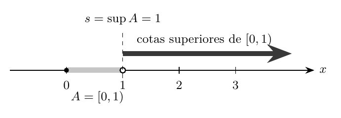{#fig-ic2021-c09-f05 fig-alt="El supremo como frontera del conjunto de cotas superiores"}

**Ampliación editorial — unicidad.** Si $s,t$ cumplen las dos condiciones del supremo de $A$, como ambos son cotas superiores, la optimalidad de $s$ da $s\le t$ y la de $t$ da $t\le s$. Por antisimetría, $s=t$. La demostración para el ínfimo es análoga.

## Axioma 8: el axioma del supremo

**En la cátedra (1:02:06–1:10:30).** El profesor enuncia el axioma que completa la teoría de los reales:

> **Axioma del supremo (completitud de $\mathbb R$).** Todo subconjunto no vacío de $\mathbb R$ que esté acotado superiormente posee supremo en $\mathbb R$.

El contenido afirmativo es una **garantía de existencia**: las dos hipótesis sobre el conjunto aseguran un real que cumple las dos condiciones definitorias del supremo.

San Martín distingue este axioma de la afirmación acerca del máximo: el conjunto $[0,1)$ satisface el axioma porque tiene supremo igual a 1, aunque carece de máximo. El axioma expresa una propiedad nueva del cuerpo ordenado de los reales.

La **hipótesis de no vaciedad** y la **acotación superior** deben comprobarse antes de invocar el axioma. Esta verificación será central en la construcción de $\sqrt2$.

### Por qué basta un axioma del supremo
**En la cátedra (1:10:30–1:11:11).** El profesor señala que el resultado simétrico para el ínfimo se deduce al cambiar el signo de los elementos.

**Ampliación editorial — demostración.** Sea $A\subseteq\mathbb R$ no vacío y acotado inferiormente. Formemos

$$-A:=\{-x:x\in A\}.$$

Si $m$ es cota inferior de $A$, entonces $-x\leq-m$ para todo $x\in A$; por tanto $-A$ está acotado superiormente. El axioma proporciona $s=\sup(-A)$. Definamos $i=-s$. Para cada $x\in A$, de $-x\leq s$ se obtiene $i\leq x$. Además, toda cota inferior $b$ de $A$ da una cota superior $-b$ de $-A$, de donde $s\leq-b$ y, por ello, $b\leq i$. Así,

$$\boxed{\inf A=-\sup(-A).}$$

Esta es una consecuencia del axioma del supremo; ofrece el teorema del ínfimo con sus hipótesis precisas.

## Construcción de $\sqrt2$ a partir del axioma

### El plan de la demostración
**En la cátedra (1:11:11–1:17:00).** La tarea es construir un **real positivo $s$** cuya propiedad característica sea $s^2=2$. El profesor indica por qué comenzar escribiendo $[0,\sqrt2)$ sería circular: se usaría en el punto de partida el número cuya existencia se pretende justificar.

El procedimiento legítimo consiste en construir un conjunto usando solamente desigualdades con cantidades ya disponibles, comprobar las dos hipótesis del axioma, obtener su supremo y demostrar que ese supremo posee la propiedad deseada.

### El conjunto auxiliar
**En la cátedra (1:17:00–1:22:25).** Se considera

$$\boxed{A=\{x\in\mathbb R:x\geq0\text{ y }x^2<2\}.}$$

La definición utiliza el orden, las operaciones y el número 2; está disponible antes de haber probado la existencia de la raíz cuadrada de 2. La intuición de un intervalo que llega hasta un extremo positivo se emplea como guía, mientras que las verificaciones se realizan con desigualdades.

**No vaciedad.** El 0 pertenece a $A$ porque $0\geq0$ y $0^2<2$; también pertenece 1, dado que $1^2<2$. De esta manera $A$ es no vacío.

**Acotación superior.** El número 2 es una cota superior. En efecto, si $x\geq0$ y $x^2<2$, entonces $x<2$: si $x\geq2$, de la monotonía del cuadrado en los no negativos se deduciría $x^2\geq4$, contrario a $x^2<2$. La misma idea permite obtener cotas más pequeñas; por ejemplo $\tfrac32$, cuyo cuadrado vale $\tfrac94>2$.

Quedan así verificadas las hipótesis del axioma: $A$ es **no vacío y acotado superiormente**. Por consiguiente, existe

$$\boxed{s:=\sup A\in\mathbb R.}$$

Como $1\in A$ y $\tfrac32$ es cota superior, tenemos

$$1\leq s\leq\frac32.$$

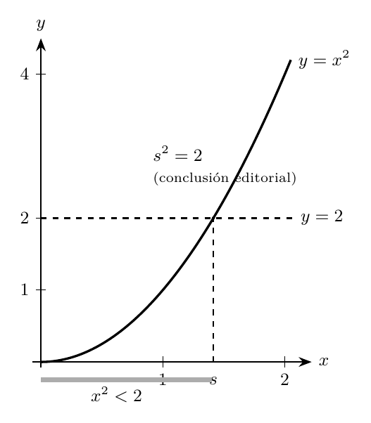{#fig-ic2021-c09-f06 fig-alt="La frontera entre cuadrados inferiores y superiores a 2"}

### La tricotomía de $s^2$ y lo que queda pendiente
**En la cátedra (1:27:48–1:38:15).** Obtenido el supremo, el profesor formula la última etapa: justificar que $s^2=2$. Por tricotomía del orden real, se presenta exactamente una de las posibilidades

$$s^2<2,\qquad s^2=2,\qquad s^2>2.$$

Para descartar $s^2>2$, anuncia la estrategia de encontrar un número positivo $s-\varepsilon<s$ cuyo cuadrado todavía sea mayor que 2. Tal número sería también cota superior de $A$, contradiciendo que $s$ es la **menor** cota superior.

Para descartar $s^2<2$, debe construirse un elemento $s+\varepsilon$ con cuadrado menor que 2: ese elemento pertenecería a $A$ y superaría a la cota superior $s$.

**Alcance exacto de la grabación.** En esta cátedra San Martín presenta el esquema de ambas contradicciones y anuncia expresamente que la elección cuantitativa de $\varepsilon$ y el cierre de la demostración se efectuarán en la clase siguiente. La prueba que aparece a continuación es una **terminación editorial independiente**, apoyada en la estrategia efectivamente explicada.

### Ampliación editorial: demostración completa de $s^2=2$
**Primera posibilidad: $s^2>2$.** Puesto que $s\geq1$, el número

$$\varepsilon=\min\!\left\{\frac{s}{2},\frac{s^2-2}{4s}\right\}>0$$

satisface $s-\varepsilon>0$ y $2s\varepsilon\leq(s^2-2)/2$. Entonces

$$
(s-\varepsilon)^2
=s^2-2s\varepsilon+\varepsilon^2
\geq s^2-2s\varepsilon
\geq\frac{s^2+2}{2}>2.
$$

Para cada $x\in A$ tenemos $0\leq x$ y $x^2<2<(s-\varepsilon)^2$. La monotonía del cuadrado en $[0,\infty)$ da $x<s-\varepsilon$. Por tanto $s-\varepsilon$ es cota superior de $A$, pero $s-\varepsilon<s$: esto contradice la minimalidad de $s$.

**Segunda posibilidad: $s^2<2$.** Definimos

$$\varepsilon=\min\!\left\{\frac12,\frac{2-s^2}{2(2s+1)}\right\}>0.$$

Tenemos $0<\varepsilon\leq\tfrac12$, por lo que $\varepsilon^2\leq\varepsilon$. Además,

$$
(s+\varepsilon)^2
=s^2+2s\varepsilon+\varepsilon^2
\leq s^2+(2s+1)\varepsilon
\leq s^2+\frac{2-s^2}{2}
<2.
$$

Como $s+\varepsilon\geq0$, resulta que $s+\varepsilon\in A$; sin embargo $s+\varepsilon>s$, contradicción con el hecho de que $s$ es cota superior de $A$.

La tricotomía deja, por tanto, la igualdad

$$\boxed{s^2=2,\qquad s>0.}$$

**Unicidad del real positivo.** Si $t>0$ y $t^2=2$, entonces $(s-t)(s+t)=s^2-t^2=0$. Como $s+t>0$, necesariamente $s=t$. Este real único recibe el nombre de $\sqrt2$.

**Conclusión editorial.** Hemos deducido la existencia y unicidad de la raíz cuadrada positiva de 2 utilizando las operaciones y el orden de $\mathbb R$, junto con el axioma del supremo. La conclusión completa es un añadido de esta edición, indicado expresamente para mantener la fidelidad a la cátedra.

## Una lectura geométrica de la construcción

El conjunto de los $x$ no negativos cuyos cuadrados son menores que 2 ocupa el tramo de la recta real situado antes de la frontera buscada. La propiedad de completitud garantiza la existencia de un real que marca el borde de todas las cotas superiores. La demostración algebraica prueba que, en esa frontera, el cuadrado vale exactamente 2.

El cálculo decimal permite **encerrar**, aunque no reemplazar, la demostración exacta:

$$1.41^2=1.9881<2<2.0164=1.42^2,$$

de donde $1.41<\sqrt2<1.42$. Una decimal más exige nuevas comparaciones, pero la existencia del número ya quedó establecida por el argumento con el supremo.

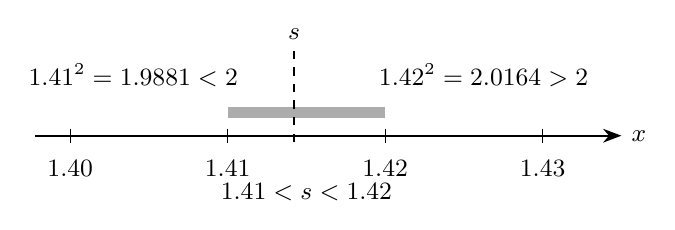{#fig-ic2021-c09-f07 fig-alt="Cotas decimales y cuadráticos alrededor de la raíz de 2"}

## Ampliaciones editoriales: consecuencias útiles

### Relación entre máximo y supremo
Si $A$ posee máximo $M$, entonces $M$ es una cota superior de $A$. Toda cota superior $T$ satisface $M\le T$ porque $M\in A$. Por tanto

$$\boxed{\max A\text{ existe}\Longrightarrow\sup A=\max A.}$$

Análogamente, si $\min A$ existe, entonces $\inf A=\min A$. La recíproca requiere verificar que el supremo o el ínfimo **pertenezca** al conjunto correspondiente.

### Caracterización por aproximaciones
**Ampliación editorial.** Para un conjunto no vacío $A$ acotado superiormente y $s\in\mathbb R$, se cumple

$$\boxed{s=\sup A\iff\begin{cases}
\forall x\in A,&x\le s,\\[2pt]
\forall\varepsilon>0,&\exists x_\varepsilon\in A:\ s-\varepsilon<x_\varepsilon.
\end{cases}}$$

**Demostración.** Si $s=\sup A$, entonces es cota superior. Para cada $\varepsilon>0$, el real $s-\varepsilon$ es menor que la menor cota superior y por ello existe $x_\varepsilon\in A$ que lo supera. Recíprocamente, las dos propiedades indican que $s$ es una cota superior y que cualquier $M<s$ es superado por algún elemento de $A$; por tanto $M$ es una cota inferior a la familia de las cotas superiores y $s$ es la menor de ellas.

El argumento formal permite expresar que **hay elementos de $A$ arbitrariamente próximos al supremo por la izquierda**. En la prueba de $[0,1)$, el punto medio entre $b$ y 1 realiza precisamente esta idea.

### Por qué los racionales no poseen esta completitud
**Ampliación editorial.** Consideremos dentro de $\mathbb Q$ el conjunto

$$B=\{q\in\mathbb Q:q\geq0,\ q^2<2\}.$$

Es no vacío y acotado superiormente en el orden racional. Si poseyera supremo racional $r$, las mismas estimaciones con números racionales positivos utilizadas arriba obligarían a que $r^2=2$.

Sin embargo, ningún racional al cuadrado vale 2. Para comprobarlo, supongamos $r=p/q$ con $p,q\in\mathbb Z$, $q>0$ y fracción irreducible. De $p^2=2q^2$ se deduce que $p$ es par, de modo que $p=2k$. Entonces $q^2=2k^2$, por lo que $q$ también es par: esto contradice la irreducibilidad. En consecuencia, el conjunto $B$ carece de supremo **en $\mathbb Q$**. Esta comparación esclarece el papel específico del axioma 8.

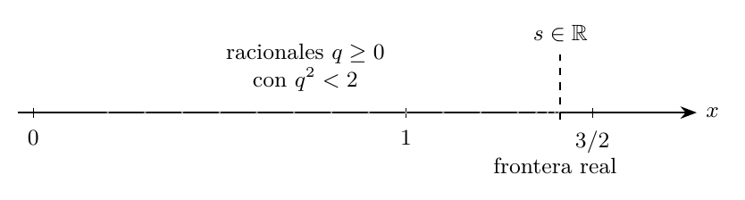{#fig-ic2021-c09-f08 fig-alt="Los puntos racionales aproximan la frontera, pero su supremo está en los reales"}

## Banco complementario de problemas resueltos

Los siguientes problemas son **originales de esta edición**. Están organizados para practicar el reconocimiento de cotas, la aplicación de las definiciones y las demostraciones con cuantificadores.

### Problema 1. Un intervalo cerrado
Para $A=[-2,5]$, determine el máximo, el mínimo, el supremo y el ínfimo.

**Solución.** Todo $x\in A$ satisface $-2\le x\le5$, por lo que $-2$ es cota inferior y 5 cota superior. Ambos pertenecen a $A$; así,

$$\max A=\sup A=5,\qquad\min A=\inf A=-2.$$

### Problema 2. Un extremo abierto
Para $A=(-2,5]$, determine los mismos cuatro valores.

**Solución.** La cota superior mínima es 5 y pertenece al conjunto, de modo que $\max A=\sup A=5$. La cota inferior máxima es $-2$, y $-2\notin A$: entonces $\inf A=-2$ y el mínimo no existe. La verificación de este último hecho se obtiene al tomar, para cualquier $x\in A$, el punto medio $(-2+x)/2$, que también pertenece a $A$ y es menor que $x$.

### Problema 3. La unión de dos intervalos
Considere $A=[0,1]\cup[3,4)$. Identifique sus cotas extremas.

**Solución.** Para cada $x\in A$, $0\le x<4$, y hay puntos de $A$ arbitrariamente próximos a 4 desde la izquierda. Así $\sup A=4$ y $A$ carece de máximo. Como $0\in A$ y todos sus elementos son mayores o iguales que 0, $\inf A=\min A=0$.

### Problema 4. Una sucesión creciente de números
Sea $A=\{1-1/n:n\in\mathbb N,\ n\ge1\}$.

**Solución.** Cada elemento satisface $0\le1-1/n<1$, por lo que 1 es cota superior y 0 es el mínimo. Para cualquier $b<1$, elija $n>1/(1-b)$, posible por la propiedad arquimediana de los naturales; entonces $1-1/n>b$. Por tanto $\sup A=1$, $\inf A=\min A=0$ y $A$ carece de máximo. *La propiedad arquimediana se usa aquí como herramienta adicional, separada del argumento de la clase.*

### Problema 5. Una sucesión decreciente
Sea $B=\{1/n:n\in\mathbb N,\ n\ge1\}$.

**Solución.** Todos los elementos son positivos y a lo más 1; además $1\in B$. De ahí $\sup B=\max B=1$. Para cada $\varepsilon>0$ existe $n$ con $n>1/\varepsilon$, y entonces $1/n<\varepsilon$. Esto demuestra $\inf B=0$ y la inexistencia de mínimo.

### Problema 6. Un conjunto definido mediante una cuadrática
Sea $C=\{x\in\mathbb R:x^2\le9\}$. Encuentre sus extremos.

**Solución.** La desigualdad equivale a $-3\le x\le3$. Por tanto $C=[-3,3]$, cuyo máximo y supremo valen 3, y cuyo mínimo e ínfimo valen $-3$.

### Problema 7. Cuantificadores en dos órdenes
Decida si $\mathbb R$ es acotado superiormente y compare los dos enunciados

$$(\forall x\in\mathbb R)(\exists M\in\mathbb R):x\le M,\qquad(\exists M\in\mathbb R)(\forall x\in\mathbb R):x\le M.$$

**Solución.** El primero es verdadero: para un $x$ dado, tomar $M=x+1$. El segundo es falso: para cualquier candidato fijo $M$ existe el real $M+1$ que lo supera. Así, $\mathbb R$ es un conjunto no acotado superiormente.

### Problema 8. Dos familias de cotas
Sea $A=(1,3)$. Determine **todos** los reales que son cotas superiores y todos los que son cotas inferiores.

**Solución.** Las cotas superiores son $[3,\infty)$, y las inferiores son $(-\infty,1]$. En consecuencia $\sup A=3$ e $\inf A=1$. Ambos extremos son límites de intervalos abiertos y ninguno pertenece a $A$; por ello el conjunto carece de máximo y mínimo.

### Problema 9. La suma de una función y su conjunto de valores
Sea $A=(0,1)$ y $f(x)=x^2$. Calcule $\sup f(A)$ y $\inf f(A)$.

**Solución.** En los positivos, el cuadrado es estrictamente creciente; por ello $f(A)=(0,1)$. Se obtiene $\sup f(A)=1$ e $\inf f(A)=0$, sin máximo ni mínimo.

### Problema 10. Cotas para $\sqrt2$ sin calculadora
Pruebe que $7/5<\sqrt2<3/2$.

**Solución.** Ambos extremos son positivos y

$$\left(\frac75\right)^2=\frac{49}{25}<2<\frac94=\left(\frac32\right)^2.$$

La función cuadrado es estrictamente creciente sobre los reales no negativos, de modo que las desigualdades de sus cuadrados implican las desigualdades de los números.

### Problema 11. Un supremo es único
Demuestre directamente, a partir de la definición, que un conjunto tiene a lo sumo un supremo.

**Solución.** Supongamos que $s$ y $t$ son supremos de $A$. Puesto que $s$ es la menor de las cotas superiores y $t$ es cota superior, $s\le t$. Intercambiando los papeles se obtiene $t\le s$. La antisimetría del orden real da $s=t$.

### Problema 12. El ínfimo a partir de la negación
Para $A=(2,7]$, determine $-A$, $\sup(-A)$ y $\inf A$.

**Solución.** Se tiene $-A=[-7,-2)$. Por tanto $\sup(-A)=-2$ y, de la relación probada en §5.1, $\inf A=-\sup(-A)=2$. El número 2 es el extremo inferior abierto de $A$.

### Problema 13. Supremo de una unión
Sean $A,B\subseteq\mathbb R$ no vacíos y acotados superiormente. Demuestre que

$$\sup(A\cup B)=\max\{\sup A,\sup B\}.$$

**Solución.** Si $s=\sup A$ y $t=\sup B$, el número $u=\max\{s,t\}$ domina todos los elementos de $A$ y los de $B$, luego es cota superior de la unión. Toda cota superior $M$ de $A\cup B$ también lo es de $A$ y de $B$; por definición, $s\le M$ y $t\le M$, de donde $u\le M$. Así $u$ es el supremo buscado.

### Problema 14. Una cota superior óptima
Sea $A=[0,1)$. Para cada $b<1$, construya explícitamente un elemento de $A$ mayor que $b$.

**Solución.** Si $b<0$, tome $x=0$. Si $0\le b<1$, tome $x=(b+1)/2$. En ambos casos $x\in A$ y $b<x$. Por tanto el número 1 es la menor de las cotas superiores de $A$. Esta construcción reproduce el núcleo exacto del argumento del profesor.

### Problema 15. Aproximaciones al supremo
Demuestre que si $s=\sup A$ y $\varepsilon>0$, existe $a_\varepsilon\in A$ tal que $s-\varepsilon<a_\varepsilon\le s$.

**Solución.** El número $s-\varepsilon$ es estrictamente menor que el supremo y por tanto queda superado por algún elemento $a_\varepsilon\in A$. Como $s$ es cota superior, $a_\varepsilon\le s$. La combinación de las dos desigualdades entrega la afirmación.

### Problema 16. Un máximo también es un supremo
Sean $A\subseteq\mathbb R$ no vacío y $m=\max A$. Justifique que $m=\sup A$.

**Solución.** Por definición de máximo, $m$ es cota superior de $A$. Si $M$ es otra cota superior, dado que $m\in A$ también se verifica $m\le M$. Así $m$ es la menor cota superior.

## Cierre editorial

La cátedra realiza el tránsito desde las desigualdades elementales hacia una proposición de existencia: **todo conjunto real no vacío y acotado superiormente posee una menor cota superior**. De ella nace el marco conceptual que permite completar la construcción de $\sqrt2$ y, posteriormente, estudiar sucesiones, límites y continuidad.

En el vídeo, el trabajo alcanza la obtención de $s=\sup\{x\ge0:x^2<2\}$ y el planteamiento de las contradicciones que descartarían $s^2>2$ y $s^2<2$. La elección formal de los incrementos queda anunciada para la próxima cátedra. En estas notas, la sección 6.4 desarrolla ambos incrementos y cierra la demostración, conservando la distinción entre **contenido de la fuente** y **contribución editorial**.

### Referencias y alcance
- **Fuente primaria:** [Jorge San Martín, IC2021, Cátedra 8.1, lunes 8:30](https://www.youtube.com/watch?v=U2nQmKdc_lo). Transcripción automática cotejada con reconstrucción simbólica.
- **Referencia complementaria para verificar la formulación del axioma:** [Cálculo interactivo, axioma del supremo, UNAM](https://prometeo.matem.unam.mx/recursos/VariosNiveles/iCartesiLibri/recursos/Calculo_2_Interactivo/paginas_extra/axioma_del_supremo.html). La fuente externa se utiliza como verificación del enunciado general; no reemplaza la organización de la grabación.
- **Contribución propia:** demostraciones editoriales de §5.1, §6.4, §8 y los problemas resueltos de §9.

*Procedencia de este tramo: cátedra 8.2.*

## Del axioma del supremo a los números naturales

**En la cátedra (15:42–18:49).** La clase anterior formuló el axioma del supremo y mostró que es el principio de completitud utilizado para obtener números reales nuevos. Ahora San Martín quiere justificar otra familia de números utilizada durante todo el curso: **los naturales**. Su lugar es significativo. Los reales se han presentado axiomáticamente en cálculo y los naturales se han estudiado en álgebra; esta lección construye los naturales *dentro de* $\mathbb R$ para enlazar ambas perspectivas.

Es tentador escribir $0,1,2,3,\ldots$ y confiar en que los puntos suspensivos determinan por sí solos todo el conjunto. Sin embargo, una definición matemática precisa debe establecer la **propiedad que identifica todos sus elementos**. La solución será una condición de estabilidad: una vez que un conjunto contiene cierto número, también contiene su sucesor obtenido al sumar uno.

La convención de la asignatura es

$$\boxed{0\in\mathbb N.}$$

El profesor advierte que existen convenciones que comienzan los naturales en $1$; aquí se adopta $0$ de manera coherente con la definición de conjunto inductivo.

## Conjuntos inductivos

### Una definición mediante dos propiedades afirmativas
**En la cátedra (18:49–21:15).** Sea $A\subseteq\mathbb R$. El conjunto $A$ es **inductivo** cuando posee simultáneamente las propiedades

$$
\boxed{
\begin{cases}
0\in A,\\[3pt]
(\forall x\in A)\quad x+1\in A.
\end{cases}}
$$

La primera determina el punto inicial de la construcción. La segunda expresa la **clausura por el sucesor** $S(x)=x+1$. La segunda condición es una afirmación cuantificada sobre todos los elementos de $A$: si se ha incluido $x$, se incluye también $x+1$.

La definición es aplicable a subconjuntos muy distintos de $\mathbb R$. Por ejemplo, un intervalo o una unión de intervalos pueden satisfacerla. Su contenido consiste en la presencia de $0$ y la invariancia de la pertenencia bajo el avance en una unidad.

### Una familia de ejemplos progresivamente más pequeña
**En la cátedra (21:15–30:21).** Primero, $\mathbb R$ es inductivo: contiene $0$ y la suma de dos reales sigue siendo real. También lo es $[0,\infty)$: contiene $0$ y, si $x\geq0$, entonces $x+1\geq1>0$. En cambio, el intervalo $[1,\infty)$ cumple la condición del sucesor, pero **la condición inicial falla**, pues $0$ queda fuera de él.

El profesor da un paso adicional y considera

$$A_1=\{0\}\cup[1,\infty).$$

Este conjunto sí es inductivo: para $x=0$ se tiene $x+1=1\in A_1$; para $x\geq1$ se obtiene $x+1\geq2$, también en $A_1$. El conjunto $\{0\}$, por sí solo, ilustra el papel de la clausura: contiene el punto inicial, pero el sucesor de $0$ es $1$, que debe agregarse.

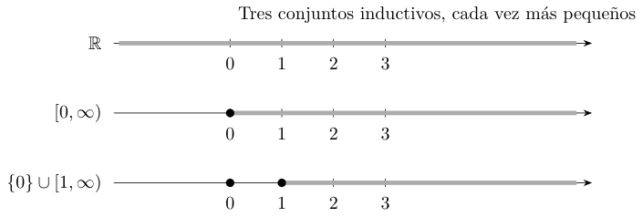{#fig-ic2021-c09-f09 fig-alt="Tres conjuntos inductivos contenidos unos en otros"}

La reducción puede continuar:

$$
A_4=\{0,1,2,3\}\cup[4,\infty)
$$

es inductivo. Sus primeros puntos $0,1,2,3$ llevan sucesivamente al siguiente, mientras que el intervalo $[4,\infty)$ permanece estable por suma de $1$. En esta construcción se aprecian dos regiones: puntos aislados al comienzo y una cola continua que permite seguir avanzando.

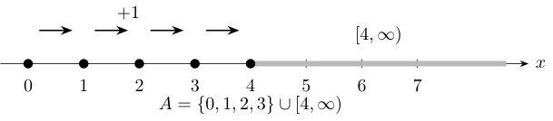{#fig-ic2021-c09-f10 fig-alt="Un inductivo con elementos aislados y una cola continua"}

El ejemplo sirve para imaginar el procedimiento de **reducir conjuntos inductivos conservando sus dos propiedades**. San Martín utiliza la imagen de un árbol que pierde hojas: quedarán los puntos que toda construcción inductiva debe contener.

## Definición de los naturales por intersección

### La familia de todos los conjuntos inductivos
**En la cátedra (30:21–32:40).** Introducimos la colección

$$
\mathcal I=\{A\subseteq\mathbb R:\ 0\in A\ \text{y}\ (\forall x\in A)\ x+1\in A\}.
$$

Esta colección tiene elementos: por ejemplo, $\mathbb R\in\mathcal I$. El **conjunto de los números naturales** se define como la intersección de esta familia:

$$
\boxed{\mathbb N=\bigcap_{A\in\mathcal I}A.}
$$

Para decidir si $x$ es natural, la expresión puede leerse de manera completamente explícita:

$$x\in\mathbb N\quad\Longleftrightarrow\quad
(\forall A\in\mathcal I)\ x\in A.$$

Aquí se reúnen dos ideas de álgebra: una **intersección arbitraria** y un **cuantificador universal**. Un elemento de la intersección pertenece a cada conjunto de la familia, independientemente de cuántos conjuntos haya. La definición reúne, por tanto, los reales cuya pertenencia está exigida por toda construcción inductiva posible.

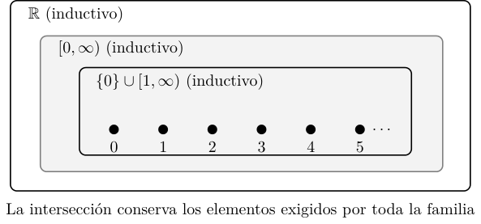{#fig-ic2021-c09-f11 fig-alt="Esquema de conjuntos inductivos anidados e intersección"}

### Teorema: $\mathbb N$ es inductivo
**Demostración desarrollada de la cátedra (32:40–41:18).** La dificultad de una intersección arbitraria consiste en determinar cuáles propiedades sobreviven a la operación. En este caso sobreviven las dos propiedades constitutivas.

**Primera propiedad.** Cada $A\in\mathcal I$ contiene a $0$, por definición de inductivo. En consecuencia,

$$0\in\bigcap_{A\in\mathcal I}A=\mathbb N.$$

**Segunda propiedad.** Sea $n\in\mathbb N$. Por la definición de intersección, $n\in A$ para todo $A\in\mathcal I$. Como cada $A$ es inductivo, $n+1\in A$ para todo $A\in\mathcal I$. Por tanto,

$$n+1\in\bigcap_{A\in\mathcal I}A=\mathbb N.$$

Hemos verificado exactamente las condiciones de la definición. Así,

$$\boxed{\mathbb N\text{ es un subconjunto inductivo de }\mathbb R.}$$

El teorema justifica en particular que $\mathbb N$ contiene a $0$ y que el sucesor de cualquier natural es nuevamente natural, con independencia del tamaño de ese natural.

### La propiedad de minimalidad
**En la cátedra (41:43–44:18).** Como $\mathbb N$ es la intersección de todos los conjuntos inductivos, para cada $A\in\mathcal I$ se tiene $\mathbb N\subseteq A$. Combinando esto con el teorema anterior se obtiene la caracterización:

$$\boxed{\mathbb N\text{ es el menor subconjunto inductivo de }\mathbb R
\text{ respecto de la inclusión}.}$$

Más concretamente, si un conjunto $A$ es inductivo y además $A\subseteq\mathbb N$, entonces

$$\mathbb N\subseteq A\subseteq\mathbb N,
\qquad\text{de donde}\qquad A=\mathbb N.$$

Esta sencilla observación será el motor de la inducción matemática.

## El principio de inducción como teorema

### El conjunto de los casos verdaderos
**En la cátedra (44:20–49:11).** Consideremos una proposición $P(n)$, formulada para cada natural $n$. Nuestro propósito es demostrar que la proposición es verdadera **para todo** natural. Construimos el conjunto

$$A_P=\{n\in\mathbb N:P(n)\text{ es verdadera}\}.$$

Por construcción, $A_P\subseteq\mathbb N$. La minimalidad obtenida anteriormente reduce el problema a verificar que $A_P$ es inductivo. Esto exige precisamente:

1. **Caso base:** la afirmación $P(0)$ es verdadera, de modo que $0\in A_P$.
2. **Paso inductivo:** para cada $n\in\mathbb N$, la verdad de $P(n)$ implica la verdad de $P(n+1)$, de modo que $n\in A_P$ lleva a $n+1\in A_P$.

Entonces $A_P$ es inductivo, y su inclusión en $\mathbb N$ obliga a la igualdad. El resultado es el **principio de inducción**:

$$
\boxed{\left(P(0)\ \land\ (\forall n\in\mathbb N)(P(n)\Rightarrow P(n+1))\right)
\Longrightarrow (\forall n\in\mathbb N)P(n).}
$$

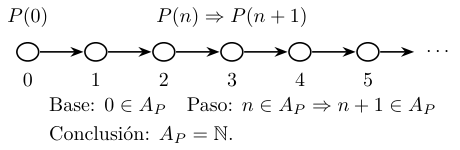{#fig-ic2021-c09-f12 fig-alt="Caso base, avance por sucesores y conclusión de inducción"}

La clase muestra aquí una relación conceptual profunda: la inducción es una consecuencia directa de la **minimalidad de los naturales**. El profesor la enlaza con el procedimiento aprendido previamente en álgebra, pero ahora queda fundamentada dentro de la estructura de $\mathbb R$.

### Una proposición con implicación: cuidado con el caso base
**Demostración desarrollada de la cátedra (54:28–1:02:33).** San Martín selecciona, de una lista de propiedades, la proposición

$$P(n):\qquad n>0\Longrightarrow n\geq1.$$

Para $n=0$, el caso base es la proposición completa

$$P(0):\qquad (0>0)\Longrightarrow(0\geq1).$$

Su antecedente es falso; por la definición de implicación material, **la implicación entera es verdadera**. El profesor insiste en el papel de la estructura lógica: el caso base afirma $P(0)$, no cada una de las dos desigualdades que contiene por separado.

Para el paso inductivo, la fórmula que debe verificarse es

$$\bigl(n>0\Rightarrow n\geq1\bigr)\Longrightarrow
\bigl(n+1>0\Rightarrow n+1\geq1\bigr).$$

La conclusión interna $n+1\geq1$ equivale a $n\geq0$. La clase utiliza aquí la propiedad anterior, enunciada sin prueba en la pizarra, que dice que **todo natural es mayor o igual a cero**. Por lo tanto, $P(n+1)$ es verdadera y el paso queda demostrado. Este ejemplo pone de relieve que una inducción puede demostrar proposiciones que contienen conectivos y cuantificadores; es indispensable identificar la fórmula completa $P(n)$.

### Propiedades elementales enunciadas en la cátedra
**En la cátedra (49:25–54:28).** El profesor enumera estas propiedades, y reserva la demostración detallada para la segunda de ellas:

| Propiedad | Enunciado |
|:---|:---|
| Positividad | $n\in\mathbb N\Rightarrow n\geq0$. |
| Primer sucesor positivo | $n\in\mathbb N,\ n>0\Rightarrow n\geq1$. |
| Separación | $m,n\in\mathbb N,\ n>m\Rightarrow n\geq m+1$. |
| Clausura | $m,n\in\mathbb N\Rightarrow m+n\in\mathbb N$ y $mn\in\mathbb N$. |
| Predecesor | $n\in\mathbb N,\ n>0\Rightarrow n-1\in\mathbb N$. |

Estas propiedades sustentan los argumentos posteriores relativos a enteros consecutivos y a la parte entera. Las verificaciones completas que siguen se presentan como **ampliación editorial**, puesto que la clase propone la mayoría como trabajo independiente.

### Ampliación editorial: pruebas de las propiedades restantes
**Positividad.** El conjunto $[0,\infty)$ es inductivo. Por minimalidad, $\mathbb N\subseteq[0,\infty)$; por consiguiente, $n\geq0$ para cada natural $n$.

**Predecesor.** La proposición $Q(n)$ dice: «$n=0$ o existe $m\in\mathbb N$ con $n=m+1$». Para $n=0$ se cumple la primera alternativa. Si $n\in\mathbb N$, su sucesor $n+1$ se escribe como sucesor del natural $n$, por lo que $Q(n+1)$ es cierta. Por inducción, todo natural positivo tiene predecesor natural.

**Separación.** Probamos por inducción sobre $m$ que, para todo $n\in\mathbb N$, si $n>m$ entonces $n\geq m+1$. El caso $m=0$ es la propiedad ya demostrada en la cátedra. Para el paso, consideremos $n>m+1$. Como $n>0$, el predecesor $n-1$ es natural y satisface $n-1>m$. Por la hipótesis inductiva, $n-1\geq m+1$ y por tanto $n\geq m+2$. Así se obtiene la propiedad para $m+1$.

**Clausura aditiva.** Fijemos $n\in\mathbb N$ y apliquemos inducción a $m$: $n+0=n$ es natural; si $n+m$ es natural, entonces $n+(m+1)=(n+m)+1$ también. **Clausura multiplicativa.** Fijado $n$, tenemos $n\cdot0=0$; si $nm\in\mathbb N$, entonces $n(m+1)=nm+n\in\mathbb N$ por la clausura de la suma. Quedan demostradas ambas propiedades.

## Los naturales y el axioma del supremo

### Mínimo e ínfimo de $\mathbb N$
**En la cátedra (1:03:13–1:05:13).** Ya se ha demostrado $0\in\mathbb N$ y $n\geq0$ para todo $n\in\mathbb N$. El $0$ es a la vez elemento del conjunto y cota inferior suya. Por ello,

$$\boxed{\min\mathbb N=\inf\mathbb N=0.}$$

La siguiente pregunta se refiere a las cotas superiores. El resultado es esencial para vincular los naturales con la completitud de los reales.

### Teorema: los naturales crecen más allá de cualquier real
**Demostración desarrollada de la cátedra (1:05:13–1:16:35).** Para cada $M\in\mathbb R$ existe $n\in\mathbb N$ tal que $M<n$. En símbolos,

$$\boxed{(\forall M\in\mathbb R)(\exists n\in\mathbb N)\quad M<n.}$$

**Prueba por reducción al absurdo.** Supongamos que $\mathbb N$ es acotado superiormente. Como $0\in\mathbb N$, el conjunto es no vacío y, por el **axioma del supremo**, existe $s=\sup\mathbb N$. Al ser una cota superior,

$$n\leq s\qquad(\forall n\in\mathbb N).$$

Por el carácter inductivo de los naturales, $n+1\in\mathbb N$. Aplicando la misma desigualdad a este sucesor y restando $1$, obtenemos

$$n+1\leq s\quad\Longrightarrow\quad n\leq s-1
\qquad(\forall n\in\mathbb N).$$

Así, $s-1$ también es una cota superior de $\mathbb N$. Como $s-1<s$, esto contradice que $s$ sea la **menor** cota superior. Concluimos que para todo real $M$ existe un natural mayor que $M$.

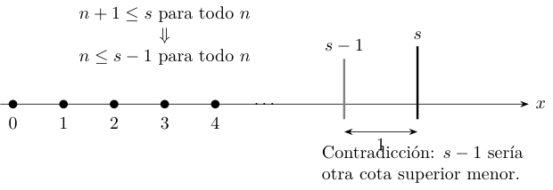{#fig-ic2021-c09-f13 fig-alt="La contradicción entre el supremo hipotético y una cota menor"}

La demostración identifica el papel preciso de la completitud: el axioma del supremo habría producido una cota superior mínima; la estabilidad por sucesor permite construir a partir de ella una cota superior todavía menor, lo que fuerza la contradicción. El profesor presenta un dibujo hipotético de dos «regiones», una de naturales y otra de cotas, para mostrar qué habría que descartar al utilizar el axioma.

## La propiedad arquimediana

### Enunciado y significado
**En la cátedra (1:22:13–1:29:16).** La propiedad arquimediana expresa que cualquier real estrictamente positivo puede sumarse consigo mismo un número natural suficiente de veces para superar una cantidad prefijada. Una forma destacada por San Martín es

$$
\boxed{(\forall\varepsilon\in\mathbb R)(\varepsilon>0\Rightarrow
(\exists n\in\mathbb N)\ n\varepsilon>1).}
$$

La letra $\varepsilon$ designa aquí **un número real positivo cualquiera**. El profesor advierte que el hecho de que en numerosas demostraciones se elijan valores pequeños responde a la dificultad del problema, mientras que el cuantificador comprende valores positivos de todos los tamaños.

La formulación equivalente más general es

$$\boxed{(\forall\varepsilon>0)(\forall R>0)(\exists n\in\mathbb N)\ n\varepsilon>R.}$$

Basta elegir $n>R/\varepsilon$, algo garantizado por la falta de cota superior de $\mathbb N$. Para $\varepsilon=0{,}23$ y $R=1$, el natural $n=5$ produce $5\varepsilon=1{,}15>1$; para un $\varepsilon$ menor se necesitará un natural mayor.

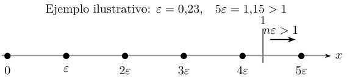{#fig-ic2021-c09-f14 fig-alt="Suma repetida de un epsilon positivo hasta sobrepasar uno"}

### Prueba por negación de cuantificadores
**Demostración desarrollada de la cátedra (1:29:16–1:33:18).** Neguemos la primera formulación. Entonces existiría un $\varepsilon>0$ tal que

$$n\varepsilon\leq1\qquad\text{para todo }n\in\mathbb N.$$

Como $\varepsilon$ es positivo, podemos dividir sin cambiar el orden:

$$n\leq\frac1\varepsilon\qquad\text{para todo }n\in\mathbb N.$$

Esto convertiría al real $1/\varepsilon$ en cota superior de $\mathbb N$, contradiciendo el teorema anterior. Así se demuestra la propiedad. San Martín insiste en la transformación correcta de los cuantificadores: la negación de «para todo $\varepsilon>0$ existe $n$» tiene la forma «existe $\varepsilon>0$ tal que para todo $n$», conservando las condiciones sobre los conjuntos donde viven las variables.

El encadenamiento lógico de la clase puede sintetizarse así:

$$\boxed{\text{Axioma del supremo}
\ \Longrightarrow\ \mathbb N\text{ sin cota superior}
\ \Longrightarrow\ \text{propiedad arquimediana}.}$$

## Enteros y separación de puntos consecutivos

### Construcción de $\mathbb Z$
**En la cátedra (1:33:18–1:35:28).** A partir de los naturales se introduce el conjunto de los enteros:

$$\boxed{\mathbb Z=\mathbb N\cup(-\mathbb N),\qquad -\mathbb N=\{-n:n\in\mathbb N\}.}$$

Los enteros reúnen los naturales y sus opuestos. La falta de cota superior de $\mathbb N$ y la simetría por cambio de signo permiten afirmar que $\mathbb Z$ se extiende tanto hacia valores arbitrariamente positivos como arbitrariamente negativos.

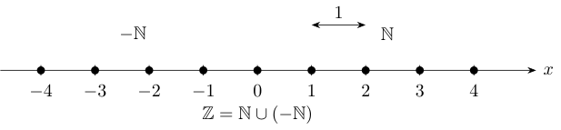{#fig-ic2021-c09-f15 fig-alt="Enteros positivos y negativos con distancia unitaria entre consecutivos"}

### Separación de dos enteros distintos
El profesor recupera una consecuencia de la propiedad de separación de los naturales: si $k,\ell\in\mathbb Z$ y $k<\ell$, entonces

$$\boxed{\ell\geq k+1,\qquad \ell-k\geq1.}$$

Por tanto,

$$\boxed{(k,k+1)\cap\mathbb Z=\varnothing\qquad(k\in\mathbb Z).}$$

Esta propiedad es indispensable en la prueba posterior: **dos enteros distintos están separados por una distancia de al menos una unidad**. Es preciso recordar que este resultado se obtiene de las propiedades de $\mathbb N$ enunciadas al principio y de la construcción de $\mathbb Z$; las pruebas auxiliares se encuentran en la sección editorial 4.4.

## Existencia de la parte entera

### Un problema de existencia y máximo
**En la cátedra (1:35:28–1:38:47).** Dado $x\in\mathbb R$, consideramos

$$A_x=\{k\in\mathbb Z:k\leq x\}.$$

El propósito es localizar el **mayor entero contenido en este conjunto**. Como $\mathbb Z$ se extiende hacia valores arbitrariamente negativos, $A_x$ es no vacío. Además, $x$ es cota superior de $A_x$. Por el axioma del supremo existe

$$s=\sup A_x.$$

El profesor se propone demostrar una propiedad adicional: ese supremo pertenece a $A_x$, de manera que es su máximo. Así quedará justificada la existencia de la **función parte entera**.

### Demostración de que el supremo es entero
**Demostración desarrollada de la cátedra (1:38:47–1:44:05).** Consideremos el real $s-\tfrac12$, estrictamente menor que el supremo. Por la propiedad que caracteriza al supremo, existe $k_*\in A_x$ con

$$s-\frac12<k_*\leq s.$$

Afirmamos que $k_*$ es cota superior de $A_x$. Si hubiera $\ell\in A_x$ con $\ell>k_*$, tendríamos dos enteros distintos en el intervalo

$$s-\frac12<k_*<\ell\leq s,$$

cuya longitud es $\tfrac12$. Pero dos enteros distintos distan al menos $1$. La contradicción muestra que $k_*$ es cota superior. Como además pertenece a $A_x$, es un **máximo** del conjunto y coincide con su supremo:

$$\boxed{s=k_*=\max A_x\in\mathbb Z.}$$

Llamamos **parte entera** de $x$ a este máximo:

$$\boxed{\lfloor x\rfloor=\max\{k\in\mathbb Z:k\leq x\}.}$$

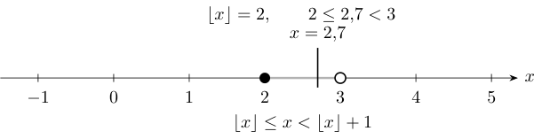{#fig-ic2021-c09-f16 fig-alt="La parte entera como máximo entero situado a la izquierda del real"}

### Caracterización fundamental
Por construcción, $\lfloor x\rfloor\leq x$. La maximalidad significa que el entero sucesor $\lfloor x\rfloor+1$ está situado estrictamente a la derecha de $x$. Así:

$$\boxed{\lfloor x\rfloor\leq x<\lfloor x\rfloor+1.}$$

La desigualdad caracteriza de manera única a la parte entera. En efecto, si dos enteros $k,\ell$ cumplieran $k\leq x<k+1$ y $\ell\leq x<\ell+1$, entonces ambos describirían el único entero situado al comienzo del intervalo unitario que contiene a $x$.

Por ejemplo, $\lfloor2{,}7\rfloor=2$. Para números negativos, la misma regla vale: $-3\leq-2{,}7<-2$, de donde $\lfloor-2{,}7\rfloor=-3$. La parte entera coincide con la función *piso* (*floor*) en la nomenclatura internacional.

## Racionales, irracionales y completitud

### La construcción de $\mathbb Q$
**En la cátedra (1:44:07–1:46:40).** El conjunto de los racionales se presenta como el conjunto de cocientes entre un entero y un natural positivo:

$$\boxed{\mathbb Q=\left\{\frac pq:p\in\mathbb Z,\ q\in\mathbb N,\ q>0\right\}.}$$

En esta forma el signo de un racional queda recogido por el numerador. El profesor señala que $\mathbb Q$ es un **cuerpo ordenado arquimediano**. Las operaciones y el orden se heredan de $\mathbb R$, y la propiedad arquimediana se verifica también para racionales positivos. Así, si $p/q>0$ con $p,q$ enteros y $q>0$, basta tomar el natural $n=2q$ para obtener

$$n\cdot\frac pq=2p>1,$$

pues $p$ es un entero estrictamente positivo y, por tanto, $p\geq1$.

La completitud distingue a $\mathbb R$ de $\mathbb Q$. El ejemplo histórico que articula la semana 8 es $\sqrt2$: es un real cuya existencia se puede obtener por el axioma del supremo, mientras que la prueba de su irracionalidad permite concluir que no pertenece a $\mathbb Q$. En consecuencia, los racionales admiten las operaciones de cuerpo y las propiedades de orden y arquimedianidad, pero **la propiedad de supremo para todos sus subconjuntos no vacíos acotados superiormente no se cumple dentro de $\mathbb Q$**.

Los irracionales forman el conjunto $\mathbb R\setminus\mathbb Q$.

### Densidad: problema propuesto al cerrar la clase
**Indicación del profesor (1:46:41–1:47:23).** La clase termina invitando a estudiar en el apunte la **densidad de los racionales y de los irracionales en $\mathbb R$**. Sus enunciados son:

$$\boxed{a<b\Longrightarrow(\exists q\in\mathbb Q)\ a<q<b}$$

$$\boxed{a<b\Longrightarrow(\exists r\in\mathbb R\setminus\mathbb Q)\ a<r<b.}$$

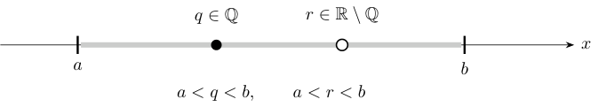{#fig-ic2021-c09-f17 fig-alt="Entre dos números reales aparecen racionales e irracionales"}

**Ampliación editorial: prueba de densidad racional.** Sean $a<b$. Por arquimedianidad existe $n\in\mathbb N$, $n>0$, tal que $n(b-a)>1$. Por la existencia de parte entera, el entero $k=\lfloor na\rfloor+1$ satisface

$$na<k\leq na+1<nb.$$

Dividiendo por $n>0$, obtenemos $a<k/n<b$, con $k/n\in\mathbb Q$.

**Ampliación editorial: prueba de densidad irracional.** Ya se conoce un irracional concreto, $\sqrt2$. Aplicando la densidad racional al intervalo $(a-\sqrt2,b-\sqrt2)$, existe $q\in\mathbb Q$ que satisface

$$a-\sqrt2<q<b-\sqrt2.$$

Por tanto, $r=q+\sqrt2$ cumple $a<r<b$ y es irracional: si fuese racional, también $\sqrt2=r-q$ sería racional. Así queda demostrado el segundo enunciado.

**Observación de fidelidad.** Al final de la grabación aparece una formulación oral o de transcripción sobre la pertenencia de $\sqrt2$ a los racionales que contradice lo explicado durante la semana. Los argumentos matemáticos coherentes son $\sqrt2\in\mathbb R$ y $\sqrt2\notin\mathbb Q$; esta edición señala la discrepancia y conserva esa distinción.

## Mapa lógico para continuar el curso

La Cátedra 8.2 está organizada en torno a una cadena de dependencias matemáticas que conviene conservar durante las siguientes semanas:

$$
\begin{gathered}
\text{Conjuntos inductivos}\ \longrightarrow\
\mathbb N\text{ mínimo inductivo}\ \longrightarrow\
\text{Inducción}\cr
\mathbb N\text{ inductivo}+\text{axioma del supremo}
\ \longrightarrow\ \mathbb N\text{ no acotado superiormente}\cr
\longrightarrow\ \text{propiedad arquimediana}
\ \longrightarrow\ \mathbb Z,\ \lfloor x\rfloor,\ \mathbb Q.
\end{gathered}
$$

La novedad esencial es que una construcción por **intersección de conjuntos** conduce a un principio de prueba para proposiciones, y este principio combinado con la completitud permite obtener hechos básicos de la recta real. En particular, la parte entera, que se utilizaba intuitivamente desde las primeras clases, queda ahora fundada como el máximo de un conjunto de enteros.

**Continuación en el curso.** El profesor anuncia que la clase 9.1 comenzará el estudio de las **sucesiones**, para el que se utilizarán continuamente los naturales, la inducción y la propiedad arquimediana. La densidad de racionales e irracionales queda sugerida como lectura y se desarrolla en esta edición únicamente en la sección editorial 9.2 y en los problemas 21–22.

## Taller de problemas y soluciones

Los ejercicios se presentan a continuación según la fuente de origen; las ampliaciones editoriales de cada apuntes permanecen expresamente identificadas.

### Banco de problemas complementarios resueltos — cátedra 8.2

> **Ampliación editorial.** Los veinte problemas siguientes fueron redactados y resueltos para estudiar autónomamente la materia. Las soluciones son adicionales a la grabación y se apoyan en las definiciones, teoremas y pruebas anteriores.

### Problema 1. Reconocer dos conjuntos inductivos
Demuestra que $\mathbb R$ y $[0,\infty)$ son inductivos.

**Solución.** $0$ pertenece a ambos. Para $x\in\mathbb R$, $x+1\in\mathbb R$ por clausura de la suma. Para $x\in[0,\infty)$, $x+1\geq1>0$, luego $x+1\in[0,\infty)$. Ambos cumplen las dos condiciones.

### Problema 2. Un conjunto con una laguna
Determina si $B=\{0\}\cup[2,\infty)$ es inductivo.

**Solución.** $0\in B$. Sin embargo, el sucesor de $0$ es $1$ y $1\notin B$. La condición de sucesor muestra que $B$ falla la segunda propiedad.

### Problema 3. Una unión inductiva
Comprueba que $C=\{0\}\cup[1,\infty)$ es inductivo.

**Solución.** El cero pertenece a $C$. Si $x=0$, su sucesor es $1\in C$; si $x\geq1$, entonces $x+1\geq2\in[1,\infty)\subseteq C$. El conjunto es inductivo.

### Problema 4. Una cola continua precedida por puntos aislados
Comprueba que $D=\{0,1,2,3\}\cup[4,\infty)$ es inductivo.

**Solución.** El sucesor de $0,1,2,3$ pertenece al conjunto en cada caso; en particular, $3+1=4$ pertenece a la cola. Si $x\geq4$, entonces $x+1\geq5$ y permanece en ella. Como $0\in D$, se verifican ambas propiedades.

### Problema 5. Intersección de inductivos
Sea $(A_i)_{i\in I}$ una familia no vacía de subconjuntos inductivos de $\mathbb R$. Demuestra que $\bigcap_{i\in I}A_i$ es inductivo.

**Solución.** Cada $A_i$ contiene a $0$, luego $0$ pertenece a la intersección. Si $x$ pertenece a la intersección, entonces pertenece a cada $A_i$, y de la clausura por sucesor se sigue que $x+1$ pertenece a cada $A_i$. Por ello, $x+1$ pertenece también a la intersección.

### Problema 6. Minimalidad de los naturales
Si $A$ es inductivo y $A\subseteq\mathbb N$, demuestra que $A=\mathbb N$.

**Solución.** Por la definición de $\mathbb N$ como intersección de todos los inductivos, $\mathbb N\subseteq A$. La hipótesis aporta $A\subseteq\mathbb N$. La doble inclusión implica $A=\mathbb N$.

### Problema 7. Una inducción con fórmula de suma
Demuestra para todo $n\in\mathbb N$:

$$\sum_{j=0}^{n}j=\frac{n(n+1)}{2}.$$

**Solución.** Para $n=0$ ambos lados son $0$. Supongamos la igualdad para $n$. Entonces

$$\sum_{j=0}^{n+1}j=\frac{n(n+1)}2+(n+1)=\frac{(n+1)(n+2)}2,$$

que es exactamente la fórmula con $n+1$.

### Problema 8. La suma de cuadrados
Demuestra que $\sum_{j=0}^{n}j^2=n(n+1)(2n+1)/6$.

**Solución.** La identidad vale para $n=0$. Si vale para $n$, al agregar $(n+1)^2$ obtenemos

$$\begin{aligned}
\sum_{j=0}^{n+1}j^2
&=\frac{n(n+1)(2n+1)}6+(n+1)^2\\
&=\frac{(n+1)(2n^2+7n+6)}6\\
&=\frac{(n+1)(n+2)(2n+3)}6,
\end{aligned}$$

la fórmula correspondiente al sucesor.

### Problema 9. Positividad de los naturales
Deduce $n\geq0$ para todo $n\in\mathbb N$ a partir de la definición por intersección.

**Solución.** $[0,\infty)$ es inductivo y $\mathbb N$ se incluye en cada inductivo. Luego $\mathbb N\subseteq[0,\infty)$, que es precisamente la afirmación.

### Problema 10. Un natural positivo es al menos uno
Demuestra por inducción que $n>0$ implica $n\geq1$ para todo natural $n$.

**Solución.** La proposición para $n=0$ es $(0>0)\Rightarrow(0\geq1)$, verdadera por el antecedente falso. Si $n\in\mathbb N$, la positividad ya demostrada da $n\geq0$, luego $n+1\geq1$. Por ello el consecuente de $P(n+1)$ es verdadero. Se cumple la inducción.

### Problema 11. Existencia del predecesor natural
Demuestra que para todo $n\in\mathbb N$, si $n>0$, entonces $n-1\in\mathbb N$.

**Solución.** Inducimos sobre la afirmación $P(n)$: «$n=0$ o $n-1\in\mathbb N$». Para $n=0$ vale la primera alternativa. Dado un natural $n$, la proposición $P(n+1)$ se cumple porque $(n+1)-1=n\in\mathbb N$. Concluimos que cada natural positivo tiene predecesor natural.

### Problema 12. Separación entre naturales
Demuestra que si $n,m\in\mathbb N$ y $n>m$, entonces $n\geq m+1$.

**Solución.** Para $m=0$ aplica el problema 10. Supongamos el enunciado para $m$ y sea $n>m+1$. El natural $n$ es positivo y su predecesor $n-1$ es natural por el problema 11. Como $n-1>m$, la hipótesis inductiva da $n-1\geq m+1$; por consiguiente, $n\geq m+2$. La afirmación queda probada para $m+1$.

### Problema 13. Clausura de suma y producto
Demuestra que $n+m$ y $nm$ son naturales cuando $m,n$ son naturales.

**Solución.** Fijemos $n$. Para la suma, el caso $m=0$ devuelve $n$; el paso inductivo añade $1$ al resultado natural $n+m$. Para el producto, el caso $m=0$ produce $0$; el paso utiliza $n(m+1)=nm+n$ y la clausura aditiva recién obtenida. De este modo ambas operaciones permanecen en $\mathbb N$.

### Problema 14. Contradicción con un supremo hipotético
Explica por qué $s-1$ sería una cota superior de $\mathbb N$ si $s=\sup\mathbb N$ existiera.

**Solución.** Para todo natural $n$, también $n+1$ es natural. La hipótesis de que $s$ es cota superior impone $n+1\leq s$, así que $n\leq s-1$. Este último número domina todos los naturales y es estrictamente menor que $s$, contradiciendo su minimalidad como cota.

### Problema 15. Un épsilon explícito
Para $\varepsilon=0{,}07$, encuentra el menor natural $n$ que satisface $n\varepsilon>1$.

**Solución.** La desigualdad equivale a $n>100/7\approx14{,}2857$. El menor natural que la satisface es $n=15$: $14\cdot0{,}07=0{,}98\leq1$ y $15\cdot0{,}07=1{,}05>1$.

### Problema 16. Amplitud arquimediana arbitraria
Demuestra que dados $\varepsilon>0$ y $R>0$ existe $n\in\mathbb N$ con $n\varepsilon>R$.

**Solución.** $R/\varepsilon$ es un real. Como $\mathbb N$ no es acotado superiormente, existe $n\in\mathbb N$ con $n>R/\varepsilon$. Multiplicando por $\varepsilon>0$ obtenemos $n\varepsilon>R$.

### Problema 17. Los enteros se extienden en ambas direcciones
Demuestra que para todo $M\in\mathbb R$ existen $k,\ell\in\mathbb Z$ con $k<M<\ell$.

**Solución.** El teorema de la sección 5 proporciona un natural $\ell>M$. Aplicado al real $-M$, proporciona un natural $n>-M$. Su opuesto $k=-n$ pertenece a $\mathbb Z$ y satisface $k<M$. Por tanto, los enteros sobrepasan cualquier real en ambas direcciones.

### Problema 18. Parte entera de números positivos y negativos
Calcula $\lfloor3{,}8\rfloor$, $\lfloor-2{,}7\rfloor$ y $\lfloor-3\rfloor$.

**Solución.** Como $3\leq3{,}8<4$, la primera es $3$. Como $-3\leq-2{,}7<-2$, la segunda es $-3$. Finalmente, $-3\leq-3<-2$ y la última vale $-3$. El criterio es siempre $k\leq x<k+1$.

### Problema 19. Traslación de la parte entera
Demuestra que para todo $x\in\mathbb R$ y $m\in\mathbb Z$, $\lfloor x+m\rfloor=\lfloor x\rfloor+m$.

**Solución.** Sea $k=\lfloor x\rfloor$. Se tiene $k\leq x<k+1$. Sumando el entero $m$, obtenemos $k+m\leq x+m<(k+m)+1$. La caracterización de la parte entera demuestra que $\lfloor x+m\rfloor=k+m$.

### Problema 20. La parte fraccionaria
Define $\{x\}=x-\lfloor x\rfloor$. Demuestra $0\leq\{x\}<1$ y calcula $\{-2{,}7\}$.

**Solución.** Restamos $\lfloor x\rfloor$ a los tres términos de $\lfloor x\rfloor\leq x<\lfloor x\rfloor+1$. El resultado es $0\leq x-\lfloor x\rfloor<1$. Como $\lfloor-2{,}7\rfloor=-3$, tenemos $\{-2{,}7\}=-2{,}7+3=0{,}3$.

### Problema 21. Densidad racional e irracional
Demuestra que todo intervalo abierto $(a,b)$ con $a<b$ contiene un racional y un irracional.

**Solución.** Elige por arquimedianidad $n\in\mathbb N$ tal que $n(b-a)>1$. Para $k=\lfloor na\rfloor+1$, se tiene $na<k\leq na+1<nb$. Así, $q=k/n$ es racional y está en $(a,b)$. Aplicamos la misma construcción al intervalo $(a-\sqrt2,b-\sqrt2)$ y obtenemos un racional $p$ allí. Entonces $p+\sqrt2$ pertenece a $(a,b)$ y es irracional.

### Problema 22. Los racionales y el axioma del supremo
Justifica por qué el conjunto $E=\{q\in\mathbb Q:q\geq0,\ q^2<2\}$ carece de supremo en $\mathbb Q$.

**Solución.** El conjunto contiene $1$ y tiene, por ejemplo, la cota superior racional $2$. Sea $r=\sqrt2\in\mathbb R\setminus\mathbb Q$. Si existiera un supremo racional $s$ de $E$, se tendría $s\geq1$. Como $s$ y $r$ son distintos, hay dos posibilidades. Si $s<r$, por densidad racional existe $q\in\mathbb Q$ con $s<q<r$. Entonces $q\in E$, contradicción con que $s$ sea cota superior. Si $s>r$, por densidad racional existe $t\in\mathbb Q$ con $r<t<s$. Ese $t$ es cota superior racional de $E$ y menor que $s$, contradicción con la minimalidad. Por tanto, $E$ constituye un ejemplo de un conjunto racional no vacío, acotado superiormente y sin supremo dentro de $\mathbb Q$.

---

---

*Este capítulo pertenece a la edición temática no oficial del curso IC2021. [Índice del libro](index.qmd) · [Fuentes y concordancia](apendices.qmd).*
