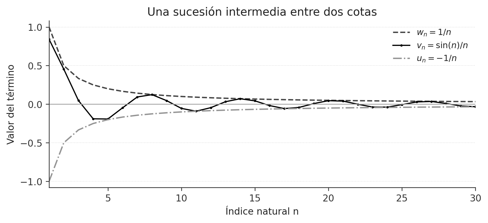
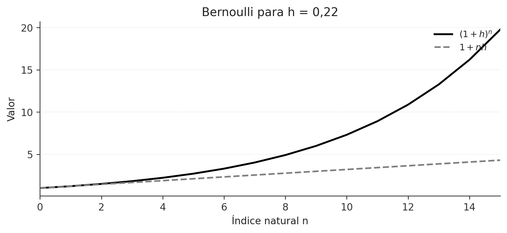
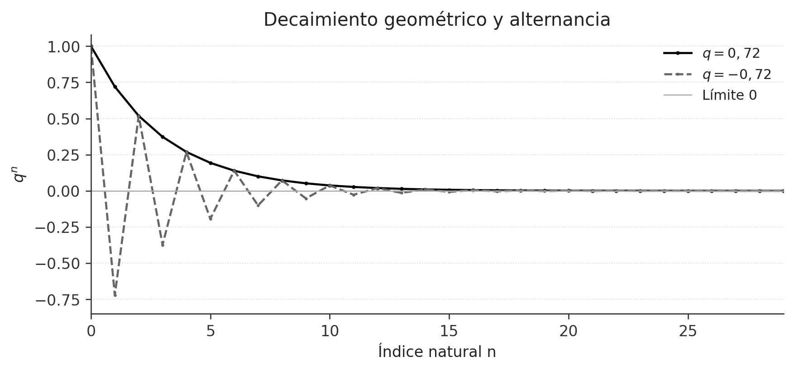
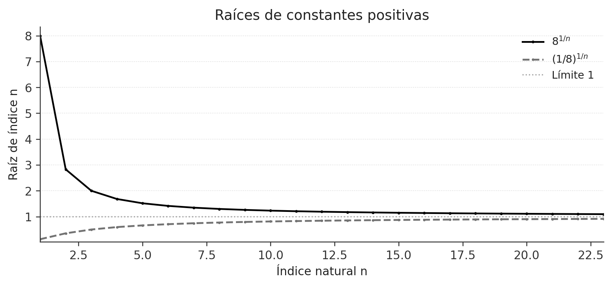
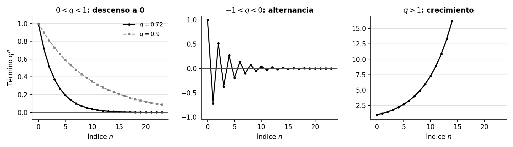
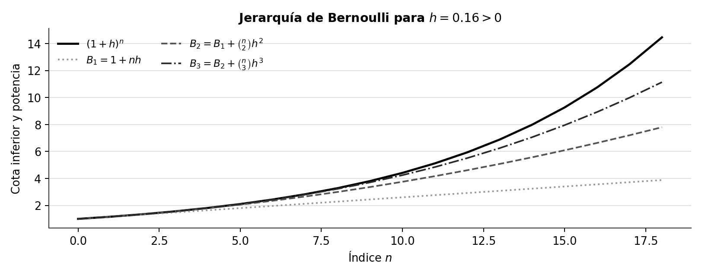
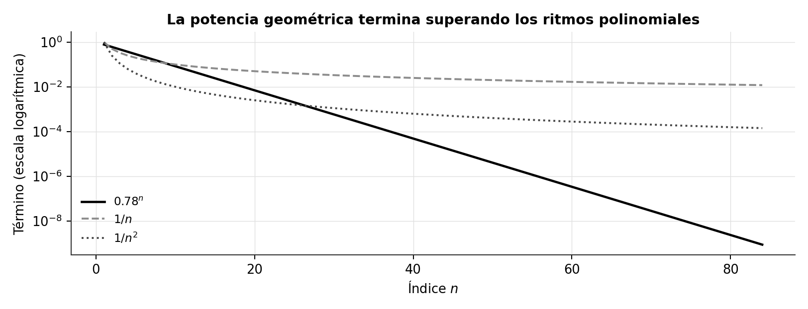
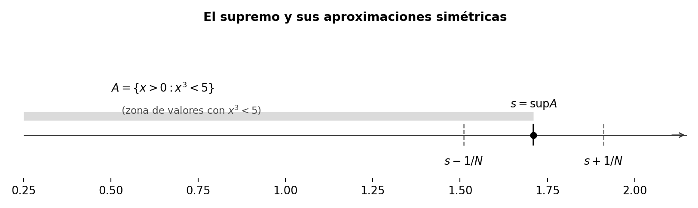
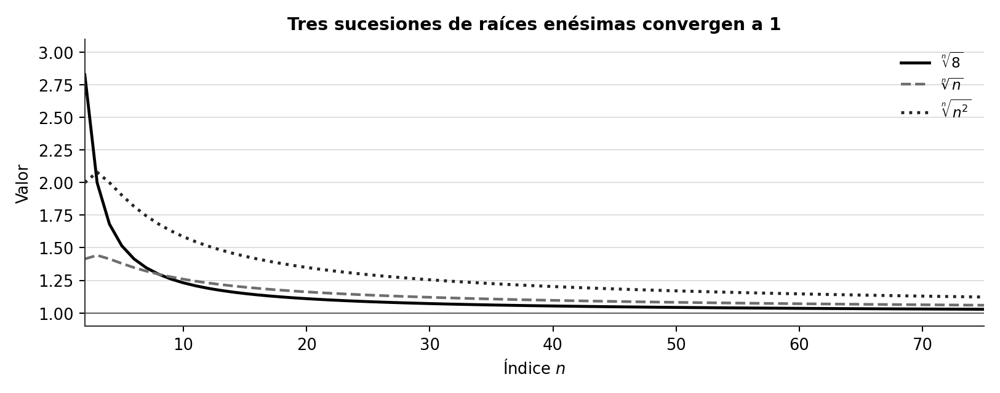
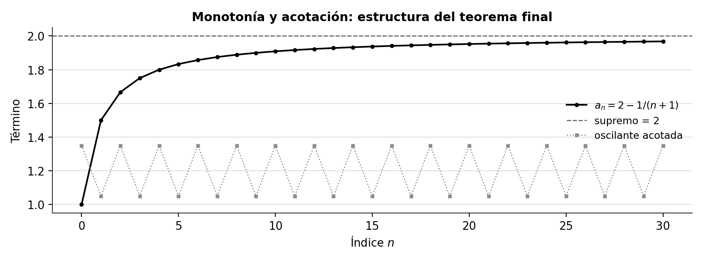

La comparación de sucesiones conduce al teorema del sándwich, a la desigualdad de Bernoulli y a los límites de potencias y raíces. La monotonía y el supremo completan el panorama de convergencia.

**Grabaciones de referencia:** [grabación de la cátedra 10.1](https://www.youtube.com/watch?v=uWNFjH-GDEA), [grabación de la cátedra 10.2](https://www.youtube.com/watch?v=CQgnnA48rEA).

*Procedencia de este tramo: cátedra 10.1.*

## De la aproximación al orden

En la cátedra anterior se estableció que una sucesión real $(s_n)$ converge a un número $L\in\mathbb R$ cuando se satisface la condición

$$
\boxed{
(\forall\varepsilon>0)(\exists N\in\mathbb N)
(\forall n\ge N)\quad |s_n-L|\le\varepsilon.
}
$$

El índice $N$ depende del margen $\varepsilon$ y de la sucesión. Cada cota para el error $|s_n-L|$ expresa que, a partir de ese índice, todos los términos permanecen dentro del intervalo $[L-\varepsilon,L+\varepsilon]$. La propiedad arquimediana permite construir índices para errores tan pequeños como se quiera.

La propiedad de convergencia es especialmente útil al combinar valores aproximados con desigualdades. El **orden** de los reales proporciona información que se conserva al pasar al límite. El paso requiere una precisión: una desigualdad estricta entre términos puede convertirse en igualdad entre límites. La razón es geométrica: dos sucesiones pueden permanecer una a cada lado y acercarse al mismo número.

**Ejemplo editorial.** Para $n\ge1$ tomemos $u_n=0$ y $v_n=1/n$. Entonces $u_n<v_n$ para cada $n$, mientras que

$$
\lim_{n\to\infty}u_n=\lim_{n\to\infty}v_n=0.
$$

El orden llega al límite bajo la forma de una desigualdad amplia.

### Un lema sobre la positividad eventual
**Demostración editorial.** Si $x_n\to a$ y $a>0$, los términos de $(x_n)$ son estrictamente positivos desde algún índice. En efecto, sea $\varepsilon=a/2>0$. Existe $N$ tal que, para $n\ge N$,

$$
|x_n-a|\le\frac a2,
\qquad\text{de donde}\qquad
x_n\ge a-\frac a2=\frac a2>0.
$$

De igual manera, si $a<0$, entonces $x_n<0$ desde algún índice, pues basta imponer $|x_n-a|\le(-a)/2$. Este lema ofrece la base de una prueba por contradicción del orden de los límites.

## El límite respeta las desigualdades

**Teorema (límites y orden; resumen MA1001, §10.1).** Sean $(u_n)$ y $(w_n)$ dos sucesiones reales, con

$$
u_n\longrightarrow u,
\qquad
w_n\longrightarrow w.
$$

Si existe $N_0\in\mathbb N$ tal que $u_n\le w_n$ para cada $n\ge N_0$, entonces

$$\boxed{u\le w.}$$

**Demostración desarrollada editorialmente.** Consideremos la sucesión de diferencias

$$d_n=w_n-u_n.$$

Por el álgebra de límites, $d_n\to w-u$. A partir de $N_0$ se cumple $d_n\ge0$. Supongamos que $w-u<0$. El lema anterior asegura entonces la existencia de un índice $N_1$ a partir del cual $d_n<0$. Para $n\ge\max\{N_0,N_1\}$ se obtendrían simultáneamente $d_n\ge0$ y $d_n<0$, situación incompatible con el orden real. Por consiguiente $w-u\ge0$, es decir, $u\le w$. $\square$

La palabra **eventualmente** abrevia una condición exacta: existe un índice natural $N_0$ desde el cual la desigualdad vale para todos los términos. La convergencia depende de las colas de las sucesiones; alterar una cantidad finita de términos iniciales conserva el mismo límite.

**Corolario editorial (intervalo de límites).** Si $a\le u_n\le b$ eventualmente y $u_n\to L$, entonces $a\le L\le b$. Se aplica el teorema a las dos sucesiones constantes $a$ y $b$.

**Contraejemplo editorial para precisar el enunciado.** La conclusión estricta $u<w$ exige hipótesis adicionales. Las sucesiones $u_n=-1/n$ y $w_n=1/n$ satisfacen $u_n<w_n$, pero ambas convergen a $0$.

## Teorema del sándwich

Hay ocasiones en que se conoce una sucesión $v_n$ mediante dos desigualdades y se desea calcular su límite. El teorema del sándwich convierte esas dos cotas en un resultado de convergencia cuando los extremos se aproximan al mismo real.

**Teorema (sándwich; resumen MA1001, §10.1).** Sean $(u_n)$, $(v_n)$ y $(w_n)$ sucesiones reales. Supongamos que

$$
\lim_{n\to\infty}u_n
=
\lim_{n\to\infty}w_n=L
$$

y que existe $N_\ast$ tal que

$$
(\forall n\ge N_\ast)\qquad
u_n\le v_n\le w_n.
$$

Entonces $(v_n)$ converge y

$$\boxed{\lim_{n\to\infty}v_n=L.}$$

**Demostración desarrollada editorialmente.** Fijemos $\varepsilon>0$. De $u_n\to L$ obtenemos un índice $N_1$ con

$$L-\varepsilon\le u_n\le L+\varepsilon
\qquad(n\ge N_1).$$

De $w_n\to L$ obtenemos un índice $N_2$ con

$$L-\varepsilon\le w_n\le L+\varepsilon
\qquad(n\ge N_2).$$

Tomamos un índice común

$$
\boxed{N=\max\{N_\ast,N_1,N_2\}.}
$$

Para todo $n\ge N$ se cumplen las tres condiciones de manera simultánea. Encadenando sus partes útiles resulta

$$
L-\varepsilon\le u_n\le v_n\le w_n\le L+\varepsilon.
$$

De ello se sigue $|v_n-L|\le\varepsilon$. Como $\varepsilon>0$ fue arbitrario, la definición de convergencia demuestra $v_n\to L$. $\square$

{#fig-ic2021-c11-f01 fig-alt="Esquema editorial: dos cotas convergentes y la sucesión intermedia." width=85%}

En la demostración, el uso de $\max\{N_\ast,N_1,N_2\}$ es la operación decisiva. Cada condición empieza a valer desde un índice posiblemente distinto; escoger el mayor permite utilizarlas todas a la vez.

### Una forma habitual: valor absoluto acotado
**Corolario editorial.** Si $a_n\ge0$, $a_n\to0$ y

$$|v_n|\le a_n\qquad\text{eventualmente},$$

entonces $v_n\to0$, pues $-a_n\le v_n\le a_n$ y los extremos convergen a cero.

Por ejemplo, si $|v_n|\le C/n$ desde algún índice, con $C>0$ fijo, entonces $v_n\to0$. Esta forma reduce el problema a encontrar una cota sencilla que tienda a cero.

### Un ejemplo oscilante
**Ejemplo editorial.** Consideremos

$$v_n=\frac{\sin(n!)}{n},\qquad n\ge1.$$

El argumento $n!$ puede generar un comportamiento oscilante, pero la desigualdad elemental $-1\le\sin x\le1$ proporciona inmediatamente

$$
-\frac1n\le\frac{\sin(n!)}n\le\frac1n.
$$

Los extremos convergen a cero y, por tanto,

$$\boxed{\lim_{n\to\infty}\frac{\sin(n!)}n=0.}$$

El teorema identifica el límite a partir de las cotas, sin exigir el cálculo del comportamiento de la parte oscilante.

## Una desigualdad que transforma potencias en cotas

El capítulo complementario de MA1001 estudia la **desigualdad de Bernoulli** como instrumento para el teorema del sándwich. Su función es permitir estimaciones de potencias usando expresiones polinomiales sencillas.

**Proposición (Bernoulli; resumen MA1001, §10.2).** Para todo natural $n\ge0$ y todo real $h>-1$,

$$\boxed{(1+h)^n\ge1+nh.}$$

**Demostración editorial por inducción.** Para $n=0$ ambos miembros son $1$. Supongamos que la desigualdad vale para cierto natural $n$. Como $1+h>0$, podemos multiplicar ambos miembros por $1+h$ y conservar el sentido de la desigualdad:

$$
\begin{aligned}
(1+h)^{n+1}
&\ge(1+nh)(1+h)\\
&=1+(n+1)h+nh^2\\
&\ge1+(n+1)h.
\end{aligned}
$$

El último paso utiliza $n\ge0$ y $h^2\ge0$. La inducción completa la demostración. $\square$

{#fig-ic2021-c11-f02 fig-alt="Esquema editorial: comparación entre (1+h)^n y 1+nh para un h fijo positivo." width=82%}

**Observación editorial.** La hipótesis $h>-1$ hace positivo el factor $1+h$ y legitima la multiplicación durante el paso inductivo. Para $h>0$, el crecimiento de $1+nh$ expresa inmediatamente que $(1+h)^n$ supera cualquier cota real al crecer $n$.

## La sucesión geométrica $q^n$

**Resultado del resumen MA1001, §10.2.** Dado $q\in\mathbb R$, el comportamiento de la sucesión $(q^n)$ se organiza mediante el valor absoluto de la base.

$$
\boxed{
\begin{array}{ll}
q=1 &\Longrightarrow\quad q^n\to1,\\[2pt]
|q|<1 &\Longrightarrow\quad q^n\to0,\\[2pt]
q\in(-\infty,-1]\cup(1,\infty)
&\Longrightarrow\quad (q^n)\ \text{diverge en }\mathbb R.
\end{array}}
$$

El caso $q=0$ se entiende con la sucesión de valores $0$ desde $n\ge1$; el término $0^0$ se omite o se conviene por separado. El caso $q=-1$ genera la alternancia $1,-1,1,-1,\ldots$.

### Demostración cuando $0<q<1$
Escribimos $q=1/(1+h)$ con $h=q^{-1}-1>0$. Aplicando Bernoulli,

$$
0<q^n=\frac{1}{(1+h)^n}
\le\frac{1}{1+nh}.
$$

Por la propiedad arquimediana, $1/(1+nh)\to0$. El teorema del sándwich concluye que $q^n\to0$.

Cuando $-1<q<0$, la sucesión $|q|^n$ converge a cero y $|q^n|=|q|^n$; la misma conclusión se obtiene por el criterio de valor absoluto.

### Demostración cuando $|q|>1$
Para $q>1$ escribimos $q=1+h$, con $h>0$. Bernoulli proporciona $q^n\ge1+nh$, de manera que $(q^n)$ crece sin cota superior y, en particular, carece de límite real.

Para $q<-1$, sus valores absolutos satisfacen $|q^n|=|q|^n\ge1+nh$ con $h=|q|-1>0$. Una sucesión real convergente es acotada, de modo que $(q^n)$ tampoco converge.

**Caso de alternancia.** Para $q=-1$ las subsucesiones de índices pares e impares tienen valores constantes $1$ y $-1$, respectivamente. Si la sucesión entera convergiera, ambas subsucesiones tendrían el mismo límite, lo que contradice $1\ne-1$.

{#fig-ic2021-c11-f03 fig-alt="Esquema editorial: sucesiones geométricas con bases positivas y negativas dentro del intervalo de módulo menor que uno." width=85%}

### Bases variables
**Proposición complementaria (resumen MA1001, §10.2).** Si $q_n\to q$ y $|q|<1$, entonces

$$\boxed{(q_n)^n\longrightarrow0.}$$

**Demostración editorial.** Escogemos $r$ tal que $|q|<r<1$. Por convergencia, $|q_n|<r$ para todos los índices suficientemente grandes. Elevando a la potencia natural $n$ obtenemos

$$0\le|q_n|^n\le r^n,$$

y el miembro derecho tiende a cero. El sándwich concluye la prueba.

Si $|q|>1$, se puede elegir $r$ con $1<r<|q|$. Desde cierto índice, $|q_n|\ge r$ y, por tanto, $|(q_n)^n|\ge r^n$. La sucesión $(q_n)^n$ es no acotada y carece de límite real.

Los casos de frontera $|q|=1$ requieren inspección adicional: la información $q_n\to1$ por sí sola es compatible con límites distintos de $(q_n)^n$. Por ejemplo, $(1+1/n)^n$ y $(1+1/n^2)^n$ siguen comportamientos diferentes. La primera sucesión se vincula con la construcción del número $e$ y la segunda converge a $1$.

## Raíces de índice creciente

La operación de extraer raíces convierte una potencia de exponente $n$ en una expresión cuyo límite se puede estimar mediante Bernoulli.

**Proposición complementaria (resumen MA1001, §10.2).** Para todo $a>0$,

$$\boxed{\lim_{n\to\infty}\sqrt[n]{a}=1.}$$

**Demostración editorial.** Si $a=1$, cada término vale $1$. Supongamos $a>1$ y definamos $h_n=\sqrt[n]{a}-1>0$. Entonces $a=(1+h_n)^n$. Por Bernoulli,

$$a\ge1+nh_n,$$

de donde

$$0\le h_n\le\frac{a-1}{n}\longrightarrow0.$$

Así $\sqrt[n]{a}=1+h_n\to1$. Si $0<a<1$, tomamos $b=1/a>1$. Ya sabemos que $\sqrt[n]{b}\to1$ y, por el álgebra de límites aplicada al recíproco,

$$\sqrt[n]{a}=\frac1{\sqrt[n]{b}}\longrightarrow1.$$

Esta demostración describe cómo una desigualdad elemental de potencias produce una aproximación arbitrariamente precisa a la unidad.

### Raíces de términos que también varían
**Proposición complementaria (resumen MA1001, §10.2).** Si $a_n\to a>0$ y $a_n>0$ desde algún índice, entonces

$$\boxed{\sqrt[n]{a_n}\longrightarrow1.}$$

**Demostración editorial.** Existe $N$ tal que, para $n\ge N$,

$$\frac a2\le a_n\le\frac{3a}{2}.$$

La función raíz $n$-ésima es creciente en $(0,\infty)$; por ello

$$\sqrt[n]{a/2}\le\sqrt[n]{a_n}\le\sqrt[n]{3a/2}.$$

Las dos sucesiones extremas convergen a $1$ por el resultado precedente. El teorema del sándwich demuestra el límite buscado.

{#fig-ic2021-c11-f04 fig-alt="Esquema editorial: raíces n-ésimas de dos números positivos que se aproximan a 1." width=84%}

## Ampliación editorial: Bernoulli de segundo orden

El apartado 10.3 del resumen MA1001 desarrolla una forma más precisa de la desigualdad de Bernoulli. Se incluye aquí como **ampliación editorial**, pues su pertenencia a la grabación del 7 de junio está pendiente de confirmación.

Para $h\ge0$ y $n\ge2$ vale

$$
\boxed{(1+h)^n\ge1+nh+\frac{n(n-1)}2h^2.}
$$

La desigualdad se obtiene del desarrollo binomial: todos los coeficientes y potencias restantes son no negativos. También puede establecerse por inducción. Su utilidad aparece en el límite

$$\boxed{\sqrt[n]{n}\longrightarrow1.}$$

**Demostración editorial.** Para $n\ge2$ escribimos $x_n=\sqrt[n]{n}-1\ge0$. Entonces $n=(1+x_n)^n$ y la desigualdad anterior asegura

$$
n\ge1+nx_n+\frac{n(n-1)}2x_n^2
\ge1+\frac{n(n-1)}2x_n^2.
$$

Así,

$$
0\le x_n^2\le\frac{2(n-1)}{n(n-1)}=\frac2n,
\qquad
0\le x_n\le\sqrt{\frac2n}\longrightarrow0.
$$

Por tanto $\sqrt[n]{n}=1+x_n\to1$. El exponente variable se controla a través de una estimación cuadrática explícita.

### Una comparación de velocidades
**Ampliación editorial.** Para cada $k\in\mathbb N$ y cada $q\in\mathbb R$ con $|q|<1$,

$$\boxed{n^kq^n\longrightarrow0.}$$

En efecto, basta estudiar $0<r=|q|<1$, y escribir $r=(1+h)^{-1}$ con $h>0$. Para $n\ge2(k+1)$, el binomio de Newton proporciona

$$
(1+h)^n\ge \binom n{k+1}h^{k+1}
\ge\frac{(n/2)^{k+1}}{(k+1)!}\,h^{k+1}.
$$

Por ello,

$$
0\le n^kr^n
\le\frac{2^{k+1}(k+1)!}{h^{k+1}}\frac1n
\longrightarrow0.
$$

El resultado explica cómo un decaimiento geométrico domina, a largo plazo, cualquier potencia natural fija.

## Ejemplos resueltos para consolidar el método

### Ejemplo 1. Una oscilación que se extingue
Sea $s_n=(-1)^n/n$ para $n\ge1$. Como $|s_n|=1/n\to0$, el criterio de valor absoluto demuestra $s_n\to0$. La alternancia de signo convive con una amplitud que se hace arbitrariamente pequeña.

### Ejemplo 2. Un cociente de polinomios
Para $n\ge1$,

$$
\frac{2n+1}{3n-4}
=\frac{2+1/n}{3-4/n}.
$$

El denominador converge a $3$; por tanto, es distinto de cero desde algún índice y el álgebra de límites da

$$\lim_{n\to\infty}\frac{2n+1}{3n-4}=\frac23.$$

La expresión original puede no estar definida en uno o varios índices iniciales; el límite estudia la cola donde se encuentra definida.

### Ejemplo 3. Una potencia geométrica con factor polinomial
Como $|2/3|<1$, la ampliación de la sección 7.1 permite concluir

$$\lim_{n\to\infty}n^3\left(-\frac23\right)^n=0.$$

La oscilación del signo y el crecimiento del factor $n^3$ quedan dominados por el decaimiento geométrico.

### Ejemplo 4. Una raíz dependiente del índice
Sea $a_n=2+1/n>0$. Como $a_n\to2$, el resultado de la sección 6.1 implica

$$\lim_{n\to\infty}\sqrt[n]{2+1/n}=1.$$

La conclusión se justifica por acotamiento entre raíces de constantes positivas, sin expandir la raíz.

*Procedencia de este tramo: cátedra 10.2.*

## El problema que organiza el cierre de la unidad

**En la cátedra (13:09–14:11).** El profesor distingue el propósito de las dos semanas terminadas y el de la semana siguiente. Durante las cuatro cátedras se han **aprendido** las sucesiones: qué significa converger, cómo operar con límites y cómo demostrar estimaciones. En la semana 11 se comenzarán a **utilizar** como herramientas para construir y estudiar nuevos objetos matemáticos. La última sesión reúne dos familias que permiten experimentar con esas herramientas: potencias de una base fija y raíces cuyo índice crece.

La pregunta inicial tiene la forma siguiente. Dado un real fijo $q$, ¿qué ocurre con $q^n$ cuando el natural $n$ crece? Una respuesta completa depende del tamaño y del signo de $q$. Después aparece una cuestión complementaria: dado $q>0$, ¿qué ocurre con la raíz $n$-ésima $\sqrt[n]{q}$? La segunda pregunta exige primero justificar que esas raíces existen en $\mathbb R$.

Las herramientas recuperadas de las clases anteriores son la convergencia $\varepsilon$–$N$, el teorema del sándwich, el álgebra de límites, el axioma del supremo y la familia de desigualdades de Bernoulli. Para una sucesión $(a_n)$ y un real $L$ conservamos la convención de la cátedra:

$$
\boxed{a_n\longrightarrow L\iff
(\forall\varepsilon>0)(\exists N\in\mathbb N)(\forall n\ge N)\quad
|a_n-L|\le\varepsilon.}
$$

El valor de $N$ puede depender de $\varepsilon$. En una demostración por sándwich, cada cota de la sucesión intermedia debe estar definida en una cola de índices y las dos sucesiones extremas deben converger al mismo número.

## El mapa completo de las potencias geométricas

**En la cátedra (14:11–16:19; 45:37–54:58).** Fijado $q\in\mathbb R$, consideremos la sucesión $a_n=q^n$. Su comportamiento se clasifica mediante el módulo de la base y los valores de frontera:

$$
\boxed{
\begin{array}{c|c}
\text{Base fija }q&\text{Comportamiento de }(q^n)\\ \hline
q=0 & q^n=0\ (n\ge1),\quad \lim q^n=0\\
q=1 & q^n=1,\quad \lim q^n=1\\
|q|<1 & \lim q^n=0\\
q=-1 & (-1)^n\text{ alterna entre }1\text{ y }-1\\
|q|>1 & |q^n|\text{ crece sin cota superior}
\end{array}}
$$

Para $q=0$ se trabaja con $n\ge1$, según la convención de omitir el término inicial $0^0$. Para $q=-1$, la sucesión está acotada por $1$ en módulo y conserva una oscilación de amplitud fija. Una sucesión convergente es acotada, pero el ejemplo $(-1)^n$ exhibe por qué la acotación, por sí sola, permite distintos comportamientos.

{#fig-ic2021-c11-f05 fig-alt="Esquema editorial: comportamiento de potencias con base positiva menor que uno, negativa de módulo menor que uno y positiva mayor que uno." width=92%}

El profesor centra inicialmente el análisis en $0<q<1$, porque de ese caso se derivarán después las bases negativas de módulo pequeño. El caso $|q|>1$ quedará resuelto mediante recíprocos.

## La transformación decisiva: del número $q<1$ a una potencia de Bernoulli

**En la cátedra (16:19–20:00).** Supongamos $0<q<1$. Su recíproco satisface $1/q>1$. En consecuencia existe $h>0$ tal que

$$
\frac1q=1+h,\qquad h=\frac1q-1>0,
\qquad
q^n=\frac1{(1+h)^n}.
$$

Esta sustitución expresa el denominador mediante una potencia cuya base tiene la forma que requiere la desigualdad de Bernoulli. La elección del recíproco es la estrategia que pone en funcionamiento la prueba. El exponente $n$ permite obtener cotas cada vez mayores para el denominador; al invertirlas, aparecen cotas superiores cada vez menores para $q^n$.

La forma elemental de Bernoulli para $h>0$ y $n\in\mathbb N$ afirma

$$
(1+h)^n\ge 1+nh.
$$

Como ambos miembros son positivos, la relación entre sus recíprocos es

$$
0<q^n=\frac1{(1+h)^n}\le\frac1{1+nh}.
$$

El miembro derecho converge a cero. Puede verificarse escribiendo

$$
\frac1{1+nh}=\frac{1/n}{1/n+h}
\ \longrightarrow\ \frac0h=0,
$$

con $h>0$ fijo. La sucesión constante cero converge también a cero. Por el sándwich,

$$\boxed{0<q<1\quad\Longrightarrow\quad q^n\longrightarrow0.}$$

**Demostración desarrollada.** El profesor hace explícito el sentido de las desigualdades: cuando se reemplaza un denominador positivo por uno más pequeño, la nueva fracción es una **cota superior** de la original. También señala que la condición $q<1$ es estricta en el extremo derecho. Para $q=1$, todos los términos valen $1$ y el límite es $1$.

**Ampliación editorial: umbral $\varepsilon$.** Si se desea exhibir un índice a partir del cual $q^n\le\varepsilon$, basta elegir $N$ de manera que $1+Nh\ge1/\varepsilon$. La propiedad arquimediana garantiza esa elección. Esta construcción traduce el sándwich a la definición cuantificada de convergencia.

La cátedra menciona bases como $0{,}999$ y otros decimales próximos a $1$: cada base fija estrictamente menor que $1$ produce una sucesión convergente a cero. La proximidad de la base a $1$ influye en el número de índices necesarios para alcanzar una tolerancia determinada. En contraste, la base exactamente igual a $1$ produce la sucesión constante uno.

## La velocidad de convergencia: cocientes de dos sucesiones nulas

**En la cátedra (26:53–35:20).** Hasta aquí se ha determinado que $q^n\to0$. El profesor propone una segunda pregunta: **¿con qué rapidez se acerca al cero, comparada con otras sucesiones conocidas?** Dos ejemplos familiares son $1/n$ y $1/n^2$. Ambas son nulas, y la segunda es más rápida en el sentido de que

$$
\frac{1/n^2}{1/n}=\frac1n\longrightarrow0.
$$

Esta forma de comparación se extiende: cuando $a_n$ y $b_n$ son sucesiones nulas, con $b_n\ne0$ eventualmente, y $a_n/b_n\to0$, se dice que $a_n$ es de orden menor que $b_n$ o que **se anula más rápidamente** que $b_n$. La escritura $a_n=o(b_n)$ es una **ampliación editorial de notación**; el profesor trabaja principalmente con el cociente.

Para comparar $q^n$ con $1/n$ hay que examinar

$$
\frac{q^n}{1/n}=nq^n.
$$

Si en la estimación de la sección anterior multiplicamos por $n$, obtenemos

$$
0\le nq^n\le\frac{n}{1+nh}.
$$

Pero el límite de la cota superior es $1/h>0$, de modo que estas dos cotas **todavía no determinan** el límite de $nq^n$. Es una limitación de la estimación utilizada, que abre el paso a una desigualdad más fuerte.

### Bernoulli de segundo orden
**En la cátedra (35:20–38:31).** Para $h>0$ y $n\ge2$, la fórmula binomial asegura

$$
(1+h)^n
=1+nh+\binom n2h^2+\cdots+h^n
\ge\binom n2h^2
=\frac{n(n-1)}2h^2.
$$

Por tanto,

$$
0\le nq^n
=\frac{n}{(1+h)^n}
\le\frac{2n}{n(n-1)h^2}
=\frac{2}{(n-1)h^2}
\longrightarrow0.
$$

El teorema del sándwich concluye

$$\boxed{nq^n\longrightarrow0\qquad(0<q<1).}$$

El resultado muestra que la potencia geométrica converge a cero más rápidamente que $1/n$: una vez dividida por $1/n$, todavía converge a cero. El papel de Bernoulli de segundo orden consiste en hacer aparecer en el denominador un polinomio de grado dos que domina al factor $n$ del numerador.

### Bernoulli de tercer orden
**En la cátedra (39:48–42:12).** Cuando la comparación es ahora con $1/n^2$, el cociente a estudiar es $n^2q^n$. Aplicando el término cúbico de la expansión binomial, para $n\ge3$ se obtiene

$$
(1+h)^n\ge \binom n3h^3
=\frac{n(n-1)(n-2)}6h^3.
$$

En consecuencia,

$$
0\le n^2q^n
\le \frac{6n}{(n-1)(n-2)h^3}
\longrightarrow0.
$$

La expresión derecha es un cociente racional cuyo denominador posee mayor grado que el numerador. Así, $q^n$ se anula también más rápido que $1/n^2$. El docente propone continuar: si se multiplica por $n^3$, se emplea una cota binomial de grado cuatro, y así sucesivamente.

{#fig-ic2021-c11-f06 fig-alt="Esquema editorial: para h>0, cada grado adicional de la cota binomial controla una potencia mayor de n." width=88%}

### El resultado general y su demostración
**En la cátedra (42:55–45:37).** Para todo entero fijo $p\ge0$,

$$
\boxed{0<q<1\quad\Longrightarrow\quad
\lim_{n\to\infty}n^p q^n=0.}
$$

El profesor explica la estrategia: ante un numerador de grado $p$, se elige en la expansión binomial un término de grado $p+1$. Esta diferencia de grados fuerza el límite a cero.

**Ampliación editorial: prueba completa con índices.** Sea $m=p+1$ y $n\ge m$. Como $h>0$,

$$
(1+h)^n\ge\binom nm h^m,
\qquad
0\le n^p q^n\le \frac{n^p}{\binom n{p+1}h^{p+1}}.
$$

La última fracción puede reescribirse como

$$
\frac{n^p}{\binom n{p+1}h^{p+1}}
=
\frac{(p+1)!}{n\,h^{p+1}}
\prod_{j=1}^{p}\frac{n}{n-j}.
$$

Para $n\ge2p$ (y $n\ge p+1$), cada factor $n/(n-j)$ es a lo sumo $2$. Por tanto,

$$
0\le n^p q^n\le
\frac{2^p(p+1)!}{n\,h^{p+1}}
\longrightarrow0.
$$

El sándwich termina la prueba. Para $p=0$ la misma estimación se entiende con producto vacío, cuyo valor es $1$.

**Corolario editorial.** Si $P$ es cualquier polinomio real y $0<|q|<1$, entonces $P(n)q^n\to0$: por linealidad, cada monomio $n^kq^n$ converge a cero, y la posible alternancia de signos se controla mediante el valor absoluto. En particular, para todo polinomio $P$ que sea positivo y crezca sin cota, $q^n$ se anula más rápidamente que $1/P(n)$.

{#fig-ic2021-c11-f07 fig-alt="Esquema editorial: la comparación de q^n con 1/n y 1/n^2 en escala vertical logarítmica." width=88%}

El gráfico es una representación a escala finita de un comportamiento **asintótico**: para decidir la rapidez mediante cocientes importa el límite cuando $n\to\infty$, y una comparación entre unos cuantos términos iniciales solo ofrece intuición.

## Bases negativas y bases de módulo grande

**En la cátedra (45:37–54:58).** La clasificación se completa mediante dos reducciones a casos ya conocidos.

### Bases $-1<q<0$
Para estas bases puede escribirse $q=-|q|$ y, por tanto,

$$q^n=(-1)^n|q|^n.$$

La sucesión $((-1)^n)$ está acotada, pues $|(-1)^n|=1$. Como $0<|q|<1$, la sucesión $(|q|^n)$ es nula. El teorema previamente estudiado afirma que el producto de una sucesión acotada por otra nula es nulo. Por tanto,

$$\boxed{-1<q<0\quad\Longrightarrow\quad q^n\longrightarrow0.}$$

La alternancia del signo produce valores a ambos lados del origen; la amplitud $|q|^n$ de esa alternancia se reduce hacia cero. Las cotas $-|q|^n\le q^n\le |q|^n$ suministran también una prueba directa por sándwich.

### Bases $|q|>1$
Si $|q|>1$, el recíproco satisface $0<|1/q|<1$. Así,

$$
\left(\frac1q\right)^n\longrightarrow0,
\qquad q^n=\frac1{(1/q)^n}.
$$

La sucesión del denominador tiene términos distintos de cero, y su valor absoluto converge a cero. Esto implica que los módulos de sus recíprocos crecen sin cota superior. En efecto, dado $M>0$, existe un índice a partir del cual

$$0<\left|\frac1q\right|^n<\frac1M;
\qquad\text{luego}\qquad |q^n|>M.$$

Por tanto, $q^n$ es una sucesión real **no acotada** y, en virtud del teorema «convergente implica acotada», carece de límite real finito.

**Ampliación editorial.** Si $q>1$, los términos son positivos y crecen sin cota: se suele escribir $q^n\to+\infty$ como descripción de divergencia infinita. Si $q<-1$, los módulos crecen sin cota mientras los signos alternan. Esta diferencia queda registrada por separado; en ambos casos la sucesión carece de límite en $\mathbb R$.

**Mapa conclusivo de la primera mitad.** Las bases de módulo estrictamente menor que uno dan límites cero, con convergencia geométrica; la base $1$ produce límite uno; la base $-1$ conserva la alternancia; las bases de módulo mayor que uno generan módulos no acotados.

## Una dificultad previa a las raíces: demostrar su existencia

**En la cátedra (55:03–1:00:18).** La segunda familia es

$$\bigl(\sqrt[n]{q}\bigr)_{n\ge1},\qquad q>0\text{ fijo}.$$

Para hablar de sus términos es preciso justificar que para cualquier entero positivo $n$ existe la raíz $n$-ésima positiva de $q$. El profesor recupera el axioma del supremo y subraya la utilidad de las sucesiones: las pruebas de existencia, que antes exigían manipular expresiones algebraicas con un pequeño $\varepsilon$, pueden ahora hacerse comparando dos sucesiones explícitas y pasando al límite.

### El conjunto generador
Fijemos un natural $p\ge2$ y un real $q>0$. Queremos hallar un real $s>0$ tal que

$$s^p=q.$$

**En la cátedra (1:00:18–1:10:22).** Consideremos

$$
\boxed{A=\{x\in\mathbb R:x>0\ \text{y}\ x^p<q\}.}
$$

Este conjunto tiene elementos positivos y una cota superior. El profesor organiza la verificación por casos. Si $0<q<1$, el propio $q$ pertenece a $A$, porque $q^p<q$; el número $1$ es una cota superior, pues $x^p<q<1$ implica $x<1$. Si $q>1$, el número $1$ pertenece a $A$ y $q$ es una cota superior: de $x^p<q<q^p$ se sigue $x<q$. El caso $q=1$ tiene raíz evidente $s=1$.

La implicación utilizada aquí se apoya en que la función potencia $x\mapsto x^p$ es **estrictamente creciente** sobre los reales positivos. Una justificación algebraica es que, si $0<a<b$,

$$
b^p-a^p=(b-a)(b^{p-1}+b^{p-2}a+\cdots+a^{p-1})>0.
$$

Así, $A$ es no vacío y está acotado superiormente. Por el axioma del supremo existe

$$s=\sup A>0.$$

El paso restante es demostrar que $s^p=q$. La positividad de $s$ se deduce de que $A$ contiene un número estrictamente positivo y $s$ es cota superior del conjunto.

### Acercarse al supremo desde ambos lados
**Demostración desarrollada (1:10:22–1:19:17).** Para cada $n\ge1$ se tiene $s+1/n>s$. Este número queda fuera de $A$, pues $s$ es cota superior; de la definición de $A$ se obtiene

$$
\boxed{q\le\left(s+\frac1n\right)^p.}
$$

Por otro lado, como $s>0$ y $1/n\to0$, existe $N$ tal que $s-1/n>0$ cuando $n\ge N$. Para esos índices el número $s-1/n$ es inferior al supremo. La propiedad característica del supremo asegura que ese número **es inferior a algún elemento de $A$** y, por la monotonía de la potencia, se cumple

$$
\boxed{\left(s-\frac1n\right)^p\le q\qquad(n\ge N).}
$$

Una forma equivalente de justificar la última relación, presentada como argumento por contradicción en clase, es observar que si $(s-1/n)^p>q$, entonces todos los elementos $x\in A$ satisfarían $x<s-1/n$. Esto convertiría a $s-1/n$ en una cota superior estrictamente menor que $s$, contradiciendo que $s$ es la menor cota superior.

Para $n$ suficientemente grande, por tanto,

$$
\boxed{\left(s-\frac1n\right)^p\le q\le
\left(s+\frac1n\right)^p.}
$$

Las dos sucesiones de extremos convergen a $s^p$, porque $s\pm1/n\to s$ y la potencia $p$ es un producto finito, al que se aplica el álgebra de límites. Al pasar al límite en las desigualdades resulta

$$s^p\le q\le s^p,$$

y así $\boxed{s^p=q}$. La raíz $p$-ésima positiva existe y es $s=\sup A$.

{#fig-ic2021-c11-f08 fig-alt="Esquema editorial: un conjunto acotado y las perturbaciones s\\pm1/N que permiten probar la igualdad para la potencia del supremo." width=86%}

**Ampliación editorial: unicidad.** Si $x,y>0$ y $x^p=y^p=q$, entonces

$$
0=x^p-y^p=(x-y)\sum_{k=0}^{p-1}x^{p-1-k}y^k.
$$

La suma es estrictamente positiva, de modo que $x-y=0$ y $x=y$. Con ello queda justificada también la escritura unívoca $\sqrt[p]{q}$.

### La pregunta sobre $s\pm1/n$
**En la discusión final (1:43:42–1:51:50).** Un estudiante pregunta por qué se han utilizado precisamente $s+1/n$ y $s-1/n$. El profesor destaca que ambos son reales disponibles para cualquier $n$ positivo; sus posiciones respecto de $s$ son conocidas, y su diferencia con $s$ tiende a cero. La elección hace posible pasar al límite sin expandir una potencia de grado arbitrario.

**Ampliación editorial.** El mismo argumento funciona con cualquier sucesión $(\delta_n)$ que satisfaga $\delta_n>0$ para todo $n$ y $\delta_n\to0$, siempre que se tome $n$ suficientemente grande para tener $s-\delta_n>0$. En lugar de $s\pm1/n$ pueden emplearse $s\pm(1/2)^n$, por ejemplo. La sucesión $1/n$ es especialmente cómoda porque sus propiedades se han demostrado en las primeras cátedras y encadena la completitud con el álgebra de límites.

## El límite de $\sqrt[n]{q}$ con base fija

**En la cátedra (1:21:05–1:31:29).** Una vez establecida la existencia de las raíces positivas, se considera la sucesión

$$r_n=\sqrt[n]{q},\qquad q>0.$$

Para $q=1$, todos los términos valen $1$. Si $q>1$, la potencia positiva conserva el orden y cada $r_n$ satisface $r_n>1$. Se define entonces una sucesión $h_n>0$ mediante

$$r_n=1+h_n,
\qquad q=(1+h_n)^n.$$

La desigualdad de Bernoulli de primer orden, válida para cada índice y para su correspondiente $h_n>0$, permite escribir

$$
q=(1+h_n)^n\ge1+nh_n.
$$

Despejando,

$$
\boxed{0<h_n\le\frac{q-1}{n}.}
$$

La cota superior tiende a cero, por lo que $h_n\to0$. Por el álgebra de límites,

$$r_n=1+h_n\longrightarrow1.$$

**Caso $0<q<1$.** El profesor lo propone como ejercicio breve a partir del recíproco. Como $1/q>1$, ya se conoce que $(1/q)^{1/n}\to1$. Por tanto,

$$
\sqrt[n]{q}=\frac1{\sqrt[n]{1/q}}\longrightarrow\frac11=1.
$$

En conjunto,

$$\boxed{\forall q>0,\qquad \lim_{n\to\infty}\sqrt[n]{q}=1.}$$

Un ejemplo tratado oralmente es $q=10\,000$: la extracción de raíces de índice cada vez mayor conduce hacia $1$ desde valores superiores. La demostración explica este fenómeno para cualquier real positivo fijo.

## El límite de $\sqrt[n]{n}$: Bernoulli de segundo orden

**En la cátedra (1:31:29–1:36:34).** El siguiente problema tiene una diferencia decisiva: el radicando también depende del índice. El profesor compara la raíz $n$-ésima de una constante $q$ con

$$r_n=\sqrt[n]{n}\qquad(n\ge1).$$

El número $r_n$ es al menos $1$, de modo que puede escribirse $r_n=1+h_n$ con $h_n\ge0$. Elevando a la potencia $n$,

$$
n=(1+h_n)^n.
$$

Bernoulli de primer orden aporta $n\ge1+nh_n$ y, por tanto, $h_n\le(n-1)/n$. Esa cota superior converge a $1$ y no alcanza para determinar que $h_n\to0$. Es el mismo fenómeno observado antes al estudiar $nq^n$: necesitamos aprovechar un grado más de la desigualdad.

**Demostración desarrollada (1:34:18–1:36:14).** Para $n\ge2$, Bernoulli de segundo orden proporciona

$$
(1+h_n)^n\ge
1+nh_n+\binom n2h_n^2
\ge1+\frac{n(n-1)}2h_n^2.
$$

Como el miembro izquierdo es $n$, se obtiene

$$
\frac{n(n-1)}2h_n^2\le n-1,
\qquad
0\le h_n\le\sqrt{\frac2n}.
$$

La cota de la derecha converge a cero. Por el sándwich, $h_n\to0$ y finalmente

$$\boxed{\lim_{n\to\infty}\sqrt[n]{n}=1.}$$

{#fig-ic2021-c11-f09 fig-alt="Esquema editorial: raíces enésimas de una constante, de n y de n^2, todas convergentes a 1." width=88%}

### Ejercicio propuesto en la clase: $\sqrt[n]{n^2}$
**En la cátedra (1:36:34–1:37:47).** El docente ofrece dos caminos: emplear una desigualdad de Bernoulli de grado mayor, o utilizar un argumento algebraico ya disponible. El segundo es inmediato:

$$
\sqrt[n]{n^2}=(\sqrt[n]{n})^2\longrightarrow1^2=1.
$$

**Ampliación editorial.** Para todo entero fijo $p\ge0$,

$$\boxed{\lim_{n\to\infty}\sqrt[n]{n^p}=1,}$$

porque $\sqrt[n]{n^p}=(\sqrt[n]{n})^p$ y el producto de un número fijo de sucesiones convergentes converge al producto de sus límites. El orden de las cuantificaciones importa: $p$ queda fijado mientras $n$ crece.

## El teorema de las sucesiones monótonas acotadas

**En la cátedra (1:38:38–1:43:01).** Como conclusión, el profesor anuncia el **teorema de las sucesiones monótonas acotadas**, que será indispensable para la semana 11. Advierte mediante el ejemplo $(-1)^n$ que una sucesión acotada puede oscilar. El dato adicional que permite asegurar convergencia es la **monotonía**.

Una sucesión real $(a_n)$ es *creciente* (en sentido amplio) cuando $a_n\le a_{n+1}$ para todo índice de su dominio, y *decreciente* (en sentido amplio) cuando $a_{n+1}\le a_n$ para todo índice. Se denomina *monótona* cuando satisface alguna de esas relaciones. En el uso matemático, ambas pueden incluir igualdades sucesivas; la estricta monotonía se indica separadamente.

El teorema tiene dos enunciados equivalentes en alcance:

$$
\begin{aligned}
(a_n)\text{ creciente y acotada superiormente}
&\Longrightarrow a_n\longrightarrow\sup\{a_n:n\in\mathbb N\},\\
(a_n)\text{ decreciente y acotada inferiormente}
&\Longrightarrow a_n\longrightarrow\inf\{a_n:n\in\mathbb N\}.
\end{aligned}
$$

**Estatuto en la fuente:** el profesor **enuncia y explica el sentido del teorema**; recomienda revisarlo en el apunte. Su demostración completa **queda fuera del desarrollo de esta grabación**. La siguiente prueba se incorpora por motivos de estudio.

### Ampliación editorial: demostración con el supremo
Supongamos $(a_n)$ creciente y acotada superiormente y sea

$$L=\sup\{a_n:n\in\mathbb N\}.$$

Por la propiedad característica del supremo, dado $\varepsilon>0$ existe algún término $a_N$ con

$$L-\varepsilon<a_N\le L.$$

Como la sucesión es creciente, para todo $n\ge N$ se tiene $a_N\le a_n\le L$. Por tanto,

$$L-\varepsilon<a_n\le L,
\qquad |a_n-L|<\varepsilon.
$$

Con ello $a_n\to L$. Para una sucesión decreciente acotada inferiormente, la misma idea se desarrolla con el ínfimo de sus términos y desigualdades invertidas.

{#fig-ic2021-c11-f10 fig-alt="Esquema editorial: una sucesión creciente que converge a su supremo y una sucesión acotada oscilante." width=87%}

La relevancia conceptual del teorema es que **permite demostrar la existencia del límite sin disponer previamente de una fórmula para calcularlo**. Este es precisamente el puente que destaca San Martín hacia los temas de la semana 11.

## Revisión de estrategias y dificultades habituales

La secuencia de las cuatro cátedras deja una técnica recurrente. Frente a una expresión que debe tender a cero, se buscan cotas útiles en lugar de intentar calcular directamente sus términos. Si la cota disponible conserva un límite positivo y, por tanto, deja el problema abierto, se fortalece la desigualdad hasta que aparezca un denominador de mayor grado. Bernoulli de grado $p+1$ sirve para neutralizar un numerador de grado $p$.

La construcción de raíces muestra una estrategia diferente. El conjunto $A=\{x>0:x^p<q\}$ determina un candidato $s=\sup A$. Una pareja de perturbaciones $s\pm1/n$ proporciona desigualdades que, mediante el álgebra de límites, pasan a la igualdad $s^p=q$. Esta prueba relaciona tres elementos vistos en semanas distintas: **completitud de los reales, convergencia de sucesiones y continuidad de las operaciones algebraicas finitas**.

En el cierre, el teorema de monotonía y acotación agrega una vía para demostrar convergencia cuando el límite aún se desconoce. Estas herramientas tienen funciones precisas y complementarias: el sándwich identifica el límite de una sucesión intermedia; Bernoulli produce cotas manejables; el supremo construye números; la monotonía acotada garantiza la convergencia de una sucesión organizada por el orden.

**Precauciones de lectura.** La potencia $q^n$ mantiene fija su base; las raíces $\sqrt[n]{n}$ cambian simultáneamente índice y radicando. En una comparación de rapidez, se fija el orden del cociente para interpretar qué sucesión es más pequeña. En las demostraciones de existencia, las potencias $p$ permanecen fijas mientras el índice auxiliar $n$ recorre los naturales. Al aplicar un límite de cocientes se verifica que el límite del denominador sea distinto de cero. Finalmente, distinguir los resultados **demostrados en la cátedra** de los **enunciados para estudio** preserva el alcance original de la clase.

## Taller de problemas y soluciones

Los ejercicios se presentan a continuación según la fuente de origen; las ampliaciones editoriales de cada apuntes permanecen expresamente identificadas.

### Ejercicios editoriales de comprobación — cátedra 10.1

Los siguientes problemas son **elaboración editorial original**. Permiten practicar la identificación de hipótesis y la construcción de desigualdades.

**Ejercicio 1.** Sean $u_n,v_n\to L$ y $u_n\le w_n\le v_n$ para todo $n\ge17$. Demuestre $w_n\to L$ y explique el papel del número $17$.

**Ejercicio 2.** Justifique que $\lim_{n\to\infty}|\sin(n^2)|/\sqrt n=0$.

**Ejercicio 3.** Sea $q=-3/4$. Determine el límite de $q^n$ y encuentre un índice $N$ suficiente para que $|q^n|\le10^{-3}$ cuando $n\ge N$.

**Ejercicio 4.** Demuestre por la definición de convergencia que $s_n=(n-1)/(n+1)\to1$. Describa desde qué lado se aproxima a $1$.

**Ejercicio 5.** Calcule $\lim_{n\to\infty}\sqrt[n]{7}$ y $\lim_{n\to\infty}\sqrt[n]{7+(-1)^n/n}$.

**Ejercicio 6.** Verifique que las sucesiones $u_n=0$ y $v_n=1/n$ satisfacen $u_n<v_n$, y explique el alcance preciso del teorema de orden al tomar límites.

**Ejercicio 7.** Construya dos sucesiones $(a_n)$ y $(b_n)$ con $a_n\le b_n$ para todo $n$ que tengan límites diferentes. ¿Qué desigualdad deben satisfacer esos límites?

**Ejercicio 8.** Determine si converge $(-1)^n$, y redacte una demostración usando la definición de convergencia o sus subsucesiones.

### Orientaciones y soluciones breves
1. Para $\varepsilon>0$ se toman índices $N_1,N_2$ asociados con $u_n$ y $v_n$ y se usa $N=\max\{17,N_1,N_2\}$. El índice $17$ asegura la desigualdad requerida en la cola.
2. La desigualdad $0\le|\sin(n^2)|/\sqrt n\le1/\sqrt n$ y el sándwich dan el resultado.
3. El límite es cero. Cualquier $N$ natural que cumpla $(3/4)^N\le10^{-3}$ sirve; por ejemplo $N=25$, pues $(3/4)^{25}<10^{-3}$.
4. Se tiene $|s_n-1|=2/(n+1)$. Para $\varepsilon>0$ basta escoger $N$ con $N+1\ge2/\varepsilon$. Como $s_n=1-2/(n+1)$, todos sus términos quedan por debajo de $1$.
5. Ambos límites valen $1$. En el segundo caso el término dentro de la raíz tiende a $7>0$.
6. Ambos límites son cero. La conclusión general conserva $\le$ y permite igualdad.
7. Por ejemplo, $a_n=0$ y $b_n=2$; sus límites satisfacen $0\le2$. En general, por el teorema de orden, $\lim a_n\le\lim b_n$.
8. Diverge, porque las subsucesiones de índices pares e impares son constantes de valores $1$ y $-1$, respectivamente, y una sucesión convergente transmite su límite a cada subsucesión.

### Ejercicios para reconstruir las ideas — cátedra 10.2

Los ejercicios 1 y 2 desarrollan tareas propuestas en la grabación. Los demás son **ejercicios editoriales originales** para comprobar la transferencia de las técnicas.

**Ejercicio 1 — propuesto en clase.** Demuestre que $\sqrt[n]{1/7}\to1$ mediante el recíproco y el caso $q>1$.

**Ejercicio 2 — propuesto en clase.** Justifique $\sqrt[n]{n^2}\to1$ por dos métodos: a partir de $\sqrt[n]{n}\to1$ y mediante una cota binomial de orden tres.

**Ejercicio 3 — editorial.** Para $q=4/5$, construya $h=1/q-1$ y una cota explícita que demuestre $q^n\to0$.

**Ejercicio 4 — editorial.** Demuestre con Bernoulli de segundo orden que $n(3/4)^n\to0$; determine qué grado necesitaría para estudiar $n^5(3/4)^n$.

**Ejercicio 5 — editorial.** Analice el comportamiento de $(-2/3)^n$, $(-1)^n$ y $(-3/2)^n$. Precise cuáles son acotadas y cuáles convergen.

**Ejercicio 6 — editorial.** Dado un polinomio $P(n)$ y un número $q$ con $|q|<1$, justifique $P(n)q^n\to0$.

**Ejercicio 7 — editorial.** Defina $A=\{x>0:x^3<7\}$. Identifique un elemento de $A$, una cota superior y explique por qué $(\sup A)^3=7$.

**Ejercicio 8 — editorial.** Para $a_n=2-1/(n+1)$, pruebe que $(a_n)$ es creciente y acotada superiormente. Aplique el teorema final para obtener su límite.

**Ejercicio 9 — editorial.** Encuentre una sucesión real acotada que tenga términos en dos valores distintos infinitas veces. Justifique mediante la definición de convergencia que carece de límite real.

**Ejercicio 10 — editorial.** Sea $(\delta_n)$ una sucesión estrictamente positiva con $\delta_n\to0$. Sustituya $1/n$ por $\delta_n$ en la demostración de la existencia de $\sqrt[p]{q}$ y establezca qué índice mínimo debe escogerse para utilizar $s-\delta_n>0$.

### Indicaciones y soluciones breves
1. Como $7^{1/n}\to1$, el álgebra de límites aplicada a $1/7^{1/n}$ da $1$.
2. Primer método: $(n^{1/n})^2\to1$. Segundo: ponga $n^2=(1+h_n)^n\ge\binom n3h_n^3$; así $0\le h_n\le[6n/((n-1)(n-2))]^{1/3}\to0$.
3. $h=1/4$; por Bernoulli, $0<(4/5)^n\le1/(1+n/4)\to0$.
4. Con $h=1/3$, $0\le n(3/4)^n\le 2/((n-1)h^2)\to0$. Para $n^5q^n$ se emplea Bernoulli de grado seis.
5. $(-2/3)^n\to0$; $(-1)^n$ es acotada y oscila; $|(-3/2)^n|\to+\infty$, por lo que la última carece de límite real.
6. Escriba $P(n)=\sum_{k=0}^d c_kn^k$ y use el límite de cada $n^k|q|^n$. Para $q=0$ los términos desde $n\ge1$ valen cero.
7. $1\in A$ y $7$ es cota superior; con $s=\sup A$ se comprueba $(s-1/n)^3\le7\le(s+1/n)^3$ para índices grandes, y el paso al límite da $s^3=7$.
8. $a_{n+1}-a_n=1/((n+1)(n+2))>0$; además $a_n<2$. Por el teorema, converge a su supremo, que vale $2$.
9. $a_n=(-1)^n$ sirve: si convergiera a $L$, las colas de índices pares e impares exigirían simultáneamente $L=1$ y $L=-1$.
10. Dado que $s>0$ y $\delta_n\to0$, elija $N$ tal que $\delta_n<s$ para $n\ge N$. Desde ese índice se repite la prueba de las dos desigualdades.

---

---

*Este capítulo pertenece a la edición temática no oficial del curso IC2021. [Índice del libro](index.qmd) · [Fuentes y concordancia](apendices.qmd).*
