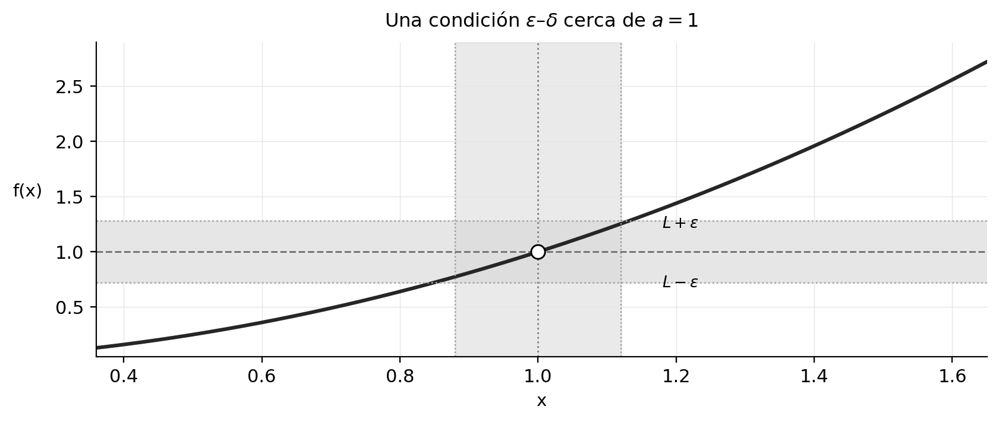
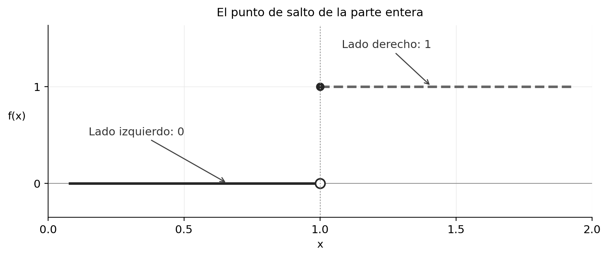
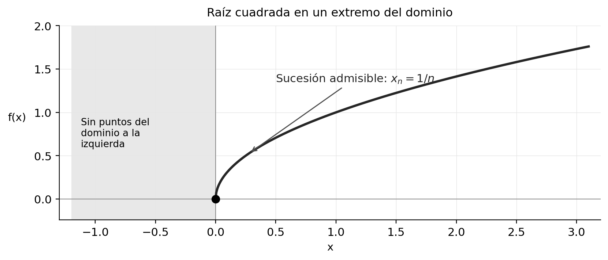
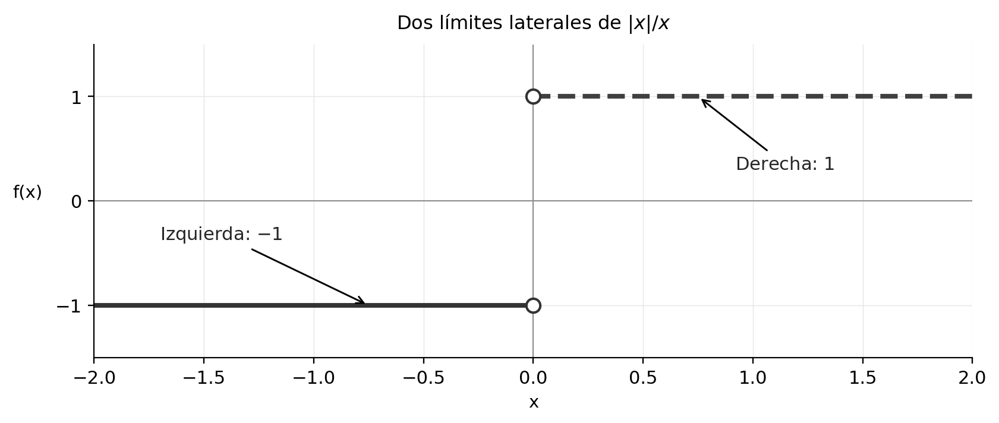
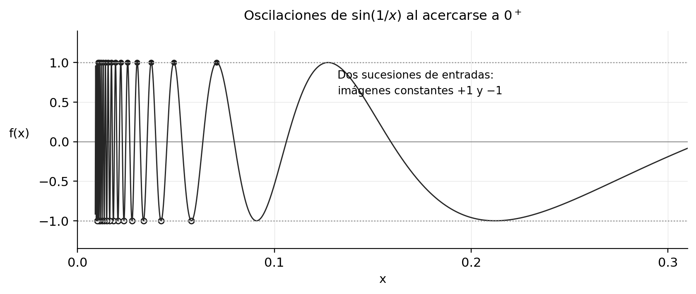
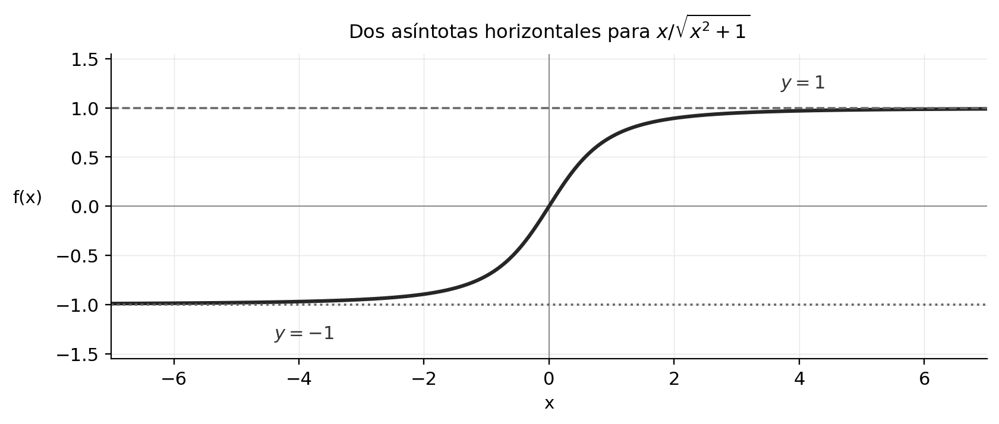
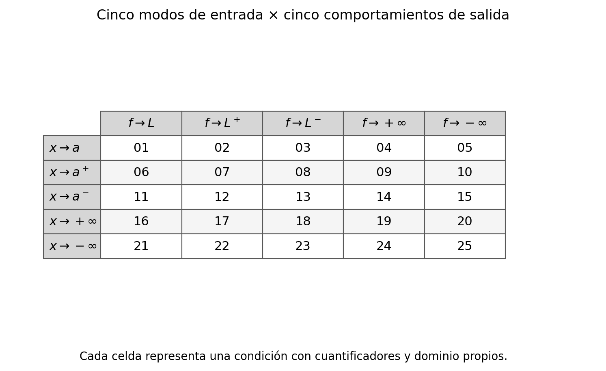
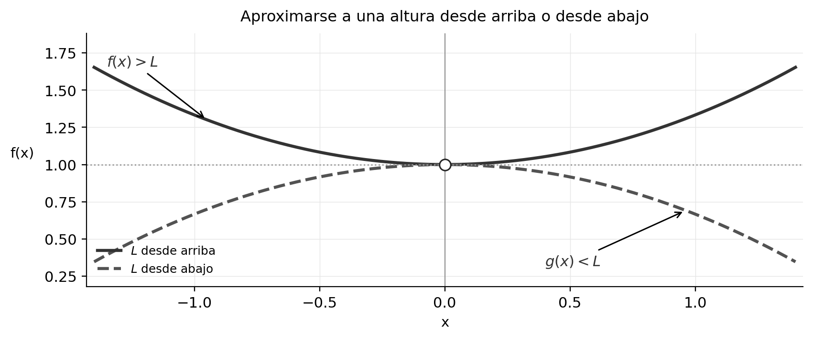
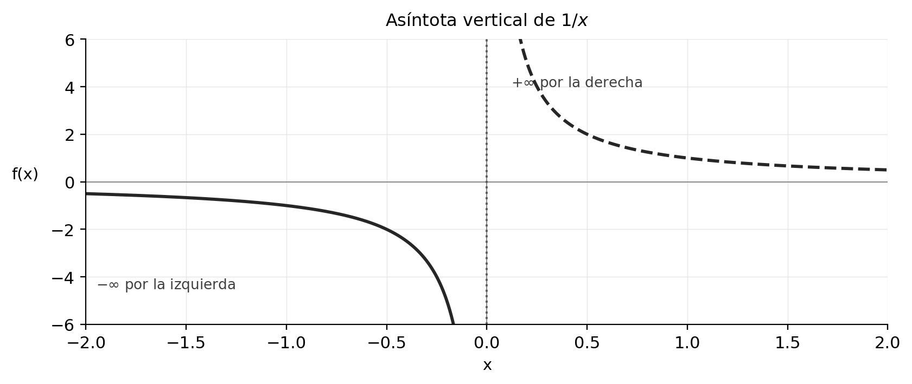

La noción de límite se amplía al restringir el dominio de aproximación y al considerar comportamientos sin cota. Los casos laterales, infinitos y desde arriba o abajo constituyen una familia de situaciones regidas por cuantificadores precisos.

**Grabaciones de referencia:** [grabación de la cátedra 13.2](https://www.youtube.com/watch?v=t3bX0a0x3kU).

*Procedencia de este tramo: cátedra 13.2.*

## El problema inicial: un límite debe poder estudiarse

**En la clase ([2:28](https://www.youtube.com/watch?v=t3bX0a0x3kU&t=148s)–[7:30](https://www.youtube.com/watch?v=t3bX0a0x3kU&t=450s)).** La definición secuencial de límite fue el fundamento anterior. Sea $f:A\to\mathbb R$ y sea $a$ un **punto de acumulación** de $A$: existe una sucesión $(x_n)$ de elementos de $A$, todos distintos de $a$, que converge a $a$. El límite de $f$ en $a$ es $L$ cuando, para **toda** sucesión así, las imágenes $f(x_n)$ convergen a $L$. Esta condición se caracteriza también mediante dos umbrales positivos:

$$
\boxed{\lim_{x\to a}f(x)=L\iff
\forall\varepsilon>0\ \exists\delta>0\ \forall x\in A:\quad
0<|x-a|<\delta\Longrightarrow |f(x)-L|<\varepsilon.}
$$

El número $\varepsilon$ mide la tolerancia vertical y $\delta$ controla la proximidad de los argumentos al punto $a$. Los puntos involucrados pertenecen al dominio $A$ y satisfacen $x\ne a$. El valor eventual de $f(a)$, cuando está definido, puede ser diferente de $L$.

{#fig-ic2021-c16-f01 fig-alt="Esquema editorial: banda de alturas y zona de aproximación."}

*Figura 1. Esquema editorial de una condición épsilon-delta. La franja vertical de entradas puede estrecharse para colocar las imágenes en la franja horizontal fijada por la tolerancia.*

La hipótesis de **acumulación** asegura que cada vecindad perforada $(a-\delta,a+\delta)\cap(A\setminus\{a\})$ tiene al menos un punto. Así, el cuantificador universal examina efectivamente imágenes de la función y la aproximación responde a datos del dominio. Esta precaución dominará toda la clase: cada límite lateral o al infinito requiere que existan entradas admisibles arbitrariamente cerca de la región indicada.

**Ampliación editorial.** El criterio de acumulación puede expresarse mediante vecindades: $a\in A'$ si y solo si

$$
\forall r>0:\quad \bigl((a-r,a+r)\setminus\{a\}\bigr)\cap A\ne\varnothing.
$$

Su equivalencia con la existencia de una sucesión apropiada se obtiene eligiendo $x_n\in A$ con $0<|x_n-a|<1/n$. Recíprocamente, una sucesión convergente y de términos distintos de $a$ aporta un término en toda vecindad perforada. La función del punto de acumulación es garantizar que se dispone de **trayectorias de aproximación dentro del dominio**.

## Límites laterales: la variable se aproxima desde un lado

**En la clase ([8:09](https://www.youtube.com/watch?v=t3bX0a0x3kU&t=489s)–[16:57](https://www.youtube.com/watch?v=t3bX0a0x3kU&t=1017s)).** Tomamos un punto real $a$ y dividimos el dominio en sus partes situadas a la derecha e izquierda:

$$
A_+(a)=A\cap(a,+\infty),\qquad A_-(a)=A\cap(-\infty,a).
$$

El **límite derecho** estudia los valores $f(x)$ cuando $x$ procede de $A_+(a)$ y se acerca a $a$. El **límite izquierdo** estudia los valores $f(x)$ cuando $x$ procede de $A_-(a)$ y se acerca a $a$. Se definen, respectivamente, cuando $a$ es punto de acumulación del dominio unilateral pertinente.

**Límite derecho.** Si $a\in A_+(a)'$, entonces

$$
\lim_{x\to a^+}f(x)=L
\iff\forall\varepsilon>0\ \exists\delta>0\ \forall x\in A:\quad
 a<x<a+\delta\Longrightarrow |f(x)-L|<\varepsilon.
$$

**Límite izquierdo.** Si $a\in A_-(a)'$, entonces

$$
\lim_{x\to a^-}f(x)=L
\iff\forall\varepsilon>0\ \exists\delta>0\ \forall x\in A:\quad
 a-\delta<x<a\Longrightarrow |f(x)-L|<\varepsilon.
$$

El signo de $a^+$ o $a^-$ describe **la posición de las entradas** con respecto a $a$; el signo se coloca en la variable que tiende al punto. A lo largo de esta unidad conservaremos la condición de acumulación unilateral como parte explícita de la definición.

### Teorema de recomposición de límites laterales
**En la clase ([16:20](https://www.youtube.com/watch?v=t3bX0a0x3kU&t=980s)–[20:37](https://www.youtube.com/watch?v=t3bX0a0x3kU&t=1237s)).** Supongamos que $a$ es punto de acumulación tanto de $A_+(a)$ como de $A_-(a)$. Entonces, para $L\in\mathbb R$,

$$
\boxed{\lim_{x\to a}f(x)=L
\iff
\lim_{x\to a^-}f(x)=L=\lim_{x\to a^+}f(x).}
$$

**Demostración desarrollada.** Si existe el límite total $L$, su definición se cumple para todos los puntos del dominio cercanos a $a$; se cumple, en particular, al restringirlos a cada conjunto unilateral. Por lo tanto ambos límites laterales valen $L$.

A la inversa, supongamos que los dos límites laterales existen y valen $L$. Dado $\varepsilon>0$, existen $\delta_-,\delta_+>0$ que funcionan, respectivamente, a izquierda y derecha. Tomemos $\delta=\min\{\delta_-,\delta_+\}$. Cualquier $x\in A$ con $0<|x-a|<\delta$ satisface exactamente una de las desigualdades $a-\delta<x<a$ o $a<x<a+\delta$. En ambos casos $|f(x)-L|<\varepsilon$. Esta es la definición del límite total.

La hipótesis de disponibilidad **de ambos lados** es esencial para este teorema. En un extremo del dominio la relación apropiada se establece con el lado que sí proporciona puntos de aproximación.

### Primer ejemplo: el salto de la parte entera
**En la clase ([22:41](https://www.youtube.com/watch?v=t3bX0a0x3kU&t=1361s)–[25:37](https://www.youtube.com/watch?v=t3bX0a0x3kU&t=1537s)).** Para la función parte entera $f(x)=\lfloor x\rfloor$ definida en $\mathbb R$, los valores en $(0,1)$ son cero y los valores en $[1,2)$ son uno. Así,

$$
\lim_{x\to1^-}\lfloor x\rfloor=0,
\qquad
\lim_{x\to1^+}\lfloor x\rfloor=1.
$$

Como $1$ es acumulación de ambos sectores del dominio y los límites laterales son distintos, el límite total carece de valor real.

{#fig-ic2021-c16-f02 fig-alt="Esquema editorial: función parte entera con salto en uno."}

*Figura 2. Esquema editorial de las dos alturas alcanzadas por aproximaciones laterales a $1$.*

### Segundo ejemplo: el extremo del dominio de la raíz
**En la clase ([25:46](https://www.youtube.com/watch?v=t3bX0a0x3kU&t=1546s)–[34:08](https://www.youtube.com/watch?v=t3bX0a0x3kU&t=2048s)).** Sea $f(x)=\sqrt{x}$, con $A=[0,+\infty)$. El punto cero es acumulación de $A$ y de $A_+(0)=(0,+\infty)$, mientras que el sector $A_-(0)$ es vacío. Por eso existen el límite derecho y el total:

$$
\boxed{\lim_{x\to0^+}\sqrt{x}=0=\lim_{x\to0}\sqrt{x}.}
$$

Para comprobar el valor, sea $\varepsilon>0$. Si $x\in[0,+\infty)$ y $0<|x|<\delta=\varepsilon^2$, entonces $0<\sqrt{x}<\varepsilon$. Esta demostración cubre simultáneamente el límite total y el derecho, porque los conjuntos de entradas realmente examinados coinciden cerca del origen.

{#fig-ic2021-c16-f03 fig-alt="Esquema editorial: raíz cuadrada y extremo del dominio."}

*Figura 3. Esquema editorial. En el límite total de $\sqrt{x}$ en cero, todas las entradas admisibles provienen del lado derecho.*

**Observación editorial sobre lenguaje.** Decir que el límite izquierdo «no existe» puede significar dos situaciones matemáticamente distintas. Aquí el límite unilateral izquierdo **no es estudiable** por falta de puntos del dominio. En una función oscilante definida a la izquierda, el límite sí es estudiable y puede fallar la convergencia. La clase subraya reiteradamente esta diferencia.

### Tercer ejemplo: dos expresiones del valor absoluto
**En la clase ([41:07](https://www.youtube.com/watch?v=t3bX0a0x3kU&t=2467s)–[46:33](https://www.youtube.com/watch?v=t3bX0a0x3kU&t=2793s)).** La función $h(x)=|x|/x$ tiene dominio $\mathbb R\setminus\{0\}$. Según el signo de la entrada,

$$
h(x)=\begin{cases}1,&x>0,\\-1,&x<0.\end{cases}
$$

Por tanto, $\lim_{x\to0^+}h(x)=1$ y $\lim_{x\to0^-}h(x)=-1$. Ambos lados son accesibles y las alturas difieren: el límite total en cero carece de valor. En cambio, para cualquier $a>0$ la función vale uno en un entorno suficientemente pequeño de $a$, aunque $a$ se encuentre muy cerca de cero. En particular, el límite en $0{,}1$ vale uno.

{#fig-ic2021-c16-f04 fig-alt="Esquema editorial: cociente valor absoluto."}

*Figura 4. Esquema editorial de $|x|/x$.*

### Cuarto ejemplo: oscilación con dos sucesiones de testigos
**En la clase ([34:20](https://www.youtube.com/watch?v=t3bX0a0x3kU&t=2060s)–[39:13](https://www.youtube.com/watch?v=t3bX0a0x3kU&t=2353s)).** Estudiemos $g(x)=\sin(1/x)$ en $A=\mathbb R\setminus\{0\}$. Consideremos las sucesiones positivas

$$
x_n=\frac1{\frac\pi2+2\pi n},\qquad
y_n=\frac1{\frac{3\pi}2+2\pi n},\qquad n\ge1.
$$

Ambas convergen a cero por la derecha. Sus imágenes satisfacen exactamente

$$
g(x_n)=1,\qquad g(y_n)=-1.
$$

Como una misma función presenta dos límites de imágenes distintos para entradas admisibles que se acercan al mismo punto desde la derecha, **carece de límite derecho en cero**. En particular, carece también de límite total. Análogamente se pueden construir testigos del lado izquierdo.

{#fig-ic2021-c16-f05 fig-alt="Esquema editorial: oscilaciones y dos familias de puntos."}

*Figura 5. Esquema editorial de la oscilación persistente de $\sin(1/x)$ cerca de cero.*

## Límites al infinito: aproximación sin cota de la variable independiente

**En la clase ([46:33](https://www.youtube.com/watch?v=t3bX0a0x3kU&t=2793s)–[58:19](https://www.youtube.com/watch?v=t3bX0a0x3kU&t=3499s)).** Los límites $x\to+\infty$ y $x\to-\infty$ examinan la función en las colas de su dominio. Para definirlos, el dominio debe ser, respectivamente, **no acotado superiormente** o **no acotado inferiormente**. Este requisito cumple el mismo papel de disponibilidad que el punto de acumulación en los límites finitos.

Si $A$ es no acotado superiormente, decimos que

$$
\boxed{\lim_{x\to+\infty}f(x)=L\iff
\forall\varepsilon>0\ \exists R>0\ \forall x\in A:\quad
x>R\Longrightarrow|f(x)-L|<\varepsilon.}
$$

Si $A$ es no acotado inferiormente, definimos

$$
\boxed{\lim_{x\to-\infty}f(x)=L\iff
\forall\varepsilon>0\ \exists R>0\ \forall x\in A:\quad
x<-R\Longrightarrow|f(x)-L|<\varepsilon.}
$$

El profesor escribe la barrera del lado izquierdo como $-M$ con $M>0$. Esta decisión mantiene positivos los parámetros de umbral y conserva la interpretación geométrica: se estudian entradas progresivamente grandes en magnitud negativa.

Una **asíntota horizontal** en la dirección $x\to+\infty$ es una recta $y=L$ para la cual la función satisface el primer límite. En la dirección $x\to-\infty$ se utiliza el segundo. Una función puede tener alturas horizontales asintóticas distintas en ambos extremos de su dominio.

{#fig-ic2021-c16-f06 fig-alt="Esquema editorial: dos asíntotas horizontales."}

*Figura 6. Ejemplo editorial: $x/\sqrt{x^2+1}$ tiende a $1$ cuando $x\to+\infty$ y a $-1$ cuando $x\to-\infty$.*

**Ampliación editorial.** Para verificar los valores de la figura, escribimos

$$
\frac{x}{\sqrt{x^2+1}}=\frac{x/|x|}{\sqrt{1+1/x^2}}.
$$

En la cola positiva $x/|x|=1$; en la negativa, $x/|x|=-1$. El denominador tiende a uno. La igualdad demuestra ambos límites sin invocar derivadas.

## Las veinticinco condiciones: una matriz de entrada y salida

**En la clase ([1:03:43](https://www.youtube.com/watch?v=t3bX0a0x3kU&t=3823s)–[1:22:01](https://www.youtube.com/watch?v=t3bX0a0x3kU&t=4921s)).** El título de la sesión se explica por dos familias independientes de opciones. La entrada admite las cinco modalidades ya estudiadas. La salida puede aproximarse a $L$, hacerlo a través de valores **mayores** que $L$ o **menores** que $L$, crecer hacia $+\infty$ o decrecer hacia $-\infty$.

{#fig-ic2021-c16-f07 fig-alt="Esquema editorial: matriz de veinticinco combinaciones."}

*Figura 7. Matriz editorial de las 25 combinaciones. Su lectura precisa exige los cuantificadores y las condiciones de dominio que siguen.*

### Cinco condiciones de entrada
Sea $A\subseteq\mathbb R$ un dominio y $a\in\mathbb R$. La letra $\rho>0$ será el parámetro de cercanía asociado a una modalidad de entrada. Definimos:

| Modalidad | Condición de entrada $P_\rho(x)$ | Requisito para que pueda estudiarse |
|:--|:--|:--|
| $x\to a$ | $x\in A$, $0<|x-a|<\rho$ | $a\in A'$ |
| $x\to a^+$ | $x\in A$, $a<x<a+\rho$ | $a\in(A\cap(a,\infty))'$ |
| $x\to a^-$ | $x\in A$, $a-\rho<x<a$ | $a\in(A\cap(-\infty,a))'$ |
| $x\to+\infty$ | $x\in A$, $x>\rho$ | $A$ no acotado superiormente |
| $x\to-\infty$ | $x\in A$, $x<-\rho$ | $A$ no acotado inferiormente |

Con esta tabla, la variable $\rho$ representa $\delta$ en los tres primeros casos y un umbral $R$ o $M$ positivo en los dos últimos. **El requisito de la última columna se comprueba antes de plantear el límite.**

### Cinco condiciones de salida
Con una tolerancia $\varepsilon>0$ o una cota $H>0$, escribimos:

| Modalidad de salida | Condición vertical que debe cumplirse |
|:--|:--|
| $f(x)\to L$ | $|f(x)-L|<\varepsilon$ |
| $f(x)\to L$ **desde arriba**, notada en clase $L^+$ | $0<f(x)-L<\varepsilon$ |
| $f(x)\to L$ **desde abajo**, notada en clase $L^-$ | $0<L-f(x)<\varepsilon$ |
| $f(x)\to+\infty$ | $f(x)>H$ |
| $f(x)\to-\infty$ | $f(x)<-H$ |

La combinación de cualquier fila de entradas con cualquier fila de salidas determina una condición completa. Para una **salida finita**, el esquema universal es

$$
\boxed{\forall\varepsilon>0\ \exists\rho>0\ \forall x\in A:\quad
P_\rho(x)\Longrightarrow Q_\varepsilon(f(x)),}
$$

y para una **salida infinita**, se emplea

$$
\boxed{\forall H>0\ \exists\rho>0\ \forall x\in A:\quad
P_\rho(x)\Longrightarrow Q_H(f(x)).}
$$

Aquí $Q$ es la desigualdad vertical correspondiente a la fila elegida. Esta regla **genera explícitamente los 25 casos** sin memorizar veinticinco fórmulas extensas. En el propio documento, por ejemplo, los casos de entrada $a^+$ y salida $L$, de entrada $+\infty$ y salida $L$, de entrada $-\infty$ y salida $+\infty$, quedan escritos en detalle.

### Tres combinaciones desarrolladas
**En la clase ([1:11:05](https://www.youtube.com/watch?v=t3bX0a0x3kU&t=4265s) y [1:16:43](https://www.youtube.com/watch?v=t3bX0a0x3kU&t=4603s)).** En la primera combinación explicada, la entrada se aproxima a $a$ **por la izquierda** y la salida se aproxima a $L$ **desde arriba**:

$$
\forall\varepsilon>0\ \exists\delta>0\ \forall x\in A:\quad
\bigl(a-\delta<x<a\bigr)
\Longrightarrow \bigl(0<f(x)-L<\varepsilon\bigr).
$$

El valor $L$ es el límite ordinario; la condición adicional $f(x)>L$ indica la dirección vertical. El profesor utiliza la expresión simbólica $L^+$ para conservar esa información adicional.

En la segunda combinación explicada se hace que $x\to-\infty$ mientras $f(x)\to+\infty$:

$$
\forall H>0\ \exists R>0\ \forall x\in A:\quad
x<-R\Longrightarrow f(x)>H.
$$

Una parábola como $f(x)=x^2$, con dominio $\mathbb R$, satisface esta condición: dado $H>0$, basta $R=\sqrt H+1$; de $x<-R$ se deduce $x^2>H$.

La tercera combinación, incorporada como **ampliación editorial**, utiliza $x\to a^+$ y salida $-\infty$:

$$
\forall H>0\ \exists\delta>0\ \forall x\in A:\quad
0<x-a<\delta\Longrightarrow f(x)<-H.
$$

Por ejemplo, $f(x)=-1/(x-a)$ en el dominio $(a,+\infty)$ tiene este comportamiento, pues basta escoger $\delta=1/(H+1)$.

### ¿Qué significan precisamente $L^+$ y $L^-$?
**Ampliación editorial de rigor.** En el uso común de cálculo, el número real límite de una función sigue siendo $L$. El signo sobrepuesto en $L^+$ o $L^-$ funciona aquí como **etiqueta de aproximación vertical**, según la convención didáctica de la grabación, y añade una desigualdad eventual. Se distingue cuidadosamente de $a^+$ y $a^-$, que indican la dirección de aproximación horizontal de la variable $x$.

La condición $f(x)\to L$ desde arriba **implica** que $f(x)\to L$; la implicación inversa requiere más información. Por ejemplo, la función constante $f(x)=L$ tiene límite $L$, pero su aproximación a $L$ no satisface las desigualdades estrictas $f(x)>L$ o $f(x)<L$. También puede ocurrir que $f(x)-L$ cambie infinitas veces de signo y aun así tienda a cero.

{#fig-ic2021-c16-f08 fig-alt="Esquema editorial: altura alcanzada desde arriba o desde abajo."}

*Figura 8. Ejemplo editorial de dos funciones que se aproximan a la misma altura $L$ con desigualdades de signo opuesto.*

Las **25 casillas describen condiciones lógicas relacionadas**, con refinamientos e implicaciones entre ellas. Por ello el conteo es una organización pedagógica de los posibles comportamientos, más que una colección de veinticinco teoremas independientes.

## Límites de salida infinita y asíntotas verticales

**En la clase ([1:17:01](https://www.youtube.com/watch?v=t3bX0a0x3kU&t=4621s)–[1:21:19](https://www.youtube.com/watch?v=t3bX0a0x3kU&t=4879s)).** Cuando la salida crece por encima de cualquier cota, se escribe un límite $+\infty$; cuando decrece por debajo de toda cota negativa, se escribe un límite $-\infty$. Por ejemplo,

$$
\lim_{x\to a^+}f(x)=+\infty
\iff
\forall H>0\ \exists\delta>0\ \forall x\in A:\quad
0<x-a<\delta\Longrightarrow f(x)>H.
$$

Asimismo,

$$
\lim_{x\to a^-}f(x)=-\infty
\iff
\forall H>0\ \exists\delta>0\ \forall x\in A:\quad
a-\delta<x<a\Longrightarrow f(x)<-H.
$$

Si al menos uno de los límites unilaterales de $f$ en $a$ presenta una de estas divergencias infinitas, la recta $x=a$ es una **asíntota vertical** en el sentido que se utiliza en la clase.

{#fig-ic2021-c16-f09 fig-alt="Esquema editorial: asíntota vertical y sentidos divergentes."}

*Figura 9. Ejemplo editorial: $f(x)=1/x$ presenta $-\infty$ a la izquierda de cero y $+\infty$ a la derecha.*

**Demostración desarrollada.** Para $f(x)=1/x$, dado $H>0$, elegimos $\delta=1/(H+1)$. Si $0<x<\delta$, entonces $1/x>H+1>H$. Si $-\delta<x<0$, el recíproco es $1/x<-(H+1)<-H$. Quedan acreditados los dos límites infinitos laterales. Esta divergencia se refiere a magnitudes sin cota; $+\infty$ y $-\infty$ son **símbolos de comportamiento** y no valores reales alcanzados por la función.

## Extensiones del álgebra, el sándwich y la composición

**En la clase ([1:22:22](https://www.youtube.com/watch?v=t3bX0a0x3kU&t=4942s)–[1:29:20](https://www.youtube.com/watch?v=t3bX0a0x3kU&t=5360s)).** Los teoremas conocidos de límites finitos conservan sus reglas ordinarias de suma, producto y cociente en sus dominios apropiados. Los comportamientos infinitos permiten extender algunas reglas: una función que crece hacia $+\infty$ conserva esa divergencia al sumarle una función que posee límite real finito. Dos funciones que crecen hacia $+\infty$ también producen una suma que crece hacia $+\infty$.

La expresión $+\infty-\infty$ señala una **forma indeterminada**: los dos términos pueden tener diferentes velocidades y la diferencia puede tender a un número, a alguno de los infinitos o presentar oscilaciones. La razón $\infty/\infty$ también es indeterminada. Son categorías de análisis: indican que la información sobre los límites separados resulta insuficiente para determinar el límite de la combinación.

**Ampliación editorial: tres resultados para una misma apariencia.** Cuando $x\to+\infty$, las funciones

$$
\bigl(x+x\bigr)-x=x\to+\infty,
\qquad (x+1)-x\to1,
\qquad x-(x+x)\to-\infty
$$

se obtienen restando expresiones que divergen hacia $+\infty$, pero producen límites completamente distintos. Análogamente, $x/x\to1$, $x/x^2\to0$ y $x^2/x\to+\infty$ ilustran la razón $\infty/\infty$.

El **principio de comparación infinita** sí da resultados completos. Si $f(x)\le g(x)$ para todos los puntos admisibles suficientemente cercanos según la modalidad de entrada elegida y $f(x)\to+\infty$, entonces $g(x)\to+\infty$. Si $f(x)\le g(x)$ y $g(x)\to-\infty$, entonces $f(x)\to-\infty$.

**Demostración desarrollada.** En el primer caso, dado $H>0$, existe un umbral de entrada a partir del cual $f(x)>H$. La desigualdad entrega $g(x)\ge f(x)>H$. En el segundo caso, la condición $g(x)<-H$ y la comparación entregan $f(x)\le g(x)<-H$. Las mismas pruebas funcionan para cualquiera de las cinco modalidades de entrada siempre que las desigualdades se cumplan en la región pertinente.

La clase también destaca el amplio número de combinaciones en la **composición**: cinco comportamientos de entrada, cinco de la función interior y cinco de la exterior originan **125 configuraciones formales**. Este número organiza posibles enunciados. Cada teorema efectivo requiere además hipótesis apropiadas sobre dominios, puntos de acumulación y compatibilidad de las aproximaciones, tal como se demostró en la cátedra 13.1.

## Dos demostraciones finales con cuantificadores

### El recíproco tiende a cero desde valores positivos
**En la clase ([1:29:29](https://www.youtube.com/watch?v=t3bX0a0x3kU&t=5369s)–[1:35:43](https://www.youtube.com/watch?v=t3bX0a0x3kU&t=5743s)).** Se demuestra

$$
\boxed{\lim_{x\to+\infty}\frac1x=0,\quad\text{con }\frac1x>0\text{ en la cola positiva}.}
$$

**Demostración desarrollada.** Dado $\varepsilon>0$, escogemos $R=1/\varepsilon$. Para cualquier $x>R$ se cumplen $x>0$ y

$$
0<\frac1x<\frac1R=\varepsilon.
$$

La elección del umbral depende explícitamente de $\varepsilon$, tal como exige la definición. En sucesiones la desigualdad correspondiente se satisface escogiendo un entero $N>1/\varepsilon$; aquí el umbral puede ser cualquier real positivo. La precisión adicional «desde arriba» registra que $1/x$ mantiene signo positivo para entradas suficientemente grandes.

### La exponencial se aproxima a cero por la izquierda del eje de entradas
**En la clase ([1:35:43](https://www.youtube.com/watch?v=t3bX0a0x3kU&t=5743s)–[1:41:58](https://www.youtube.com/watch?v=t3bX0a0x3kU&t=6118s)).** Se demuestra

$$
\boxed{\lim_{x\to-\infty}e^x=0,\quad e^x>0.}
$$

**Demostración desarrollada.** Dado $\varepsilon>0$, buscamos una cota $R>0$ tal que $x<-R$ implique $e^x<\varepsilon$. Como el logaritmo es estrictamente creciente,

$$
e^x<\varepsilon\iff x<\ln\varepsilon.
$$

Basta elegir

$$
\boxed{R=\max\{1,-\ln\varepsilon\}.}
$$

En efecto, $R\ge-\ln\varepsilon$ implica $-R\le\ln\varepsilon$; por lo tanto, $x<-R$ asegura $x<\ln\varepsilon$ y de aquí $0<e^x<\varepsilon$. La elección funciona tanto para tolerancias pequeñas como grandes y mantiene el umbral $R$ estrictamente positivo. Esta demostración muestra cómo un resultado previo sobre la función logaritmo permite construir el umbral exigido por la definición.

## Taller de problemas y soluciones

Los ejercicios se presentan a continuación según la fuente de origen; las ampliaciones editoriales de cada apuntes permanecen expresamente identificadas.

### Ejercicios de estudio y soluciones — cátedra 13.2

Los ejercicios siguientes son **ampliaciones editoriales**, salvo aquellos que retoman una actividad expresamente tratada o propuesta en la grabación. En cada solución conviene empezar por el dominio y las regiones de aproximación accesibles.

**Ejercicio 1 (repaso de la clase).** Hallar los dos límites laterales de $\lfloor x\rfloor$ en $x=2$. **Solución.** En $(1,2)$ la parte entera vale uno, y en $(2,3)$ vale dos. Por tanto, el izquierdo es uno y el derecho es dos; el límite total carece de valor real.

**Ejercicio 2 (repaso de la clase).** Determinar los límites accesibles de $\sqrt{x}$ en $0$. **Solución.** El dominio es $[0,+\infty)$; el límite total y el derecho son cero. El lado izquierdo carece de puntos de aproximación del dominio.

**Ejercicio 3 (editorial).** Para $f(x)=\sqrt{1-x}$, estudiar $x\to1$. **Solución.** El dominio es $(-\infty,1]$; el límite total y el izquierdo son cero. El límite derecho carece de dominio accesible.

**Ejercicio 4 (repaso de la clase).** Calcular los límites de $|x|/x$ en $0$. **Solución.** El izquierdo vale $-1$ y el derecho vale $1$; existe diferencia entre las dos aproximaciones.

**Ejercicio 5 (editorial).** Hallar $\lim_{x\to0}\sqrt{|x|}$. **Solución.** Si $0<|x|<\varepsilon^2$, entonces $\sqrt{|x|}<\varepsilon$. El límite total vale cero y ambos lados proporcionan entradas admisibles.

**Ejercicio 6 (repaso de la clase).** Probar con sucesiones que $\sin(1/x)$ carece de límite derecho en $0$. **Solución.** Utilizar $x_n=1/(\pi/2+2\pi n)$ e $y_n=1/(3\pi/2+2\pi n)$, cuyas imágenes son $1$ y $-1$.

**Ejercicio 7 (editorial).** Calcular $\lim_{x\to+\infty}(2x+1)/(x+3)$ e indicar el lado vertical de aproximación. **Solución.** Al dividir numerador y denominador por $x$ obtenemos $2$. Además, $(2x+1)/(x+3)-2=-5/(x+3)<0$ en la cola positiva: se aproxima a $2$ desde abajo.

**Ejercicio 8 (editorial).** Calcular $\lim_{x\to\pm\infty}x/\sqrt{x^2+1}$. **Solución.** Utilizar $x/|x|$ y dividir el denominador por $|x|$: se obtienen $+1$ a la derecha y $-1$ a la izquierda. Ambos valores se alcanzan mediante cotas de signo estrictas.

**Ejercicio 9 (editorial).** Determinar los límites laterales infinitos de $1/x^2$ en $0$. **Solución.** A ambos lados $1/x^2>H$ cuando $0<|x|<1/\sqrt H$, con $H>0$. Así ambos lados divergen a $+\infty$, y también se puede decir que la función diverge a $+\infty$ en el sentido de la definición total correspondiente.

**Ejercicio 10 (editorial).** Probar que $\lim_{x\to-\infty}e^{2x}=0$ mediante cuantificadores. **Solución.** Para $\varepsilon>0$ basta tomar $R=\max\{1,-\tfrac12\ln\varepsilon\}$; si $x<-R$, se obtiene $2x<\ln\varepsilon$ y $0<e^{2x}<\varepsilon$.

**Ejercicio 11 (editorial).** Sea $f(x)=3+x\sin(1/x)$ para $x\ne0$. Determinar el límite en cero y si se aproxima desde un único lado vertical. **Solución.** Puesto que $|x\sin(1/x)|\le|x|$, el límite es $3$. Los valores de $x\sin(1/x)$ toman signos positivos y negativos arbitrariamente cerca de cero, de modo que no se satisface una aproximación vertical estrictamente desde arriba ni estrictamente desde abajo.

**Ejercicio 12 (editorial).** Verificar un caso de comparación infinita: $f(x)=x^2$ y $g(x)=x^2+\cos x$ cuando $x\to+\infty$. **Solución.** Como $g(x)\ge x^2-1$ y $x^2-1\to+\infty$, la comparación implica $g(x)\to+\infty$.

**Ejercicio 13 (editorial).** Si $f(x)\equiv4$, estudiar su límite cuando $x\to+\infty$, comparándolo con las nociones $4^+$ y $4^-$. **Solución.** El límite ordinario es $4$. Las dos condiciones de aproximación vertical estricta fallan, pues la diferencia $f(x)-4$ vale cero en cada punto.

**Ejercicio 14 (editorial).** Sea $A=\{1/n:n\in\mathbb N,\ n\ge1\}$ y $f:A\to\mathbb R$ dada por $f(x)=x$. Estudiar el límite cuando $x\to0$ y los dos laterales. **Solución.** El cero es punto de acumulación de $A$ y de $A_+(0)$; el límite total y el derecho valen cero. Como $A\cap(-\infty,0)=\varnothing$, el izquierdo no es estudiable.

### Problemas generativos para profundizar
**Ejercicio 15 (editorial).** Construir una función definida a ambos lados de cero que tenga límite total igual a cinco y que tome infinitas veces valores mayores y menores que cinco cerca del origen. **Solución orientativa.** Definir $f(0)=0$ y $f(x)=5+x\sin(1/x)$ para $x\ne0$. El teorema del sándwich establece $f(x)\to5$ y las oscilaciones de signo producen los dos comportamientos verticales.

**Ejercicio 16 (editorial).** Encontrar funciones $f$ y $g$ con $f(x),g(x)\to+\infty$ cuando $x\to+\infty$, tales que $f-g$ tienda respectivamente a $0$, a $7$, a $+\infty$ y a $-\infty$. **Solución.** En el mismo orden, pueden escogerse $(f,g)=(x,x)$, $(x+7,x)$, $(2x,x)$ y $(x,2x)$.

**Ejercicio 17 (editorial).** Enunciar y demostrar el límite $\lim_{x\to a^+}(x-a)^{-1}=+\infty$ mediante $H$ y $\delta$. **Solución.** Para $H>0$, elegir $\delta=1/(H+1)$; en $a<x<a+\delta$ se cumple $(x-a)^{-1}>H+1$.

**Ejercicio 18 (editorial).** Explicar con un ejemplo por qué el requisito $a\in A_-(a)'$ es esencial al usar el teorema de límites laterales. **Solución.** $f(x)=\sqrt x$ en $a=0$: su límite total es cero y el lateral derecho vale cero, mientras que el lateral izquierdo carece de entradas admisibles. El enunciado de coincidencia necesita la hipótesis de accesibilidad en ambos lados.

---

---

*Este capítulo pertenece a la edición temática no oficial del curso IC2021. [Índice del libro](index.qmd) · [Fuentes y concordancia](apendices.qmd).*
