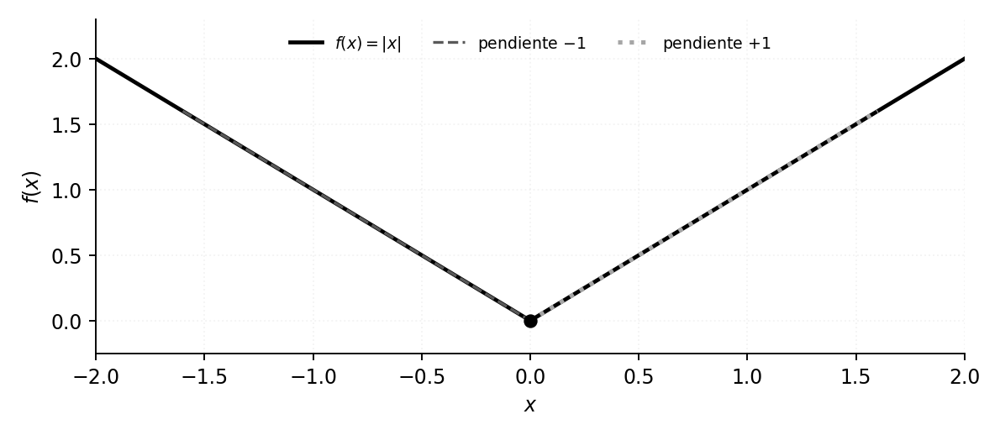
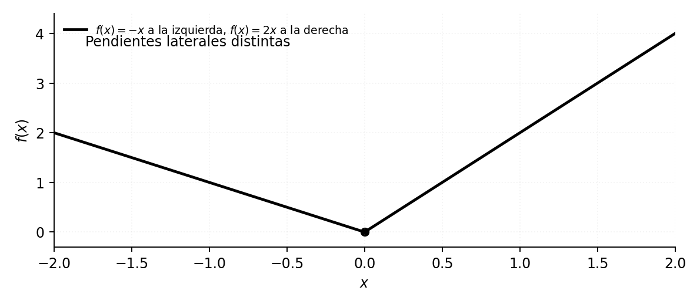
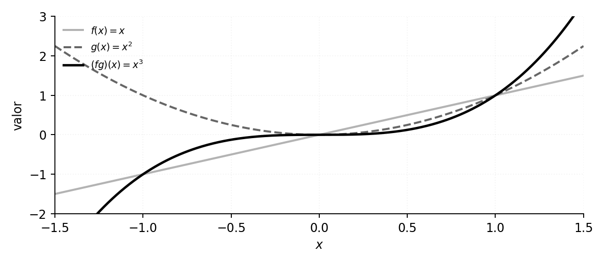
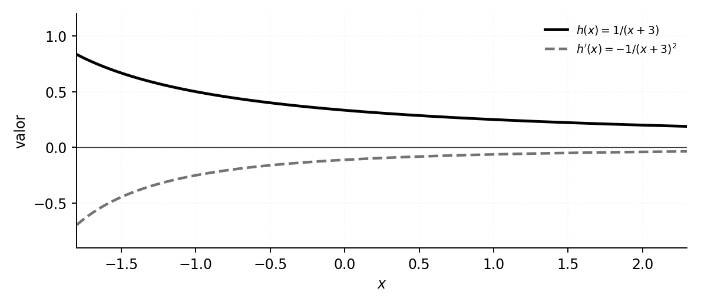
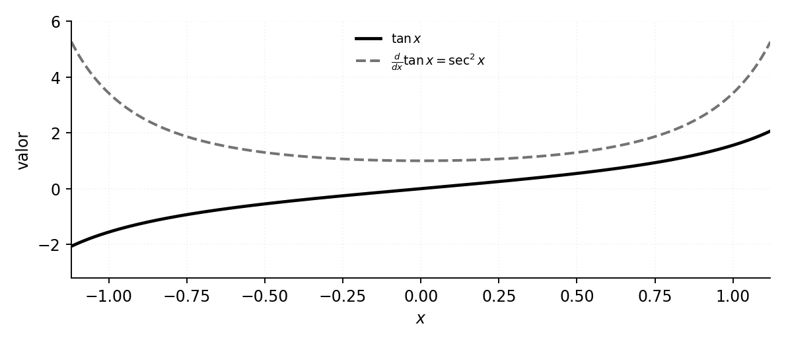
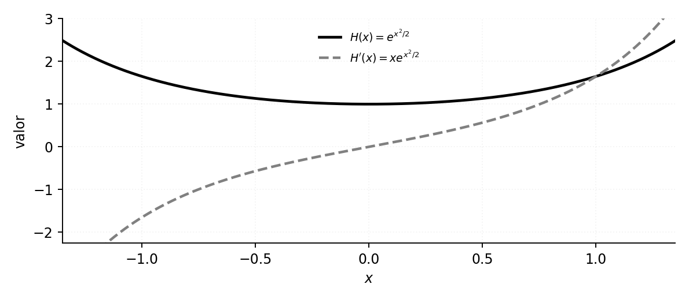
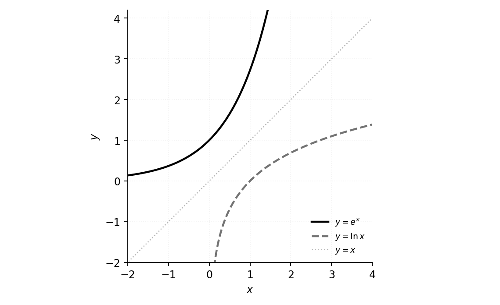
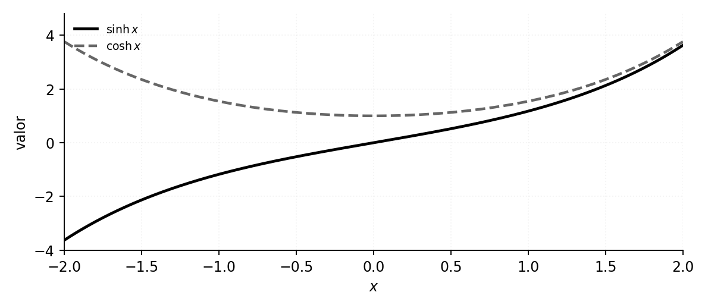

La derivabilidad implica continuidad y permite establecer reglas operativas para sumas, productos y cocientes. Las reglas de composición e inversa amplían el repertorio, con hipótesis que es indispensable explicitar.

**Grabaciones de referencia:** [grabación de la cátedra 14.2](https://www.youtube.com/watch?v=eXthvzh8_9Y).

*Procedencia de este tramo: cátedra 14.2.*

## El objetivo de las técnicas de derivación

**En la clase (17:44–20:20).** El estudio de la cátedra 14.1 permitió derivar directamente algunas funciones elementales: polinomios, potencias, raíces, exponencial y funciones trigonométricas. La nueva pregunta es cómo obtener derivadas de las funciones construidas mediante **suma, resta, producto, cociente y composición**, y posteriormente mediante **inversión**.

Fijada una función $f:A\to\mathbb R$ y un punto interior $a\in\operatorname{int}(A)$, su derivada es el límite real

$$
 f'(a)=\lim_{x\to a}\frac{f(x)-f(a)}{x-a}
 =\lim_{h\to0}\frac{f(a+h)-f(a)}{h},
$$

si existe. Las reglas que estudiaremos convierten este límite en una operación calculable, siempre atendiendo a las condiciones de derivabilidad y a los dominios de las funciones que intervienen.

## Primer teorema: derivabilidad y continuidad

**En la clase (20:20–29:55).** Una función derivable en un punto tiene límite igual a su valor en él. Este resultado conecta la noción geométrica de pendiente tangente con la continuidad, que el profesor anuncia como objeto de estudio sistemático del semestre siguiente.

**Teorema.** Sea $f:A\to\mathbb R$, con $a$ interior de $A$. Si existe un número real $f'(a)$, entonces

$$
 \boxed{\lim_{x\to a}f(x)=f(a).}
$$

**Demostración reconstruida de la clase.** Para $x\in A$ distinto de $a$ se puede escribir

$$
\begin{aligned}
 f(x)&=f(a)+\bigl(f(x)-f(a)\bigr)\\
 &=f(a)+\frac{f(x)-f(a)}{x-a}\,(x-a).
\end{aligned}
$$

El cociente tiende al número finito $f'(a)$ por hipótesis y el factor $x-a$ tiende a cero. El álgebra de límites da

$$
\lim_{x\to a}f(x)=f(a)+f'(a)\cdot0=f(a).
$$

La conclusión identifica la **continuidad en $a$**: el comportamiento de $f$ en los puntos del dominio cercanos a $a$ converge al valor asignado al propio punto.

### Una función continua con esquina
**En la clase (29:55–40:20).** Para $f(x)=|x|$ se verifica $\lim_{x\to0}|x|=0=f(0)$, de modo que $f$ es continua en cero. Sin embargo, su cociente incremental en el origen es

$$
\frac{|x|-|0|}{x-0}=\frac{|x|}{x}=\begin{cases}1,&x>0,\\-1,&x<0.\end{cases}
$$

Sus límites laterales son $1$ y $-1$, respectivamente. Como difieren, el límite bilateral de ese cociente **no existe** y $f$ carece de derivada finita en cero.

{#fig-ic2021-c18-f01 fig-alt="Esquema editorial: continuidad y pendientes laterales del valor absoluto"}

### Dos pendientes laterales y una decisión única
**Ampliación editorial.** La derivabilidad bilateral se comprueba examinando los cocientes incrementales desde ambos lados. Cuando el dominio contiene un intervalo abierto centrado en $a$, se tienen las derivadas laterales

$$
 f'_-(a)=\lim_{h\to0^-}\frac{f(a+h)-f(a)}{h},\qquad
 f'_+(a)=\lim_{h\to0^+}\frac{f(a+h)-f(a)}{h},
$$

si existen como números reales. La derivada $f'(a)$ existe precisamente cuando ambas derivadas laterales existen y coinciden. El valor absoluto da $f'_-(0)=-1$ y $f'_+(0)=1$.

Otra función continua con quiebre es

$$
 q(x)=\begin{cases}-x,&x<0,\\2x,&x\ge0.\end{cases}
$$

Ambas ramas se encuentran en $(0,0)$, por lo que $q$ es continua en cero; el cociente incremental vale $-1$ para $h<0$ y $2$ para $h>0$. La diferencia entre las pendientes es la propiedad relevante. La figura siguiente constituye un ejemplo editorial independiente.

{#fig-ic2021-c18-f02 fig-alt="Esquema editorial: ramas con pendientes laterales diferentes"}

**Consecuencia lógica.** La implicación «derivable $\Rightarrow$ continua» está demostrada. Su recíproca es falsa, como muestra el valor absoluto. Fuera de cero, el valor absoluto es derivable y

$$
 (|x|)'=\begin{cases}1,&x>0,\\-1,&x<0,\end{cases}
 \qquad\text{equivalentemente } (|x|)'=\frac{|x|}{x}\quad(x\ne0).
$$

**Ampliación editorial.** La derivabilidad exige un comportamiento lineal de primer orden único. Las funciones $|x|$ y la función $x\mapsto\sqrt{|x|}$ ilustran dos modos diferentes de perder derivabilidad: en la primera se obtienen pendientes laterales finitas diferentes; en la segunda los cocientes pueden crecer sin cota. Existen, además, funciones continuas en toda la recta y no derivables en ningún punto, posibilidad mencionada por el docente sin construir un ejemplo específico en esta sesión.

## Álgebra de derivadas: suma, resta y multiplicación por una constante

**En la clase (41:57–47:10).** Supongamos que $f$ y $g$ son derivables en $a$ y están definidas en un intervalo abierto que contiene $a$. Las funciones $f+g$ y $f-g$ también son derivables en $a$, con

$$
 \boxed{(f+g)'(a)=f'(a)+g'(a),\qquad (f-g)'(a)=f'(a)-g'(a).}
$$

**Demostración desarrollada.** Para $x\ne a$,

$$
\begin{aligned}
 \frac{(f+g)(x)-(f+g)(a)}{x-a}
 &=\frac{[f(x)-f(a)]+[g(x)-g(a)]}{x-a}\\
 &=\frac{f(x)-f(a)}{x-a}+\frac{g(x)-g(a)}{x-a}.
\end{aligned}
$$

Al pasar al límite, cada sumando converge a su derivada correspondiente. En la resta se conserva el signo negativo del segundo cociente. Con un factor real constante $c$, la misma operación da

$$
 (cf)'(a)=c\,f'(a).
$$

Estas reglas permiten derivar polinomios término a término: por ejemplo,

$$
 (5x^4-3x^2+7)'=20x^3-6x.
$$

## La derivada del producto

**En la clase (47:10–1:00:20).** Sean $f$ y $g$ derivables en $a$. La derivada del producto es una **suma de dos contribuciones**:

$$
 \boxed{(fg)'(a)=f'(a)g(a)+f(a)g'(a).}
$$

**Demostración reconstruida.** El punto decisivo del cálculo es agregar y quitar el término $f(a)g(x)$, operación que San Martín llama «ni quita ni pone». Para $x\ne a$,

$$
\begin{aligned}
 f(x)g(x)-f(a)g(a)
 &=f(x)g(x)-f(a)g(x)+f(a)g(x)-f(a)g(a)\\
 &=[f(x)-f(a)]g(x)+f(a)[g(x)-g(a)].
\end{aligned}
$$

Dividimos por $x-a$:

$$
\frac{f(x)g(x)-f(a)g(a)}{x-a}
 =\frac{f(x)-f(a)}{x-a}\,g(x)
 +f(a)\frac{g(x)-g(a)}{x-a}.
$$

Puesto que las funciones derivables son continuas, $g(x)\to g(a)$. Los dos cocientes incrementales tienden a $f'(a)$ y $g'(a)$, respectivamente. Aplicando el álgebra de límites se obtiene la fórmula anunciada. La continuidad de $g$ utilizada aquí fue demostrada en el primer teorema de la clase.

{#fig-ic2021-c18-f03 fig-alt="Esquema editorial: funciones y producto"}

### Tres factores y generalización
**Ejercicio propuesto por el profesor.** Para tres funciones derivables,

$$
 \boxed{(fgh)'=f'gh+fg'h+fgh'.}
$$

**Solución editorial.** Escribimos $fgh=(fg)h$. La regla del producto aplicada por primera vez da $(fgh)'=(fg)'h+(fg)h'$. Una segunda aplicación a $(fg)'$ produce $(f'g+fg')h+fgh'$, que coincide con la fórmula. Por inducción, para $m$ factores derivables,

$$
\left(\prod_{j=1}^{m}f_j\right)'=
 \sum_{k=1}^{m} f_k'\!\prod_{\substack{1\le j\le m\\j\ne k}}f_j.
$$

La suma contiene $m$ términos; cada término deriva exactamente uno de los factores y conserva los demás.

## Recíproco y cociente

**En la clase (1:00:20–1:09:20).** Sea $g$ derivable en $a$ y $g(a)\ne0$. Por continuidad, $g(x)$ conserva un valor distinto de cero en un entorno de $a$, por lo que $1/g$ está definido allí. El resultado es

$$
 \boxed{\left(\frac1g\right)'(a)=-\frac{g'(a)}{g(a)^2}.}
$$

**Demostración reconstruida.** El cociente incremental del recíproco se transforma mediante denominador común:

$$
\begin{aligned}
\frac{g(x)^{-1}-g(a)^{-1}}{x-a}
 &=\frac{g(a)-g(x)}{g(x)g(a)(x-a)}\\
 &=-\frac{g(x)-g(a)}{x-a}\cdot\frac{1}{g(x)g(a)}.
\end{aligned}
$$

El primer factor tiende a $-g'(a)$ y el segundo a $1/g(a)^2$. De aquí se obtiene el resultado.

{#fig-ic2021-c18-f04 fig-alt="Esquema editorial: una función recíproca y su derivada"}

Si $f$ y $g$ son derivables en $a$ y $g(a)\ne0$, expresamos $f/g=f\cdot(1/g)$ y aplicamos las dos reglas anteriores. Se obtiene la **regla del cociente**:

$$
 \boxed{\left(\frac{f}{g}\right)'(a)
 =\frac{f'(a)g(a)-f(a)g'(a)}{g(a)^2}.}
$$

Es crucial conservar el orden de los términos del numerador: el primero es la derivada del numerador por el denominador, y el segundo es el numerador por la derivada del denominador, con signo negativo.

### Aplicaciones desarrolladas en la clase
**Potencias negativas (aprox. 1:15).** Tomando $g(x)=x^n$ con $n\in\mathbb N$ y $x\ne0$:

$$
\begin{aligned}
 \frac{d}{dx}x^{-n}
 &=\left(\frac{1}{x^n}\right)'
 =-\frac{nx^{n-1}}{x^{2n}}
 =-nx^{-n-1}.
\end{aligned}
$$

La regla $(x^k)'=kx^{k-1}$ vale así para exponentes enteros $k$, en los dominios donde la función está definida. La clase 14.1 ya había abordado las potencias naturales y las raíces.

**Tangente trigonométrica (aprox. 1:18).** Como $\tan x=\sin x/\cos x$ para $\cos x\ne0$,

$$
\begin{aligned}
 (\tan x)'&=\frac{(\cos x)(\cos x)-(\sin x)(-\sin x)}{\cos^2x}\\
 &=\frac{\cos^2x+\sin^2x}{\cos^2x}
 =\frac{1}{\cos^2x}=\sec^2x.
\end{aligned}
$$

{#fig-ic2021-c18-f05 fig-alt="Esquema editorial: tangente y secante al cuadrado"}

## Regla de la cadena: derivar composiciones

**Continuación temática del curso.** La composición aparece en el programa que San Martín anuncia al comenzar la cátedra. Sean $g$ derivable en $a$ y $f$ derivable en $b=g(a)$, con $g$ definida cerca de $a$, sus valores en el dominio de $f$ y las composiciones correspondientes bien definidas. Entonces

$$
 \boxed{(f\circ g)'(a)=f'(g(a))\,g'(a).}
$$

En palabras: se deriva primero la función exterior, evaluándola en el argumento interior, y se multiplica por la derivada de ese argumento. Conviene distinguir el resultado de la derivada de un producto: aunque ambas fórmulas contienen multiplicaciones, la composición utiliza una función **evaluada sobre otra**, mientras que el producto combina los valores de dos funciones en un mismo argumento.

### Demostración editorial rigurosa
La exposición del profesor advierte que las pruebas de algunos teoremas posteriores exceden las herramientas disponibles en el curso durante el semestre. Por eso la demostración siguiente se presenta como **ampliación editorial**, con el argumento completo.

Sea $b=g(a)$ y definamos la función auxiliar

$$
 A(u)=\begin{cases}
 \dfrac{f(u)-f(b)}{u-b},&u\ne b,\\[5pt]
 f'(b),&u=b.
 \end{cases}
$$

La definición de derivada de $f$ garantiza $\lim_{u\to b}A(u)=f'(b)=A(b)$; por tanto, $A$ es continua en $b$. Como $g$ es derivable en $a$, también es continua en $a$, de manera que $g(a+h)\to b$. Para $h\ne0$ suficientemente pequeño se cumple la identidad

$$
\frac{f(g(a+h))-f(g(a))}{h}
 =A(g(a+h))\cdot\frac{g(a+h)-g(a)}{h}.
$$

Esta identidad es válida incluso cuando $g(a+h)=g(a)$, pues entonces ambos lados son cero. Al pasar al límite, el primer factor tiende a $A(b)=f'(b)$ y el segundo a $g'(a)$. Así se obtiene la regla de la cadena **sin suponer** que la función interior evita siempre el valor $b$.

### Ejemplo: exponencial de una función cuadrática
**Ejemplo editorial.** Sea $H(x)=\exp(x^2/2)$. La función exterior es $f(u)=e^u$ y la interior es $g(x)=x^2/2$. Tenemos $f'(u)=e^u$ y $g'(x)=x$, por lo que

$$
 \boxed{H'(x)=x\,e^{x^2/2}.}
$$

{#fig-ic2021-c18-f06 fig-alt="Esquema editorial: composición y función derivada"}

**Ejemplo editorial.** Para $G(x)=\sin(3x-2)$, la regla de la cadena da $G'(x)=3\cos(3x-2)$. Para $P(x)=(2x^2+1)^5$, resulta $P'(x)=5(2x^2+1)^4(4x)=20x(2x^2+1)^4$.

## Derivada de una función inversa

**Continuación temática y ampliación editorial.** El programa anunciado incluye funciones inversas —logaritmo, arco seno, arco coseno y arco tangente—. Conviene establecer las hipótesis que hacen posible aplicar la fórmula.

Sea $f:I\to J$ una biyección entre intervalos, con inversa $g=f^{-1}$ continua en $b=f(a)$. Si $f$ es derivable en $a$ y $f'(a)\ne0$, y los puntos considerados permiten calcular derivadas bilaterales en los interiores correspondientes, entonces

$$
 \boxed{g'(b)=\frac{1}{f'(a)}=\frac{1}{f'(g(b))}.}
$$

**Demostración editorial.** Para $y=f(x)\ne f(a)$, la inyectividad da $x\ne a$ y la identidad

$$
 \frac{g(y)-g(b)}{y-b}
 =\frac{x-a}{f(x)-f(a)}
 =\left(\frac{f(x)-f(a)}{x-a}\right)^{-1}.
$$

Por continuidad de $g$, si $y\to b$ se tiene $x=g(y)\to a$. El último cociente tiende a $1/f'(a)$, que es finito porque la derivada de $f$ en $a$ es distinta de cero. La continuidad local de la inversa es una hipótesis sustantiva, no una consecuencia de su mera existencia como correspondencia algebraica.

{#fig-ic2021-c18-f07 fig-alt="Esquema editorial: exponencial, logaritmo y reflexión sobre la bisectriz"}

### Derivada del logaritmo natural
Tomamos $f(x)=e^x$, función biyectiva de $\mathbb R$ en $(0,\infty)$. Su inversa es $\ln$, y $f'(x)=e^x$. Para $y>0$,

$$
 \boxed{(\ln y)'=\frac{1}{e^{\ln y}}=\frac{1}{y}.}
$$

Por composición, si $u$ es derivable y $u(x)>0$,

$$
 \boxed{\frac{d}{dx}\ln(u(x))=\frac{u'(x)}{u(x)}.}
$$

### Inversas trigonométricas
**Ampliación editorial.** La restricción $\sin:[-\pi/2,\pi/2]\to[-1,1]$ es biyectiva y estrictamente creciente; para $-1<y<1$, poniendo $x=\arcsin y$, tenemos $\cos x=\sqrt{1-y^2}>0$. Por tanto,

$$
 \boxed{(\arcsin y)'=\frac{1}{\sqrt{1-y^2}}\quad(-1<y<1).}
$$

Análogamente, en los intervalos de inyectividad habituales,

$$
\boxed{(\arccos y)'=-\frac{1}{\sqrt{1-y^2}}\quad(|y|<1),\qquad
(\arctan y)'=\frac{1}{1+y^2}\quad(y\in\mathbb R).}
$$

Los extremos $\pm1$ de los dominios de las inversas seno y coseno requieren un examen separado: el denominador se anula y la fórmula de derivada finita no se extiende a ellos.

### Tres precauciones para utilizar funciones inversas
**Ampliación editorial.** La fórmula de la inversa depende de la estructura local de la función original. Un punto en el cual $f'(a)=0$ puede producir una inversa con cociente incremental que crece sin cota. Por ejemplo, $f(x)=x^3$ posee inversa $g(y)=\sqrt[3]{y}$, pero en $a=0$ se tiene $f'(0)=0$; el cociente de $g$ en $y=0$ es $1/y^{2/3}$ y no admite límite real finito. Este ejemplo muestra por qué la hipótesis $f'(a)\ne0$ tiene contenido matemático.

La condición de inyectividad permite hablar de una inversa que sea función. Para $f(x)=x^2$ sobre toda $\mathbb R$, cada $y>0$ tiene dos preimágenes. Su restricción a $[0,\infty)$ sí da una función inversa $g(y)=\sqrt y$, derivable para $y>0$ y con $g'(y)=1/(2\sqrt y)$. Elegir el dominio correcto es parte del teorema y del cálculo.

Las inversas trigonométricas requieren de manera análoga restringir el dominio de la función de partida a un intervalo de monotonía. Por ejemplo, el arco seno utiliza $[-\pi/2,\pi/2]$ y el arco tangente utiliza $(-\pi/2,\pi/2)$.

## Funciones hiperbólicas

**Ampliación editorial motivada por el programa.** La clase anuncia que también pueden estudiarse funciones análogas a las trigonométricas, definidas mediante la exponencial. Se introducen mediante propiedades afirmativas:

$$
 \sinh x=\frac{e^x-e^{-x}}2,
 \qquad \cosh x=\frac{e^x+e^{-x}}2,
 \qquad \cosh^2x-\sinh^2x=1.
$$

Utilizando la derivada exponencial, la suma y la cadena, se demuestra

$$
 \boxed{(\sinh x)'=\cosh x,\qquad (\cosh x)'=\sinh x.}
$$

Estas fórmulas se verifican directamente diferenciando las expresiones exponenciales; además, $\tanh x=\sinh x/\cosh x$ y $(\tanh x)'=1/\cosh^2x$.

{#fig-ic2021-c18-f08 fig-alt="Esquema editorial: seno y coseno hiperbólicos"}

## Registro editorial y fuentes

**Base comprobada de la clase:** grabación de Jorge San Martín, «IC2021: Cátedra 14.2: Sábado 16:15», transmitida el 10 de julio de 2021, [YouTube](https://www.youtube.com/watch?v=eXthvzh8_9Y). Se consultaron subtítulos automáticos en español para el comienzo y el tramo sustantivo hasta aproximadamente 1:19, así como el cierre. El segmento entre ese momento y la despedida no fue recuperado de manera íntegra por el conector; por ello, los contenidos posteriores se presentan como desarrollos editoriales que completan un itinerario de estudio sin reclamar correspondencia minuto a minuto con la grabación. El nombre del programa, la fecha y la caracterización de la cátedra proceden de la fuente.

**Fidelidad:** los teoremas de derivabilidad y continuidad, álgebra de derivadas, regla del producto, recíproco, cociente, potencias negativas y tangente fueron recuperados del desarrollo oral. Las pruebas completas de la cadena y de inversas, el apartado de hiperbólicas y los ejercicios nuevos son ampliaciones editoriales distinguidas. Queda pendiente la lectura íntegra del tramo final de contenido, la revisión visual de la pizarra original y la comparación de expresiones poco claras de los subtítulos.

**Relación curricular:** la cátedra 14.1 introduce la definición de derivada, los puntos interiores y las derivadas elementales. Esta cátedra 14.2 conecta ese resultado con las técnicas de cálculo. El profesor anuncia la continuidad del estudio sistemático de continuidad y derivadas para el semestre posterior.

## Taller de problemas y soluciones

Los ejercicios se presentan a continuación según la fuente de origen; las ampliaciones editoriales de cada apuntes permanecen expresamente identificadas.

### Ejercicios de consolidación con soluciones — cátedra 14.2

*Los ejercicios de esta sección son editoriales, excepto la generalización del producto de tres factores y las aplicaciones de potencias negativas y tangente, recuperadas de la clase. Sus soluciones se incluyen para el estudio autónomo.*

### Ejercicio 1. Un criterio sencillo de continuidad
**Enunciado.** Sea $f(x)=3x^2-x+4$. Demostrar su continuidad a partir de la derivabilidad.

**Solución.** El cociente incremental se puede calcular por factorización y su límite vale $f'(a)=6a-1$. Por el teorema 1, $f$ es continua en todo real, pues cada real es punto interior de su dominio.

### Ejercicio 2. Un ejemplo continuo y no derivable
**Enunciado.** Estudiar $f(x)=|x-2|$ en $a=2$.

**Solución.** El límite de $f$ al acercarse a $2$ es cero, igual a $f(2)$. Su cociente incremental es $|h|/h$, con límites laterales $1$ y $-1$. La función es continua y carece de derivada bilateral en $2$.

### Ejercicio 3. Producto de tres funciones
**Enunciado.** Derivar $H(x)=x^2 e^x\sin x$.

**Solución.** Derivando cada factor una vez y conservando los otros dos,

$$
 H'(x)=2xe^x\sin x+x^2e^x\sin x+x^2e^x\cos x
 =e^x\bigl[(2x+x^2)\sin x+x^2\cos x\bigr].
$$

### Ejercicio 4. Cociente racional
**Enunciado.** Derivar $R(x)=(x^2+1)/(x-1)$, $x\ne1$.

**Solución.** La regla del cociente da

$$
R'(x)=\frac{2x(x-1)-(x^2+1)}{(x-1)^2}
=\frac{x^2-2x-1}{(x-1)^2}.
$$

### Ejercicio 5. Recíproco
**Enunciado.** Derivar $h(x)=1/(x^2+3)$.

**Solución.** Con $g(x)=x^2+3$, se tiene $g'(x)=2x$ y $g(x)>0$. Por la regla del recíproco,

$$
 h'(x)=-\frac{2x}{(x^2+3)^2}.
$$

### Ejercicio 6. Potencia entera negativa
**Enunciado.** Derivar $f(x)=x^{-4}$, $x\ne0$.

**Solución.** Se aplica la regla recuperada en la clase: $f'(x)=-4x^{-5}=-4/x^5$.

### Ejercicio 7. Tangente trigonométrica
**Enunciado.** Hallar la derivada de $\tan x$ a partir de $\sin x$ y $\cos x$.

**Solución.** La regla del cociente y $\sin^2x+\cos^2x=1$ conducen a $1/\cos^2x$ para todo $x$ con $\cos x\ne0$.

### Ejercicio 8. Composición exponencial
**Enunciado.** Derivar $F(x)=e^{3x^2-1}$.

**Solución.** La función exterior tiene derivada $e^u$ y la interior derivada $6x$. Por la regla de la cadena, $F'(x)=6xe^{3x^2-1}$.

### Ejercicio 9. Seno de un producto
**Enunciado.** Derivar $F(x)=\sin(x e^x)$.

**Solución.** La regla de la cadena da $F'=\cos(xe^x)\,(xe^x)'$. Por el producto, $(xe^x)'=e^x+xe^x=e^x(1+x)$, luego

$$F'(x)=e^x(1+x)\cos(xe^x).$$

### Ejercicio 10. Logaritmo compuesto
**Enunciado.** Derivar $F(x)=\ln(1+x^2)$.

**Solución.** Puesto que $1+x^2>0$ para todo real, $F$ está definida en $\mathbb R$, y

$$F'(x)=\frac{2x}{1+x^2}.$$

### Ejercicio 11. Función inversa
**Enunciado.** Calcular la derivada de $f^{-1}$ en $y=8$ cuando $f(x)=x^3$.

**Solución.** El punto preimagen es $a=2$ y $f'(2)=3\cdot2^2=12\ne0$. La regla de la inversa da $(f^{-1})'(8)=1/12$. Es coherente con la inversa $f^{-1}(y)=\sqrt[3]{y}$ y su derivada $1/(3y^{2/3})$ para $y>0$.

### Ejercicio 12. Composición con una función constante en el punto
**Enunciado.** Sea $f(u)=u^2$ y $g(x)=x^2$. Verificar la cadena en $a=0$.

**Solución.** La composición es $H(x)=x^4$, cuya derivada vale $H'(0)=0$. La regla de la cadena da $f'(g(0))g'(0)=(2\cdot0)(2\cdot0)=0$. La demostración de la cadena sigue funcionando aunque $g(x)-g(0)$ se anule en ciertos valores; la extensión continua del cociente exterior evita divisiones artificiales.

### Ejercicio 13. Primera aproximación lineal
**Enunciado.** Aproximar $\sqrt{4.04}$ usando la derivada de $\sqrt{x}$ en $a=4$.

**Solución.** Como $f(4)=2$ y $f'(4)=1/(2\sqrt4)=1/4$, para $h=0.04$ se obtiene $\sqrt{4.04}\approx2+(1/4)(0.04)=2.01$. El error se estudia mediante el residuo de la aproximación lineal.

### Ejercicio 14. Hiperbólicas
**Enunciado.** Comprobar que $(\cosh x)'=\sinh x$ desde la definición exponencial.

**Solución.** Se diferencia término a término $\cosh x=(e^x+e^{-x})/2$; la derivada es $(e^x-e^{-x})/2=\sinh x$.

### Ejercicio 15. Diferenciabilidad sin continuidad de la derivada
**Enunciado.** Sea $f(x)=x^2\sin(1/x)$ para $x\ne0$ y $f(0)=0$. Probar que $f$ es derivable en cero, y estudiar si $f'$ es continua en cero.

**Solución.** En el origen el cociente incremental es $f(h)/h=h\sin(1/h)$; su valor absoluto está acotado por $|h|$, que tiende a cero. Luego $f'(0)=0$. Para $x\ne0$, las reglas de producto y cadena dan $f'(x)=2x\sin(1/x)-\cos(1/x)$. El primer sumando tiende a cero, mientras que el segundo oscila entre $-1$ y $1$ al aproximarse a cero. Por tanto, $f'$ no es continua en cero, aunque $f$ sí es derivable allí. Este ejercicio distingue **derivabilidad de $f$** y **continuidad de $f'$**.

### Ejercicio 16. Composición con cociente
**Enunciado.** Hallar $H'(x)$ para $H(x)=\ln\!\left(\frac{x^2+1}{x^2+4}\right)$.

**Solución.** El argumento del logaritmo es positivo para todo $x\in\mathbb R$. Aplicando cadena y cociente, o bien la identidad $H(x)=\ln(x^2+1)-\ln(x^2+4)$,

$$
 H'(x)=\frac{2x}{x^2+1}-\frac{2x}{x^2+4}
 =\frac{6x}{(x^2+1)(x^2+4)}.
$$

### Ejercicio 17. Comprobación directa de una regla
**Enunciado.** Derivar $f(x)=x^{-1}$ por definición en cualquier $a\ne0$, y comparar con la regla del recíproco.

**Solución.** Para $x\ne a$, $\frac{x^{-1}-a^{-1}}{x-a}=\frac{a-x}{ax(x-a)}=-\frac{1}{ax}$. Al tomar $x\to a$ se obtiene $f'(a)=-1/a^2$. Es la misma fórmula que $-(g'(a))/g(a)^2$ con $g(x)=x$.

---

---

*Este capítulo pertenece a la edición temática no oficial del curso IC2021. [Índice del libro](index.qmd) · [Fuentes y concordancia](apendices.qmd).*
