::: {.spivak-nav}

[← Capítulo 3](capitulo-03.qmd) · [Colecciones](../index.qmd#spivak-calculus-cuarta-edición) · [Capítulo 5 →](capitulo-05.qmd)

:::

Referencia: Michael Spivak, *Calculus*, 4.ª ed., problemas del capítulo, pp. 68–74; apéndice 1, pp. 77–79; apéndice 2, pp. 82–83; apéndice 3, pp. 88–89. Los enunciados se reducen a su contenido matemático; las explicaciones y figuras son propias de Matemática Abierta.

Una gráfica es un conjunto de puntos, no el trazo producido por unir muestras. En las figuras, una frontera discontinua queda excluida; un punto hueco es un extremo excluido y uno lleno es un extremo incluido. Las ventanas son finitas: las rectas, ramas y familias infinitas continúan según las fórmulas. Los parámetros usados para ilustrar casos particulares se indican en cada lámina. Se trabaja sin derivadas: las comparaciones se prueban por álgebra, orden y geometría. Las raíces reales y las propiedades arquimedianas se usan con el alcance declarado en los capítulos anteriores.

## Ejercicio 1 — `SPV4-C04-E001` {#e001}

Referencia: pp. 68–69. **Problema:** expresar mediante intervalos y representar los ocho conjuntos definidos por las desigualdades siguientes.

### Solución

| Inciso | Desigualdad | Conjunto solución |
|---|---|---|
| (i) | $\vert x-3\vert <1$ | $(2,4)$ |
| (ii) | $\vert x-3\vert \le1$ | $[2,4]$ |
| (iii) | $\vert x-a\vert <\varepsilon$ | $(a-\varepsilon,a+\varepsilon)$ si $\varepsilon>0$; vacío si $\varepsilon\le0$ |
| (iv) | $\vert x^2-1\vert <1/2$ | $(-\sqrt{3/2},-\sqrt{1/2})\cup(\sqrt{1/2},\sqrt{3/2})$ |
| (v) | $1/(1+x^2)\ge1/5$ | $[-2,2]$ |
| (vi) | $1/(1+x^2)\le a$ | vacío si $a\le0$; $\mathbb R$ si $a\ge1$; $(-\infty,-s]\cup[s,\infty)$ si $0<a<1$, $s=\sqrt{1/a-1}$ |
| (vii) | $x^2+1\ge2$ | $(-\infty,-1]\cup[1,\infty)$ |
| (viii) | $(x+1)(x-1)(x-2)>0$ | $(-1,1)\cup(2,\infty)$ |

Para (i)–(iii), $|u|<r$ equivale a $-r<u<r$ cuando $r>0$; con desigualdad no estricta se incluyen ambos extremos. En (iv), la condición es $1/2<x^2<3/2$: hay que conservar las dos posibilidades para el signo de $x$.

En (v), multiplicar por $5(1+x^2)>0$ da $5\ge1+x^2$, es decir, $x^2\le4$. Los extremos $\pm2$ satisfacen la igualdad. En (vi), el miembro izquierdo siempre pertenece a $(0,1]$. Para $0<a<1$, la desigualdad equivale a $x^2\ge1/a-1$; esto explica tanto las dos semirrectas como sus extremos cerrados. En (vii), $x^2\ge1$ exige $|x|\ge1$. Para (viii), los signos en los intervalos separados por $-1,1,2$ son, respectivamente, $-,+,-,+$; las tres raíces se excluyen.

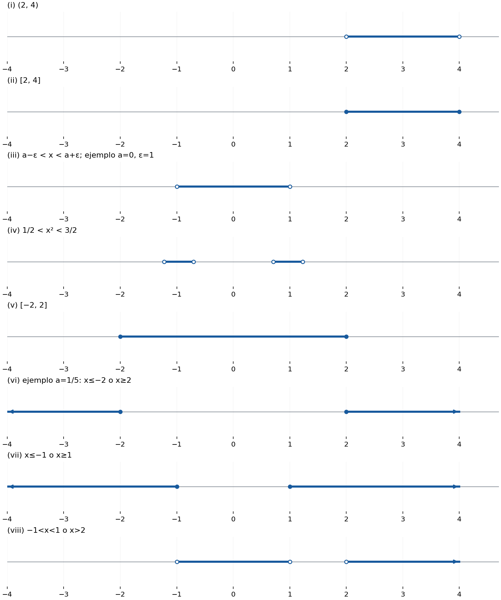{#fig-spv4-c04-f01 fig-alt="Capítulo 4: Intervalos del ejercicio 1"}

## Ejercicio 2 — `SPV4-C04-E002` {#e002}

Referencia: p. 69. **Problema:** parametrizar los intervalos cerrados y abiertos; interpretar el parámetro y hallar puntos intermedios.

### Solución

**(a)** Si $0\le x\le b$ y $b>0$, tome $t=x/b$. Dividir por un número positivo da $0\le t\le1$, y $x=tb$. El parámetro es la fracción de la longitud total recorrida desde $0$; $t=1/2$ produce el punto medio $b/2$.

**(b)** Para $a\le x\le b$ con $a<b$, tome $t=(x-a)/(b-a)$. Entonces $0\le t\le1$ y

$$x=a+t(b-a)=(1-t)a+tb.$$

El punto medio es $(a+b)/2$. A un tercio del recorrido desde $a$ hacia $b$ se encuentra $(2a+b)/3$.

**(c)** Recíprocamente, de $0\le t\le1$ y $b-a>0$ se deduce $0\le t(b-a)\le b-a$. Sumando $a$, resulta $a\le(1-t)a+tb\le b$.

**(d)** Las mismas operaciones conservan las desigualdades estrictas: $a<x<b$ equivale a $0<(x-a)/(b-a)<1$. Así, el intervalo abierto corresponde exactamente a $0<t<1$.

## Ejercicio 3 — `SPV4-C04-E003` {#e003}

Referencia: p. 69. **Problema:** representar diez subconjuntos del plano.

### Solución

**(i)** $x>y$ es el semiplano $y<x$, debajo de la diagonal $y=x$, que queda excluida.

**(ii)** $x+a>y+b$ equivale a $y<x+a-b$. La frontera es la recta de pendiente $1$ y ordenada $a-b$; se toma el lado inferior y se excluye la recta.

**(iii)** $y<x^2$ comprende todos los puntos por debajo de la parábola, sin su frontera. **(iv)** $y\le x^2$ añade todos los puntos de la parábola.

**(v)** $|x-y|<1$ equivale a $x-1<y<x+1$: franja abierta entre dos rectas paralelas de pendiente $1$.

**(vi)** $|x+y|<1$ equivale a $-x-1<y<-x+1$: franja abierta de pendiente $-1$.

**(vii)** Si $x+y$ es entero, el conjunto es $\bigcup_{k\in\mathbb Z}\{(x,y):y=-x+k\}$. Son rectas completas, sin región sombreada entre ellas.

**(viii)** Si $1/(x+y)$ es entero, dicho entero no puede ser cero. El conjunto es

$$\bigcup_{k\in\mathbb Z\setminus\{0\}}\{(x,y):y=-x+1/k\}.$$

Estas rectas se aproximan a $y=-x$, pero esa recta no pertenece al conjunto: allí ni siquiera existe el recíproco. No hay otras rectas.

**(ix)** $(x-1)^2+(y-2)^2<1$ es el disco abierto de centro $(1,2)$ y radio $1$; la circunferencia se excluye.

**(x)** Para que exista un $y$ con $x^2<y<x^4$, primero debe cumplirse $x^2<x^4$. Como $x^4-x^2=x^2(x^2-1)$, esto ocurre exactamente cuando $|x|>1$. El conjunto consta de dos regiones entre las curvas, una a cada lado; ambas fronteras se excluyen y no hay puntos con $-1\le x\le1$.

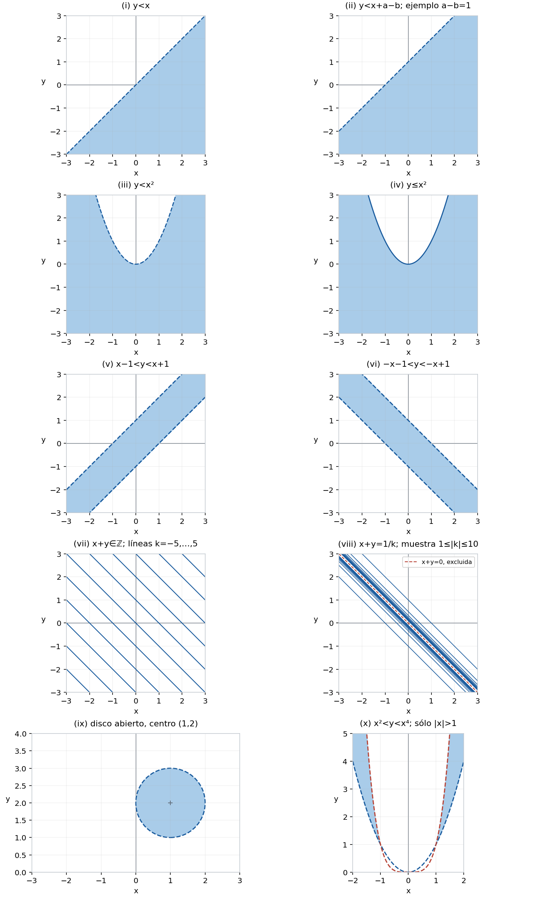{#fig-spv4-c04-f02 fig-alt="Capítulo 4: Regiones y familias de rectas"}

## Ejercicio 4 — `SPV4-C04-E004` {#e004}

Referencia: p. 69. **Problema:** dibujar los ocho lugares dados por ecuaciones.

### Solución

**(i)** $|x|+|y|=1$ es el contorno del rombo con vértices $(1,0),(0,1),(-1,0),(0,-1)$. Por ejemplo, en el primer cuadrante es el segmento $x+y=1$. Los otros tres segmentos se obtienen por reflexión; el interior no satisface la igualdad.

**(ii)** $|x|-|y|=1$ equivale a $|x|=1+|y|$. Para cada $y$, hay dos puntos $x=\pm(1+|y|)$. Resultan cuatro semirrectas, con vértices $(\pm1,0)$, abiertas hacia derecha e izquierda.

**(iii)** $|x-1|=|y-1|$ implica $x-1=\pm(y-1)$: las rectas $y=x$ y $y=2-x$. **(iv)** $|1-x|=|y-1|$ es exactamente la misma ecuación, porque $|1-x|=|x-1|$; la figura también es la misma.

**(v)** $x^2+y^2=0$ contiene únicamente $(0,0)$: dos cuadrados no negativos sólo suman cero si ambos son cero.

**(vi)** $xy=0$ contiene los dos ejes, pues un producto real es cero si y sólo si alguno de sus factores lo es.

**(vii)** $x^2-2x+y^2=4$ equivale a $(x-1)^2+y^2=5$: circunferencia de centro $(1,0)$ y radio $\sqrt5$.

**(viii)** $x^2=y^2$ equivale a $(x-y)(x+y)=0$: unión de las rectas $y=x$ y $y=-x$.

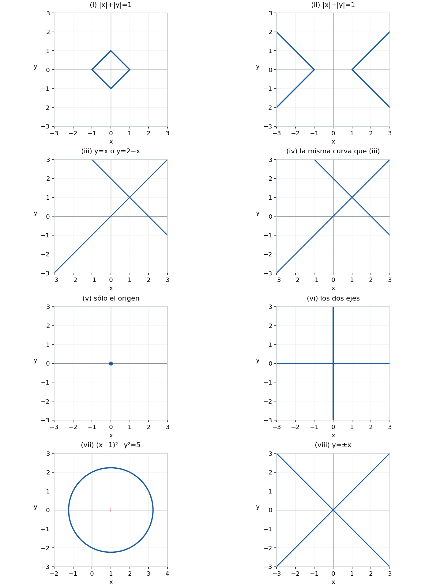{#fig-spv4-c04-f03 fig-alt="Capítulo 4: Lugares definidos por ecuaciones"}

## Ejercicio 5 — `SPV4-C04-E005` {#e005}

Referencia: p. 70. **Problema:** dibujar cuatro curvas que no son, en general, gráficas de $y$ como función de $x$.

### Solución

**(i)** $x=y^2$ es la parábola con vértice en el origen que abre hacia la derecha. Una parametrización completa es $(t^2,t)$, $t\in\mathbb R$. Para $x>0$ aparecen $y=\pm\sqrt x$.

**(ii)** $y^2/a^2-x^2/b^2=1$, con $a,b\ne0$, equivale a $y=\pm|a|\sqrt{1+x^2/b^2}$. Es una hipérbola con dos ramas verticales, vértices $(0,\pm|a|)$ y asíntotas $y=\pm(|a|/|b|)x$. Si alguno de los parámetros es cero, la expresión original no está definida.

**(iii)** $x=|y|$ da las semirrectas $(t,t)$ y $(t,-t)$ para $t\ge0$: una V acostada, con vértice en el origen.

**(iv)** $x=\sin y$ se parametriza como $(\sin t,t)$, $t\in\mathbb R$. La ondulación queda en la franja $-1\le x\le1$ y se repite verticalmente cada $2\pi$. Rotar una gráfica usual de seno no debe introducir un cambio de signo: aquí se intercambian las coordenadas.

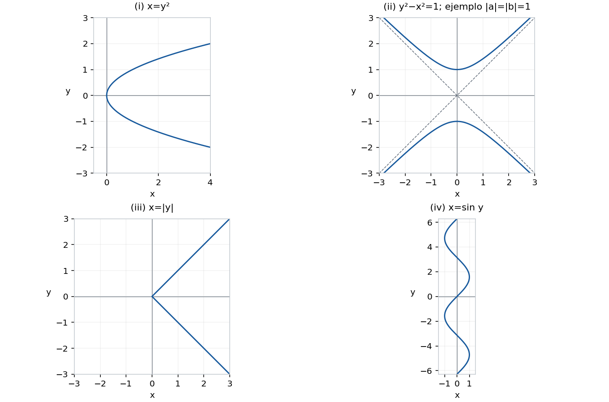{#fig-spv4-c04-f04 fig-alt="Capítulo 4: Parábola, hipérbola y curvas horizontales"}

## Ejercicio 6 — `SPV4-C04-E006` {#e006}

Referencia: p. 70. **Problema:** determinar rectas por punto y pendiente, por dos puntos, y la condición de paralelismo.

### Solución

**(a)** Una recta no vertical de pendiente $m$ que pasa por $(a,b)$ satisface $y-b=m(x-a)$, de modo que $y=m(x-a)+b$. La ecuación incluye el punto dado y cualquier par de puntos distintos tiene cociente de incrementos $m$.

**(b)** Para $(a,b),(c,d)$ con $a\ne c$, la pendiente es $(d-b)/(c-a)$. Por tanto,

$$y=b+\frac{d-b}{c-a}(x-a).$$

Si $a=c$ y los puntos son distintos, la recta es $x=a$, y no tiene pendiente finita. Si los puntos coinciden, no determinan una única recta.

**(c)** Las rectas $y=mx+b$ y $y=m'x+b'$ tienen la misma dirección si y sólo si $m=m'$. Para ser paralelas distintas también se exige $b\ne b'$. Si $m=m'$ y $b=b'$, coinciden; si $m\ne m'$, se cortan en el único punto obtenido al resolver $(m-m')x=b'-b$.

## Ejercicio 7 — `SPV4-C04-E007` {#e007}

Referencia: p. 70. **Problema:** justificar la ecuación general de una recta y su recíproco.

### Solución

**(a)** En $Ax+By+C=0$ se supone $(A,B)\ne(0,0)$. Si $B\ne0$, se despeja $y=-(A/B)x-C/B$, una recta no vertical. Si $B=0$, necesariamente $A\ne0$ y la ecuación es $x=-C/A$, una recta vertical.

**(b)** Toda recta no vertical tiene forma $y=mx+b$, equivalente a $mx-y+b=0$. Toda recta vertical tiene forma $x=a$, equivalente a $x-a=0$. En ambos casos los dos coeficientes de las coordenadas no son simultáneamente cero. La restricción es necesaria: $A=B=0$ produciría todo el plano si $C=0$ y el conjunto vacío en otro caso.

## Ejercicio 8 — `SPV4-C04-E008` {#e008}

Referencia: p. 70. **Problema:** caracterizar la perpendicularidad por pendientes y por coeficientes generales.

### Solución

**(a)** Tras trasladar cada recta paralelamente hasta el origen, sus direcciones siguen siendo las de $y=mx$ y $y=nx$. Tome $O=(0,0)$, $P=(1,m)$, $Q=(1,n)$. El ángulo en $O$ es recto si y sólo si se cumple el teorema de Pitágoras y su recíproco:

$$(m-n)^2=(1+m^2)+(1+n^2).$$

Al cancelar $m^2+n^2$, queda $-2mn=2$, es decir, $mn=-1$. Esta condición también garantiza que las direcciones son distintas. Los términos independientes no modifican el ángulo.

**(b)** Suponga $(A,B),(A',B')\ne(0,0)$. Si $B,B'\ne0$, las pendientes son $-A/B$ y $-A'/B'$; (a) da $AA'+BB'=0$. Si $B=0$, la primera recta es vertical y la otra debe ser horizontal, lo que equivale a $A'=0$; la misma condición general se reduce a $AA'=0$ y, como $A\ne0$, exige precisamente $A'=0$. El caso $B'=0$ es simétrico. Por tanto, en todos los casos la condición exacta es

$$\boxed{AA'+BB'=0.}$$

## Ejercicio 9 — `SPV4-C04-E009` {#e009}

Referencia: pp. 70–71. **Problema:** deducir la desigualdad triangular y su significado geométrico.

### Solución

**(a)** Escriba $u=(x_1,x_2)$, $v=(y_1,y_2)$, y $\|u\|=\sqrt{x_1^2+x_2^2}$. La desigualdad de Schwarz del capítulo 1 da $u\cdot v\le\|u\|\|v\|$. Entonces

$$\|u+v\|^2=\|u\|^2+2u\cdot v+\|v\|^2\le(\|u\|+\|v\|)^2.$$

Ambos miembros de la desigualdad sin cuadrados son no negativos; tomar raíces conserva el orden. Así, $\|u+v\|\le\|u\|+\|v\|$.

**(b)** Aplique (a) a $u=P_2-P_1$ y $v=P_3-P_2$. Como $u+v=P_3-P_1$, se obtiene

$$d(P_1,P_3)\le d(P_1,P_2)+d(P_2,P_3).$$

La longitud del recorrido directo no supera la del recorrido con escala en $P_2$. Hay igualdad exactamente cuando $P_2$ pertenece al segmento cerrado de $P_1$ a $P_3$. En efecto, si los vectores no son cero, igualdad en Schwarz y en su signo superior exige que tengan la misma dirección: $v=tu$ con $t>0$. Eso coloca $P_2$ entre los extremos. Los casos $P_2=P_1$ o $P_2=P_3$ también dan igualdad. Si $P_1=P_3$, sólo hay igualdad cuando los tres puntos coinciden. La simple colinealidad no basta: $P_1=0,P_2=2,P_3=1$ sobre una recta da $1<2+1$.

## Ejercicio 10 — `SPV4-C04-E010` {#e010}

Referencia: p. 71. **Problema:** dibujar cuatro funciones racionales, examinando simetría y comportamiento cerca de cero y para valores grandes.

### Solución

El dominio de las cuatro funciones es $\mathbb R\setminus\{0\}$. Cada gráfica se dibuja con sus dos ramas separadas: no se une el trazo atravesando $x=0$.

**(i)** $f(x)=x+1/x$ es impar. Para $x>0$,

$$f(x)-2=\frac{(x-1)^2}{x}\ge0,$$

con igualdad sólo en $x=1$. La rama positiva tiene mínimo $(1,2)$; la negativa tiene máximo $(-1,-2)$ por imparidad. Para $0<u<v$, la identidad

$$f(v)-f(u)=(v-u)\left(1-\frac1{uv}\right)$$

prueba que decrece en $(0,1]$ y crece en $[1,\infty)$. Para $x>0$ pequeño, $f(x)>1/x$ es arbitrariamente grande; el comportamiento negativo se obtiene por simetría. Para $|x|$ grande, la diferencia respecto de $y=x$ es $1/x$, de magnitud arbitrariamente pequeña. La rama positiva está por encima de esa recta y la negativa por debajo.

**(ii)** $g(x)=x-1/x$ es impar y se anula en $x=\pm1$. Para $u<v$ del mismo signo,

$$g(v)-g(u)=(v-u)\left(1+\frac1{uv}\right)>0.$$

Cada rama es estrictamente creciente. Cuando $x>0$ es pequeño, $g(x)$ es negativo y de magnitud arbitrariamente grande; cuando $x<0$ es pequeño en magnitud, es positivo y grande. La diferencia $g(x)-x=-1/x$ muestra la aproximación a $y=x$, por debajo para $x>0$ y por encima para $x<0$.

**(iii)** $h(x)=x^2+1/x^2$ es par y

$$h(x)-2=\frac{(x^2-1)^2}{x^2}\ge0.$$

Sus mínimos están en $(\pm1,2)$. En el semieje positivo decrece hasta $1$ y luego crece: para $0<u<v$,

$$h(v)-h(u)=(v^2-u^2)\left(1-\frac1{u^2v^2}\right).$$

Se refleja esa rama respecto del eje vertical. Cerca de cero domina el término positivo $1/x^2$; lejos de cero, $h(x)-x^2=1/x^2$ es pequeño. Las dos ramas quedan encima de la parábola $y=x^2$.

**(iv)** $j(x)=x^2-1/x^2$ es par, se anula en $\pm1$ y crece estrictamente para $x>0$, porque

$$j(v)-j(u)=(v^2-u^2)\left(1+\frac1{u^2v^2}\right)>0.$$

Cerca de cero es negativo y de magnitud arbitrariamente grande. Para $|x|$ grande queda debajo de $y=x^2$ a una distancia vertical $1/x^2$. Por reflexión, decrece en el semieje negativo.

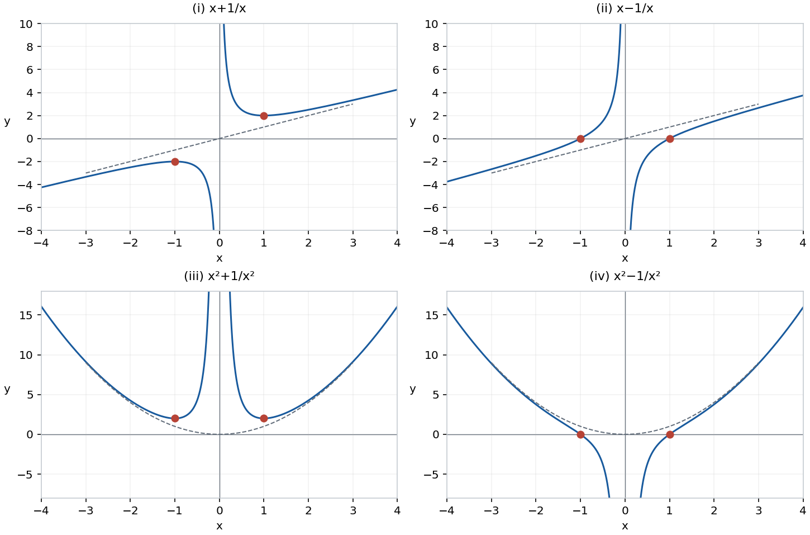{#fig-spv4-c04-f05 fig-alt="Capítulo 4: Cuatro gráficas racionales"}

## Ejercicio 11 — `SPV4-C04-E011` {#e011}

Referencia: p. 71. **Problema:** describir las gráficas bajo cuatro condiciones.

### Solución

**(i)** Si $f$ es par, $(x,f(x))$ y $(-x,f(x))$ aparecen juntos: simetría respecto del eje vertical. **(ii)** Si $f$ es impar, $(x,f(x))$ y $(-x,-f(x))$ aparecen juntos: simetría central respecto del origen. Estas definiciones presuponen un dominio simétrico respecto de cero.

**(iii)** Si $f(x)\ge0$ en su dominio, todos los puntos están en el semiplano cerrado $y\ge0$.

**(iv)** Si $f(x)=f(x+a)$ para todos los $x$, la gráfica es invariante al trasladarla horizontalmente $a$ unidades. Para $a\ne0$, también $-a$ es período, y se repite un tramo de longitud $|a|$; éste puede no ser el período mínimo. Para $a=0$ la condición es una identidad sin información adicional.

## Ejercicio 12 — `SPV4-C04-E012` {#e012}

Referencia: p. 71. **Problema:** dibujar $f_m(x)=\sqrt[m]{x}$ para $m=1,2,3,4$.

### Solución

Para $m=1,3$, el dominio es $\mathbb R$; para $m=2,4$, es $[0,\infty)$ y se toma la raíz no negativa. Todas pasan por $(0,0)$ y $(1,1)$; las impares pasan además por $(-1,-1)$ y tienen simetría central.

Se obtienen intercambiando coordenadas en las gráficas de $y=x^m$, restringidas a $x\ge0$ cuando $m$ es par. Si $0<x<1$, el orden es

$$x<\sqrt x<\sqrt[3]x<\sqrt[4]x;$$

si $x>1$, el orden se invierte. Por ejemplo, si $0<u<1$, entonces $u^4<u^3<u^2<u$; la monotonía de las potencias y sus inversas permite comparar las raíces. Cada función es estrictamente creciente en su dominio.

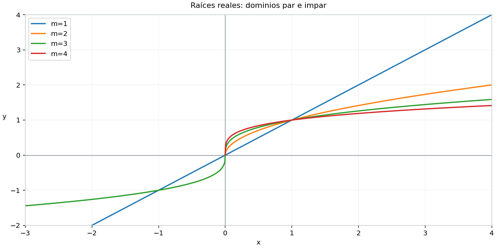{#fig-spv4-c04-f06 fig-alt="Capítulo 4: Raíces de órdenes uno a cuatro"}

## Ejercicio 13 — `SPV4-C04-E013` {#e013}

Referencia: p. 71. **Problema:** comparar (a) $|x|$ con $x^2$ y (b) $|\sin x|$ con $\sin^2x$.

### Solución

**(a)** $|x|$ consta de dos semirrectas que se encuentran en el origen; $x^2$ es una parábola. Ambas son pares y no negativas. Coinciden cuando $|x|=x^2$, es decir, en $x=-1,0,1$. Para $0<|x|<1$, se tiene $x^2<|x|$; para $|x|>1$, $x^2>|x|$. La V conserva dos lados rectos, mientras que la parábola cambia su forma gradualmente.

**(b)** Ponga $u=|\sin x|\in[0,1]$. Entonces $u^2\le u$, con igualdad sólo si $u=0$ o $u=1$. Por tanto, $\sin^2x\le|\sin x|$; coinciden en $x=k\pi/2$, $k\in\mathbb Z$, y la desigualdad es estricta entre esos puntos. Las dos son pares y de período $\pi$. En $|\sin x|$ se reflejan hacia arriba los arcos negativos del seno; en $\sin^2x$ se cuadran todas las alturas. Las figuras muestran el contraste entre los encuentros de arcos en los ceros y los valles más aplanados de la función cuadrada; no se necesita aquí un criterio diferencial de suavidad.

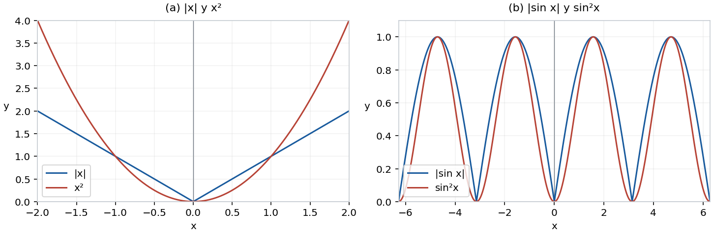{#fig-spv4-c04-f07 fig-alt="Capítulo 4: Comparación de valor absoluto y cuadrado"}

## Ejercicio 14 — `SPV4-C04-E014` {#e014}

Referencia: pp. 71–72. **Problema:** describir diez transformaciones de una gráfica dada.

### Solución

Sea $D$ el dominio de $f$. Cada regla se justifica siguiendo un punto $(u,f(u))$ o sustituyendo el argumento.

| Inciso | $g(x)$ | Gráfica y dominio |
|---|---|---|
| (i) | $f(x)+c$ | $(u,f(u))\mapsto(u,f(u)+c)$: traslación vertical; dominio $D$ |
| (ii) | $f(x+c)$ | $(u,f(u))\mapsto(u-c,f(u))$: traslación horizontal $-c$; dominio $D-c$ |
| (iii) | $cf(x)$ | $(u,f(u))\mapsto(u,cf(u))$: factor vertical $\vert c\vert $ y reflexión horizontal si $c<0$; dominio $D$ |
| (iv) | $f(cx)$, $c\ne0$ | $(u,f(u))\mapsto(u/c,f(u))$: factor horizontal $1/\vert c\vert $ y reflexión vertical si $c<0$; dominio $\{x:cx\in D\}$ |
| (v) | $f(1/x)$ | $(u,f(u))\mapsto(1/u,f(u))$ para $u\ne0$; dominio $\{x\ne0:1/x\in D\}$ |
| (vi) | $f(\vert x\vert )$ | conservar la parte con $u\ge0$ y reflejarla en el eje vertical; dominio $\{x:\vert x\vert \in D\}$ |
| (vii) | $\vert f(x)\vert $ | reflejar sobre el eje horizontal las alturas negativas; dominio $D$ |
| (viii) | $\max(f(x),0)$ | sustituir las alturas negativas por cero; dominio $D$ |
| (ix) | $\min(f(x),0)$ | sustituir las alturas positivas por cero; dominio $D$ |
| (x) | $\max(f(x),1)$ | sustituir las alturas menores que uno por uno; dominio $D$ |

En (iii), si $c=0$, la función vale cero sólo en $D$: multiplicar por cero no añade puntos al dominio. En (iv), si $c=0$ y $0\in D$, la función es la constante $f(0)$ sobre $\mathbb R$; si $0\notin D$, no está definida en ningún punto. En (v), un argumento grande positivo o negativo se convierte en uno pequeño del mismo signo, y viceversa; ésta no es una transformación lineal ni una reflexión usual. En (viii)–(x), las partes sustituidas permanecen como segmentos o conjuntos de puntos a la altura correspondiente: no se eliminan del dominio.

## Ejercicio 15 — `SPV4-C04-E015` {#e015}

Referencia: p. 72. **Problema:** describir la gráfica de $ax^2+bx+c$.

### Solución

Si $a\ne0$, completar el cuadrado da

$$ax^2+bx+c=a\left(x+\frac b{2a}\right)^2+c-\frac{b^2}{4a}.$$

Es la parábola $y=ax^2$ trasladada, con vértice $(-b/(2a),c-b^2/(4a))$ y eje vertical $x=-b/(2a)$. Abre hacia arriba si $a>0$ y hacia abajo si $a<0$. Su corte con el eje vertical es $(0,c)$.

Con $\Delta=b^2-4ac$, el corte con el eje horizontal consta de dos puntos si $\Delta>0$, un punto si $\Delta=0$ y ninguno si $\Delta<0$; las abscisas son $(-b\pm\sqrt\Delta)/(2a)$ cuando existen. Si $a=0,b\ne0$, hay una recta; si $a=b=0$, una recta horizontal constante. La forma canónica permite dibujar cualquier caso sin una lista arbitraria de muestras.

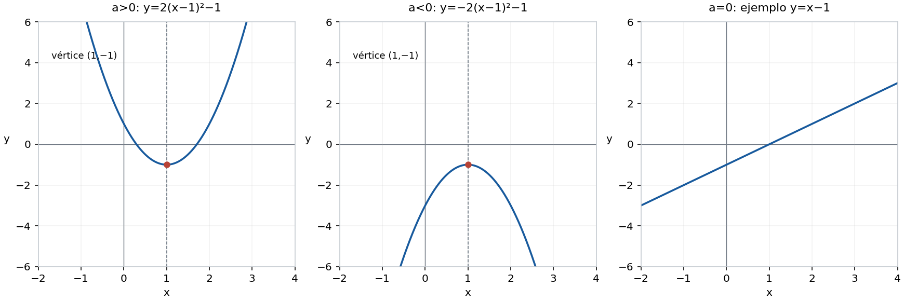{#fig-spv4-c04-f08 fig-alt="Capítulo 4: Formas de la cuadrática y su caso lineal"}

## Ejercicio 16 — `SPV4-C04-E016` {#e016}

Referencia: p. 72. **Problema:** clasificar $Ax^2+Bx+Cy^2+Dy+E=0$, donde $A,C$ no son ambos cero, incluidos los casos degenerados y la circunferencia.

### Solución

Suponga primero $A,C\ne0$. Con

$$X=x+\frac B{2A},\quad Y=y+\frac D{2C},\quad K=-E+\frac{B^2}{4A}+\frac{D^2}{4C},$$

la ecuación equivale a $AX^2+CY^2=K$.

Si $A,C$ tienen el mismo signo, multiplique toda la ecuación por $-1$ si es necesario para que sean positivos; también se cambia el signo de $K$. Entonces:

| Condición | Lugar |
|---|---|
| $K>0$ | elipse $X^2/(K/A)+Y^2/(K/C)=1$ |
| $K=0$ | un solo punto, el centro |
| $K<0$ | vacío |

La elipse es una circunferencia exactamente cuando $A=C$, y su radio es $\sqrt{K/A}$. En los coeficientes originales se requiere $A=C\ne0$ y $K/A>0$. El caso de radio cero se registra como punto.

Si $A,C$ tienen signos opuestos, $K\ne0$ produce una hipérbola. Después de dividir por $K$, el término con coeficiente positivo señala la dirección de sus dos ramas. Si $K=0$, aparecen las dos rectas secantes

$$X=\pm\sqrt{-C/A}\,Y.$$

Quedan los casos con un coeficiente cuadrático nulo. Si $C=0$, entonces $A\ne0$, y al completar el cuadrado se obtiene

$$A\left(x+\frac B{2A}\right)^2+Dy=K_0,\qquad K_0=-E+\frac{B^2}{4A}.$$

Si $D\ne0$, se despeja una parábola con eje vertical. Si $D=0$, la ecuación $X^2=K_0/A$ produce dos rectas verticales paralelas, una sola recta vertical o el vacío, según $K_0/A$ sea positivo, cero o negativo. Si $A=0,C\ne0$, intercambie $x$ con $y$ y $B$ con $D$: se obtiene una parábola horizontal cuando $B\ne0$; cuando $B=0$, dos rectas horizontales, una o ninguna. Esto agota todos los casos sin atribuir una elipse o una parábola a una ecuación degenerada.

## Ejercicio 17 — `SPV4-C04-E017` {#e017}

Referencia: p. 72. **Problema:** dibujar seis funciones construidas con $\lfloor x\rfloor$, el mayor entero no superior a $x$.

### Solución

Escriba $x=n+t$, $n\in\mathbb Z$, $0\le t<1$.

**(i)** $\lfloor x\rfloor=n$ en $[n,n+1)$: escalón cerrado a la izquierda y abierto a la derecha.

**(ii)** $x-\lfloor x\rfloor=t$: segmento de pendiente $1$ desde $(n,0)$ incluido hasta $(n+1,1)$ excluido; en el entero siguiente se reinicia en cero.

**(iii)** $\sqrt{x-\lfloor x\rfloor}=\sqrt t$: arco desde $(n,0)$ incluido hasta $(n+1,1)$ excluido. Su dominio es todo $\mathbb R$, porque la parte fraccionaria nunca es negativa.

**(iv)** $\lfloor x\rfloor+\sqrt{x-\lfloor x\rfloor}=n+\sqrt t$. Cada arco va de $(n,n)$ al punto $(n+1,n+1)$; aunque el extremo derecho no pertenece a ese arco, el arco siguiente lo incluye. No hay saltos entre los valores de los extremos.

**(v)** Sea $k=\lfloor1/x\rfloor$, con $x\ne0$. Resolver $k\le1/x<k+1$ por separado según el signo da

$$\lfloor1/x\rfloor=\begin{cases}
-1,&x\le-1,\\
0,&x>1,\\
k,&\dfrac1{k+1}<x\le\dfrac1k,\quad k\ge1\text{ o }k\le-2.
\end{cases}$$

Hay infinitos escalones que se acumulan en cero. En $x=1$ el valor es $1$; en $x=-1$ es $-1$.

**(vi)** $1/\lfloor1/x\rfloor$ exige además $\lfloor1/x\rfloor\ne0$. Su dominio exacto es

$$(-\infty,0)\cup(0,1].$$

En $x\le-1$ vale $-1$; en cada intervalo de (v) con $k\ge1$ o $k\le-2$, vale $1/k$. No se elimina $x<-1$: allí el denominador es $-1$, perfectamente válido. Cero queda excluido aunque las alturas de los escalones se acerquen a él.

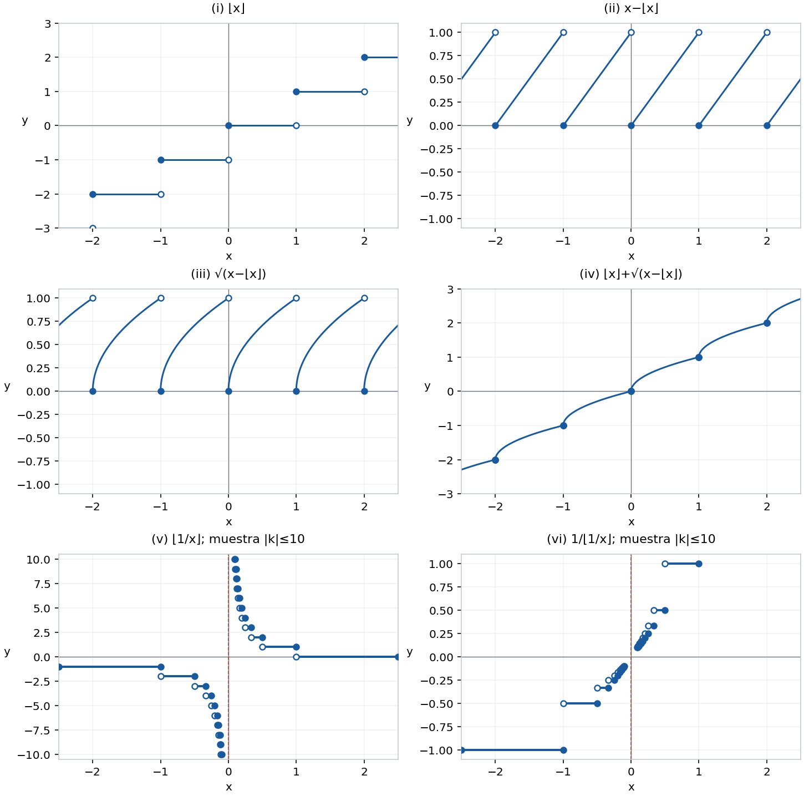{#fig-spv4-c04-f09 fig-alt="Capítulo 4: Parte entera y sus composiciones"}

## Ejercicio 18 — `SPV4-C04-E018` {#e018}

Referencia: p. 72. **Problema:** dibujar cinco funciones usando la distancia $\delta(x)$ al entero más próximo.

### Solución

Esta notación no representa la parte fraccionaria del ejercicio anterior. Para $x=n+t$, $0\le t\le1$,

$$\delta(x)=\min(t,1-t)=\begin{cases}t,&0\le t\le1/2,\\1-t,&1/2\le t\le1.\end{cases}$$

Los dos enteros vecinos son los más próximos: cualquier otro entero está al menos a distancia $1$ de uno de los extremos y no puede mejorar el mínimo. Así, $\delta$ es par, de período $1$, con ceros en los enteros y altura $1/2$ en los semienteros.

**(i)** La gráfica de $\delta(x)$ es la sucesión de triángulos descrita por la fórmula.

**(ii)** La de $\delta(2x)$ tiene la misma altura y un período $1/2$: ceros en $k/2$ y máximos en $(2k+1)/4$.

**(iii)** Para $T_2(x)=\delta(x)+\delta(2x)/2$, basta conocer las alturas en $0,1/4,1/2,3/4,1$:

$$0,\ 1/2,\ 1/2,\ 1/2,\ 0.$$

Entre estos puntos cada sumando es lineal. Por tanto, en $[0,1]$ sube con pendiente $2$ hasta $1/4$, permanece a altura $1/2$ hasta $3/4$ y baja con pendiente $-2$ hasta $1$. Se repite con período $1$.

**(iv)** $\delta(4x)$ tiene período $1/4$, ceros en $k/4$ y máximos $1/2$ en $(2k+1)/8$.

**(v)** Para $T_3(x)=T_2(x)+\delta(4x)/4$, las alturas en los nueve puntos $j/8$, $j=0,\ldots,8$, son

$$0,\ 3/8,\ 1/2,\ 5/8,\ 1/2,\ 5/8,\ 1/2,\ 3/8,\ 0.$$

Una cada par de vértices consecutivos por un segmento y repita el tramo. Estas alturas y la linealidad entre los puntos de quiebre determinan la gráfica completa; no hace falta anticipar la teoría de la serie infinita que aparecerá más adelante.

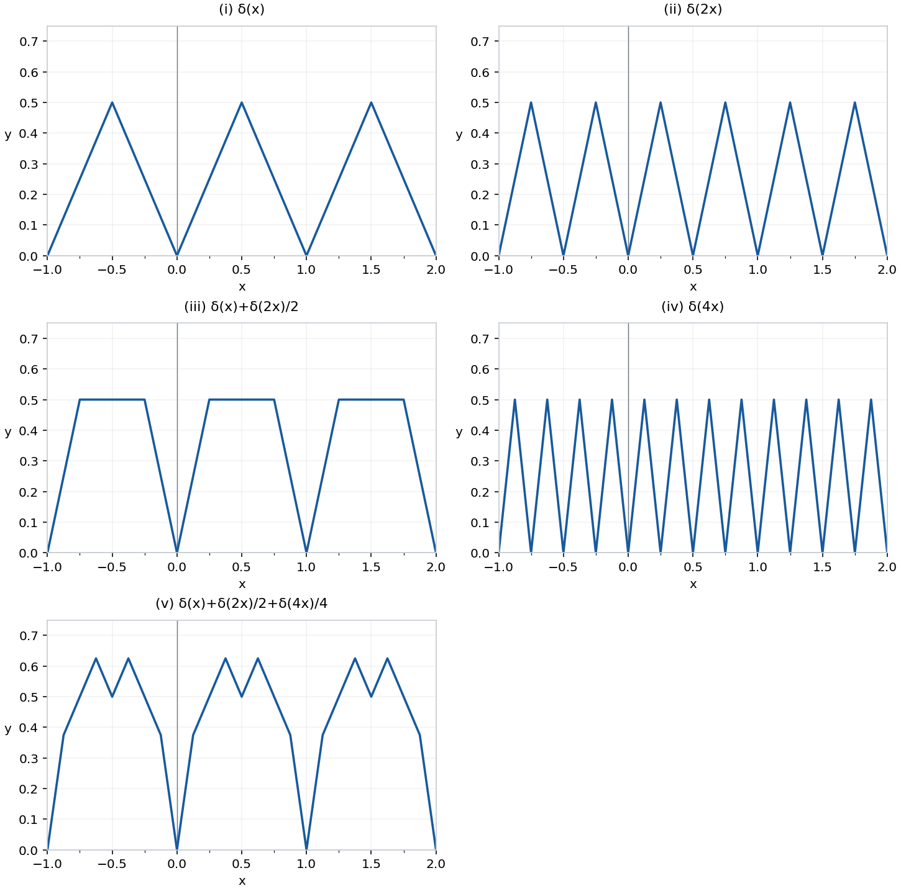{#fig-spv4-c04-f10 fig-alt="Capítulo 4: Distancia a enteros y sumas de triángulos"}

## Ejercicio 19 — `SPV4-C04-E019` {#e019}

Referencia: p. 73. **Problema:** describir seis gráficas definidas mediante cifras decimales, eligiendo siempre la expansión con una cola de nueves cuando hay dos expansiones.

### Solución

Para evitar ambigüedad con números negativos e enteros, usamos $x=N+\sum_{j\ge1}d_j10^{-j}$, con $N\in\mathbb Z$, $0<\sum d_j10^{-j}\le1$, y la expansión que no termina en ceros. Por ejemplo, $0= -1+0.999\ldots$ y $0.1=0+0.0999\ldots$. Las posiciones se cuentan después de la coma. Con esta convención los extremos decimales de los escalones pertenecen al tramo situado a su izquierda. Las descripciones de expansiones infinitas tienen aquí el carácter intuitivo admitido expresamente por el libro; su construcción formal corresponde al capítulo 23.

**(i)** La primera cifra vale $j$ en

$$\left(N+\frac j{10},N+\frac{j+1}{10}\right],\qquad j=0,\ldots,9,\quad N\in\mathbb Z.$$

Cada unidad contiene diez escalones, abiertos a la izquierda y cerrados a la derecha. En un entero la primera cifra es $9$.

**(ii)** La segunda cifra vale $j$ en

$$\left(N+\frac{10i+j}{100},N+\frac{10i+j+1}{100}\right],\quad i,j=0,\ldots,9.$$

Son cien escalones por unidad, agrupados en diez sucesiones de alturas $0,1,\ldots,9$. Para cualquier posición se dispone de la fórmula exacta

$$d_j(x)=\lceil10^jx\rceil-10\lceil10^{j-1}x\rceil+9.$$

**(iii)** La función que cuenta los sietes si son finitos y vale cero si son infinitos toma valores $0,1,2,\ldots$. Elija un prefijo decimal suficientemente largo para que todas sus prolongaciones caigan dentro de un intervalo abierto dado. Si ese prefijo contiene $h$ sietes, puede alcanzar cualquier altura $k\ge h$ añadiendo $k-h$ sietes y una cola sin sietes. Sin embargo, **no todas las alturas son densas en todo intervalo**. Por ejemplo, en $(0.77,0.78)$ toda expansión empieza por $77$, y no puede haber altura $1$. La altura $0$ sí aparece en cualquier intervalo mediante una cola con infinitos sietes. Para $k\ge1$, el conjunto de abscisas de altura $k$ es exactamente el de expansiones con $k$ sietes; su presencia en un intervalo depende de los prefijos que dicho intervalo admite. La gráfica tiene filas de puntos, no rectas horizontales completas.

**(iv)** La función que vale $0$ si hay finitos sietes y $1$ si hay infinitos tiene puntos de ambas alturas en todo intervalo abierto. Tras cualquier prefijo, una cola de nueves evita añadir sietes y una cola de sietes produce infinitos. Ninguna de las dos filas contiene todos los puntos de una recta.

**(v)** Si el primer $7$ ocupa la posición $n$, se conserva el prefijo hasta ese $7$ y se reemplaza la cola por ceros. Si $P$ es el entero formado por las primeras $n$ cifras, el valor es $N+P/10^n$. Los puntos con ese valor tienen abscisas en

$$\left(N+\frac P{10^n},N+\frac{P+1}{10^n}\right],$$

donde el prefijo termina en $7$ y no contiene otro $7$ anterior. El extremo izquierdo se excluye porque su expansión elegida termina en $6\,999\ldots$; el derecho sí conserva el $7$ del prefijo. Si nunca aparece $7$, el valor es $x$: esos puntos permanecen en la diagonal. Cada escalón queda por debajo de la diagonal; si el primer $7$ está en posición $n$, entonces $0<x-f(x)\le10^{-n}$.

**(vi)** Si el primer $1$ aparece en posición $n$, el valor es $n$. La fila $y=n$ consta de intervalos abiertos a la izquierda y cerrados a la derecha cuyos prefijos tienen longitud $n$, última cifra $1$ y ninguna cifra anterior igual a $1$. En $y=0$ quedan exactamente los números sin ningún $1$. Por ejemplo, la altura $1$ ocupa $(N+0.1,N+0.2]$. La altura $2$ ocupa los intervalos de centésimas correspondientes a prefijos $01,21,31,\ldots,91$. Fijar más cifras revela sucesivamente filas más altas; unir puntos elegidos al azar daría una imagen falsa.

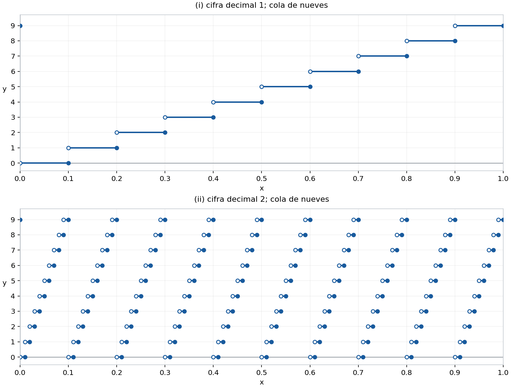{#fig-spv4-c04-f11 fig-alt="Capítulo 4: Primeras cifras decimales: convención con nueves"}

## Ejercicio 20 — `SPV4-C04-E020` {#e020}

Referencia: p. 73. **Problema:** representar $f(x)=0$ para $x$ irracional y $f(p/q)=1/q$ para una fracción irreducible con $q>0$.

### Solución

Primero se colocan los enteros a altura $1$; luego los numeradores impares sobre denominador $2$ a altura $1/2$; luego $p/3$ con $3\nmid p$ a altura $1/3$, y así sucesivamente. La reducción importa: $2/4=1/2$ se coloca a altura $1/2$, no $1/4$. El número cero es $0/1$, de modo que $f(0)=1$.

La gráfica es de período $1$, porque $\gcd(p+q,q)=\gcd(p,q)$, y es par porque cambiar el signo del numerador no cambia el denominador reducido. Está contenida entre $0$ y $1$. La fila cero contiene exactamente las abscisas irracionales; ningún racional está a altura cero.

En un intervalo acotado hay sólo finitos puntos por encima de una altura fija $\eta>0$: allí $1/q\ge\eta$ exige $q\le1/\eta$, y para cada uno de esos pocos denominadores sólo hay finitos numeradores en el intervalo. Las filas con denominadores grandes quedan arbitrariamente cerca del eje. La lámina muestra todas las fracciones reducidas con $q\le12$ en su ventana; no pretende mostrar todos los racionales ni convierte la fila de irracionales en una recta completa.

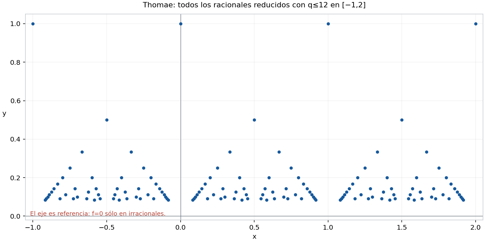{#fig-spv4-c04-f12 fig-alt="Capítulo 4: Muestra ordenada por denominadores de la función de Thomae"}

## Ejercicio 21 — `SPV4-C04-E021` {#e021}

Referencia: p. 73. **Problema:** describir parábolas mediante foco y directriz horizontal.

### Solución

**(a)** Para $P=(x,x^2)$, la distancia a $F=(0,1/4)$ satisface

$$d(P,F)^2=x^2+(x^2-1/4)^2=(x^2+1/4)^2.$$

Como $x^2+1/4>0$, la distancia es $x^2+1/4$. La distancia a la recta $y=-1/4$ es exactamente la misma. Así, todos los puntos de la parábola son equidistantes del foco y la directriz.

**(b)** Para un foco $F=(\alpha,\beta)$ y directriz $y=\gamma$, la igualdad de distancias equivale a

$$(x-\alpha)^2+(y-\beta)^2=(y-\gamma)^2.$$

Cuando $\beta\ne\gamma$, cancelar $y^2$ y despejar produce

$$y=\frac{(x-\alpha)^2}{2(\beta-\gamma)}+\frac{\beta+\gamma}{2}.$$

Es una parábola de vértice $(\alpha,(\beta+\gamma)/2)$, que abre hacia el foco. El proceso es reversible: ambos cuadrados son cuadrados de distancias no negativas, por lo que no se añaden puntos al elevar al cuadrado. Si $\beta=\gamma$, queda $(x-\alpha)^2=0$: toda la recta vertical $x=\alpha$, no una parábola ni la gráfica de una función de $x$.

## Ejercicio 22 — `SPV4-C04-E022` {#e022}

Referencia: p. 73. **Problema:** obtener la distancia de $(c,d)$ a una recta por minimización de una cuadrática.

### Solución

**(a)** La distancia al punto $(x,mx)$, al cuadrado, es

$$Q(x)=(x-c)^2+(mx-d)^2=(1+m^2)x^2-2(c+md)x+c^2+d^2.$$

Al completar el cuadrado,

$$Q(x)=(1+m^2)\left(x-\frac{c+md}{1+m^2}\right)^2+\frac{(mc-d)^2}{1+m^2}.$$

El primer término es no negativo y alcanza cero para $x_*=(c+md)/(1+m^2)$. La menor distancia es, por tanto, $|mc-d|/\sqrt{1+m^2}$. Se ha demostrado que el mínimo existe, además de calcular su valor.

**(b)** Traslade todo el plano $-b$ verticalmente. La recta $y=mx+b$ se convierte en $y=mx$ y el punto en $(c,d-b)$; las distancias se conservan. Por (a),

$$\boxed{d((c,d),\{y=mx+b\})=\frac{|mc-d+b|}{\sqrt{1+m^2}}.}$$

El punto más próximo tiene abscisa $(c+m(d-b))/(1+m^2)$ y ordenada $mx_*+b$.

## Ejercicio 23 — `SPV4-C04-E023` {#e023}

Referencia: p. 74. **Problema:** hallar las coordenadas en ejes girados $45^\circ$ y reconocer la hipérbola $xy=1$.

### Solución

**(a)** La magnitud de la coordenada $x'$ es la distancia a la recta $y=-x$, que por el ejercicio 22 es $|x+y|/\sqrt2$. El signo positivo corresponde al lado $x+y>0$. De modo análogo, $y'$ es la distancia con signo a $y=x$, positiva en el lado $y>x$. Por tanto,

$$x'=\frac{x+y}{\sqrt2},\qquad y'=\frac{-x+y}{\sqrt2}.$$

Son coordenadas con signo, no meras longitudes positivas. La transformación inversa es $x=(x'-y')/\sqrt2$, $y=(x'+y')/\sqrt2$.

**(b)** Sustituir da

$$\left(\frac{x'}{\sqrt2}\right)^2-\left(\frac{y'}{\sqrt2}\right)^2
=\frac{(x+y)^2-(y-x)^2}{4}=xy.$$

La expresión vale $1$ exactamente cuando $xy=1$. En los ejes girados, esta hipérbola tiene la forma habitual con semiejes $\sqrt2$; en los originales sus asíntotas son los dos ejes.

# Apéndice 1 — Vectores

Las operaciones son $(v_1,v_2)+(w_1,w_2)=(v_1+w_1,v_2+w_2)$ y $av=(av_1,av_2)$. La norma es $\|v\|=\sqrt{v_1^2+v_2^2}$. Una rotación positiva se mide en sentido antihorario.

## Ejercicio 1 — `SPV4-C04-A01-E001` {#e001-2}

Referencia: pp. 77–78. **Problema:** deducir la fórmula de rotación por un ángulo $\theta$ y aplicarla a los ejes girados.

### Solución

**(a)** El punto $(1,0)$ está en el círculo unidad; al girarlo, sus coordenadas son $(\cos\theta,\sin\theta)$ por definición geométrica. El punto $(0,1)$ está un cuarto de vuelta más adelante; al girarlo da $(\cos(\theta+\pi/2),\sin(\theta+\pi/2))=(-\sin\theta,\cos\theta)$.

**(b)** Una rotación conserva segmentos, paralelismo y longitudes. Por eso lleva el paralelogramo de lados $v,w$ al de lados $R_\theta(v),R_\theta(w)$, y su diagonal satisface $R_\theta(v+w)=R_\theta(v)+R_\theta(w)$. Si los lados son colineales, se usa la suma de segmentos con signo en la misma recta, que también se conserva. Para $a>0$, el vector $av$ tiene la misma dirección que $v$ y longitud $a\|v\|$, propiedades que conserva el giro; para $a<0$ se añade la inversión de dirección, y para $a=0$ ambos miembros son cero. Así, $R_\theta(av)=aR_\theta(v)$ para todo real $a$.

**(c)** Descomponga $(x,y)=x(1,0)+y(0,1)$. Por (a) y (b),

$$R_\theta(x,y)=(x\cos\theta-y\sin\theta,\ x\sin\theta+y\cos\theta).$$

**(d)** Para expresar un punto en ejes girados $\pi/4$, se gira el vector por $-\pi/4$. Como $\cos(-\pi/4)=1/\sqrt2$ y $\sin(-\pi/4)=-1/\sqrt2$, se recupera $(x',y')=((x+y)/\sqrt2,(-x+y)/\sqrt2)$. Además, $(x'^2-y'^2)/2=xy$, dando nuevamente la equivalencia con la hipérbola del ejercicio 23.

## Ejercicio 2 — `SPV4-C04-A01-E002` {#e002-2}

Referencia: p. 78. **Problema:** estudiar $v\cdot w=v_1w_1+v_2w_2$, su norma, desigualdad triangular e identidad de polarización.

### Solución

**(a)** El vector $(-v_2,v_1)$ cumple $v\cdot(-v_2,v_1)=0$. Si $v\ne0$, todos los vectores ortogonales son $t(-v_2,v_1)$, $t\in\mathbb R$. Si $v_1\ne0$, despeje $w_1=-v_2w_2/v_1$ y tome $t=w_2/v_1$; si $v_1=0$, entonces $v_2\ne0$, $w_2=0$ y la misma parametrización da toda la recta horizontal. Si $v=0$, todos los vectores del plano satisfacen la ecuación; no hay una única recta de soluciones.

**(b)** La conmutatividad real da $v_1w_1+v_2w_2=w_1v_1+w_2v_2$. Por distributividad,

$$v\cdot(w+z)=v_1(w_1+z_1)+v_2(w_2+z_2)=v\cdot w+v\cdot z.$$

Finalmente, $a(v\cdot w)=av_1w_1+av_2w_2=(av)\cdot w=v\cdot(aw)$. El resultado de cada producto escalar es un número, no un vector.

**(c)** $v\cdot v=v_1^2+v_2^2\ge0$, con igualdad si y sólo si $v_1=v_2=0$. Su raíz es la distancia euclidiana del extremo de $v$ al origen; se anula sólo para el vector cero.

**(d)** Schwarz da $v\cdot w\le\|v\|\|w\|$; expandir $\|v+w\|^2$ como en el ejercicio 9 demuestra $\|v+w\|\le\|v\|+\|w\|$. Si alguno es cero hay igualdad. Si ambos son no nulos, la igualdad exige colinealidad y producto escalar positivo, por lo que $w=av$ con $a>0$. Recíprocamente, en ese caso $\|v+w\|=(1+a)\|v\|=\|v\|+\|w\|$. Un múltiplo negativo no da igualdad salvo los casos nulos ya separados.

**(e)** Por expansión y (b), $\|v+w\|^2=\|v\|^2+2v\cdot w+\|w\|^2$ y $\|v-w\|^2=\|v\|^2-2v\cdot w+\|w\|^2$. Restando,

$$v\cdot w=\frac{\|v+w\|^2-\|v-w\|^2}{4}.$$

## Ejercicio 3 — `SPV4-C04-A01-E003` {#e003-2}

Referencia: p. 78. **Problema:** probar la invariancia del producto escalar por rotaciones y su fórmula angular.

### Solución

**(a)** Escriba $c=\cos\theta$, $s=\sin\theta$. Entonces

$$\begin{aligned}
R_\theta(v)\cdot R_\theta(w)
&=(cv_1-sv_2)(cw_1-sw_2)+(sv_1+cv_2)(sw_1+cw_2)\\
&=(c^2+s^2)(v_1w_1+v_2w_2)=v\cdot w.
\end{aligned}$$

Los términos mixtos se cancelan. En particular, la norma también se conserva.

**(b)** Para $e=(1,0)$ y $u=(\cos\theta,\sin\theta)$, $e\cdot u=\cos\theta$. Dados dos vectores no nulos, gire ambos hasta que el primero apunte por el eje positivo horizontal. Quedan $v'=(\|v\|,0)$ y $w'=\|w\|(\cos\theta,\sin\theta)$, donde $\theta$ es su ángulo orientado. Por (a),

$$v\cdot w=\|v\|\|w\|\cos\theta.$$

Si se usa el ángulo no orientado, el coseno es el mismo. Para un vector nulo no hay ángulo definido; la identidad escalar sigue dando cero si se adopta cualquier ángulo por convenio.

## Ejercicio 4 — `SPV4-C04-A01-E004` {#e004-2}

Referencia: p. 79. **Problema:** hallar la intersección de una recta paralela a $w$ con el eje horizontal y deducir una fórmula para el área.

### Solución

**(a)** La recta por $v$ paralela a $w$ se parametriza como $v+tw$. Si $w_2\ne0$, su intersección con el eje horizontal ocurre para $t=-v_2/w_2$ y tiene abscisa

$$B_1=v_1-\frac{v_2w_1}{w_2}=\frac{v_1w_2-w_1v_2}{w_2}.$$

En la configuración de la figura del libro, la base obtenida por desplazar los triángulos tiene longitud $B_1>0$ y la altura es $w_2>0$. El área es $B_1w_2=v_1w_2-w_1v_2$. Para una configuración arbitraria hay que distinguir el área no negativa del determinante con signo:

$$\det(v,w)=v_1w_2-v_2w_1,\qquad \text{área}=|\det(v,w)|.$$

La construcción con esa intersección no sirve si $w_2=0$, aunque la fórmula de área sí: entonces la base puede tomarse como $w$, horizontal, y la altura es $|v_2|$, dando $|w_1v_2|$. El próximo ejercicio prueba la fórmula sin depender de la posición de la figura.

## Ejercicio 5 — `SPV4-C04-A01-E005` {#e005-2}

Referencia: p. 79. **Problema:** justificar el signo geométrico del determinante y su invariancia por rotaciones.

### Solución

**(a)** Si $v=(h,0)$ con $h>0$, $\det(v,w)=hw_2$. La base del paralelogramo es $h$ y la altura es $|w_2|$, de modo que el determinante es el área si $w_2>0$, su negativo si $w_2<0$, y cero si $w_2=0$.

**(b)** Con $c=\cos\theta,s=\sin\theta$,

$$\begin{aligned}
\det(R_\theta v,R_\theta w)
&=(cv_1-sv_2)(sw_1+cw_2)-(sv_1+cv_2)(cw_1-sw_2)\\
&=(c^2+s^2)(v_1w_2-v_2w_1)=\det(v,w).
\end{aligned}$$

Si $v\ne0$, gírelo hasta el eje positivo horizontal y aplique (a). El giro conserva el área y el orden de orientación: el signo es positivo cuando el ángulo orientado de $v$ a $w$, tomado en $(-\pi,\pi)$, es positivo, y negativo cuando es negativo. Para vectores colineales o nulos, el área y el determinante son cero. Así, el determinante mide área orientada y su valor absoluto mide área geométrica.

## Ejercicio 6 — `SPV4-C04-A01-E006` {#e006-2}

Referencia: p. 79. **Problema:** demostrar la bilinealidad del determinante.

### Solución

La distributividad real da

$$\det(v,w+z)=v_1(w_2+z_2)-v_2(w_1+z_1)=\det(v,w)+\det(v,z),$$

$$\det(v+w,z)=(v_1+w_1)z_2-(v_2+w_2)z_1=\det(v,z)+\det(w,z).$$

Además,

$$\det(av,w)=av_1w_2-av_2w_1=a\det(v,w)=\det(v,aw).$$

No hay una regla correspondiente de suma para las áreas sin signo: tomar valores absolutos puede destruir estas igualdades por cancelación de orientaciones.

## Ejercicio 7 — `SPV4-C04-A01-E007` {#e007-2}

Referencia: p. 79. **Problema:** expresar el determinante mediante longitudes y ángulo.

### Solución

Para vectores no nulos, gire $v$ hasta $(\|v\|,0)$. El otro vector queda $\|w\|(\cos\theta,\sin\theta)$, con $\theta$ orientado de $v$ a $w$. La invariancia probada en el ejercicio 5 da

$$\det(v,w)=\|v\|\|w\|\sin\theta.$$

El área es $\|v\|\|w\|\,|\sin\theta|$: base por altura. Con ángulo no orientado en $[0,\pi]$, esa fórmula da directamente el área, pero no conserva el signo del determinante. Si alguno de los vectores es cero, ambos lados escalares se anulan, aunque el ángulo no esté definido.

# Apéndice 2 — Secciones cónicas

## Ejercicio 1 — `SPV4-C04-A02-E001` {#e001-3}

Referencia: pp. 82–83. **Problema:** clasificar las secciones planas del cilindro $x^2+y^2=C^2$.

### Solución

Suponga $C>0$. El cilindro tiene generatrices verticales. Si el plano no es vertical, se escribe $z=Mx+Ny+B$. Gire los ejes horizontales para dejarlo como $z=Mx+B$. En el propio plano use una coordenada horizontal $u$ a lo largo de su dirección inclinada y otra $v$ paralela al eje $y$. La coordenada ambiental es $x=\alpha u+\beta$, donde $0<|\alpha|\le1$; si $M\ne0$, se puede escoger $\alpha=1/\sqrt{1+M^2}$. Entonces la sección cumple

$$(\alpha u+\beta)^2+v^2=C^2.$$

Es una elipse de semiejes $C/|\alpha|$ y $C$, con centro $(-\beta/\alpha,0)$. Si el plano es horizontal, $|\alpha|=1$ y la sección es una circunferencia.

Si el plano es vertical, tras girar en torno al eje del cilindro se escribe $x=\beta$. Dentro del plano se toman $u=z,v=y$, y la misma expresión tiene $\alpha=0$: $\beta^2+v^2=C^2$. Hay dos generatrices paralelas si $|\beta|<C$, una generatriz tangente si $|\beta|=C$ y ningún punto si $|\beta|>C$. No aparece una parábola ni una hipérbola. Si $C=0$, el cilindro degenera en el eje vertical y su sección puede ser una recta, un punto o el vacío.

## Ejercicio 2 — `SPV4-C04-A02-E002` {#e002-3}

Referencia: p. 83. **Problema:** usar dos esferas tangentes al plano secante y al cilindro para obtener los focos de la elipse.

### Solución

**(a)** Sea $Z$ un punto de la sección y $F_1$ el punto donde el plano toca a la primera esfera. El segmento $ZF_1$ es tangente a la esfera. La generatriz vertical por $Z$ también es tangente a ella en el punto $T_1$ del círculo de contacto $C_1$. Las dos longitudes son iguales. Una prueba directa evita depender del dibujo: si $S_1$ es el centro y $R$ el radio, ambos radios al punto de tangencia son perpendiculares a los segmentos, y Pitágoras da

$$ZF_1^2=ZS_1^2-R^2=ZT_1^2.$$

Las longitudes son no negativas, luego $ZF_1=ZT_1$.

**(b)** La misma prueba para la segunda esfera da $ZF_2=ZT_2$. En la configuración no vertical, toda la sección queda entre los planos horizontales de $C_1$ y $C_2$. Por eso $Z$ está entre $T_1$ y $T_2$ en la generatriz, y

$$ZF_1+ZF_2=ZT_1+ZT_2=T_1T_2.$$

La última distancia es la separación constante de esos planos horizontales, independiente de $Z$. Ésta es la propiedad focal de una elipse, con focos $F_1,F_2$. La identificación completa de la sección con esa elipse también se sigue de la clasificación algebraica del ejercicio 1; no se está afirmando que una sola inclusión baste para probar igualdad de lugares. En el caso horizontal los focos coinciden y la elipse es una circunferencia.

## Ejercicio 3 — `SPV4-C04-A02-E003` {#e003-3}

Referencia: p. 83. **Problema:** demostrar geométricamente las propiedades focales de las secciones de un cono con esferas de Dandelin.

### Solución

Se consideran cortes no degenerados: el plano no pasa por el vértice. Cada esfera toca el plano en un foco $F_i$ y el cono en un círculo $C_i$; toda generatriz es tangente a la esfera en su intersección $T_i$ con ese círculo. Como en el ejercicio 2, $ZF_i=ZT_i$ para cualquier punto $Z$ de la sección.

En el corte elíptico, las dos esferas están en la misma hoja del cono y $Z$ queda entre los dos puntos de contacto de su generatriz. Así,

$$ZF_1+ZF_2=ZT_1+ZT_2=T_1T_2,$$

una longitud constante: la porción de generatriz entre dos planos horizontales fijos tiene la misma longitud en todas las generatrices de un cono circular. Se obtiene la propiedad de suma constante de distancias a los focos.

En el corte hiperbólico, las esferas están en hojas opuestas. Para un punto de una rama, los contactos $T_1,T_2$ están sobre la misma recta generatriz y el punto $Z$ queda fuera del segmento que los une. Por ello,

$$|ZF_1-ZF_2|=|ZT_1-ZT_2|=T_1T_2.$$

La diferencia absoluta es constante; la diferencia con signo cambia de una rama a la otra. Se obtiene la propiedad focal de la hipérbola. La clasificación algebraica del cono cortado, junto con las posiciones de los contactos, identifica las curvas no degeneradas; si el plano pasara por el vértice podrían aparecer rectas o un punto, y esas excepciones no se cubren con la construcción de dos esferas de la figura.

# Apéndice 3 — Coordenadas polares

Un par polar $(r,\theta)$ representa $(r\cos\theta,r\sin\theta)$. Se admiten radios negativos, como en el apéndice del libro: $(r,\theta)$ y $(-r,\theta+\pi)$ representan el mismo punto. El radio con signo no siempre es la distancia al origen, que vale $|r|$. Esta distinción es decisiva en las rosas y en la hipérbola.

## Ejercicio 1 — `SPV4-C04-A03-E001` {#e001-4}

Referencia: p. 88. **Problema:** hallar la distancia entre dos puntos dados en coordenadas polares.

### Solución

Por la fórmula cartesiana y la identidad del coseno de una diferencia,

$$\begin{aligned}
d^2&=(r_1\cos\theta_1-r_2\cos\theta_2)^2+(r_1\sin\theta_1-r_2\sin\theta_2)^2\\
&=r_1^2+r_2^2-2r_1r_2(\cos\theta_1\cos\theta_2+\sin\theta_1\sin\theta_2)\\
&=r_1^2+r_2^2-2r_1r_2\cos(\theta_1-\theta_2).
\end{aligned}$$

Para radios no negativos es la ley de los cosenos aplicada al triángulo con vértice en el origen. La identidad algebraica también funciona con radios negativos; para interpretarla como ley de cosenos con longitudes, se reemplazan por $|r_i|$ y se ajusta el ángulo del radio negativo en $\pi$.

## Ejercicio 2 — `SPV4-C04-A03-E002` {#e002-4}

Referencia: p. 88. **Problema:** describir simetrías polares cuando $f$ es par, impar o de período $\pi$.

### Solución

**(i)** Si $f(-\theta)=f(\theta)$, cambiar $\theta$ por $-\theta$ lleva $(x,y)$ a $(x,-y)$. La gráfica tiene simetría respecto del eje horizontal.

**(ii)** Si $f(-\theta)=-f(\theta)$, el mismo cambio lleva $(x,y)$ a $(-x,y)$: simetría respecto del eje vertical. La imparidad polar no significa simetría central, porque también cambia el radio.

**(iii)** Si $f(\theta+\pi)=f(\theta)$, cambiar $\theta$ por $\theta+\pi$ lleva $(x,y)$ a $(-x,-y)$: simetría central. En cada caso se presupone que los argumentos transformados pertenecen al dominio. Son condiciones suficientes para esas simetrías; la representación polar puede no ser única, por lo que no se enuncian recíprocos generales.

## Ejercicio 3 — `SPV4-C04-A03-E003` {#e003-4}

Referencia: p. 88. **Problema:** dibujar seis curvas polares.

### Solución

**(i)** $r=a\sin\theta$ da $r^2=ar\sin\theta=ay$, o $x^2+(y-a/2)^2=a^2/4$. Es una circunferencia de centro $(0,a/2)$ y radio $|a|/2$; para $a=0$, sólo el origen. La equivalencia completa se verifica en el ejercicio 4.

**(ii)** $r=a\sec\theta$ está definido sólo cuando $\cos\theta\ne0$. Si $a\ne0$, $r\cos\theta=a$, luego $x=a$: toda esa recta vertical, porque $y=a\tan\theta$ recorre $\mathbb R$. Si $a=0$, el radio vale cero en todos los argumentos permitidos y la curva es únicamente el origen; no es todo el eje vertical.

**(iii)** $r=\cos2\theta$ es una rosa de cuatro pétalos de longitud $1$, orientados por los dos ejes. Para $-\pi/4\le\theta\le\pi/4$, el radio no negativo va de cero a uno y de vuelta a cero, trazando el pétalo derecho. El intervalo alrededor de $\pi$ traza el izquierdo. Los intervalos con radio negativo producen los pétalos verticales: por ejemplo, en $\theta=\pi/2$, $r=-1$ representa $(0,-1)$. Excluir radios negativos dejaría sólo los pétalos horizontales.

**(iv)** $r=\cos3\theta$ es una rosa de tres pétalos de longitud $1$, con ejes a ángulos $0,2\pi/3,4\pi/3$. El intervalo $[-\pi/6,\pi/6]$ traza el pétalo derecho; trasladarlo en $2\pi/3$ y $4\pi/3$ traza los otros. Los radios negativos no añaden pétalos, porque $\cos3(\theta+\pi)=-\cos3\theta$ y el cambio simultáneo de radio y ángulo representa el mismo punto.

**(v)** $r=|\cos2\theta|$ produce los mismos cuatro pétalos que (iii). Si $\cos2\theta<0$, el punto de (iii) está en la dirección $\theta+\pi$; allí $|\cos2(\theta+\pi)|=|\cos2\theta|$. En (v) cada dirección tiene radio no negativo, incluidos los ejes verticales.

**(vi)** $r=|\cos3\theta|$ produce seis pétalos, con ejes $k\pi/3$, $k=0,\ldots,5$. Los tres intervalos que tenían radio negativo ahora dan pétalos nuevos en las direcciones opuestas a los originales. En cada intervalo entre ceros vecinos, el radio sube de cero a uno y regresa a cero.

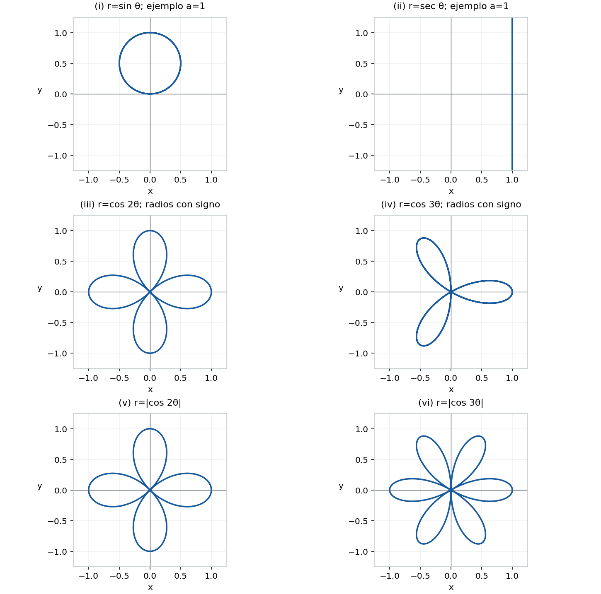{#fig-spv4-c04-f13 fig-alt="Capítulo 4: Seis curvas polares"}

## Ejercicio 4 — `SPV4-C04-A03-E004` {#e004-3}

Referencia: p. 88. **Problema:** hallar ecuaciones cartesianas de las primeras tres curvas del ejercicio anterior.

### Solución

**Curva (i):** $x^2+y^2=ay$. Si un punto no nulo cumple esta ecuación, tome $\rho=\sqrt{x^2+y^2}>0$ y un ángulo con $\sin\theta=y/\rho$. Entonces $\rho^2=ay$ implica $\rho=a\sin\theta$; el punto pertenece a la gráfica polar. El origen también aparece, tomando $\theta=0$. Esto prueba el recíproco, incluidos $a<0$ y $a=0$.

**Curva (ii):** si $a\ne0$, la ecuación es $x=a$. Para cualquier punto de esa recta, tome coordenadas polares con radio positivo: $\cos\theta=a/\rho\ne0$, luego $\rho=a\sec\theta$. Para $a=0$, la ecuación cartesiana correcta es $x^2+y^2=0$, porque la curva se reduce al origen.

**Curva (iii):** multiplicar $r=\cos2\theta$ por $r^2$ da $r^3=x^2-y^2$. Como $r$ puede ser negativo, la ecuación que representa los cuatro pétalos es

$$\boxed{(x^2+y^2)^3=(x^2-y^2)^2.}$$

Para el recíproco, en un punto no nulo escriba $\rho>0$ y su ángulo $\phi$. La ecuación implica $\rho=|\cos2\phi|$. Si $\cos2\phi\ge0$, use $(\rho,\phi)$. Si es negativo, use $(-\rho,\phi+\pi)$: su radio coincide con $\cos2(\phi+\pi)$. El origen aparece donde el coseno se anula. La ecuación sin cuadrar $(x^2+y^2)^{3/2}=x^2-y^2$ describe sólo los pétalos horizontales y no es equivalente con la convención de radios negativos.

## Ejercicio 5 — `SPV4-C04-A03-E005` {#e005-3}

Referencia: p. 88. **Problema:** obtener la forma polar de una hipérbola de focos $O$ y $(-2\varepsilon a,0)$, diferencia de distancias $2a$, con $a>0$, $\varepsilon>1$.

### Solución

Sea $\rho$ la distancia a $O$ y $s$ la distancia al otro foco. Entonces $s^2-\rho^2=4\varepsilon ax+4\varepsilon^2a^2$. Defina $\Lambda=(1-\varepsilon^2)a<0$.

En la rama $\rho-s=2a$, se tiene $s=\rho-2a$ y la diferencia de cuadrados da

$$-4a\rho+4a^2=4\varepsilon ax+4\varepsilon^2a^2,\qquad \rho=\Lambda-\varepsilon x.$$

Use $r=\rho$ y $x=r\cos\theta$. Resulta $r(1+\varepsilon\cos\theta)=\Lambda$.

En la otra rama, $s-\rho=2a$ da $\rho=-\Lambda+\varepsilon x$. Use ahora el radio con signo $r=-\rho$ y un ángulo opuesto a la dirección del punto; así, $x=r\cos\theta$ todavía y $r=\Lambda-\varepsilon x$. Las dos ramas quedan representadas por una misma fórmula:

$$\boxed{r=\frac{\Lambda}{1+\varepsilon\cos\theta}},\qquad 1+\varepsilon\cos\theta\ne0.$$

Si se impone $r\ge0$, sólo se conserva la primera rama con esta elección de foco y de $\Lambda$. Los radios negativos de la fórmula completa representan la otra rama; no deben confundirse con distancias negativas.

## Ejercicio 6 — `SPV4-C04-A03-E006` {#e006-3}

Referencia: p. 88. **Problema:** obtener la parábola de foco en el origen y una directriz, y revisar la fórmula polar indicada.

### Solución

Hay una discrepancia en el impreso: se escribe $y=a$, pero la figura dibuja una recta vertical y se pide la distancia $a-r\cos\theta$. Esa fórmula corresponde a **$x=a$**, no a $y=a$. Damos ambos casos, suponiendo $a>0$.

Para la directriz vertical $x=a$, la igualdad de distancias es $\rho=|x-a|$, $\rho=\sqrt{x^2+y^2}$. Al cuadrar, $y^2=a^2-2ax$, por lo que $x\le a/2<a$ y la distancia es $a-x$. Como aquí se puede tomar radio no negativo $r=\rho$, queda

$$r=a-r\cos\theta,\qquad \boxed{a=r(1+\cos\theta)}.$$

Para la directriz horizontal literalmente escrita, $y=a$, el mismo argumento da $x^2=a^2-2ay$, $y\le a/2$, y

$$\boxed{a=r(1+\sin\theta)}.$$

Las dos parábolas son imágenes por un giro de un cuarto de vuelta. Si $a=0$, el foco está en la directriz y el lugar degenera: $x=a=0$ produce el eje horizontal, mientras que $y=a=0$ produce el eje vertical; no se aplica la fórmula de una parábola no degenerada.

## Ejercicio 7 — `SPV4-C04-A03-E007` {#e007-3}

Referencia: p. 88. **Problema:** clasificar la curva $r=\Lambda/(1+\varepsilon\cos\theta)$ a partir de su ecuación cartesiana.

### Solución

Para todo punto de la curva, $r=\Lambda-\varepsilon x$. Al cuadrar y usar $r^2=x^2+y^2$,

$$\boxed{(1-\varepsilon^2)x^2+y^2=\Lambda^2-2\Lambda\varepsilon x.}$$

Si $\Lambda\ne0$, la equivalencia es completa con radios de ambos signos: para un punto cartesiano no nulo, tome $r=\Lambda-\varepsilon x$, cuyo cuadrado es su distancia al origen al cuadrado, y elija el ángulo para que $x=r\cos\theta,y=r\sin\theta$. Entonces $r\ne0$, y $1+\varepsilon\cos\theta=\Lambda/r\ne0$.

Para $|\varepsilon|\ne1$, completar el cuadrado da

$$(1-\varepsilon^2)\left(x+\frac{\Lambda\varepsilon}{1-\varepsilon^2}\right)^2+y^2=\frac{\Lambda^2}{1-\varepsilon^2}.$$

Con $\Lambda\ne0$, hay una elipse si $|\varepsilon|<1$ —circunferencia si $\varepsilon=0$—, una hipérbola si $|\varepsilon|>1$, y una parábola si $|\varepsilon|=1$, pues en ese caso $y^2=\Lambda^2-2\Lambda\varepsilon x$ tiene término lineal no nulo. Para la excentricidad usual $\varepsilon\ge0$, son los tres casos $\varepsilon<1$, $\varepsilon=1$, $\varepsilon>1$ solicitados.

La palabra «cualquier» requiere una excepción: si $\Lambda=0$, la fórmula cociente vale cero donde está definida y su gráfica es sólo el origen. La ecuación cuadrada puede contener puntos extra: si $|\varepsilon|=1$ da la recta $y=0$; si $|\varepsilon|>1$ da dos rectas. La clasificación no degenerada no es válida para $\Lambda=0$ ni se puede extender a todos los $\varepsilon<1$ negativos sin usar $|\varepsilon|$.

## Ejercicio 8 — `SPV4-C04-A03-E008` {#e008-2}

Referencia: p. 89. **Problema:** dibujar la cardioide $r=1-\sin\theta$, hallar una segunda representación y su ecuación cartesiana.

### Solución

**(a)** El radio está entre $0$ y $2$. Es cero en $\theta=\pi/2$, vale $1$ en $0,\pi$ y vale $2$ en $3\pi/2$. La curva es simétrica respecto del eje vertical, tiene una cúspide en el origen y un punto inferior $(0,-2)$; pasa por $(\pm1,0)$. Una vuelta $0\le\theta\le2\pi$ la traza completa.

**(b)** Para un punto representado por $(1-\sin\theta,\theta)$, use el par equivalente $(-(1-\sin\theta),\theta+\pi)$. Su nuevo radio es $-1-\sin(\theta+\pi)$, de modo que la misma curva se describe por $r=-1-\sin\theta$. El cambio es reversible.

**(c)** En la primera representación $r=\rho\ge0$. Multiplicar por $r$ da $r^2=r-r\sin\theta$, es decir,

$$x^2+y^2=\sqrt{x^2+y^2}-y.$$

En un punto no nulo esta igualdad permite dividir por $\rho$ y recuperar $\rho=1-\sin\theta$; el origen también pertenece. Al cuadrar se obtiene

$$\boxed{(x^2+y^2+y)^2=x^2+y^2.}$$

No se añaden soluciones: con $q=x^2+y^2=\rho^2$, una raíz del signo incorrecto exigiría $q+y=-\rho$, luego $q=-\rho-y\le0$ porque $y\ge-\rho$. Esto fuerza $q=0$, y el origen ya satisface la ecuación original. Así, la ecuación polinómica describe exactamente la cardioide.

## Ejercicio 9 — `SPV4-C04-A03-E009` {#e009-2}

Referencia: p. 89. **Problema:** dibujar tres limacones.

### Solución

**(i)** $r=1-\tfrac12\sin\theta$ siempre es positivo: $1/2\le r\le3/2$. La curva es simétrica respecto del eje vertical, pasa por $(\pm1,0)$ y corta ese eje en $(0,1/2)$ y $(0,-3/2)$. No pasa por el origen ni tiene lazo interior. Estos puntos y el cambio gradual del radio determinan el óvalo mostrado.

**(ii)** $r=1-2\sin\theta$ se anula en $\pi/6$ y $5\pi/6$, y es negativo entre esos ángulos. En ese tramo, el cambio a radio negativo coloca el punto en la dirección opuesta y traza el lazo interior, situado debajo del origen; en $\theta=\pi/2$ se obtiene $(0,-1)$. El resto traza el lazo exterior, que alcanza $(0,-3)$ en $3\pi/2$ y pasa por $(\pm1,0)$. Ambas partes son simétricas respecto del eje vertical y se encuentran en el origen.

**(iii)** $r=2+\cos\theta$ tiene $1\le r\le3$, simetría respecto del eje horizontal, extremos sobre ese eje $(3,0)$ y $(-1,0)$, y puntos $(0,\pm2)$. Es dos veces la curva de (i) girada $\pi/2$ en sentido antihorario: al sustituir $\phi=\theta-\pi/2$, $2(1-\tfrac12\sin\phi)=2+\cos\theta$.

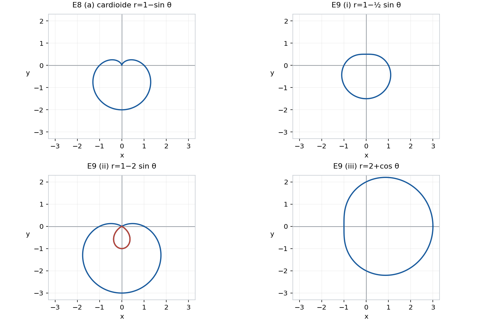{#fig-spv4-c04-f14 fig-alt="Capítulo 4: Cardioide y limacones"}

## Ejercicio 10 — `SPV4-C04-A03-E010` {#e010-2}

Referencia: p. 89. **Problema:** dibujar la lemniscata $r^2=2a^2\cos2\theta$, hallar su ecuación cartesiana, su descripción por producto de distancias y comparar otros productos.

### Solución

Suponga $a>0$; para $a=0$ la lemniscata se reduce al origen.

**(a)** Para un radio real debe cumplirse $\cos2\theta\ge0$. El intervalo $[-\pi/4,\pi/4]$ con $r=\sqrt2a\sqrt{\cos2\theta}$ traza el lóbulo derecho: sale del origen, alcanza $(\sqrt2a,0)$ y vuelve al origen. El intervalo trasladado por $\pi$ traza el izquierdo. Los radios negativos no añaden puntos. La curva tiene simetría respecto de ambos ejes y dos lóbulos que se encuentran en el origen.

**(b)** Multiplicar por $r^2$ produce

$$\boxed{(x^2+y^2)^2=2a^2(x^2-y^2).}$$

Para el recíproco, un punto no nulo permite dividir por $\rho^2=x^2+y^2$ y recuperar $\rho^2=2a^2\cos2\theta$. El origen está en las dos descripciones.

**(c)** Sean $d_1,d_2$ las distancias a $(-a,0),(a,0)$. Entonces

$$\begin{aligned}
(d_1d_2)^2&=((x+a)^2+y^2)((x-a)^2+y^2)\\
&=(x^2+y^2+a^2)^2-4a^2x^2\\
&=(x^2+y^2)^2-2a^2(x^2-y^2)+a^4.
\end{aligned}$$

Como el producto es no negativo, $d_1d_2=a^2$ equivale exactamente a la ecuación de (b).

**(d)** Para $d_1d_2=b$, con $b\ge0$, la ecuación es

$$(x^2+y^2)^2-2a^2(x^2-y^2)=b^2-a^4.$$

Si $0<b<a^2$, aparecen dos óvalos separados, uno alrededor de cada foco. Puede comprobarse resolviendo para $y^2$:

$$y^2=-x^2-a^2+\sqrt{4a^2x^2+b^2}.$$

Este valor es no negativo si y sólo si $|x^2-a^2|\le b$, de modo que las abscisas permitidas son $[-\sqrt{a^2+b},-\sqrt{a^2-b}]$ y $[\sqrt{a^2-b},\sqrt{a^2+b}]$. Cada intervalo tiene una curva superior e inferior que se unen sólo en sus extremos: dos componentes.

Si $b>a^2$, las abscisas forman un único intervalo $[-\sqrt{a^2+b},\sqrt{a^2+b}]$, y las mitades superior e inferior se unen en los extremos formando un solo óvalo. En $x=0$ tienen alturas $\pm\sqrt{b-a^2}$, por lo que no pasan por el origen. Para $b$ apenas mayor que $a^2$ se conserva una cintura; para valores grandes se ve una curva más redondeada. La lámina distingue esos casos sin afirmar que todos los óvalos sean convexos. Si $b=0$, sólo quedan los dos focos; si $b<0$, no hay puntos.

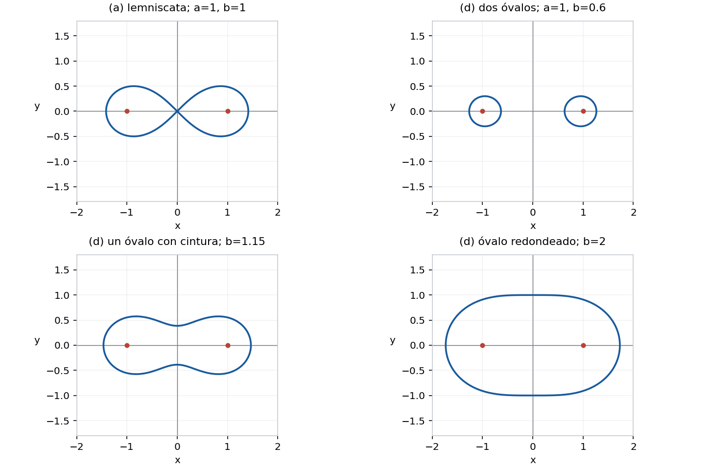{#fig-spv4-c04-f15 fig-alt="Capítulo 4: Lemniscata y óvalos de Cassini"}

---

::: {.spivak-nav}

[← Capítulo 3](capitulo-03.qmd) · [Colecciones](../index.qmd#spivak-calculus-cuarta-edición) · [Capítulo 5 →](capitulo-05.qmd)

:::

Soluciones originales de Alevi Peña · Matemática Abierta. [Licencia GFDL 1.3 o posterior](/COPYING.FDL).
