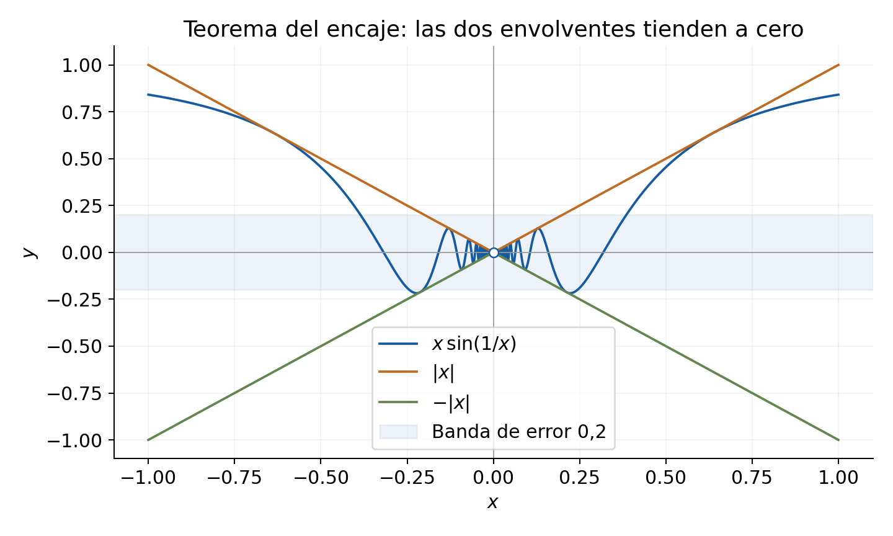
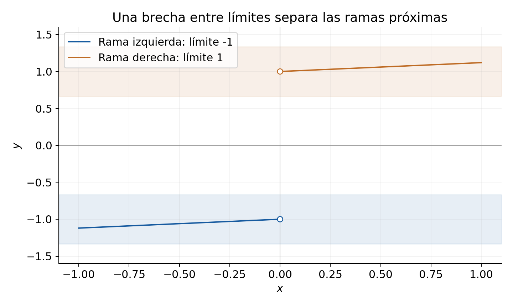
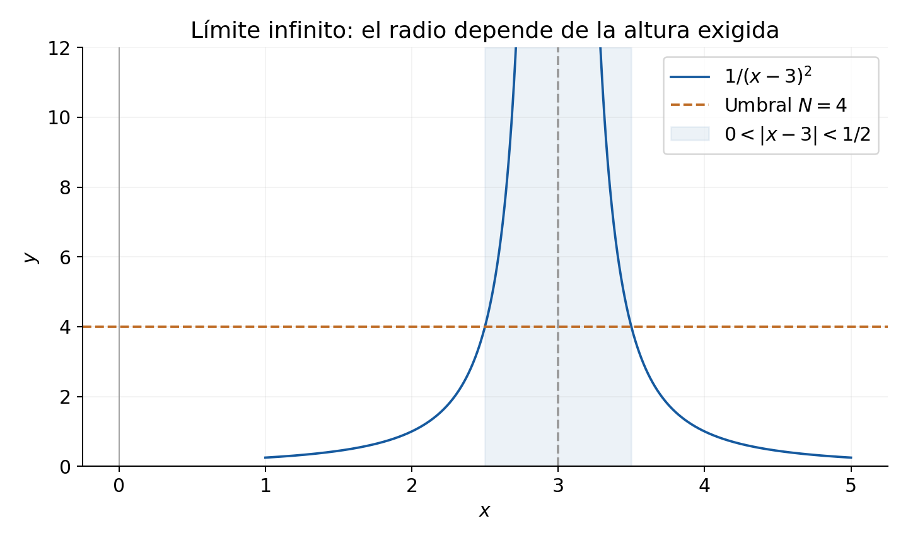

[← Capítulo 4](capitulo-04.qmd) · [Colecciones](../index.qmd#spivak-calculus-cuarta-edición) · [Capítulo 6 →](capitulo-06.qmd)

Solucionario explicado de Matemática Abierta · A. Peña

Los problemas proceden de Michael Spivak, *Calculus*, 4.ª edición, capítulo 5, pp. 107–114 (PDF consultado: páginas 127–134). Los enunciados se reducen al contenido matemático necesario; las soluciones y explicaciones son propias. Las referencias de cada ejercicio remiten a esa edición.

Usamos límites finitos salvo indicación expresa de $+\infty$ o $-\infty$. Las condiciones se aplican a puntos del dominio. Un límite lateral solo se considera cuando hay puntos del dominio arbitrariamente próximos por ese lado: una condición vacía no constituye un límite. Se adoptan las propiedades de orden, raíces y densidad de los reales declaradas en capítulos anteriores. No se usan derivadas, series ni la regla de l'Hôpital.

## Ejercicio 1 — `SPV4-C05-E001` {#e001}

Referencia: p. 107. **Problema:** calcular los seis límites siguientes; $n$ es un entero positivo.

### Solución

**(i)** Al acercarse $x$ a $1$, $(x^2-1)/(x+1)=x-1$; el límite es **$0$**.

**(ii)** Para $x\ne2$, $(x^3-8)/(x-2)=x^2+2x+4$; en $2$ el límite es **$12$**.

**(iii)** Al acercarse $x$ a $3$, el denominador $x-2$ tiende a $1$ y el numerador a $19$; el límite es **$19$**. Un cociente solo exige cancelar cuando su denominador tiende a cero.

**(iv)** Con $y$ fijo,
$$\frac{x^n-y^n}{x-y}=\sum_{j=0}^{n-1}x^{n-1-j}y^j.$$
Al tender $x$ a $y$, cada uno de los $n$ términos tiende a $y^{n-1}$: el resultado es **$ny^{n-1}$**. Para $n=1$ el cociente es $1$, también si $y=0$.

**(v)** Ahora $x$ es fijo y $y\to x$. La misma identidad da **$nx^{n-1}$**. La letra que varía cambia; la identidad algebraica permanece.

**(vi)** Si $a>0$, racionalizar da
$$\frac{\sqrt{a+h}-\sqrt a}{h}=\frac1{\sqrt{a+h}+\sqrt a}\longrightarrow\frac1{2\sqrt a}.$$
La continuidad local de la raíz se justifica por $|\sqrt{a+h}-\sqrt a|\le |h|/\sqrt a$. Si $a=0$, el dominio próximo es $h>0$ y el cociente $1/\sqrt h$ tiende a $+\infty$, sin límite finito. Si $a<0$, la expresión real no está definida.

## Ejercicio 2 — `SPV4-C05-E002` {#e002}

Referencia: pp. 107–108. **Problema:** calcular tres cocientes con raíces.

### Solución

**(i)** Para $x\ne1$, $(1-\sqrt x)/(1-x)=1/(1+\sqrt x)$: al tender $x$ a $1$, el límite es **$1/2$**.

**(ii)** Cerca de $0$, racionalizar $(1-\sqrt{1-x^2})/x$ produce $x/(1+\sqrt{1-x^2})$, cuyo límite es **$0$**.

**(iii)** El cociente $(1-\sqrt{1-x^2})/x^2$ se convierte en $1/(1+\sqrt{1-x^2})$: el límite es **$1/2$**. La raíz tiende a $1$, pues $|\sqrt{1-x^2}-1|\le x^2$ para $|x|<1$.

## Ejercicio 3 — `SPV4-C05-E003` {#e003}

Referencia: p. 108. **Problema:** determinar los límites y dar una elección de $\delta$ para cada $\varepsilon>0$.

### Solución

**(i)** $f(x)=x[3-\cos(x^2)]$, $a=0$. Como $|3-\cos(x^2)|\le4$, el límite es $0$ y sirve $\delta=\varepsilon/4$. No hace falta conocer un límite del coseno.

**(ii)** $f(x)=x^2+5x-2$, $a=2$. El límite es $12$ y $|f(x)-12|=|x-2||x+7|$. Para $|x-2|<1$, $|x+7|<10$; sirve $\delta=\min(1,\varepsilon/10)$.

**(iii)** $f(x)=100/x$, $a=1$. Si $|x-1|<1/2$, $|x|>1/2$ y $|100/x-100|<200|x-1|$. El límite es $100$; tome $\delta=\min(1/2,\varepsilon/200)$.

**(iv)** $f(x)=x^4$, $a$ arbitrario. Ponga $B=|a|+1$. Para $|x-a|<1$,
$$|x^4-a^4|\le |x-a|(|x|^3+|x|^2|a|+|x||a|^2+|a|^3)\le4B^3|x-a|.$$
El límite es $a^4$; sirve $\delta=\min(1,\varepsilon/(4B^3))$.

**(v)** $f(x)=x^4+1/x$, $a=1$. Para $|x-1|<1/2$, la estimación anterior con $B=2$ da $|x^4-1|\le32|x-1|$, y $|1/x-1|<2|x-1|$. El límite es $2$; sirve $\delta=\min(1/2,\varepsilon/34)$.

**(vi)** $f(x)=x/(2-\sin^2x)$, $a=0$. El denominador es al menos $1$, por lo que $|f(x)|\le|x|$. Límite $0$ y $\delta=\varepsilon$.

**(vii)** $f(x)=\sqrt{|x|}$, $a=0$. Límite $0$; $\delta=\varepsilon^2$ transforma $|x|<\delta$ en $\sqrt{|x|}<\varepsilon$.

**(viii)** $f(x)=\sqrt x$, $a=1$. Para $x\ge0$, $|\sqrt x-1|=|x-1|/(\sqrt x+1)\le|x-1|$. El límite es $1$ y sirve $\delta=\min(1,\varepsilon)$.

## Ejercicio 4 — `SPV4-C05-E004` {#e004}

Referencia: p. 108; funciones de 4-17, p. 72. **Problema:** determinar dónde existen sus límites bilaterales finitos.

### Solución

**(i)** $\lfloor x\rfloor$: existen exactamente en $a\notin\mathbb Z$, y valen $\lfloor a\rfloor$. En el entero $k$, los valores laterales son $k-1$ y $k$.

**(ii)** $x-\lfloor x\rfloor$: existen exactamente fuera de $\mathbb Z$, con valor $a-\lfloor a\rfloor$. En los enteros los límites laterales son $1$ y $0$.

**(iii)** $\sqrt{x-\lfloor x\rfloor}$: la misma exclusión de enteros; los valores laterales allí son $1$ y $0$. En los intervalos entre enteros la continuidad de la raíz se obtiene racionalizando, o usando $|\sqrt u-\sqrt v|\le\sqrt{|u-v|}$.

**(iv)** $\lfloor x\rfloor+\sqrt{x-\lfloor x\rfloor}$: existe en **todo real** y coincide con la función. En un entero $k$, el arco izquierdo tiende a $(k-1)+1=k$ y el derecho a $k+0=k$.

**(v)** $\lfloor1/x\rfloor$: existe cuando $a\ne0$ y $1/a\notin\mathbb Z$, y vale $\lfloor1/a\rfloor$. En $a=1/k$, $k\in\mathbb Z\setminus\{0\}$, los valores laterales son $k$ a la izquierda y $k-1$ a la derecha; en $0$ no hay límite finito.

**(vi)** $1/\lfloor1/x\rfloor$, dominio $D=(-\infty,0)\cup(0,1]$: en los puntos de acumulación de $D$, el límite relativo existe en $a=0$, donde vale $0$, en $a=1$, donde vale $1$ por la izquierda, y en los demás puntos de $D$ salvo $a=1/k$ con $k\le-1$ o $k\ge2$. En esos puntos excluidos hay saltos entre $1/k$ y $1/(k-1)$. En puntos ordinarios el límite coincide con la función. Para $0<|x|<1/2$, $|\lfloor1/x\rfloor|\ge1/(2|x|)$, luego $|1/\lfloor1/x\rfloor|\le2|x|$.

Si se exige un entorno bilateral contenido en el dominio salvo su centro, $a=1$ no se llama límite bilateral; solo tiene límite izquierdo. Dejamos explícita esta diferencia de convención.

## Ejercicio 5* — `SPV4-C05-E005` {#e005}

Referencia: p. 108; funciones de 4-19, p. 73. **Problema:** determinar los límites de seis funciones decimales, (a) usando colas de nueves y (b) usando colas de ceros.

### Solución

Una regla de lectura permite incluir todos los extremos sin una lista interminable. En un punto $a$ sin decimal finito hay una sola expansión. En un punto decimal finito, llamaremos **expansión izquierda** a la que acaba en nueves y **expansión derecha** a la que acaba en ceros, ajustando también la parte entera. Por ejemplo, en $a=1$ son $0.999\ldots$ y $1.000\ldots$. Al aproximarse por el lado correspondiente, cualquier prefijo fijo de esa expansión queda estable. En un punto no decimal finito, cada prefijo queda estable por ambos lados. Esta afirmación se sigue de que los extremos de un cilindro decimal de longitud $n$ son múltiplos de $10^{-n}$.

**(a-i), (a-ii), (b-i), (b-ii).** Para la primera cifra, el límite bilateral existe exactamente fuera de $10^{-1}\mathbb Z$; para la segunda, fuera de $10^{-2}\mathbb Z$. Su valor es la cifra local constante. En cada extremo de escalón cambia la cifra: incluso los reinicios de $9$ a $0$ son saltos. La elección de expansión solo modifica el valor en el punto del salto.

**(a-iii), (b-iii).** La función que cuenta los sietes cuando son finitos y vale $0$ cuando son infinitos no tiene límite finito en ningún punto. En cualquier intervalo se puede prolongar un prefijo con infinitos sietes, dando valor $0$, o con un número finito arbitrariamente grande de sietes, dando valores arbitrariamente grandes. Esto funciona también en cualquier intervalo lateral.

**(a-iv), (b-iv).** El indicador de infinitos sietes tampoco tiene límite en ningún punto: toda vecindad contiene prolongaciones con finitos y con infinitos sietes, de valores $0$ y $1$.

**(a-v), (b-v).** Defina $T_7(e)$ para una expansión $e$ de $a$: si contiene un primer $7$, conserve hasta él y suprima la cola; si no contiene $7$, ponga $T_7(e)=a$. Los límites izquierdo y derecho son respectivamente $T_7(e_-)$ y $T_7(e_+)$. Por tanto el límite bilateral existe **exactamente cuando esos dos números coinciden**. Esta es una caracterización efectiva: para un decimal finito solo se examinan sus dos prefijos finitos, pues las colas de ceros y nueves no contienen sietes. Para un decimal no finito el límite existe siempre: vale el truncamiento en su primer $7$, o $a$ si nunca hay $7$.

En efecto, si el primer $7$ está en posición $n$, el prefijo estable fija un valor constante. Si no hay $7$, fijar las primeras $N$ cifras asegura que un eventual truncamiento posterior difiere de $x$ en a lo sumo $10^{-N}$; así $|f(x)-a|\le10^{-N}+|x-a|$. Como ejemplos, en $a=0.7$ los límites son $0.7$ a ambos lados, mientras que en $a=0.8$ son $0.7$ y $0.8$: allí el bilateral falla. Elegir otra representación en los puntos aislados no altera estos límites, porque la misma cota sigue siendo válida.

**(a-vi), (b-vi).** Para la posición del primer $1$ (valor $0$ si no hay ninguno), un límite lateral finito existe exactamente cuando la expansión de ese lado tiene un $1$; vale su primera posición. Si no lo tiene, en cada vecindad lateral hay puntos sin ningún $1$, de valor $0$, y puntos cuyo primer $1$ aparece arbitrariamente tarde. El bilateral existe exactamente cuando ambas expansiones tienen su primer $1$ en la misma posición. Para un decimal no finito esto equivale a que tenga algún $1$; para un decimal finito se comparan las dos expansiones. En $0.1$, por ejemplo, el límite derecho vale $1$ y el izquierdo no existe; en $0.12$ ambos valen $1$.

La propiedad sobre prolongaciones se aplica por separado dentro de cada vecindad lateral, evitando tomar el punto $a$ como muestra. Los cambios de convención en $a$ no deben confundirse con cambios de límite.

## Ejercicio 6 — `SPV4-C05-E006` {#e006}

Referencia: p. 108. **Problema:** se conoce que errores menores que $t$ en $f(x)\to2$ y $g(x)\to4$ se obtienen, respectivamente, con radios $F(t)=\sin^2(t^2/9)+t$ y $G(t)=t^2$. Dar radios para suma, producto y cocientes.

### Solución

En todos los casos exigimos $0<|x-2|<\delta$. Para controlar simultáneamente errores menores que $t$, basta $\delta\le\min(F(t),G(t))$; ambos números son positivos.

**(i)** Para la suma, tome $t=\varepsilon/2$ y $\delta=\min(F(t),G(t))$. La desigualdad triangular da $|f+g-6|<2t=\varepsilon$.

**(ii)** Tome $t=\min(1,\varepsilon/7)$ y el mismo mínimo. Entonces $|g|<5$ y
$$|fg-8|\le |g||f-2|+2|g-4|<7t\le\varepsilon.$$

**(iii)** Tome $t=\min(1,12\varepsilon)$ y $\delta=G(t)$. Como $g>3$,
$$\left|\frac1g-\frac14\right|=\frac{|g-4|}{4|g|}<t/12\le\varepsilon.$$

**(iv)** Tome $t=\min(1,2\varepsilon)$ y $\delta=\min(F(t),G(t))$. Con $g>3$,
$$\left|\frac fg-\frac12\right|\le\frac{2|f-2|+|g-4|}{2|g|}<t/2\le\varepsilon.$$
Estas cotas garantizan además que los denominadores no se anulan.

## Ejercicio 7 — `SPV4-C05-E007` {#e007}

Referencia: p. 108. **Problema:** refutar que reducir el radio a la mitad reduzca necesariamente el error a la mitad.

### Solución

Tome $f(x)=\sqrt{|x|}$, $a=l=0$, $\varepsilon=\delta=1$. Si $0<|x|<1$, $|f(x)|<1$. Pero $x=1/3$ satisface $0<|x|<1/2$ y $f(x)=1/\sqrt3>1/2$. Aunque la función tiene límite cero, la relación entre radios y errores no es lineal.

## Ejercicio 8 — `SPV4-C05-E008` {#e008}

Referencia: p. 109. **Problema:** estudiar cuatro implicaciones sobre suma y producto de límites.

### Solución

**(a)** Sí pueden existir ambos resultados aunque ninguno de los factores tenga límite. En $a=0$, sea $s(x)=1$ para $x>0$ y $-1$ para $x<0$. Con $f=s$, $g=-s$, ni $f$ ni $g$ tienen límite, pero $f+g=0$ y $fg=-1$ fuera de cero.

**(b)** Si $f\to l$ y $f+g\to m$, entonces $g=(f+g)-f\to m-l$.

**(c)** No: si $f$ y $f+g$ tuvieran límites, (b) daría un límite para $g$.

**(d)** No en general: $f(x)=x$, $g(x)=s(x)$ da $fg=|x|\to0$, pero $g$ no tiene límite. Si el límite de $f$ fuera distinto de cero, el cociente $g=(fg)/f$ sí tendría límite.

## Ejercicio 9 — `SPV4-C05-E009` {#e009}

Referencia: p. 109. **Problema:** justificar el cambio $x=a+h$ en un límite.

### Solución

Las condiciones $0<|x-a|<\delta$ y $0<|h|<\delta$ son idénticas cuando $x=a+h$, y las diferencias $|f(x)-l|$ y $|f(a+h)-l|$ también. Cada radio válido para una definición vale para la otra. Así las existencias son equivalentes y los valores iguales.

## Ejercicio 10 — `SPV4-C05-E010` {#e010}

Referencia: p. 109. **Problema:** justificar tres cambios en límites y dar un contraejemplo para $x^2$.

### Solución

**(a)** $f(x)\to l$ equivale a $f(x)-l\to0$, porque el error en ambas definiciones es $|f(x)-l|$.

**(b)** $\lim_{x\to0}f(x)=\lim_{x\to a}f(x-a)$, con existencia equivalente, por el cambio $u=x-a$ del ejercicio 9.

**(c)** $\lim_{x\to0}f(x)=\lim_{x\to0}f(x^3)$, también con existencia equivalente. De izquierda a derecha un radio $\eta$ para $f$ se convierte en $\eta^{1/3}$; de derecha a izquierda un radio $\delta$ para $f(x^3)$ se convierte en $\delta^3$, usando $x=\sqrt[3]u$. Ambos cambios conservan puntos no nulos y alcanzan ambos lados de cero.

**(d)** Con $f=s$ del ejercicio 8, $f(x^2)=1$ para $x\ne0$, mientras que $f(x)$ no tiene límite bilateral. Los cuadrados solo recorren el lado positivo.

## Ejercicio 11 — `SPV4-C05-E011` {#e011}

Referencia: p. 109. **Problema:** probar que funciones iguales en un entorno perforado tienen los mismos límites.

### Solución

Suponga $f(x)=g(x)$ para $0<|x-a|<r$. Si $f\to l$ y $\eta$ controla su error para una tolerancia dada, tome $\delta=\min(r,\eta)$. Entonces $|g(x)-l|=|f(x)-l|<\varepsilon$. Intercambiar $f$ y $g$ prueba la recíproca. Los valores en $a$ y lejos de $a$ no intervienen.

## Ejercicio 12 — `SPV4-C05-E012` {#e012}

Referencia: p. 109. **Problema:** estudiar el paso de desigualdades a límites.

### Solución

**(a)** Si $f\le g$, $f\to l$, $g\to m$, necesariamente $l\le m$. Si $l>m$, tome $\varepsilon=(l-m)/3$ y un radio común. Allí $f>l-\varepsilon>m+\varepsilon>g$, contradicción.

**(b)** Basta $f\le g$ en algún entorno perforado de $a$, en el dominio común que se aproxima a $a$; la prueba anterior puede restringir el radio a ese entorno.

**(c)** La desigualdad estricta puede perderse. Ponga $f(x)=0$ y $g(x)=(x-a)^2$ para $x\ne a$, con $g(a)=1$. Entonces $f(x)<g(x)$ para todo $x$, pero ambos límites son $0$.

## Ejercicio 13 — `SPV4-C05-E013` {#e013}

Referencia: p. 109. **Problema:** probar el teorema del encaje para $f\le g\le h$, con $f,h\to l$, e ilustrarlo.

### Solución

Dado $\varepsilon>0$, elija un radio común en que $l-\varepsilon<f(x)$ y $h(x)<l+\varepsilon$. Allí
$$l-\varepsilon<f(x)\le g(x)\le h(x)<l+\varepsilon,$$
por lo que $|g(x)-l|<\varepsilon$. Basta, como en el ejercicio anterior, que el encaje rija localmente.

La lámina muestra una muestra finita de $-|x|\le x\sin(1/x)\le|x|$ en torno a cero. Las envolventes entran en cualquier banda horizontal alrededor de $0$ y fuerzan a la función intermedia a entrar en ella.

## Ejercicio 14* — `SPV4-C05-E014` {#e014}

Referencia: p. 109. **Problema:** (a) si $f(x)/x\to l$, calcular $f(bx)/x$ para $b\ne0$; (b) tratar $b=0$; (c) aplicar a $\sin(2x)/x$ mediante otro método.

### Solución

**(a)** Para $b\ne0$,
$$\frac{f(bx)}x=b\frac{f(bx)}{bx}\longrightarrow bl.$$
El cambio $u=bx$ es legítimo: un radio $\eta$ en $u$ corresponde a $\eta/|b|$ en $x$.

**(b)** Si $f(0)$ está definido, la expresión es $f(0)/x$. Cuando $f(0)=0$ el límite es $0$; cuando $f(0)\ne0$ no existe un límite finito. La hipótesis sobre $f(x)/x$ no impone nada a $f(0)$: por ejemplo, $f(x)=lx$ fuera de cero y $f(0)=1$. Si $f(0)$ no está definido, tampoco lo está la nueva expresión.

**(c)** Escribiendo $\alpha=\lim_{x\to0}\sin x/x$, la identidad $\sin2x=2\sin x\cos x$ da límite $2\alpha$. Aquí $\sin x\to0$ se deduce de la acotación de $\sin x/x$ y $\cos x\to1$ de $1-\cos x=\sin^2x/(1+\cos x)$, usando que $\cos x>0$ cerca de cero. Este signo proviene de la geometría elemental del círculo.

## Ejercicio 15 — `SPV4-C05-E015` {#e015}

Referencia: pp. 109–110. **Problema:** calcular once límites en términos de $\alpha=\lim_{x\to0}\sin x/x$.

### Solución

Se supone la existencia de $\alpha$. Para los cocientes que lo requieren usamos $\alpha>0$: con ángulos en radianes, la comparación geométrica de áreas da $\cos t\le\sin t/t\le1$ para $0<t<\pi/2$; en un intervalo pequeño el extremo izquierdo supera $1/2$. Basta esta cota para asegurar $\alpha\ge1/2$; no necesitamos sustituir aquí su valor. Esta dependencia trigonométrica no es una consecuencia de las reglas de límites por sí solas. Como en E014, $\sin t\to0$ y $\cos t\to1$.

**(i)** $\sin3x/x\to\boxed{3\alpha}$ por E014.

**(ii)** Si $b\ne0$,
$$\frac{\sin ax}{\sin bx}=\frac{\sin ax/x}{\sin bx/x}\longrightarrow\boxed{a/b}.$$
Para $a=0$ vale cero; para $b=0$ el cociente no está definido. La cota positiva anterior asegura que $\sin bx$ no se anula cerca de cero, salvo en el centro.

**(iii)** $\sin^2(2x)/x=x(\sin2x/x)^2\to\boxed0$.

**(iv)** $\sin^2(2x)/x^2\to\boxed{4\alpha^2}$.

**(v)** Racionalizando mediante $\sin^2x=(1-\cos x)(1+\cos x)$,
$$\frac{1-\cos x}{x^2}=\frac{(\sin x/x)^2}{1+\cos x}\longrightarrow\boxed{\alpha^2/2}.$$

**(vi)** Divida numerador y denominador de $(\tan^2x+2x)/(x+x^2)$ por $x$. Como $\tan x/x=(\sin x/x)/\cos x$ tiene límite, $\tan^2x/x\to0$. Resultado: $\boxed2$.

**(vii)** $x\sin x/(1-\cos x)=(\sin x/x)/[(1-\cos x)/x^2]\to\boxed{2/\alpha}$.

**(viii)** Manteniendo fijo $x$ y usando la fórmula de adición,
$$\frac{\sin(x+h)-\sin x}{h}=\sin x\frac{\cos h-1}{h}+\cos x\frac{\sin h}{h}\longrightarrow\boxed{\alpha\cos x}.$$
El primer cociente tiende a cero por (v). Este cálculo es directo; no invoca derivadas.

**(ix)** Ponga $u=x^2-1$. Para $x\to1$, $u\to0$ y $u\ne0$ cerca del centro; $\sin(x^2-1)/(x-1)=(\sin u/u)(x+1)\to\boxed{2\alpha}$.

**(x)** Para $x\ne0$,
$$\frac{x^2(3+\sin x)}{(x+\sin x)^2}=\frac{3+\sin x}{(1+\sin x/x)^2}\longrightarrow\boxed{3/(1+\alpha)^2}.$$
El denominador límite es positivo.

**(xi)** $|(x^2-1)^3[\sin(1/(x-1))]^3|\le|x^2-1|^3\to0$ cuando $x\to1$. Resultado: $\boxed0$. No es necesario asignar un límite al factor oscilante.

## Ejercicio 16 — `SPV4-C05-E016` {#e016}

Referencia: p. 110. **Problema:** probar las reglas para valor absoluto, máximo y mínimo.

### Solución

**(a)** La desigualdad $||f(x)|-|l||\le|f(x)-l|$ permite usar el mismo radio que para $f\to l$. Así $|f|\to|l|$.

**(b)** Use
$$\max(u,v)=\frac{u+v+|u-v|}2,\qquad \min(u,v)=\frac{u+v-|u-v|}2.$$
Las reglas de suma y (a) dan límites $\max(l,m)$ y $\min(l,m)$. La fórmula cubre también $l=m$.

## Ejercicio 17 — `SPV4-C05-E017` {#e017}

Referencia: p. 110. **Problema:** demostrar la inexistencia de límites finitos de $1/x$ en $0$ y de $1/(x-1)$ en $1$.

### Solución

**(a)** Para cualquier candidato $l$ tome $\varepsilon=1$. Dado cualquier $\delta>0$, elija $0<x<\min(\delta,1/(|l|+2))$. Entonces $1/x>|l|+2$ y $|1/x-l|>1$. Ningún $l$ satisface la definición.

**(b)** Ponga $h=x-1$ y aplique exactamente la misma elección a $h$. El desplazamiento no cambia el argumento.

## Ejercicio 18 — `SPV4-C05-E018` {#e018}

Referencia: p. 110. **Problema:** probar que un límite finito implica acotación local e interpretarla geométricamente.

### Solución

Si $f\to l$, use la tolerancia $1$. Existe $\delta>0$ con $|f(x)-l|<1$ para $0<|x-a|<\delta$, luego $|f(x)|<|l|+1$. Tome $M=|l|+1$. La gráfica próxima, sin incluir necesariamente el punto central, queda en una banda horizontal de altura finita. No se afirma acotación global ni se restringe $f(a)$.

## Ejercicio 19 — `SPV4-C05-E019` {#e019}

Referencia: p. 110. **Problema:** probar que el indicador de los racionales no tiene límite en ningún real.

### Solución

Todo intervalo abierto contiene racionales e irracionales. Si hubiera límite $l$, con tolerancia $1/3$ y en un mismo entorno perforado tendríamos $|1-l|<1/3$ y $|l|<1/3$, de donde $1<2/3$. La contradicción vale para cualquier centro y también por cada lado.

La densidad racional proviene de la propiedad arquimediana; la irracional se deduce tomando un racional en un intervalo trasladado por un irracional fijo. Estas dependencias no se confunden con las reglas algebraicas de límites.

## Ejercicio 20* — `SPV4-C05-E020` {#e020}

Referencia: p. 110. **Problema:** para $f(x)=x$ en racionales y $f(x)=-x$ en irracionales, probar que no hay límite en $a\ne0$.

### Solución

Si $f\to l$, al restringirnos a racionales arbitrariamente próximos a $a$, necesariamente $l=a$: de $|l-a|\le|l-x|+|x-a|$ se obtendría $|l-a|<2\varepsilon$ para todo $\varepsilon>0$. En irracionales el mismo argumento obliga a $l=-a$. Ambos valores coinciden solo si $a=0$. En ese punto sí hay límite cero, porque $|f(x)|=|x|$.

## Ejercicio 21 — `SPV4-C05-E021` {#e021}

Referencia: p. 110. **Problema:** (a) si $g\to0$ en cero, probar $g(x)\sin(1/x)\to0$; (b) extenderlo a un factor acotado.

### Solución

**(a)** $|g(x)\sin(1/x)|\le|g(x)|$; el radio para el error $\varepsilon$ en $g$ basta.

**(b)** Si $|h(x)|\le M$ y $M>0$, el radio que asegura $|g(x)|<\varepsilon/M$ da $|g(x)h(x)|<\varepsilon$. Si $M=0$ el producto es cero. Basta que la cota se cumpla en un entorno perforado; fuera de él nada importa. No se requiere que $h$ tenga límite.

## Ejercicio 22 — `SPV4-C05-E022` {#e022}

Referencia: p. 111. **Problema:** caracterizar las funciones $f$ tales que $f+g$ carezca de límite en cero siempre que $g$ carezca de él.

### Solución

Si $f$ tiene límite y $f+g$ lo tuviera, la resta produciría un límite de $g$. Por tanto $f$ cumple la propiedad. Si $f$ no tiene límite, elija $g=-f$: tampoco tiene límite, pero $f+g=0$. La propiedad equivale exactamente a la existencia de un límite finito de $f$.

## Ejercicio 23** — `SPV4-C05-E023` {#e023}

Referencia: p. 111. **Problema:** caracterizar la propiedad multiplicativa: para todo $g$ sin límite finito en cero, $fg$ tampoco tiene límite finito. Probar (a) suficiencia de $f\to l\ne0$; (b) suficiencia de $|f|\to+\infty$; (c) necesidad de una de ellas.

### Solución

**(a)** Si $f\to l\ne0$, existe un entorno perforado donde $|f|>|l|/2$. Si $fg$ tuviera límite, la regla del cociente daría un límite de $g=(fg)/f$, contradicción.

**(b)** Si $|f|\to+\infty$, $f$ no se anula cerca del centro y $1/f\to0$: para obtener error menor que $\varepsilon$, basta imponer $|f|>1/\varepsilon$. Si $fg$ tuviera límite finito, sería localmente acotado y $g=(fg)(1/f)\to0$ por E021. De nuevo hay contradicción.

**(c)** Suponga que no se cumple ninguna de las dos condiciones. Separamos dos posibilidades exhaustivas.

Primera: existe $c>0$ y un entorno perforado donde $|f|>c$. Defina allí $g=1/f$, extendiéndola arbitrariamente lejos de cero. El producto vale $1$ localmente. Si $g$ tuviera límite $m\ne0$, el recíproco daría $f\to1/m\ne0$, condición excluida. Si $g\to0$, para cada $N>0$ tendríamos $|g|<1/N$ suficientemente cerca y, por tanto, $|f|>N$; esto daría $|f|\to+\infty$, también excluido. Por ello $g$ no tiene límite finito, pero $fg\to1$.

Segunda: para todo $c>0$ y todo radio hay un punto no nulo donde $|f|\le c$. Podemos elegir puntos distintos $x_n\to0$, con $|x_n|<1/n$ y $|f(x_n)|\le1/n$. Para garantizar distinción, el radio en la elección siguiente se hace menor que la mitad de los módulos ya elegidos. Ponga $g(x_n)=1$ y $g(x)=0$ en los demás puntos. Entonces $fg$ vale cero fuera del conjunto elegido y su módulo en $x_n$ es a lo sumo $1/n$; para una tolerancia dada se excluyen los finitos puntos iniciales mediante un radio menor que sus distancias al centro. Así $fg\to0$.

En cambio $g$ no tiene límite: toma $1$ en puntos arbitrariamente próximos y $0$ en otros arbitrariamente próximos. Estos últimos existen, por ejemplo, en intervalos entre módulos consecutivos después de escoger los $|x_n|$ estrictamente decrecientes con razón menor que $1/2$. Las dos construcciones completan la necesidad. Se usa aquí una elección sucesiva numerable de puntos reales; no una hipótesis de regularidad de $f$.

## Ejercicio 24* — `SPV4-C05-E024` {#e024}

Referencia: p. 111. **Problema:** sean $A_n\subset[0,1]$ finitos y disjuntos dos a dos; definir $f=1/n$ en $A_n$ y cero fuera de su unión. Probar $f\to0$ en cada $a\in[0,1]$.

### Solución

Elija $N$ con $1/N<\varepsilon$. El conjunto $B=A_1\cup\cdots\cup A_N$ es finito. Puede escogerse un radio positivo que no contenga ningún punto de $B\setminus\{a\}$: use la mitad de la menor distancia a esos puntos, o cualquier radio si no hay ninguno. En el entorno perforado, $f$ vale cero o $1/n$ con $n>N$, luego $|f|<\varepsilon$. Se excluye $a$ porque su propio valor puede ser grande. En los extremos se entiende el límite relativo a $[0,1]$, es decir, el lateral disponible.

## Ejercicio 25 — `SPV4-C05-E025` {#e025}

Referencia: p. 111. **Problema:** verificar cuatro formulaciones: para todo $d>0$ existe $e>0$ tal que (i) $0<|x-a|<e\Rightarrow|f-l|<d$; (ii) igual con $\le d$; (iii) igual con $<5d$; (iv) radio $e/10$ y error $<d$.

### Solución

**(i)** Solo se han renombrado las variables cuantificadas: $d$ es la tolerancia y $e$ el radio.

**(ii)** La definición habitual implica la variante no estricta. A la inversa, aplíquela a $d=\varepsilon/2$; error $\le\varepsilon/2$ implica error $<\varepsilon$.

**(iii)** De la definición habitual obtenga error $<5d$. Para recuperar la habitual, aplique la variante a $d=\varepsilon/5$.

**(iv)** Si un radio habitual es $r$, elija $e=10r$. En sentido inverso, un $e$ de la variante suministra radio $e/10$. Los factores positivos fijos no cambian la definición.

## Ejercicio 26* — `SPV4-C05-E026` {#e026}

Referencia: p. 111. **Problema:** refutar (a) $\forall\delta>0\ \exists\varepsilon>0:\ 0<|x-a|<\delta\Rightarrow|f(x)-l|<\varepsilon$; (b) la implicación invertida $|f(x)-l|<\varepsilon\Rightarrow0<|x-a|<\delta$.

### Solución

**(a)** Tome $f(x)=1$, $a=l=0$. Para todo $\delta$ sirve $\varepsilon=2$, pero el límite real es $1$, no $0$. Se está pidiendo una cota de error que puede ser grande, en lugar de controlar cualquier error previamente prescrito.

**(b)** La condición no es necesaria: $f(x)=0$, $a=l=0$ tiene límite cero, pero $|f(x)-l|<\varepsilon$ se cumple para todo $x$, incluidos el centro y puntos arbitrariamente lejanos. Ningún $\delta$ los encierra en $0<|x-a|<\delta$.

De hecho, si $f(a)$ está definido, la condición escrita para **todo** $x$ es imposible: elija $\varepsilon>|f(a)-l|$ y aplique la implicación en $x=a$. Aunque se excluyera el centro de la cuantificación, seguiría siendo incorrecta: en el dominio $\mathbb R\setminus\{0\}$ tome $f(x)=x$, $a=0$, $l=1$. Para cada $\varepsilon>0$ sirve $\delta=1+\varepsilon$, pues $|x-1|<\varepsilon$ implica $0<|x|<1+\varepsilon$. Sin embargo el límite es $0$. La condición invertida localiza preimágenes de bandas; no controla los valores cerca del centro.

## Ejercicio 27 — `SPV4-C05-E027` {#e027}

Referencia: p. 112; funciones de 4-17, p. 72. **Problema:** determinar dónde existen los límites laterales finitos de las seis funciones.

### Solución

**(i)** Para $\lfloor x\rfloor$ existen ambos en todo $a$. En un entero $k$, izquierdo $k-1$, derecho $k$; fuera de enteros ambos valen $\lfloor a\rfloor$.

**(ii)** Para la parte fraccionaria existen ambos en todo $a$. En enteros, izquierdo $1$, derecho $0$; fuera de ellos ambos valen $a-\lfloor a\rfloor$.

**(iii)** Para su raíz existen ambos en todo $a$: en enteros $1$ y $0$; fuera de ellos $\sqrt{a-\lfloor a\rfloor}$.

**(iv)** Para $\lfloor x\rfloor+\sqrt{x-\lfloor x\rfloor}$ ambos existen en todo $a$ y valen la función, incluido $a=k$, con valor $k$.

**(v)** Para $\lfloor1/x\rfloor$ ambos existen en todo $a\ne0$. En $a=1/k$, izquierdo $k$ y derecho $k-1$; en los demás puntos ambos valen la función. En $0$ no hay laterales finitos: izquierdo $-\infty$, derecho $+\infty$.

**(vi)** Para $1/\lfloor1/x\rfloor$ ambos existen en $a<1$, incluyendo $0$, donde valen $0$. En un punto $1/k$, $k\le-1$ o $k\ge2$, izquierdo $1/k$ y derecho $1/(k-1)$. En los demás puntos no nulos menores que $1$ ambos valen la función. En $1$ existe solo el izquierdo, $1$; para $a>1$ ninguno es un límite lateral del dominio. No se atribuye un valor a un lado sin puntos disponibles.

La orientación de los saltos se obtiene de que $1/x$ es estrictamente decreciente en cada semieje, también en el negativo.

## Ejercicio 28* — `SPV4-C05-E028` {#e028}

Referencia: p. 112; funciones de 4-19, p. 73. **Problema:** determinar los laterales de las funciones decimales, (a) con colas de nueves y (b) con colas de ceros.

### Solución

Usamos las expansiones laterales $e_-$ y $e_+$ definidas en E005. Las respuestas siguientes valen para **cada una de las dos convenciones**, porque incluyen el control de los puntos decimales finitos próximos, no solo el valor central.

**(a-i), (b-i).** Ambos laterales existen en todo real y valen las primeras cifras de $e_-$ y $e_+$, respectivamente.

**(a-ii), (b-ii).** Lo mismo para la segunda cifra. Fuera de la correspondiente malla decimal son iguales; en ella se leen las dos expansiones.

**(a-iii), (b-iii).** Ningún lateral finito existe: en todo intervalo lateral hay valor cero y valores arbitrariamente grandes.

**(a-iv), (b-iv).** Ningún lateral existe: en todo intervalo lateral aparecen $0$ y $1$.

**(a-v), (b-v).** Ambos laterales existen en todo real y valen $T_7(e_-)$ y $T_7(e_+)$. Si no hay primer $7$ en una expansión lateral, el valor de ese límite es $a$. El control $|f(x)-x|\le10^{-N}$ cuando las primeras $N$ cifras carecen de sietes prueba este caso.

**(a-vi), (b-vi).** Un lateral finito existe exactamente cuando su expansión lateral contiene un $1$, y vale la posición del primero. En ausencia de $1$, las prolongaciones sin unos y con un primer uno arbitrariamente tardío impiden un límite finito. Esto prueba cada lado sin necesidad de suponer la existencia del otro.

## Ejercicio 29 — `SPV4-C05-E029` {#e029}

Referencia: p. 112. **Problema:** probar que límites laterales iguales producen un bilateral.

### Solución

Si ambos laterales valen $l$, para una tolerancia $\varepsilon$ hay radios $\delta_-$ y $\delta_+$. Tome su mínimo. Todo $x\ne a$ de ese entorno queda a uno de los dos lados y satisface el control correspondiente. Así $f\to l$. Se presupone que ambos lados están disponibles en el dominio.

## Ejercicio 30 — `SPV4-C05-E030` {#e030}

Referencia: p. 112. **Problema:** justificar tres identidades de límites y precisar la equivalencia de existencias.

### Solución

**(i)** $\lim_{x\to0^+}f(x)=\lim_{x\to0^-}f(-x)$. El cambio $u=-x$ convierte $-\delta<x<0$ en $0<u<\delta$. La existencia de cualquiera equivale a la del otro.

**(ii)** $\lim_{x\to0}f(|x|)=\lim_{x\to0^+}f(x)$. De derecha a izquierda use $0<|x|<\delta$. De izquierda a derecha restrinja el control bilateral a $x>0$, donde $|x|=x$. Existencia equivalente.

**(iii)** $\lim_{x\to0}f(x^2)=\lim_{x\to0^+}f(x)$. Un radio $r$ positivo para $f$ produce radio $\sqrt r$ para la composición. A la inversa, para $0<u<\delta^2$ use $x=\sqrt u$. También aquí las existencias son equivalentes.

## Ejercicio 31 — `SPV4-C05-E031` {#e031}

Referencia: p. 112. **Problema:** si $l_-=\lim_{x\to a^-}f(x)<l_+=\lim_{x\to a^+}f(x)$, probar separación de valores a ambos lados, dibujar y estudiar la recíproca.

### Solución

Ponga $\varepsilon=(l_+-l_-)/3$. Tome un radio común para los controles laterales. Si $x<a<y$ están en él,
$$f(x)<l_-+\varepsilon<l_+-\varepsilon<f(y).$$

La recíproca es falsa, incluso si ambos laterales existen: $f(x)=x$ en $a=0$ satisface $f(x)<f(y)$ siempre que $x<0<y$, pero los límites son ambos cero. La ordenación estricta de valores no obliga a una brecha estricta entre sus límites.

## Ejercicio 32 — `SPV4-C05-E032` {#e032}

Referencia: p. 112. **Problema:** estudiar en $+\infty$ el cociente de polinomios de grados $n,m$, con coeficientes principales $a_n,b_m\ne0$.

### Solución

Para $k\ge1$, $1/x^k\to0$: dado $\varepsilon>0$, basta $x>\max(1,1/\varepsilon)$, pues entonces $1/x^k\le1/x<\varepsilon$. Las reglas de suma, producto y cociente se prueban en infinito igual que en un punto, sustituyendo el mínimo de radios por el máximo de umbrales.

Dividiendo por $x^m$,
$$\frac{a_nx^n+\cdots+a_0}{b_mx^m+\cdots+b_0}
=x^{n-m}\frac{a_n+a_{n-1}/x+\cdots+a_0/x^n}{b_m+b_{m-1}/x+\cdots+b_0/x^m}.$$
El segundo factor tiende a $a_n/b_m\ne0$. Si $m=n$, el límite es $a_n/b_m$; si $m>n$, es $0$. Si $m<n$, el módulo crece sin cota porque el segundo factor tiene módulo mayor que $|a_n/b_m|/2$ eventualmente y $x^{n-m}\to+\infty$. No hay límite finito; su signo eventual es el de $a_n/b_m$. El denominador no se anula para $x$ suficientemente grande.

## Ejercicio 33 — `SPV4-C05-E033` {#e033}

Referencia: p. 112. **Problema:** calcular cuatro límites en $+\infty$.

### Solución

**(i)** $(x+\sin^3x)/(5x+6)=(1+\sin^3x/x)/(5+6/x)\to\boxed{1/5}$, pues $|\sin^3x/x|\le1/x$ para $x>0$.

**(ii)** $|x\sin x/(x^2+5)|\le x/(x^2+5)\le1/x\to0$. Resultado: $\boxed0$.

**(iii)** Para $x>0$,
$$\sqrt{x^2+x}-x=\frac{x}{\sqrt{x^2+x}+x}=\frac1{\sqrt{1+1/x}+1}\longrightarrow\boxed{1/2}.$$
La raíz del denominador tiende a $1$ por racionalización.

**(iv)** $x^2(1+\sin^2x)/(x+\sin x)^2=(1+\sin^2x)/(1+\sin x/x)^2$ no tiene límite. En $x=k\pi$ vale $1$; en $x=\pi/2+2k\pi$ tiende a $2$. Ambas familias escapan a infinito y son incompatibles con un único límite finito. La expresión queda acotada eventualmente, de modo que tampoco tiende a un infinito.

## Ejercicio 34 — `SPV4-C05-E034` {#e034}

Referencia: p. 112. **Problema:** justificar $\lim_{x\to0^+}f(1/x)=\lim_{x\to+\infty}f(x)$.

### Solución

Si para $u>N>0$ se tiene error menor que $\varepsilon$, basta $0<x<1/N$. Si en cambio conocemos un radio $\delta$ para $f(1/x)$, use $u>1/\delta$ y $x=1/u$. Estos cambios prueban ambas direcciones y la igualdad de valores. Se puede aumentar cualquier umbral a uno positivo.

## Ejercicio 35 — `SPV4-C05-E035` {#e035}

Referencia: p. 112. **Problema:** calcular dos límites en $+\infty$ en términos de $\alpha$.

### Solución

**(i)** $|\sin x/x|\le1/x$ da $\boxed0$.

**(ii)** $x\sin(1/x)=\sin(1/x)/(1/x)\to\boxed\alpha$ por E034 y la restricción del límite bilateral a la derecha.

## Ejercicio 36 — `SPV4-C05-E036` {#e036}

Referencia: p. 113. **Problema:** definir un límite finito en $-\infty$ y (a) calcular cocientes polinómicos; (b) cambiar $x$ por $-x$; (c) relacionarlo con $1/x$ en $0^-$.

### Solución

La definición es: para todo $\varepsilon>0$ existe $N>0$ tal que $x<-N$ implica $|f(x)-l|<\varepsilon$. Equivale a permitir cualquier umbral real por debajo del cual se cumple el control.

**(a)** Con los coeficientes principales no nulos, la misma división de E032 da límite $0$ si $m>n$, $a_n/b_m$ si $m=n$, y ningún límite finito si $n>m$. En el último caso el módulo tiende a infinito y el signo es $(-1)^{n-m}\operatorname{sgn}(a_n/b_m)$, pues $x$ es negativo.

**(b)** $\lim_{x\to+\infty}f(x)=\lim_{x\to-\infty}f(-x)$ con existencia equivalente: $x<-N$ equivale a $-x>N$.

**(c)** $\lim_{x\to0^-}f(1/x)=\lim_{x\to-\infty}f(x)$. Para $N>0$, $-1/N<x<0$ implica $1/x<-N$; recíprocamente $u<-1/\delta$ implica $-\delta<1/u<0$. Se conservan los controles de error.

## Ejercicio 37 — `SPV4-C05-E037` {#e037}

Referencia: p. 113. **Problema:** ilustrar el límite $+\infty$ en un punto; (a) probar $1/(x-3)^2\to+\infty$; (b) si $f>c>0$ y $g\to0$, estudiar $f/|g|$.

### Solución

Decir $F(x)\to+\infty$ en $a$ significa que para cada umbral real $N$ hay un radio que obliga a $F(x)>N$ en el entorno perforado. Basta verificar umbrales positivos.

**(a)** Para $N>0$, tome $\delta=1/\sqrt N$. Entonces $0<|x-3|<\delta$ implica $1/(x-3)^2>N$. Para $N\le0$ cualquier radio sirve.

**(b)** Para $N>0$, escoja un radio donde $|g(x)|<c/N$. En los puntos donde $g(x)\ne0$,
$$\frac{f(x)}{|g(x)|}>\frac c{|g(x)|}>N.$$
Así el cociente tiende a $+\infty$ **sobre su dominio**, siempre que dicho dominio tenga a $a$ como punto de acumulación. Si se exige que el cociente esté definido en todo un entorno perforado, hace falta añadir $g(x)\ne0$ allí. La hipótesis $g\to0$ no lo garantiza: $g\equiv0$ deja el cociente sin dominio. Esta precisión forma parte de la respuesta.

## Ejercicio 38 — `SPV4-C05-E038` {#e038}

Referencia: p. 113. **Problema:** (a) definir límites infinitos laterales y en infinito; (b) probar $1/x\to+\infty$ en $0^+$; (c) probar la equivalencia por inversión.

### Solución

**(a)** Para $f(x)\to+\infty$ cuando $x\to a^+$ se exige: para cada $N>0$, algún $\delta>0$ hace que $0<x-a<\delta\Rightarrow f(x)>N$. Para $x\to a^-$ se reemplaza por $0<a-x<\delta$. Para $x\to+\infty$ se exige un umbral $R$ con $x>R\Rightarrow f(x)>N$. En $-\infty$, la condición es $x<-R$. Para límite $-\infty$ se cambia la conclusión a $f(x)<-N$. Incluyendo el acercamiento bilateral a un punto, hay cinco tipos de acercamiento ($a,a^+,a^- ,+\infty,-\infty$) y dos signos de divergencia: diez combinaciones. Las disponibles dependen del dominio.

**(b)** Para $N>0$, $0<x<1/N$ implica $1/x>N$.

**(c)** $f(x)\to+\infty$ en $0^+$ equivale a $f(1/x)\to+\infty$ en $+\infty$. Para cada $N$ el cambio convierte un radio $\delta$ en umbral $1/\delta$, y un umbral positivo $R$ en radio $1/R$. No aparece una tolerancia de error alrededor de un valor finito.

## Ejercicio 39 — `SPV4-C05-E039` {#e039}

Referencia: p. 113. **Problema:** calcular siete límites, finitos o infinitos, en $+\infty$.

### Solución

**(i)** $(x^3+4x-7)/(7x^2-x+1)=x(1+4/x^2-7/x^3)/(7-1/x+1/x^2)\to\boxed{+\infty}$. El segundo factor tiende a $1/7>0$.

**(ii)** $x(1+\sin^2x)\ge x$ para $x>0$, por lo que tiende a $\boxed{+\infty}$.

**(iii)** $x\sin^2x$ no tiene límite finito ni infinito: vale cero en $k\pi$ y tiende a $+\infty$ en $\pi/2+k\pi$. Es no negativa, de modo que tampoco puede tender a $-\infty$.

**(iv)** $x^2\sin(1/x)=x[\sin(1/x)/(1/x)]\to\boxed{+\infty}$ porque el factor entre corchetes tiende a $\alpha>0$, según la dependencia geométrica explicitada en E015.

**(v)** $\sqrt{x^2+2x}-x=2/(\sqrt{1+2/x}+1)\to\boxed1$.

**(vi)**
$$x(\sqrt{x+2}-\sqrt x)=\frac{2x}{\sqrt{x+2}+\sqrt x}=\frac{2\sqrt x}{\sqrt{1+2/x}+1}\longrightarrow\boxed{+\infty}.$$
El denominador tiende a $2$ y el numerador crece sin cota.

**(vii)** Para $x>0$, $\sqrt{|x|}/x=1/\sqrt x\to\boxed0$; dado $\varepsilon$, basta $x>1/\varepsilon^2$.

## Ejercicio 40 — `SPV4-C05-E040` {#e040}

Referencia: p. 113. **Problema:** (a) hallar el perímetro del polígono regular inscrito de $n$ lados en un círculo de radio $r$; (b) su valor límite; (c) la conjetura trigonométrica sugerida.

### Solución

**(a)** Cada lado es una cuerda con ángulo central $2\pi/n$. Dividir el triángulo isósceles por su altura da longitud $2r\sin(\pi/n)$, y
$$P_n=2rn\sin(\pi/n).$$

**(b)** Si $r>0$, el cálculo con $\alpha$ da $P_n\to2\pi r\alpha$. La interpretación geométrica de la longitud de circunferencia mediante perímetros inscritos predice $P_n\to2\pi r$. Ese paso requiere un fundamento de longitud de curvas o una definición equivalente; la figura por sí sola no lo demuestra. Si $r=0$, todos los perímetros son cero y no se puede dividir por $r$.

**(c)** Comparar las dos expresiones sugiere $\alpha=1$, es decir, $\lim_{x\to0}\sin x/x=1$ en radianes. Si se adopta y demuestra la aproximación geométrica de (b), esta comparación demuestra el valor bajo la existencia de $\alpha$. El ejercicio pide una conjetura; el desarrollo completo de ese límite no se presupone aquí.

## Ejercicio 41 — `SPV4-C05-E041` {#e041}

Referencia: p. 114. **Problema:** probar (a) $c^{1/n}\to1$ si $c>1$; (b) extenderlo a $c>0$.

### Solución

**(a)** Sea $u_n=c^{1/n}>1$. La desigualdad de Bernoulli, probada por inducción, da $(1+\varepsilon)^n\ge1+n\varepsilon$. Si $n>(c-1)/\varepsilon$, entonces $(1+\varepsilon)^n>c=u_n^n$. La monotonía de la potencia en números positivos obliga a $u_n<1+\varepsilon$. Así $0<u_n-1<\varepsilon$ para todo $n$ suficientemente grande.

**(b)** Para $c=1$ el resultado es inmediato. Para $0<c<1$, aplique (a) a $1/c$: si $v_n=(1/c)^{1/n}\to1$ y $v_n>1$, entonces
$$|c^{1/n}-1|=|1/v_n-1|=(v_n-1)/v_n\le v_n-1\to0.$$
Se usa la existencia de las raíces positivas y la identidad de sus recíprocos; no logaritmos ni exponenciales.

## Ejercicio 42* — `SPV4-C05-E042` {#e042}

Referencia: p. 114. **Problema:** examinar una propuesta de prueba de $x^2\to a^2$ para $a>0$, basada en el radio mínimo de $\sqrt{a^2+\varepsilon}-a$ y $a-\sqrt{a^2-\varepsilon}$.

### Solución

La propuesta utiliza raíces cuya existencia todavía no se ha establecido en el desarrollo lógico del libro en este punto. Probar un límite de cuadrados no exige saber que todo número positivo es un cuadrado, y esa afirmación no se obtiene solo de los axiomas de cuerpo ordenado. Por ejemplo, el cuerpo ordenado de los racionales tiene las operaciones y el orden usuales, pero carece de raíz cuadrada de $2$. Dentro del orden del libro, usar esas raíces anticipa un resultado de existencia y deja un hueco en la prueba.

Hay además una restricción inmediata: si $\varepsilon>a^2$, $\sqrt{a^2-\varepsilon}$ no es real. Incluso con raíces disponibles debe reducirse primero la tolerancia. Bajo la existencia de raíces reales **adoptada expresamente en nuestro proyecto**, el procedimiento puede repararse: tome $\eta=\min(\varepsilon,a^2/2)>0$ y
$$\delta=\min\{\sqrt{a^2+\eta}-a,\ a-\sqrt{a^2-\eta}\}>0.$$
Entonces $|x-a|<\delta$ implica $0<\sqrt{a^2-\eta}<x<\sqrt{a^2+\eta}$; al elevar al cuadrado, $|x^2-a^2|<\eta\le\varepsilon$. Con esa dependencia y esa restricción explícitas, la prueba reparada es válida. No se trata de una falsa desigualdad: se trata del fundamento de las raíces y del alcance de la tolerancia.

La ruta que evita ambas dificultades es algebraica: si $|x-a|<1$, $|x+a|<2a+1$, y $\delta=\min(1,\varepsilon/(2a+1))$ asegura
$$|x^2-a^2|=|x-a||x+a|<\varepsilon.$$

---

[← Capítulo 4](capitulo-04.qmd) · [Colecciones](../index.qmd#spivak-calculus-cuarta-edición) · [Capítulo 6 →](capitulo-06.qmd)

Soluciones originales de Alevi Peña · Matemática Abierta. [Licencia GFDL 1.3 o posterior](/COPYING.FDL).
