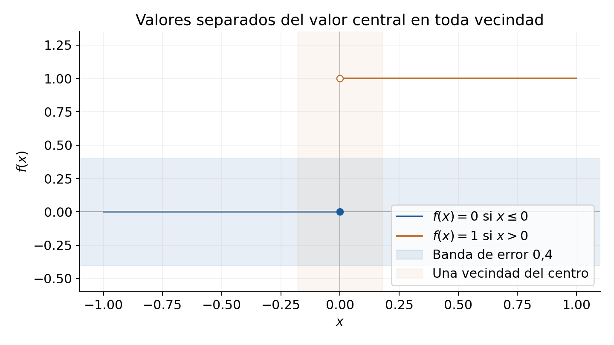

[← Capítulo 5](capitulo-05.qmd) · [Colecciones](../index.qmd#spivak-calculus-cuarta-edición) · [Capítulo 7 →](capitulo-07.qmd)

Solucionario explicado de Matemática Abierta · A. Peña

Problemas procedentes de Michael Spivak, *Calculus*, 4.ª edición, capítulo 6, pp. 119–121 (PDF consultado: 139–141). Los enunciados se normalizan al contenido matemático necesario; las soluciones y explicaciones son propias.

La continuidad se entiende en el dominio de la función. En un intervalo cerrado, los extremos requieren solo el límite desde el interior. Para funciones definidas en toda la recta, la continuidad en $a$ significa que, para cada $\varepsilon>0$, algún $\delta>0$ garantiza $|f(x)-f(a)|<\varepsilon$ cuando $|x-a|<\delta$, incluido $x=a$. Usamos las reglas de límites y las propiedades de los reales ya declaradas. La continuidad del seno se adopta como permite expresamente el capítulo, p. 117. El adelanto fundacional de E017(e) se identifica dentro de su solución.

## Ejercicio 1 — `SPV4-C06-E001` {#e001}

Referencia: p. 119. **Problema:** determinar cuáles de las cuatro funciones admiten una extensión continua $F:\mathbb R\to\mathbb R$ que coincida con ellas en todo su dominio.

### Solución

**(i)** $f(x)=(x^2-4)/(x-2)$, $x\ne2$. Al cancelar, $f(x)=x+2$. La extensión $F(x)=x+2$ en toda la recta es continua y exige $F(2)=4$. Ese valor es único porque el límite de los valores ya fijados en torno a $2$ es $4$.

**(ii)** $f(x)=|x|/x$, $x\ne0$. A la izquierda de cero vale $-1$ y a la derecha $1$. Una extensión continua necesitaría simultáneamente $F(0)=-1$ y $F(0)=1$, lo que es imposible.

**(iii)** $f(x)=0$ definida solo en los irracionales. Sí: $F\equiv0$. Es además la única extensión continua, porque en todo entorno de cualquier real hay irracionales; si $F(a)\ne0$, su continuidad obligaría a los valores próximos a separarse de cero, contradiciendo los valores impuestos en ese conjunto denso.

**(iv)** $f(p/q)=1/q$ definida en los racionales, con fracción irreducible y $q>0$. No. En $1$ la coincidencia exige $F(1)=1$. Pero para $n\ge1$, $r_n=(n+1)/n$ es una fracción irreducible, $r_n\to1$ y $F(r_n)=1/n\to0$. En términos directos: para cualquier radio en torno a $1$, elija $n$ tan grande que $1/n$ sea menor que el radio y que $1/2$; entonces $|F(r_n)-F(1)|>1/2$. No hay continuidad en $1$.

Los últimos dos casos muestran que un dominio denso fija toda extensión continua, pero no asegura que exista.

## Ejercicio 2 — `SPV4-C06-E002` {#e002}

Referencia: p. 119; funciones de 4-17 y 4-19, pp. 72–73. **Problema:** determinar los puntos de continuidad de las doce funciones.

### Solución: funciones de 4-17

**(4-17-i)** $\lfloor x\rfloor$ es continua exactamente en $\mathbb R\setminus\mathbb Z$. Es localmente constante entre enteros; en $k$ el límite izquierdo $k-1$ difiere del valor $k$.

**(4-17-ii)** $x-\lfloor x\rfloor$ es continua exactamente fuera de los enteros. En $k$ su valor es $0$, mientras que el límite izquierdo es $1$.

**(4-17-iii)** $\sqrt{x-\lfloor x\rfloor}$ tiene el mismo conjunto de continuidad. Dentro de cada intervalo se compone una función afín con la raíz; en los enteros persiste el salto de $1$ a $0$.

**(4-17-iv)** $\lfloor x\rfloor+\sqrt{x-\lfloor x\rfloor}$ es continua en **todo real**. En el entero $k$, el arco izquierdo tiende a $(k-1)+1=k$, el derecho a $k+0=k$, y el valor central es $k$.

**(4-17-v)** $\lfloor1/x\rfloor$, dominio $\mathbb R\setminus\{0\}$, es continua exactamente donde $1/x\notin\mathbb Z$. En $x=1/k$, $k\ne0$, los límites izquierdo y derecho son $k$ y $k-1$. Cero no es un punto del dominio: no se clasifica como punto de discontinuidad de esta función.

**(4-17-vi)** $1/\lfloor1/x\rfloor$, dominio $D=(-\infty,0)\cup(0,1]$, es continua en $1$ respecto de $D$, y en los demás puntos de $D$ salvo $1/k$ con $k\le-1$ o $k\ge2$. En esos puntos los valores laterales $1/k$ y $1/(k-1)$ difieren. En $x<-1$ la función es la constante $-1$. En $1$ el único lado disponible es el izquierdo y allí vale $1$. Cero no pertenece a $D$, aunque puede incorporarse como punto de una extensión continua definiendo valor $0$, según C05-E004.

### Solución: funciones de 4-19

Se usa la convención original de colas de nueves. Para un decimal finito $a$, la expansión elegida es la que se aproxima desde la izquierda, $e_-$; $e_+$ es la expansión con cola de ceros que describe la aproximación derecha. En un decimal no finito ambas expansiones coinciden. Por ejemplo, en $0.2$ son $0.1999\ldots$ y $0.2000\ldots$. En los enteros cambia también la parte entera: en $1$ son $0.9999\ldots$ y $1.0000\ldots$. Cada prefijo fijo queda estable al aproximarse por su lado; en puntos no decimales finitos queda estable por ambos. Esta regla fue justificada por los intervalos de prefijos en C05-E005.

**(4-19-i)** La primera cifra decimal es continua exactamente fuera de $10^{-1}\mathbb Z$. En esos puntos la cifra es localmente constante; en la malla los dos límites laterales difieren.

**(4-19-ii)** La segunda cifra es continua exactamente fuera de $10^{-2}\mathbb Z$, por el mismo argumento.

**(4-19-iii)** El número de sietes, con valor cero cuando son infinitos, no es continuo en ningún punto. Toda vecindad contiene una prolongación con infinitos sietes, de valor $0$, y prolongaciones con un número finito arbitrariamente grande, de valores sin cota. El valor central no puede remediarlo.

**(4-19-iv)** El indicador de infinitos sietes no es continuo en ningún punto: los valores $0$ y $1$ aparecen en todo intervalo abierto.

**(4-19-v)** La función que trunca después del primer $7$, y conserva $x$ si no hay ninguno, es continua en todo decimal no finito. En un decimal finito es continua **exactamente cuando los truncamientos de $e_-$ y $e_+$ coinciden**, entendiendo que una expansión sin sietes devuelve $a$. Es una regla que decide cada caso mediante las dos expansiones: en $0.7$ ambos lados tienden a $0.7$, en $0.8$ tienden a $0.7$ y $0.8$, y en $0.78$ ambos tienden a $0.7$ por el siete anterior. La expansión elegida en el centro devuelve el truncamiento izquierdo, de modo que la igualdad de los dos límites es también la igualdad con el valor central.

Para justificar el caso sin sietes, fijar $N$ cifras libres de $7$ obliga a que un eventual truncamiento posterior cambie el valor de $x$ en a lo sumo $10^{-N}$. Así $|f(x)-a|\le10^{-N}+|x-a|$. Cuando hay un primer $7$ en un prefijo estable, la función es constante en la vecindad correspondiente.

**(4-19-vi)** La posición del primer $1$, con valor cero si no hay ninguno, es continua **exactamente cuando las dos expansiones laterales tienen su primer $1$ en la misma posición**. En un decimal no finito basta que haya algún $1$. Si la expansión de un lado no tiene unos, aparecen por ese lado puntos sin unos y puntos cuyo primer uno está arbitrariamente lejos; no hay límite lateral finito. Si ambos primeros unos existen pero están en posiciones distintas, hay un salto. Cuando coinciden, la posición es estable por los dos lados y coincide con el valor central. Por ejemplo, $0.12$ es punto de continuidad, mientras que $0.1$ y $0.2$ no lo son.

No se sustituye en este ejercicio «límite existente» por «continuidad» sin comparar con el valor de la función y sin comprobar que el centro esté en su dominio.

## Ejercicio 3 — `SPV4-C06-E003` {#e003}

Referencia: p. 120. **Problema:** (a) si $|f(x)|\le|x|$, probar continuidad en cero; (b) dar un ejemplo discontinuo en todo punto no nulo; (c) sustituir la cota por $|f(x)|\le g(x)$, con $g$ continua en cero y $g(0)=0$.

### Solución

**(a)** La desigualdad en $x=0$ fuerza $f(0)=0$. Para cualquier $\varepsilon>0$, $|x|<\varepsilon$ implica $|f(x)-f(0)|\le|x|<\varepsilon$. Sirve $\delta=\varepsilon$.

**(b)** Ponga $f(x)=x$ si $x$ es racional y $f(x)=-x$ si es irracional. Cumple $|f(x)|=|x|$ y es continua en cero. En $a\ne0$, los valores sobre racionales se aproximan a $a$ y los valores sobre irracionales a $-a$. Como ambos conjuntos son densos, no existe límite bilateral y no puede haber continuidad. El argumento vale para centros racionales e irracionales.

**(c)** La cota obliga a $g(x)\ge0$ y a $f(0)=0$. Dada $\varepsilon>0$, la continuidad de $g$ proporciona un radio donde $|g(x)|<\varepsilon$. Allí $|f(x)-f(0)|\le g(x)<\varepsilon$. Lo decisivo es que la envolvente se anule en el centro y se haga pequeña cerca de él.

## Ejercicio 4 — `SPV4-C06-E004` {#e004}

Referencia: p. 120. **Problema:** encontrar $f$ discontinua en todo punto, con $|f|$ continua en toda la recta.

### Solución

Tome $f=1$ en los racionales y $f=-1$ en los irracionales. La densidad de ambos conjuntos impide un límite en cualquier centro: en un mismo entorno se encuentran valores separados por $2$. Pero $|f|=1$ en toda la recta y es continua. El módulo puede borrar oscilaciones de signo.

## Ejercicio 5 — `SPV4-C06-E005` {#e005}

Referencia: p. 120. **Problema:** para cada real $a$, dar una función cuyo único punto de continuidad sea $a$.

### Solución

Defina
$$f_a(x)=\begin{cases}x-a,&x\in\mathbb Q,\\a-x,&x\notin\mathbb Q.\end{cases}$$
Como $|f_a(x)|=|x-a|$, la función vale cero en $a$ y es continua allí. En $b\ne a$, los valores racionales se aproximan a $b-a$, mientras que los irracionales se aproximan a $a-b$; son distintos. La densidad de ambos conjuntos descarta un límite y, por tanto, la continuidad en $b$. No importa si $a$ es racional.

## Ejercicio 6 — `SPV4-C06-E006` {#e006}

Referencia: p. 120. **Problema:** (a) construir una función discontinua solo en $1,1/2,1/3,1/4,\ldots$, continua también en cero; (b) construir otra discontinua solo en $0,1,1/2,1/3,\ldots$.

### Solución

**(a)** Sea $S=\{1/n:n\ge1\}$ y ponga $f(1/n)=1/n$, $f(x)=0$ fuera de $S$, incluido $x=0$. Cada $1/n$ es un punto aislado de $S$; en un entorno perforado suficientemente pequeño $f$ vale cero, mientras que $f(1/n)=1/n>0$. Por ello hay discontinuidad en cada uno de esos puntos.

En cero, $f(0)=0$ y $|f(x)|\le|x|$ para todo $x$, de modo que E003(a) prueba continuidad. En cualquier $b\ne0$ fuera de $S$, un entorno inicial de radio menor que $|b|/2$ excluye todos los $1/n$ suficientemente próximos a cero; los candidatos restantes son finitos y pueden excluirse reduciendo el radio. Así $f$ es localmente cero y continua en $b$. Las alturas de los puntos excepcionales disminuyen precisamente para permitir continuidad en su punto de acumulación.

**(b)** Ahora sea $T=\{0\}\cup\{1/n:n\ge1\}$ y ponga $f=1$ en $T$, $f=0$ fuera. En cada $1/n$, la discontinuidad se prueba aislando ese punto de los demás. En cero hay puntos $1/n$ arbitrariamente próximos, con valor $1$, y puntos negativos arbitrariamente próximos, con valor $0$; por tanto ni siquiera existe límite bilateral.

Si $b\notin T$, entonces $b\ne0$. Escoja un radio inicial menor que $|b|/2$. Los puntos $1/n$ con $n$ suficientemente grande quedan fuera de ese entorno, cerca de cero. Solo restan finitos candidatos; reduzca el radio para excluirlos todos. La función es entonces idénticamente cero cerca de $b$ y es continua allí. La acumulación de los puntos excepcionales ocurre únicamente en cero, ya incluido en el conjunto de discontinuidades.

## Ejercicio 7 — `SPV4-C06-E007` {#e007}

Referencia: p. 120. **Problema:** si $f(x+y)=f(x)+f(y)$ y $f$ es continua en cero, probar continuidad en todo real.

### Solución

La identidad con $x=y=0$ da $f(0)=0$. En un centro arbitrario $a$, escriba $x=a+h$. Entonces
$$f(x)-f(a)=f(h)=f(x-a).$$
Para una tolerancia $\varepsilon$, el radio que controla $|f(h)-f(0)|$ cuando $|h|$ es pequeño controla exactamente $|f(x)-f(a)|$. Así la misma continuidad se transporta de cero a cada centro. No se necesita demostrar primero que una función aditiva continua sea lineal.

## Ejercicio 8 — `SPV4-C06-E008` {#e008}

Referencia: p. 120. **Problema:** si $f$ es continua en $a$ y $f(a)=0$, probar que $f+\alpha$ no se anula cerca de $a$ cuando $\alpha\ne0$.

### Solución

Use la tolerancia $|\alpha|/2$. En un entorno de $a$, $|f(x)|<|\alpha|/2$, luego
$$|f(x)+\alpha|\ge|\alpha|-|f(x)|>|\alpha|/2>0.$$
Esto incluye el propio centro. Si $f$ está definida en toda la recta, el entorno es un intervalo abierto completo; para un dominio general se afirma la no anulación en la intersección con él. La condición $\alpha\ne0$ es necesaria: $f\equiv0$ la refuta cuando $\alpha=0$.

## Ejercicio 9 — `SPV4-C06-E009` {#e009}

Referencia: p. 120. **Problema:** (a) si $f(a)$ existe pero $f$ no es continua en $a$, demostrar una separación positiva en puntos arbitrariamente próximos e ilustrarla; (b) probar que esa separación ocurre arbitrariamente cerca por debajo o por encima de $f(a)$.

### Solución

**(a)** Negar la definición de continuidad da un $\eta>0$ tal que para todo $\delta>0$ existe $x$ con $|x-a|<\delta$ y $|f(x)-f(a)|\ge\eta$. Ese punto es distinto de $a$, pues allí el error es cero. Tome $\varepsilon=\eta/2$: en cada entorno hay entonces un punto con $|f(x)-f(a)|>\varepsilon$, como pide el enunciado estricto.

{#fig-spv4-c06-f01 fig-alt="Capítulo 6: Una discontinuidad produce valores fuera de una banda fija en toda vecindad"}

La lámina muestra un ejemplo con valor central $0$ y valor $1$ a su derecha: por pequeño que sea el radio, aparecen valores fuera de la banda alrededor del valor central. La figura ilustra la negación; no presupone que toda discontinuidad sea un salto.

**(b)** Use la misma $\varepsilon$. Si no hubiera puntos arbitrariamente próximos con $f(x)<f(a)-\varepsilon$, algún radio excluiría todos esos puntos. Si tampoco los hubiera arbitrariamente próximos con $f(x)>f(a)+\varepsilon$, otro radio excluiría todos estos. En el mínimo de ambos radios se tendría $|f(x)-f(a)|\le\varepsilon$, contradiciendo (a). Por ello al menos una de las dos alternativas se presenta arbitrariamente cerca. No es necesario que se presente siempre por el mismo lado del eje de las abscisas.

## Ejercicio 10 — `SPV4-C06-E010` {#e010}

Referencia: p. 120. **Problema:** probar cuatro construcciones que preservan continuidad.

### Solución

**(a)** Si $f$ es continua en $a$, entonces $|f|$ también, por
$$\big||f(x)|-|f(a)|\big|\le|f(x)-f(a)|.$$
El mismo radio de continuidad sirve para el módulo.

**(b)** Para $f$ continua en $\mathbb R$, defina
$$E(x)=\frac{f(x)+f(-x)}2,\qquad O(x)=\frac{f(x)-f(-x)}2.$$
La composición con $x\mapsto-x$ es continua, y las sumas y múltiplos también. Se comprueba $E(-x)=E(x)$, $O(-x)=-O(x)$ y $E+O=f$. Las fórmulas muestran además la unicidad: si $f=E+O$ con esas paridades, sumar y restar las igualdades en $x$ y $-x$ recupera exactamente las expresiones anteriores.

**(c)** Si $f,g$ son continuas, use
$$\max(f,g)=\frac{f+g+|f-g|}2,\qquad\min(f,g)=\frac{f+g-|f-g|}2.$$
La continuidad se sigue de (a) y de las operaciones algebraicas. Las fórmulas valen también donde $f=g$.

**(d)** Tome $g=\max(f,0)$ y $h=\max(-f,0)$. Ambas funciones son continuas y no negativas. Si $f(x)\ge0$, $g(x)=f(x)$ y $h(x)=0$; si $f(x)<0$, $g(x)=0$ y $h(x)=-f(x)$. Por tanto $f=g-h$ en todo el dominio. No se impone ninguna unicidad a esta última descomposición.

## Ejercicio 11 — `SPV4-C06-E011` {#e011}

Referencia: p. 120; teorema 1(3), p. 116, y teorema 2, pp. 117–118. **Problema:** deducir la continuidad de $1/g$ en $a$ cuando $g$ es continua en $a$ y $g(a)\ne0$, mediante composición.

### Solución

Sea $r(u)=1/u$, continua para $u\ne0$. Por ejemplo, si $u_0\ne0$ y $|u-u_0|<|u_0|/2$, entonces
$$\left|\frac1u-\frac1{u_0}\right|\le\frac{2|u-u_0|}{|u_0|^2}.$$
La continuidad de $g$ garantiza que $g(x)$ permanezca distinto de cero cerca de $a$: haga $|g(x)-g(a)|<|g(a)|/2$. Como $r$ es continua en $g(a)$, el teorema de composición da continuidad de $r\circ g=1/g$ en $a$. La condición de dominio se comprueba antes de aplicar el teorema.

## Ejercicio 12* — `SPV4-C06-E012` {#e012}

Referencia: p. 120. **Problema:** (a) si $g(x)\to l$ en $a$ y $f$ es continua en $l$, probar $f(g(x))\to f(l)$; (b) mostrar que sin esa continuidad la conclusión puede fallar.

### Solución

**(a)** Para $\varepsilon>0$, la continuidad de $f$ en $l$ da $\eta>0$ tal que $|u-l|<\eta$ implica $|f(u)-f(l)|<\varepsilon$, **también cuando $u=l$**. El límite de $g$ da $\delta$ tal que $0<|x-a|<\delta$ implica $|g(x)-l|<\eta$. Encadenar ambas implicaciones prueba el resultado. Se supone que la composición esté definida en los puntos considerados. No se necesita que $g(a)$ exista ni que sea igual a $l$.

La inclusión de $u=l$ explica por qué la continuidad es la hipótesis adecuada: $g$ puede tomar el valor límite muchas veces cerca de $a$, sin que esos puntos estén excluidos de la composición.

**(b)** Ponga $f(l)=1$, $f(u)=0$ para $u\ne l$, y $g(x)=l+x-a$. Entonces $g\to l$, pero para $x\ne a$ se tiene $f(g(x))=0$. El límite de la composición es $0$, mientras que $f(l)=1$. La discontinuidad de $f$ en el punto al que llegan los valores de $g$ impide el paso propuesto.

## Ejercicio 13 — `SPV4-C06-E013` {#e013}

Referencia: p. 121. **Problema:** (a) extender continuamente a $\mathbb R$ una función continua en $[a,b]$; (b) refutar esa posibilidad universal para $(a,b)$.

### Solución

**(a)** Para $a<b$, defina
$$G(x)=\begin{cases}f(a),&x<a,\\f(x),&a\le x\le b,\\f(b),&x>b.\end{cases}$$
En los intervalos exteriores es constante y en el interior coincide con $f$. En $a$, el límite izquierdo vale $f(a)$ y el derecho también por la continuidad de $f$ en el extremo de $[a,b]$. Ambos coinciden con $G(a)$. En $b$ se razona de igual modo. Por tanto $G$ es continua en toda la recta. Si el intervalo degenerado $a=b$ se admite, la extensión constante $G\equiv f(a)$ resuelve ese caso.

**(b)** Para $a<b$, $f(x)=1/(x-a)$ es continua en $(a,b)$, pero crece sin cota al acercarse a $a$ por la derecha. Si existiera una extensión continua en $a$, sería acotada en un entorno de ese punto, por C05-E018. Esto contradice los valores ya impuestos dentro de $(a,b)$. Los extremos incluidos de (a) aportan precisamente los valores y controles que aquí pueden faltar.

## Ejercicio 14 — `SPV4-C06-E014` {#e014}

Referencia: p. 121. **Problema:** probar dos reglas de pegado de funciones continuas que coinciden en la unión.

### Solución

**(a)** Sean $g,h$ continuas en $a$, con $g(a)=h(a)=c$, y defina $f=g$ para $x\ge a$, $f=h$ para $x\le a$. La igualdad en $a$ hace la definición consistente. Para $\varepsilon>0$, tome radios $\delta_g,\delta_h$ de continuidad y use su mínimo. A la derecha, $|f(x)-c|=|g(x)-g(a)|<\varepsilon$; a la izquierda ocurre lo mismo con $h$. En $a$ el error es cero. Así $f$ es continua en $a$.

**(b)** Si $g$ es continua en $[a,b]$, $h$ en $[b,c]$, y $g(b)=h(b)$, el pegado coincide localmente con cada función en los interiores. En $b$ use los radios de continuidad izquierda de $g$ y derecha de $h$ y su mínimo, como en (a). En $a,c$ se conservan los controles laterales originales. Así es continua en $[a,c]$. Se consideran $a<b<c$; los intervalos degenerados, si se admiten, reducen la construcción a una de las funciones o a un punto y no introducen un salto.

## Ejercicio 15 — `SPV4-C06-E015` {#e015}

Referencia: p. 121. **Problema:** si $f$ es continua en $a$, probar que para cada $\varepsilon>0$ existe $\delta>0$ tal que $|x-a|,|y-a|<\delta$ implica $|f(x)-f(y)|<\varepsilon$.

### Solución

Escoja el radio de continuidad para la tolerancia $\varepsilon/2$. Entonces
$$|f(x)-f(y)|\le|f(x)-f(a)|+|f(y)-f(a)|<\varepsilon.$$
Ambos puntos pueden coincidir con $a$. El radio depende del centro $a$ y de la tolerancia: esta afirmación local no prueba continuidad uniforme en todo el dominio.

## Ejercicio 16 — `SPV4-C06-E016` {#e016}

Referencia: p. 121. **Problema:** (a) probar conservación local del signo bajo continuidad derecha en $a$; (b) formular y probar la versión izquierda en $b$.

### Solución

**(a)** Si $\lim_{x\to a^+}f(x)=f(a)>0$, use $\varepsilon=f(a)/2$. Para algún $\delta>0$, $0<x-a<\delta$ implica $f(x)>f(a)/2>0$; en $x=a$ el signo es positivo por hipótesis. Por tanto $f>0$ cuando $0\le x-a<\delta$. Si $f(a)<0$, use $\varepsilon=|f(a)|/2$ para obtener $f(x)<f(a)/2<0$ en ese mismo tipo de intervalo. No se afirma nada sobre la izquierda.

**(b)** Si $\lim_{x\to b^-}f(x)=f(b)>0$, el mismo error $f(b)/2$ da $f(x)>0$ cuando $0\le b-x<\delta$. Si $f(b)<0$, el error $|f(b)|/2$ da $f(x)<0$ allí. El extremo se incluye en la conclusión porque su signo ya está dado, aunque la definición del límite lateral lo excluya.

## Ejercicio 17 — `SPV4-C06-E017` {#e017}

Referencia: p. 121. **Problema:** estudiar discontinuidades eliminables, cuando existe un límite finito distinto del valor central: (a) dos funciones oscilantes; (b) reparación en un punto; (c) función de denominadores racionales; (d*) continuidad de la función de límites; (e**) posibilidad de discontinuidad eliminable en todos los puntos.

### Solución

**(a), primer caso.** Si $f(x)=\sin(1/x)$ para $x\ne0$ y $f(0)=1$, la discontinuidad en cero **no es eliminable**. En los puntos
$$x_n=\frac1{\pi/2+2\pi n},\qquad y_n=\frac1{3\pi/2+2\pi n}$$
el seno vale $1$ y $-1$, respectivamente, y ambas familias se aproximan a cero. Ningún límite finito puede acomodar ambos valores. Cambiar solo $f(0)$ no afecta esta oscilación.

**(a), segundo caso.** Si $f(x)=x\sin(1/x)$ para $x\ne0$ y $f(0)=1$, la discontinuidad **sí es eliminable**. El encaje $|x\sin(1/x)|\le|x|$ da límite $0$, distinto del valor central. Se elimina asignando $f(0)=0$.

**(b)** Si $l=\lim_{x\to a}f(x)$ existe y definimos $g=f$ fuera de $a$, $g(a)=l$, la localidad del límite da $\lim_{x\to a}g(x)=l=g(a)$. Esta es exactamente la continuidad en $a$. En los demás puntos no se altera la continuidad, porque allí puede escogerse un entorno que no contenga $a$.

**(c)** Sea $f=0$ en irracionales y $f(p/q)=1/q$ en racionales reducidos, $q>0$. En cualquier intervalo acotado hay solo finitos racionales con denominador $q\le N$: para cada uno de los finitos denominadores posibles solo hay finitos numeradores en ese intervalo. Dada una tolerancia $\varepsilon$, escoja $N$ con $1/N<\varepsilon$ y trabaje en $(a-1,a+1)$. Excluya mediante un radio los finitos puntos de denominador pequeño distintos de $a$. En el entorno perforado restante $f$ vale cero o $1/q$ con $q>N$, por lo que $|f(x)|<\varepsilon$. Así existe límite cero **en todo real** y la función del enunciado es $g\equiv0$.

En los irracionales $f(a)=0$, luego $f$ es continua; en los racionales $f(a)=1/q>0$, por lo que la discontinuidad es eliminable. Este ejemplo requiere excluir el punto central del límite, aunque su valor no sea pequeño.

**(d*)** Suponga ahora que $f:\mathbb R\to\mathbb R$ tiene límite finito en cada punto, y ponga
$$g(x)=\lim_{y\to x}f(y).$$
Esto incluye tanto los puntos donde $f$ es continua como sus discontinuidades eliminables. Fije $a$ y $\varepsilon>0$. Por la definición de $g(a)$, hay $r>0$ tal que
$$0<|z-a|<r\quad\Longrightarrow\quad |f(z)-g(a)|<\varepsilon/3.$$
Si $0<|x-a|<r/2$, escoja un radio alrededor de $x$ tan pequeño que todos sus puntos estén en $(a-r,a+r)$ y sean distintos de $a$; basta un radio menor que $\min(|x-a|/2,r/2)$. En ese entorno perforado de $x$ todos los valores $f(z)$ están entre $g(a)-\varepsilon/3$ y $g(a)+\varepsilon/3$. Al tomar el límite en $x$, la conservación de desigualdades no estrictas de C05-E012 obliga a
$$|g(x)-g(a)|\le\varepsilon/3<\varepsilon.$$
Para $x=a$ el error es cero. Así $g$ es continua en $a$, y como $a$ era arbitrario, es continua en toda la recta. No se intercambian dos límites sin justificación: se mantiene una misma banda de valores al cambiar el centro.

**(e), marcado con dos estrellas.** **No existe** una función discontinua en todos los puntos con discontinuidades únicamente eliminables. El propio ejercicio advierte que una prueba general excede las herramientas desarrolladas hasta este capítulo. Presentamos el argumento completo como un **adelanto de la completitud de $\mathbb R$**; no usamos esa conclusión para resolver los incisos anteriores.

Por (d), la función $g$ de límites es continua. Ponga $h=f-g$. Para cada $a$,
$$\lim_{x\to a}h(x)=g(a)-g(a)=0.$$
Además, $f$ es continua en $a$ exactamente cuando $h(a)=0$, pues su límite allí es $g(a)$. Basta encontrar un punto donde $h$ se anule.

Para cada entero $n\ge1$, definamos
$$D_n=\{x:|h(x)|\ge1/n\}.$$
Ningún punto puede ser punto de acumulación de $D_n$: el límite cero de $h$ en un centro cualquiera proporciona un entorno perforado sin puntos de $D_n$. En particular, dentro de **cualquier** intervalo abierto $J$ hay un subintervalo cerrado de longitud positiva que evita $D_n$. Para verlo, escoja $t$ interior a $J$ y un radio pequeño donde $0<|x-t|$ fuerce $|h(x)|<1/n$. Un subintervalo cerrado situado a un lado de $t$, dentro de ese radio y de $J$, cumple la exigencia.

Comenzando con $I_0=[0,1]$, elija sucesivamente intervalos cerrados de longitud positiva $I_n$ tales que
$$I_n\subset\operatorname{int}(I_{n-1}),\qquad I_n\cap D_n=\varnothing,\qquad |I_n|\le2^{-n}.$$
La construcción anterior permite cada elección. La completitud de los reales asegura que los intervalos anidados tienen un punto común $c$. Este es el paso posterior al capítulo: si $I_n=[u_n,v_n]$, el conjunto de extremos izquierdos está acotado, y $c=\sup\{u_n:n\ge0\}$ satisface $u_n\le c\le v_n$ para todo $n$, pues cada $v_n$ es cota superior de todos los $u_j$. La reducción de longitudes asegura también unicidad, aunque aquí basta la existencia.

Como $c\in I_n$ y $I_n$ evita $D_n$, tenemos $|h(c)|<1/n$ para todo $n$. La propiedad arquimediana fuerza $h(c)=0$. Entonces $f$ es continua en $c$, contradiciendo la supuesta discontinuidad en todos los puntos.

La misma construcción puede comenzar dentro de cualquier intervalo abierto, de modo que estos puntos de continuidad son, de hecho, densos. El ejemplo de (c) muestra que aún pueden quedar infinitas discontinuidades, incluso un conjunto denso de ellas. Densidad de las discontinuidades y discontinuidad en cada punto son afirmaciones diferentes.

---

[← Capítulo 5](capitulo-05.qmd) · [Colecciones](../index.qmd#spivak-calculus-cuarta-edición) · [Capítulo 7 →](capitulo-07.qmd)

Soluciones originales de Alevi Peña · Matemática Abierta. [Licencia GFDL 1.3 o posterior](/COPYING.FDL).
