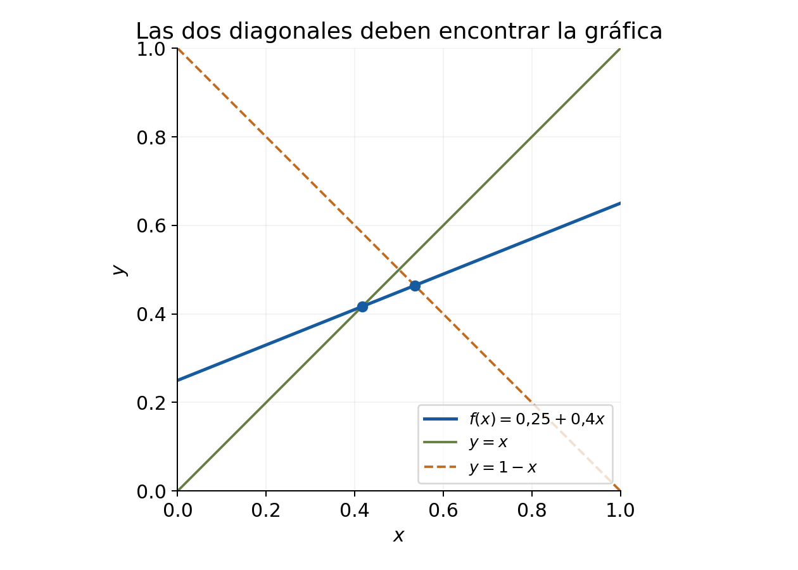
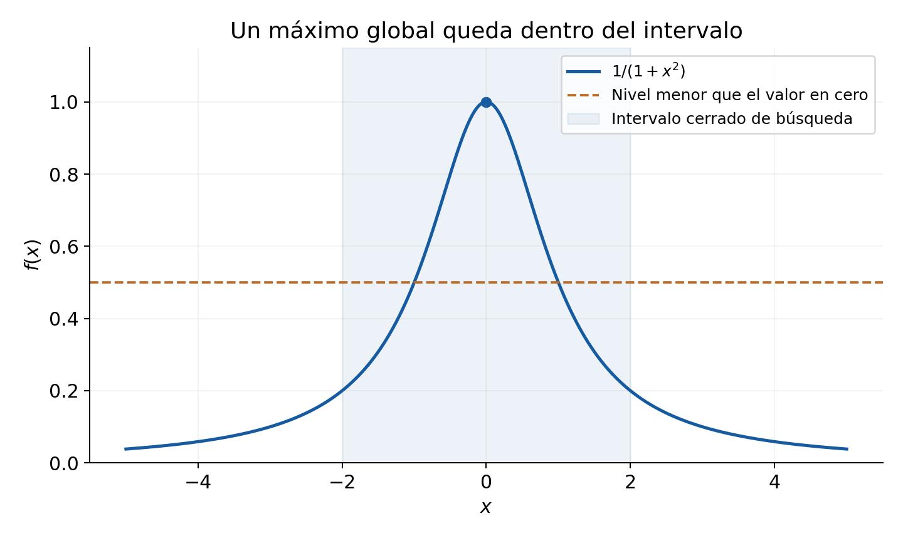
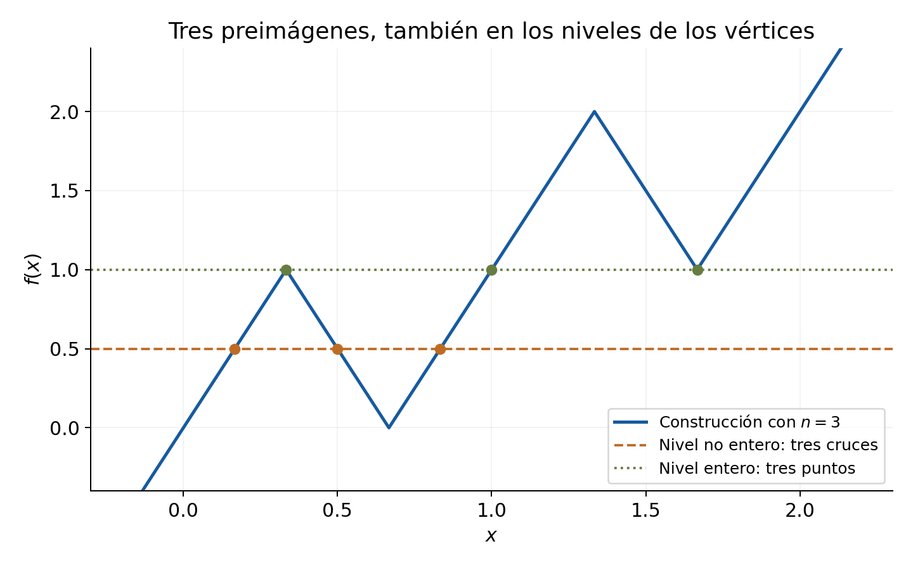

[← Capítulo 6](capitulo-06.qmd) · [Colecciones](../index.qmd#spivak-calculus-cuarta-edición) · [Capítulo 8 →](capitulo-08.qmd)

Solucionario explicado de Matemática Abierta · A. Peña

Problemas procedentes de Michael Spivak, *Calculus*, 4.ª edición, capítulo 7, pp. 129–132 (PDF consultado: 149–152). Los enunciados se reducen al contenido matemático necesario; las soluciones y explicaciones son propias.

Se usan, como permite este capítulo, el teorema de valores intermedios y la existencia de máximos y mínimos para funciones continuas en intervalos cerrados y acotados. El texto pospone sus fundamentos completos al capítulo 8; aquí se aplican sin fingir que se deducen solo de los axiomas de cuerpo ordenado. Los teoremas se usan únicamente cuando sus hipótesis se cumplen. Continuidad trigonométrica y existencia de raíces reales conservan las dependencias adoptadas previamente. «Máximo» y «mínimo» significan valores alcanzados, no meras cotas.

## Ejercicio 1 — `SPV4-C07-E001` {#e001}

Referencia: pp. 129–130. **Problema:** para doce funciones, determinar acotación superior e inferior y existencia de máximo y mínimo en los intervalos indicados. En (v–vi), $a>-1$. En los intervalos $[0,a]$ o $[0,a^3]$ se considera $a\ge0$ para que no sean vacíos.

### Solución

**(i)** $x^2$ en $(-1,1)$ tiene valores en $[0,1)$. Es acotada por ambos lados y alcanza mínimo $0$ en $x=0$. No alcanza máximo: si $|x|<1$, hay un punto de módulo mayor pero menor que $1$, cuyo cuadrado es mayor. Su cota superior óptima es $1$.

**(ii)** $x^3$ en $(-1,1)$ tiene valores en $(-1,1)$. Es acotada por ambos lados, sin máximo ni mínimo. La estricta monotonía del cubo y los extremos excluidos justifican ambas faltas de extremos.

**(iii)** $x^2$ en $\mathbb R$ está acotada inferiormente, alcanza mínimo $0$ en cero y no está acotada superiormente; no tiene máximo.

**(iv)** $x^2$ en $[0,\infty)$ tiene exactamente las mismas propiedades que (iii).

**(v)** Sea $L=-a-1$, $U=a+1$, y
$$f(x)=\begin{cases}x^2,&x\le a,\\a+2,&x>a,\end{cases}\qquad L<x<U.$$
Es acotada por ambos lados para todo $a>-1$. Si $a\le-1/2$, el punto de corte queda a la izquierda del intervalo o en su extremo excluido: la función es la constante $a+2$, que es máximo y mínimo.

Si $a>-1/2$, la rama cuadrática tiene dominio $(L,a]$ y la rama constante no es vacía. Ponga $\rho=(\sqrt5-1)/2$. El resultado completo es:

| Parámetro | Mínimo | Máximo | Cota superior óptima |
|---|---|---|---|
| $-1<a\le-1/2$ | $a+2$, alcanzado | $a+2$, alcanzado | $a+2$ |
| $-1/2<a<0$ | $a^2$, en $a$ | $a+2$, alcanzado | $a+2$ |
| $0\le a\le\rho$ | $0$, en $0$ | $a+2$, alcanzado | $a+2$ |
| $a>\rho$ | $0$, en $0$ | No existe | $(a+1)^2$ |

En la segunda fila los cuadrados disminuyen al acercarse a $a<0$ desde la izquierda. Cuando $a\ge0$, cero pertenece a la rama cuadrática. El extremo izquierdo siempre tiene mayor módulo que $a$, por lo que la cota superior de esa rama es $(a+1)^2$, no alcanzada. La constante produce máximo exactamente cuando $a+2\ge(a+1)^2$, es decir, cuando $a\le\rho$ dentro del caso $a>-1/2$. En $a=\rho$, la constante alcanza la misma cota que la cuadrática solo aproxima.

**(vi)** Cambian dos inclusiones:
$$f(x)=\begin{cases}x^2,&x<a,\\a+2,&x\ge a,\end{cases}\qquad L\le x\le U.$$
También es acotada por ambos lados para todo $a>-1$.

| Parámetro | Mínimo | Máximo |
|---|---|---|
| $-1<a\le-1/2$ | $a+2$, alcanzado | $a+2$, alcanzado |
| $-1/2<a\le0$ | No existe; cota inferior óptima $a^2$ | $a+2$, alcanzado |
| $a>0$ | $0$, en $0$ | $\max\{(a+1)^2,a+2\}$, alcanzado |

Para $-1/2<a\le0$, la rama cuadrática llega hasta $a$ sin incluirlo; sus valores se acercan a $a^2$ desde arriba y la constante es mayor. Esto incluye $a=0$: cero recibe valor $2$, no valor $0$. Para $a>0$, cero sí queda en la rama cuadrática, y el extremo izquierdo $L$ también queda incluido, alcanzando $(a+1)^2$. La otra candidata al máximo es $a+2$, alcanzada en toda la rama constante. Que el intervalo sea cerrado no garantiza un mínimo si la función no es continua en el punto de corte.

**(vii)** La función $f=0$ en irracionales, $f(p/q)=1/q$ en racionales reducidos, sobre $[0,1]$, tiene $0\le f\le1$. Alcanza mínimo $0$ en los irracionales y máximo $1$ en $0=0/1$ y $1=1/1$.

**(viii)** Si se cambia el valor irracional a $1$, queda $0<f\le1$. Hay máximo $1$, alcanzado en irracionales y en los extremos racionales. No hay mínimo: en $x=1/n$ el valor es $1/n$, que se acerca a cero, pero cero nunca se alcanza.

**(ix)** Si vale $1$ en irracionales y $-1/q$ en racionales reducidos, está entre $-1$ y $1$. Máximo $1$ en irracionales; mínimo $-1$ en $0,1$.

**(x)** $f(x)=x$ en racionales y $0$ en irracionales, sobre $[0,a]$. Está entre $0$ y $a$ y siempre alcanza mínimo $0$. Si $a$ es racional, alcanza máximo $a$ en el extremo; si $a$ es irracional y positivo, no alcanza máximo, aunque tiene cota superior óptima $a$. La densidad racional da valores racionales arbitrariamente cercanos a $a$ por debajo. Para $a=0$, máximo y mínimo son cero.

**(xi)** $f(x)=\sin^2(\cos x+\sqrt{a+a^2})$ en $[0,a^3]$. Para $a\ge0$, el radical existe, la función es continua y el intervalo es cerrado y acotado. Está entre $0$ y $1$ y alcanza máximo y mínimo por el teorema de extremos. El ejercicio pide existencia, no que esos extremos sean necesariamente $0$ y $1$. Para $a=0$, el intervalo es un punto y ambos valores son $\sin^2 1$.

**(xii)** $\lfloor x\rfloor$ en $[0,a]$ está entre $0$ y $\lfloor a\rfloor$. Alcanza mínimo $0$ en cero y máximo $\lfloor a\rfloor$ en $a$, incluidos los casos enteros y $a=0$.

Si se permite $a<0$ en (x), (xi) o (xii) usando $[u,v]=\{x:u\le x\le v\}$, el intervalo indicado es vacío: toda cota es vacuamente una cota, pero no hay extremo alcanzado. Además, en (xi) el radical no es real para $-1<a<0$. La clasificación principal presupone el dominio real no vacío que el problema sugiere.

## Ejercicio 2 — `SPV4-C07-E002` {#e002}

Referencia: p. 130. **Problema:** encontrar un entero $n$ tal que cada polinomio tenga una raíz entre $n$ y $n+1$.

### Solución

**(i)** Para $x^3-x+3$, los valores en $-2,-1$ son $-3$ y $3$. Por continuidad hay una raíz en $(-2,-1)$; sirve $n=-2$.

**(ii)** Para $x^5+5x^4+2x+1$, los valores en $-5,-4$ son $-9$ y $249$. Hay una raíz en $(-5,-4)$; sirve $n=-5$.

**(iii)** Para $x^5+x+1$, los valores en $-1,0$ son $-1,1$. Hay una raíz en $(-1,0)$; sirve $n=-1$.

**(iv)** $4x^2-4x+1=(2x-1)^2$ tiene raíz $1/2$, así que sirve $n=0$. Los valores en ambos extremos son positivos: una raíz de multiplicidad par no exige un cambio de signo. Aquí la factorización, y no un argumento de signos en los extremos, prueba su existencia.

## Ejercicio 3 — `SPV4-C07-E003` {#e003}

Referencia: p. 130. **Problema:** demostrar la existencia de una solución de dos ecuaciones.

### Solución

**(i)** Para
$$x^{179}+\frac{163}{1+x^2+\sin^2x}=119,$$
reste el miembro derecho y llame $H$ a la diferencia. El denominador es al menos $1$, por lo que $H$ es continua en $[0,1]$. En cero, $H(0)=163-119=44>0$. En uno,
$$H(1)=1+\frac{163}{2+\sin^21}-119\le1+\frac{163}2-119<0.$$
Existe una solución en $(0,1)$.

**(ii)** Para $\sin x=x-1$, use $H(x)=\sin x-x+1$. Es continua, $H(0)=1>0$ y $H(3)\le1-3+1=-1<0$. Existe una solución en $(0,3)$. Este intervalo evita necesitar una comparación estricta especial entre $\sin2$ y $1$.

## Ejercicio 4 — `SPV4-C07-E004` {#e004}

Referencia: p. 130. **Problema:** (a) si $0\le k\le n$ y $n-k$ es par, construir un polinomio de grado $n$ con exactamente $k$ raíces reales; (b) probar que el número de raíces reales contado con multiplicidades tiene la misma paridad que el grado.

### Solución

**(a)** Ponga $m=(n-k)/2$ y
$$P(x)=(x^2+1)^m\prod_{j=1}^k(x-j).$$
Su grado es $2m+k=n$. El factor $x^2+1$ es estrictamente positivo, de modo que sus únicas raíces reales son $1,\ldots,k$, cada una simple. Si $k=0$, el producto vacío vale $1$; si $n=k=0$, obtenemos el polinomio constante $1$.

**(b)** Sea $P$ no nulo de grado $n$, con raíces reales distintas $a_1,\ldots,a_r$ de multiplicidades $m_1,\ldots,m_r$. Por división sucesiva por los factores lineales,
$$P(x)=\prod_{j=1}^r(x-a_j)^{m_j}Q(x),$$
donde $Q$ no tiene raíces reales y su grado es $n-k$, con $k=\sum m_j$. Si ese grado fuera impar, el comportamiento del término principal daría signos opuestos en los dos extremos de la recta; el teorema de valores intermedios produciría una raíz de $Q$. Por tanto $n-k$ es par. Para $Q$ constante el grado es cero y el resultado también vale. No se usa el teorema fundamental del álgebra ni se cuentan raíces complejas. El polinomio cero queda excluido: no tiene grado ni un número finito de raíces con estas multiplicidades.

## Ejercicio 5 — `SPV4-C07-E005` {#e005}

Referencia: p. 130. **Problema:** caracterizar una función continua en $[a,b]$ que solo toma valores racionales.

### Solución

Es constante. Si tomara dos valores distintos $u<v$, la densidad de los irracionales daría un irracional $w$ entre ellos. Aplicar valores intermedios al intervalo entre las dos abscisas obligaría a $f$ a tomar $w$, contradicción. La constante resultante debe ser racional. En un intervalo degenerado también es constante.

## Ejercicio 6 — `SPV4-C07-E006` {#e006}

Referencia: p. 130. **Problema:** si $f$ es continua en $[-1,1]$ y $x^2+f(x)^2=1$, probar que recorre íntegramente uno de los dos semicírculos como gráfica.

### Solución

Para $-1<x<1$, se tiene $f(x)^2=1-x^2>0$, luego $f(x)\ne0$. Una función continua sin ceros en un intervalo no puede cambiar de signo: valores de signos opuestos producirían un cero intermedio. Por tanto en todo el interior vale una única elección de signo,
$$f(x)=\sqrt{1-x^2}\quad\text{o bien}\quad f(x)=-\sqrt{1-x^2}.$$
En los extremos la ecuación fuerza $f(-1)=f(1)=0$, que coincide con ambas fórmulas. Así el signo elegido en el interior determina la función en todo el intervalo. No se puede cambiar de semicírculo en un punto interior, donde las dos opciones nunca coinciden.

## Ejercicio 7 — `SPV4-C07-E007` {#e007}

Referencia: p. 130. **Problema:** contar las funciones continuas en $\mathbb R$ que satisfacen $f(x)^2=x^2$.

### Solución

En cada semieje abierto $f$ es no nula y, por valores intermedios, su signo es constante. La ecuación da $|f(x)|=|x|$, por lo que hay dos elecciones independientes de signo, una en cada semieje. En cero necesariamente $f(0)=0$, y cualquiera de esas elecciones es continua allí porque $|f(x)|=|x|\to0$.

Son exactamente **cuatro** funciones:
$$f(x)=x,\qquad f(x)=-x,\qquad f(x)=|x|,\qquad f(x)=-|x|.$$
La independencia de las elecciones se debe al cero que separa los semiejes.

## Ejercicio 8 — `SPV4-C07-E008` {#e008}

Referencia: p. 130. **Problema:** si $f,g$ son continuas en $\mathbb R$, $f^2=g^2$ y $f$ nunca se anula, probar $f=g$ en toda la recta o $f=-g$ en toda ella.

### Solución

La igualdad de cuadrados y la no anulación de $f$ implican que $g$ tampoco se anula. La función continua $h=f/g$ toma solo los valores $1$ y $-1$. Si tomara ambos, valores intermedios la obligarían a tomar cero entre ellos, imposible. Por tanto es constante $1$ o $-1$, y resulta la alternativa pedida. El dominio conectado es esencial: en intervalos separados se podría elegir un signo distinto en cada uno.

## Ejercicio 9 — `SPV4-C07-E009` {#e009}

Referencia: pp. 130–131. **Problema:** (a–b) determinar el signo de una función continua con único cero $a$ a partir de un valor en cada semieje; (c*) estudiar $x^3+x^2y+xy^2+y^3$ cuando $(x,y)\ne(0,0)$.

### Solución

**(a)** Si hay un valor positivo a cada lado de $a$, $f(x)>0$ para todo $x\ne a$. En cada uno de los intervalos $(-\infty,a)$ y $(a,\infty)$ el signo debe ser constante, porque un cambio produciría otro cero. Los valores conocidos fijan ambos signos como positivos.

**(b)** Si hay un valor positivo a la derecha y uno negativo a la izquierda, entonces $f(x)>0$ para $x>a$ y $f(x)<0$ para $x<a$, por el mismo argumento separado en los dos semiejes.

**(c*)** La factorización directa es
$$x^3+x^2y+xy^2+y^3=(x+y)(x^2+y^2).$$
El segundo factor es positivo si $(x,y)\ne(0,0)$, así que la expresión tiene exactamente el signo de $x+y$. Es positiva para $x+y>0$, negativa para $x+y<0$ y cero para $x+y=0$. Puede anularse aunque $x,y$ no sean ambos cero: basta $x=-y\ne0$.

## Ejercicio 10 — `SPV4-C07-E010` {#e010}

Referencia: p. 131. **Problema:** si $f,g$ son continuas en $[a,b]$, $f(a)<g(a)$ y $f(b)>g(b)$, probar que se igualan en algún punto.

### Solución

La diferencia $h=f-g$ es continua y satisface $h(a)<0<h(b)$. Valores intermedios da $h(c)=0$ para algún $c\in(a,b)$, es decir, $f(c)=g(c)$. Las desigualdades estrictas excluyen que el punto buscado sea un extremo.

## Ejercicio 11 — `SPV4-C07-E011` {#e011}

Referencia: p. 131. **Problema:** si $f:[0,1]\to[0,1]$ es continua, probar que tiene un punto fijo e ilustrarlo.

### Solución

Ponga $h(x)=f(x)-x$. Se tiene $h(0)=f(0)\ge0$ y $h(1)=f(1)-1\le0$. Si alguno es cero, ese extremo es punto fijo; de lo contrario hay signos opuestos y valores intermedios da un cero interior. En ambos casos existe $c\in[0,1]$ con $f(c)=c$.

{#fig-spv4-c07-f01 fig-alt="Capítulo 7: Intersecciones de una gráfica continua con las dos diagonales del cuadrado"}

La lámina usa una función afín de ejemplo; el argumento cubre cualquier función continua con valores en el cuadrado. No prueba unicidad: $f(x)=x$ tiene todos sus puntos fijos.

## Ejercicio 12 — `SPV4-C07-E012` {#e012}

Referencia: p. 131. **Problema:** bajo las hipótesis de E011, (a) probar intersección con la otra diagonal; (b) reemplazar la diagonal por una función continua cuyos valores extremos sean $0,1$ en cualquier orden.

### Solución

**(a)** Ponga $h(x)=f(x)-(1-x)$. Entonces $h(0)=f(0)-1\le0$ y $h(1)=f(1)\ge0$. Si hay igualdad en un extremo ya hay intersección; si no, valores intermedios da $f(c)=1-c$ en un punto interior.

**(b)** Si $g(0)=0$, $g(1)=1$, la diferencia $f-g$ es no negativa en cero y no positiva en uno. Si los valores de $g$ se invierten, los signos se invierten también. La misma distinción entre ceros extremos y signos opuestos da $f(c)=g(c)$. No se requiere que todos los valores interiores de $g$ estén en $[0,1]$; bastan su continuidad y los dos valores extremos.

## Ejercicio 13 — `SPV4-C07-E013` {#e013}

Referencia: p. 131. **Problema:** (a) estudiar $f(x)=\sin(1/x)$ fuera de cero, $f(0)=0$, en $[-1,1]$; (b*) si una función tiene la propiedad de valores intermedios y cada valor se toma una sola vez, probar continuidad; (c*) extenderlo cuando cada valor se toma solo finitas veces.

La propiedad necesaria en (b–c) es la de **valores intermedios en cada subintervalo**: entre $f(u)$ y $f(v)$ se toma cada valor intermedio en algún punto entre $u$ y $v$. Esta precisión expresa el sentido local del teorema usado; que la imagen del dominio completo sea un intervalo sería una condición más débil.

### Solución

**(a)** No es continua en cero: puntos con $1/x=\pi/2+2\pi n$ dan valor $1$, y puntos con $1/x=3\pi/2+2\pi n$ dan $-1$, arbitrariamente cerca de cero. Fuera de cero es continua.

Sin embargo cumple la propiedad de valores intermedios en **cada** subintervalo de $[-1,1]$. Si el subintervalo no contiene cero, la continuidad allí permite aplicar el teorema. Si lo contiene y tiene longitud positiva, dispone de puntos no nulos arbitrariamente próximos a cero por al menos un lado. Para cualquier $t\in[-1,1]$, el seno toma el valor $t$ en ángulos de módulo arbitrariamente grande de ese signo, por periodicidad y sus valores sobre un período; sus recíprocos quedan dentro del subintervalo. Así se toma todo $[-1,1]$, que contiene cualquier valor entre los de los extremos. Un subintervalo de un solo punto es trivial.

**(b*)** Si $f$ no fuera continua en un punto $a$, C06-E009 proporciona $\varepsilon>0$ y una de estas dos alternativas: valores arbitrariamente próximos mayores que $f(a)+\varepsilon$, o menores que $f(a)-\varepsilon$. En la primera, fije el nivel $d=f(a)+\varepsilon/2$. Para cada radio hay un punto $x$ en él con $f(x)>f(a)+\varepsilon$; la propiedad intermedia en el intervalo entre $a$ y $x$ da un punto $z$ estrictamente entre ambos con $f(z)=d$. Como $f(a)\ne d$, hay preimágenes de $d$ distintas de $a$ arbitrariamente cerca de él. Esto contradice que $d$ pueda tomarse una sola vez. La segunda alternativa se trata con $d=f(a)-\varepsilon/2$. Por tanto $f$ es continua en cada punto de su intervalo de definición, con continuidad lateral en extremos incluidos.

**(c*)** El mismo argumento produce infinitas preimágenes distintas de un único nivel fijo $d$. Si solo hubiera finitas, todas distintas de $a$, la menor distancia positiva de ellas a $a$ excluiría esas preimágenes en un entorno suficientemente pequeño. Eso contradice la construcción para cada radio. Por tanto también la propiedad intermedia y la finitud de cada fibra $f^{-1}(d)$ obligan a la continuidad. No se necesita una cota uniforme para el número de preimágenes de los distintos valores.

Si se interpretara la propiedad solo como «la imagen total es un intervalo», (b–c) serían falsos: la biyección de $\mathbb R$ que coincide con $x$ salvo que intercambia los valores en $0$ y $1$ tiene imagen $\mathbb R$ y fibras de un punto, pero es discontinua en esos dos puntos. La ubicación de la preimagen entre las abscisas es parte esencial de la hipótesis.

## Ejercicio 14 — `SPV4-C07-E014` {#e014}

Referencia: p. 131. **Problema:** para funciones continuas en $[0,1]$, definir $\|f\|=\max|f|$ y probar tres propiedades.

### Solución

La definición tiene sentido porque $|f|$ es continua y alcanza máximo en el intervalo.

**(a)** $\|cf\|=|c|\|f\|$. Punto a punto, $|cf(x)|=|c||f(x)|\le|c|\|f\|$, y en una abscisa donde $|f|$ alcanza su máximo se alcanza la igualdad. Esto incluye $c=0$.

**(b*)** Para cada $x$, $|f(x)+g(x)|\le|f(x)|+|g(x)|\le\|f\|+\|g\|$. Tomar el máximo da
$$\|f+g\|\le\|f\|+\|g\|.$$
Puede ser estricta: $f\equiv1$, $g\equiv-1$ da $\|f+g\|=0<2$. No se suman máximos como si tuvieran que ocurrir simultáneamente con signos compatibles.

**(c)** Aplique (b) a $h-f=(h-g)+(g-f)$:
$$\|h-f\|\le\|h-g\|+\|g-f\|.$$
La desigualdad expresa que el error máximo de una aproximación directa no excede la suma de dos errores intermedios.

## Ejercicio 15* — `SPV4-C07-E015` {#e015}

Referencia: p. 131. **Problema:** sea $n\ge1$ entero y $\phi$ continua en $\mathbb R$, con $\phi(x)/x^n\to0$ en ambos infinitos. Probar (a) existencia de raíz de $x^n+\phi(x)$ si $n$ es impar; (b) existencia de mínimo global si es par.

### Solución

Sea $F(x)=x^n+\phi(x)$. Fuera de un intervalo suficientemente grande,
$$\left|\frac{\phi(x)}{x^n}\right|<\frac12,\qquad F(x)=x^n\left(1+\frac{\phi(x)}{x^n}\right).$$
El factor entre paréntesis es positivo y mayor que $1/2$.

**(a)** Si $n$ es impar, $F$ es negativo suficientemente a la izquierda y positivo suficientemente a la derecha. Su continuidad en un intervalo cerrado que una esos puntos da una raíz por valores intermedios.

**(b)** Si $n$ es par, $F(x)>|x|^n/2$ fuera de un intervalo grande, de modo que $F\to+\infty$ en ambos extremos. Aumente $R$ para que $F(x)>F(0)$ cuando $|x|>R$. En $[-R,R]$ la función alcanza un mínimo $F(y)\le F(0)$; los puntos exteriores tienen valores mayores, luego ese mínimo es global.

La condición $n\ge1$ importa. Para $n=0$, que no es un natural en la convención usada, $\phi(x)=1/(1+x^2)$ cumple el límite exigido pero $1+\phi$ no alcanza su ínfimo $1$.

## Ejercicio 16* — `SPV4-C07-E016` {#e016}

Referencia: p. 131. **Problema:** (a) si $f$ es continua en $(a,b)$ y tiende a $+\infty$ en ambos extremos, probar un mínimo global; (b) extenderlo a extremos infinitos.

### Solución

**(a)** Elija $c\in(a,b)$ y use el nivel $f(c)+1$. Por los dos límites, hay $u,v$ con $a<u<c<v<b$ tales que $f(x)>f(c)+1$ en $(a,u)$ y $(v,b)$. Sobre $[u,v]$, $f$ alcanza mínimo en algún $y$, con $f(y)\le f(c)$. Fuera de ese intervalo los valores son mayores, así que $y$ minimiza $f$ en todo $(a,b)$.

**(b)** Si $a=-\infty$, el límite proporciona un umbral finito $u<c$ debajo del cual $f(x)>f(c)+1$. Si $b=+\infty$, proporciona un umbral finito $v>c$ por encima del cual sucede lo mismo. Se usa el límite lateral usual en cualquier extremo que sea finito. En los tres casos —solo el extremo izquierdo infinito, solo el derecho, o ambos— queda un intervalo cerrado y acotado $[u,v]$ que contiene $c$, y la prueba anterior funciona sin cambios. La existencia de un mínimo se obtiene confinando primero los candidatos a un intervalo compacto.

## Ejercicio 17* — `SPV4-C07-E017` {#e017}

Referencia: p. 131. **Problema:** probar que para todo polinomio $P$ existe $y$ con $|P(y)|\le|P(x)|$ para todo real $x$.

### Solución

Si $P$ es constante, cualquier $y$ sirve, incluido el polinomio cero. Si tiene grado $n\ge1$ y coeficiente principal $c\ne0$, $P(x)/x^n\to c$ en ambos infinitos. Por tanto $|P(x)|\ge|c||x|^n/2$ cuando $|x|$ es suficientemente grande, y $|P|\to+\infty$ en ambas direcciones. Como $|P|$ es continua, E016(b) le da un mínimo global. Si $P$ tiene alguna raíz, el mínimo es cero; la prueba también cubre polinomios sin raíces reales.

## Ejercicio 18* — `SPV4-C07-E018` {#e018}

Referencia: p. 132. **Problema:** si $f$ es continua, estrictamente positiva y tiende a cero en ambos infinitos, probar que alcanza un máximo global e ilustrarlo.

### Solución

Sea $c=f(0)>0$. Escoja $R>0$ de modo que $f(x)<c/2$ para $|x|>R$. En $[-R,R]$ alcanza máximo $f(y)\ge f(0)=c$, mientras que todos los puntos exteriores tienen valores menores que $c/2$. Así ese máximo es global. La positividad suministra un valor interior mayor que el valor límite de las colas.

{#fig-spv4-c07-f02 fig-alt="Capítulo 7: Un máximo interior domina las dos colas que tienden a cero"}

La figura usa $f(x)=1/(1+x^2)$ como ejemplo; no se presupone que una función general tenga un único máximo ni una forma simétrica.

## Ejercicio 19* — `SPV4-C07-E019` {#e019}

Referencia: p. 132. **Problema:** estudiar puntos de la gráfica más próximos a $(x,0)$: (a) sobre $[a,b]$; (b) contraejemplo sobre $(a,b)$; (c) sobre $\mathbb R$; (d) continuidad de la distancia mínima; (e) mínima distancia entre la gráfica y el segmento del eje sobre $[a,b]$.

### Solución

**(a)** Fije $x\in\mathbb R$ y minimice el cuadrado de la distancia,
$$D_x(t)=(t-x)^2+f(t)^2,\qquad a\le t\le b.$$
Es continuo y alcanza mínimo en algún $y\in[a,b]$. La raíz cuadrada es creciente, así que $(y,f(y))$ también minimiza la distancia misma. No se exige unicidad del punto más próximo.

**(b)** En $(0,1)$ tome $f\equiv0$ y $x=0$. La distancia desde $(0,0)$ al punto $(t,0)$ es $t>0$. Su cota inferior óptima es cero, pero ningún punto del dominio la alcanza. Por tanto la afirmación universal falla en intervalos abiertos.

**(c)** Si $f$ es continua en $\mathbb R$, $D_x$ sigue siendo continua y $D_x(t)\ge(t-x)^2\to+\infty$ en ambos infinitos. E016(b) da un minimizador global. El crecimiento horizontal de la distancia basta, aunque $f$ no crezca ni esté acotada.

**(d)** Sea $g(x)$ la distancia mínima en (a) o (c), y elija un punto $P$ de la gráfica que la alcance. La desigualdad triangular en el plano da
$$g(y)\le\operatorname{dist}((y,0),P)\le |x-y|+\operatorname{dist}((x,0),P)=|x-y|+g(x).$$
Intercambiando $x,y$,
$$|g(y)-g(x)|\le|x-y|.$$
Por tanto $g$ es continua; para error $\varepsilon$ sirve radio $\varepsilon$. La cota prueba incluso una propiedad global de Lipschitz, sin exigir que el punto más cercano dependa continuamente de $x$.

**(e)** Use en (d) la gráfica restringida a $[a,b]$. La función $g$ es continua y alcanza mínimo sobre $x\in[a,b]$ en algún $x_0$. Por (a), hay $x_1\in[a,b]$ con distancia de $(x_0,0)$ a $(x_1,f(x_1))$ igual a $g(x_0)$. Para cualquier otro par $x'_0,x'_1\in[a,b]$,
$$\operatorname{dist}((x_0,0),(x_1,f(x_1)))=g(x_0)\le g(x'_0)\le\operatorname{dist}((x'_0,0),(x'_1,f(x'_1))).$$
Esto demuestra la afirmación mediante dos minimizaciones en intervalos, sin invocar un teorema de extremos en dos variables.

## Ejercicio 20 — `SPV4-C07-E020` {#e020}

Referencia: p. 132. **Problema:** (a) si $f$ es continua en $[0,1]$ y $f(0)=f(1)$, probar una cuerda horizontal de longitud $1/n$; (b*) para $0<a<1$ no recíproco de un entero positivo, construir una función con esos valores extremos pero sin cuerda horizontal de longitud $a$.

### Solución

**(a)** Se busca $x\in[0,1-1/n]$ con $f(x)=f(x+1/n)$. Para $n=1$ sirve $x=0$. Para $n\ge2$, defina la función continua
$$G(x)=f(x)-f(x+1/n),\qquad 0\le x\le1-1/n.$$
Si no tuviera ningún cero, su signo sería constante por valores intermedios. Pero
$$\sum_{k=0}^{n-1}G(k/n)=\sum_{k=0}^{n-1}[f(k/n)-f((k+1)/n)]=f(0)-f(1)=0.$$
Una suma de números todos estrictamente positivos o todos estrictamente negativos no puede ser cero. Por tanto $G$ tiene un cero en el dominio indicado.

**(b*)** Ponga
$$C=1-\cos(2\pi/a),\qquad f(x)=\cos(2\pi x/a)+Cx.$$
Como $1/a$ no es un entero, $\cos(2\pi/a)\ne1$, por lo que $C>0$. La función es continua y
$$f(0)=1,\qquad f(1)=\cos(2\pi/a)+C=1.$$
En cambio, para cada $x\in[0,1-a]$, la periodicidad del coseno da
$$f(x+a)-f(x)=Ca>0.$$
Así nunca coinciden dos valores separados por $a$. El término lineal corrige los valores extremos sin eliminar la diferencia entre puntos separados por un período de la parte oscilante.

## Ejercicio 21* — `SPV4-C07-E021` {#e021}

Referencia: p. 132. **Problema:** para funciones continuas en $\mathbb R$, estudiar el número de preimágenes de cada valor: (a) imposibilidad de exactamente dos para cada real; (b) imposibilidad de exactamente dos para cada valor alcanzado; (c) construir exactamente tres y, en general, un número impar $n$; (d) refutar un número par positivo para cada real.

### Solución

**(a)** Suponga que cada real tiene exactamente dos preimágenes. En particular, un valor $c$ se toma en $u<v$. Entre esos puntos $f$ no puede valer $c$, y debe quedar íntegramente por encima o íntegramente por debajo, porque un cambio de signo de $f-c$ daría una tercera preimagen de $c$. Cambiando $f$ por $-f$ si hace falta, supongamos $f>c$ en $(u,v)$.

Entonces $f<c$ en ambos intervalos exteriores. En efecto, si en un punto exterior $w$ se tuviera $f(w)>c$, elija $t\in(u,v)$ y un nivel $d$ estrictamente entre $c$ y $\min(f(t),f(w))$. En $(u,t)$ y $(t,v)$ valores intermedios da dos preimágenes distintas de $d$, y en el intervalo entre $w$ y el extremo próximo ($u$ o $v$) da una tercera. Tampoco puede haber otro punto exterior con valor $c$. Por tanto todos los valores exteriores son menores que $c$.

En $[u,v]$ la función está acotada superiormente y fuera de él no supera $c$. Es así acotada superiormente en toda la recta, lo que contradice que tome **cada** valor real. La alternativa con excursión negativa conduce a acotación inferior y a la misma contradicción.

**(b)** El argumento anterior no usó que todos los reales se alcanzaran para demostrar la desigualdad exterior: los niveles $d$ elegidos ya se alcanzan en el interior, así que también deberían tener exactamente dos preimágenes. Por tanto, si cada valor alcanzado se tomara dos veces, tendríamos de nuevo, tras cambiar el signo si hace falta, $f>c$ en $(u,v)$ y $f<c$ fuera.

La función alcanza entonces un máximo global $M>c$ en $[u,v]$. Ese valor debe tomarse exactamente en dos puntos $p<q$, ambos interiores. Elija $t\in(p,q)$: necesariamente $f(t)<M$, pues no puede haber una tercera preimagen de $M$. Escoja
$$\max\{c,f(t)\}<d<M.$$
Los cuatro intervalos $(u,p)$, $(p,t)$, $(t,q)$ y $(q,v)$ contienen, por valores intermedios, sendas preimágenes de $d$. Son distintas. Esto contradice las dos preimágenes permitidas para ese valor alcanzado, y prueba la imposibilidad más fuerte.

**(c), tres preimágenes.** En cada bloque $[k,k+1]$, $k\in\mathbb Z$, una los cuatro vértices
$$ (k,k),\quad(k+1/3,k+1),\quad(k+2/3,k),\quad(k+1,k+1) $$
mediante segmentos rectos. Los valores en los extremos comunes de bloques contiguos coinciden, por lo que se obtiene una función continua en toda la recta. Cada nivel no entero entre $k$ y $k+1$ se cruza una vez en cada uno de los tres segmentos. Un nivel entero $m$ se alcanza en el pico interior del bloque izquierdo, en el punto común $x=m$ y en el valle interior del bloque derecho: exactamente tres puntos.

**(c), generalización impar.** Sea $n=2r+1$. Para $x=k+t$, $0\le t\le1$, defina
$$f(x)=k+W_n(t),$$
donde $W_n$ es lineal en cada intervalo $[j/n,(j+1)/n]$ y sus valores en los vértices son
$$W_n(j/n)=\begin{cases}0,&j\text{ par},\\1,&j\text{ impar},\end{cases}\qquad j=0,\ldots,n.$$
Como $n$ es impar, $W_n(0)=0$ y $W_n(1)=1$, de modo que las definiciones de los bloques coinciden en sus extremos. Cada nivel no entero se alcanza en exactamente $n$ segmentos del único bloque cuyo rango interior lo contiene. Un nivel entero $m$ aparece $r+1$ veces como cima en el bloque $[m-1,m]$ y $r+1$ veces como valle en $[m,m+1]$; el punto común $x=m$ se cuenta en ambos listados. Quedan $2(r+1)-1=2r+1=n$ preimágenes distintas. Ningún otro bloque puede aportar ese nivel. Para $n=1$ se obtiene $f(x)=x$.

{#fig-spv4-c07-f03 fig-alt="Capítulo 7: Función continua con tres preimágenes de cada nivel"}

**(d)** Sea $n=2m\ge2$ y suponga que cada real tiene exactamente $2m$ preimágenes. Ordene las del nivel cero:
$$x_1<x_2<\cdots<x_{2m}.$$
En cada uno de los $2m-1$ intervalos entre ellas, $f$ tiene signo constante y no nulo. Por el principio del palomar, al menos $m$ de esos intervalos tienen el mismo signo. Cambiando $f$ por $-f$, podemos suponerlo positivo. Elija un punto de altura positiva en cada uno de esos $m$ intervalos.

Para un nivel $d>0$ menor que todas esas alturas, cada excursión positiva aporta dos preimágenes de $d$, una a cada lado del punto elegido. Ya hay $2m$ preimágenes dentro de $(x_1,x_{2m})$. Por tanto $f$ debe ser negativa en todo punto exterior: si algún $w$ exterior tuviera valor positivo, escogeríamos $d$ aún menor que $f(w)$ y obtendríamos otra preimagen entre $w$ y el extremo próximo. Cero tampoco puede aparecer fuera de la lista.

Como hay alturas positivas interiores y valores negativos exteriores, $f$ alcanza un máximo global $M>0$ dentro de $[x_1,x_{2m}]$. Ordene sus $2m$ preimágenes como $u_1<\cdots<u_{2m}$. Entre cada par consecutivo elija un punto $v_j$; allí $f(v_j)<M$. Escoja un nivel $d$ mayor que cero y que todos los finitos valores $f(v_j)$, pero menor que $M$.

Cada intervalo $(u_j,u_{j+1})$ aporta dos preimágenes de $d$, una a cada lado de $v_j$: en total $2(2m-1)$. Los intervalos $(x_1,u_1)$ y $(u_{2m},x_{2m})$ aportan una más cada uno, pues sus valores extremos son $0$ y $M$. Tenemos al menos $4m>2m$ preimágenes distintas del mismo nivel, contradicción.

El recuento incluye las alturas críticas, no solo los niveles que cortan segmentos por su interior. Esa comprobación es esencial en la construcción impar y en la imposibilidad par.

---

[← Capítulo 6](capitulo-06.qmd) · [Colecciones](../index.qmd#spivak-calculus-cuarta-edición) · [Capítulo 8 →](capitulo-08.qmd)

Soluciones originales de Alevi Peña · Matemática Abierta. [Licencia GFDL 1.3 o posterior](/COPYING.FDL).
