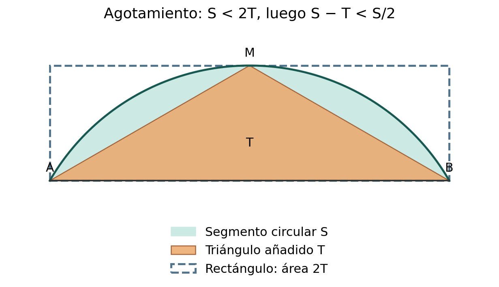
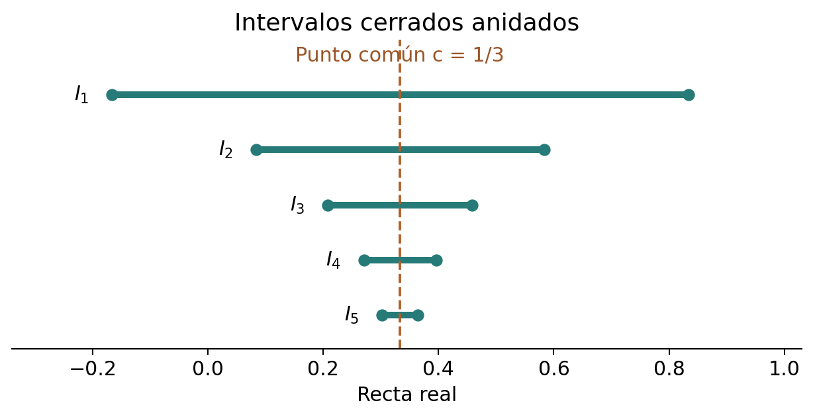
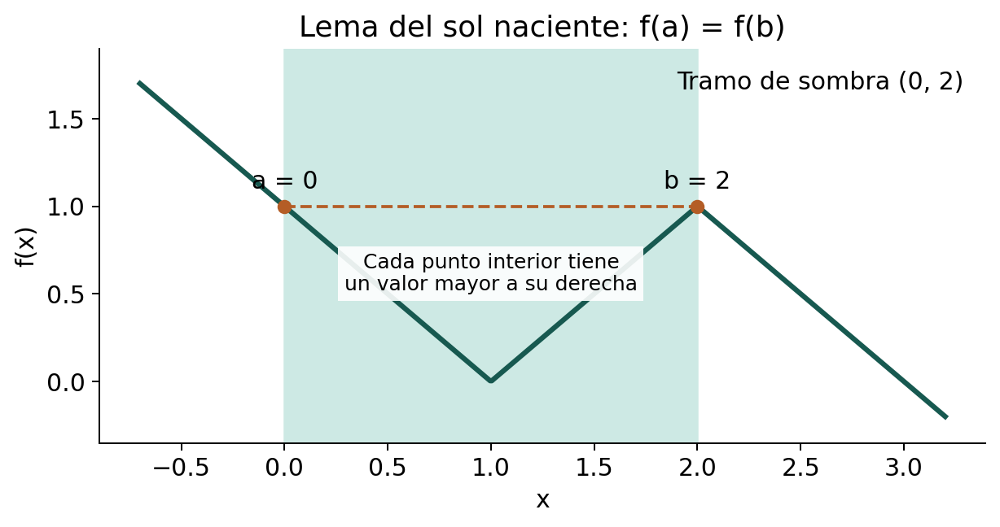

::: {.spivak-nav}

[← Capítulo 7](capitulo-07.qmd) · [Colecciones](../index.qmd#spivak-calculus-cuarta-edición) · [Capítulo 9 →](capitulo-09.qmd)

:::

Solucionario explicado de Matemática Abierta · A. Peña

Problemas procedentes de Michael Spivak, *Calculus*, 4.ª edición, capítulo 8, pp. 139–143, y apéndice «Continuidad uniforme», p. 146 (PDF consultado: 159–163 y 166). Los enunciados se normalizan al contenido matemático necesario; las soluciones y explicaciones son propias.

La completitud se usa en su forma explícita: todo subconjunto no vacío de $\mathbb R$ acotado superiormente tiene supremo real. Si $s=\sup A$, cada $\varepsilon>0$ permite encontrar $x\in A$ con $s-\varepsilon<x\le s$, pues $s-\varepsilon$ no es cota superior. El ínfimo se obtiene en E002. Un extremo existe cuando la cota correspondiente pertenece al conjunto. Las afirmaciones sobre intervalos presuponen extremos ordenados y dominio no vacío, salvo cuando se discute expresamente una excepción. No se utilizan derivadas ni integrales.

## Ejercicio 1 — `SPV4-C08-E001` {#e001}

Referencia: p. 139. **Problema:** determinar supremo, ínfimo, máximo y mínimo de ocho conjuntos. En todos los casos $\mathbb N=\{1,2,\ldots\}$.

### Solución

Ponga $r_- =(-1-\sqrt5)/2$ y $r_+=(-1+\sqrt5)/2$.

| Inciso y conjunto | Supremo real | Ínfimo real | Máximo | Mínimo |
|---|---|---|---|---|
| (i) $\{1/n:n\in\mathbb N\}$ | $1$ | $0$ | $1$ | No |
| (ii) $\{1/n:n\in\mathbb Z,\ n\ne0\}$ | $1$ | $-1$ | $1$ | $-1$ |
| (iii) $\{0\}\cup\{1/n:n\in\mathbb N\}$ | $1$ | $0$ | $1$ | $0$ |
| (iv) $[0,\sqrt2]\cap\mathbb Q$ | $\sqrt2$ | $0$ | No | $0$ |
| (v) $\{x:x^2+x+1\ge0\}$ | No existe | No existe | No | No |
| (vi) $\{x:x^2+x-1<0\}$ | $r_+$ | $r_-$ | No | No |
| (vii) $\{x:x<0,\ x^2+x-1<0\}$ | $0$ | $r_-$ | No | No |
| (viii) $\{1/n+(-1)^n:n\in\mathbb N\}$ | $3/2$ | $-1$ | $3/2$ | No |

**(i)** Todos los términos son positivos y el primero es $1$. Para cualquier $\varepsilon>0$ hay $n$ con $1/n<\varepsilon$, por la propiedad arquimediana ya demostrada en el capítulo; por eso ninguna cota inferior positiva sirve. Cero no es un término.

**(ii)** Los términos negativos están entre $-1$ y $0$, los positivos entre $0$ y $1$, y ambos extremos se toman para $n=-1,1$.

**(iii)** Añadir cero convierte el ínfimo de (i) en mínimo y no cambia el supremo.

**(iv)** La densidad racional hace que ninguna cota menor que $\sqrt2$ sea superior. Para no ocultar una dependencia, esa densidad puede tomarse de E005(b), cuya prueba usa solo la propiedad arquimediana y no este inciso. La irracionalidad de $\sqrt2$ impide que el supremo pertenezca al conjunto. Cero sí pertenece.

**(v)** $x^2+x+1=(x+1/2)^2+3/4>0$ para todo real, de modo que el conjunto es $\mathbb R$, no acotado en ninguna dirección.

**(vi)** $x^2+x-1=(x-r_-)(x-r_+)$ es negativo exactamente entre las dos raíces. El conjunto es $(r_-,r_+)$; sus extremos son las cotas óptimas y están excluidos.

**(vii)** Como $r_-<0<r_+$, la intersección pedida es $(r_-,0)$.

**(viii)** Los términos de índice par son $1+1/(2k)$, con máximo $3/2$ y aproximación a $1$ desde arriba. Los impares son $-1+1/(2k-1)$, que van desde $0$ hacia $-1$ sin alcanzarlo. Ambas subsecciones son infinitas y justifican las cotas de la última fila.

## Ejercicio 2 — `SPV4-C08-E002` {#e002}

Referencia: p. 139. **Problema:** para $A\ne\varnothing$ acotado inferiormente, construir su ínfimo (a) mediante $-A$ y (b) mediante el conjunto de cotas inferiores.

### Solución

**(a)** Si $x_0\in A$, entonces $-x_0\in-A$, así que $-A$ no es vacío. Una cota inferior $m$ de $A$ da la cota superior $-m$ de $-A$. Sea $s=\sup(-A)$. Para cada $x\in A$, $-x\le s$, por lo que $-s\le x$: $-s$ es cota inferior. Si $t$ es otra cota inferior, $-t$ es superior para $-A$, luego $s\le-t$ y $t\le-s$. Así
$$\inf A=-\sup(-A).$$

**(b)** Sea $B$ el conjunto de cotas inferiores. Es no vacío por hipótesis. Un elemento cualquiera $x_0\in A$ es cota superior de $B$. Existe $s=\sup B$, y cada $x\in A$ es también cota superior de $B$, por lo que $s\le x$. Así $s\in B$ y es su mayor elemento, es decir, $s=\inf A$. La pertenencia a $B$ no se presume: se obtiene de que todos los elementos de $A$ son cotas superiores de $B$.

## Ejercicio 3 — `SPV4-C08-E003` {#e003}

Referencia: pp. 139–140. **Problema:** sea $f$ continua en $[a,b]$, con $f(a)<0<f(b)$. (a) estudiar la existencia de un segundo cero más pequeño y de un último cero; (b) demostrar la existencia de un cero mediante el supremo de los puntos donde $f<0$, e identificar qué cero se obtiene.

### Solución

**(a)** No tiene por qué haber un segundo cero más pequeño. En $[-1,2]$, defina $f(x)=x$ para $x<0$, $f(x)=0$ en $[0,1]$ y $f(x)=x-1$ para $x>1$. El pegado es continuo y los valores extremos tienen signos opuestos. El primer cero es $0$, pero el conjunto de ceros posteriores es $(0,1]$, sin menor elemento.

Sí existe un último cero. Sea $Z=\{x\in[a,b]:f(x)=0\}$, no vacío por valores intermedios, y sea $s=\sup Z$. Si $f(s)\ne0$, la continuidad en $s$ daría un entorno relativo sin ceros. Pero la propiedad del supremo proporciona un elemento de $Z$ en cualquier intervalo $(s-\delta,s]$. Esto es imposible; por tanto $f(s)=0$. El mismo argumento con el ínfimo prueba la existencia del primer cero. No se necesita que haya solo finitos ceros.

**(b)** Ponga $B=\{x\in[a,b]:f(x)<0\}$ y $s=\sup B$. Es no vacío y acotado. La continuidad y los signos en los extremos aseguran $a<s<b$: hay puntos negativos a la derecha de $a$ y todo un intervalo positivo a la izquierda de $b$. Si $f(s)<0$, la persistencia local del signo daría puntos de $B$ mayores que $s$. Si $f(s)>0$, habría un entorno izquierdo sin puntos de $B$, contradiciendo que $s$ sea su menor cota superior. Así $f(s)=0$.

Se obtiene la frontera derecha de los puntos negativos, **no necesariamente el último cero de $f$**. Por ejemplo, $f(x)=x(x-1)^2$ en $[-1,2]$ da $s=0$, aunque también tiene un cero en $1$.

El conjunto $A$ de la prueba del texto exige negatividad en todo $[a,x]$, y puede ser distinto de $B$. Para $f(x)=(x+1)x(x-1)$ en $[-2,2]$,
$$A=[-2,-1),\qquad B=[-2,-1)\cup(0,1).$$
Sus supremos son $-1$ y $1$, respectivamente. Ambos procedimientos producen ceros, pero localizan fronteras diferentes.

## Ejercicio 4* — `SPV4-C08-E004` {#e004}

Referencia: p. 140. **Problema:** (a) aislar un tramo estrictamente positivo alrededor de un punto positivo, entre ceros; (b) aislar un tramo cuyos valores estén estrictamente entre los dos valores extremos de una función continua.

### Solución

**(a)** Suponga $f(a)=f(b)=0$ y $f(x_0)>0$. El punto $x_0$ es interior. El conjunto de ceros en $[a,x_0]$ tiene un último elemento $c$, y el de $[x_0,b]$ un primer elemento $d$, por el argumento de E003(a). Se tiene $a\le c<x_0<d\le b$. No hay ceros en $(c,d)$, y el signo debe ser positivo allí porque lo es en $x_0$; un valor negativo produciría un cero intermedio. Así $f(c)=f(d)=0$ y $f>0$ en todo $(c,d)$.

**(b)** Ponga $L=f(a)<U=f(b)$. Sea $d$ la primera abscisa de $[a,b]$ donde $f=U$, y sea $c$ la última de $[a,d]$ donde $f=L$. Existen: los conjuntos de nivel son no vacíos y la continuidad permite tomar su ínfimo o supremo como en E003. Además $a\le c<d\le b$.

Para $c<x<d$, no puede haber $f(x)\ge U$: la igualdad viola la elección de $d$, y un valor mayor obliga a tomar $U$ entre $a$ y $x$, antes de $d$. Tampoco puede haber $f(x)\le L$: la igualdad viola la elección de $c$, y un valor menor obliga a tomar $L$ entre $x$ y $d$, después de $c$. Por tanto
$$f(c)=f(a),\quad f(d)=f(b),\qquad f(a)<f(x)<f(b)\quad(c<x<d).$$

## Ejercicio 5 — `SPV4-C08-E005` {#e005}

Referencia: p. 140. **Problema:** (a) hallar un entero entre $x,y$ cuando $y-x>1$; (b) probar densidad racional; (c) hallar un irracional entre dos racionales; (d) probar densidad irracional.

### Solución

**(a)** Justifiquemos primero la existencia de la parte entera sin presuponerla. Elija por la propiedad arquimediana un entero positivo $N>|x|+1$. Entre los finitos enteros de $[-N,N]$ no superiores a $x$ hay un mayor $l$. Entonces $l\le x<l+1$, porque $l+1\le N$ y, si no superase a $x$, contradiría la elección de $l$. Por tanto
$$x<l+1\le x+1<y,$$
y sirve $k=l+1$.

**(b)** Si $x<y$, elija $n\in\mathbb N$ con $1/n<y-x$. Entonces $ny-nx>1$ y (a) da un entero $k$ con $nx<k<ny$. Dividir por $n>0$ produce $x<k/n<y$.

Estos resultados necesitan la propiedad arquimediana, cuya derivación a partir de la completitud se ofrece en el capítulo. Que la división y el orden funcionen como en $\mathbb R$ no basta por sí solo para justificar esos pasos en cualquier cuerpo ordenado.

**(c)** Si $r<s$ son racionales, use $t=r+(s-r)\sqrt2/2$. Como $0<\sqrt2/2<1$, se tiene $r<t<s$. Si $t$ fuera racional, también lo sería $(t-r)/(s-r)=\sqrt2/2$, contradicción.

**(d)** Por (b), elija racionales $r,s$ con $x<r<s<y$, aplicando la densidad dos veces. Por (c) hay un irracional entre $r,s$, que también queda entre $x,y$.

## Ejercicio 6* — `SPV4-C08-E006` {#e006}

Referencia: p. 140. **Problema:** estudiar igualdad y orden de funciones continuas a partir de sus valores en un conjunto denso $D\subset\mathbb R$.

### Solución

**(a)** Si $f=0$ en $D$, entonces $f=0$ en toda la recta. Si $f(a)\ne0$, la continuidad daría un intervalo en que $|f(x)|>|f(a)|/2>0$. La densidad exige allí un punto de $D$, contradicción.

**(b)** Si $f=g$ en $D$, aplique (a) a la diferencia continua $f-g$.

**(c)** Si $f\ge g$ en $D$, también $f\ge g$ en toda la recta. Si $f(a)-g(a)<0$, la persistencia local de ese signo proporcionaría un intervalo negativo, que debe contener un punto de $D$.

La versión estricta falla. Tome $D=\mathbb R\setminus\{0\}$, denso, $f(x)=x^2$, $g(x)=0$. En $D$ se tiene $f>g$, pero en cero hay igualdad. La continuidad conserva desigualdades cerradas; no garantiza una separación positiva en el límite.

## Ejercicio 7 — `SPV4-C08-E007` {#e007}

Referencia: p. 140. **Problema:** probar que toda función aditiva continua tiene forma $f(x)=cx$.

### Solución

Ponga $c=f(1)$. La aditividad da $f(0)=0$, $f(-x)=-f(x)$ y, por repetición, $f(nx)=nf(x)$ para todo entero $n$. Para $q>0$, $qf(1/q)=f(1)=c$, luego $f(p/q)=cp/q$ para cualquier racional $p/q$. Las funciones continuas $f(x)$ y $cx$ coinciden en $\mathbb Q$, que es denso por E005(b); E006(b) obliga a que coincidan en todo $\mathbb R$. La continuidad en cero ya bastaría, porque la aditividad la transporta a cada centro según C06-E007.

## Ejercicio 8* — `SPV4-C08-E008` {#e008}

Referencia: p. 141. **Problema:** para una función no decreciente $f:\mathbb R\to\mathbb R$, probar (a) existencia de ambos límites laterales finitos; (b) ausencia de discontinuidades eliminables; (c) continuidad si tiene la propiedad de valores intermedios en cada subintervalo.

### Solución

**(a)** En un centro $a$, los conjuntos
$$L_a=\{f(x):x<a\},\qquad R_a=\{f(x):x>a\}$$
son no vacíos. El primero está acotado superiormente por $f(a)$, el segundo inferiormente por $f(a)$. Ponga $l=\sup L_a$ y $r=\inf R_a$. Son reales y
$$l\le f(a)\le r.$$
Dado $\varepsilon>0$, hay $x_0<a$ con $f(x_0)>l-\varepsilon$. Si $x_0<x<a$, la monotonía da $l-\varepsilon<f(x)\le l$; por tanto el límite izquierdo es $l$. A la derecha elija $x_1>a$ con $f(x_1)<r+\varepsilon$: si $a<x<x_1$, $r\le f(x)<r+\varepsilon$, y el límite derecho es $r$.

**(b)** Si el límite bilateral existe, los dos laterales son iguales. La desigualdad anterior obliga entonces a que ambos sean $f(a)$. Por eso un límite finito nunca puede diferir del valor central: una discontinuidad eliminable es imposible.

**(c)** Si hubiera un salto $l<r$, elija $t\in(l,r)$ distinto de $f(a)$. Para cualquier $u<a<v$, $f(u)\le l<t<r\le f(v)$. La propiedad intermedia exigiría una abscisa entre $u,v$ con valor $t$, pero ninguna a la izquierda de $a$ puede superar $l$, ninguna a la derecha puede ser menor que $r$, y en $a$ se eligió un valor diferente. Contradicción. Así $l=r=f(a)$ en todo centro y $f$ es continua.

## Ejercicio 9* — `SPV4-C08-E009` {#e009}

Referencia: p. 141; remisión a 7-14. **Problema:** para funciones acotadas, definir $\|f\|=\sup\{|f(x)|:x\in[0,1]\}$ y probar homogeneidad y las dos desigualdades triangulares.

### Solución

**(i)** $\|cf\|=|c|\|f\|$. La desigualdad $\le$ se sigue de $|cf(x)|\le|c|\|f\|$. Para $c\ne0$ y cualquier $\varepsilon>0$, la aproximación al supremo proporciona $x$ con $|f(x)|>\|f\|-\varepsilon/|c|$, así que $\|cf\|>|c|\|f\|-\varepsilon$. Ningún número menor que $|c|\|f\|$ puede ser ese supremo. Si $c=0$, ambas partes son cero.

**(ii)** Punto a punto, $|f(x)+g(x)|\le\|f\|+\|g\|$. Esa es una cota superior, luego
$$\|f+g\|\le\|f\|+\|g\|.$$
La desigualdad puede ser estricta: $f\equiv1$, $g\equiv-1$ da $0<2$. No se elige un punto de máximo, que puede no existir para funciones acotadas discontinuas.

**(iii)** Como $h-f=(h-g)+(g-f)$, (ii) da
$$\|h-f\|\le\|h-g\|+\|g-f\|.$$

## Ejercicio 10 — `SPV4-C08-E010` {#e010}

Referencia: p. 141. **Problema:** para $\alpha>0$, probar la representación única $x=k\alpha+x'$, con $k\in\mathbb Z$ y $0\le x'<\alpha$.

### Solución

Tome $k=\lfloor x/\alpha\rfloor$, cuya existencia fue justificada en E005(a), y $x'=x-k\alpha$. De $k\le x/\alpha<k+1$ se obtiene $0\le x'<\alpha$.

Si también $x=l\alpha+y'$ con $0\le y'<\alpha$, entonces $(k-l)\alpha=y'-x'$. El segundo miembro tiene módulo menor que $\alpha$, por lo que $|k-l|<1$. Como es entero, $k=l$, y luego $x'=y'$. El extremo derecho se excluye precisamente para evitar dos representaciones en los múltiplos de $\alpha$.

## Ejercicio 11 — `SPV4-C08-E011` {#e011}

Referencia: p. 141. **Problema:** (a) probar que una sucesión positiva con $a_{n+1}<a_n/2$ termina por ser menor que cualquier tolerancia; (b) demostrar reducción a menos de la mitad del defecto de área al duplicar un polígono regular inscrito; (c) deducir agotamiento del área circular; (d*) probar que las áreas de círculos tienen la razón de los cuadrados de sus radios usando polígonos semejantes.

### Solución

**(a)** Por inducción, para $n\ge2$, $a_n<a_1/2^{n-1}$. Además $2^{n-1}\ge n$, también por inducción. Elija un entero $n>a_1/\varepsilon$; entonces $a_n<a_1/n<\varepsilon$ (si es preciso, aumente $n$ a $2$). No se presupone un teorema general sobre convergencia de sucesiones.

**(b)** Considere un lado $AB$ del polígono, el punto medio $M$ del arco menor correspondiente y el segmento circular $S$ entre arco y cuerda. Al duplicar los lados se añade al polígono el triángulo $AMB$. Sea $h$ la distancia de $M$ a la cuerda. El segmento circular queda dentro del rectángulo de base $AB$ y altura $h$, y su área es **estrictamente menor** que la del rectángulo: el arco deja fuera regiones de área positiva próximas a sus esquinas. El triángulo añadido tiene área $AB\cdot h/2$, la mitad de ese rectángulo. Por tanto su área $T$ supera $S/2$, y el defecto nuevo de ese segmento cumple
$$S-T<S/2.$$
Sumar sobre los lados del polígono da la misma reducción estricta para el defecto total. Se usan aquí las propiedades geométricas de área —aditividad y comparación por inclusión—, no la fórmula $\pi r^2$ que se pretende justificar después. El polígono tiene al menos tres lados y el círculo radio positivo.

{#fig-spv4-c08-f01 fig-alt="Capítulo 8: El triángulo añadido supera la mitad del segmento circular"}

**(c)** Comience con un polígono regular inscrito y duplique sucesivamente sus lados. Los defectos positivos de área satisfacen la hipótesis de (a) por (b). Así, para cualquier $\varepsilon>0$, uno de esos polígonos tiene área que difiere de la circular en menos de $\varepsilon$. La sucesión se construye con duplicaciones; no se necesita una fórmula analítica de la longitud del arco.

**(d*)** Sean $A_1,A_2$ las áreas de dos círculos de radios positivos $R_1,R_2$, y $\lambda=R_1^2/R_2^2$. Polígonos regulares inscritos correspondientes, con el mismo número de lados, tienen áreas $P_1=\lambda P_2$: sus lados están en razón $R_1/R_2$, y se usa la relación de áreas de polígonos semejantes dada en el enunciado.

Si $A_1>\lambda A_2$, por (c) se puede elegir $P_1>\lambda A_2$. El correspondiente $P_2=P_1/\lambda$ superaría $A_2$, imposible para un polígono inscrito. Si $A_1<\lambda A_2$, elija $P_2>A_1/\lambda$; entonces $P_1>A_1$, igualmente imposible. Por tanto $A_1=\lambda A_2$, es decir,
$$\frac{A_1}{A_2}=\frac{R_1^2}{R_2^2}.$$
Los radios cero darían figuras degeneradas y no se incluyen en una afirmación sobre razón de áreas.

## Ejercicio 12 — `SPV4-C08-E012` {#e012}

Referencia: p. 141. **Problema:** sean $A,B$ no vacíos y $x\le y$ para todo $x\in A,y\in B$; probar (a) $\sup A\le y$ para cada $y\in B$; (b) $\sup A\le\inf B$.

### Solución

**(a)** Cualquier $y\in B$ es cota superior de $A$, de modo que existe $\sup A$ y no supera a $y$.

**(b)** Un elemento de $A$ da una cota inferior de $B$, así que existe $\inf B$. Por (a), $\sup A$ es también cota inferior de $B$ y no puede superar a la mayor de ellas. Se verificó la existencia de ambas cotas óptimas a partir de la no vacuidad y de la relación entre los conjuntos; no se presupone que cada conjunto sea acotado en ambas direcciones.

## Ejercicio 13 — `SPV4-C08-E013` {#e013}

Referencia: pp. 141–142. **Problema:** para $A,B$ no vacíos y acotados superiormente, probar $\sup(A+B)=\sup A+\sup B$, donde $A+B=\{x+y:x\in A,y\in B\}$.

### Solución

Sea $s=\sup A$, $t=\sup B$. El conjunto suma es no vacío y cada uno de sus elementos es menor o igual que $s+t$, luego $\sup(A+B)\le s+t$. Para cualquier $\varepsilon>0$, elija $x\in A,y\in B$ con $x>s-\varepsilon/2$, $y>t-\varepsilon/2$. Entonces $x+y>s+t-\varepsilon$, y por tanto ninguna cota superior menor que $s+t$ sirve para $A+B$. Resulta la igualdad. No se necesita que ninguno de los dos supremos se alcance.

## Ejercicio 14 — `SPV4-C08-E014` {#e014}

Referencia: p. 142. **Problema:** (a) probar que intervalos cerrados no vacíos, finitos y anidados $I_n=[a_n,b_n]$, con $a_n\le a_{n+1}$ y $b_{n+1}\le b_n$, tienen un punto común; (b) refutarlo para intervalos abiertos.

### Solución

**(a)** Los extremos izquierdos forman un conjunto no vacío acotado por $b_1$. Sea $s=\sup\{a_n\}$. Para cada $n$, **todo** $a_m$ es menor o igual que $b_n$: si $m\le n$, $a_m\le a_n\le b_n$; si $m\ge n$, $a_m\le b_m\le b_n$. Así $s\le b_n$ y, como $s\ge a_n$, $s\in I_n$ para todo $n$.

{#fig-spv4-c08-f02 fig-alt="Capítulo 8: Los extremos izquierdos y derechos confinan un punto común"}

No hace falta que las longitudes tiendan a cero para la existencia. Si además lo hacen, el punto común es único: dos puntos distintos impondrían una longitud mínima positiva a todos los intervalos.

**(b)** Los intervalos $I_n=(0,1/n)$ son no vacíos y anidados, pero su intersección es vacía. Cero está excluido; para cualquier $x>0$, un $n$ con $1/n<x$ excluye también a $x$. La inclusión de las fronteras es decisiva.

## Ejercicio 15* — `SPV4-C08-E015` {#e015}

Referencia: p. 142. **Problema:** demostrar por bisección que una función continua con valores extremos de signos opuestos tiene un cero.

### Solución

Si el punto medio es un cero, se termina. Si no, su signo permite conservar la mitad cuyos extremos sigan teniendo signos opuestos, ordenados como negativo a la izquierda y positivo a la derecha. Repita. Si nunca aparece un cero en los puntos medios, se obtienen intervalos cerrados anidados $I_n=[a_n,b_n]$ con $f(a_n)<0<f(b_n)$ y longitud $(b-a)/2^n$.

Por E014 existe un punto común $c$. Las longitudes terminan por ser menores que cualquier radio: la estimación $2^n\ge n+1$ usada en E011(a) da $(b-a)/2^n\le(b-a)/(n+1)$. No se aplica literalmente su hipótesis de reducción estricta, pues aquí cada reducción es exactamente a la mitad. Ambos extremos quedan arbitrariamente cerca de $c$. Si $f(c)>0$, la continuidad haría positivos ambos valores extremos para $n$ suficientemente grande, contradiciendo $f(a_n)<0$. Si $f(c)<0$, haría negativos ambos, contradiciendo $f(b_n)>0$. Así $f(c)=0$. Esta prueba usa completitud mediante los intervalos anidados y continuidad local; no invoca el teorema de valores intermedios que está demostrando.

## Ejercicio 16* — `SPV4-C08-E016` {#e016}

Referencia: p. 142. **Problema:** demostrar por bisección que una función continua en un intervalo cerrado y acotado está acotada.

### Solución

Si $f$ fuera no acotada, al menos una de las dos mitades conservaría esa propiedad: dos cotas finitas para ambas mitades darían una cota en su unión. Conserve una mitad no acotada y repita. Resultan intervalos anidados de longitudes que se reducen a la mitad, en cada uno de los cuales $f$ sigue no acotada.

Por E014 hay un punto común $c$. La continuidad en $c$, con tolerancia $1$, asegura $|f(x)|<|f(c)|+1$ para los puntos del dominio suficientemente próximos. Un intervalo de la construcción queda íntegramente en esa vecindad, contradiciendo la no acotación que debía conservar. El mismo argumento cubre falta de cota superior, inferior o de cota para el módulo; no usa el teorema de acotación como premisa.

## Ejercicio 17 — `SPV4-C08-E017` {#e017}

Referencia: p. 142. **Problema:** (a) verificar cuatro propiedades de $A=(-\infty,\alpha)$; (b) probar que todo conjunto con esas propiedades es $(-\infty,\sup A)$.

### Solución

**(a-i)** Si $x<\alpha$ y $y<x$, entonces $y<\alpha$, de modo que $y\in A$.

**(a-ii)** $\alpha-1\in A$, por lo que $A$ no es vacío.

**(a-iii)** $\alpha\notin A$, por lo que $A\ne\mathbb R$.

**(a-iv)** Para $x\in A$, el punto $x'=(x+\alpha)/2$ cumple $x<x'<\alpha$ y pertenece a $A$.

**(b)** Suponga esas cuatro propiedades. Un punto $z\notin A$ es cota superior: si hubiera $x\in A$ con $x>z$, la propiedad de cierre hacia abajo obligaría a $z\in A$. Existe entonces $s=\sup A$. Ningún $x\in A$ puede ser $s$, porque la propiedad (iv) produciría un elemento mayor. Así $A\subset(-\infty,s)$.

Si $y<s$, la propiedad del supremo da $x\in A$ con $y<x\le s$, y el cierre hacia abajo implica $y\in A$. Se obtiene la inclusión contraria y $A=(-\infty,s)$. La condición de no tener mayor elemento excluye la alternativa de un semieje cerrado.

## Ejercicio 18* — `SPV4-C08-E018` {#e018}

Referencia: pp. 142–143. **Problema:** una casi cota superior $t$ deja solo finitos elementos de $A$ con $x\ge t$; una casi cota inferior deja solo finitos con $x\le t$. (a) hallar ambas para los ocho conjuntos de E001; (b) probar existencia de su ínfimo para casi cotas superiores de un conjunto infinito acotado; (c) calcular el límite superior así definido; (d) definir y calcular el límite inferior.

### Solución

**(b)** Sea $A$ infinito y acotado, y $B$ el conjunto de sus casi cotas superiores. Una cota superior estricta de $A$ pertenece a $B$, pues no queda ningún elemento por encima de ella. Si $m$ es cota inferior de $A$, ningún $t\le m$ puede pertenecer a $B$: todos los infinitos elementos de $A$ satisfacen $x\ge t$. Así $B$ es no vacío y acotado inferiormente. Existe $\inf B$, que se define como $\limsup A$.

**(d), definición.** Sea $C$ el conjunto de casi cotas inferiores. Una cota inferior estricta pertenece a $C$, y cualquier cota superior de $A$ acota superiormente a $C$, pues niveles aún mayores dejan todos los elementos por debajo. Por tanto $C$ es no vacío y acotado superiormente, y se define $\liminf A=\sup C$.

**(a), (c) y (d), cálculos.** Para cada conjunto $A_i$ de E001:

| Conjunto | Casi cotas superiores $B$ | Casi cotas inferiores $C$ | $\limsup A$ | $\liminf A$ |
|---|---|---|---|---|
| (i) $\{1/n\}$ | $(0,\infty)$ | $(-\infty,0]$ | $0$ | $0$ |
| (ii) $\{\pm1/n\}$ | $(0,\infty)$ | $(-\infty,0)$ | $0$ | $0$ |
| (iii) $\{0\}\cup\{1/n\}$ | $(0,\infty)$ | $(-\infty,0]$ | $0$ | $0$ |
| (iv) $[0,\sqrt2]\cap\mathbb Q$ | $[\sqrt2,\infty)$ | $(-\infty,0]$ | $\sqrt2$ | $0$ |
| (v) $\mathbb R$ | $\varnothing$ | $\varnothing$ | No definido como real por (b) | No definido como real |
| (vi) $(r_-,r_+)$ | $[r_+,\infty)$ | $(-\infty,r_-]$ | $r_+$ | $r_-$ |
| (vii) $(r_-,0)$ | $[0,\infty)$ | $(-\infty,r_-]$ | $0$ | $r_-$ |
| (viii) $\{1/n+(-1)^n\}$ | $(1,\infty)$ | $(-\infty,-1]$ | $1$ | $-1$ |

Para (i–iii), por encima de cualquier umbral positivo quedan solo finitos términos, pero por encima de cero siguen quedando infinitos. En (ii), por debajo de cero también quedan infinitos términos negativos, lo que excluye cero de $C$; en (iii) solo se añade un único punto cero y no cambia la clasificación de casi cotas.

En (iv), cada intervalo con longitud positiva dentro del rango contiene infinitos racionales: subdivídalo en tantos intervalos disjuntos como se quiera y use E005(b). Por eso ninguna casi cota superior puede estar por debajo de $\sqrt2$, y ninguna inferior por encima de cero. Cero sí deja solo el elemento cero por debajo o en el nivel. Para (vi–vii), los intervalos contienen igualmente infinitos puntos en cada tramo de longitud positiva; sus extremos deciden las inclusiones de $B,C$.

En (viii), cualquier nivel mayor que $1$ deja solo finitos términos pares por encima, pero el nivel $1$ deja todos los pares; cualquier nivel mayor que $-1$ deja infinitos impares por debajo, mientras que $-1$ no deja ninguno. El supremo $3/2$ de E001 es un valor aislado grande y por eso no coincide con el límite superior $1$.

El conjunto (v) es infinito pero no acotado y queda fuera de la hipótesis de la definición real. Si se **añade** la convención de reales extendidos $\inf\varnothing=+\infty$, $\sup\varnothing=-\infty$, entonces se escribe $\limsup\mathbb R=+\infty$ y $\liminf\mathbb R=-\infty$. Es una extensión de la definición, no la existencia de un número real. Se cuentan elementos distintos del conjunto, no repeticiones de una enumeración.

## Ejercicio 19* — `SPV4-C08-E019` {#e019}

Referencia: p. 143. **Problema:** para $A$ infinito y acotado, probar las relaciones entre ínfimo, límite inferior, límite superior y supremo, y deducir extremos cuando las desigualdades exteriores son estrictas.

### Solución

**(a)** Sea $C$ el conjunto de casi cotas inferiores y $B$ el de casi cotas superiores. Cada $p\in C$ debe satisfacer $p\le q$ para cada $q\in B$. Si $p>q$, todo elemento de $A$ estaría entre los finitos que cumplen $x\le p$ o los finitos que cumplen $x\ge q$, haciendo finito a $A$. Por E012,
$$\liminf A=\sup C\le\inf B=\limsup A.$$

**(b)** $\sup A$ pertenece a $B$: solo puede haber un elemento de $A$ mayor o igual que su supremo, el propio supremo si se alcanza. Por tanto $\limsup A\le\sup A$.

**(c)** Si $L=\limsup A<\sup A$, elija $t$ entre ambos. Como $t>\inf B$, hay $q\in B$ con $q<t$; entonces $t\in B$, pues al aumentar un nivel no se añaden elementos por encima. El conjunto $F=\{x\in A:x\ge t\}$ es finito y no vacío: si lo fuera, $t$ sería cota superior, contradiciendo $t<\sup A$. Su mayor elemento es también el mayor de $A$, porque todos los elementos restantes son menores que $t$. Así $A$ tiene máximo.

**(d-i)** $\inf A$ pertenece a $C$, pues solo el propio ínfimo puede ser un elemento de $A$ menor o igual que él. Luego $\inf A\le\liminf A$.

**(d-ii)** Si $\inf A<\liminf A$, escoja $t$ entre ambos. Existe una casi cota inferior $p>t$, y bajar el nivel conserva esa propiedad; por tanto $\{x\in A:x\le t\}$ es finito. Es no vacío porque $t>\inf A$. Su menor elemento es el menor de $A$.

En conjunto,
$$\inf A\le\liminf A\le\limsup A\le\sup A.$$
Las separaciones estrictas exteriores detectan un extremo que puede aislarse de la parte infinita del conjunto; no se afirma la recíproca.

## Ejercicio 20 — `SPV4-C08-E020` {#e020}

Referencia: p. 143. **Problema:** un punto $x$ está en sombra si existe $y>x$ con $f(y)>f(x)$, para $f$ continua en $\mathbb R$. Suponga que todos los puntos de $(a,b)$ están en sombra pero $a,b$ no lo están. (a) bajo $f(a)>f(b)$, localizar el máximo en $[a,b]$; (b) obtener una contradicción y concluir $f(a)=f(b)$.

### Solución

Como $a$ no está en sombra, $f(y)\le f(a)$ para todo $y>a$, en particular $f(b)\le f(a)$.

**(a)** El máximo en $[a,b]$ es $f(a)$. Ningún punto interior puede tomar ese mismo valor: estaría en sombra y habría un punto aún mayor a su derecha con valor superior a $f(a)$, contradiciendo que $a$ no esté en sombra. Bajo la desigualdad estricta, $b$ tampoco puede ser maximizador. Por tanto el único punto de máximo es $a$.

**(b)** Si $f(a)>f(b)$, por continuidad en $a$ puede escogerse $x\in(a,b)$ con $f(x)>f(b)$. En $[x,b]$ hay un punto de máximo $c$, y $c<b$ porque el máximo supera $f(b)$. Como $c\in(a,b)$, está en sombra: habría $y>c$ con $f(y)>f(c)$. Si $y\le b$, viola el máximo en $[x,b]$; si $y>b$, viola que $b$ no esté en sombra, pues $f(y)>f(c)>f(b)$. Ambas posibilidades son imposibles. Por tanto no puede haber desigualdad estricta y $f(a)=f(b)$.

{#fig-spv4-c08-f03 fig-alt="Capítulo 8: Los extremos no sombreados de un tramo tienen la misma altura"}

La lámina muestra un ejemplo con tramo de sombra $(0,2)$ y extremos de altura $1$. La prueba no presupone que la gráfica sea lineal ni que el valle tenga un único punto mínimo.

# Apéndice — Continuidad uniforme

Referencia general: pp. 144–146; ejercicios en p. 146 / PDF 166. Una función es uniformemente continua en $A$ si para cada $\varepsilon>0$ existe un mismo radio $\delta>0$ que controla $|f(x)-f(y)|<\varepsilon$ para **todos** $x,y\in A$ con $|x-y|<\delta$. El radio depende de la tolerancia, no de la ubicación del par; no se afirma que sea único.

## Apéndice, ejercicio 1 — `SPV4-C08-A01-E001` {#e001-2}

**Problema:** (a) estudiar $x^\alpha$ en $[0,\infty)$ para $\alpha=1/3,1/2,2,3$; (b) dar un ejemplo continuo y acotado en $(0,1]$ que no sea uniformemente continuo; (c) hacerlo sobre $[0,\infty)$.

### Solución

**(a-i), $\alpha=1/3$.** Para $u,v\ge0$, $|u-v|^3\le|u^3-v^3|$: si $u\ge v$, se factoriza la diferencia y se compara $(u-v)^2\le u^2+uv+v^2$. Poniendo $u=x^{1/3}$, $v=y^{1/3}$,
$$|x^{1/3}-y^{1/3}|\le|x-y|^{1/3}.$$
Para una tolerancia $\varepsilon$ sirve $\delta=\varepsilon^3$ en todo el semieje. Sí es uniformemente continua.

**(a-ii), $\alpha=1/2$.** La misma comparación $|u-v|^2\le|u^2-v^2|$ da $|\sqrt x-\sqrt y|\le\sqrt{|x-y|}$. Sirve $\delta=\varepsilon^2$. Sí es uniformemente continua.

**(a-iii), $\alpha=2$.** Tome $x=n$, $y=n+1/n$. La distancia es $1/n$, tan pequeña como se quiera, pero $y^2-x^2=2+1/n^2>1$. Ningún radio uniforme para $\varepsilon=1$ sirve.

**(a-iv), $\alpha=3$.** Con el mismo par, $y^3-x^3=3n+3/n+1/n^3>1$, aunque $|x-y|=1/n$. Tampoco es uniformemente continua.

**(b)** Tome $f(x)=\sin(1/x)$ en $(0,1]$, continua y acotada entre $-1,1$. Los puntos
$$x_n=\frac1{2\pi n+\pi/2},\qquad y_n=\frac1{2\pi n+3\pi/2}$$
pertenecen al dominio para $n\ge1$, sus valores son $1,-1$ y
$$|x_n-y_n|=\frac\pi{(2\pi n+\pi/2)(2\pi n+3\pi/2)}\longrightarrow0.$$
Para cualquier radio elija $n$ grande; el error sigue siendo $2$, lo que refuta la condición para $\varepsilon=1$.

**(c)** Tome $f(x)=\sin(x^2)$ en $[0,\infty)$. Es continua y acotada. Para
$$x_n=\sqrt{2\pi n+\pi/2},\qquad y_n=\sqrt{2\pi n+3\pi/2},$$
los valores son $1,-1$, mientras que racionalizar da
$$y_n-x_n=\frac\pi{\sqrt{2\pi n+3\pi/2}+\sqrt{2\pi n+\pi/2}}\longrightarrow0.$$
De nuevo falla la tolerancia uniforme $1$.

## Apéndice, ejercicio 2 — `SPV4-C08-A01-E002` {#e002-2}

**Problema:** (a) suma; (b) producto bajo acotación de ambos factores; (c) contraejemplo sin esa acotación; (d) composición de funciones uniformemente continuas.

### Solución

**(a)** Para error $\varepsilon$, tome radios que controlen errores $\varepsilon/2$ en $f$ y $g$ y use su mínimo. La desigualdad triangular da el control de la suma para todo par del dominio.

**(b)** Si $|f|\le M$, $|g|\le N$, escoja radios uniformes para errores $\varepsilon/[2(N+1)]$ en $f$ y $\varepsilon/[2(M+1)]$ en $g$. En su mínimo,
$$|f(x)g(x)-f(y)g(y)|\le N|f(x)-f(y)|+M|g(x)-g(y)|<\varepsilon.$$
Los denominadores positivos cubren los factores nulos y no se exige que las cotas se alcancen.

**(c)** Basta que uno de los factores deje de estar acotado para que la conclusión falle. En $[0,\infty)$ use $f(x)=x$ y
$$g(x)=\min_{k\in\mathbb Z}|x-2k|.$$
El mínimo existe tomando un entero par próximo a $x$; $0\le g\le1$. Es la función triangular que vale cero en enteros pares y uno en impares, y cumple $|g(x)-g(y)|\le|x-y|$, por la desigualdad triangular aplicada a un punto par minimizador y luego intercambiando $x,y$. Así ambos factores son uniformemente continuos, y solo $f$ es no acotada.

Pero con $x=2n$, $y=2n+1/n$, $g(x)=0$, $g(y)=1/n$, luego
$$|f(y)g(y)-f(x)g(x)|=2+1/n^2>1,$$
aunque $|x-y|=1/n\to0$. El producto no es uniformemente continuo.

**(d)** Sea $f:A\to B$ uniformemente continua y $g:B\to\mathbb R$ uniformemente continua. Para error $\varepsilon$ en $g$, obtenga un radio $\eta$ en $B$. Para error $\eta$ en $f$, obtenga un radio $\delta$ en $A$. Entonces $|x-y|<\delta$ implica $|f(x)-f(y)|<\eta$ y después $|g(f(x))-g(f(y))|<\varepsilon$. La inclusión $f(A)\subset B$ asegura que ese segundo control se aplica.

## Apéndice, ejercicio 3 — `SPV4-C08-A01-E003` {#e003-2}

**Problema:** demostrar por bisección que una función continua en $[a,b]$ es uniformemente continua.

### Solución

Suponga lo contrario. Existe $\varepsilon_0>0$ para el que ningún radio controla todos los pares: en cada radio aparece un par de puntos a distancia menor con error al menos $\varepsilon_0$. Llamemos a un intervalo **malo para $\varepsilon_0$** cuando conserva esta propiedad, con la misma tolerancia fija.

Al dividir un intervalo malo por su punto medio $m$, al menos una mitad debe ser mala para esa misma tolerancia. Para justificarlo, si ambas tuvieran radios de control para $\varepsilon_0$, use también la continuidad en $m$ para obtener un radio donde $|f(t)-f(m)|<\varepsilon_0/2$. El mínimo de los tres radios controla pares en una misma mitad mediante su radio, y pares a ambos lados mediante la suma de sus errores respecto de $m$: si $x<m<y$ y $|x-y|$ es menor que ese mínimo, ambos quedan dentro del radio de $m$. Resultaría un control para todo el intervalo, contradicción.

Conserve siempre una mitad mala. Por E014 los intervalos anidados tienen un punto común $c$, y sus longitudes tienden a cero por la estimación geométrica explicitada en E015. La continuidad en $c$, con error $\varepsilon_0/3$, implica que en un entorno relativo suyo cualquier par tenga error menor que $2\varepsilon_0/3$. Un intervalo completo de la construcción queda dentro de ese entorno. Todos sus pares tienen entonces error menor que $\varepsilon_0$, de modo que un radio cualquiera —por ejemplo uno mayor que su longitud— lo hace bueno para esa tolerancia. Contradicción.

Se concluye la continuidad uniforme. Mantener fija $\varepsilon_0$ es esencial: seleccionar mitades simplemente «no uniformemente continuas» sin controlar la tolerancia no justificaría el último paso.

## Apéndice, ejercicio 4 — `SPV4-C08-A01-E004` {#e004-2}

**Problema:** deducir la acotación de una función continua en $[a,b]$ a partir de su continuidad uniforme.

### Solución

Por el teorema del apéndice, o por la prueba anterior, para error $1$ hay un radio uniforme $\delta>0$. Si $a<b$, elija un entero $N>(b-a)/\delta$. Para cada $x\in[a,b]$, divida $[a,x]$ en $N$ pasos de longitud $(x-a)/N<\delta$. Cada paso cambia el valor de $f$ en menos que $1$; al sumar las diferencias,
$$|f(x)-f(a)|<N\quad\text{si }x\ne a.$$
En $x=a$ el error es cero. Por tanto $|f(x)|\le |f(a)|+N$ en todo el intervalo. Si $a=b$, basta la cota $|f(a)|$. Se obtiene la acotación sin invocar el teorema de acotación que se busca deducir y sin exigir que el radio dependa del punto.

---

::: {.spivak-nav}

[← Capítulo 7](capitulo-07.qmd) · [Colecciones](../index.qmd#spivak-calculus-cuarta-edición) · [Capítulo 9 →](capitulo-09.qmd)

:::

Soluciones originales de Alevi Peña · Matemática Abierta. [Licencia GFDL 1.3 o posterior](/COPYING.FDL).
