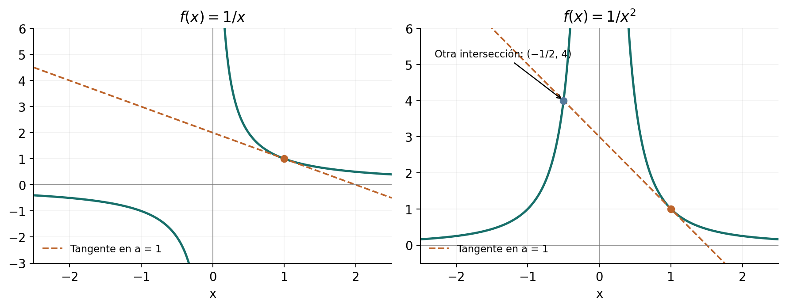
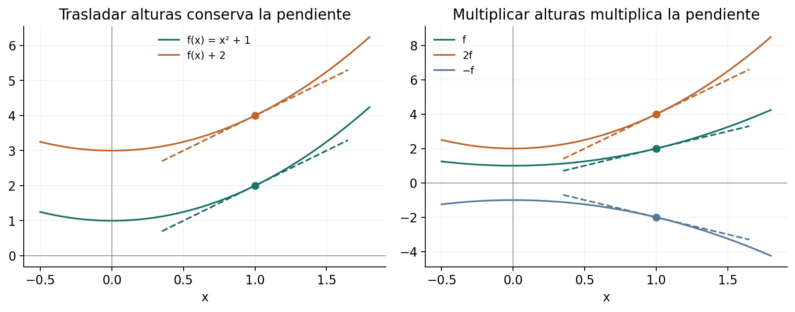
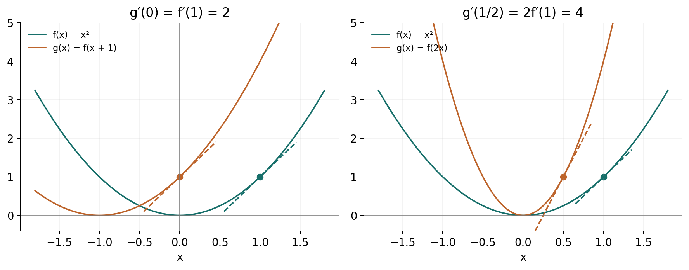
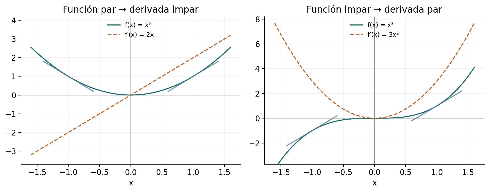

[← Capítulo 8](capitulo-08.qmd) · [Colecciones](../index.qmd#spivak-calculus-cuarta-edición) · [Capítulo 10 →](capitulo-10.qmd)

Solucionario explicado de Matemática Abierta · A. Peña

Problemas procedentes de Michael Spivak, *Calculus*, 4.ª edición, capítulo 9, pp. 163–167 (PDF 183–187). Se conserva el contenido matemático necesario de los enunciados; las soluciones, los ejemplos complementarios y las figuras son propios.

El punto de partida es el cociente incremental
$$f'(a)=\lim_{h\to0}\frac{f(a+h)-f(a)}h.$$
Todos los límites que definen derivadas son finitos y bilaterales, salvo indicación expresa. Las pruebas emplean esta definición y los resultados de límites y continuidad ya disponibles. Las reglas de producto, cociente y cadena se desarrollan en el capítulo siguiente y no se presuponen aquí. Cuando se escribe una igualdad de derivadas, se entiende que la derivada requerida de la función original existe en el punto señalado.

## Ejercicio 1 — `SPV4-C09-E001` {#e001}

Referencia: p. 163. **Problema:** para $f(x)=1/x$, (a) obtener $f'(a)$ desde la definición, con $a\ne0$; (b) demostrar que la tangente solo intersecta la gráfica en su punto de tangencia.

### Solución

**(a)** Restrinja $|h|<|a|/2$, para que $a+h\ne0$. Para $h\ne0$,
$$\frac{1/(a+h)-1/a}{h}=-\frac1{a(a+h)}\longrightarrow-\frac1{a^2}.$$
Así $f'(a)=-1/a^2$.

**(b)** La tangente tiene ecuación $y=1/a-(x-a)/a^2=2/a-x/a^2$. Una intersección con la gráfica debe tener $x\ne0$ y satisfacer
$$\frac1x=\frac2a-\frac{x}{a^2}\quad\Longleftrightarrow\quad a^2=2ax-x^2\quad\Longleftrightarrow\quad(x-a)^2=0.$$
Su única abscisa es $a$. Que la ecuación tenga una raíz doble expresa el contacto de la recta con la curva; aquí, además, no hay ninguna otra intersección.

## Ejercicio 2 — `SPV4-C09-E002` {#e002}

Referencia: p. 163. **Problema:** para $f(x)=1/x^2$, (a) calcular $f'(a)$ con $a\ne0$; (b) hallar la otra intersección de la tangente con la gráfica.

### Solución

**(a)** Para $h\ne0$ suficientemente pequeño,
$$\frac{1/(a+h)^2-1/a^2}{h}=\frac{-2a-h}{a^2(a+h)^2}\longrightarrow-\frac2{a^3}.$$

**(b)** La tangente es $y=3/a^2-2x/a^3$. Igualar con $1/x^2$, para $x\ne0$, equivale a
$$2x^3-3ax^2+a^3=(x-a)^2(2x+a)=0.$$
Además del contacto en $x=a$, aparece exactamente $x=-a/2$. Su ordenada es $4/a^2$ y su signo horizontal es opuesto al de $a$. La multiplicación por los denominadores no introdujo $x=0$, que tampoco satisface el polinomio porque $a\ne0$.

{#fig-spv4-c09-f01 fig-alt="Capítulo 9: Dos tangentes: contacto único y segunda intersección"}

## Ejercicio 3 — `SPV4-C09-E003` {#e003}

Referencia: p. 163. **Problema:** obtener la derivada de $f(x)=\sqrt x$ en $a>0$.

### Solución

Para $h\ne0$ y $a+h>0$, racionalizar elimina el cociente indeterminado:
$$\frac{\sqrt{a+h}-\sqrt a}{h}=\frac1{\sqrt{a+h}+\sqrt a}\longrightarrow\frac1{2\sqrt a}.$$
La continuidad de la raíz justifica el límite. En cero la misma expresión por la derecha vale $1/\sqrt h$ y crece sin cota; no proporciona una derivada real finita, y cero tampoco es un punto interior del dominio.

## Ejercicio 4 — `SPV4-C09-E004` {#e004}

Referencia: p. 163. **Problema:** con $S_n(x)=x^n$, $n\ge1$ entero, conjeturar y demostrar una fórmula para $S_n'$.

### Solución

Los primeros casos sugieren $S_n'(a)=na^{n-1}$. El binomio lo demuestra:
$$\frac{(a+h)^n-a^n}{h}=na^{n-1}+\sum_{j=2}^{n}\binom nj a^{n-j}h^{j-1}.$$
La suma tiene finitos términos y cada uno tiende a cero. Para $n=1$ es vacía y queda $1$. Por tanto
$$S_n'(x)=nx^{n-1}.$$
En $n=1$ se interpreta la fórmula como la constante $1$, también en cero. Los exponentes que quedan en la suma son no negativos.

## Ejercicio 5 — `SPV4-C09-E005` {#e005}

Referencia: p. 163. **Problema:** hallar la derivada de $f(x)=|x|$.

### Solución

En un entorno de cada $a>0$, $f(x)=x$, y el cociente incremental vale $1$; si $a<0$, $f(x)=-x$ cerca de $a$ y vale $-1$. En cero el cociente es $|h|/h$: vale $1$ por la derecha y $-1$ por la izquierda. Así
$$f'(x)=\begin{cases}1,&x>0,\\-1,&x<0,\end{cases}$$
y $f'(0)$ no existe. La continuidad de la gráfica en el vértice no iguala las pendientes de sus dos lados.

## Ejercicio 6 — `SPV4-C09-E006` {#e006}

Referencia: p. 163. **Problema:** demostrar desde la definición e ilustrar (a) la derivada de $f+c$; (b) la de $cf$, para una constante $c$.

### Solución

**(a)** Si $g=f+c$, las dos constantes se cancelan:
$$\frac{g(x+h)-g(x)}h=\frac{f(x+h)-f(x)}h.$$
Por tanto $g'(x)=f'(x)$. Trasladar verticalmente la curva y todas sus secantes no cambia sus pendientes.

**(b)** Si $g=cf$, su cociente es $c[f(x+h)-f(x)]/h$, cuyo límite es $cf'(x)$. La multiplicación vertical multiplica por $c$ el ascenso de cada secante y deja intacto su recorrido horizontal. Un $c$ negativo invierte el signo de la pendiente. Para $c=0$, $g$ es constante y tiene derivada cero incluso en puntos donde $f'$ no exista; en esos puntos no se escribe $0\cdot f'(x)$.

{#fig-spv4-c09-f02 fig-alt="Capítulo 9: Traslación vertical y multiplicación de alturas"}

## Ejercicio 7 — `SPV4-C09-E007` {#e007}

Referencia: p. 163. **Problema:** para $f(x)=x^3$, (a–c) evaluar $f'$ en los argumentos indicados; (d) comparar $f'(x^2)$ con la derivada de $g(x)=f(x^2)$.

### Solución

E004 da $f'(u)=3u^2$. La letra $u$ permite ver qué operación se está haciendo: primero se deriva y después se introduce el argumento.

**(a)** $f'(9)=243$, $f'(25)=1875$, $f'(36)=3888$.

**(b)** $f'(3^2)=243$, $f'(5^2)=1875$, $f'(6^2)=3888$; son los mismos argumentos escritos de otra forma.

**(c)** $f'(a^2)=3a^4$ y $f'(x^2)=3x^4$.

**(d)** En cambio, $g(x)=x^6$, de modo que $g'(x)=6x^5$ por E004. La expresión $f'(x^2)$ evalúa una función ya derivada; $g'(x)$ deriva la composición completa. Aquí se obtuvieron ambas sin recurrir a la regla de la cadena.

## Ejercicio 8 — `SPV4-C09-E008` {#e008}

Referencia: p. 164. **Problema:** demostrar e ilustrar (a) $g'(x)=f'(x+c)$ si $g(x)=f(x+c)$; (b) $g'(x)=cf'(cx)$ si $g(x)=f(cx)$; (c) periodicidad de la derivada de una función diferenciable periódica.

### Solución

**(a)** La definición en $x$ produce
$$\frac{g(x+h)-g(x)}h=\frac{f((x+c)+h)-f(x+c)}h\longrightarrow f'(x+c).$$
La curva se traslada horizontalmente una distancia $-c$. En puntos correspondientes, las secantes tienen el mismo ascenso y la misma separación horizontal.

**(b)** Si $c\ne0$, ponga $k=ch$. Entonces $k\to0$ por ambos lados cuando $h\to0$, incluso si $c<0$, y
$$\frac{f(cx+ch)-f(cx)}h=c\frac{f(cx+k)-f(cx)}k\longrightarrow cf'(cx).$$
La escala horizontal explica el factor: el incremento del argumento de $f$ es $c$ veces el incremento de $x$. Si $c=0$ y $f(0)$ está definido, $g$ es constante y $g'=0$, sin requerir que $f'(0)$ exista.

{#fig-spv4-c09-f03 fig-alt="Capítulo 9: Traslación y cambio de escala horizontal"}

**(c)** Si $f(x+p)=f(x)$, con período $p\ne0$, la función de (a), con $c=p$, es la propia $f$. Por ello $f'(x+p)=f'(x)$. El período se conserva, aunque la derivada podría tener otros períodos adicionales; por ejemplo, una derivada constante.

## Ejercicio 9 — `SPV4-C09-E009` {#e009}

Referencia: p. 164. **Problema:** calcular $f'(x)$ y $f'(x+3)$ en tres casos de traslación.

### Solución

En los casos donde se da $f(x+3)$, cambie primero la variable: si $u=x+3$, entonces $x=u-3$. Esto identifica la función que realmente hay que derivar.

| Inciso y dato | Función recuperada | $f'(x)$ | $f'(x+3)$ |
|---|---|---|---|
| (i) $f(x)=(x+3)^5$ | $f(u)=(u+3)^5$ | $5(x+3)^4$ | $5(x+6)^4$ |
| (ii) $f(x+3)=x^5$ | $f(u)=(u-3)^5$ | $5(x-3)^4$ | $5x^4$ |
| (iii) $f(x+3)=(x+5)^7$ | $f(u)=(u+2)^7$ | $7(x+2)^6$ | $7(x+5)^6$ |

E004 y E008(a) justifican las derivadas de la tabla. La evaluación final suma tres al argumento de $f'$, no a su valor.

## Ejercicio 10 — `SPV4-C09-E010` {#e010}

Referencia: p. 164. **Problema:** interpretar $f'(x)$ en (i) $f(x)=g(t+x)$; (ii) $f(t)=g(t+x)$, manteniendo fijo el parámetro que no es la variable de $f$.

### Solución

**(i)** Con $t$ fijo, $f(u)=g(t+u)$, y E008(a) da $f'(x)=g'(t+x)$.

**(ii)** Con el desplazamiento $x$ fijo, la relación define $f(u)=g(u+x)$. Su derivada en un argumento $u$ es $g'(u+x)$. Evaluarla en $u=x$ da $f'(x)=g'(2x)$.

La repetición de la letra $x$ puede confundir el papel de parámetro con el de argumento de evaluación. Escribiendo $f_p(u)=g(u+p)$ queda $f_p'(p)=g'(2p)$: al formar el cociente incremental, $p$ no cambia. Derivar la función $u\mapsto g(2u)$ sería otra tarea y produciría $2g'(2u)$.

## Ejercicio 11 — `SPV4-C09-E011` {#e011}

Referencia: p. 164. **Problema:** (a) comparar $s'=ks$ con una caída no trivial $s(t)=ct^2$; (b-i–ii) verificar aceleración constante y la relación velocidad–distancia para $s(t)=(A/2)t^2$; (c) calcular tiempos, velocidad final y posición a media velocidad para una caída de $400$ pies, con $A=32$ pies/s².

### Solución

**(a)** Si $c\ne0$, entonces $s'(t)=2ct$. La proporcionalidad con constante $k$ exigiría $2ct=kct^2$, y para $t>0$ se obtendría $k=2/t$, que no puede ser constante en un intervalo de tiempos. El movimiento trivial $c=0$ sí satisface ambas ecuaciones; se excluye al hablar de una caída efectiva. Esta es la incompatibilidad matemática solicitada, sin añadir una atribución histórica independiente.

**(b-i)** E004 y E006 dan $s'(t)=At$, y una nueva aplicación de la definición da $s''(t)=A$.

**(b-ii)** $[s'(t)]^2=A^2t^2=2A[(A/2)t^2]=2As(t)$.

**(c)** Para $t\ge0$, $s(t)=16t^2$. El impacto en el suelo se produce cuando $16t^2=400$, esto es, a los $5$ segundos; la velocidad hacia abajo es $s'(5)=32\cdot5=160$ pies/s. La mitad de esa velocidad se alcanza en $t=5/2$ s, cuando la caída recorrida es $16(5/2)^2=100$ pies. La altura restante sobre el suelo es entonces $400-100=300$ pies. Se distingue la distancia caída de la altura: son funciones diferentes. Los cálculos corresponden al modelo ideal dado, con inicio en reposo y sin resistencia.

## Ejercicio 12 — `SPV4-C09-E012` {#e012}

Referencia: p. 164. **Problema:** posiciones $a(t),b(t)$ y límite espacial de velocidad $L$. (a) expresar que A circula al límite; (b) probarlo para B si $b(t)=a(t-1)$; (c) determinar cuándo se conserva si $b(t)=a(t)-d$, con $d>0$ constante.

### Solución

**(a)** En el sentido creciente de la carretera, la ecuación es $a'(t)=L(a(t))$. El límite se evalúa en la posición, no en el tiempo. Si se permitieran ambos sentidos, la rapidez se expresaría como $|a'(t)|$; aquí se mantiene la orientación implícita en el recorrido.

**(b)** E008(a) da $b'(t)=a'(t-1)=L(a(t-1))=L(b(t))$. Cada automóvil atraviesa cada posición con la velocidad prescrita allí, aunque en momentos distintos. La afirmación se aplica a tiempos para los que ambas posiciones están definidas.

**(c)** Ahora $b'(t)=a'(t)$ por E006(a). Así B circula al límite exactamente cuando
$$L(a(t)-d)=L(a(t))\quad\text{para todos los tiempos del recorrido}.$$
Esta es la condición necesaria y suficiente sobre las posiciones efectivamente visitadas. Que $L$ sea constante o tenga período $d$ en toda la carretera es suficiente, pero no necesario fuera de esas posiciones. Una distancia fija no equivale, en general, a un retraso temporal fijo.

## Ejercicio 13 — `SPV4-C09-E013` {#e013}

Referencia: p. 165. **Problema:** pegar $f$ a la izquierda de $a$ y $g$ a su derecha, suponiendo $f(a)=g(a)$ y derivadas laterales coincidentes.

### Solución

Sea $h(x)=f(x)$ para $x\le a$ y $h(x)=g(x)$ para $x\ge a$. La igualdad central hace consistente la definición. El cociente $[h(a+t)-h(a)]/t$ es el de $f$ si $t<0$ y el de $g$ si $t>0$. Sus límites laterales son el mismo número $m$ por hipótesis. Para una tolerancia $\varepsilon$, tome el menor de los dos radios que controlan esos límites: cubre todos los $t\ne0$ pequeños. Por tanto $h'(a)=m$. Basta la existencia de las derivadas laterales mencionadas; no se requiere diferenciabilidad de cada función a ambos lados.

## Ejercicio 14 — `SPV4-C09-E014` {#e014}

Referencia: p. 165. **Problema:** probar diferenciabilidad en cero de $f(x)=x^2$ para $x\in\mathbb Q$ y $f(x)=0$ para $x\notin\mathbb Q$.

### Solución

Se tiene $f(0)=0$. Para $h\ne0$, el cociente $f(h)/h$ vale $h$ si $h$ es racional y cero si es irracional. En ambos casos su módulo es menor o igual que $|h|$, por lo que tiende a cero. Así $f'(0)=0$. El argumento controla juntos los dos tipos de puntos; no basta calcular límites separados en dos listas particulares.

Como contraste, en cualquier $a\ne0$ los valores racionales se aproximan a $a^2$ y los irracionales a cero. La densidad hace que $f$ sea discontinua allí, y por tanto no diferenciable. La derivada en un punto no exige continuidad en los puntos vecinos.

## Ejercicio 15 — `SPV4-C09-E015` {#e015}

Referencia: p. 165. **Problema:** (a) probar diferenciabilidad en cero si $|f(x)|\le x^2$; (b) dar una propiedad de $g$ que permita reemplazar esa cota por $|g(x)|$.

### Solución

**(a)** La cota en cero obliga a $f(0)=0$. Para $h\ne0$,
$$\left|\frac{f(h)-f(0)}h\right|\le|h|\longrightarrow0,$$
y $f'(0)=0$.

**(b)** Sirve $g(0)=g'(0)=0$. La primera igualdad obliga a $f(0)=0$, y la segunda significa que $g(h)/h\to0$. Por tanto
$$\left|\frac{f(h)}h\right|\le\left|\frac{g(h)}h\right|\longrightarrow0.$$
La condición puede formularse directamente como $g(0)=0$ y $|g(h)|/|h|\to0$. No basta que $g$ sea simplemente continua ni que se anule en cero: $g(x)=|x|$ permitiría elegir $f(x)=|x|$, que no tiene derivada en cero.

## Ejercicio 16 — `SPV4-C09-E016` {#e016}

Referencia: p. 165. **Problema:** con $\alpha>1$ y $|f(x)|\le|x|^\alpha$, probar diferenciabilidad en cero.

### Solución

La cota da $f(0)=0$ y
$$\left|\frac{f(h)}h\right|\le|h|^{\alpha-1}.$$
El exponente es positivo. Dado $\varepsilon>0$, sirve $\delta=\varepsilon^{1/(\alpha-1)}$: si $0<|h|<\delta$, el cociente tiene módulo menor que $\varepsilon$. Así $f'(0)=0$. Se usa la construcción de potencias reales positivas y su compatibilidad con el orden, ya disponible; no se deriva $x^\alpha$. La restricción estricta importa: para $\alpha=1$, $f(x)=|x|$ refuta la conclusión.

## Ejercicio 17 — `SPV4-C09-E017` {#e017}

Referencia: p. 165. **Problema:** con $0<\beta<1$, $f(0)=0$ y $|f(x)|\ge|x|^\beta$, probar que $f$ no es diferenciable en cero.

### Solución

Para $h\ne0$,
$$\left|\frac{f(h)}h\right|\ge\frac1{|h|^{1-\beta}},$$
y la derecha supera cualquier número positivo cuando $h$ es suficientemente pequeño. Un cociente con límite finito $m$ quedaría acotado por $|m|+1$ cerca de cero. La cota inferior lo impide. No se concluye que exista una derivada infinita de signo determinado: el módulo puede crecer mientras el signo cambia.

## Ejercicio 18* — `SPV4-C09-E018` {#e018}

Referencia: p. 165. **Problema:** sea $f(x)=0$ para irracionales y $f(p/q)=1/q$ para racionales en forma reducida, con $q>0$. Probar que no es diferenciable en ningún punto.

### Solución

En un racional $a=p/q$, $f(a)>0$. Irracionales arbitrariamente próximos tienen valor cero, de modo que $f$ no es continua en $a$. La diferenciabilidad implica continuidad y queda descartada.

Sea ahora $a$ irracional, de modo que $f(a)=0$. Si el incremento $h\ne0$ es racional, $a+h$ es irracional y el cociente incremental vale cero. Tales incrementos pueden ser arbitrariamente pequeños, así que una posible derivada tendría que ser cero.

Construyamos otra aproximación. Para $n\ge1$, sea
$$r_n=\frac{\lfloor10^na\rfloor}{10^n},\qquad h_n=r_n-a.$$
La irracionalidad asegura $0<a-r_n<10^{-n}$ y $h_n\ne0$. Al reducir $r_n$ a una fracción, su denominador $q_n$ no supera $10^n$. Por tanto
$$\left|\frac{f(a+h_n)-f(a)}{h_n}\right|=\frac1{q_n|r_n-a|}>1.$$
Además $h_n\to0$. Estos cocientes no pueden tender a cero, contradiciendo el único candidato posible. Así tampoco hay derivada en irracionales. El uso de la parte entera funciona para $a$ negativo y evita ambigüedades de representación decimal.

## Ejercicio 19 — `SPV4-C09-E019` {#e019}

Referencia: p. 165. **Problema:** (a) si $f\le g\le H$, coinciden en $a$ y $f'(a)=H'(a)$, probar diferenciabilidad de $g$ en $a$; (b) mostrar la necesidad de la igualdad central.

### Solución

**(a)** Para un incremento $t>0$, restar el valor central común y dividir por $t$ conserva el orden entre los tres cocientes. Para $t<0$ lo invierte. En ambos casos el cociente de $g$ queda entre los de $f$ y $H$, cuyos límites son el mismo número $m$. Un mismo radio que los acerque a $m$ en menos de $\varepsilon$ controla también el de $g$. Así $g'(a)=m=f'(a)=H'(a)$. La inversión para incrementos negativos es parte de la prueba.

**(b)** Tome $f\equiv-1$, $H\equiv1$ y $g(x)=\min\{|x-a|,1\}$. El orden global se cumple y las dos funciones extremas tienen derivada cero. Sin embargo, cerca de $a$ la función intermedia es $|x-a|$, cuyas derivadas laterales son $-1$ y $1$. Ni siquiera la continuidad adicional de $g$ rescata la conclusión al perderse la coincidencia central.

## Ejercicio 20 — `SPV4-C09-E020` {#e020}

Referencia: pp. 165–166. **Problema:** para un polinomio $f$, estudiar el defecto respecto de su tangente,
$$d(x)=f(x)-f(a)-f'(a)(x-a).$$
(a) factorizarlo para $f(x)=x^4$; (b) demostrar que siempre es divisible por $(x-a)^2$, justificando la cadena de preguntas del enunciado.

### Solución

**(a)** Por E004, $f'(a)=4a^3$. Entonces
$$d(x)=x^4-4a^3x+3a^4=(x-a)^2(x^2+2ax+3a^2).$$
En $a=0$ el defecto es $x^4$, y el factor cuadrático restante es $x^2$: el contacto puede tener orden mayor que dos.

**(b)** El polinomio $f(x)-f(a)$ se anula en $a$, así que el teorema del factor da $f(x)-f(a)=(x-a)q(x)$ para cierto polinomio $q$. Por tanto
$$d(x)=(x-a)[q(x)-f'(a)].$$
Ponga $H(x)=q(x)-f'(a)$, polinomio definido también en $a$. Para $x\ne a$,
$$H(x)=\frac{d(x)}{x-a}=\frac{f(x)-f(a)}{x-a}-f'(a)\longrightarrow0.$$
La continuidad de $H$ obliga a $H(a)=0$. Una segunda aplicación del teorema del factor da $H(x)=(x-a)r(x)$ y, por ello, $d(x)=(x-a)^2r(x)$. Se han justificado los dos factores por separado, incluida la extensión polinómica del cociente al centro.

La existencia de $f'(a)$ tampoco requiere una regla posterior: si $f(x)=\sum_{j=0}^N c_jx^j$, el cociente incremental es la suma finita de los cocientes de sus términos. E004 y las reglas de límites dan $f'(a)=\sum_{j=1}^N jc_ja^{j-1}$. El argumento incluye constantes y el polinomio cero, cuyo defecto es cero y es divisible por cualquier polinomio no nulo.

## Ejercicio 21 — `SPV4-C09-E021` {#e021}

Referencia: p. 166. **Problema:** (a) expresar la derivada con $x\to a$; (b) probar que es una propiedad local.

### Solución

**(a)** El cambio $x=a+h$ identifica exactamente los puntos $0<|h|<\delta$ con $0<|x-a|<\delta$. Los dos cocientes son iguales, de modo que
$$f'(a)=\lim_{x\to a}\frac{f(x)-f(a)}{x-a}.$$
La equivalencia vale también como criterio de existencia.

**(b)** Si $f=g$ en un intervalo abierto que contiene $a$, sus valores centrales coinciden y también sus cocientes para todos los incrementos suficientemente pequeños. Por tanto una derivada existe si y solo si existe la otra, y son iguales. Los valores fuera de ese intervalo no intervienen. La apertura garantiza que hay un radio positivo alrededor de $a$ donde se conserva la coincidencia.

## Ejercicio 22 — `SPV4-C09-E022` {#e022}

Referencia: p. 166. **Problema:** para $f$ diferenciable en $x$, (a) obtener la fórmula simétrica; (b**) generalizar a incrementos positivos independientes $h,k$.

### Solución

**(a)** Para $h\ne0$,
$$\frac{f(x+h)-f(x-h)}{2h}=\frac12\left[\frac{f(x+h)-f(x)}h+\frac{f(x-h)-f(x)}{-h}\right].$$
Ambos cocientes tienden a $f'(x)$, así que su media también. Se obtiene la fórmula pedida. Su recíproca es falsa: para $f(u)=|u|$ en $x=0$, el cociente simétrico vale cero, pero no existe derivada.

**(b)** Escriba, para $h,k>0$,
$$\frac{f(x+h)-f(x-k)}{h+k}=\frac{h}{h+k}\frac{f(x+h)-f(x)}h+\frac{k}{h+k}\frac{f(x-k)-f(x)}{-k}.$$
Es una media con pesos positivos que suman uno. Dado $\varepsilon>0$, la diferenciabilidad da $\delta>0$ tal que cada cociente unilateral difiere de $m=f'(x)$ en menos de $\varepsilon$ cuando su incremento está entre cero y $\delta$. Si $0<h,k<\delta$, el error de la media queda acotado por
$$\frac{h}{h+k}\varepsilon+\frac{k}{h+k}\varepsilon=\varepsilon,$$
con desigualdad estricta para el error real. Esto demuestra el límite conjunto: se controlan todos los pares del cuadrado $(0,\delta)^2$, sin exigir una relación entre $h$ y $k$. Su positividad evita cancelaciones en el denominador y es esencial para esta estimación.

## Ejercicio 23 — `SPV4-C09-E023` {#e023}

Referencia: p. 166. **Problema:** si $f$ es par y diferenciable, probar que su derivada es impar e ilustrarlo.

### Solución

Ponga $g(x)=f(-x)$. E008(b), con $c=-1$, da $g'(x)=-f'(-x)$. La paridad dice que $g=f$, luego
$$f'(x)=-f'(-x).$$
En particular, $f'(0)=0$. La reflexión horizontal cambia el signo de la pendiente: las tangentes en puntos simétricos tienen pendientes opuestas. La figura usa $f(x)=x^2$ y su derivada $2x$.

## Ejercicio 24 — `SPV4-C09-E024` {#e024}

Referencia: p. 166. **Problema:** si $f$ es impar y diferenciable, probar que su derivada es par e ilustrarlo.

### Solución

Para $g(x)=f(-x)$, E008(b) da $g'(x)=-f'(-x)$. Pero la imparidad significa $g=-f$, y E006(b) da también $g'(x)=-f'(x)$. Igualar ambas expresiones produce
$$f'(x)=f'(-x).$$
Una simetría central invierte a la vez las separaciones horizontal y vertical y conserva la pendiente. En la figura se usa $f(x)=x^3$, cuya derivada $3x^2$ es par.

{#fig-spv4-c09-f04 fig-alt="Capítulo 9: La derivación intercambia las dos clases de paridad"}

## Ejercicio 25 — `SPV4-C09-E025` {#e025}

Referencia: p. 166. **Problema:** determinar la paridad de $f^{(k)}$ a partir de la de $f$.

### Solución

Cada derivación intercambia las clases par e impar por E023–E024. Una inducción en $k$ da:

| Paridad inicial | $k$ par, incluido $0$ | $k$ impar |
|---|---|---|
| $f$ par | $f^{(k)}$ par | $f^{(k)}$ impar |
| $f$ impar | $f^{(k)}$ impar | $f^{(k)}$ par |

Se presupone la existencia de las derivadas hasta el orden considerado en un dominio simétrico; en el ejercicio puede tomarse toda la recta. La función cero es a la vez par e impar, lo que es compatible con la tabla. No se afirma una exclusión entre ambas clases cuando una derivada se anula idénticamente.

## Ejercicio 26 — `SPV4-C09-E026` {#e026}

Referencia: p. 166. **Problema:** hallar $f''(x)$ para cuatro datos.

### Solución

**(i)** Si $f(x)=x^3$, E004 da $f'(x)=3x^2$ y después $f''(x)=6x$.

**(ii)** Si $f(x)=x^5$, se obtiene $f'(x)=5x^4$ y $f''(x)=20x^3$.

**(iii)** Si se da directamente $f'(x)=x^4$, basta una derivación: $f''(x)=4x^3$. No se necesita reconstruir $f$.

**(iv)** Si $f(x+3)=x^5$, como en E009(ii), $f(u)=(u-3)^5$. Así $f'(x)=5(x-3)^4$ y $f''(x)=20(x-3)^3$. Se pide $f''$ en $x$, no en $x+3$.

## Ejercicio 27 — `SPV4-C09-E027` {#e027}

Referencia: p. 166. **Problema:** demostrar, para enteros $0\le k\le n$, la fórmula de la derivada de orden $k$ de $S_n(x)=x^n$.

### Solución

Para $k=0$ se tiene $S_n^{(0)}=S_n$, y el coeficiente $n!/(n-0)!$ vale uno. Si la fórmula vale para $k<n$, E004 y E006(b) permiten derivarla:
$$\left[\frac{n!}{(n-k)!}x^{n-k}\right]'=\frac{n!}{(n-k)!}(n-k)x^{n-k-1}=\frac{n!}{(n-k-1)!}x^{n-k-1}.$$
Por inducción,
$$S_n^{(k)}(x)=\frac{n!}{(n-k)!}x^{n-k}=k!\binom nk x^{n-k}.$$
En $k=n$ es la constante $n!$; las derivadas de órdenes mayores son cero. El caso $n=0$ se interpreta como el polinomio constante $1$, y solo tiene $k=0$ dentro del rango de la fórmula.

## Ejercicio 28 — `SPV4-C09-E028` {#e028}

Referencia: p. 166. **Problema:** (a) estudiar las tres primeras derivadas de $|x|^3$; (b) analizar del mismo modo $f(x)=x^4$ para $x\ge0$ y $f(x)=-x^4$ para $x\le0$.

### Solución

**(a)** A la derecha, $f=x^3$; a la izquierda, $f=-x^3$. E004 y la localidad de E021 dan $f'(x)=3x|x|$ para $x\ne0$. En cero,
$$\frac{|h|^3}{h}=h|h|\longrightarrow0,$$
así que la misma fórmula vale allí. Para $x\ne0$, la segunda derivada es $6|x|$; en cero su cociente es $3h|h|/h=3|h|\to0$, de modo que $f''(x)=6|x|$ en toda la recta. Por tanto
$$f'''(x)=\begin{cases}6,&x>0,\\-6,&x<0,\end{cases}$$
y $f'''(0)$ no existe: el cociente de $f''$ en cero es $6|h|/h$.

**(b)** Las ramas dan $f'(x)=4|x|^3$ fuera de cero, y el cociente central de $f$ tiene módulo $|h|^3$, luego $f'(0)=0$. La fórmula global es $f'=4|x|^3$. Por (a) y E006(b),
$$f''(x)=12x|x|,\qquad f'''(x)=24|x|,$$
también en cero. Así las tres primeras derivadas existen en todos los puntos. El primer fallo llega al cuarto orden: $f^{(4)}(x)=24$ si $x>0$, $-24$ si $x<0$, y $f^{(4)}(0)$ no existe. Cada nueva derivada reduce la potencia que ocultaba la diferencia entre las dos ramas.

## Ejercicio 29 — `SPV4-C09-E029` {#e029}

Referencia: p. 167. **Problema:** para un entero $n\ge1$, sea $f(x)=x^n$ cuando $x\ge0$ y $f(x)=0$ cuando $x\le0$. Hallar $f^{(n-1)}$ y probar que no existe $f^{(n)}(0)$.

### Solución

Para $0\le k\le n-1$, la fórmula es
$$f^{(k)}(x)=\begin{cases}\dfrac{n!}{(n-k)!}x^{n-k},&x>0,\\0,&x\le0.\end{cases}$$
Se prueba por inducción. Las ramas se derivan usando E027 y localidad. En cero, si ya se obtuvo la fórmula para $k<n-1$, el cociente para la siguiente derivada vale cero con incremento negativo, y con incremento positivo vale $[n!/(n-k)!]h^{n-k-1}$. Ese exponente es positivo, así que ambos lados tienden a cero y la fórmula se conserva.

En particular, $f^{(n-1)}(x)=n!x$ para $x>0$ y cero para $x\le0$. Su cociente en cero vale $n!$ por la derecha y cero por la izquierda; por tanto no existe la derivada de orden $n$ allí. Para $n=1$ el argumento parte de $f^{(0)}=f=\max\{x,0\}$ y la misma discrepancia aparece en la primera derivada. No se admite $n=0$: las dos prescripciones originales entrarían en conflicto en cero.

## Ejercicio 30 — `SPV4-C09-E030` {#e030}

Referencia: p. 167. **Problema:** interpretar diez expresiones de notación de Leibniz como los resultados anteriores. Se leen $d/dx$ y $d^k/dx^k$ como operadores de derivación, no como cocientes de números independientes.

### Solución

**(i)** $\dfrac{dx^n}{dx}=nx^{n-1}$ es E004: la función $x\mapsto x^n$ tiene esa derivada, para $n\ge1$ entero.

**(ii)** Si $z(y)=1/y$, entonces $\dfrac{dz}{dy}=-1/y^2$ para $y\ne0$. Es E001(a) con otro nombre de variable.

**(iii)** $\dfrac{d[f(x)+c]}{dx}=\dfrac{df(x)}{dx}$ significa $(f+c)'=f'$ con $c$ constante, E006(a).

**(iv)** $\dfrac{d[cf(x)]}{dx}=c\dfrac{df(x)}{dx}$ expresa $(cf)'=cf'$, E006(b), donde existe $f'$.

**(v)** Si $z(x)=y(x)+c$, entonces $\dfrac{dz}{dx}=\dfrac{dy}{dx}$. Es la misma traslación vertical de (iii), con $y,z$ entendidas como funciones de $x$.

**(vi)** $\left.\dfrac{dx^3}{dx}\right|_{x=a^2}=3a^4$: derivar el cubo y evaluar en $a^2$, E007(c). La barra indica evaluación posterior.

**(vii)** $\left.\dfrac{df(x+a)}{dx}\right|_{x=b}=\left.\dfrac{df(x)}{dx}\right|_{x=b+a}$: la derivada de la función trasladada en $b$ es $f'(b+a)$, E008(a), con $a$ fijo.

**(viii)** $\left.\dfrac{df(cx)}{dx}\right|_{x=b}=c\left.\dfrac{df(x)}{dx}\right|_{x=cb}$: la escala horizontal da $cf'(cb)$, E008(b).

**(ix)** $\dfrac{df(cx)}{dx}=c\left.\dfrac{df(y)}{dy}\right|_{y=cx}$ es el mismo resultado. La variable auxiliar $y$ separa el argumento de $f$ de la variable $x$ de la composición.

**(x)** $\dfrac{d^kx^n}{dx^k}=k!\binom nk x^{n-k}$ expresa E027 para $0\le k\le n$, con las convenciones allí indicadas. Se trata de aplicar $k$ veces la derivación; el denominador tipográfico $dx^k$ no es una instrucción de división algebraica por una potencia de un número $dx$.

---

[← Capítulo 8](capitulo-08.qmd) · [Colecciones](../index.qmd#spivak-calculus-cuarta-edición) · [Capítulo 10 →](capitulo-10.qmd)

Soluciones originales de Alevi Peña · Matemática Abierta. [Licencia GFDL 1.3 o posterior](/COPYING.FDL).
