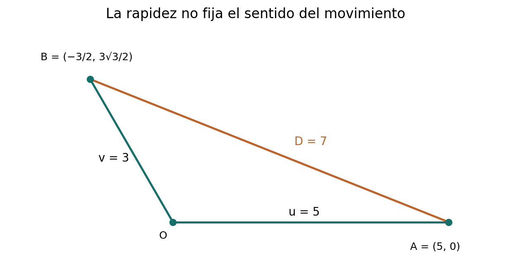
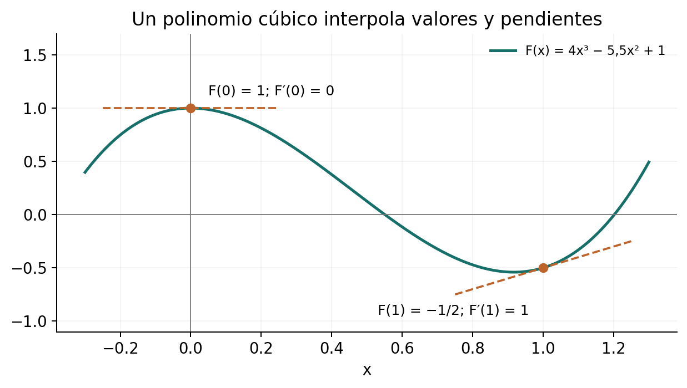
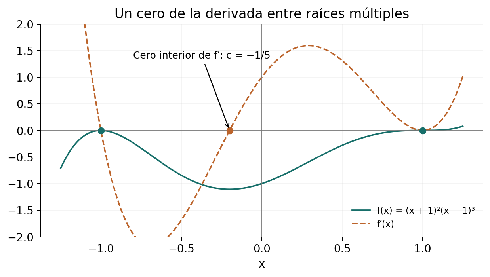
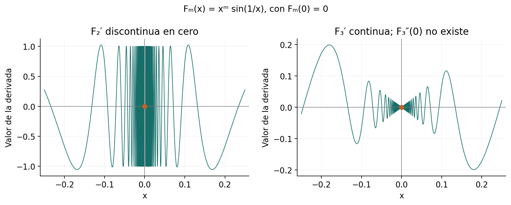

[← Capítulo 9](capitulo-09.qmd) · [Colecciones](../index.qmd#spivak-calculus-cuarta-edición) · [Capítulo 11 →](capitulo-11.qmd)

Solucionario explicado de Matemática Abierta · A. Peña

Problemas procedentes de Michael Spivak, *Calculus*, 4.ª edición, capítulo 10, pp. 181–187 (PDF 201–207). Los enunciados conservan los datos matemáticos necesarios; las soluciones, precisiones y figuras son propias. Se emplean las reglas de suma, producto, cociente y cadena demostradas en este capítulo, así como $(\sin x)'=\cos x$ y $(\cos x)'=-\sin x$.

En las fórmulas con cocientes se trabaja donde todos los denominadores de la función original son distintos de cero. Simplificar una fórmula no añade puntos a ese dominio. La notación $\sin^m u$ significa $(\sin u)^m$, mientras $\sin x^m$ significa $\sin(x^m)$. La distinción organiza buena parte de los primeros cálculos.

## Ejercicio 1 — `SPV4-C10-E001` {#e001}

Referencia: p. 181. **Problema:** hallar las derivadas de ocho funciones.

### Solución

Cada seno exterior aporta el coseno de su argumento, multiplicado por la derivada de ese argumento. Si hay una suma o un cociente fuera del seno, esa operación se deriva por separado.

| Inciso | $f(x)$ | $f'(x)$ |
|---|---|---|
| (i) | $\sin(x+x^2)$ | $(1+2x)\cos(x+x^2)$ |
| (ii) | $\sin x+\sin(x^2)$ | $\cos x+2x\cos(x^2)$ |
| (iii) | $\sin(\cos x)$ | $-\sin x\cos(\cos x)$ |
| (iv) | $\sin(\sin x)$ | $\cos x\cos(\sin x)$ |
| (v) | $\sin(\cos x/x)$ | $-\dfrac{x\sin x+\cos x}{x^2}\cos(\cos x/x)$ |
| (vi) | $\sin(\cos x)/x$ | $\dfrac{-x\sin x\cos(\cos x)-\sin(\cos x)}{x^2}$ |
| (vii) | $\sin(x+\sin x)$ | $(1+\cos x)\cos(x+\sin x)$ |
| (viii) | $\sin(\cos(\sin x))$ | $-\cos x\sin(\sin x)\cos(\cos(\sin x))$ |

En (v), el cociente está dentro del argumento y su derivada se multiplica por el coseno exterior. En (vi), el cociente está fuera y exige los dos términos del numerador. Ambos incisos requieren $x\ne0$; los demás están definidos y son diferenciables en toda la recta.

## Ejercicio 2 — `SPV4-C10-E002` {#e002}

Referencia: pp. 181–182. **Problema:** hallar las derivadas de dieciocho funciones compuestas.

### Solución

En los cálculos más largos conviene nombrar los argumentos sucesivos. Eso permite comprobar cada factor de la cadena sin expandir expresiones que ya tienen una estructura útil.

**(i)** Si $f(x)=\sin((x+1)^2(x+2))$, el argumento tiene derivada $2(x+1)(x+2)+(x+1)^2=(x+1)(3x+5)$. Por tanto
$$f'(x)=(x+1)(3x+5)\cos((x+1)^2(x+2)).$$

**(ii)** Para $f(x)=\sin^3(x^2+\sin x)$, ponga $u=x^2+\sin x$:
$$f'(x)=3\sin^2u\cos u\,(2x+\cos x).$$

**(iii)** Para $f(x)=\sin^2((x+\sin x)^2)$, ponga $u=x+\sin x$:
$$f'(x)=4u(1+\cos x)\sin(u^2)\cos(u^2).$$

**(iv)** Si $f(x)=\sin(x^3/\cos(x^3))$, el cociente interior tiene derivada
$$\frac{3x^2\cos(x^3)+3x^5\sin(x^3)}{\cos^2(x^3)}.$$
Así $f'$ es esa expresión multiplicada por $\cos(x^3/\cos(x^3))$. Se requiere $\cos(x^3)\ne0$.

**(v)** Para $f(x)=\sin(x\sin x)+\sin(\sin(x^2))$,
$$f'(x)=(\sin x+x\cos x)\cos(x\sin x)+2x\cos(x^2)\cos(\sin(x^2)).$$

**(vi)** Si $f(x)=(\cos x)^{31^2}$, el exponente es la constante entera $N=31^2=961$. Se obtiene
$$f'(x)=-961(\cos x)^{960}\sin x.$$
El cuadrado pertenece al exponente numérico; no se deriva como una función de $x$.

**(vii)** El producto $f(x)=\sin^2x\,\sin(x^2)\,\sin^2(x^2)$ se reúne como $\sin^2x\,\sin^3(x^2)$. Entonces
$$f'(x)=2\sin x\cos x\,\sin^3(x^2)+6x\sin^2x\,\sin^2(x^2)\cos(x^2).$$

**(viii)** Para $f(x)=\sin^3(\sin^2(\sin x))$, defina $u=\sin x$, $v=\sin^2u$. Sus derivadas son $u'=\cos x$ y $v'=2\sin u\cos u\cos x$. Por ello
$$f'(x)=6\sin^2v\cos v\sin u\cos u\cos x.$$

**(ix)** Si $f(x)=(x+\sin^5x)^6$,
$$f'(x)=6(x+\sin^5x)^5(1+5\sin^4x\cos x).$$

**(x)** Hay cinco senos anidados. Ponga $u_0=x$ y $u_{j+1}=\sin u_j$ para $0\le j\le4$. La función es $u_5$ y
$$f'(x)=\prod_{j=0}^{4}\cos u_j.$$
Cada uno de los cinco factores corresponde a una aplicación distinta del seno.

**(xi)** Para $f(x)=\sin((\sin^7(x^7)+1)^7)$, ponga $u=x^7$ y $v=\sin^7u+1$. Entonces $u'=7x^6$, $v'=49x^6\sin^6u\cos u$, y
$$f'(x)=343x^6v^6\sin^6u\cos u\cos(v^7).$$

**(xii)** Para $f(x)=(((x^2+x)^3+x)^4+x)^5$, defina
$$u=x^2+x,\qquad v=u^3+x,\qquad w=v^4+x.$$
Sus derivadas dan sucesivamente
$$f'(x)=5w^4\bigl[4v^3\bigl(3u^2(2x+1)+1\bigr)+1\bigr].$$
Los dos términos $+1$ proceden de los dos sumandos $x$ interiores.

**(xiii)** Si $f(x)=\sin(x^2+\sin(x^2+\sin(x^2)))$, ponga $u=x^2+\sin(x^2)$ y $v=x^2+\sin u$. Así
$$f'(x)=2x\cos v\,[1+\cos u\,(1+\cos(x^2))].$$

**(xiv)** Para $f(x)=\sin(6\cos(6\sin(6\cos(6x))))$, ponga $u=6\cos(6x)$, $v=6\sin u$, $w=6\cos v$. Al multiplicar las derivadas,
$$f'(x)=1296\cos w\sin v\cos u\sin(6x).$$
Los dos cosenos derivados aportan dos signos negativos, que se cancelan, y los cuatro factores de escala son $6$.

**(xv)** Si $f(x)=\sin(x^2)\sin^2x/(1+\sin x)$, el numerador tiene derivada $2x\cos(x^2)\sin^2x+2\sin(x^2)\sin x\cos x$. Por tanto
$$f'(x)=\frac{[2x\cos(x^2)\sin^2x+2\sin(x^2)\sin x\cos x](1+\sin x)-\sin(x^2)\sin^2x\cos x}{(1+\sin x)^2}.$$
Se excluyen los puntos con $1+\sin x=0$.

**(xvi)** Para $f(x)=1/[x-2/(x+\sin x)]$, ponga $u=x+\sin x$ y $v=x-2/u$. Se tiene $u'=1+\cos x$, $v'=1+2u'/u^2$, luego
$$f'(x)=-\frac{1+2(1+\cos x)/u^2}{v^2}.$$
Esta fórmula exige $u\ne0$ y $v\ne0$, tal como la función original.

**(xvii)** Para $f(x)=\sin\bigl(x^3/\sin(x^3/\sin x)\bigr)$, defina
$$u=\frac{x^3}{\sin x},\quad v=\sin u,\quad w=\frac{x^3}{v}.$$
Entonces
$$u'=\frac{3x^2\sin x-x^3\cos x}{\sin^2x},\qquad v'=\cos u\,u',\qquad
f'(x)=\cos w\,\frac{3x^2v-x^3v'}{v^2}.$$
Se requieren $\sin x\ne0$ y $v\ne0$. Todos los auxiliares y sus derivadas están explícitos, por lo que la fórmula no deja una derivación pendiente.

**(xviii)** Para $f(x)=\sin\bigl(x/[x-\sin(x/(x-\sin x))]\bigr)$, use
$$u=x-\sin x,\quad v=\frac xu,\quad w=x-\sin v,\quad z=\frac xw.$$
Se obtiene
$$u'=1-\cos x,\quad v'=\frac{u-xu'}{u^2},\quad w'=1-\cos v\,v',\qquad
f'(x)=\cos z\,\frac{w-xw'}{w^2}.$$
Aquí se excluyen $u=0$ y $w=0$. Nombrar los dos denominadores impide confundirlos durante la segunda aplicación de la regla del cociente.

## Ejercicio 3 — `SPV4-C10-E003` {#e003}

Referencia: p. 182. **Problema:** derivar tangente, cotangente, secante y cosecante.

### Solución

De sus expresiones como cocientes y de $\sin^2x+\cos^2x=1$ resulta
$$\begin{aligned}
(\tan x)'&=\frac{\cos^2x+\sin^2x}{\cos^2x}=\sec^2x,\\
(\cot x)'&=\frac{-\sin^2x-\cos^2x}{\sin^2x}=-\csc^2x,\\
(\sec x)'&=\frac{\sin x}{\cos^2x}=\sec x\tan x,\\
(\csc x)'&=-\frac{\cos x}{\sin^2x}=-\csc x\cot x.
\end{aligned}$$
Tangente y secante requieren $\cos x\ne0$; cotangente y cosecante, $\sin x\ne0$. Las fórmulas se aplican en cada componente abierta de esos dominios.

## Ejercicio 4 — `SPV4-C10-E004` {#e004}

Referencia: p. 182. **Problema:** calcular $f'(f(x))$ para cuatro funciones.

### Solución

Se deriva $f$ en una variable auxiliar $u$ y luego se sustituye $u=f(x)$. No se multiplica por $f'(x)$: eso produciría la derivada de la composición.

**(i)** Si $f(x)=1/(1+x)$, entonces $f'(u)=-1/(1+u)^2$ y
$$f'(f(x))=-\frac{(1+x)^2}{(x+2)^2},\qquad x\ne-1,-2.$$
El punto $-1$ sigue excluido aunque la expresión simplificada tenga allí un valor.

**(ii)** Si $f(x)=\sin x$, resulta $f'(f(x))=\cos(\sin x)$.

**(iii)** Si $f(x)=x^2$, resulta $f'(f(x))=2x^2$.

**(iv)** Si $f(x)=17$, resulta $f'(f(x))=0$.

## Ejercicio 5 — `SPV4-C10-E005` {#e005}

Referencia: p. 182. **Problema:** calcular $f(f'(x))$ para cuatro funciones.

### Solución

**(i)** Si $f(x)=1/x$, $f'(x)=-1/x^2$ y $f(f'(x))=-x^2$, con $x\ne0$.

**(ii)** Si $f(x)=x^2$, $f(f'(x))=(2x)^2=4x^2$.

**(iii)** Si $f(x)=17$, $f'(x)=0$ pero $f(0)=17$, así que $f(f'(x))=17$.

**(iv)** Si $f(x)=17x$, $f'(x)=17$ y $f(f'(x))=289$.

Aquí se evalúa la función original en el valor de su derivada; no es la operación de E004.

## Ejercicio 6 — `SPV4-C10-E006` {#e006}

Referencia: p. 182. **Problema:** expresar $f'$ mediante $g'$ en seis relaciones, con $a$ fijo.

### Solución

| Inciso y relación | Derivada |
|---|---|
| (i) $f(x)=g(x+g(a))$ | $f'(x)=g'(x+g(a))$ |
| (ii) $f(x)=g(xg(a))$ | $f'(x)=g(a)g'(xg(a))$ |
| (iii) $f(x)=g(x+g(x))$ | $f'(x)=g'(x+g(x))(1+g'(x))$ |
| (iv) $f(x)=g(x)(x-a)$ | $f'(x)=g'(x)(x-a)+g(x)$ |
| (v) $f(x)=g(a)(x-a)$ | $f'(x)=g(a)$ |
| (vi) $f(x+3)=g(x^2)$ | $f'(x)=2(x-3)g'((x-3)^2)$ |

En (i), (ii) y (v), $g(a)$ es un número constante. En (iii) es $g(x)$ lo que varía. Para (vi), primero se recupera $f(u)=g((u-3)^2)$ y después se deriva. Las fórmulas se entienden donde las derivadas de $g$ requeridas existen; si $g(a)=0$ en (ii), la función es constante $g(0)$ y su derivada es cero sin necesitar $g'(0)$.

## Ejercicio 7 — `SPV4-C10-E007` {#e007}

Referencia: pp. 182–183. **Problema:** tasas de área y volumen para $A=\pi r^2$, $V=4\pi r^3/3$: (a–b) $r=6$, $r'=4$; (c) $r=3$, $A'=5$, resolver por dos métodos.

### Solución

**(a)** Como $r$ depende del tiempo, $A'=2\pi rr'$. En el instante dado, $A'=2\pi\cdot6\cdot4=48\pi$ unidades de área por unidad de tiempo.

**(b)** $V'=4\pi r^2r'$, luego $V'=4\pi\cdot36\cdot4=576\pi$ unidades de volumen por unidad de tiempo.

**(c)** Primero, $5=2\pi\cdot3\,r'$ da $r'=5/(6\pi)$, y
$$V'=4\pi\cdot9\frac5{6\pi}=30.$$
Por otra vía, $r=\sqrt{A/\pi}$ y $V=(4/3)Ar=(4/3)A\sqrt{A/\pi}$. Producto y cadena dan $dV/dA=2\sqrt{A/\pi}=2r$ para $A>0$. Así $V'=2rA'=2\cdot3\cdot5=30$. Se deriva la raíz mediante C09-E003; no se necesita una regla general para exponentes fraccionarios.

## Ejercicio 8 — `SPV4-C10-E008` {#e008}

Referencia: p. 183. **Problema:** la diferencia de áreas de dos círculos concéntricos es siempre $9\pi$ pulg²; el área exterior cambia a $10\pi$ pulg²/s. Hallar la tasa de la circunferencia interior cuando su área es $16\pi$ pulg².

### Solución

Derivar $A_{\rm ext}-A_{\rm int}=9\pi$ da $A'_{\rm int}=10\pi$. El radio interior en ese instante es $r=4$ pulg. De $A'_{\rm int}=2\pi rr'$ se obtiene $r'=10\pi/(8\pi)=5/4$ pulg/s. La circunferencia $C=2\pi r$ cambia a
$$C'=2\pi r'=\frac{5\pi}{2}\ \text{pulg/s}.$$
La constancia de la corona iguala las tasas de áreas, no las de radios.

## Ejercicio 9 — `SPV4-C10-E009` {#e009}

Referencia: p. 183. **Problema:** A está en $(5,0)$ sobre el semieje horizontal positivo, con rapidez $3$; B está a distancia $3$ del origen sobre $y=-\sqrt3x$, $x\le0$, con rapidez $4$. Hallar la tasa de variación de la distancia entre ambos.

### Solución

Ponga $u$ para la distancia de A al origen y $v$ para la de B. La posición de B es $(-v/2,\sqrt3v/2)$. Por Pitágoras,
$$D^2=(u+v/2)^2+3v^2/4=u^2+uv+v^2.$$
En el instante dado, $u=5$, $v=3$ y $D=7$. Al derivar,
$$2DD'=(2u+v)u'+(u+2v)v',\qquad D'=\frac{13u'+11v'}{14}.$$

El enunciado proporciona **rapideces**, pero no dice si las partículas se acercan al origen o se alejan. Eso permite cuatro respuestas:

| Sentido de A | Sentido de B | $(u',v')$ | $D'$ |
|---|---|---|---|
| Se aleja | Se aleja | $(3,4)$ | $83/14$ |
| Se aleja | Se acerca | $(3,-4)$ | $-5/14$ |
| Se acerca | Se aleja | $(-3,4)$ | $5/14$ |
| Se acerca | Se acerca | $(-3,-4)$ | $-83/14$ |

Si se pretende que ambas se alejen del origen, la respuesta es $83/14$ unidades/s. Las otras posibilidades no quedan descartadas por los datos impresos. Una tasa negativa significa que la distancia disminuye.

{#fig-spv4-c10-f01 fig-alt="Capítulo 10: Posiciones, radios y distancia entre las partículas"}

## Ejercicio 10 — `SPV4-C10-E010` {#e010}

Referencia: p. 183. **Problema:** sea $f(x)=x^2\sin(1/x)$ si $x\ne0$, $f(0)=0$. Se dan $h'(x)=\sin^2(\sin(x+1))$, $h(0)=3$, $k'(x)=f(x+1)$, $k(0)=0$. Calcular tres expresiones.

### Solución

Para $x\ne0$, $f'(x)=2x\sin(1/x)-\cos(1/x)$; en cero el cociente $x\sin(1/x)$ tiende a cero, luego $f'(0)=0$.

**(i)** Cadena en cero da
$$ (f\circ h)'(0)=f'(3)h'(0)=[6\sin(1/3)-\cos(1/3)]\sin^2(\sin1).$$

**(ii)** $(k\circ f)'(0)=k'(f(0))f'(0)=k'(0)\cdot0=0$. Se tiene $k'(0)=f(1)=\sin1$; el dato $k(0)=0$ no altera esa derivada.

**(iii)** Si $\alpha(x)=h(x^2)$, entonces $\alpha'(u)=2u\sin^2(\sin(u^2+1))$. Evaluar en $u=x^2$ produce
$$\alpha'(x^2)=2x^2\sin^2(\sin(x^4+1)).$$
No se está derivando la nueva función $x\mapsto\alpha(x^2)$.

## Ejercicio 11 — `SPV4-C10-E011` {#e011}

Referencia: p. 183. **Problema:** para $f(x)=g(x)\sin(1/x)$ fuera de cero, $f(0)=0$, y $g(0)=g'(0)=0$, hallar $f'(0)$.

### Solución

Para $h\ne0$,
$$\left|\frac{f(h)-f(0)}h\right|\le\left|\frac{g(h)-g(0)}h\right|\longrightarrow0.$$
Por tanto $f'(0)=0$. La fórmula de producto fuera de cero no resuelve el punto central, donde $\sin(1/x)$ no está definida; el cociente incremental sí lo resuelve.

## Ejercicio 12 — `SPV4-C10-E012` {#e012}

Referencia: p. 183. **Problema:** obtener $(1/g)'$ mediante la regla de la cadena y la derivada del recíproco.

### Solución

Escriba $1/g=R\circ g$, con $R(u)=1/u$. C09-E001 da $R'(u)=-1/u^2$. Si $g$ es diferenciable en $x$ y $g(x)\ne0$, la continuidad asegura que el recíproco está definido cerca de $x$, y
$$\left(\frac1g\right)'(x)=-\frac{g'(x)}{g(x)^2}.$$

## Ejercicio 13 — `SPV4-C10-E013` {#e013}

Referencia: p. 183. **Problema:** (a) derivar $f(x)=\sqrt{1-x^2}$ en $(-1,1)$; (b) probar que una tangente solo intersecta esa gráfica en su punto de contacto.

### Solución

**(a)** C09-E003 y cadena dan $f'(x)=-x/\sqrt{1-x^2}$.

**(b)** Sea $a\in(-1,1)$ y $b=\sqrt{1-a^2}>0$. La tangente $y=b-(a/b)(x-a)$ se escribe
$$ax+by=1.$$
Si $(x,y)$ pertenece al círculo unitario y a esa recta, entonces
$$ (x-a)^2+(y-b)^2=(x^2+y^2)+(a^2+b^2)-2(ax+by)=0.$$
Así $(x,y)=(a,b)$. Se probó incluso que no hay otra intersección con el círculo completo, lo que incluye la gráfica del semicírculo superior. En los extremos hay tangentes verticales geométricas; la derivada finita de (a) no se extiende a ellos.

## Ejercicio 14 — `SPV4-C10-E014` {#e014}

Referencia: p. 184. **Problema:** probar la unicidad de intersección de una tangente con una elipse y con una hipérbola.

### Solución

**Elipse.** Tome $x^2/A^2+y^2/B^2=1$, $A,B>0$. Fuera de los puntos con $y=0$, sus ramas $y=\pm B\sqrt{1-x^2/A^2}$ se derivan como en E013 y la tangente en $(x_0,y_0)$ es
$$\frac{x_0x}{A^2}+\frac{y_0y}{B^2}=1.$$
Con $u=x/A$, $v=y/B$, la ecuación es $u_0u+v_0v=1$ y $u^2+v^2=u_0^2+v_0^2=1$. El argumento de E013 obliga a $(u,v)=(u_0,v_0)$. Si $y_0=0$, puede usarse $x$ como función diferenciable de $y$; la tangente es vertical $x=x_0=\pm A$ y su sustitución en la elipse exige $y=0$.

**Hipérbola.** Tome $x^2/A^2-y^2/B^2=1$. Derivar las ramas, usando $x$ o $y$ según el punto, da la tangente
$$\frac{x_0x}{A^2}-\frac{y_0y}{B^2}=1.$$
En coordenadas normalizadas, todo punto de esa recta tiene forma
$$u=u_0+t v_0,\qquad v=v_0+t u_0.$$
Como $u_0^2-v_0^2=1$,
$$u^2-v^2=1-t^2.$$
Pertenecer a la hipérbola exige $t=0$, así que la intersección es única. La parametrización también cubre los vértices $v_0=0$, donde la tangente es vertical. Traslaciones y rotaciones conservan las intersecciones y las tangencias, de modo que la demostración se aplica a las formas trasladadas o giradas de estas cónicas no degeneradas.

## Ejercicio 15 — `SPV4-C10-E015` {#e015}

Referencia: p. 184. **Problema:** (i) estudiar si la diferenciabilidad de $f+g$ fuerza la de sus sumandos; (ii) dar una condición sobre $f$ para recuperar la de $g$ a partir de $fg$ y $f$.

### Solución

**(i)** No. En $a=0$, tome $f(x)=|x|$, $g(x)=-|x|$. Ambos fallan allí, mientras $f+g=0$ es diferenciable. La suma puede cancelar las irregularidades.

**(ii)** Sirve $f(a)\ne0$. Por continuidad de $f$, es no nula en un entorno de $a$ y allí $g=(fg)/f$. La regla del cociente da diferenciabilidad en $a$. Si $f(a)=0$, no hay garantía: $f(x)=x$ y $g(x)=|x|$ dan $fg=x|x|$, cuya derivada en cero es cero, aunque $g$ no tiene derivada. La condición no nula es suficiente; no se presenta como necesaria para cada pareja particular.

## Ejercicio 16 — `SPV4-C10-E016` {#e016}

Referencia: p. 184. **Problema:** diferenciabilidad de módulo, máximo y mínimo, y contraejemplos cuando coinciden los valores relevantes.

### Solución

**(a)** Si $f$ es diferenciable en $a$ y $f(a)\ne0$, su continuidad conserva el signo en un entorno. Allí $|f|=f$ o $|f|=-f$, y por localidad $|f|$ es diferenciable, con derivada $\operatorname{sgn}(f(a))f'(a)$.

**(b)** Con $f(x)=x$ y $a=0$, el módulo es $|x|$ y no tiene derivada.

**(c)** Si $f(a)>g(a)$, la continuidad de $f-g$ conserva esa desigualdad cerca de $a$. Allí $\max(f,g)=f$ y $\min(f,g)=g$, por lo que ambas son diferenciables. Si $f(a)<g(a)$, se intercambian sus papeles. Esto también puede obtenerse de $(f+g\pm|f-g|)/2$ y (a).

**(d)** Si $f(x)=x$, $g(x)=-x$ y $a=0$, coinciden en cero pero su máximo es $|x|$ y su mínimo $-|x|$, ambos no diferenciables allí.

## Ejercicio 17 — `SPV4-C10-E017` {#e017}

Referencia: p. 184. **Problema:** hallar $g$ diferenciable y sobreyectiva sobre $\mathbb R$, con $f\circ g$ diferenciable aunque $f$ no lo sea.

### Solución

Tome $g(x)=x^3$ y $f(u)=|u|$. La función $g$ es diferenciable y toma todos los valores reales. Su composición es $|x|^3$, diferenciable en toda la recta por C09-E028(a), mientras $f$ no es diferenciable en cero. La sobreyectividad no elimina el efecto del aplanamiento: $g'(0)=0$ convierte la esquina exterior en un contacto de mayor orden.

## Ejercicio 18 — `SPV4-C10-E018` {#e018}

Referencia: p. 184. **Problema:** (a) derivar $g=f^2$; (b) derivar $g=(f')^2$; (c) si $f>0$ y $(f')^2=f+f^{-3}$, expresar $f''$ mediante $f$.

### Solución

**(a)** Producto o cadena dan $g'=2ff'$.

**(b)** Donde existe $f''$, la misma regla aplicada a $f'$ da $g'=2f'f''$.

**(c)** El segundo miembro es positivo, así que $f'$ nunca se anula. Si $f''$ existe, derivar y cancelar ese factor da
$$2f'f''=f'(1-3f^{-4}),\qquad f''=\frac12-\frac3{2f^4}.$$
La cancelación se justifica por la ecuación, no por una suposición adicional.

También puede justificarse la existencia de $f''$ si solo se presupone que $f$ es diferenciable en un intervalo abierto. Primero recordemos por qué una derivada no salta de signo sin anularse. Si $F'(u)<0<F'(v)$ para $u<v$, la función continua $F$ tiene mínimo en $[u,v]$; el signo de las derivadas excluye ambos extremos. En un mínimo interior, los cocientes por la derecha son no negativos y los de la izquierda no positivos, de modo que la derivada, si existe, es cero. Si los signos se invierten, se usa el máximo. Este argumento usa extremos de funciones continuas y la definición de derivada, sin invocar un teorema posterior.

Aplicado a $f$, demuestra que el signo de $f'$ es constante en cada intervalo conectado, pues no puede haber un cero. Además
$$|f'|=\sqrt{f+f^{-3}}.$$
El lado derecho es una función diferenciable de $f>0$ por las reglas disponibles. Con el signo fijo, $f'$ es ese lado o su negativo y, por tanto, es diferenciable. Queda justificada la existencia de $f''$ y la fórmula obtenida.

## Ejercicio 19 — `SPV4-C10-E019` {#e019}

Referencia: p. 184. **Problema:** para funciones tres veces diferenciables con derivada no nula, sea
$$\mathcal S f=\frac{f'''}{f'}-\frac32\left(\frac{f''}{f'}\right)^2.$$
(a) demostrar la fórmula de composición del schwarziano; (b) calcularlo para una transformación fraccionaria lineal.

### Solución

**(a)** Ponga $L_f=f''/f'$. La regla del cociente da $\mathcal Sf=L_f'-L_f^2/2$. Para $F=f\circ g$, producto y cadena producen
$$L_F=(L_f\circ g)g'+L_g.$$
Derivar y restar la mitad del cuadrado da
$$\begin{aligned}
\mathcal SF={}&(L_f'\circ g)(g')^2+(L_f\circ g)g''+L_g'\\
&-\tfrac12(L_f\circ g)^2(g')^2-(L_f\circ g)g'L_g-\tfrac12L_g^2.
\end{aligned}$$
Los términos mixtos se cancelan porque $g'L_g=g''$. Los restantes son
$$\boxed{\mathcal S(f\circ g)=(\mathcal Sf\circ g)(g')^2+\mathcal Sg.}$$
Se requiere $g'(x)\ne0$ y $f'(g(x))\ne0$ en los puntos donde se escribe la identidad, además de las tres derivadas. La fórmula no atribuye un schwarziano a un punto donde su denominador se anule.

**(b)** Si $f(x)=(ax+b)/(cx+d)$ y $\Delta=ad-bc\ne0$, entonces, para $cx+d\ne0$,
$$f'=\frac{\Delta}{(cx+d)^2},\quad f''=-\frac{2c\Delta}{(cx+d)^3},\quad f'''=\frac{6c^2\Delta}{(cx+d)^4}.$$
En particular, $L_f=-2c/(cx+d)$, $L_f'=2c^2/(cx+d)^2$, y $\mathcal Sf=0$. La fórmula de (a) da $\mathcal S(f\circ g)=\mathcal Sg$ donde la composición y los schwarzianos están definidos. El caso $c=0$ está incluido y corresponde a una función afín con pendiente no nula.

## Ejercicio 20 — `SPV4-C10-E020` {#e020}

Referencia: p. 184. **Problema:** demostrar la fórmula de Leibniz para la derivada de orden $n$ de un producto.

### Solución

Para $n=0$ la fórmula dice simplemente $fg=fg$. Para $n=1$ es la regla del producto. Suponga la identidad para orden $n$ y derive cada uno de sus términos:
$$\begin{aligned}
(fg)^{(n+1)}={}&\sum_{k=0}^n\binom nk f^{(k+1)}g^{(n-k)}\\
&+\sum_{k=0}^n\binom nk f^{(k)}g^{(n-k+1)}.
\end{aligned}$$
Para un índice interior $j$, el coeficiente de $f^{(j)}g^{(n+1-j)}$ es $\binom n{j-1}+\binom nj=\binom{n+1}j$; los dos términos de borde tienen coeficiente uno. Así, por inducción,
$$\boxed{(fg)^{(n)}(a)=\sum_{k=0}^n\binom nk f^{(k)}(a)g^{(n-k)}(a).}$$
La existencia de las derivadas de orden $n$ en $a$ incluye, en el sentido recursivo, las derivadas inferiores necesarias en un entorno. La fórmula de orden $n-1$ vale cerca de $a$, y su última derivación se efectúa en $a$. No es necesario suponer continuidad de las derivadas de orden máximo ni su existencia en todos los puntos de la recta.

## Ejercicio 21* — `SPV4-C10-E021` {#e021}

Referencia: p. 185. **Problema:** si existen $f^{(n)}(g(a))$ y $g^{(n)}(a)$, probar que existe $(f\circ g)^{(n)}(a)$.

### Solución

Para $k\ge1$, una afirmación que se conserva al derivar es que la derivada de orden $k$ de la composición es una suma finita de términos
$$C\,f^{(j)}(g(x))\prod_{\ell=1}^{k}\bigl(g^{(\ell)}(x)\bigr)^{m_\ell},$$
donde $m_\ell$ son enteros no negativos y
$$\sum_{\ell=1}^{k}\ell m_\ell=k,\qquad j=\sum_{\ell=1}^{k}m_\ell.$$
Para $k=1$ es la regla de la cadena, con $m_1=j=1$.

Si se deriva el factor exterior, cadena eleva $j$ en uno y añade un factor $g'$: ambas condiciones pasan del peso $k$ al $k+1$. Si se deriva un factor $g^{(\ell)}$, producto reemplaza uno de ellos por $g^{(\ell+1)}$; el número total de factores permanece y su peso aumenta en uno. Cada derivación produce solo finitos términos. Por inducción, la forma se conserva hasta orden $n$.

Para la última derivación en $a$, todos los órdenes de $g$ que aparecen son como máximo $n$, y los de $f$, como máximo $n$, evaluados en $g(a)$. Existen por hipótesis. La continuidad de $g$ permite restringir un entorno de $a$ para que su imagen quede en el entorno donde existen las derivadas inferiores de $f$. Por tanto cada término de orden $n-1$ puede derivarse en $a$ y la derivada pedida existe. El caso $n=0$ solo pide que la composición esté definida. El argumento prueba existencia sin tener que enumerar todos los coeficientes de una fórmula cerrada.

## Ejercicio 22 — `SPV4-C10-E022` {#e022}

Referencia: p. 185. **Problema:** construir funciones cuya derivada sea (a) un polinomio; (b) una suma de potencias $x^{-j}$ con $j\ge2$; (c) decidir si una suma finita de potencias enteras positivas y negativas puede tener derivada $1/x$.

### Solución

**(a)** Para $f(x)=\sum_{j=0}^n a_jx^j$, tome
$$g(x)=\sum_{j=0}^n\frac{a_j}{j+1}x^{j+1}.$$
La regla de potencias da $g'=f$. Otra solución es $g+1$, y en general puede añadirse cualquier constante. No se afirma todavía que estas agoten todas las soluciones: eso requeriría un resultado sobre funciones de derivada cero.

**(b)** Si $f(x)=\sum_{j=2}^m b_jx^{-j}$, sirve
$$g(x)=-\sum_{j=2}^m\frac{b_j}{j-1}x^{-(j-1)},\qquad x\ne0.$$
Derivar cada término verifica la igualdad. El índice inicial $2$ evita un denominador cero en los coeficientes.

**(c)** No existe una función de la forma propuesta, $F(x)=\sum_{j=0}^n a_jx^j+\sum_{j=1}^m b_jx^{-j}$, cuya derivada sea $1/x$. Tras derivar, multiplicar por $x^{m+1}$ daría la identidad polinómica
$$\sum_{j=1}^n ja_jx^{m+j}-\sum_{j=1}^m jb_jx^{m-j}=x^m.$$
El lado izquierdo no tiene término de grado $m$: la primera suma empieza en $m+1$ y la segunda llega solo a $m-1$. La igualdad en todos los $x\ne0$ implicaría igualdad de polinomios y contradice el coeficiente uno del lado derecho. Si no hay parte negativa, se puede tomar igualmente $m=1$ con $b_1=0$. El argumento no niega la existencia de otras funciones con derivada $1/x$; excluye únicamente esta forma algebraica finita.

## Ejercicio 23 — `SPV4-C10-E023` {#e023}

Referencia: p. 185. **Problema:** construir polinomios de grado $n\ge1$ cuyas derivadas tengan los números de ceros distintos especificados.

### Solución

Por E022(a), basta construir un polinomio $Q$ de grado $n-1$ con los ceros requeridos y tomar un polinomio $F$ con $F'=Q$. Su grado es $n$ porque el coeficiente principal de la primitiva no se anula.

**(a)** Para exactamente $n-1$ ceros, use $Q(x)=\prod_{j=1}^{n-1}(x-j)$. Para $n=1$ el producto es uno y no hay ceros.

**(b)** Si $n$ es impar, use $Q(x)=(x^2+1)^{(n-1)/2}$: tiene el grado necesario y es positivo en toda la recta.

**(c)** Si $n$ es par, use $Q(x)=x(x^2+1)^{(n-2)/2}$. Su único cero real es cero.

**(d)** Para $0\le k\le n-1$ y $n-k$ impar, el exponente $(n-1-k)/2$ es entero no negativo. Sirve
$$Q(x)=\left[\prod_{j=1}^k(x-j)\right](x^2+1)^{(n-1-k)/2}.$$
Tiene grado $n-1$ y exactamente $k$ ceros reales distintos, $1,\ldots,k$. El factor positivo aumenta el grado sin introducir otros ceros. La condición de paridad es suficiente para esta construcción; no se presenta como una clasificación de todas las posibilidades con multiplicidades.

## Ejercicio 24 — `SPV4-C10-E024` {#e024}

Referencia: p. 185. **Problema:** (a) probar que $(x-a)^2$ divide un polinomio $f$ si y solo si $f(a)=f'(a)=0$; (b) aplicar el criterio a una cuadrática.

### Solución

**(a)** Si $f(x)=(x-a)^2g(x)$, producto da $f'(x)=2(x-a)g(x)+(x-a)^2g'(x)$ y ambos valores centrales son cero. Recíprocamente, si $f(a)=0$, el teorema del factor da $f=(x-a)g$. Entonces $f'(a)=g(a)$. Si además $f'(a)=0$, otro factor $x-a$ divide a $g$, y $f$ es divisible por $(x-a)^2$.

La definición usada llama «doble» a multiplicidad **al menos dos**: también incluye raíces triples o de orden mayor. El polinomio cero satisface igualmente la divisibilidad y las dos igualdades, aunque no se le atribuye una multiplicidad finita.

**(b)** Si $f(x)=Ax^2+Bx+C$, $A\ne0$, el único candidato es el cero de $f'$, $a=-B/(2A)$. Evaluar da $f(a)=C-B^2/(4A)$. Por tanto la condición es $B^2-4AC=0$. La parábola tiene vértice sobre el eje horizontal y es tangente a ese eje; su raíz es exactamente doble por ser de grado dos.

## Ejercicio 25 — `SPV4-C10-E025` {#e025}

Referencia: p. 185. **Problema:** para $f$ diferenciable en $a$, hallar $d'(a)$ si $d(x)=f(x)-f'(a)(x-a)-f(a)$, y relacionarlo con el contacto polinómico de C09-E020.

### Solución

Los valores $f'(a)$ y $f(a)$ son constantes al derivar respecto de $x$, por lo que $d'(a)=f'(a)-f'(a)=0$. Además $d(a)=0$. Si $f$ es un polinomio, también lo es $d$ y E024(a) obliga a que $(x-a)^2$ lo divida. Esto recupera el factor doble del defecto respecto de la tangente. Para una función diferenciable general, se conservan $d(a)=d'(a)=0$, pero no se afirma una factorización polinómica.

## Ejercicio 26* — `SPV4-C10-E026` {#e026}

Referencia: p. 185. **Problema:** interpolar valores $a_i$ y pendientes $b_i$ en nodos distintos $x_1,\ldots,x_n$: (a) construir un polinomio que cumpla los datos en un solo nodo y se anule con su derivada en los otros; (b) reunir los datos de todos los nodos.

### Solución

Hay una precisión necesaria: el texto pide «grado $2n-1$», pero para datos arbitrarios la afirmación correcta es **grado a lo sumo $2n-1$**. Si todos los valores y pendientes son cero, cualquier polinomio no nulo que los cumpla debe tener los $n$ nodos como raíces de multiplicidad al menos dos, y por tanto grado al menos $2n$. No puede tener grado exactamente $2n-1$. La construcción siguiente prueba el resultado corregido y cubre todos los datos, incluidos los nulos.

**(a)** Para un nodo fijo $i$, defina el polinomio de Lagrange
$$\ell_i(x)=\prod_{j\ne i}\frac{x-x_j}{x_i-x_j}.$$
Los denominadores son no nulos; $\ell_i(x_i)=1$ y $\ell_i(x_j)=0$ si $j\ne i$. Ponga
$$H_i(x)=[1-2\ell_i'(x_i)(x-x_i)]\ell_i(x)^2,\qquad K_i(x)=(x-x_i)\ell_i(x)^2.$$
Ambos tienen grado a lo sumo $2n-1$. En los nodos ajenos, el factor cuadrado obliga a que el valor y la derivada sean cero por E024. En el nodo propio,
$$H_i(x_i)=1,\quad H_i'(x_i)=-2\ell_i'(x_i)+2\ell_i'(x_i)=0,$$
$$K_i(x_i)=0,\quad K_i'(x_i)=1.$$
Así $a_iH_i+b_iK_i$ satisface exactamente los datos del apartado.

**(b)** Sume las construcciones:
$$F(x)=\sum_{i=1}^n[a_iH_i(x)+b_iK_i(x)].$$
En cada nodo solo contribuye el término correspondiente, luego $F(x_i)=a_i$, $F'(x_i)=b_i$ y $\deg F\le2n-1$ cuando $F\ne0$. Para $n=1$, se obtiene directamente $a_1+b_1(x-x_1)$, cuyo grado también puede ser menor que uno.

Dentro de esa cota, la solución es única. La diferencia de dos soluciones tiene cada nodo como raíz doble, por lo que es divisible por $\prod_i(x-x_i)^2$, de grado $2n$. Una diferencia de grado a lo sumo $2n-1$ debe ser cero. La figura ilustra la interpolación de valores y pendientes en dos nodos.

{#fig-spv4-c10-f02 fig-alt="Capítulo 10: Interpolación de dos valores y dos pendientes"}

## Ejercicio 27* — `SPV4-C10-E027` {#e027}

Referencia: pp. 185–186. **Problema:** entre dos raíces consecutivas $a<b$ de un polinomio, probar que hay un cero de su derivada: primero para raíces simples y luego para raíces múltiples.

### Solución

**(a)** Para raíces simples, escriba $f(x)=(x-a)(x-b)g(x)$, con $g(a)g(b)\ne0$. El polinomio $g$ no puede tener ceros en $(a,b)$, pues serían ceros adicionales de $f$. Por continuidad y valores intermedios, $g(a)$ y $g(b)$ tienen el mismo signo: de lo contrario habría un cero intermedio.

**(b)** Producto da $f'(a)=(a-b)g(a)$ y $f'(b)=(b-a)g(b)$, valores de signos opuestos. La derivada de un polinomio es otro polinomio y es continua. Valores intermedios da $c\in(a,b)$ con $f'(c)=0$. No se invoca el teorema general de Rolle que aparecerá en C11.

**(c)** Para multiplicidades $r,s\ge1$, escriba $f=(x-a)^r(x-b)^sg(x)$, con $g$ no nulo en $[a,b]$. Derivar y extraer los factores da
$$f'(x)=(x-a)^{r-1}(x-b)^{s-1}P(x),$$
$$P(x)=[r(x-b)+s(x-a)]g(x)+(x-a)(x-b)g'(x).$$
Los valores $P(a)=r(a-b)g(a)$ y $P(b)=s(b-a)g(b)$ tienen signos opuestos por el argumento de (a). Así $P$ tiene un cero interior, que también es un cero de $f'$. Los factores extraídos no se anulan en el interior; este paso evita confundir los ceros heredados de las multiplicidades en los extremos con el cero que buscamos entre ellos.

{#fig-spv4-c10-f03 fig-alt="Capítulo 10: Raíces múltiples y un cero interior de la derivada"}

## Ejercicio 28 — `SPV4-C10-E028` {#e028}

Referencia: p. 186. **Problema:** si $f(x)=xg(x)$ y $g$ es continua en cero, probar diferenciabilidad de $f$ allí y hallar su derivada.

### Solución

Se tiene $f(0)=0$. Para $h\ne0$, el cociente incremental es $hg(h)/h=g(h)$, que tiende a $g(0)$. Por tanto $f'(0)=g(0)$. No se necesita $g'(0)$, así que la regla del producto no sería la justificación adecuada bajo estas hipótesis.

## Ejercicio 29 — `SPV4-C10-E029` {#e029}

Referencia: p. 186. **Problema:** si $f$ es diferenciable en cero y $f(0)=0$, escribir $f(x)=xg(x)$ con $g$ continua en cero.

### Solución

Defina $g(x)=f(x)/x$ si $x\ne0$ y $g(0)=f'(0)$. La definición de derivada dice precisamente que $g(x)\to g(0)$ cuando $x\to0$. Por tanto $g$ es continua en cero, y $xg(x)=f(x)$ tanto fuera como dentro de cero. E028 y este resultado dan las dos direcciones de una caracterización local de diferenciabilidad para funciones que se anulan en el centro.

## Ejercicio 30 — `SPV4-C10-E030` {#e030}

Referencia: p. 186. **Problema:** para $f(x)=x^{-n}$, $n\ge1$ entero, demostrar la fórmula de sus derivadas de orden $k$.

### Solución

Para $k=0$ la fórmula es la propia función. La regla del recíproco da $(x^{-m})'=-mx^{-m-1}$. Si la fórmula vale para $k$, derivarla multiplica su coeficiente por $-(n+k)$ y disminuye el exponente en uno. Por inducción,
$$\boxed{f^{(k)}(x)=(-1)^k\frac{(n+k-1)!}{(n-1)!}x^{-n-k}=(-1)^kk!\binom{n+k-1}k x^{-n-k},\quad x\ne0.}$$
El factorial de orden $n-1$ incluye $n=1$, pues $0!=1$. Todas estas derivadas existen en los dos componentes del dominio.

## Ejercicio 31* — `SPV4-C10-E031` {#e031}

Referencia: p. 186. **Problema:** probar que no puede escribirse $x=f(x)g(x)$ con $f,g$ diferenciables y $f(0)=g(0)=0$.

### Solución

Derivar en cero daría
$$1=f'(0)g(0)+f(0)g'(0)=0,$$
contradicción. Basta la diferenciabilidad de ambos factores en cero y que la identidad valga cerca de él. La anulación simultánea obliga a que el producto tenga derivada cero allí, mientras la identidad tiene pendiente uno.

## Ejercicio 32 — `SPV4-C10-E032` {#e032}

Referencia: p. 186. **Problema:** hallar la derivada de orden $k$ de dos funciones racionales.

### Solución

**(a)** Para $f(x)=1/(x-a)^n$, la traslación en E030 da
$$f^{(k)}(x)=(-1)^k\frac{(n+k-1)!}{(n-1)!}(x-a)^{-n-k},\qquad x\ne a.$$

**(b)** Descomponga
$$\frac1{x^2-1}=\frac12\left(\frac1{x-1}-\frac1{x+1}\right).$$
Aplicar (a) con $n=1$ a cada término produce
$$f^{(k)}(x)=\frac{(-1)^kk!}{2}\left[\frac1{(x-1)^{k+1}}-\frac1{(x+1)^{k+1}}\right],\qquad x\ne\pm1.$$
Para $k=0$ se recupera la descomposición inicial, lo que comprueba también el signo entre las dos fracciones.

## Ejercicio 33* — `SPV4-C10-E033` {#e033}

Referencia: p. 186. **Problema:** sea $F(x)=x^{2n}\sin(1/x)$ si $x\ne0$, $F(0)=0$, con $n\ge1$ entero. Probar que existen sus primeras $n$ derivadas en cero, pero la de orden $n$ no es continua allí.

### Solución

Para controlar muchas derivaciones sin expandirlas todas, consideremos $F_m(x)=x^m\sin(1/x)$ fuera de cero. Para cada $k\ge0$, su derivada allí tiene la forma
$$F_m^{(k)}(x)=(-1)^kx^{m-2k}\sin(1/x+k\pi/2)+R_{m,k}(x),$$
donde $R_{m,k}$ es una suma finita de términos constantes por $x^p\sin(1/x+\theta)$, con exponentes enteros $p\ge m-2k+1$. Para $k=0$, el resto es cero. Si la fórmula vale para $k$, derivar el seno del primer término produce exactamente el primer término de orden $k+1$. Derivar su potencia da un término con exponente una unidad mayor que el mínimo nuevo. Los términos del resto, al derivarse, disminuyen su exponente a lo sumo en dos, por lo que siguen una unidad por encima del mínimo. Eso prueba la forma por inducción.

En particular, para $0<|x|\le1$, el resto satisface $|R_{m,k}(x)|\le C_{m,k}|x|^{m-2k+1}$, con una constante finita. Las constantes no dependen de $x$.

Tome $m=2n$. Demostremos sucesivamente que $F^{(k)}(0)=0$ para $1\le k\le n$. Si ya se conoce el valor cero en orden $k-1$, la fórmula fuera de cero da
$$|F^{(k-1)}(h)|\le C|h|^{2n-2k+2}.$$
Su cociente por $h$ tiene módulo a lo sumo $C|h|^{2n-2k+1}$, cuyo exponente es al menos uno. Tiende a cero y justifica la siguiente derivada central. La inducción empieza con $F(0)=0$.

En el orden final,
$$F^{(n)}(x)=(-1)^n\sin(1/x+n\pi/2)+R_{2n,n}(x),\qquad R_{2n,n}(x)\to0.$$
Para mostrar que no hay límite, elija, para enteros $j$ suficientemente grandes,
$$x_j=\frac1{2\pi j+\pi/2-n\pi/2},\qquad y_j=\frac1{2\pi j+3\pi/2-n\pi/2}.$$
Ambas sucesiones tienden a cero por la derecha, pero los senos valen $1$ y $-1$, respectivamente. Los dos límites de valores son $(-1)^n$ y $-(-1)^n$. Por tanto $F^{(n)}$ no es continua en cero, aunque su valor allí, obtenido por un cociente de la derivada anterior, existe y es cero.

## Ejercicio 34* — `SPV4-C10-E034` {#e034}

Referencia: p. 186. **Problema:** para $F(x)=x^{2n+1}\sin(1/x)$ fuera de cero y $F(0)=0$, probar existencia de las primeras $n$ derivadas, continuidad de $F^{(n)}$ en cero y falta de su derivada allí.

### Solución

Use la forma de E033 con $m=2n+1$. En el paso que calcula $F^{(k)}(0)$, el cociente de $F^{(k-1)}(h)$ queda acotado por $C|h|^{2n-2k+2}$, que tiende a cero para $k\le n$. Así todas esas derivadas centrales existen y valen cero.

Para $x\ne0$,
$$F^{(n)}(x)=(-1)^nx\sin(1/x+n\pi/2)+R_{2n+1,n}(x),$$
con $|R_{2n+1,n}(x)|\le C|x|^2$. Por tanto $F^{(n)}(x)\to0=F^{(n)}(0)$: la continuidad está probada.

Su cociente incremental en cero, sin embargo, es
$$\frac{F^{(n)}(h)}h=(-1)^n\sin(1/h+n\pi/2)+\frac{R_{2n+1,n}(h)}h.$$
El segundo sumando tiende a cero y el primero toma los dos valores opuestos en las sucesiones de E033. No hay límite; $F^{(n+1)}(0)$ no existe. La potencia adicional de $x$ hace continua la última derivada, pero el cociente siguiente elimina exactamente ese factor.

{#fig-spv4-c10-f04 fig-alt="Capítulo 10: Una derivada discontinua y otra continua pero no diferenciable en cero"}

## Ejercicio 35 — `SPV4-C10-E035` {#e035}

Referencia: p. 187. **Problema:** aplicar la regla de la cadena en notación de Leibniz a cuatro conjuntos de variables intermedias y comparar con E001.

### Solución

La notación $dz/dy$ deriva la función exterior respecto de su argumento $y$; al combinarla con $dy/dx$, se sustituye después el valor $y=y(x)$. Se interpreta la composición mediante la regla ya demostrada, sin tratar los símbolos como fracciones que puedan cancelarse para justificarla.

**(i)** Si $z=\sin y$, $y=x+x^2$, entonces
$$\frac{dz}{dx}=\frac{dz}{dy}\frac{dy}{dx}=\cos y(1+2x)=(1+2x)\cos(x+x^2),$$
igual que E001(i).

**(ii)** Si $z=\sin y$, $y=\cos x$, resulta $dz/dx=\cos y(-\sin x)=-\sin x\cos(\cos x)$, E001(iii).

**(iii)** Si $z=\sin u$, $u=\sin x$, resulta $dz/dx=\cos u\cos x=\cos(\sin x)\cos x$, E001(iv).

**(iv)** Si $z=\sin v$, $v=\cos u$, $u=\sin x$, se multiplican los tres factores:
$$\frac{dz}{dx}=\frac{dz}{dv}\frac{dv}{du}\frac{du}{dx}=\cos v(-\sin u)\cos x=-\cos(\cos(\sin x))\sin(\sin x)\cos x,$$
que coincide con E001(viii). Cada factor conserva su variable de derivación y su argumento de evaluación.

---

[← Capítulo 9](capitulo-09.qmd) · [Colecciones](../index.qmd#spivak-calculus-cuarta-edición) · [Capítulo 11 →](capitulo-11.qmd)

Soluciones originales de Alevi Peña · Matemática Abierta. [Licencia GFDL 1.3 o posterior](/COPYING.FDL).
