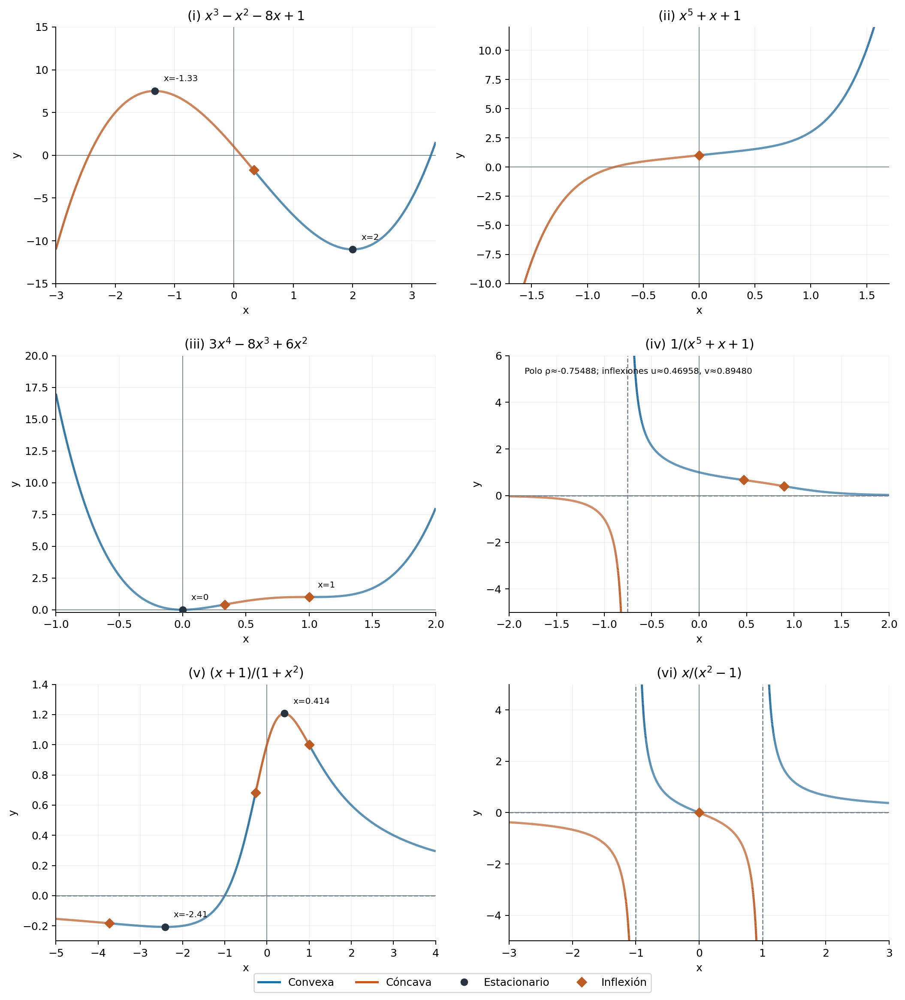
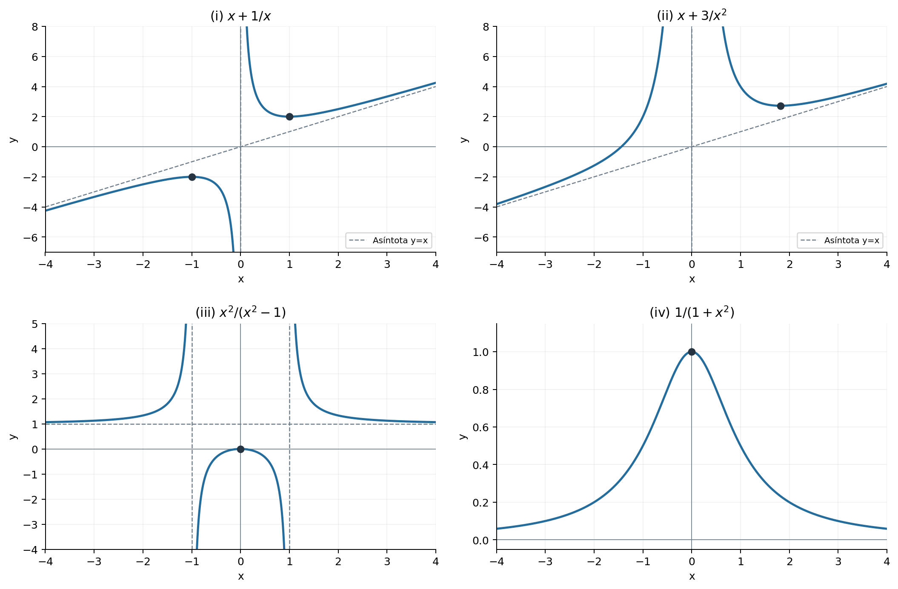
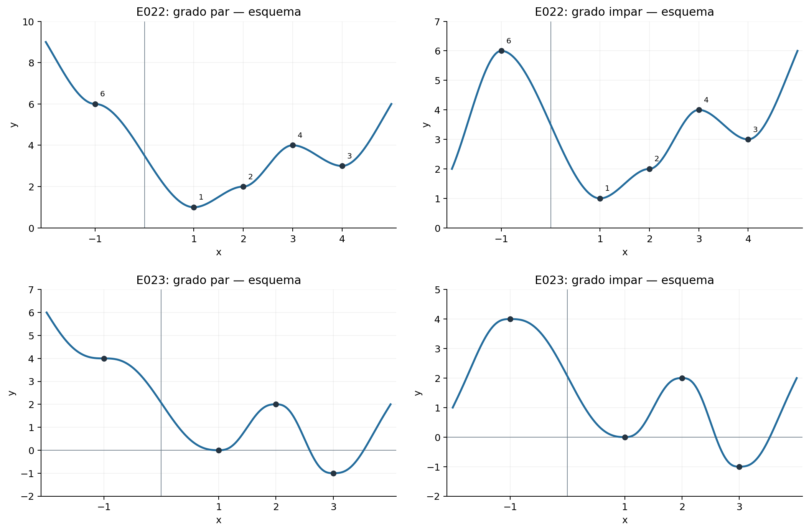
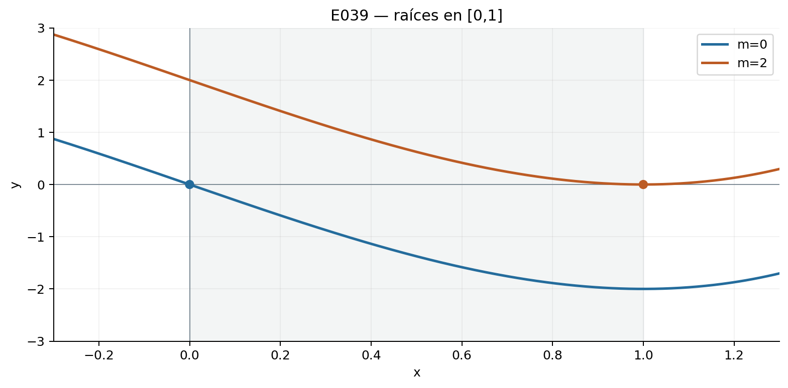
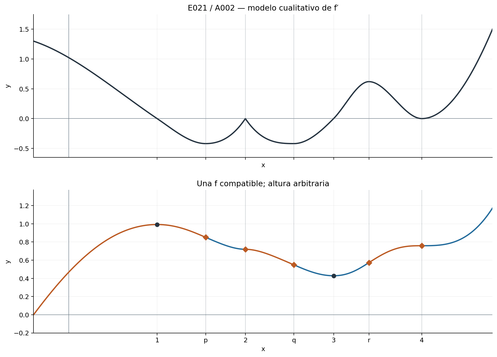
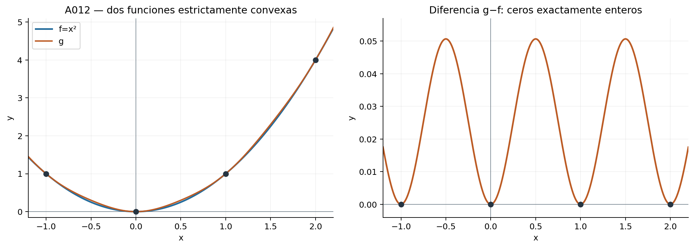

::: {.spivak-nav}

[← Capítulo 10](capitulo-10.qmd) · [Colecciones](../index.qmd#spivak-calculus-cuarta-edición) · [Capítulo 12 →](capitulo-12.qmd)

:::

Solucionario explicado de Matemática Abierta · A. Peña

Fuente: Michael Spivak, *Calculus*, 4.ª edición, pp. 205–218 y apéndice, pp. 227–229 (PDF 225–238 y 247–249). Desarrollo y figuras originales. Se incluyen los 71 problemas principales y los 13 del apéndice. Los enunciados se condensan conservando los datos necesarios.

Salvo indicación contraria, «creciente» significa estrictamente creciente. Los extremos locales ordinarios permiten igualdad; un extremo estricto no la permite fuera del punto. El teorema del valor medio (TVM) requiere continuidad en el intervalo cerrado y diferenciabilidad en su interior. Se declaran expresamente las correcciones de enunciados que no son ciertos literalmente. En el apéndice, «convexa» significa **estrictamente convexa**, como en el libro; la convexidad débil se trata por separado.

## Ejercicio 1 — `SPV4-C11-E001` {#e001}

Referencia: p. 205.

**Problema.** Hallar máximo y mínimo en los intervalos indicados.

Se comparan extremos del intervalo y puntos interiores con derivada cero. Las derivadas y la comparación completa son:

| Inciso y función | Intervalo | Derivada y candidatos | Mínimo | Máximo |
|---|---|---|---|---|
| (i) $x^3-x^2-8x+1$ | $[-2,2]$ | $(3x+4)(x-2)$; valores $5,203/27,-11$ en $-2,-4/3,2$ | $-11$, en $2$ | $203/27$, en $-4/3$ |
| (ii) $x^5+x+1$ | $[-1,1]$ | $5x^4+1>0$; valores $-1,3$ | $-1$, en $-1$ | $3$, en $1$ |
| (iii) $3x^4-8x^3+6x^2$ | $[-1/2,1/2]$ | $12x(x-1)^2$; valores $43/16,0,11/16$ | $0$, en $0$ | $43/16$, en $-1/2$ |
| (iv) $1/(x^5+x+1)$ | $[-1/2,1]$ | $-(5x^4+1)/(x^5+x+1)^2<0$; denominador positivo | $1/3$, en $1$ | $32/15$, en $-1/2$ |
| (v) $(x+1)/(x^2+1)$ | $[-1,1/2]$ | $(1-2x-x^2)/(1+x^2)^2$; valores $0,(1+\sqrt2)/2,6/5$ | $0$, en $-1$ | $(1+\sqrt2)/2$, en $\sqrt2-1$ |
| (vi) $x/(x^2-1)$ | $[0,5]$ | $-(x^2+1)/(x^2-1)^2$ donde existe | No existe | No existe |

En (vi) la fórmula no define una función en todo $[0,5]$: hay un polo en $1$. En el dominio efectivo $[0,1)\cup(1,5]$, los límites al polo son $-\infty$ y $+\infty$. Por tanto tampoco hay extremos absolutos en ese dominio; no se puede invocar el teorema de extremos sobre el intervalo original.

## Ejercicio 2 — `SPV4-C11-E002` {#e002}

Referencia: p. 206.

**Problema.** Bosquejar globalmente las seis funciones anteriores y hallar sus extremos locales.

{#fig-spv4-c11-f01 fig-alt="Capítulo 11: Seis gráficas, extremos y asíntotas"}

Las derivadas de E001 dan el siguiente análisis, ahora en todo el dominio:

| Inciso | Monotonía | Extremos locales y otros rasgos |
|---|---|---|
| (i) | Crece hasta $-4/3$, decrece hasta $2$, crece después | Máximo $(-4/3,203/27)$; mínimo $(2,-11)$; límites $-\infty,+\infty$ |
| (ii) | Crece en $\mathbb R$ | Ningún extremo; pasa por $(0,1)$ |
| (iii) | Decrece antes de $0$; crece después | Mínimo absoluto $(0,0)$; $x=1$ es estacionario sin extremo; ambos extremos infinitos de la gráfica suben |
| (iv) | Decrece en cada componente | Ningún extremo; polo en la única raíz $\rho$ de $x^5+x+1$, con $-1<\rho<0$; asíntota horizontal $0$; límites en el polo $-\infty,+\infty$ |
| (v) | Decrece, crece, decrece, con cortes $-1-\sqrt2,-1+\sqrt2$ | Mínimo $(-1-\sqrt2,(1-\sqrt2)/2)$; máximo $(-1+\sqrt2,(1+\sqrt2)/2)$; asíntota $y=0$ |
| (vi) | Decrece en cada componente | Ningún extremo; polos $\pm1$, asíntota $y=0$; función impar |

Una derivada negativa a ambos lados de un polo no permite unir las ramas en una sola afirmación de monotonía sobre un intervalo que contenga ese polo.

## Ejercicio 3 — `SPV4-C11-E003` {#e003}

Referencia: p. 206.

**Problema.** Bosquejar cuatro funciones racionales.

{#fig-spv4-c11-f02 fig-alt="Capítulo 11: Cuatro funciones racionales"}

**(i)** $f=x+1/x$, $x\ne0$. Su derivada es $1-1/x^2$: crece donde $|x|>1$ y decrece donde $0<|x|<1$. Máximo local $(-1,-2)$ y mínimo local $(1,2)$. Asíntotas $x=0$ y $y=x$; gráfica impar.

**(ii)** $f=x+3/x^2$, $x\ne0$. Derivada $1-6/x^3$. Crece en $(-\infty,0)$, decrece en $(0,\sqrt[3]6)$ y crece después. Mínimo local $(\sqrt[3]6,\tfrac32\sqrt[3]6)$. Las dos ramas tienden a $+\infty$ en cero y a la recta $y=x$ en el infinito. La raíz es $-\sqrt[3]3$.

**(iii)** $f=x^2/(x^2-1)$, $x\ne\pm1$. Derivada $-2x/(x^2-1)^2$: crece para $x<0$ y decrece para $x>0$, dentro de cada componente. Máximo local $(0,0)$. Asíntotas $x=\pm1$, $y=1$; gráfica par. La rama central es no positiva y las exteriores están sobre $1$.

**(iv)** $f=1/(1+x^2)$. Derivada $-2x/(1+x^2)^2$. Crece hasta cero y decrece después. Máximo absoluto $(0,1)$, asíntota $y=0$, gráfica par y positiva.

## Ejercicio 4 — `SPV4-C11-E004` {#e004}

Referencia: p. 206.

**Problema.** Para $a_1<\cdots<a_n$, minimizar sumas de cuadrados y de distancias; para $a>0$, maximizar una suma de dos fracciones.

**(a)** Escribiendo $\bar a=(a_1+\cdots+a_n)/n$,
$$\sum_{j=1}^n(x-a_j)^2=n(x-\bar a)^2+\sum_{j=1}^n(\bar a-a_j)^2.$$
El mínimo único está en $x=\bar a$ y vale la segunda suma. También se obtiene de la derivada $2nx-2\sum a_j$.

**(b)** Entre dos datos consecutivos, la pendiente de $\sum|x-a_j|$ es «número de datos a la izquierda menos número de datos a la derecha». Antes de todos los datos es $-n$, y después es $n$. Si $n=2m+1$, el mínimo único está en $a_{m+1}$; si $n=2m$, todos los puntos de $[a_m,a_{m+1}]$ y solo ellos minimizan. En ambos casos, con $m=\lfloor n/2\rfloor$, el valor mínimo es $\sum_{j=n-m+1}^na_j-\sum_{j=1}^ma_j$, interpretando las sumas vacías como cero para $n=1$.

**(c)** $F(x)=1/(1+|x|)+1/(1+|x-a|)$. A la izquierda de $0$ ambas sumandas crecen; a la derecha de $a$ ambas decrecen. En $[0,a]$,
$$F'(x)=-\frac1{(1+x)^2}+\frac1{(1+a-x)^2},$$
negativa hasta $a/2$ y positiva después. El máximo global es $(a+2)/(a+1)$, alcanzado exactamente en $0,a$.

## Ejercicio 5 — `SPV4-C11-E005` {#e005}

Referencia: p. 206.

**Problema.** Encontrar todos los extremos locales, incluidos los no estrictos, de cinco funciones discontinuas.

**(i)** $f(x)=x$ salvo $f(3)=5,f(5)=-3,f(7)=9,f(9)=7$. Los únicos máximos locales son $3,7$; los únicos mínimos son $5,9$, todos estrictos. En un punto no modificado, un entorno suficientemente pequeño conserva la recta creciente y no hay extremo.

**(ii)** La función de Thomae vale $0$ en irracionales y $1/q$ en racionales reducidos $p/q$, $q>0$. Todos los irracionales son mínimos locales no estrictos. Todos los racionales son máximos locales estrictos: cerca de un racional con denominador $q$, se pueden excluir los otros racionales de denominador $\le q$, que son finitos en cualquier intervalo acotado. Los racionales no son mínimos, por la densidad de los irracionales; los irracionales no son máximos, por la densidad de los racionales.

**(iii)** $f(x)=x$ en racionales y $0$ en irracionales. Un irracional positivo es mínimo local; uno negativo es máximo local, ambos no estrictos. Ningún racional es extremo: en cualquier entorno hay racionales a ambos lados, y además, si el punto es distinto de cero, hay irracionales con valor cero que impiden el otro tipo de extremo. En $0$ hay valores de ambos signos. No hay extremos estrictos.

**(iv)** $f(1/n)=1$ para $n\ge1$, y $f=0$ en los otros puntos. Cada $1/n$ es máximo local estricto. Todo punto distinto de los $1/n$ es mínimo no estricto. Salvo en $0$, esos puntos de valor cero son también máximos no estrictos, pues la función es localmente constante allí. En $0$ hay mínimos, pero no máximo, por la sucesión $1/n\to0$.

**(v)** Se usa la expansión decimal usual, sin una cola infinita de nueves, y se ignora el signo. Sea $S$ el conjunto de números cuya expansión contiene un $5$; $f=1$ en $S$ y $0$ fuera. Todos los puntos de $S$ son máximos locales no estrictos; todos los puntos fuera de $S$ son mínimos locales no estrictos. Hay además mínimos en los puntos de $\operatorname{int}S$, donde $f$ es localmente constante igual a $1$. No hay máximos de valor cero: cualquier intervalo contiene un número con un $5$ suficientemente lejos en su expansión. Esta caracterización es exacta: $\operatorname{int}S$ es la unión de los interiores de los intervalos decimales cuyo prefijo contiene un $5$, y sus reflejos negativos. Por ejemplo, $0.51$ está en ese interior, mientras $0.5$ no lo está. No hay extremos estrictos, pues ambos valores que aparecen en un entorno se repiten arbitrariamente cerca del punto correspondiente.

## Ejercicio 6 — `SPV4-C11-E006` {#e006}

Referencia: p. 207.

**Problema.** Extender el crecimiento estricto del interior a $[a,b]$ cuando hay continuidad en los extremos.

Si $a<x<y<b$, ya se sabe $f(x)<f(y)$. Tomar límites interiores da $f(a)\le f(x)$ y $f(y)\le f(b)$. Para obtener estrictitud en $f(a)<f(y)$ basta insertar $x$; para $f(x)<f(b)$ insertar $y$. Dos puntos interiores intermedios dan $f(a)<f(b)$. Así la función crece estrictamente en todo $[a,b]$.

## Ejercicio 7 — `SPV4-C11-E007` {#e007}

Referencia: p. 207.

**Problema.** Minimizar el trayecto de $(0,a)$ a $(1,b)$, $a,b>0$, pasando por $(x,0)$, $0\le x\le1$.

La longitud es $L(x)=\sqrt{x^2+a^2}+\sqrt{(1-x)^2+b^2}$. Su derivada se anula cuando
$$\frac{x}{\sqrt{x^2+a^2}}=\frac{1-x}{\sqrt{(1-x)^2+b^2}},$$
equivalente a $bx=a(1-x)$: $x=a/(a+b)$. Además $L''>0$, así que es el mínimo único. Los cocientes son los senos de los ángulos respecto de la vertical; por tanto los ángulos de entrada y salida son iguales. Reflejar $(1,b)$ en $(1,-b)$ transforma el camino mínimo en un segmento recto y muestra que $L_{\min}=\sqrt{1+(a+b)^2}$.

## Ejercicio 8 — `SPV4-C11-E008` {#e008}

Referencia: p. 207.

**Problema.** Hallar la proyección de un punto sobre una recta y la distancia correspondiente.

**(a)** La distancia cuadrada de $(x_0,y_0)$ a $(x,mx+b)$ es $D=(x-x_0)^2+(mx+b-y_0)^2$. Su derivada se anula únicamente en
$$\bar x=\frac{x_0+m(y_0-b)}{1+m^2},\qquad \bar y=m\bar x+b.$$
Como $D''=2(1+m^2)>0$, esta es la proyección buscada.

**(b)** La condición $\bar x-x_0+m(\bar y-y_0)=0$ dice que el vector al punto proyectado es perpendicular al vector director $(1,m)$. Es la construcción geométrica por la perpendicular, válida también para $m=0$.

**(c)** Al sustituir se obtiene $d=|mx_0-y_0+b|/\sqrt{1+m^2}$.

**(d)** Para $Ax+By+C=0$, con $(A,B)\ne(0,0)$, un vector normal es $(A,B)$ y
$$d=\frac{|Ax_0+By_0+C|}{\sqrt{A^2+B^2}}.$$
El valor absoluto es necesario para una distancia; la expresión sin él que aparece en el enunciado es una distancia con signo. La proyección es $(x_0,y_0)-\frac{Ax_0+By_0+C}{A^2+B^2}(A,B)$, lo que cubre también rectas verticales.

## Ejercicio 9 — `SPV4-C11-E009` {#e009}

Referencia: p. 207.

**Problema.** Relacionar los puntos críticos de $f$ y de $f^2$.

En cualquier punto donde $f$ sea diferenciable, $(f^2)'=2ff'$. Por tanto los puntos estacionarios de $f^2$ son exactamente los puntos donde $f'=0$ o $f=0$. Todos los estacionarios de $f$ son estacionarios de $f^2$, pero pueden aparecer otros: $f(x)=x$ no es estacionaria en cero y $f^2=x^2$ sí lo es. Si «crítico» incluye los puntos sin derivada, hay que añadir ese análisis: $f=|x|$ no tiene derivada en cero, aunque $f^2$ sí la tiene. No se aplica una regla de producto a una función que no es diferenciable allí.

## Ejercicio 10 — `SPV4-C11-E010` {#e010}

Referencia: p. 207.

**Problema.** Maximizar el área de un rectángulo de perímetro fijo $P>0$.

Si un lado es $x\in(0,P/2)$, el otro es $P/2-x$. El área $A=x(P/2-x)$ tiene derivada $P/2-2x$; crece hasta $P/4$ y decrece después. El cuadrado de lado $P/4$ maximiza el área, que vale $P^2/16$.

## Ejercicio 11 — `SPV4-C11-E011` {#e011}

Referencia: p. 207.

**Problema.** Minimizar la superficie de un cilindro cerrado de volumen $V>0$.

$h=V/(\pi r^2)$, $r>0$, y $S=2\pi r^2+2V/r$. La derivada $4\pi r-2V/r^2$ cambia de negativa a positiva en $r^3=V/(2\pi)$. Como $S\to\infty$ en ambos extremos del dominio, es el mínimo global. Resulta $h=2r$, con $r=(V/(2\pi))^{1/3}$.

## Ejercicio 12 — `SPV4-C11-E012` {#e012}

Referencia: p. 207.

**Problema.** Maximizar el volumen del cono obtenido al girar un triángulo rectángulo de hipotenusa $a>0$ alrededor de un cateto.

Sean $h$ el cateto eje y $r$ el otro. Como $r^2=a^2-h^2$, $V=\pi(a^2h-h^3)/3$, $0\le h\le a$. La derivada es $\pi(a^2-3h^2)/3$. El máximo está en $h=a/\sqrt3$, $r=a\sqrt{2/3}$; vale $2\pi a^3/(9\sqrt3)$. Los extremos degenerados tienen volumen cero.

## Ejercicio 13 — `SPV4-C11-E013` {#e013}

Referencia: p. 207.

**Problema.** Probar $x+1/x\ge2$ para $x>0$.

La derivada $1-1/x^2$ es negativa antes de $1$ y positiva después. El mínimo es $2$, en $x=1$, único caso de igualdad. Equivalentemente, $x+1/x-2=(x-1)^2/x$.

## Ejercicio 14 — `SPV4-C11-E014` {#e014}

Referencia: p. 207.

**Problema.** Inscribir un trapecio de área máxima en un semicírculo de radio $a$, con una base sobre el diámetro.

Para una altura fija conviene utilizar todo el diámetro como base inferior. La base superior es la cuerda horizontal de longitud $2x$, con altura $\sqrt{a^2-x^2}$, $0\le x\le a$. El área es $A=(a+x)\sqrt{a^2-x^2}$; en el interior,
$$A'=\frac{a^2-ax-2x^2}{\sqrt{a^2-x^2}}=\frac{(a-2x)(a+x)}{\sqrt{a^2-x^2}}.$$
El máximo está en $x=a/2$: bases $2a,a$, altura $\sqrt3a/2$, área $3\sqrt3a^2/4$. Los valores extremos $a^2,0$ son menores.

## Ejercicio 15 — `SPV4-C11-E015` {#e015}

Referencia: p. 207.

**Problema.** Hallar la longitud máxima de una escalera que puede doblar una esquina de corredores de anchos $a,b>0$.

Para una orientación $0<\theta<\pi/2$, la longitud que toca simultáneamente las tres paredes es $L(\theta)=a\csc\theta+b\sec\theta$. Una escalera que atraviesa todas las orientaciones debe tener longitud no mayor que esta capacidad para cada una: la longitud máxima admisible es **el mínimo** de $L$. La ecuación $L'=0$ equivale a $\tan^3\theta=a/b$. El signo de la derivada cambia de negativo a positivo y $L$ diverge en ambos extremos. Sustituir da
$$L_{\max\,admisible}=(a^{2/3}+b^{2/3})^{3/2}.$$
La igualdad corresponde al paso límite, con contacto en la esquina; longitudes menores tienen holgura.

## Ejercicio 16 — `SPV4-C11-E016` {#e016}

Referencia: p. 208.

**Problema.** Minimizar el perímetro de un sector circular de área $A>0$.

Con radio $R$ y ángulo $\theta$ en radianes, $A=R^2\theta/2$ y $P=2R+R\theta=2R+2A/R$. Su derivada cambia de signo en $R=\sqrt A$; allí $\theta=2$ y $P_{\min}=4\sqrt A$. Se cuentan el arco y los dos radios, tal como exige la frontera del sector del problema.

## Ejercicio 17 — `SPV4-C11-E017` {#e017}

Referencia: p. 208.

**Problema.** Un ángulo recto tiene vértice variable sobre el diámetro de un semicírculo de radio $a$; sus lados son horizontal y vertical. Maximizar la suma de los segmentos hasta la circunferencia.

Con vértice $(x,0)$, $-a\le x\le a$, los segmentos miden $a-x$ y $\sqrt{a^2-x^2}$. La suma tiene derivada $-1-x/\sqrt{a^2-x^2}$ y máximo único en $x=-a/\sqrt2$. El valor es $a(1+\sqrt2)$, mayor que los valores $2a,0$ de los extremos.

## Ejercicio 18 — `SPV4-C11-E018` {#e018}

Referencia: p. 208.

**Problema.** Llegar al punto diametralmente opuesto de un lago de radio una milla, remando a $2$ millas/h y andando por la orilla a $4$ millas/h; combinar una cuerda y un arco.

Si la cuerda recorrida abarca un ángulo central $\theta\in[0,\pi]$, su longitud es $2\sin(\theta/2)$ y el arco restante mide $\pi-\theta$. El tiempo es
$$T(\theta)=\sin(\theta/2)+\frac{\pi-\theta}{4},\qquad T'=\tfrac12\cos(\theta/2)-\tfrac14.$$
Crece hasta $2\pi/3$ y decrece después: ese punto es un **máximo**, no un mínimo.

**(i)** Para ver el mayor recorrido de paisaje, se maximiza la distancia: $D=2\sin(\theta/2)+\pi-\theta$ tiene derivada $\cos(\theta/2)-1<0$ para $\theta>0$. Conviene andar todo el semicírculo, distancia $\pi$. Esta es la interpretación de la respuesta secundaria.

**(ii)** Para llegar lo antes posible se comparan los extremos de $T$: $T(0)=\pi/4$ y $T(\pi)=1$. Conviene también andar todo el semicírculo, tardando $\pi/4$ horas. Como precisión, si «ver más paisaje» significase dedicar el mayor **tiempo** al trayecto, la respuesta sería diferente: $\theta=2\pi/3$, cuerda $\sqrt3$, arco restante $\pi/3$, tiempo $\sqrt3/2+\pi/12$. La magnitud que se optimiza debe quedar explícita.

## Ejercicio 19 — `SPV4-C11-E019` {#e019}

Referencia: p. 208.

**Problema.** Maximizar dos áreas triangulares dentro de un círculo y deducir el polígono inscrito de área máxima.

**(a)** Si $\angle AOC=\alpha\in(0,2\pi)$ y $B$ se mueve en el arco elegido, escribimos $\angle AOB=\theta$. La suma de áreas orientadas es
$$\tfrac12R^2[\sin\theta+\sin(\alpha-\theta)]=R^2\sin(\alpha/2)\cos(\theta-\alpha/2).$$
Su máximo está en $\theta=\alpha/2$: $B$ es el punto medio del arco. En la configuración de la figura, ambas áreas son ordinarias positivas. La fórmula orientada permite usar el argumento también cuando el centro queda fuera de un polígono.

**(b)** Parametrizamos los vértices por sus ángulos ordenados. El espacio de configuraciones, permitiendo coincidencias, es compacto y el área continua, así que existe un máximo. Un máximo no tiene vértices coincidentes: insertar un nuevo vértice en un arco entre dos vértices distintos aumenta estrictamente el área del polígono, pues añade un triángulo no degenerado exterior a la cuerda. Por tanto los $n\ge3$ huecos angulares son positivos y suman $2\pi$.

Manteniendo todos los vértices salvo uno, sus dos huecos vecinos tienen suma menor que $2\pi$. La fórmula de (a) muestra que el máximo exige que esos dos huecos sean iguales: el factor $\sin(\alpha/2)$ es positivo. Hacerlo en cada vértice obliga a que todos los huecos sean $2\pi/n$. El polígono máximo es regular; su área es $\tfrac n2R^2\sin(2\pi/n)$. La compactitud demuestra que el candidato encontrado es un máximo global, no solo estacionario.

## Ejercicio 20 — `SPV4-C11-E020` {#e020}

Referencia: p. 208.

**Problema.** Doblar la esquina inferior derecha de una página de ancho $a$ hasta el borde izquierdo, minimizando la longitud del pliegue de esquina mostrado.

Tomamos la esquina $P=(a,0)$ y su imagen $Q=(0,q)$, $0<q\le a$. El pliegue es la mediatriz de $PQ$:
$$-ax+qy=(q^2-a^2)/2.$$
Corta el borde inferior en $((a^2-q^2)/(2a),0)$ y el derecho en $(a,(a^2+q^2)/(2q))$. La longitud es
$$L(q)=\frac{(a^2+q^2)^{3/2}}{2aq},\qquad \frac{L'}L=\frac{3q}{a^2+q^2}-\frac1q.$$
El signo cambia en $q=a/\sqrt2$ y el mínimo es $3\sqrt3a/4$. Se presupone una página suficientemente larga para el punto de corte superior. La restricción $q\le a$ expresa la configuración del dibujo: el pliegue corta los bordes inferior y derecho y dobla una esquina triangular. Si se admiten pliegues que corten los dos bordes laterales, se cambia el problema geométrico y esta cota no se aplica.

## Ejercicio 21 — `SPV4-C11-E021` {#e021}

Referencia: p. 208.

**Problema.** Identificar los extremos de $f$ a partir de la gráfica de $f'$ de la figura 31.

$f'$ cambia de positivo a negativo en $1$ y de negativo a positivo en $3$. Luego $f$ tiene máximo local en $1$ y mínimo local en $3$. En $2,4$ la derivada se anula sin cambiar de signo: no hay extremo de $f$. El apéndice A002 completa el bosquejo mediante la variación de $f'$.

## Ejercicio 22 — `SPV4-C11-E022` {#e022}

Referencia: p. 208.

**Problema.** Bosquejar un polinomio mónico cuyos únicos puntos críticos son $-1,1,2,3,4$, con valores respectivos $6,1,2,4,3$.

Entre puntos críticos consecutivos la derivada no se anula y tiene signo constante. Los valores dados fuerzan sucesivamente los signos $-,+,+,-$. A la derecha de $4$ el signo es $+$ por el término principal mónico. Por tanto $1,4$ son mínimos, $3$ es máximo y $2$ es estacionario sin extremo. A la izquierda de $-1$ el signo de $f'$ es negativo si el grado es par y positivo si es impar. Así $-1$ es estacionario sin extremo en grado par, y máximo en grado impar.

{#fig-spv4-c11-f03 fig-alt="Capítulo 11: Bosquejos cualitativos de los polinomios de E022 y E023"}

La lámina respeta los valores y los cambios de signo; sus trazos son esquemas, no una interpolación que se presente como el polinomio exacto. En grado par ambos extremos de la gráfica suben; en grado impar el izquierdo baja y el derecho sube.

## Ejercicio 23 — `SPV4-C11-E023` {#e023}

Referencia: p. 208.

**Problema.** Analizar un polinomio mónico con críticos $-1,1,2,3$ y $f''(-1)=0,f''(1)>0,f''(2)<0,f''(3)=0$; decidir qué sucede si se suprime el crítico $3$.

**(a)** En $1$ hay mínimo y en $2$ máximo por la segunda derivada. Por tanto $f'$ tiene signos $-,+,-$ en $(-1,1),(1,2),(2,3)$. Después de $3$ es positiva por ser mónico: $3$ es un mínimo con segunda derivada cero, necesariamente un cero de multiplicidad impar de $f'$, de al menos tres. En $-1$, si el grado es par, $f'$ es negativa a ambos lados y no hay extremo; si es impar, cambia de $+$ a $-$ y hay máximo plano. Los dos bosquejos aparecen en la lámina anterior; aquí las alturas no están fijadas.

**(b)** Si no hubiese crítico después de $2$, la derivada tendría que seguir siendo negativa, pues es negativa inmediatamente a su derecha. Pero una derivada de polinomio mónico es positiva para $x$ suficientemente grande. Darboux, o la continuidad polinómica, obliga a otro cero. Los datos con solo $-1,1,2$ son imposibles.

## Ejercicio 24 — `SPV4-C11-E024` {#e024}

Referencia: p. 208.

**Problema.** Explicar cómo investigar la gráfica de una función racional.

Se conserva primero el dominio original: los ceros del denominador quedan excluidos aunque se cancelen. La factorización identifica polos y agujeros; la división polinómica identifica la asíntota polinómica en el infinito. Los ceros del numerador son cortes con el eje solo si pertenecen al dominio. La derivada es racional; sus ceros, si no es idénticamente cero, son finitos, y junto con los puntos excluidos dividen el dominio en intervalos de signo constante de $f'$. El TVM da la monotonía en cada intervalo y los cambios de signo clasifican extremos. Los límites laterales, la paridad y el valor en cero completan el bosquejo. Una función racional constante se trata aparte: todos sus puntos son extremos locales no estrictos y no hay extremos estrictos.

## Ejercicio 25 — `SPV4-C11-E025` {#e025}

Referencia: p. 209.

**Problema.** Acotar y realizar el número de intersecciones de dos gráficas polinómicas de grados $m,n$.

**(a)** Se requiere que los polinomios sean **distintos**. Las intersecciones son las raíces de su diferencia, polinomio no nulo de grado a lo sumo $N=\max(m,n)$, así que hay a lo sumo $N$. Si los polinomios son iguales, hay infinitas intersecciones: la precisión no se puede omitir.

**(b)** Sea $W(x)=\prod_{j=1}^N(x-j)$. Si los grados son distintos, tome un polinomio $q$ del menor grado y $p=q+W$ del mayor: hay exactamente $N$ intersecciones. Si ambos grados son $N\ge1$, tome $q=x^N$, $p=q+W$; ambos tienen grado $N$ y la diferencia tiene exactamente las $N$ raíces indicadas. Para grado cero, dos constantes distintas tienen cero intersecciones, que realiza la cota.

## Ejercicio 26 — `SPV4-C11-E026` {#e026}

Referencia: p. 209.

**Problema.** Si un polinomio $f$ de grado par $n$ es no negativo en toda la recta, probar que $S=f+f'+\cdots+f^{(n)}$ es no negativo.

Si $f$ no es el polinomio cero, su coeficiente principal es positivo, y $S$ tiene el mismo grado par y el mismo coeficiente principal. Si $n\ge2$, $S\to+\infty$ a ambos lados, de modo que alcanza un mínimo en $c$. Allí $S'(c)=0$. Como $S'=S-f$, resulta $S(c)=f(c)\ge0$; por tanto $S(x)\ge S(c)\ge0$ para todo $x$. Para $n=0$, $S=f$ es una constante no negativa. Si $f=0$, también $S=0$. Bajo la hipótesis más fuerte $f>0$, el mismo argumento da $S>0$, pero no se reemplaza la hipótesis original por esa versión.

## Ejercicio 27 — `SPV4-C11-E027` {#e027}

Referencia: p. 209.

**Problema.** Contar y construir puntos críticos no degenerados de polinomios mónicos, y comparar máximos con mínimos.

**(a)** Si los $k$ ceros reales de $f'$ son simples, al cruzar cada uno cambia su signo. Los signos de $f'$ en los extremos son $(-1)^{n-1}$ y $+1$. Así $n-1-k$ es par; equivalentemente, $n-k$ es impar. Además $0\le k\le n-1$.

**(b)** Para cualquier $k$ admisible, defina
$$f'(x)=n\prod_{j=1}^k(x-j)(1+x^2)^{(n-1-k)/2}.$$
Integrar cada monomio produce un polinomio mónico de grado $n$, más una constante arbitraria. Sus únicos críticos son los $k$ puntos indicados; son simples, luego $f''$ no se anula en ellos. El producto vacío cubre $k=0$.

**(c)** Los extremos alternan al recorrer la recta; los críticos sin cambio de signo no alteran la cuenta. Si $n$ es par, hay un mínimo más que máximos: $k_2=k_1+1$. Si $n$ es impar, hay tantos mínimos como máximos: $k_2=k_1$. En ambos casos $k_1+k_2\le n-1$.

**(d)** Dadas cantidades no negativas que satisfagan esas condiciones, se repite (b) con $k=k_1+k_2$. Los signos extremos y la alternancia dan exactamente los $k_1$ máximos y $k_2$ mínimos solicitados. No se afirma una construcción para cantidades que violen la paridad o la cota del grado.

## Ejercicio 28 — `SPV4-C11-E028` {#e028}

Referencia: p. 209.

**Problema.** Deducir cotas de diferencias a partir de cotas de $f'$.

Con las hipótesis del TVM, $f(b)-f(a)=f'(c)(b-a)$ para algún $a<c<b$.

**(a)** Si $f'\ge M$, entonces $f(b)\ge f(a)+M(b-a)$.

**(b)** Si $f'\le M$, entonces $f(b)\le f(a)+M(b-a)$.

**(c)** Si $|f'|\le M$, $M\ge0$, entonces $|f(b)-f(a)|\le M(b-a)$. Aplicarlo a cualquier subintervalo da la misma cota para dos puntos cualesquiera.

## Ejercicio 29 — `SPV4-C11-E029` {#e029}

Referencia: p. 209.

**Problema.** Si $f'\ge M>0$ en $[0,1]$, hallar un intervalo de longitud $1/4$ donde $|f|\ge M/4$.

Si $f(1/2)\ge0$, para $x\in[3/4,1]$, E028 da $f(x)\ge f(1/2)+M(x-1/2)\ge M/4$. Si $f(1/2)<0$, para $x\in[0,1/4]$ se tiene $f(x)\le f(1/2)-M(1/2-x)<-M/4$. Uno de esos dos intervalos siempre cumple lo pedido.

## Ejercicio 30 — `SPV4-C11-E030` {#e030}

Referencia: p. 209.

**Problema.** Comparar funciones mediante sus derivadas.

**(a)** Si $f(a)=g(a)$ y $f'>g'$ en todo el intervalo, la diferencia $D=f-g$ tiene $D'>0$. El TVM da $D(x)>D(a)=0$ para $x>a$, y $D(x)<D(a)=0$ para $x<a$. Por tanto $f(x)>g(x)$ a la derecha y $f(x)<g(x)$ a la izquierda.

**(b)** La igualdad inicial es indispensable. Por ejemplo, $f(x)=x$, $g(x)=1$, $a=0$, tienen $f'>g'$ pero $f<g$ para $0<x<1$.

**(c)** Con $f'\ge g'$ y la igualdad inicial, $D$ es no decreciente y $D\ge0$ a la derecha. Si $D'(x_0)>0$ con $x_0>a$, no puede ser $D(x_0)=0$: sería un mínimo interior y Fermat daría $D'(x_0)=0$. Luego $D(x_0)>0$ y, por monotonía, $f(x)>g(x)$ para todo $x\ge x_0$ del intervalo.

## Ejercicio 31 — `SPV4-C11-E031` {#e031}

Referencia: p. 209.

**Problema.** Encontrar todas las funciones con las derivadas prescritas.

Restar una solución particular y aplicar sucesivamente «derivada cero implica constante» da todas las soluciones, en un intervalo conectado:

**(a)** $f'=\sin x$: $f=-\cos x+C$.

**(b)** $f''=x^3$: $f=x^5/20+Ax+B$.

**(c)** $f'''=x+x^2$: $f=x^4/24+x^5/60+Ax^2+Bx+C$.

La derivación directa verifica los coeficientes; las constantes independientes cubren todas las posibilidades.

## Ejercicio 32 — `SPV4-C11-E032` {#e032}

Referencia: p. 209–210.

**Problema.** Resolver el movimiento vertical con aceleración $s''=-32$, en pies y segundos.

**(a)** Todas las soluciones son $s(t)=-16t^2+\alpha t+\beta$, con velocidad $s'=-32t+\alpha$.

**(b)** Si $s(0)=s_0$ y $s'(0)=v_0$, entonces $\beta=s_0,\alpha=v_0$.

**(c)** Para lanzamiento desde el suelo con velocidad $v>0$, $s=-16t^2+vt$. El máximo ocurre en $t=v/32$ y vale $v^2/64$; allí la velocidad es cero y la aceleración sigue siendo $-32$. El regreso al suelo es en $t=v/16$, con velocidad $-v$. Se usa el modelo ideal hasta el impacto.

## Ejercicio 33 — `SPV4-C11-E033` {#e033}

Referencia: p. 210.

**Problema.** Hallar trayectoria y alcance de un proyectil lanzado con velocidad $v$ y ángulo $\alpha$.

**(a)** Para $v>0$, $0<\alpha<\pi/2$, $x(t)=v\cos\alpha\,t$ y $y(t)=v\sin\alpha\,t-16t^2$. Eliminar $t$ da la parábola
$$y=x\tan\alpha-\frac{16x^2}{v^2\cos^2\alpha}.$$
**(b)** El tiempo de vuelo positivo es $v\sin\alpha/16$ y el alcance $R=v^2\sin(2\alpha)/32$. Se maximiza en $\alpha=\pi/4$, con $R=v^2/32$. Un lanzamiento vertical tiene alcance cero y no se expresa como esa gráfica $y(x)$, porque $\cos\alpha=0$.

## Ejercicio 34 — `SPV4-C11-E034` {#e034}

Referencia: p. 210.

**Problema.** Investigar los límites de las derivadas si $f(x)$ tiene límite finito cuando $x\to\infty$.

**(a)** No tiene por qué existir $\lim f'$. Para $x>0$, $f(x)=\sin(x^2)/x\to0$, pero $f'=2\cos(x^2)-\sin(x^2)/x^2$ oscila entre valores que se aproximan a $2$ y $-2$.

**(b)** Si $\lim f'=L$ existe y es finito, el TVM en $[x,x+1]$ da $f(x+1)-f(x)=f'(c_x)$, $c_x\to\infty$. El lado izquierdo tiende a cero, así que $L=0$.

**(c)** Si $\lim f''=L$ existe y es finito, también $L=0$. Si $L>0$, eventualmente $f''\ge L/2$. Por E028, $f'$ crece al menos linealmente, y llega a ser $\ge1$. Otra aplicación de E028 obliga entonces a $f$ a crecer al menos linealmente, contradiciendo su límite finito. Si $L<0$, aplicar el argumento a $-f$. No se supone aquí que $f'$ tenga límite.

## Ejercicio 35 — `SPV4-C11-E035` {#e035}

Referencia: p. 210.

**Problema.** Si $fg'-f'g=0$, $f(a)=0$ y $g(a)\ne0$, probar que $f$ se anula cerca de $a$.

La continuidad de $g$ da un intervalo alrededor de $a$ sin ceros de $g$. Allí $(f/g)'=(f'g-fg')/g^2=0$, de modo que $f/g$ es constante. Su valor en $a$ es cero; por tanto $f=0$ en ese intervalo. No se divide por $g$ fuera de la región donde se sabe que no se anula.

## Ejercicio 36 — `SPV4-C11-E036` {#e036}

Referencia: p. 210.

**Problema.** Si $|f(x)-f(y)|\le|x-y|^n$ para $n>1$, probar que $f$ es constante.

Para $h\ne0$, el valor absoluto del cociente incremental es a lo sumo $|h|^{n-1}\to0$. Así $f'$ existe y vale cero en todos los puntos. El TVM da constancia en cualquier intervalo, por tanto en la recta.

## Ejercicio 37 — `SPV4-C11-E037` {#e037}

Referencia: p. 210.

**Problema.** Estudiar condiciones de Hölder y de Lipschitz.

**(a)** Si cerca de $a$ se cumple $|f(x)-f(a)|\le C|x-a|^\alpha$, con $C\ge0$, $\alpha>0$, entonces $f$ es continua en $a$: para $C>0$ sirve $|x-a|<(\varepsilon/C)^{1/\alpha}$, dentro del entorno dado; si $C=0$, es localmente constante respecto de $f(a)$.

**(b)** Si la cota vale para todos los pares del dominio con las mismas constantes, ese mismo $\delta$ funciona en todos los puntos: hay continuidad uniforme.

**(c)** La diferenciabilidad en $a$ implica una cota local de orden $1$ centrada en $a$, pues el cociente incremental está acotado por $|f'(a)|+1$ suficientemente cerca. La recíproca es falsa: $|x-a|$ satisface esa cota pero no tiene derivada en $a$.

**(d)** Ser diferenciable en un intervalo cerrado no garantiza una cota de Lipschitz global. En $[0,1]$, defina $f(0)=0$, $f(x)=x^2\sin(1/x^2)$ para $x>0$. Tiene derivada cero en el extremo $0$, pero $f'=2x\sin(1/x^2)-(2/x)\cos(1/x^2)$ no está acotada cerca de cero. Una cota global de Lipschitz acotaría todas las derivadas interiores por su constante, contradicción.

**(e)** Una cota global de orden $\alpha>1$ da derivada cero en el interior, como en E036. La continuidad en los extremos que proporciona (a) extiende la constancia a todo el intervalo cerrado.

## Ejercicio 38 — `SPV4-C11-E038` {#e038}

Referencia: p. 211.

**Problema.** Si $a_0+a_1/2+\cdots+a_n/(n+1)=0$, demostrar que $a_0+a_1x+\cdots+a_nx^n=0$ para algún $0<x<1$.

Sea $P(x)=\sum_{j=0}^n a_jx^{j+1}/(j+1)$. Entonces $P(0)=P(1)=0$. Rolle da un cero de $P'$ en $(0,1)$; $P'$ es exactamente el polinomio pedido. Si todos los coeficientes son cero, cualquier punto sirve.

## Ejercicio 39 — `SPV4-C11-E039` {#e039}

Referencia: p. 211.

**Problema.** Probar que $x^3-3x+m=0$ no puede tener dos raíces en $[0,1]$ e ilustrar los casos límite.

La derivada $3x^2-3$ es negativa en $(0,1)$. Dos raíces distintas en el cerrado darían un cero interior de esa derivada por Rolle, imposible. Hay una raíz en $[0,1]$ exactamente cuando los valores extremos $m,m-2$ tienen signos opuestos o son cero: $0\le m\le2$. Para $m=0$ es $0$ y para $m=2$ es $1$; la derivada nula en ese extremo no introduce otra raíz.

{#fig-spv4-c11-f04 fig-alt="Capítulo 11: Casos m igual a cero y dos"}

## Ejercicio 40 — `SPV4-C11-E040` {#e040}

Referencia: p. 211.

**Problema.** Una función diferenciable de $[0,1]$ en sí mismo tiene $f'\ne1$ en el interior. Probar que tiene un único punto fijo.

$D=f-x$ es continua, con $D(0)\ge0$ y $D(1)\le0$. Valores intermedios da un cero, incluyendo los extremos. Dos ceros distintos darían, por Rolle, $D'(c)=f'(c)-1=0$ en el interior, contradicción. No hace falta suponer $|f'|<1$.

## Ejercicio 41 — `SPV4-C11-E041` {#e041}

Referencia: p. 211.

**Problema.** Probar que cada ecuación tiene exactamente dos raíces reales.

**(a)** $F=x^2-\cos x$ es par, $F(0)=-1$, $F(1)>0$, y $F'=2x+\sin x>0$ en $(0,1)$. Para $x>1$, $F\ge x^2-1>0$. Hay exactamente una raíz positiva y, por paridad, una negativa.

**(b)** $F=x^2-x\sin x-\cos x$ es par y $F'=x(2-\cos x)>0$ para $x>0$. Parte de $-1$ y tiende a $+\infty$ porque $F\ge x^2-x-1$ allí. Hay exactamente una raíz positiva y su opuesta.

**(c)** $F=2x^2-x\sin x-\cos^2x$ es par. En $(0,1)$,
$$F'=4x-\sin x-x\cos x+2\sin x\cos x>2x>0,$$
usando $\sin x\le x$, $\cos x\le1$ y la positividad del último término. Además $F(0)=-1$ y $F(1)=1-\sin1+\sin^21>0$. Para $x>1$, $F\ge2x^2-x-1>0$. Por tanto tiene exactamente dos raíces, una en $(0,1)$ y su opuesta.

## Ejercicio 42 — `SPV4-C11-E042` {#e042}

Referencia: p. 211.

**Problema.** Si $f(0)=0,f(1)=1,f'(0)=f'(1)=0$ y $f$ es dos veces diferenciable, probar que algún $|f''|$ es al menos $4$ y que incluso es mayor que $4$.

**(a)** Si $f''<4$ en $(0,1/2)$, $u=f-2x^2$ tiene $u''<0$ y $u'(0)=0$, de donde $u'<0$ y $f(1/2)<1/2$. Si $f''>-4$ en $(1/2,1)$, $v=f-[1-2(1-x)^2]$ tiene $v''>0$, $v'(1)=0$; por tanto $v'<0$ a la izquierda de $1$, y $f(1/2)>1/2$. Ambas desigualdades no pueden darse a la vez. Luego en uno de los dos medios intervalos existe $f''\ge4$ o $f''\le-4$.

**(b)** Suponga, para obtener contradicción, que $|f''|\le4$ en todo $(0,1)$. Aplicar el TVM a $f'$ desde cada extremo da
$$f'(x)\le\min\{4x,4(1-x)\}.$$
Sea $H=2x^2$ para $x\le1/2$ y $H=1-2(1-x)^2$ para $x\ge1/2$. Es diferenciable y $H'=\min\{4x,4(1-x)\}$. Así $(H-f)'\ge0$, y $H-f$ es no decreciente con valores cero en ambos extremos. Debe ser idénticamente cero. Pero $H'$ tiene pendientes laterales $4,-4$ en $1/2$, así que $H$ no tiene segunda derivada allí, contradicción. Por tanto existe $|f''|>4$. La prueba no supone continuidad de $f''$.

## Ejercicio 43 — `SPV4-C11-E043` {#e043}

Referencia: p. 211.

**Problema.** Si $f'(x)=1/x$ para $x>0$ y $f(1)=0$, probar $f(xy)=f(x)+f(y)$.

Fije $y>0$. La derivada de $G(x)=f(xy)-f(x)$ es $y/(xy)-1/x=0$. Luego $G$ es constante en $(0,\infty)$, y $G(1)=f(y)$. Se obtiene la identidad para todos $x,y>0$ sin presuponer la teoría del logaritmo.

## Ejercicio 44 — `SPV4-C11-E044` {#e044}

Referencia: p. 211.

**Problema.** Si $f''+gf'-f=0$ y $f(a)=f(b)=0$, probar $f=0$ en $[a,b]$.

Si $f$ toma un valor positivo, alcanza un máximo positivo interior $c$. Fermat da $f'(c)=0$ y la prueba de segunda derivada da $f''(c)\le0$. La ecuación exige $f''(c)=f(c)>0$, contradicción. Si toma un valor negativo, un mínimo interior da $f''(c)\ge0$ mientras la ecuación lo hace negativo. No hay valores de ninguno de los dos signos, así que $f$ es idénticamente cero. No se requiere continuidad de $g$ para este argumento puntual.

## Ejercicio 45 — `SPV4-C11-E045` {#e045}

Referencia: p. 211.

**Problema.** Una función con $n+1$ ceros distintos tiene un cero de su derivada $n$-ésima.

Ordene los ceros $x_0<\cdots<x_n$. Rolle en cada intervalo consecutivo produce $n$ ceros distintos de $f'$, cada uno entre dos ceros anteriores. Repetir produce $n-1$ ceros de $f''$, y así sucesivamente hasta un cero de $f^{(n)}$ en $(x_0,x_n)$. En cada etapa la diferenciabilidad de la derivada siguiente asegura la continuidad de la anterior en los subintervalos necesarios; para la primera se exige continuidad de $f$ en el cerrado original.

## Ejercicio 46 — `SPV4-C11-E046` {#e046}

Referencia: p. 212.

**Problema.** Obtener el resto de interpolación de $f$ por un polinomio $P$ de grado a lo sumo $n$ en nodos $x_0,\ldots,x_n$.

Es necesario que los nodos sean **distintos**, precisión no explícita en la formulación. Tome $Q(t)=\prod_{j=0}^n(t-x_j)$. Si $x$ no es un nodo, la función
$$F(t)=Q(x)[f(t)-P(t)]-Q(t)[f(x)-P(x)]$$
tiene $n+2$ ceros distintos: los nodos y $x$. E045 da $F^{(n+1)}(c)=0$ entre el menor y el mayor de ellos. Como $P^{(n+1)}=0$ y $Q^{(n+1)}=(n+1)!$,
$$f(x)-P(x)=\frac{f^{(n+1)}(c)}{(n+1)!}\prod_{j=0}^n(x-x_j).$$
Si $x$ es un nodo, ambos lados son cero y sirve cualquier $c$ interior donde esté definida la derivada. Se suponen las hipótesis de diferenciabilidad y continuidad necesarias para E045. Si se permiten nodos repetidos sin datos de derivadas, la afirmación es falsa: con $n=1$, $x_0=x_1=0$, $f(t)=t$ y $P=0$, los valores coinciden en los nodos pero la fórmula daría $x=0$ para cualquier $x>0$.

## Ejercicio 47 — `SPV4-C11-E047` {#e047}

Referencia: p. 212.

**Problema.** Probar $1/9<\sqrt{66}-8<1/8$.

El TVM para $\sqrt t$ entre $64,66$ da $\sqrt{66}-8=1/\sqrt c$, $64<c<66$. Entonces es menor que $1/8$ y mayor que $1/\sqrt{66}>1/9$, pues $66<81$. Todas las desigualdades son estrictas.

## Ejercicio 48 — `SPV4-C11-E048` {#e048}

Referencia: p. 212.

**Problema.** Extender el TVM a una función diferenciable en $(a,b)$ con límites finitos en ambos extremos.

Defina los valores extremos como esos límites. La función extendida es continua en $[a,b]$ y diferenciable en $(a,b)$. El TVM usual da
$$f'(c)=\frac{\lim_{x\to b^-}f(x)-\lim_{x\to a^+}f(x)}{b-a}$$
para algún $c\in(a,b)$. No se requiere derivada en los extremos.

## Ejercicio 49 — `SPV4-C11-E049` {#e049}

Referencia: p. 212.

**Problema.** Justificar la forma de cociente del TVM de Cauchy bajo las hipótesis indicadas.

Se suponen $g(b)\ne g(a)$ y que $f',g'$ no se anulan simultáneamente. Cauchy da
$$[f(b)-f(a)]g'(c)=[g(b)-g(a)]f'(c).$$
Si $g'(c)=0$, el segundo factor no nulo de la derecha obliga a $f'(c)=0$, contradicción. Por tanto se puede dividir y
$$\frac{f'(c)}{g'(c)}=\frac{f(b)-f(a)}{g(b)-g(a)}.$$
Aplicar dos TVM separados no sirve, porque podrían producir puntos distintos.

## Ejercicio 50 — `SPV4-C11-E050` {#e050}

Referencia: p. 212.

**Problema.** Si $g'\ne0$ en $(a,b)$, hallar $x$ con $f'(x)/g'(x)=[f(x)-f(a)]/[g(b)-g(x)]$.

Sea $H(x)=[f(x)-f(a)][g(b)-g(x)]$. Tiene $H(a)=H(b)=0$, de modo que Rolle da un punto interior con
$$0=H'(x)=f'(x)[g(b)-g(x)]-[f(x)-f(a)]g'(x).$$
El factor $g'(x)$ no se anula por hipótesis. Tampoco $g(b)-g(x)$: una igualdad de esos valores daría un cero de $g'$ en $(x,b)$ por Rolle. Se puede dividir por ambos y obtener lo pedido.

## Ejercicio 51 — `SPV4-C11-E051` {#e051}

Referencia: p. 212.

**Problema.** Detectar el error de una doble aplicación de l’Hôpital al cociente $(x^3+x-2)/(x^2-3x+2)$ en $x=1$.

La primera forma es $0/0$; después de derivar se obtiene $(3x^2+1)/(2x-3)$, cuyo límite es $4/(-1)=-4$. Este segundo cociente **no** es $0/0$, así que derivarlo otra vez no está autorizado. La factorización confirma el resultado: fuera de $1$, el cociente es $(x^2+x+2)/(x-2)\to-4$.

## Ejercicio 52 — `SPV4-C11-E052` {#e052}

Referencia: p. 213.

**Problema.** Calcular dos límites en cero.

**(i)** $x/\tan x=(x/\sin x)\cos x\to1$.

**(ii)** $(\cos^2x-1)/x^2=-(\sin x/x)^2\to-1$.

Ambos se obtienen de $\sin x/x\to1$; l’Hôpital también es válido, pero no es necesario.

## Ejercicio 53 — `SPV4-C11-E053` {#e053}

Referencia: p. 213.

**Problema.** Si $g(0)=g'(0)=0,g''(0)=17$, definir $f(x)=g(x)/x$ fuera de cero y $f(0)=0$; hallar $f'(0)$.

El cociente incremental de $f$ en cero es $g(x)/x^2$. Como $g'(x)/x\to17$ por la definición de $g''(0)$, l’Hôpital da
$$f'(0)=\lim_{x\to0}\frac{g(x)}{x^2}=\lim_{x\to0}\frac{g'(x)}{2x}=17/2.$$
La hipótesis de existencia de $g''(0)$ incluye que $g'$ esté definida cerca de cero; no se supone continuidad de $g''$.

## Ejercicio 54 — `SPV4-C11-E054` {#e054}

Referencia: p. 213.

**Problema.** Probar cuatro variantes de l’Hôpital para la forma $0/0$.

En todas se exige que $f,g$ sean diferenciables en el entorno perforado correspondiente y $g'\ne0$ allí. Por Rolle, tras reducir el entorno si hace falta, $g$ no tiene otros ceros. Se trabaja separadamente en cada lado.

**(a)** Si $f,g\to0$ cuando $x\to a^+$ y $f'/g'\to L\in\mathbb R$, extienda $f(a)=g(a)=0$. Cauchy en $[a,x]$ produce $c_x\in(a,x)$ y $f(x)/g(x)=f'(c_x)/g'(c_x)\to L$. El argumento para $a^-$ es idéntico, invirtiendo el orden del intervalo.

**(b)** Si el límite del cociente de derivadas es $+\infty$, para todo $M$ ese cociente excede $M$ suficientemente cerca de $a$. Como $c_x$ está entre $a,x$, la misma igualdad hace $f(x)/g(x)>M$. Para $-\infty$ se invierte la desigualdad, o se cambia $f$ por $-f$.

**(c)** Si $x\to+\infty$ y $f,g\to0$, ponga $u=1/x$, $F(u)=f(1/u)$, $G(u)=g(1/u)$. Entonces $F'/G'=f'(1/u)/g'(1/u)$, pues se cancela $-1/u^2$. El caso se reduce a (a) en $u\to0^+$.

**(d)** Para límite infinito del cociente de derivadas en el infinito, la misma sustitución reduce a (b). El extremo $x\to-\infty$ corresponde a $u\to0^-$. Un límite bilateral en un punto finito requiere que los dos límites laterales coincidan.

## Ejercicio 55 — `SPV4-C11-E055` {#e055}

Referencia: p. 213–214.

**Problema.** Probar l’Hôpital cuando $f,g\to+\infty$ y $f'/g'\to L\in\mathbb R$ en $+\infty$.

**(a)** Dado $\varepsilon>0$, elija $A$ de modo que $|f'/g'-L|<\varepsilon$ para $x>A$, con $g'\ne0$ allí. Cauchy entre $A,x$ da
$$R(x)=\frac{f(x)-f(A)}{g(x)-g(A)},\qquad |R(x)-L|<\varepsilon.$$
El denominador no es cero por Rolle. Los límites infinitos permiten además suponer $f(x)-f(A)\ne0$ para $x$ suficientemente grande, si se desea emplear el producto propuesto en el libro.

**(b)** Una identidad equivalente, que evita dividir por ese último numerador, es
$$\frac{f(x)}{g(x)}=R(x)\left(1-\frac{g(A)}{g(x)}\right)+\frac{f(A)}{g(x)}.$$
Por tanto el error respecto de $L$ es a lo sumo
$$\varepsilon\left|1-\frac{g(A)}{g(x)}\right|+|L|\left|\frac{g(A)}{g(x)}\right|+\left|\frac{f(A)}{g(x)}\right|.$$
Para $x$ suficientemente grande, el primer factor es menor que $3/2$ y las otras dos sumas menores que $\varepsilon/2$; el error es menor que $2\varepsilon$. Como $\varepsilon$ es arbitrario, el límite es $L$.

## Ejercicio 56 — `SPV4-C11-E056` {#e056}

Referencia: p. 214.

**Problema.** Demostrar más variantes de l’Hôpital en puntos finitos o infinitos, con límites finitos o infinitos.

Se mantienen las hipótesis de diferenciabilidad y $g'\ne0$; el ejercicio permite escoger casos. Aquí una reducción cubre todas las formas indicadas. Las formas $0/0$ ya están en E054. Para $\infty/\infty$ con cociente de derivadas de límite finito, E055 funciona igual si alguno de los límites infinitos es negativo: solo se usa que $|g(x)|\to\infty$ para los errores.

Para un cociente de derivadas que tiende a $+\infty$, fije $M>0$ y elija $A$ con $f'/g'>2M$ después de $A$. Cauchy da $R(x)>2M$. En la identidad de E055, el factor $1-g(A)/g(x)$ tiende a $1$, es finalmente mayor que $3/4$, y $f(A)/g(x)$ tiene valor absoluto menor que $M/2$. Resulta $f(x)/g(x)>M$ finalmente. Para $-\infty$ se cambia el signo de $f$.

El límite en $-\infty$ se transforma con $x=-t$. Un extremo finito unilateral se transforma con $x=a+1/t$ o $a-1/t$, $t\to+\infty$. En todos los cambios se cancela el mismo factor de cadena en el cociente de derivadas. Si los límites infinitos son negativos, cambiar signos en numerador o denominador reduce a los mismos argumentos, conservando el signo final. Dos lados se combinan únicamente cuando sus conclusiones coinciden. Esto demuestra las variantes sin aplicar la regla a una forma que no sea indeterminada.

## Ejercicio 57 — `SPV4-C11-E057` {#e057}

Referencia: p. 214.

**Problema.** ¿Existe una recíproca de l’Hôpital?

No. Tome $f(0)=0$, $f(x)=x^2\sin(1/x)$ fuera de cero, y $g(x)=x$. Entonces $f/g=x\sin(1/x)\to0$, pero $f'/g'=2x\sin(1/x)-\cos(1/x)$ no tiene límite: las sucesiones $x=1/(2\pi n)$ y $x=1/((2n+1)\pi)$ producen $-1,+1$. Ambas funciones son diferenciables incluso en cero.

## Ejercicio 58 — `SPV4-C11-E058` {#e058}

Referencia: p. 214.

**Problema.** Si $f'$ es creciente, probar que cada tangente corta la gráfica solo en su punto de contacto.

Fije $a$ y sea $\ell(x)=f(a)+f'(a)(x-a)$. Si $x>a$, el TVM da una pendiente secante $f'(c)>f'(a)$, así $f(x)>\ell(x)$. Si $x<a$, la pendiente es $f'(c)<f'(a)$, pero multiplicar por $x-a<0$ vuelve a dar $f(x)>\ell(x)$. Hay igualdad solo en $a$. La estrictitud de crecimiento importa: una función afín tendría infinitos contactos con su tangente.

## Ejercicio 59 — `SPV4-C11-E059` {#e059}

Referencia: p. 214.

**Problema.** Reconsiderar C10-E018(c) para $(f')^2=f-f^{-2}$, con $f>0$.

La ecuación obliga a $f\ge1$ y permite $f'=0$ precisamente cuando $f=1$. En el abierto donde $f>1$, la derivada no se anula; por Darboux tiene signo constante en cada componente. Allí $f'=\pm\sqrt{f-f^{-2}}$ es diferenciable, y derivar y cancelar legítimamente da
$$f''=\frac12+\frac1{f^3}.$$
No se puede extender esta cancelación automáticamente a los ceros de $f'$. La solución constante $f=1$ satisface la ecuación original y tiene $f''=0$, mientras la fórmula daría $3/2$.

Más aún, si solo se supone $f$ diferenciable, $f''$ puede no existir en un contacto. Para verlo, defina $H(u)=\int_1^u (s-s^{-2})^{-1/2}\,ds$, $u>1$, con $H(1)=0$, e invierta su rama creciente para obtener $U(t)$, $t\ge0$. La integral es finita cerca de $1$ porque $s-s^{-2}\sim3(s-1)$; por tanto $U(t)=1+\tfrac34t^2+o(t^2)$, $U'(t)=\tfrac32t+o(t)$. Empalmar $f(t)=1$ para $t\le0$ con $f(t)=U(t)$ para $t\ge0$ da una función diferenciable que satisface la ecuación, pero los cocientes de $f'$ en cero tienen límites $0,3/2$. Esta construcción auxiliar se identifica como uso de integral e inversa, fuera de las herramientas centrales del capítulo; basta la constante anterior para refutar una fórmula incondicional.

Si se añade que $f$ es dos veces diferenciable en un intervalo conectado, la clasificación se completa con herramientas del capítulo. Dos contactos con $1$ obligan a $f=1$ entre ellos: si hubiese un valor mayor, un máximo interior tendría $f'=0$ y valor mayor que $1$, imposible. El conjunto de contactos es por tanto un intervalo. Si tuviese interior y también una rama no constante adyacente, en su frontera $f'$ sería cero en un lado, mientras en el otro $f''\to3/2$; E048 aplicada a $f'$ haría que su cociente incremental tendiese a $3/2$ por ese lado y a cero por el otro. La segunda derivada no existiría. Así, o $f=1$ en todo el intervalo, o hay a lo sumo un contacto. En ese único contacto, la fórmula exterior tiene límite $3/2$; E048, junto con $f'=0$ en el contacto y la continuidad de $f'$ allí que da la segunda diferenciabilidad, extiende la fórmula. En consecuencia, para una solución dos veces diferenciable no constante, la fórmula vale en todos sus puntos interiores. El ejercicio pertenece a este capítulo porque un cero de $f'$ exige argumentar con extremos y valor medio, no dividir por él.

## Ejercicio 60 — `SPV4-C11-E060` {#e060}

Referencia: p. 214.

**Problema.** Signos de derivadas en mínimos extremos y teorema de Darboux.

**(a)** Si el mínimo de $f$ en $[a,b]$ está en $a$, los cocientes $(f(a+h)-f(a))/h$ para $h>0$ son no negativos; por tanto $f'(a)\ge0$. Si está en $b$, los cocientes con $h<0$ son no positivos y $f'(b)\le0$. Se interpretan las derivadas extremas como las correspondientes derivadas unilaterales, o como derivadas de una extensión.

**(b)** Si $f'(a)<0<f'(b)$, (a) excluye ambos extremos como mínimos. La continuidad asegura un mínimo interior, y Fermat da $f'=0$ allí.

**(c)** Si $f'(a)<c<f'(b)$, aplique (b) a $F(x)=f(x)-cx$: sus derivadas extremas tienen signos opuestos. Se obtiene $F'(x)=0$, esto es $f'(x)=c$, en el interior. El orden inverso se trata con $-f$. Esta propiedad de valores intermedios de una derivada no requiere que la derivada sea continua.

## Ejercicio 61 — `SPV4-C11-E061` {#e061}

Referencia: p. 214.

**Problema.** Una derivada discontinua en $a$ no puede tener ambos límites laterales, ni siquiera como límites infinitos.

**(a)** Si un límite unilateral finito de $f'$ existe, el TVM entre $a,a+h$ hace que el cociente incremental de $f$ tienda a ese límite. Pero dicho cociente tiende a $f'(a)$. Por tanto todo límite unilateral finito existente debe ser $f'(a)$. Si ambos existieran, $f'$ sería continua en $a$, contradicción.

**(b)** El mismo argumento excluye incluso un límite unilateral infinito: el valor $f'(c_h)$ entre $a,a+h$ haría divergir el cociente incremental de $f$, incompatible con la existencia finita de $f'(a)$. Así ningún límite unilateral infinito es posible, y los dos límites finitos tampoco pueden coexistir bajo la discontinuidad dada. Es una prueba más directa de la conclusión sugerida por Darboux.

## Ejercicio 62 — `SPV4-C11-E062` {#e062}

Referencia: p. 215.

**Problema.** Si $f$ es continua en $a$ y $|f|$ es diferenciable allí, probar que $f$ también lo es.

Si $f(a)\ne0$, la continuidad conserva su signo cerca de $a$ y $f=\pm|f|$ allí. Si $f(a)=0$, $|f|$ tiene mínimo en $a$, así $(|f|)'(a)=0$. Luego $|f(a+h)|/|h|\to0$, y el cociente incremental de $f$ tiene valor absoluto igual a esa expresión. Se obtiene $f'(a)=0$.

## Ejercicio 63 — `SPV4-C11-E063` {#e063}

Referencia: p. 215.

**Problema.** Resolver $x^n+y^n=(x+y)^n$ para $y\ne0$, distinguiendo la paridad de $n$.

**(a)** Para $n\ge2$ par, $F(x)=x^n+y^n-(x+y)^n$ tiene derivada $n[x^{n-1}-(x+y)^{n-1}]$, que nunca es cero porque la potencia impar es inyectiva y $y\ne0$. Rolle impide dos raíces distintas. Como $F(0)=0$, la única solución es $x=0$.

**(b)** Para $n\ge3$ impar, $F'=0$ equivale a $|x|=|x+y|$, y por tanto a $x=-y/2$: hay un solo crítico. Tres raíces distintas darían dos críticos por Rolle. Como $0,-y$ son raíces distintas, son exactamente las dos soluciones. **Excepción del enunciado:** para $n=1$, que también es impar, la igualdad es una identidad y todo $x$ es solución. Se requiere $n>1$ en la conclusión de dos raíces.

## Ejercicio 64 — `SPV4-C11-E064` {#e064}

Referencia: p. 215.

**Problema.** Si $f(0)=0$ y $f'$ es creciente, probar que $f(x)/x$ crece para $x>0$.

Para cada $x>0$, el TVM da $f(x)=xf'(c)$ con $0<c<x$. Así $xf'(x)-f(x)=x[f'(x)-f'(c)]>0$. La derivada del cociente es ese numerador dividido por $x^2$, y es positiva. Se supone que todo $[0,x]$ está en el dominio y que $f$ es continua en cero. Con crecimiento no estricto de $f'$, la conclusión sería no estricta.

## Ejercicio 65 — `SPV4-C11-E065` {#e065}

Referencia: p. 215.

**Problema.** Demostrar la desigualdad estricta de Bernoulli para $x>-1$, $x\ne0$.

Para el entero $n\ge2$, sea $F(x)=(1+x)^n-1-nx$. Su derivada $n[(1+x)^{n-1}-1]$ es negativa en $(-1,0)$ y positiva en $(0,\infty)$. Como $F(0)=0$, es positiva en los otros puntos: $(1+x)^n>1+nx$. **Corrección:** el enunciado impreso permite $n\ge1$, pero para $n=1$ hay igualdad para todo $x$. La forma no estricta vale para ese caso.

## Ejercicio 66 — `SPV4-C11-E066` {#e066}

Referencia: p. 215.

**Problema.** Analizar $f(0)=0$, $f(x)=x^4\sin^2(1/x)$ para $x\ne0$.

**(a)** $f\ge0$, luego cero es mínimo absoluto, no estricto: también hay ceros $x=1/(k\pi)$ arbitrariamente cerca. Entre esos ceros hay valores positivos, de modo que $f$ no es monótona en ningún entorno de cero.

**(b)** El cociente incremental $h^3\sin^2(1/h)\to0$ da $f'(0)=0$. Fuera de cero,
$$f'=4x^3\sin^2(1/x)-2x^2\sin(1/x)\cos(1/x).$$
Dividir esta expresión por $x$ y tomar el límite da $f''(0)=0$. Segunda derivada cero no excluye un mínimo, ni garantiza monotonía a cada lado.

## Ejercicio 67 — `SPV4-C11-E067` {#e067}

Referencia: p. 215–216.

**Problema.** Contrastar derivada positiva y crecimiento local usando $g(0)=0$, $g(x)=x^2\sin(1/x)$.

**(a)** Si $f'(a)>0$ y $f'$ es continua en $a$, existe un intervalo donde $f'>f'(a)/2>0$. El TVM muestra que $f$ crece allí.

**(b)** Para $x\ne0$, $g'=2x\sin(1/x)-\cos(1/x)$ y $g'(0)=0$. En $x=1/(2\pi n)$ la derivada es $-1$; en $x=1/((2n+1)\pi)$ es $+1$. Por tanto tiene ambos signos arbitrariamente cerca de cero.

**(c)** Si $f=\alpha x+g$, $0<\alpha<1$, entonces $f'(0)=\alpha>0$, pero en las dos sucesiones anteriores $f'=\alpha-1<0$ y $\alpha+1>0$. Una función creciente diferenciable no puede tener derivada negativa; una decreciente no puede tenerla positiva. Así $f$ no es monótona en ningún intervalo alrededor de cero. La continuidad de $f'$ en (a) es una hipótesis real.

## Ejercicio 68 — `SPV4-C11-E068` {#e068}

Referencia: p. 216–217.

**Problema.** Completar el ejemplo anterior para $\alpha=1$ y $\alpha>1$, mediante $G(y)=2\sin y/y-\cos y$.

**(a)** En un punto estacionario $y\ne0$, $G'=2\cos y/y-2\sin y/y^2+\sin y=0$. Por tanto $\cos y=(2-y^2)\sin y/(2y)$ y $G(y)=(2+y^2)\sin y/(2y)$.

**(b)** Sustituir en $\sin^2y+\cos^2y=1$ da $\sin^2y=4y^2/(4+y^4)$, y
$$|G(y)|=\frac{2+y^2}{\sqrt{4+y^4}}>1.$$
La última desigualdad vale para $y\ne0$, pues al elevar al cuadrado la diferencia de numeradores es $4y^2>0$.

**(c)** En el intervalo $[(2m-1)\pi,2m\pi]$, $G$ empieza en $1$ y termina en $-1$. Además $G'(2m\pi)=2/(2m\pi)>0$, por lo que justo a la izquierda del extremo toma valores menores que $-1$. El mínimo está entonces en el interior; (b) confirma su valor absoluto mayor que $1$. Como estos intervalos se alejan al infinito, $1+G(1/x)$ toma valores negativos arbitrariamente cerca de $x=0$. Es precisamente $f'$ cuando $\alpha=1$. En los puntos con $1/x=(2m-1)\pi$ vale $2>0$. La función tampoco es monótona cerca de cero en este caso límite.

**(d)** Si $\alpha>1$, la expresión de (b) tiende a $1$ para $|y|\to\infty$. Elija un múltiplo $Y=N\pi$ tan grande que esa expresión sea menor que $\alpha$ para $|y|\ge Y$. En cada intervalo entre múltiplos sucesivos de $\pi$, los extremos de $G$ son $\pm1$ y los otros extremos interiores satisfacen (b); por el teorema de extremos, $G> -\alpha$ en todo el intervalo. Como $G$ es par, esto cubre ambos lados del infinito. Luego $f'=\alpha+G(1/x)>0$ para $0<|x|<1/Y$, y $f'(0)=\alpha>0$. El TVM da crecimiento en ese entorno. También se obtiene directamente de $|G(y)|\le\sqrt{1+4/y^2}$ por Cauchy–Schwarz.

## Ejercicio 69 — `SPV4-C11-E069` {#e069}

Referencia: p. 217.

**Problema.** Si $f$ es «creciente en cada punto» —valores menores a su izquierda inmediata y mayores a su derecha inmediata—, estudiar el crecimiento global y dar una prueba de constancia sin TVM.

**(a)** Si además es continua en $[0,1]$, en cualquier $[u,v]$ alcanza un mínimo. Ningún punto de $(u,v]$ puede ser mínimo: tiene un punto inmediatamente a su izquierda con valor menor, usando la propiedad unilateral en $v$. Por tanto el mínimo único está en $u$ y $f(v)>f(u)$. La función crece globalmente.

**(b)** Se puede prescindir de continuidad. Fije $u<v$ y sea $S=\{x\in[u,v]:f(y)\ge f(u)\ \text{para todo }y\in[u,x]\}$. El crecimiento puntual en $u$ asegura que $S$ contiene un intervalo derecho, así $c=\sup S>u$. Para todo $y<c$, un elemento de $S$ mayor que $y$ muestra $f(y)\ge f(u)$. La propiedad puntual en $c$ da $f(c)>f(y)\ge f(u)$ para algún $y$ inmediatamente a su izquierda. De este modo $c\in S$. Si $c<v$, la propiedad a la derecha de $c$ extendería $S$ más allá de su supremo, contradicción. Luego $c=v$ y $f(v)>f(u)$. El argumento vale en cualquier subintervalo.

**(c)** Si $f$ es diferenciable y creciente en $a$ en ese sentido, sus cocientes incrementales son positivos para $h$ de cualquiera de los dos signos. Su límite da $f'(a)\ge0$, pero puede ser cero, como para $x^3$ en cero.

**(d)** Si $f'(a)>0$, los cocientes incrementales son mayores que $f'(a)/2$ suficientemente cerca. Multiplicar por el signo de $h$ da la propiedad puntual.

**(e)** (d) y (a), o (b), prueban que una derivada estrictamente positiva implica crecimiento sin TVM. Si solo se tiene diferenciabilidad interior y continuidad en los extremos, aplique lo anterior a subintervalos interiores y extienda el crecimiento al cerrado mediante el argumento de E006, que solo usa límites y puntos intermedios.

**(f)** Si $f'=0$ y $f$ es continua en $[0,1]$, para cada $\varepsilon>0$ las funciones $f(x)+\varepsilon x$ y $\varepsilon x-f(x)$ tienen derivadas positivas. Por (e), $-\varepsilon<f(1)-f(0)<\varepsilon$. Al hacer $\varepsilon\to0$ resulta igualdad. Aplicarlo a cada subintervalo prueba que $f$ es constante. Esta demostración no invoca el TVM en ninguna de sus etapas.

## Ejercicio 70 — `SPV4-C11-E070` {#e070}

Referencia: p. 218.

**Problema.** Una función continua en un intervalo tiene extremo local en cada punto. Estudiar dos versiones.

**(a)** Si cada punto es máximo local, $f$ es constante. Si no lo fuera, escogiendo la orientación del intervalo podríamos hallar valores $L<U$ y, por la propiedad de nivel del capítulo 8, un segmento $[c,d]$ con $f(c)=L,f(d)=U$ y $L<f(x)<U$ para $c<x<d$. Entonces $c$ no sería máximo local, contradicción. Si todos son mínimos, se aplica lo anterior a $-f$.

**(b)** Si cada punto es máximo **o** mínimo, también es constante, pero hace falta un argumento distinto. Suponga un segmento $I_1=[a_1,b_1]$ con $f(a_1)<f(x)<f(b_1)$ en su interior, como en (a). Construiremos segmentos anidados de ese mismo tipo, cada uno estrictamente interior al anterior y de longitud menor que la mitad.

En $I_n$, sea $H=f(b_n)-f(a_n)>0$. Por continuidad uniforme, una partición suficientemente fina tiene oscilación menor que $H/2$ en cada subsegmento y malla menor que $|I_n|/2$. Debe existir un incremento positivo entre dos puntos **interiores** consecutivos de la partición: si no, los incrementos interiores serían no positivos y solo los dos extremos podrían contribuir, cada uno con menos de $H/2$, incapaces de sumar $H$. Llame $u<v$ a ese par. La propiedad de nivel de C08 selecciona $[a_{n+1},b_{n+1}]\subset[u,v]$ con valores estrictamente intermedios en su interior. Este segmento cumple las condiciones inductivas.

Los segmentos cerrados anidados tienen un único punto común $c$, pues sus longitudes tienden a cero. Para todo $n$, $c$ es interior de $I_n$, ya que $I_{n+1}$ lo es, y $f(a_n)<f(c)<f(b_n)$. Ambos extremos tienden a $c$; hay por tanto valores menores y mayores que $f(c)$ arbitrariamente cerca. El punto $c$ no tiene ningún extremo local, contradicción. Así $f$ era constante.

## Ejercicio 71 — `SPV4-C11-E071` {#e071}

Referencia: p. 218.

**Problema.** Dar una función con máximos locales estrictos densos y probar que no puede haber un máximo estricto en cada punto.

**(a)** La función de Thomae de E005(ii) tiene máximo local estricto en cada racional. Su conjunto de máximos estrictos es denso y no coincide con toda la recta.

**(b)** Suponga que cada punto de un intervalo no degenerado es máximo local estricto. Elija un punto interior $x_1$ y un intervalo cerrado $I_1$ de longitud menor que $1$, dentro de su entorno estricto. Elija $x_2\in\operatorname{int}I_1$, distinto de $x_1$, y luego un intervalo $I_2\subset\operatorname{int}I_1$ dentro del entorno estricto de $x_2$, que excluya $x_1$ y tenga longitud menor que $1/2$. Repita, tomando $x_{n+1}\ne x_n$, e $I_{n+1}$ que excluya $x_n$ y tenga longitud menor que $2^{-n}$. Los intervalos posteriores ya excluyen todos los puntos anteriores.

El punto común $c$ de los intervalos no es ningún $x_n$. Como $c\in I_n$, la estrictitud en $x_n$ da $f(c)<f(x_n)$. Pero $x_n\to c$, y la estrictitud en $c$ exigiría $f(x_n)<f(c)$ para $n$ grande, contradicción. No se usa continuidad de $f$. En la desigualdad definitoria del máximo estricto siempre se excluye el propio punto; incluirlo literalmente sería imposible.

## Apéndice — Convexidad y concavidad {#seccion-58982}

Para $a<b<c$ escribimos $s(a,b)=[f(b)-f(a)]/(b-a)$. La convexidad estricta equivale a $s(a,b)<s(a,c)<s(b,c)$. La débil sustituye esos signos por $\le$. Una segunda derivada positiva garantiza convexidad estricta; una no negativa solo garantiza la débil, salvo que se excluyan todos los segmentos afines. En los puntos de inflexión que siguen se verifica cambio de concavidad y cruce de la tangente, no solo $f''=0$.

## Apéndice, ejercicio 1 — `SPV4-C11-A01-E001` {#e001-2}

Referencia: p. 227.

**Problema.** Indicar convexidad, concavidad e inflexiones de las seis funciones de E001.

La lámina E002_A001 colorea los tramos convexos en azul y los cóncavos en naranja. Los intervalos siguientes son abiertos; un extremo finito donde la función esté definida puede añadirse al intervalo por continuidad. Un polo nunca se añade.

**(i)** $f''=6x-2$. Cóncava en $(-\infty,1/3)$ y convexa en $(1/3,\infty)$; inflexión en $(1/3,f(1/3))=(1/3,-47/27)$.

**(ii)** $f''=20x^3$. Cóncava en $(-\infty,0)$, convexa en $(0,\infty)$; inflexión $(0,1)$.

**(iii)** $f''=12(3x-1)(x-1)$. Convexa antes de $1/3$ y después de $1$; cóncava entre ellos. Inflexiones $(1/3,11/27)$ y $(1,1)$. La segunda es estacionaria; la primera no lo es.

**(iv)** Con $d=x^5+x+1$,
$$f''=\frac{2(15x^8-10x^3+1)}{d^3}.$$
Sea $H=15x^8-10x^3+1$. Para $x\le0$ es positivo. En $x>0$, $H'=30x^2(4x^5-1)$, así que decrece hasta $c=4^{-1/5}$ y crece después. Además $H(c)=1-(25/4)c^3<0$ (por ejemplo $c^3>1/4$), $H(0)=1$ y $H(1)=6$. Tiene exactamente dos raíces $u\in(0,c)$, $v\in(c,1)$. El denominador tiene la única raíz negativa $\rho$ de E002. Así $f$ es cóncava en $(-\infty,\rho)$ y $(u,v)$; convexa en $(\rho,u)$ y $(v,\infty)$. Las inflexiones son $(u,1/d(u))$ y $(v,1/d(v))$. El polo $\rho$ no es punto de la gráfica ni inflexión. Las raíces se caracterizan exactamente; sus aproximaciones solo se usan al dibujar.

**(v)**
$$f''=\frac{2(x-1)(x^2+4x+1)}{(1+x^2)^3}.$$
Es cóncava en $(-\infty,-2-\sqrt3)$ y $(-2+\sqrt3,1)$, convexa en $(-2-\sqrt3,-2+\sqrt3)$ y $(1,\infty)$. Las tres abscisas $-2-\sqrt3,-2+\sqrt3,1$ son inflexiones; sus ordenadas se obtienen sustituyendo en $(x+1)/(x^2+1)$.

**(vi)** $f''=2x(x^2+3)/(x^2-1)^3$. Es cóncava en $(-\infty,-1)$ y $(0,1)$; convexa en $(-1,0)$ y $(1,\infty)$. La única inflexión es $(0,0)$; los polos no lo son.

## Apéndice, ejercicio 2 — `SPV4-C11-A01-E002` {#e002-2}

Referencia: p. 227.

**Problema.** Bosquejar $f$ a partir de la gráfica de $f'$ del capítulo.

La referencia «figura 30» del apéndice es una errata: esa figura muestra el pliegue de papel; la gráfica de $f'$ es la **figura 31**. Sea $p\in(1,2)$ el primer mínimo de $f'$, $q\in(2,3)$ el segundo y $r\in(3,4)$ su máximo positivo. La gráfica da:

| Intervalo | Variación de $f'$ | Forma de $f$ |
|---|---|---|
| Antes de $p$ | Decrece | Cóncava |
| $(p,2)$ | Crece | Convexa |
| $(2,q)$ | Decrece | Cóncava |
| $(q,r)$ | Crece | Convexa |
| $(r,4)$ | Decrece | Cóncava |
| Después de $4$ | Crece | Convexa |

Se combinan estos datos con E021: máximo de $f$ en $1$, mínimo en $3$, tangentes horizontales sin extremo en $2,4$. Hay inflexiones en $p,2,q,r,4$; las de $2,4$ son estacionarias. La altura absoluta es arbitraria, pues sumar una constante a $f$ no altera $f'$. La lámina es un modelo cualitativo integrado, no una recuperación de alturas que la figura no suministra.

{#fig-spv4-c11-f05 fig-alt="Capítulo 11: Derivada dada y una gráfica compatible, con convexidad e inflexiones"}

## Apéndice, ejercicio 3 — `SPV4-C11-A01-E003` {#e003-2}

Referencia: p. 227.

**Problema.** Expresar la convexidad mediante combinaciones de dos puntos.

Para $x\ne y$ y $0<t<1$, $z=tx+(1-t)y$ está estrictamente entre ambos. La recta que une $(x,f(x))$ y $(y,f(y))$ tiene altura $tf(x)+(1-t)f(y)$ sobre $z$. Por tanto estar por debajo de toda cuerda equivale exactamente a
$$f(tx+(1-t)y)<tf(x)+(1-t)f(y).$$
Recíprocamente, dado $x<z<y$, tome $t=(y-z)/(y-x)$. Esto recupera la definición por cuerdas. **Precisión:** el texto dice «todos $x,y$», pero se necesita $x\ne y$; con $x=y$ ambos miembros son iguales. Para la versión débil sí se permiten todos los pares, con $\le$.

## Apéndice, ejercicio 4 — `SPV4-C11-A01-E004` {#e004-2}

Referencia: p. 227.

**Problema.** Composición de funciones convexas y una prueba con segundas derivadas.

**(a)** Suponga que $f,g$ son estrictamente convexas, que $f$ es creciente y que el rango de $g$ está en el dominio intervalar de $f$. Para $x\ne y$, $z=tx+(1-t)y$,
$$g(z)<tg(x)+(1-t)g(y).$$
El crecimiento de $f$ hace estricta la primera comparación
$$f(g(z))<f(tg(x)+(1-t)g(y))\le tf(g(x))+(1-t)f(g(y)).$$
El segundo signo es $\le$ para cubrir $g(x)=g(y)$; es estricto si son distintos. Esto prueba la convexidad estricta de $f\circ g$.

**(b)** Tome $f(x)=x^2$ en $[0,\infty)$ y $g(x)=(x-1)^2$ en $\mathbb R$. Ambas son estrictamente convexas y $f$ es creciente. Sin embargo, en $x\ge0$, $(g\circ f)(x)=(x^2-1)^2$ tiene segunda derivada $12x^2-4<0$ para $0<x<1/\sqrt3$, así que no es convexa. El orden de composición importa.

**(c)** Si ambas son dos veces diferenciables, $f'',g''\ge0$ y $f'\ge0$. La cadena da
$$h''=f''(g)(g')^2+f'(g)g''\ge0.$$
Esto prueba inicialmente la convexidad **débil**. Para completar la estricta, observe que $f'(u)>0$ para todo punto interior de su dominio: una secante anterior tiene pendiente positiva y la convexidad hace mayor a $f'(u)$. Si $h$ fuese afín en un intervalo abierto $J$, tendríamos $h''=0$ allí. Hay un subintervalo de $J$ donde $g$ toma valores interiores del dominio de $f$: una función estrictamente convexa no puede ser constante en $J$ ni tomar solo valores extremos del dominio. En ese subintervalo $f'(g)>0$, así la suma de términos no negativos obliga a $g''=0$. El TVM haría afín a $g$ allí, contradicción. Luego $h$ no contiene segmentos afines y es estrictamente convexa. No se reemplaza injustificadamente $f'',g''\ge0$ por $>0$.

## Apéndice, ejercicio 5 — `SPV4-C11-A01-E005` {#e005-2}

Referencia: p. 227.

**Problema.** Clasificar la monotonía de una función convexa y usarla para demostrar la composición.

**(a)** Si $f$ es diferenciable y estrictamente convexa, $f'$ es estrictamente creciente. Si es positiva en todo el interior, $f$ crece; si es negativa, decrece. Puede haber un cero, a lo sumo uno, $c$; Darboux asegura su existencia si hay valores de ambos signos. Entonces $f'<0$ a su izquierda y $f'>0$ a su derecha: $f$ decrece y luego crece, con mínimo único en $c$. Las variantes con derivada cero solo en un extremo se incluyen en las funciones monótonas. La continuidad extiende las conclusiones a extremos incluidos.

**(b)** Para $h=f\circ g$ como en A004(a), $h'=f'(g)g'$. La derivada $g'$ es estrictamente creciente y $f'$ es no negativa y estrictamente creciente. Si $g'(x),g'(y)\ge0$, con $x<y$, $g$ crece entre ellos y los factores se ordenan en el mismo sentido, dando $h'(x)<h'(y)$. Si ambas son no positivas, $g(x)>g(y)$; $f'(g(x))>f'(g(y))\ge0$, y multiplicar por los factores negativos, con $g'(x)<g'(y)$, vuelve a dar $h'(x)<h'(y)$. Si los signos son opuestos, los productos tienen signos opuestos, o uno es cero, y se obtiene la misma conclusión. La estrictitud no falla por un valor extremo del dominio de $f$: si $g$ toma tal valor en un punto interior, $g'=0$ allí por Fermat; donde $g'\ne0$, $f'(g)>0$ como se probó en A004(c). Así $h'$ es estrictamente creciente y $h$ estrictamente convexa, sin segundas derivadas.

**(c)** Sin diferenciabilidad, use las desigualdades de secantes. Si $a<b$ y $f(a)<f(b)$, toda secante situada a la derecha de $b$ tiene pendiente mayor que $s(a,b)>0$: $f$ crece allí. Si $f(a)>f(b)$, toda secante situada a la izquierda de $a$ tiene pendiente menor que $s(a,b)<0$: $f$ decrece allí.

Para clasificar todas las posibilidades, sea $L$ el conjunto de puntos $x$ para los que existe $y>x$ con $f(y)\le f(x)$, y $R$ el de puntos con algún $y<x$ y $f(y)\le f(x)$. Si $x\in L$, la desigualdad estricta de secantes muestra que $f$ decrece a la izquierda de $x$ y que todos los puntos anteriores pertenecen a $L$. Análogamente, $R$ es un segmento final y $f$ crece a la derecha de cada uno de sus puntos. No pueden intersectarse: un punto con vecinos de valor no mayor a ambos lados violaría la desigualdad estricta de la cuerda. Un punto fuera de ambos sería mínimo global estricto, así que hay a lo sumo uno.

Si $L$ es vacío, la función es creciente; si $R$ es vacío, decreciente. Si ambos son no vacíos, su frontera común $c$ separa una parte decreciente de una creciente: para $u<v<c$, $v\in L$ fuerza $f(u)>f(v)$, y para $c<u<v$, $u\in R$ fuerza $f(u)<f(v)$. En un intervalo abierto $c$ pertenece al dominio y la continuidad interior (A010) garantiza el mínimo en él. En un intervalo cerrado, sin continuidad extrema, la frontera puede ser un extremo con un salto hacia arriba; la afirmación de monotonía a izquierda y derecha de $c$ sigue siendo válida, pero no se debe afirmar que el ínfimo se alcanza allí. A010 explica exactamente esa excepción. Esta prueba se basa en secantes, no en derivadas.

## Apéndice, ejercicio 6 — `SPV4-C11-A01-E006` {#e006-2}

Referencia: p. 227.

**Problema.** Si $f>0$ en $[0,\infty)$, es decreciente, dos veces diferenciable y $f'(0)=0$, probar que $f''$ tiene un cero positivo.

Como $f$ decrece estrictamente, el TVM en algún $[0,t]$ da $x_0>0$ con $f'(x_0)<0$. No puede cumplirse $f'(y)\le f'(x_0)$ para todo $y>x_0$: E028 daría $f(y)\le f(x_0)+f'(x_0)(y-x_0)$, que sería negativa finalmente. Existe pues $x_1>x_0$ con $f'(x_1)>f'(x_0)$. La función continua $f'$ alcanza un mínimo en $[0,x_1]$; no está en $0$, cuyo valor es cero, ni en $x_1$, cuyo valor supera al de $x_0$. Fermat aplicado a $f'$ da $f''(c)=0$ en el interior. No se asegura una inflexión solo con ese cero. Las tres hipótesis adicionales importan: $1-x^2$, $x^2$ y $1/(1+x)$ muestran respectivamente el fallo sin positividad, sin decrecimiento y sin la condición $f'(0)=0$.

## Apéndice, ejercicio 7 — `SPV4-C11-A01-E007` {#e007-2}

Referencia: p. 227.

**Problema.** Caracterizar convexidad por desigualdades de punto medio y continuidad.

**(a)** A003 con $t=1/2$ da $f((x+y)/2)<[f(x)+f(y)]/2$ para $x\ne y$.

**(b)** Inductivamente, todo punto con peso diádico $t=m/2^n$, $0<m<2^n$, satisface la desigualdad estricta. Si $m$ es par, se reduce al nivel anterior; si es impar, el punto es el punto medio de los dos puntos diádicos vecinos del nivel anterior. Estos son distintos; la desigualdad de punto medio es estricta, y las cotas de ambos vecinos, incluidas las igualdades en los extremos, completan la cota requerida.

**(c)** Por continuidad, aproximar un peso arbitrario con diádicos prueba primero la desigualdad **no estricta**, no directamente la estricta. Para terminar, si hubiera igualdad con una cuerda en un punto interior, la convexidad débil obtenida obligaría a que toda la gráfica entre sus extremos fuese la cuerda: véase la prueba de A011(a). Ello violaría la desigualdad estricta de punto medio. Luego la desigualdad es estricta para todo $x\ne y$ y $0<t<1$. Esta etapa evita el error de mantener un signo $<$ al tomar un límite.

## Apéndice, ejercicio 8 — `SPV4-C11-A01-E008` {#e008-2}

Referencia: p. 228.

**Problema.** Medias ponderadas y desigualdad de Jensen, con $p_j>0$ y $\sum p_j=1$.

**(a)** Si $m=\min x_j$, $M=\max x_j$, multiplicar $m\le x_j\le M$ por los pesos positivos y sumar da $m\le\sum p_jx_j\le M$. Si no todos los $x_j$ son iguales, hay términos estrictos en ambos lados y la media está estrictamente entre $m,M$.

**(b)** Para $t=\sum_{j<n}p_j>0$, los pesos $p_j/t$ suman uno. Aplicar (a) a los primeros $n-1$ puntos sitúa su media $u=t^{-1}\sum_{j<n}p_jx_j$ en el intervalo de dominio.

**(c)** Jensen se demuestra por inducción. Para $n=2$ es A003, con signo no estricto si los dos puntos coinciden. Para el paso inductivo,
$$f(tu+p_nx_n)\le tf(u)+p_nf(x_n)\le\sum_{j=1}^np_jf(x_j).$$
Si $u\ne x_n$, la primera desigualdad es estricta. Si $u=x_n$ pero los primeros puntos no son todos iguales, la segunda es estricta por inducción. Así, con convexidad estricta y pesos positivos, la conclusión es estricta **exactamente cuando no todos los $x_j$ son iguales**. Si todos coinciden, hay igualdad: el signo estricto sin esta salvedad en el enunciado no puede ser correcto.

## Apéndice, ejercicio 9 — `SPV4-C11-A01-E009` {#e009-2}

Referencia: p. 228.

**Problema.** Derivadas laterales de una función convexa, empalmes y diferenciabilidad.

**(a)** Para $a$ interior, las secantes derechas $s(a,a+h)$ aumentan con $h>0$, y están acotadas entre secantes de puntos fijos a izquierda y derecha. Por tanto al hacer $h\downarrow0$ tienen un límite finito $f'_+(a)$. Las izquierdas aumentan al aproximar su extremo a $a$ y también están acotadas; existe $f'_-(a)$. Las desigualdades de secantes dan $f'_-(a)\le f'_+(a)$.

Si $x<y$, elija dos puntos interiores entre ellos. Las mismas desigualdades, incluyendo límites en los extremos, dan
$$f'_+(x)<s(x,y)<f'_-(y)$$
para convexidad estricta. En consecuencia ambas derivadas laterales son estrictamente crecientes. Para la versión débil, todos los signos son no estrictos.

**(b)** Sean $f$ convexa en $[a,b]$, $g$ convexa en $[b,c]$, $f(b)=g(b)$ y $f'_-(b)\le g'_+(b)$. Se entienden como límites unilaterales; su existencia finita o la hipótesis de derivada lateral en el extremo implica continuidad en ese extremo. Para $x<b<y$,
$$s_f(x,b)<f'_-(b)\le g'_+(b)<s_g(b,y).$$
La secante de $x$ a $y$ es la media ponderada de esas dos pendientes y está estrictamente entre ellas. Si el punto intermedio está a la izquierda de $b$, las secantes de $f$ y esta comparación colocan su valor debajo de la cuerda completa; si está a la derecha, se usa $g$ de igual modo; para el propio $b$, la comparación ya lo demuestra. En detalle, para $x<z<b<y$, $s_f(x,z)<s_f(x,b)<s_h(x,y)$, y para $x<b<z<y$, $s_h(x,z)$ es una media de $s_f(x,b)$ y $s_g(b,z)$, ambas menores que $s_g(z,y)$; por tanto $s_h(x,z)<s_h(x,y)$. El empalme $h$ es estrictamente convexo en todo $[a,c]$.

**(c)** La derivada derecha es continua por la derecha. En efecto, su límite monótono $R$ al aproximar $x\downarrow a$ satisface $R\ge f'_+(a)$. Para cualquier $z>a$ fijo, $f'_+(x)\le s(x,z)$ cuando $a<x<z$; la continuidad interior de $f$ da $R\le s(a,z)$. Hacer $z\downarrow a$ muestra $R=f'_+(a)$.

Por la izquierda, $f'_+(x)\le s(x,a)$ da límite $L\le f'_-(a)$. Para cualquier $t<a$, $s(t,x)\le f'_+(x)$, y hacer $x\uparrow a$, luego $t\uparrow a$, da $L\ge f'_-(a)$. Así el límite izquierdo de $f'_+$ es $f'_-(a)$. Por tanto $f'_+$ es continua en $a$ si y solo si $f'_-(a)=f'_+(a)$, que equivale a la diferenciabilidad de $f$ allí. No se supone que $f$ ya sea diferenciable.

## Apéndice, ejercicio 10 — `SPV4-C11-A01-E010` {#e010-2}

Referencia: p. 228.

**Problema.** Continuidad interior y discontinuidades posibles en extremos de funciones convexas.

**(a)** Fije un subintervalo interior compacto $[u,v]$ y puntos $r<u<v<s$ del dominio. Para $u\le x<y\le v$, las secantes satisfacen
$$s(r,u)\le s(x,y)\le s(v,s).$$
Por tanto $|f(y)-f(x)|\le K|y-x|$, con $K=\max(|s(r,u)|,|s(v,s)|)$. Hay una cota de Lipschitz local y continuidad en todo punto interior de un intervalo abierto. Este argumento no usa derivadas laterales ni presupone la continuidad que demuestra.

**(b)** En $[0,1]$, defina $f(x)=x^2$ para $0<x\le1$ y $f(0)=1$. Es estrictamente convexa: las cuerdas entre puntos interiores satisfacen la desigualdad estricta usual y elevar el valor de un extremo solo eleva las cuerdas que lo utilizan. Sin embargo, es discontinua en $0$.

En general, en $[a,b]$ los límites interiores extremos son finitos: la cuerda de los extremos acota por arriba y la prolongación de una secante interior fija acota por abajo cerca de cada extremo. La clasificación por secantes de A005(c) asegura monotonía suficientemente cerca de cada extremo, por lo que los límites existen. La desigualdad con una cuerda desde el extremo a un punto interior fijo da
$$\lim_{x\to a^+}f(x)\le f(a),\qquad \lim_{x\to b^-}f(x)\le f(b).$$
Así solo son posibles saltos **hacia arriba en el valor del extremo**, de tamaño finito; no hay saltos interiores, saltos hacia abajo ni divergencia infinita en extremos incluidos. Recíprocamente, elevar cualquiera de los valores extremos de una función convexa continua preserva la convexidad: eleva las cuerdas y no altera los valores interiores. Para convexidad estricta ocurre lo mismo. La demostración de existencia de límites usa solo el argumento de secantes de A005(c), cuya clasificación no dependía de continuidad interior para separar las partes monótonas.

## Apéndice, ejercicio 11 — `SPV4-C11-A01-E011` {#e011-2}

Referencia: p. 228.

**Problema.** Convexidad débil, ausencia de segmentos rectos y reformulación de los teoremas del apéndice.

**(a)** Si la gráfica es estrictamente convexa, no contiene un segmento recto no degenerado, pues el punto medio tendría igualdad con la cuerda. Recíprocamente, suponga convexidad débil y una igualdad con la cuerda $\ell$ entre $a<b$ en un punto $a<z<b$. Sea $F=f-\ell$; $F\le0$ en $[a,b]$ y $F(a)=F(z)=F(b)=0$. Si $a<x<z$, expresar $z$ entre $x,b$ da $0=F(z)\le\lambda F(x)\le0$, así $F(x)=0$. Si $z<x<b$, expresar $z$ entre $a,x$ da lo mismo. Luego toda la gráfica sobre $[a,b]$ es la cuerda. Sin segmentos rectos no puede haber tal igualdad, y la convexidad es estricta. Se corrige la notación de la definición impresa usando siempre tres puntos ordenados, o equivalentemente A003 con $\le$.

**(b)** Las versiones precisas de los teoremas 1–4 son las siguientes:

| Teorema | Versión para convexidad débil |
|---|---|
| 1: tangentes y pendientes | La gráfica está sobre cada tangente: $f(x)\ge f(a)+f'(a)(x-a)$; para $a<b$, $f'(a)\le f'(b)$, si existen las derivadas. Puede haber muchos contactos. |
| 2: criterio de derivada | Para una función diferenciable, convexidad débil equivale a $f'$ no decreciente. Una segunda derivada no negativa basta y, si existe, es necesaria. La prueba del lema de cuerdas horizontales cambia $<$ por $\le$. |
| 3: criterio de tangentes | Si la gráfica está sobre todas sus tangentes, es débilmente convexa. La recíproca está en 1. Se admiten igualdades y segmentos afines. |
| 4: contactos | Si la intersección de la gráfica con **cada tangente es un intervalo**, posiblemente reducido a un punto, la función es débilmente convexa o débilmente cóncava. El criterio permite tramos afines, pero excluye contactos separados por puntos fuera de esa tangente. La hipótesis original de un único contacto sigue dando convexidad o concavidad estricta. |

Las pruebas de 2 y 3 se obtienen de las comparaciones de secantes, o del TVM en los dos subintervalos de una cuerda. Para el criterio de tangentes, si $a<z<b$, las dos desigualdades $f(a)\ge f(z)+f'(z)(a-z)$ y $f(b)\ge f(z)+f'(z)(b-z)$, multiplicadas por los pesos que anulan los términos lineales, dan la desigualdad de la cuerda en $z$. La cuarta fila enuncia la versión con intervalos de contacto, tal como solicita la reformulación; no se sustituye por «al menos un contacto», condición que toda función diferenciable satisface. Las versiones cóncavas se obtienen aplicando todo a $-f$. Para recobrar estrictitud en las versiones débiles se añade la ausencia de segmentos rectos de (a).

## Apéndice, ejercicio 12 — `SPV4-C11-A01-E012` {#e012-2}

Referencia: p. 229.

**Problema.** Encontrar dos funciones estrictamente convexas que coincidan exactamente en los enteros.

Una construcción suave evita tener que empalmar muchas ramas:
$$f(x)=x^2,\qquad g(x)=x^2+\frac{1-\cos(2\pi x)}{4\pi^2}.$$
Sus segundas derivadas son $f''=2$ y $g''=2+\cos(2\pi x)\ge1>0$, así ambas son estrictamente convexas en $\mathbb R$. Además $g(x)-f(x)=0$ si y solo si $\cos(2\pi x)=1$, esto es $x\in\mathbb Z$. En los demás puntos $g>f$. Se verifica así tanto la convexidad estricta como el «si y solo si», sin confundir una interpolación lineal débil con la función requerida.

{#fig-spv4-c11-f06 fig-alt="Capítulo 11: Dos funciones convexas con contactos exactamente enteros"}

## Apéndice, ejercicio 13 — `SPV4-C11-A01-E013` {#e013-2}

Referencia: p. 229.

**Problema.** Probar que el epígrafo $A_f=\{(x,y):y\ge f(x)\}$ es un conjunto convexo si y solo si $f$ es débilmente convexa.

Se supone que el dominio de $f$ es un intervalo. Si $f$ es débilmente convexa y $(x_1,y_1),(x_2,y_2)\in A_f$, para $0\le t\le1$,
$$f(tx_1+(1-t)x_2)\le tf(x_1)+(1-t)f(x_2)\le ty_1+(1-t)y_2.$$
Todo el segmento entre los dos puntos pertenece a $A_f$, así es convexo. Recíprocamente, aplique la convexidad del conjunto a los dos puntos de la propia gráfica $(x_1,f(x_1))$, $(x_2,f(x_2))$. La pertenencia de su segmento al epígrafo es exactamente la desigualdad débil de convexidad. El criterio no obliga a convexidad estricta: el epígrafo de una función afín también es convexo.

***

**Cierre del capítulo:** 71 ejercicios principales y 13 de apéndice desarrollados. Las excepciones y correcciones se integran en las soluciones; no se presentan como demostraciones de enunciados falsos. El capítulo siguiente es **12 — Funciones inversas**, que comienza en p. 230 (PDF 250).

---

::: {.spivak-nav}

[← Capítulo 10](capitulo-10.qmd) · [Colecciones](../index.qmd#spivak-calculus-cuarta-edición) · [Capítulo 12 →](capitulo-12.qmd)

:::

Soluciones originales de Alevi Peña · Matemática Abierta. [Licencia GFDL 1.3 o posterior](/COPYING.FDL).
