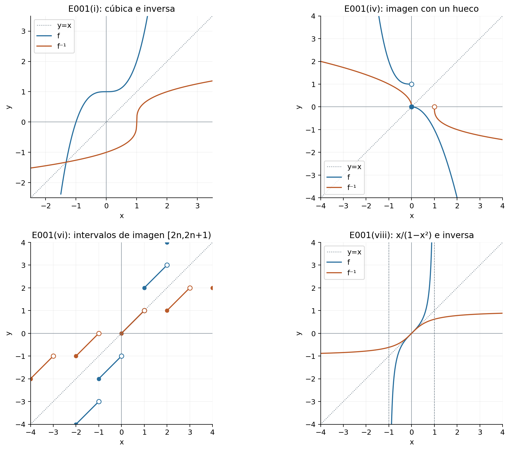
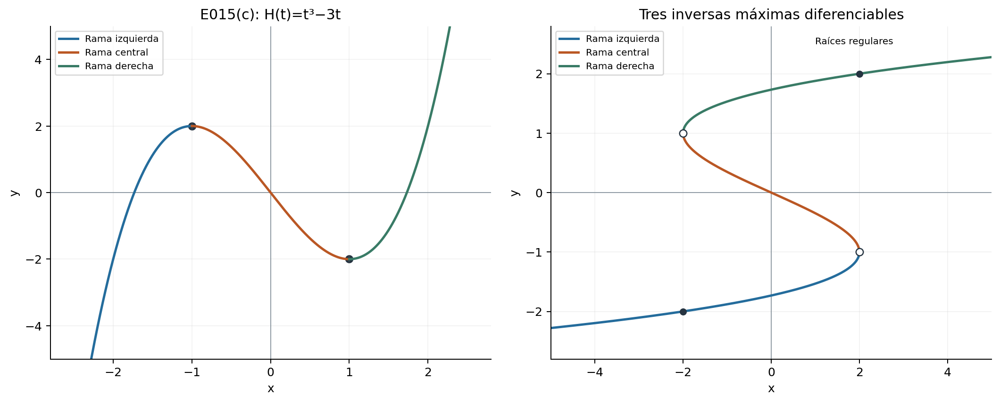
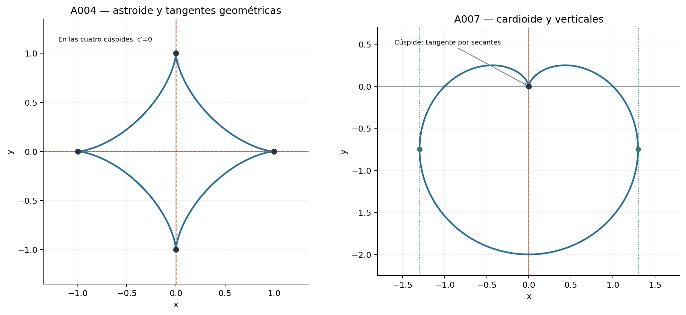
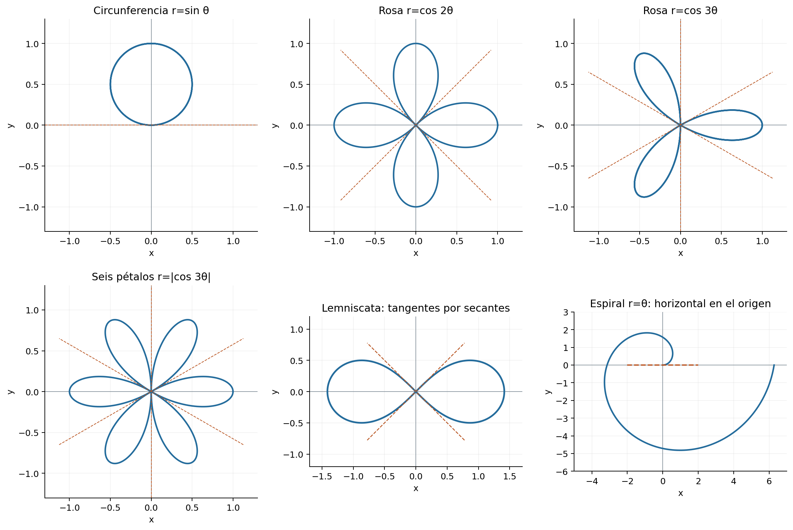
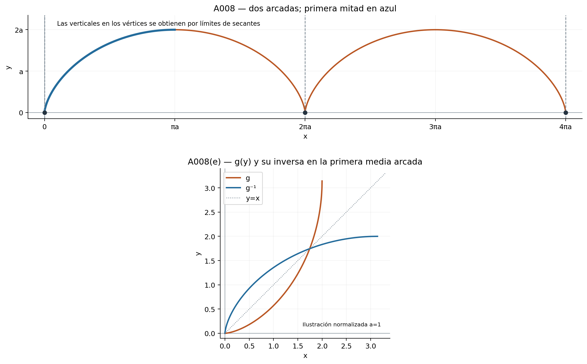

[← Capítulo 11](capitulo-11.qmd) · [Colecciones](../index.qmd#spivak-calculus-cuarta-edición) · [Capítulo 13 →](capitulo-13.qmd)

Solucionario explicado de Matemática Abierta · A. Peña

Fuente: Michael Spivak, *Calculus*, 4.ª edición, problemas pp. 239–243 (PDF 259–263) y apéndice pp. 248–252 (PDF 268–272). Enunciados condensados, demostraciones y figuras propias. Se desarrollan los 27 problemas principales y los 10 del apéndice, con todos sus incisos y precisiones necesarias.

Una inversa se define sobre la **imagen** de la función, que puede ser menor que el codominio declarado. $f^{-1}$ no significa $1/f$. «Creciente» y «decreciente» son estrictos; las versiones no estrictas se nombran explícitamente. Para aplicar el teorema de diferenciación de inversas se trabaja con una función continua e inyectiva en un intervalo: si $y=f(a)$ y $f'(a)\ne0$, entonces $(f^{-1})'(y)=1/f'(a)$. La diferenciabilidad de la inversa se demuestra por ese teorema antes de usar la regla de la cadena.

## Ejercicio 1 — `SPV4-C12-E001` {#e001}

Referencia: pp. 239–240. **Problema:** hallar las inversas de ocho funciones.

**(i)** Para $f(x)=x^3+1$, resolver $y=x^3+1$ da $f^{-1}(y)=\sqrt[3]{y-1}$, definida en toda la recta. Sustituir en ambos sentidos devuelve el argumento.

**(ii)** Para $f(x)=(x-1)^3$, la inversa es $f^{-1}(y)=1+\sqrt[3]y$, también en toda la recta.

**(iii)** $f(x)=x$ si $x$ es racional y $f(x)=-x$ si es irracional. Cambiar el signo preserva la irracionalidad, por tanto $f(f(x))=x$ en ambos casos. Es una biyección de la recta sobre sí misma y $f^{-1}=f$, aunque no es monótona ni continua salvo en cero.

**(iv)** $f(x)=-x^2$ para $x\ge0$, y $f(x)=1-x^3$ para $x<0$. La primera rama tiene imagen $(-\infty,0]$ y la segunda $(1,\infty)$; ambas son inyectivas y sus imágenes son disjuntas. Así
$$f^{-1}(y)=\begin{cases}\sqrt{-y},&y\le0,\\ \sqrt[3]{1-y},&y>1.\end{cases}$$
La inversa no está definida en $(0,1]$, pues ningún punto tiene esos valores como imagen. La discontinuidad de $f$ no impide la inyectividad.

**(v)** Se supone que $a_1,\ldots,a_n$ son distintos. La función deja fijos los otros números y envía $a_i$ a $a_{i+1}$, cerrando el ciclo con $a_n\mapsto a_1$. Su inversa invierte el ciclo:
$$f^{-1}(x)=\begin{cases}x,&x\notin\{a_1,\ldots,a_n\},\\a_{i-1},&x=a_i, 2\le i\le n,\\a_n,&x=a_1.\end{cases}$$
Para $n=1$ es la identidad. Sin distinguir los $a_i$, la definición por casos puede asignar valores incompatibles a un mismo argumento; la salvedad es necesaria.

**(vi)** $f(x)=x+\lfloor x\rfloor$. Para $x\in[n,n+1)$, $n\in\mathbb Z$, $f(x)=x+n$ y su imagen es $[2n,2n+1)$. Los intervalos de imagen son disjuntos, así $f$ es inyectiva. Su inversa, en $B=\bigcup_{n\in\mathbb Z}[2n,2n+1)$, es
$$f^{-1}(y)=y-\lfloor y/2\rfloor.$$
La fórmula no convierte los huecos de $B$ en puntos del dominio.

**(vii)** Se intercambian las dos primeras cifras decimales de $x=0.a_1a_2a_3\ldots$ en $[0,1)$. Para evitar la doble representación de decimales finitos, usamos la expansión que no acaba en una cola infinita de nueves. La permutación de dos cifras conserva esa convención y al aplicarla dos veces se obtiene $x$. Por tanto $f^{-1}=f$. Los casos $a_1=a_2$ quedan fijos. Una convención decimal no declarada podría hacer que la misma entrada tuviese imágenes distintas.

**(viii)** $f(x)=x/(1-x^2)$ para $-1<x<1$. Su derivada $(1+x^2)/(1-x^2)^2$ es positiva y sus límites extremos son $-\infty,+\infty$, de modo que es una biyección sobre $\mathbb R$. De $yx^2+x-y=0$ se selecciona la raíz que pertenece a $(-1,1)$:
$$f^{-1}(y)=\frac{2y}{1+\sqrt{1+4y^2}},\qquad y\in\mathbb R.$$
La racionalización evita la división por $y$ y da directamente valor cero cuando $y=0$. Para $y\ne0$, equivale a $(\sqrt{1+4y^2}-1)/(2y)$; la otra raíz queda fuera del dominio original. El valor absoluto de la raíz elegida es menor que uno porque $1+\sqrt{1+4y^2}>2|y|$.

{#fig-spv4-c12-f01 fig-alt="Capítulo 12: Inversas y dominios de imagen"}

## Ejercicio 2 — `SPV4-C12-E002` {#e002}

Referencia: p. 240. **Problema:** describir la gráfica de la inversa en cuatro casos de signo y monotonía.

La reflexión $(x,y)\mapsto(y,x)$ en la diagonal lleva la gráfica de $f$ a la de $f^{-1}$. El signo de $f$ determina el lado del **dominio** de la inversa, no el signo de sus valores:

| Inciso | Datos de $f$ | Gráfica de $f^{-1}$ |
|---|---|---|
| (i) | Creciente, positiva | Creciente, con abscisas positivas |
| (ii) | Creciente, negativa | Creciente, con abscisas negativas |
| (iii) | Decreciente, positiva | Decreciente, con abscisas positivas |
| (iv) | Decreciente, negativa | Decreciente, con abscisas negativas |

Las ordenadas de la inversa recorren el dominio original de $f$, sobre cuyo signo no se dan datos. No se afirma que toda la semirrecta correspondiente pertenezca a su dominio.

## Ejercicio 3 — `SPV4-C12-E003` {#e003}

Referencia: p. 240. **Problema:** probar que la inversa conserva el sentido de monotonía.

Sean $u<v$ en la imagen y $a=f^{-1}(u)$, $b=f^{-1}(v)$. Si $f$ crece, $a\ge b$ implicaría $f(a)\ge f(b)$, contradiciendo $u<v$; luego $a<b$. Si $f$ decrece, $a\le b$ implicaría $f(a)\ge f(b)$, también imposible; luego $a>b$. No se requiere continuidad para esta comparación de orden.

## Ejercicio 4 — `SPV4-C12-E004` {#e004}

Referencia: p. 240. **Problema:** decidir si suma, producto y composición de dos funciones crecientes son crecientes.

**Suma:** sí, en su dominio común: para $x<y$, sumar $f(x)<f(y)$ y $g(x)<g(y)$ da la desigualdad estricta.

**Producto:** no en general. Con $f=g=x$ en la recta, $fg=x^2$ decrece en la semirrecta negativa. Si ambas funciones fueran positivas, sí se podría comparar $f(x)g(x)<f(y)g(x)<f(y)g(y)$, pero esa condición adicional no está dada.

**Composición:** sí, siempre que esté definida: $g(x)<g(y)$ y el crecimiento de $f$ dan $f(g(x))<f(g(y))$. El rango de la función interior debe estar en el dominio de la exterior.

## Ejercicio 5 — `SPV4-C12-E005` {#e005}

Referencia: p. 240. **Problema:** invertir composiciones y un traslado vertical.

**(a)** Si $g(x)=g(y)$ solo para $x=y$ y $f$ es también inyectiva, $f(g(x))=f(g(y))$ fuerza primero $g(x)=g(y)$ y después $x=y$. Para deshacer una composición se deshace primero la aplicación exterior:
$$ (f\circ g)^{-1}=g^{-1}\circ f^{-1}.$$
Las identidades se comprueban sustituyendo; el dominio de la inversa es $f(g(D_g))$. En un caso con dominios mayores para $f$, se restringe su inversa a esa imagen para que $g^{-1}$ esté definida.

**(b)** Si $g(x)=1+f(x)$, la ecuación $y=g(x)$ equivale a $y-1=f(x)$. Luego $g^{-1}(y)=f^{-1}(y-1)$ en $1+f(D_f)$.

## Ejercicio 6 — `SPV4-C12-E006` {#e006}

Referencia: p. 240. **Problema:** caracterizar e invertir $f(x)=(ax+b)/(cx+d)$.

Se supone $(c,d)\ne(0,0)$, para que el dominio $D=\{x:cx+d\ne0\}$ no sea vacío. Para $x,y\in D$, multiplicar cruzado da
$$f(x)=f(y)\iff(ad-bc)(x-y)=0.$$
Así $f$ es inyectiva si y solo si $\Delta=ad-bc\ne0$. Si $\Delta=0$, es constante en su dominio, que contiene más de un punto. Sin la salvedad sobre $(c,d)$, la función de dominio vacío sería vacuamente inyectiva y el «si y solo si» literal fallaría.

Cuando $\Delta\ne0$, resolver $y(cx+d)=ax+b$ da
$$f^{-1}(y)=\frac{dy-b}{a-cy}.$$
Si $c\ne0$, su dominio es $\mathbb R\setminus\{a/c\}$ y el original excluye $-d/c$. Si $c=0$, $d\ne0$ y $a\ne0$, se obtiene la inversa afín $(dy-b)/a$ en toda la recta. La comparación anterior prueba inyectividad global entre las dos ramas, no solo monotonía dentro de cada una.

## Ejercicio 7 — `SPV4-C12-E007` {#e007}

Referencia: p. 240. **Problema:** hallar los intervalos cerrados de inyectividad de cuatro funciones.

Para $a<b$, una función continua es inyectiva en $[a,b]$ exactamente cuando es estrictamente monótona allí. Se dan las regiones máximas; los intervalos pedidos son todos sus subintervalos cerrados. Los intervalos de un solo punto siempre son inyectivos.

**(i)** $x^3-3x^2$, con derivada $3x(x-2)$: regiones $(-\infty,0]$, $[0,2]$, $[2,\infty)$. Un intervalo que atraviese $0$ o $2$ contiene un extremo interior y no es inyectivo.

**(ii)** $x^5+x$: derivada $5x^4+1>0$. Todo $[a,b]$ sirve.

**(iii)** $1/(1+x^2)$: crece hasta cero y decrece después. Sirven exactamente los cerrados contenidos en $(-\infty,0]$ o en $[0,\infty)$.

**(iv)** $(x+1)/(x^2+1)$: derivada $(1-2x-x^2)/(1+x^2)^2$. Con $\alpha=-1-\sqrt2$, $\beta=-1+\sqrt2$, las regiones son $(-\infty,\alpha]$, $[\alpha,\beta]$, $[\beta,\infty)$. No se excluyen los críticos como extremos de un intervalo de inyectividad.

## Ejercicio 8 — `SPV4-C12-E008` {#e008}

Referencia: p. 240. **Problema:** si $f'(x)=(1+x^3)^{-1/2}$, probar que su inversa $g$ satisface $g''=\tfrac32g^2$.

La expresión real exige $x>-1$. En un intervalo de ese dominio, $f'>0$ y existe una inversa diferenciable en la imagen. El teorema de inversas da
$$g'(y)=\sqrt{1+g(y)^3}.$$
El miembro derecho es diferenciable porque $1+g^3>0$. Por tanto
$$g''(y)=\frac{3g(y)^2g'(y)}{2\sqrt{1+g(y)^3}}=\frac32g(y)^2.$$
Las cancelaciones se hacen con factores estrictamente positivos. La constante aditiva de $f$ solo traslada el dominio de $g$.

## Ejercicio 9 — `SPV4-C12-E009` {#e009}

Referencia: p. 240. **Problema:** si $f^{-1}$ es diferenciable con derivada nunca nula, probar que $f$ es diferenciable.

En el contexto intervalar del teorema, aplíquelo a $g=f^{-1}$. Es inyectiva, continua por diferenciabilidad y tiene $g'\ne0$; su inversa $g^{-1}=f$ es diferenciable. Además $f'(x)=1/g'(f(x))$. Si el dominio de $g$ no es un solo intervalo, la misma prueba se hace localmente: en un intervalo abierto alrededor de cualquier $y$ donde $g$ esté definida y sea diferenciable, su derivada nunca nula tiene un único signo por Darboux. La restricción de $g$ es estrictamente monótona y su imagen contiene un intervalo alrededor de $g(y)$. La inversa local coincide allí con la inversa global por inyectividad. Así se obtiene la misma conclusión sin exigir un único intervalo global; se conserva la noción usual de diferenciabilidad en un entorno del punto.

## Ejercicio 10 — `SPV4-C12-E010` {#e010}

Referencia: p. 240. **Problema:** en C10-E017, ¿qué condición adicional sobre $g$ garantiza la diferenciabilidad de $f$?

En aquel problema $g$ era diferenciable y sobreyectiva sobre $\mathbb R$, y $F=f\circ g$ era diferenciable. Una condición suficiente es $g'(x)\ne0$ para todo $x$. Por Darboux, $g'$ tiene un único signo en la recta; el TVM hace a $g$ estrictamente monótona. Es por tanto una biyección continua con inversa diferenciable, y $f=F\circ g^{-1}$ es diferenciable. La cadena da $f'(y)=F'(g^{-1}(y))/g'(g^{-1}(y))$. El contraejemplo anterior, $g=x^3$, $f=|x|$, falla justamente en $g'(0)=0$.

## Ejercicio 11 — `SPV4-C12-E011` {#e011}

Referencia: p. 240. **Problema:** hallar la segunda derivada de una inversa.

Sea $g=f^{-1}$ y $f'(g(y))\ne0$. Si $f''$ existe en el punto correspondiente, derivar $g'=1/(f'\circ g)$ da
$$g''(y)=-\frac{f''(g(y))g'(y)}{[f'(g(y))]^2}=-\frac{f''(g(y))}{[f'(g(y))]^3}.$$
La derivabilidad de las expresiones se justifica con las hipótesis locales de E012, no con una supuesta división por $f'=0$.

## Ejercicio 12 — `SPV4-C12-E012` {#e012}

Referencia: p. 240. **Problema:** si $f'(f^{-1}(y))\ne0$ y existe $f^{(k)}$ allí, demostrar que existe $(f^{-1})^{(k)}(y)$.

Se mantienen continuidad e inyectividad de $f$ en un intervalo. La existencia de una derivada de orden $k$ en $a=f^{-1}(y)$ se entiende recursivamente: las de órdenes menores están definidas cerca de $a$, y la de orden $k-1$ es diferenciable en $a$.

Para $k=1$ es el teorema de inversas. Si $k\ge2$, la existencia de $f''(a)$ implica continuidad de $f'$ en $a$, así $f'$ no se anula en algún entorno de $a$. La continuidad de la inversa traslada ese entorno a otro de $y$.

Una inducción precisa organiza todas las derivadas. Escriba $p_j=f^{(j)}$ y $Q_1(p_1)=1/p_1$. Si
$$g^{(n)}=Q_n(p_1\circ g,\ldots,p_n\circ g),$$
la cadena y $g'=1/(p_1\circ g)$ producen
$$Q_{n+1}(p_1,\ldots,p_{n+1})=\frac1{p_1}\sum_{j=1}^n\frac{\partial Q_n}{\partial p_j}\,p_{j+1}.$$
Cada $Q_n$ es una función racional, sin denominadores distintos de potencias de $p_1$. Hasta el orden $k-1$ las fórmulas están definidas cerca de $y$; para la última derivación basta que cada $p_j$, $j\le k-1$, sea diferenciable en $a$, lo que garantiza la hipótesis. Así existe $g^{(k)}(y)$. No se exige continuidad de $f^{(k)}$ ni su existencia en todo un entorno si solo se pide la derivada en el punto.

## Ejercicio 13 — `SPV4-C12-E013` {#e013}

Referencia: p. 240. **Problema:** estudiar el schwarziano de la inversa, con $\mathcal Sf=f'''/f'-\tfrac32(f''/f')^2$.

**(a)** La existencia de $\mathcal Sf$ incluye las tres derivadas de $f$ y $f'\ne0$. En un intervalo, Darboux y el TVM hacen a $f$ estrictamente monótona, por tanto inyectiva. E012 hace a $g=f^{-1}$ tres veces diferenciable, y $g'=1/(f'\circ g)\ne0$. Por tanto $\mathcal Sg$ está definido en todo su dominio interior.

**(b)** Evaluando las derivadas de $f$ en $g(y)$ y abreviándolas como $p,q,r$,
$$g'=p^{-1},\quad g''=-qp^{-3},\quad g'''=3q^2p^{-5}-rp^{-4}.$$
Luego
$$\mathcal Sg(y)=\frac{3q^2}{p^4}-\frac r{p^3}-\frac32\frac{q^2}{p^4}=-\frac{\mathcal Sf(g(y))}{[f'(g(y))]^2}.$$
También se obtiene de $\mathcal S(f\circ g)=0$ y la regla de composición de C10-E019; el cálculo anterior verifica independientemente el signo y la potencia del denominador.

## Ejercicio 14 — `SPV4-C12-E014` {#e014}

Referencia: p. 241. **Problema:** construir una función diferenciable con $f(x)^5+f(x)+x=0$ y calcular su derivada de dos modos.

**(a)** Sea $H(t)=-t^5-t$. Tiene $H'=-5t^4-1<0$ y límites $+\infty,-\infty$ en los extremos de la recta. Es una biyección continua de $\mathbb R$ sobre sí misma. Definir $f=H^{-1}$ da $H(f(x))=x$, exactamente la ecuación requerida. El teorema de inversas prueba la diferenciabilidad, y también la unicidad de la solución para cada $x$.

**(b)** Por la fórmula de la inversa, $f'(x)=1/H'(f(x))=-1/[5f(x)^4+1]$.

**(c)** Puesto que la diferenciabilidad ya se ha probado, derivar la identidad da $(5f^4+1)f'+1=0$, de nuevo la misma fórmula. Derivar implícitamente desde el principio solo daría una condición necesaria y no demostraría existencia ni diferenciabilidad.

## Ejercicio 15 — `SPV4-C12-E015` {#e015}

Referencia: p. 241. **Problema:** determinar las soluciones diferenciables de tres ecuaciones implícitas.

**(a)** En $(-1,1)$, $x^2+f(x)^2=1$ exige $f=\pm\sqrt{1-x^2}$. Una solución diferenciable es continua y nunca vale cero en ese intervalo; no puede cambiar de signo por valores intermedios. Así hay exactamente dos soluciones en todo el intervalo: la rama positiva y la negativa. No hay valores reales para $|x|>1$.

**(b)** $x^2+f(x)^2=-1$ no tiene soluciones reales en ningún dominio no vacío, porque el miembro izquierdo es no negativo.

**(c)** Sea $H(t)=t^3-3t$, con derivada $3(t^2-1)$. Sus tres restricciones a $(-\infty,-1)$, $(-1,1)$ y $(1,\infty)$ tienen imágenes respectivas $(-\infty,2)$, $(-2,2)$ y $(-2,\infty)$. Sus inversas son las tres ramas diferenciables máximas de $f^3-3f=x$.

En un intervalo conectado, cualquier solución diferenciable debe permanecer en una de esas ramas: derivar da $3(f^2-1)f'=1$, que impide $f=\pm1$; la continuidad impide saltar entre componentes de $\mathbb R\setminus\{-1,1\}$. Toda restricción de una rama a un subintervalo de su dominio también sirve. No existe solución diferenciable sobre toda la recta, porque ninguna de las tres imágenes es toda $\mathbb R$. En $x=2$ hay una raíz regular $f=2$ y una crítica $f=-1$; en $x=-2$, una regular $f=-2$ y una crítica $f=1$. Las raíces regulares están incluidas en las ramas externas correspondientes; las críticas no admiten una solución diferenciable que pase por ellas.

{#fig-spv4-c12-f02 fig-alt="Capítulo 12: Tres ramas inversas de la cúbica"}

## Ejercicio 16 — `SPV4-C12-E016` {#e016}

Referencia: p. 241. **Problema:** derivar implícitamente el círculo y la cúbica, verificando las dos ramas del círculo.

**(a)** De $f^2+x^2=1$ se obtiene $2ff'+2x=0$ y $f'=-x/f$, donde $f\ne0$.

**(b)** Para $f=\sqrt{1-x^2}$, la derivada directa es $-x/\sqrt{1-x^2}$; para $f=-\sqrt{1-x^2}$ es $x/\sqrt{1-x^2}$. Ambas coinciden con $-x/f$. Se trabaja en $(-1,1)$; no se divide por el valor cero de los extremos.

**(c)** De $f^3-3f=x$ se obtiene $f'=1/[3(f^2-1)]$ en cada rama de E015(c). La identidad derivada vuelve a mostrar por qué $f=\pm1$ impide una derivada finita.

## Ejercicio 17 — `SPV4-C12-E017` {#e017}

Referencia: p. 241. **Problema:** hallar $f',f''$ para $x^3+f(x)^3=7$, y evaluarlas cuando $f(-1)=2$.

**(a)** La única solución real es $f(x)=\sqrt[3]{7-x^3}$, diferenciable salvo en $x=\sqrt[3]7$. Donde $f\ne0$, la identidad da $f'=-x^2/f^2$. Derivando otra vez,
$$f''=-\frac{2x}{f^2}+\frac{2x^2f'}{f^3}=-\frac{2x}{f^2}-\frac{2x^4}{f^5}=-\frac{14x}{f^5},$$
porque $f^3+x^3=7$. En el punto excluido $f=0$, la primera identidad derivada exigiría $3x^2=0$, imposible allí.

**(b)** Sustituir $x=-1$, $f=2$ da $f'(-1)=-1/4$ y $f''(-1)=7/16$.

## Ejercicio 18 — `SPV4-C12-E018` {#e018}

Referencia: p. 241. **Problema:** hallar la tangente a $3x^3+4x^2y-xy^2+2y^3=4$ en $(-1,1)$.

El punto pertenece a la curva porque $-3+4+1+2=4$. Para una rama diferenciable $y=f(x)$, derivar da
$$9x^2+8xy-y^2+(4x^2-2xy+6y^2)y'=0.$$
En $(-1,1)$ los coeficientes son $0$ y $12$; por tanto $y'=0$ y la tangente es **$y=1$**.

Se puede justificar localmente la existencia de la rama, sin inferirla de la identidad derivada: el polinomio $F(x,y)=3x^3+4x^2y-xy^2+2y^3-4$ tiene $F_y=12$ en el punto, y por continuidad es estrictamente positivo en un rectángulo pequeño. En sus bordes horizontales cerca del punto, $F$ tiene signos opuestos; al reducir el ancho se mantienen para todo $x$ del rectángulo. Valores intermedios y crecimiento en $y$ producen una raíz única $y=f(x)$; las mismas comparaciones producen continuidad. El desarrollo de la diferencia polinómica entre dos puntos de esa rama da el cociente incremental $-F_x/F_y$ en el límite, así la rama es diferenciable. Aquí el denominador no nulo es el dato que valida la tangente.

## Ejercicio 19 — `SPV4-C12-E019` {#e019}

Referencia: pp. 241–242. **Problema:** reescribir una derivación de Leibniz mediante funciones y primas.

La identidad $y^4+y^3+xy=1$ significa
$$f(x)^4+f(x)^3+xf(x)=1.$$
Para una solución diferenciable, la cadena y el producto dan
$$4f(x)^3f'(x)+3f(x)^2f'(x)+f(x)+xf'(x)=0,$$
por tanto
$$f'(x)=-\frac{f(x)}{4f(x)^3+3f(x)^2+x}.$$
Se exige que el denominador sea no nulo. Si fuese cero en una solución diferenciable, la identidad derivada exigiría $f=0$, pero la original daría $0=1$; así en una rama diferenciable ese denominador no puede anularse. La notación $y$ abrevia $f(x)$, no una constante respecto de $x$.

## Ejercicio 20 — `SPV4-C12-E020` {#e020}

Referencia: p. 242. **Problema:** escribir el teorema de inversas en notación de Leibniz e interpretar la derivada de una raíz.

Si $y=f(x)$ y $x=f^{-1}(y)$, con derivada no nula,
$$\left.\frac{dx}{dy}\right|_{y=f(a)}=\frac1{\left.\frac{dy}{dx}\right|_{x=a}}.$$
Los dos cocientes son derivadas de funciones distintas en argumentos correspondientes. Para $x=y^n$, restringiendo la potencia a una rama inyectiva, $y=x^{1/n}$ y
$$\frac{d}{dx}x^{1/n}=\frac1{ny^{n-1}}=\frac1n x^{1/n-1}.$$
Para $n>1$, el cálculo se hace con $y\ne0$; si $n$ es par se usa la raíz no negativa y $x>0$. Si $n$ es impar admite $x<0$ con potencias reales de denominador impar. Para $n=1$ la derivada vale uno también en cero. La notación sugiere una inversión de fracciones, pero su justificación es el teorema, no álgebra de infinitesimales.

## Ejercicio 21 — `SPV4-C12-E021` {#e021}

Referencia: p. 242. **Problema:** si $F'=f$, hallar una función con derivada $f^{-1}$.

Suponga $f$ diferenciable e inyectiva en un intervalo, con $f'\ne0$, y ponga $g=f^{-1}$. Para $G(x)=xg(x)-F(g(x))$,
$$G'(x)=g(x)+xg'(x)-F'(g(x))g'(x)=g(x)+[x-f(g(x))]g'(x)=g(x).$$
Así $G'=f^{-1}$ en la imagen de $f$. El término entre corchetes se anula por la identidad de inversas; la prueba no requiere conocer una fórmula explícita para $g$.

## Ejercicio 22 — `SPV4-C12-E022` {#e022}

Referencia: p. 242. **Problema:** si $h'(x)=\sin^2(\sin(x+1))$, $h(0)=3$, calcular dos derivadas de inversas.

La derivada es no negativa y se anula exactamente cuando $x+1=k\pi$: como $\sin(x+1)\in[-1,1]$, su seno solo es cero si su argumento es cero. Los ceros son aislados. Por el TVM $h$ es no decreciente; no puede ser constante en ningún intervalo porque dentro de él hay un punto con $h'>0$. E026(a) implica que $h$ es estrictamente creciente y tiene inversa en su imagen.

**(i)** $h^{-1}(3)=0$ y $h'(0)=\sin^2(\sin1)>0$, luego $(h^{-1})'(3)=1/\sin^2(\sin1)$.

**(ii)** Si $\beta(x)=h(x+1)$, entonces $\beta(-1)=3$, y $\beta'(-1)=h'(0)$. Por tanto $(\beta^{-1})'(3)$ tiene el mismo valor. Equivalentemente, $\beta^{-1}(y)=h^{-1}(y)-1$. No se evalúa $h'$ en $1$: el argumento correcto procede de la preimagen de $3$.

## Ejercicio 23 — `SPV4-C12-E023` {#e023}

Referencia: p. 242. **Problema:** estudiar intersecciones de funciones monótonas y construir ejemplos.

**(a)** Si $f$ crece y $g$ decrece, $f-g$ crece estrictamente. Dos ceros distintos darían valores iguales de una función estrictamente creciente, imposible. Puede haber cero o una intersección.

**(b)** Tome $f(x)=x$ y $g(x)=x+[1-\cos(2\pi x)]/(4\pi)$. Son continuas y crecientes porque $f'=1$ y $g'=1+\tfrac12\sin(2\pi x)\ge1/2>0$. Su diferencia se anula exactamente cuando $\cos(2\pi x)=1$, esto es, en los enteros.

**(c)** Tome $f(x)=2+x/\sqrt{1+x^2}$ y $g(x)=-2-x/\sqrt{1+x^2}$. Sus derivadas son opuestas, la de $f$ es $(1+x^2)^{-3/2}>0$; ambas son continuas. Como $f>1$ y $g<-1$, no se intersectan. Monotonías opuestas no garantizan por sí solas un cruce.

## Ejercicio 24 — `SPV4-C12-E024` {#e024}

Referencia: pp. 242–243. **Problema:** estudiar funciones continuas iguales a su inversa.

**(a)** $f=f^{-1}$ equivale a $f(f(x))=x$, y geométricamente a que su gráfica sea simétrica respecto de $y=x$. Si ya hay $f(a)=a$, terminamos. Si no, sea $b=f(a)$. Entonces $f(b)=a$, de modo que $D(x)=f(x)-x$ tiene valores $b-a$ y $a-b$ en $a,b$, de signos opuestos. Por continuidad tiene un cero entre ambos. Existe un punto fijo.

**(b)** Tres familias de ejemplos continuos con un único punto fijo son:

| Función | Verificación y punto fijo |
|---|---|
| $f(x)=c-x$ | $f(f(x))=x$; fijo $c/2$ |
| $f(x)=-ax$ si $x\ge0$, $f(x)=-x/a$ si $x<0$, $a>0$ | Continua y decreciente; las dos ramas se deshacen; único fijo $0$ |
| $f(x)=\sqrt[3]{c-x^3}$ | $f(f(x))^3=x^3$; decreciente; único fijo $\sqrt[3]{c/2}$ |

No se exige que esos ejemplos sean diferenciables: el problema pide continuidad. El decrecimiento y E023(a), aplicada a la identidad creciente, prueban la unicidad.

**(c)** Si además $f$ crece, $f(x)>x$ implicaría $x=f(f(x))>f(x)$, contradicción. Si $f(x)<x$, aplicar el crecimiento da $x=f(f(x))<f(x)$, también imposible. Luego $f(x)=x$ en todos los puntos. Aquí no hace falta continuidad.

## Ejercicio 25 — `SPV4-C12-E025` {#e025}

Referencia: p. 243. **Problema:** determinar cuándo la reflexión en la antidiagonal sigue siendo gráfica de una función.

Reflejar en $y=-x$ envía $(x,f(x))$ a $(-f(x),-x)$. La primera coordenada determina un único valor de la segunda si y solo si $f$ es inyectiva. En ese caso la función reflejada es
$$H(u)=-f^{-1}(-u),\qquad u\in-f(D_f).$$
Si $f(x_1)=f(x_2)$ con $x_1\ne x_2$, la reflexión tiene dos ordenadas sobre la misma abscisa y no es una gráfica. No se requiere monotonía ni continuidad.

## Ejercicio 26 — `SPV4-C12-E026` {#e026}

Referencia: p. 243. **Problema:** relacionar crecimiento no estricto, constancia en intervalos y signo de la derivada.

**(a)** Si $f$ es no decreciente pero no estrictamente creciente, hay $a<b$ con $f(a)=f(b)$. Para $a\le x\le b$, $f(a)\le f(x)\le f(b)$, luego $f$ es constante en ese intervalo no degenerado.

**(b)** Si $f$ es diferenciable y no decreciente, sus cocientes incrementales son no negativos para ambos signos de $h$: el numerador y $h$ tienen el mismo signo, o el numerador es cero. El límite da $f'(x)\ge0$.

**(c)** Si $f'\ge0$ en el interior de un intervalo y $f$ es continua en los extremos incluidos, el TVM entre $a<b$ da $f(b)-f(a)=f'(c)(b-a)\ge0$. Por tanto $f$ es no decreciente. Son conclusiones no estrictas: una derivada que vale cero en todo un subintervalo produce un tramo constante.

## Ejercicio 27 — `SPV4-C12-E027` {#e027}

Referencia: p. 243. **Problema:** para una función positiva y decreciente en $\mathbb R$, construir una minorante continua decreciente, y hacer que su cociente con $f$ tienda a cero en $+\infty$.

**(a)** No se supone continuidad de $f$. Para cada entero $n$, ponga $b_n=f(n+1)>0$. Una esos datos con segmentos: si $n\le x\le n+1$,
$$g_0(x)=(n+1-x)b_n+(x-n)b_{n+1}.$$
Las fórmulas adyacentes coinciden en los enteros, así $g_0$ es continua; como $b_{n+1}<b_n$, cada segmento tiene pendiente negativa y el conjunto es estrictamente decreciente. Además
$$0<g_0(x)\le b_n=f(n+1)\le f(x).$$
Se usa un dato desplazado a la derecha para que toda la interpolación quede por debajo de $f$, incluso si esta tiene saltos.

**(b)** Sea $D(x)=1+x+\sqrt{1+x^2}$. Es positiva, mayor que uno y estrictamente creciente, pues $D'=1+x/\sqrt{1+x^2}>0$. La función $g(x)=g_0(x)/D(x)$ es positiva, continua y estrictamente decreciente: entre dos puntos disminuye el numerador positivo y aumenta el denominador positivo. Cumple $g\le f$ y
$$0<\frac{g(x)}{f(x)}\le\frac1{D(x)}\longrightarrow0\quad(x\to+\infty).$$
La construcción funciona en toda la recta y no emplea integrales de una función posiblemente discontinua.

## Apéndice — Representación paramétrica de curvas {#seccion-25225}

Para $c(t)=(u(t),v(t))$, se deriva por componentes: $c'=(u',v')$. La definición del apéndice produce una recta tangente $c(t_0)+s\,c'(t_0)$ solo si $c'(t_0)\ne(0,0)$. En puntos de velocidad cero puede existir una tangente **geométrica por límite de secantes**, pero no se deduce de esa fórmula: la distinción permite tratar las cúspides sin declarar que un vector cero define una dirección.

## Apéndice, ejercicio 1 — `SPV4-C12-A01-E001` {#e001-2}

Referencia: p. 248. **Problema:** comparar la tangente usual a una gráfica con la definición paramétrica.

**(a)** En la ecuación punto-pendiente $y-f(a)=(x-a)f'(a)$, poner $s=x-a$ produce todos los puntos $(a+s,f(a)+sf'(a))$, $s\in\mathbb R$. Recíprocamente todo $s$ corresponde a una abscisa $x=a+s$; las dos descripciones son idénticas.

**(b)** Para $c(t)=(t,f(t))$, $c'(a)=(1,f'(a))\ne(0,0)$. Su recta tangente es $(a,f(a))+s(1,f'(a))$, exactamente la de (a). La coincidencia se verifica incluso cuando $f'(a)=0$.

## Apéndice, ejercicio 2 — `SPV4-C12-A01-E002` {#e002-2}

Referencia: p. 248. **Problema:** estudiar $c(t)=(f(t),t^2)$, donde $f$ es la función de la figura 21 de C09.

La figura 21, p. 162, define $f(t)=t^2$ para $t>0$ y $-t^2$ para $t\le0$, esto es $t|t|$. Entonces $c(t)=(t|t|,t^2)$ y el valor absoluto de su primera coordenada es $\lvert t\cdot|t|\rvert=|t|\cdot|t|=t^2$. Por tanto sus coordenadas cumplen $y=|x|$ y, al variar $t$, recorren toda esa gráfica.

Por cociente incremental, $f'(0)=\lim h|h|/h=0$ y $(t^2)'(0)=0$, así $c'(0)=(0,0)$. La curva tiene una esquina geométrica en el origen, aunque la parametrización sea diferenciable allí. La velocidad cero impide aplicar la definición de tangente regular.

## Apéndice, ejercicio 3 — `SPV4-C12-A01-E003` {#e003-2}

Referencia: pp. 248–249. **Problema:** convertir una parametrización con $u$ inyectiva en una gráfica y hallar sus dos primeras derivadas.

**(a)** Para $x=u(t)$, el parámetro es $t=u^{-1}(x)$ y la ordenada $v(t)$ es $f(x)=(v\circ u^{-1})(x)$. La imagen paramétrica coincide con la gráfica de $f$ sobre $u(I)$.

**(b)** Suponga $u,v$ diferenciables y $u'\ne0$. El teorema de inversas y la cadena dan
$$f'(u(t))=\frac{v'(t)}{u'(t)}.$$
La derivada está evaluada en **$x=u(t)$**, no en $t$ salvo que $u$ sea la identidad.

**(c)** Si además existen $u'',v''$, derive con respecto a $t$ la igualdad anterior: $f''(u(t))u'(t)=[v''u'-v'u'']/(u')^2$. Dividir por el factor no nulo da
$$f''(u(t))=\frac{u'(t)v''(t)-v'(t)u''(t)}{[u'(t)]^3}.$$
La tercera potencia del denominador procede de dos divisiones distintas: la del cociente y la del cambio de variable.

## Apéndice, ejercicio 4 — `SPV4-C12-A01-E004` {#e004-2}

Referencia: p. 249. **Problema:** calcular la pendiente de la astroide $x^{2/3}+y^{2/3}=1$ de dos modos.

Las potencias se interpretan mediante raíces cúbicas reales, así $x^{2/3}=|x|^{2/3}$. En los puntos con $xy\ne0$:

**(i)** Derivar implícitamente da $\tfrac23x^{-1/3}+\tfrac23y^{-1/3}y'=0$, por tanto $y'=-\sqrt[3]{y/x}$.

**(ii)** Para $x=\cos^3t$, $y=\sin^3t$, $x'=-3\cos^2t\sin t$, $y'=3\sin^2t\cos t$. Si $\sin t\cos t\ne0$, $dy/dx=-\tan t$, que coincide con $-\sqrt[3]{y/x}$.

Hay cuatro cúspides: $(\pm1,0)$, $(0,\pm1)$, donde el vector velocidad es cero y las divisiones anteriores no se aplican. Por secantes, las tangentes geométricas en $(\pm1,0)$ son horizontales y en $(0,\pm1)$ verticales. Por ejemplo, cerca de $t=0$, $x-1\sim-\tfrac32t^2$, $y\sim t^3$, así $y/(x-1)\to0$; cerca de $t=\pi/2$, el cociente de los incrementos de $x$ e $y$ tiende a cero. No se confunde esa tangente de cúspide con la definición regular del apéndice.

{#fig-spv4-c12-f03 fig-alt="Capítulo 12: Astroide y cardioide: tangentes regulares y de cúspide"}

## Apéndice, ejercicio 5 — `SPV4-C12-A01-E005` {#e005-2}

Referencia: p. 249. **Problema:** probar que el segmento desde un punto fijo hasta un punto más próximo o más lejano de una curva es perpendicular a su tangente.

Sea $P=(x_0,y_0)$ y $Q=c(t_0)$. Se requiere que el extremo de distancia ocurra en un **parámetro interior**, que $c'(t_0)\ne0$ y, para hablar de la recta $PQ$, que $P\ne Q$. La distancia cuadrada es
$$D(t)=[u(t)-x_0]^2+[v(t)-y_0]^2.$$
Fermat, tanto en mínimo como en máximo, da
$$0=D'(t_0)=2[Q-P]\cdot c'(t_0).$$
El vector $Q-P$ es perpendicular al vector director de la tangente; se obtiene lo pedido.

La condición interior, no explicitada en el enunciado, no puede omitirse: para $c(t)=(t,0)$, $0\le t\le1$, y $P=(-1,1)$, el punto más próximo es $Q=(0,0)$, en el extremo. Su vector $Q-P=(1,-1)$ tiene producto escalar $1$ con $c'(0)=(1,0)$, y no es perpendicular. Si $P=Q$, el producto escalar se anula trivialmente, pero no hay recta determinada por dos puntos distintos.

## Apéndice, ejercicio 6 — `SPV4-C12-A01-E006` {#e006-2}

Referencia: pp. 249–250. **Problema:** estudiar tangentes de la curva polar $c(\theta)=f(\theta)(\cos\theta,\sin\theta)$.

**(a)** Sus componentes derivadas son $x'=f'\cos\theta-f\sin\theta$, $y'=f'\sin\theta+f\cos\theta$. Si $x'\ne0$, la pendiente es
$$\frac{dy}{dx}=\frac{f\cos\theta+f'\sin\theta}{-f\sin\theta+f'\cos\theta}.$$
Si $x'=0$ y $y'\ne0$, la tangente es vertical; si ambos son cero, la definición regular no da una recta.

**(b)** Si $f(\theta_0)=0$, entonces $c'(\theta_0)=f'(\theta_0)(\cos\theta_0,\sin\theta_0)$. Cuando $f'(\theta_0)\ne0$, la tangente pasa por el origen con dirección $\theta_0$, es decir $x\sin\theta_0-y\cos\theta_0=0$.

El enunciado solo pide $f$ diferenciable, pero si también $f'(\theta_0)=0$ la velocidad es cero y la conclusión no se sigue de la definición del apéndice. Una curva constante en el origen ni siquiera determina una dirección geométrica. Si hay puntos no nulos de la curva arbitrariamente cerca del parámetro, sus secantes desde el origen tienen dirección $\theta\pmod\pi$, que tiende a $\theta_0$; ello sí justifica una tangente geométrica a esa rama, mediante otro argumento.

Se completan las curvas remitidas a C04, conservando su convención de radios con signo:

| Curva anterior | Tangentes en el origen o precisión pertinente |
|---|---|
| Espiral de Arquímedes $r=a\theta$, $a\ne0$ | Cero en $\theta=0$, derivada $a\ne0$; tangente horizontal |
| C04-A03-E003(i), $r=a\sin\theta$, $a\ne0$ | Ceros $k\pi$; todas las tangentes en el origen son horizontales |
| E003(ii), $r=a\sec\theta$, $a\ne0$ | No pasa por el origen; es la recta $x=a$, de tangente vertical |
| E003(iii), $r=\cos2\theta$ | Ceros $\pi/4+k\pi/2$; tangentes $y=x$ y $y=-x$ |
| E003(iv), $r=\cos3\theta$ | Ceros $\pi/6+k\pi/3$; tres direcciones: $\pi/6,\pi/2,5\pi/6$ módulo $\pi$ |
| E003(v), $r=|\cos2\theta|$ | No es diferenciable en los ceros; por secantes tiene las mismas dos rectas diagonales |
| E003(vi), $r=|\cos3\theta|$ | Tampoco es diferenciable en los ceros; por secantes tiene las mismas tres direcciones del coseno triple |
| C04-A03-E010(a–c), lemniscata $r^2=2a^2\cos2\theta$, $a>0$ | El radio como función del ángulo no es diferenciable en sus extremos de valor cero; las dos tangentes geométricas son $y=\pm x$ |
| E010(d), óvalos de Cassini $d_1d_2=b$ | Solo $b=a^2$ pasa por el origen y recupera la lemniscata; los otros óvalos no añaden tangentes allí |

Para la lemniscata, las direcciones de las secantes tienden a $\pm\pi/4$, o se usa el término cuadrático de $(x^2+y^2)^2=2a^2(x^2-y^2)$. Si $a=0$ en las curvas que dependen de él, la curva degenerada es solo un punto y no una curva con tangente regular. La tabla aplica el resultado cuando sus hipótesis se cumplen y emplea secantes donde no se cumplen.

{#fig-spv4-c12-f04 fig-alt="Capítulo 12: Tangentes en el origen de las curvas polares"}

**(c)** Si la distancia al origen tiene un máximo en un parámetro interior y el punto es regular, $\|c\|^2=f^2$ da $2ff'=0$. Si $f\ne0$, entonces $f'=0$ y $c'=f(-\sin\theta,\cos\theta)$: la tangente es perpendicular al radio. Equivalentemente $c\cdot c'=0$, como en A005. Un máximo de distancia cero reduciría la curva al origen y no sería regular; un extremo de parámetro requiere las mismas reservas que A005.

**(d)** En la base radial $e=(\cos\theta,\sin\theta)$ y su perpendicular $e_\perp=(-\sin\theta,\cos\theta)$, la velocidad es $c'=f'e+fe_\perp$. Por tanto sus componentes respecto del radio son $f',f$, y el ángulo de la tangente cumple
$$\tan(\alpha-\theta)=\frac{f(\theta)}{f'(\theta)},$$
si $f'\ne0$. Si $f'=0$ y $f\ne0$, el ángulo es recto módulo $\pi$ y su tangente trigonométrica no tiene valor finito. Si ambos son cero, no se define $\alpha$ por la velocidad. La forma vectorial también cubre tangentes verticales sin usar una fórmula de resta de tangentes con denominadores nulos.

## Apéndice, ejercicio 7 — `SPV4-C12-A01-E007` {#e007-2}

Referencia: p. 250. **Problema:** calcular las pendientes de la cardioide $r=1-\sin\theta$ de dos modos, y estudiar la tangente en el origen.

**(a-i)** Ponga $S=x^2+y^2$ y $A=S+y$. La ecuación cartesiana es $A^2=S$. Derivar implícitamente da
$$2A[2x+(2y+1)y']=2x+2yy',$$
así
$$y'=\frac{x(1-2A)}{A(2y+1)-y}$$
donde el denominador sea no nulo y exista una rama diferenciable.

**(a-ii)** Con $r=1-\sin\theta$, $r'=-\cos\theta$, A006(a) da
$$\frac{dy}{dx}=\frac{\cos\theta(1-2\sin\theta)}{2\sin^2\theta-\sin\theta-1}.$$
Fuera del origen, $S=r^2$ y $A=r^2+r\sin\theta=r$, por lo que sustituir $x=r\cos\theta,y=r\sin\theta$ en la fórmula cartesiana reproduce exactamente este cociente.

**(b)** El origen corresponde a $\theta=\pi/2+2k\pi$, donde $r=r'=0$: la velocidad también es cero. No se puede aplicar sin más la definición de tangente regular ni dividir las fórmulas anteriores, que son $0/0$. Para $\theta=\pi/2+h$,
$$r=1-\cos h,\qquad x=-r\sin h,\qquad y=r\cos h.$$
Para $h\ne0$ pequeño, $x/y=-\tan h\to0$. Las secantes de ambas ramas tienden por tanto a la recta vertical **$x=0$**, la tangente geométrica en la cúspide. Hay también dos tangentes verticales regulares cuando $\sin\theta=-1/2$, en $(\pm3\sqrt3/4,-3/4)$; se distinguen de la cúspide en la lámina A004_A007.

## Apéndice, ejercicio 8 — `SPV4-C12-A01-E008` {#e008-2}

Referencia: pp. 250–252. **Problema:** parametrizar la cicloide de una rueda de radio $a>0$, estudiar su gráfica y tangentes, y expresar su primera media arcada como una inversa. El propio texto indica que las funciones trigonométricas inversas de los últimos incisos se apoyan en C15; aquí se usan con sus valores principales declarados.

**(a)** Tras un giro $t$ en radianes, la rodadura sin deslizamiento traslada el centro a $(at,a)$. El vector desde el centro al punto que partió del contacto con el suelo es $(-a\sin t,-a\cos t)$. Por tanto
$$u(t)=a(t-\sin t),\qquad v(t)=a(1-\cos t).$$
La igualdad entre distancia rodada y arco $at$ fija el signo y el factor del primer término.

**(b)** $u'=a(1-\cos t)\ge0$, con ceros aislados $2k\pi$. Por el TVM $u$ es no decreciente; no puede ser constante en un intervalo porque su derivada es positiva en algún punto de cualquiera de ellos. E026(a) da crecimiento estricto. Además $|u(t)-at|\le a$, así su imagen es toda la recta. La cicloide es la gráfica $f=v\circ u^{-1}$. En los parámetros no cuspídeos,
$$f'(u(t))=\frac{a\sin t}{a(1-\cos t)}=\cot(t/2).$$
El argumento es $u(t)$; escribir $f'(t)$ sin ese cambio confundiría el parámetro con la abscisa. En cada arcada el valor sube hasta altura $2a$ y baja a cero.

**(c)** En los vértices $t=2k\pi$, tanto $u'$ como $v'$ se anulan. Con $s=t-2k\pi$,
$$u(t)-2k\pi a=a(s-\sin s),\qquad v(t)=a(1-\cos s).$$
Usando $s-\sin s\sim s^3/6$, $1-\cos s\sim s^2/2$, se obtiene $(u-2k\pi a)/v\to0$. Estos equivalentes se pueden demostrar por l’Hôpital sucesivo con las derivadas trigonométricas conocidas, sin usar series. Las secantes tienden a la recta vertical **$x=2k\pi a$**. Por la izquierda y la derecha la pendiente de la gráfica tiende respectivamente a $-\infty,+\infty$: no hay derivada real finita en el vértice, y la tangente geométrica no procede del vector velocidad cero.

{#fig-spv4-c12-f05 fig-alt="Capítulo 12: Cicloide, pendientes y cambio de rama"}

**(d)** Sea $y=v(t)\in[0,2a]$, $\phi=\arccos((a-y)/a)\in[0,\pi]$ y $R=\sqrt{(2a-y)y}$. Entonces $\cos t=(a-y)/a$ y $a|\sin t|=R$. Las expresiones correctas para las dos mitades de cada arcada son
$$u(t)=\begin{cases}2k\pi a+a\phi-R,&2k\pi\le t\le(2k+1)\pi,\\2(k+1)\pi a-a\phi+R,&(2k+1)\pi\le t\le2(k+1)\pi.\end{cases}$$
En particular, en la primera media arcada, $u=a\phi-R$.

**Corrección de alcance del enunciado:** la expresión impresa $u=a\arccos((a-v)/a)\pm\sqrt{(2a-v)v}$ no es válida para todo $t$ si $\arccos$ significa su rama principal. En la segunda mitad hace falta reemplazar el término angular por $2\pi a-a\phi$, y en arcadas posteriores añadir el período espacial. Por ejemplo, en $t=3\pi/2$, $v=a$ y $u=a(3\pi/2+1)$, que no es ninguno de $a(\pi/2\pm1)$. La formulación por ramas demuestra la relación correcta sin atribuir a $\arccos$ un valor principal incompatible.

**(e)** En $0\le t\le\pi$, $v$ aumenta de $0$ a $2a$ y $u$ de $0$ a $\pi a$. La fórmula anterior define
$$g(y)=a\arccos\frac{a-y}{a}-\sqrt{(2a-y)y},\qquad 0\le y\le2a.$$
Es continua y estrictamente creciente, pues equivale a $u\circ(v|_{[0,\pi]})^{-1}$. Tiene valores extremos $g(0)=0,g(2a)=\pi a$, y la primera mitad de la primera arcada es exactamente la gráfica de $g^{-1}$ en $[0,\pi a]$. Como comprobación en el interior,
$$g'(y)=\frac{a}{\sqrt{(2a-y)y}}-\frac{a-y}{\sqrt{(2a-y)y}}=\sqrt{\frac{y}{2a-y}}>0.$$
No se fuerza una derivada finita en ambos extremos de $g$: el comportamiento de la inversa en la cúspide se analiza en (c).

## Apéndice, ejercicio 9 — `SPV4-C12-A01-E009` {#e009-2}

Referencia: p. 252. **Problema:** demostrar que una tangente de una curva regular es paralela a la cuerda que une sus extremos.

Se requiere $P=c(a)\ne Q=c(b)$, continuidad en $[a,b]$, diferenciabilidad interior y $c'(t)\ne0$ allí, como advierte la pista. Ponga $w=Q-P\ne0$ y $H(t)=\det(c(t)-P,w)$. Esta función escalar es continua y diferenciable, con $H(a)=H(b)=0$. Rolle da $\tau\in(a,b)$ con
$$0=H'(\tau)=\det(c'(\tau),w).$$
En el plano, determinante cero significa dependencia lineal. Como ambos vectores son no nulos, definen direcciones paralelas: la tangente en $c(\tau)$ es paralela a la cuerda. Es la interpretación geométrica del TVM de Cauchy sin dividir por una componente que pudiera ser cero, así cubre cuerdas verticales.

Si $P=Q$, no hay una dirección de cuerda determinada; por ejemplo una circunferencia parametrizada una vuelta completa tiene velocidad no nula pero sus extremos coinciden. No se afirma la conclusión direccional en ese caso. Si se permiten puntos de velocidad cero, Rolle podría seleccionar uno de ellos y tampoco produciría una tangente regular.

## Apéndice, ejercicio 10 — `SPV4-C12-A01-E010` {#e010-2}

Referencia: p. 252. **Problema:** probar la equivalencia de límite vectorial por norma y por componentes.

Sean $c(t)=(u(t),v(t))$ y $L=(l_1,l_2)$.

**(a)** Por la definición euclídea,
$$\|c(t)-L\|^2=|u(t)-l_1|^2+|v(t)-l_2|^2.$$
Cada sumando es no negativo, así $|u-l_1|\le\|c-L\|$ y $|v-l_2|\le\|c-L\|$. Si la norma es menor que $\varepsilon$ para $0<|t-a|<\delta$, ambas diferencias también lo son. El límite vectorial implica los dos límites escalares.

**(b)** Recíprocamente, dados los dos límites escalares y $\varepsilon>0$, elija $\delta_1,\delta_2$ para que cada diferencia sea menor que $\varepsilon/\sqrt2$. Con $\delta=\min(\delta_1,\delta_2)$, para $0<|t-a|<\delta$ la suma de cuadrados es menor que $\varepsilon^2$ y la norma menor que $\varepsilon$. Eso prueba el límite vectorial según la definición por norma. La equivalencia justifica también que el cociente incremental vectorial se calcule componente por componente.

***
**Cierre:** 27 ejercicios principales y 10 del apéndice desarrollados, con las condiciones de dominio, regularidad y ramas incorporadas. El capítulo siguiente es **13 — Integrales**, que comienza en p. 253 (PDF 273).

---

[← Capítulo 11](capitulo-11.qmd) · [Colecciones](../index.qmd#spivak-calculus-cuarta-edición) · [Capítulo 13 →](capitulo-13.qmd)

Soluciones originales de Alevi Peña · Matemática Abierta. [Licencia GFDL 1.3 o posterior](/COPYING.FDL).
