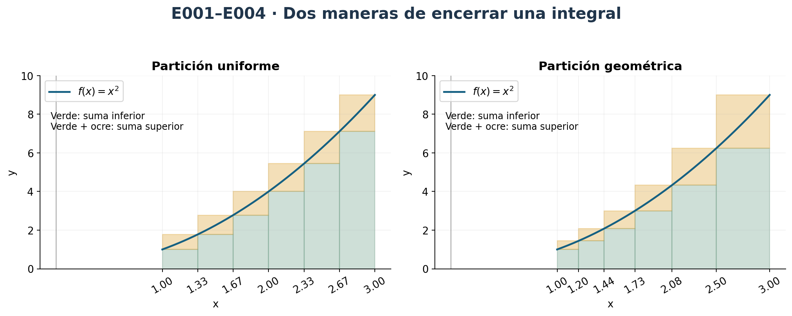
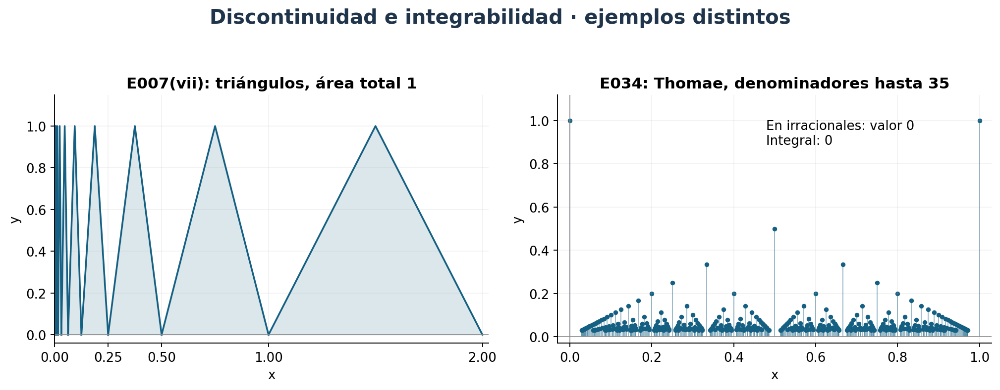
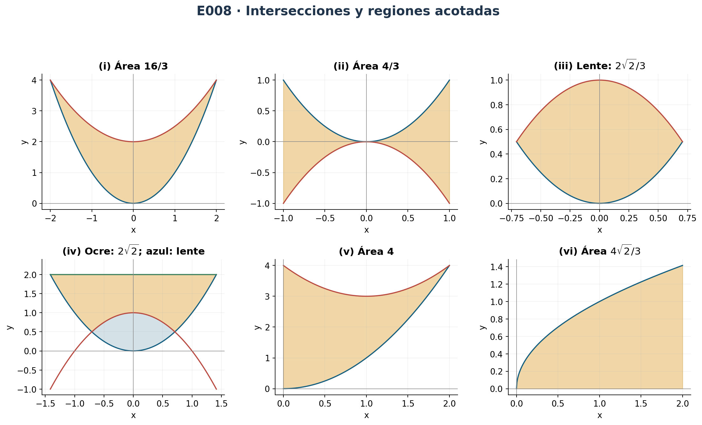
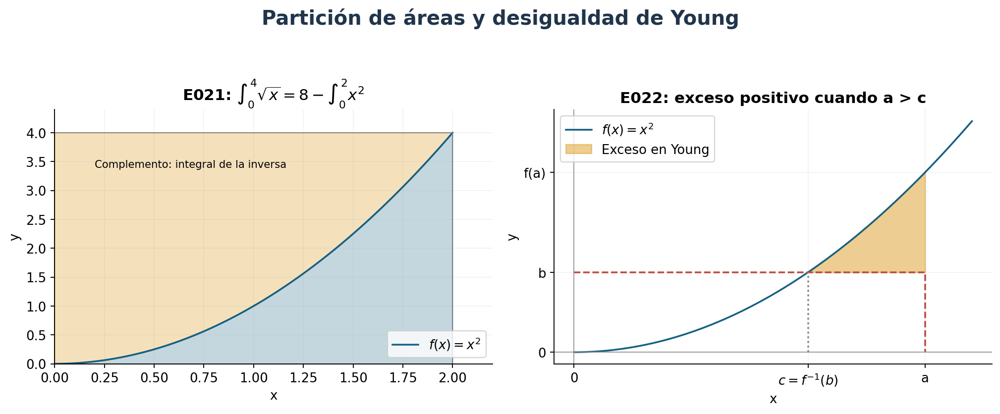
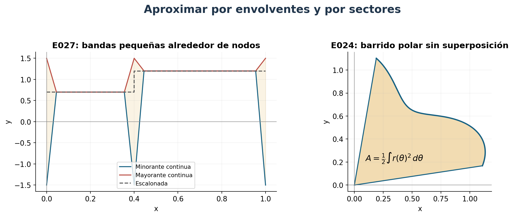
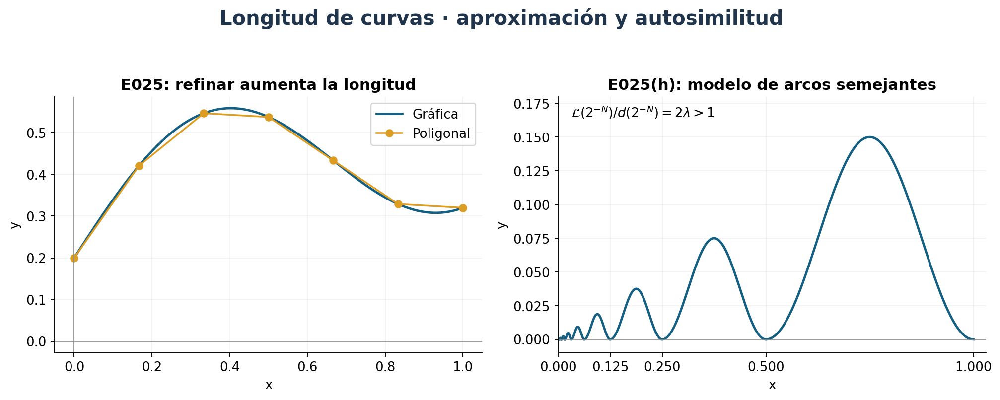

[← Capítulo 12](capitulo-12.qmd) · [Colecciones](../index.qmd#spivak-calculus-cuarta-edición) · [Capítulo 14 →](capitulo-14.qmd)

Este capítulo construye la integral mediante sumas inferiores y superiores. Las soluciones conservan ese punto de partida: no usan el teorema fundamental del cálculo del capítulo siguiente para justificar los primeros cálculos. Las fórmulas de longitud se prueban por aproximación poligonal.

**Alcance.** Ejercicios 1–40, pp. 272–281 (PDF 292–301), y ejercicios 1–5 del apéndice, pp. 283–284 (PDF 303–304). El apéndice comienza en p. 282. Se incluyen todos los incisos y ejercicios estrellados. Los enunciados se condensan para identificar el problema; las demostraciones son propias. La revisión secundaria, realizada después de la redacción inicial, se documenta en el informe de cierre y en el inventario.

## Convenciones y herramientas {#seccion-711}

Salvo indicación expresa, $a<b$, las funciones integrables lo son en el sentido de Riemann y están acotadas. Para $P=\{t_0,\ldots,t_n\}$ escribimos $\Delta t_i=t_i-t_{i-1}$, $m_i=\inf_{[t_{i-1},t_i]}f$, $M_i=\sup_{[t_{i-1},t_i]}f$ y

$$L(f,P)=\sum_i m_i\Delta t_i,\qquad U(f,P)=\sum_i M_i\Delta t_i.$$

Una función acotada es integrable si y solo si para cada $\varepsilon>0$ existe $P$ con $U(f,P)-L(f,P)<\varepsilon$. Refinar una partición aumenta $L$ y disminuye $U$. Se usan los teoremas ya demostrados en la exposición sobre continuidad, aditividad por intervalos y linealidad. Cuando un ejercicio pide reconstruir un teorema, se evita usarlo en esa reconstrucción.

**Lema de modificaciones finitas.** Cambiar una función acotada en un número finito de puntos conserva integrabilidad e integral. En efecto, se rodean esos puntos con intervalos de longitud total $\eta$; si ambas funciones tienen módulo $\le B$, la contribución adicional a las diferencias de Darboux es como máximo $4B\eta$. Fuera de esos intervalos coinciden. Se toma $\eta\to0$. Esta prueba incluye puntos extremos con vecindarios unilaterales. Una función escalonada, con alturas $c_i$ en los intervalos abiertos de una partición, tiene integral $\sum c_i\Delta t_i$; los valores aislados de los nodos no intervienen.

## Ejercicio 1 — `SPV4-C13-E001` {#e001}

**Fuente:** p. 272 / PDF 292. Calcular $\int_0^b x^3\,dx$ por particiones uniformes.

Para $b>0$, $t_i=ib/n$ y la monotonía dan

$$L_n=\frac{b^4}{n^4}\sum_{i=0}^{n-1}i^3
=\frac{b^4(n-1)^2}{4n^2},\qquad
U_n=\frac{b^4}{n^4}\sum_{i=1}^ni^3
=\frac{b^4(n+1)^2}{4n^2}.$$

Ambas sucesiones tienden a $b^4/4$ y $U_n-L_n=b^4/n\to0$. El criterio de Darboux prueba integrabilidad y encierra su integral entre esos límites. Así,

$$\boxed{\int_0^b x^3\,dx=b^4/4.}$$

Para $b=0$ es inmediato. Si se admite $b<0$ con integral orientada, la reflexión $x=-t$ en sumas de Darboux y el signo de orientación dan la misma fórmula.

## Ejercicio 2 — `SPV4-C13-E002` {#e002}

**Fuente:** p. 272 / PDF 292. Hacer lo mismo para $x^4$.

Para $b>0$,

$$U_n=\frac{b^5}{n^5}\sum_{i=1}^ni^4
=\frac{b^5}{30n^4}(n+1)(2n+1)(3n^2+3n-1),$$

usando la fórmula de sumas de potencias del capítulo 2. La suma inferior usa $i=0,\ldots,n-1$; por telescopaje $U_n-L_n=b^5/n$. Como $U_n\to b^5/5$, también $L_n\to b^5/5$. El criterio de Darboux da

$$\boxed{\int_0^b x^4\,dx=b^5/5.}$$

El caso cero y el negativo se cubren como en E001, teniendo en cuenta que $x^4$ es par.

## Ejercicio 3* — `SPV4-C13-E003` {#e003}

**Fuente:** p. 272 / PDF 292. Potencias enteras $p\ge0$.

**(a)** Sea $S_p(n)=\sum_{k=1}^n k^p$. Por inducción, $S_p(n)/n^{p+1}\to1/(p+1)$. Para $p=0$ vale exactamente. Para el paso inductivo, expandimos y sumamos

$$(n+1)^{p+1}-1=\sum_{k=1}^n[(k+1)^{p+1}-k^{p+1}]
=(p+1)S_p(n)+\sum_{j=0}^{p-1}\binom{p+1}{j}S_j(n).$$

Al dividir por $n^{p+1}$, cada sumando de grado menor tiende a cero por la hipótesis inductiva, y el lado izquierdo tiende a uno. Esta prueba expresa precisamente que, para cada tolerancia, basta elegir $n$ suficientemente grande.

**(b)** Para $b>0$, las sumas superiores de $x^p$ son $b^{p+1}S_p(n)/n^{p+1}$, y su diferencia con las inferiores es $b^{p+1}/n$ si $p>0$. Para $p=0$ ambas sumas son $b$. Por tanto

$$\boxed{\int_0^b x^p\,dx=\frac{b^{p+1}}{p+1}.}$$

La reflexión extiende la identidad a $b<0$ para potencias enteras.

## Ejercicio 4* — `SPV4-C13-E004` {#e004}

**Fuente:** p. 272 / PDF 292. Particiones geométricas para $0<a<b$ y $p$ entero no negativo.

**(a)** Si los cocientes consecutivos son $r$, entonces $t_i=ar^i$ y $ar^n=b$. Con $c=b/a$, resulta $r=c^{1/n}$ y $t_i=ac^{i/n}$.

**(b)** Para $p>0$, $x^p$ es creciente. Como $t_i-t_{i-1}=t_i(1-r^{-1})$,

$$U_n=a^{p+1}(1-r^{-1})\sum_{i=1}^nr^{(p+1)i}
=(b^{p+1}-a^{p+1})\frac{r^p}{1+r+\cdots+r^p}.$$

La suma inferior usa $t_{i-1}^p=r^{-p}t_i^p$, de modo que

$$L_n=(b^{p+1}-a^{p+1})\frac1{1+r+\cdots+r^p}.$$

Para $p=0$ estas expresiones también valen y ambas son $b-a$.

**(c)** Puesto que $c^{1/n}\to1$, ambas expresiones tienden a

$$\boxed{\int_a^b x^p\,dx=\frac{b^{p+1}-a^{p+1}}{p+1}.}$$

Para $a=0$, hacemos $a\downarrow0$. La integral omitida está acotada por $a b^p$ y tiende a cero. La expresión geométrica impresa con $p+1$ términos presupone $p$ entero; este argumento no pretende usar esa suma finita para exponentes reales arbitrarios.

{#fig-spv4-c13-f01 fig-alt="Capítulo 13: Particiones uniformes y geométricas"}

## Ejercicio 5 — `SPV4-C13-E005` {#e005}

**Fuente:** p. 272 / PDF 292. Evaluaciones por simetría.

**(i)** $x^3\sqrt{1-x^2}$ es impar. La reflexión de las sumas en $[-1,0]$ y $[0,1]$ hace que sus integrales se cancelen: el resultado es $0$.

**(ii)** La parte $x^5\sqrt{1-x^2}$ también es impar. La integral restante es tres veces el área del semicírculo unitario superior:

$$\boxed{\int_{-1}^1(x^5+3)\sqrt{1-x^2}\,dx=3\pi/2.}$$

## Ejercicio 6 — `SPV4-C13-E006` {#e006}

**Fuente:** p. 273 / PDF 293. Probar $\int_0^x\sin t/(t+1)\,dt>0$ para $x>0$.

En cada bloque $[2k\pi,(2k+2)\pi]$, emparejamos $t=2k\pi+u$ y $t=(2k+1)\pi+u$, $0\le u\le\pi$. La contribución total del bloque es

$$\int_0^\pi\sin u\left(\frac1{2k\pi+u+1}-\frac1{(2k+1)\pi+u+1}\right)du>0.$$

El integrando es continuo, no negativo y positivo en el interior; su integral es estrictamente positiva, pues un pequeño subintervalo tiene una cota inferior positiva. Esta justificación no depende de E031.

Si $x$ cae en la mitad positiva de un bloque, se añaden a los bloques completos contribuciones no negativas. Si cae en la mitad negativa, la integral acumulada en el bloque es al menos la del bloque completo, porque la porción negativa todavía no consumida solo podría disminuirla. Para $0<x\le\pi$ la positividad es directa. En todos los casos el total es estrictamente positivo.

## Ejercicio 7 — `SPV4-C13-E007` {#e007}

**Fuente:** p. 273 / PDF 293. Integrabilidad en $[0,2]$; $[x]=\lfloor x\rfloor$.

**(i)** $f=x$ en $[0,1)$ y $f=x-2$ en $[1,2]$. Es continua por tramos con un salto, por tanto integrable: $\int_0^1x+\int_1^2(x-2)=1/2-1/2=0$. La integrabilidad se prueba aislando el salto como en E019, sin importar su valor puntual.

**(ii)** Se asigna $f(1)=1$ en lugar de $-1$. Es una modificación en un punto de (i); la integral sigue siendo $0$.

**(iii)** $f=x+\lfloor x\rfloor$. Es integrable por el mismo criterio, y $\int_0^2x=2$, mientras $\int_0^2\lfloor x\rfloor=1$. Resultado: $3$.

**(iv)** $f=x+\lfloor x\rfloor$ en racionales y $0$ en irracionales. Toda suma inferior es cero por densidad de los irracionales. En cada intervalo el supremo es el mismo que para $h=x+\lfloor x\rfloor$: se aproxima por racionales, incluidos los posibles valores de salto en enteros. Por tanto el ínfimo de las sumas superiores es $\int h=3$. No es integrable.

**(v)** $f$ es la indicatriz de $D=\{r+s\sqrt2:r,s\in\mathbb Q\}$. El conjunto $D$ es denso por contener $\mathbb Q$. Su complemento también lo es: $D$ es numerable y ningún intervalo no degenerado es numerable. Así $L=0$, $U=2$ para cualquier partición. No es integrable.

**(vi)** Para $0<x\le1$, $f(x)=1/\lfloor1/x\rfloor$; en cero y en $(1,2]$ vale cero. En $(1/(n+1),1/n]$ vale $1/n$. Para un $N$ fijo hay solo finitos saltos fuera de $[0,1/N]$, y dentro $0\le f\le1/N$. Su contribución a $U-L$ es como máximo $1/N^2$. Esto prueba integrabilidad y, sumando primero finitos intervalos y pasando al límite,

$$\boxed{\int_0^2f=\sum_{n=1}^{\infty}\frac1{n^2(n+1)}
=\sum_{n=1}^{\infty}\frac1{n^2}-1.}$$

Es una evaluación exacta mediante serie convergente. Identificarla con $\pi^2/6-1$ exige además la suma de Euler, ajena a este capítulo.

**(vii)** La figura 15 tiene triángulos de altura uno sobre $[1,2]$, $[1/2,1]$, $[1/4,1/2]$, etc. Fuera de $[0,2^{-N}]$ es continua por tramos y el intervalo restante tiene contribución $\le2^{-N}$; es integrable cualquiera que sea el valor acotado en cero. Las áreas son la mitad de cada base, cuya suma es $2$. Resultado: $\boxed{1}$.

{#fig-spv4-c13-f02 fig-alt="Capítulo 13: Triángulos de altura constante y función de Thomae"}

## Ejercicio 8 — `SPV4-C13-E008` {#e008}

**Fuente:** pp. 273–274 / PDF 293–294. Áreas delimitadas por gráficas.

**(i)** $x^2=x^2/2+2$ da $x=\pm2$. La curva superior es $x^2/2+2$. El área es $\int_{-2}^2(2-x^2/2)=\boxed{16/3}$.

**(ii)** Entre $x^2$ y $-x^2$, con $-1\le x\le1$, el área es $\int_{-1}^12x^2=\boxed{4/3}$.

**(iii)** $x^2=1-x^2$ da $x=\pm1/\sqrt2$. El área de la lente es $\int_{-1/\sqrt2}^{1/\sqrt2}(1-2x^2)=\boxed{2\sqrt2/3}$.

**(iv)** La región cuya frontera usa las tres curvas $x^2$, $1-x^2$ e $y=2$ tiene techo $2$ y suelo $\max(x^2,1-x^2)$ entre $-\sqrt2$ y $\sqrt2$. Se obtiene quitando la lente de (iii) al área bajo $2-x^2$:

$$\boxed{\frac{8\sqrt2}{3}-\frac{2\sqrt2}{3}=2\sqrt2.}$$

La lente inferior está acotada solo por las dos parábolas. Si se pidiera la suma de todas las regiones finitas del dibujo, incluyendo esa lente, sería $8\sqrt2/3$. La figura distingue ambas.

**(v)** Las curvas $x^2$ y $x^2-2x+4$ se cruzan en $x=2$. Con el eje vertical, el área es $\int_0^2(4-2x)=\boxed{4}$.

**(vi)** La reflexión en $y=x$ convierte el área bajo $\sqrt x$, $0\le x\le2$, en el área del rectángulo $[0,\sqrt2]\times[0,2]$ situada por encima de $y=x^2$. Por ello

$$\boxed{2\sqrt2-\int_0^{\sqrt2}x^2\,dx=\frac{4\sqrt2}{3}.}$$

E021 prueba con sumas la identidad general que respalda esta interpretación.

{#fig-spv4-c13-f03 fig-alt="Capítulo 13: Las seis regiones de E008"}

## Ejercicio 9 — `SPV4-C13-E009` {#e009}

**Fuente:** p. 274 / PDF 294. Integral iterada de un producto separado.

Suponemos $f$ integrable en $[a,b]$ y $g$ en $[c,d]$. Para $x$ fijo, $f(x)$ es constante respecto de $y$, así que $\int_c^df(x)g(y)\,dy=f(x)G$, donde $G=\int_c^dg$. Ahora $G$ es constante respecto de $x$:

$$\boxed{\int_a^b\left(\int_c^df(x)g(y)\,dy\right)dx
=\left(\int_a^bf\right)\left(\int_c^dg\right).}$$

No se intercambia aquí ningún orden de integración ni se necesita un teorema de integrales dobles.

## Ejercicio 10 — `SPV4-C13-E010` {#e010}

**Fuente:** p. 274 / PDF 294. Ínfimos de la suma.

En un subintervalo $I_i$, sean $m_i'=\inf f$, $m_i''=\inf g$ y $m_i=\inf(f+g)$. Siempre $f(x_1)+g(x_2)\ge m_i'+m_i''$. Para cada $\eta>0$ existen $x_1,x_2\in I_i$ con $f(x_1)<m_i'+\eta/2$ y $g(x_2)<m_i''+\eta/2$. Por tanto

$$m_i'+m_i''=\inf\{f(x_1)+g(x_2):x_1,x_2\in I_i\}\le m_i.$$

La última desigualdad se debe a que imponer $x_1=x_2$ restringe el conjunto sobre el que se toma el ínfimo. No se supone que los ínfimos sean alcanzados.

## Ejercicio 11 — `SPV4-C13-E011` {#e011}

**Fuente:** p. 274 / PDF 294. Clasificar funciones según sus sumas.

**(a)** Son exactamente las funciones constantes. Tomar $P=\{a,b\}$ obliga a $(b-a)\inf f=(b-a)\sup f$.

**(b)** También son exactamente las constantes. Si $U(f,P)=L(f,Q)$ y $R=P\cup Q$, entonces

$$L(f,Q)\le L(f,R)\le U(f,R)\le U(f,P).$$

Todo es igualdad, luego cada oscilación en los subintervalos de $R$ es cero. La función es constante en cada uno de ellos, y los extremos compartidos obligan a que las constantes sean iguales.

**(c)** Entre las continuas, solo las constantes. Sea $c=\min f$. Si todas las sumas inferiores son iguales, todas valen $c(b-a)$, como la de $\{a,b\}$. Si $f(x_0)>c$, la continuidad proporciona un intervalo no degenerado $J$ donde $f\ge c+\eta$. Una partición que contenga $J$ tiene suma inferior al menos $c(b-a)+\eta|J|$, contradicción.

**(d)** Entre las integrables, son exactamente las funciones para las que existe $c$ tal que $f\ge c$ y el conjunto $\{x:f(x)=c\}$ es denso en $[a,b]$ (densidad relativa, incluidos los extremos). La suficiencia es inmediata: todo subintervalo tiene ínfimo $c$.

Para la necesidad, $c=\inf f$ y todas las sumas inferiores valen $c(b-a)$. Si un subintervalo tuviera ínfimo mayor que $c$, una partición que lo contuviera produciría una suma mayor. Así todos los ínfimos locales valen $c$. En cualquier punto de continuidad interior debe valer $f(x)=c$, pues de otro modo habría un entorno con ínfimo mayor. E030, aplicado dentro de cualquier intervalo abierto, proporciona un punto de continuidad. Por tanto el conjunto de valores exactamente iguales a $c$ es denso. La hipótesis de integrabilidad importa en esta dirección; sin ella, ínfimos locales iguales no implican que $c$ sea alcanzado.

## Ejercicio 12 — `SPV4-C13-E012` {#e012}

**Fuente:** p. 274 / PDF 294. Restricción a $[b,c]\subset[a,d]$.

Dada $\varepsilon>0$, elegimos una partición de $[a,d]$ con diferencia $U-L<\varepsilon$ y añadimos $b,c$. La diferencia no aumenta. La partición restringida a $[b,c]$ contribuye solo con algunos sumandos no negativos a la diferencia total, luego su diferencia es $<\varepsilon$. La restricción es acotada y, por Darboux, integrable.

## Ejercicio 13 — `SPV4-C13-E013` {#e013}

**Fuente:** p. 274 / PDF 294. Positividad y comparación.

**(a)** Si $f\ge0$, toda suma inferior es no negativa. Su supremo, la integral, también lo es.

**(b)** Si $f\ge g$, entonces $f-g$ es integrable y no negativa. Por (a) y linealidad, $\int f-\int g=\int(f-g)\ge0$.

## Ejercicio 14 — `SPV4-C13-E014` {#e014}

**Fuente:** p. 274 / PDF 294. Traslación.

Para $h(x)=f(x-c)$ en $[a+c,b+c]$, la partición $P'=\{t_i+c\}$ tiene las mismas longitudes y los mismos supremos e ínfimos que $P$ para $f$. De ahí $L(h,P')=L(f,P)$ y $U(h,P')=U(f,P)$. La correspondencia de particiones es biyectiva: prueba integrabilidad y

$$\boxed{\int_a^bf(x)\,dx=\int_{a+c}^{b+c}f(x-c)\,dx.}$$

## Ejercicio 15* — `SPV4-C13-E015` {#e015}

**Fuente:** p. 275 / PDF 295. Ley multiplicativa de $\int_1^a dt/t$, $a,b>1$.

A cada partición de $[1,a]$ asociamos $\{bt_i\}$ en $[b,ab]$. Las longitudes se multiplican por $b$ y los ínfimos y supremos de $1/t$ se dividen por $b$. Sus sumas son iguales. Por tanto $\int_b^{ab}dt/t=\int_1^adt/t$. La aditividad por intervalos da

$$\boxed{\int_1^a\frac{dt}{t}+\int_1^b\frac{dt}{t}=\int_1^{ab}\frac{dt}{t}.}$$

No se emplean logaritmos ni primitivas.

## Ejercicio 16* — `SPV4-C13-E016` {#e016}

**Fuente:** p. 275 / PDF 295. Cambio de escala.

Para $c>0$, $P'=\{ct_i\}$ conserva el orden. Si $h(t)=f(ct)$, los supremos e ínfimos se corresponden y $\Delta(ct_i)=c\Delta t_i$. Así $L(f,P')=cL(h,P)$, y lo mismo para $U$, lo que prueba

$$\boxed{\int_{ca}^{cb}f(t)\,dt=c\int_a^bf(ct)\,dt.}$$

Para $c<0$, la partición imagen se ordena de $cb$ a $ca$ y sus longitudes son $|c|\Delta t_i$. Primero se obtiene $\int_{cb}^{ca}f=|c|\int_a^bf(ct)$; invertir los límites da la fórmula indicada. Para $c=0$, ambos lados son cero, siempre que $f(0)$ esté definido. Se presupone integrabilidad en el intervalo imagen adecuado.

## Ejercicio 17 — `SPV4-C13-E017` {#e017}

**Fuente:** p. 275 / PDF 295. Área de la elipse, $a,b>0$.

La semielipse superior es $y=b\sqrt{1-x^2/a^2}$, $-a\le x\le a$. Por simetría y E016,

$$A=2b\int_{-a}^a\sqrt{1-x^2/a^2}\,dx
=2ab\int_{-1}^1\sqrt{1-t^2}\,dt=\boxed{\pi ab}.$$

La última integral es el semicírculo unitario, cuya área se da como $\pi/2$.

## Ejercicio 18 — `SPV4-C13-E018` {#e018}

**Fuente:** p. 275 / PDF 295. Método de Cavalieri; $c_n=\int_0^1x^n\,dx$, $n\ge0$ entero.

**(a)** E016 con escala $a>0$ da $\int_0^ax^n\,dx=a^{n+1}c_n$.

**(b)** La traslación y el binomio dan

$$c_n(2a)^{n+1}=\int_{-a}^a(x+a)^n\,dx
=\sum_{k=0}^n\binom nk a^{n-k}\int_{-a}^ax^k\,dx.$$

Los términos impares se anulan por reflexión; los pares tienen integral $2c_ka^{k+1}$. Luego

$$\boxed{2^{n+1}c_na^{n+1}=2a^{n+1}\sum_{\substack{0\le k\le n\\k\text{ par}}}\binom nk c_k.}$$

**(c)** Para $n=0$, $c_0=1$. Para $n\ge1$, al despejar $c_n$, el coeficiente es $2^n-1$ si $n$ es par y $2^n$ si es impar, ambos positivos. La recurrencia determina $c_n$ por los valores anteriores. La identidad combinatoria

$$\sum_{k\text{ par}}\frac{\binom nk}{k+1}
=\frac1{n+1}\sum_{\substack{1\le j\le n+1\\j\text{ impar}}}\binom{n+1}{j}
=\frac{2^n}{n+1}$$

muestra que $c_k=1/(k+1)$ satisface la recurrencia. Por inducción y unicidad, $c_n=1/(n+1)$. Para $0\le a<b$, aditividad da $(b^{n+1}-a^{n+1})/(n+1)$.

## Ejercicio 19 — `SPV4-C13-E019` {#e019}

**Fuente:** p. 275 / PDF 295. Una discontinuidad interior.

Sea $|f|\le B$ y $x_0\in(a,b)$ el único posible punto discontinuo. Si $B=0$, es trivial. Elegimos $u<x_0<v$ con $2B(v-u)<\varepsilon/2$. En los intervalos compactos $[a,u]$ y $[v,b]$, la función es continua y hay particiones con suma total de diferencias $<\varepsilon/2$. Unimos esas particiones con $[u,v]$. Su contribución es como máximo $2B(v-u)$, luego la diferencia total es $<\varepsilon$. Esto prueba integrabilidad. El mismo argumento aísla finitos puntos, incluidos extremos, y justifica los usos anteriores.

## Ejercicio 20 — `SPV4-C13-E020` {#e020}

**Fuente:** pp. 275–276 / PDF 295–296. Función no decreciente.

**(a)** En cada intervalo, el mínimo es $f(t_{i-1})$ y el máximo $f(t_i)$, aun con saltos. Así $L=\sum f(t_{i-1})\Delta t_i$, $U=\sum f(t_i)\Delta t_i$.

**(b)** Si $\Delta t_i=\delta$, el telescopaje da $U-L=\delta\sum[f(t_i)-f(t_{i-1})]=\delta[f(b)-f(a)]$.

**(c)** Con $\delta=(b-a)/n$, esa diferencia tiende a cero. La función está acotada entre sus valores extremos, luego es integrable.

**(d)** Un ejemplo es

$$f(x)=\sum_{n=1}^{\infty}2^{-n}\mathbf1_{[1/n,1]}(x),\qquad0\le x\le1.$$

Es no decreciente, pues cada sumando lo es, y la serie converge uniformemente por la cota de su cola. En cada $1/n$ tiene un salto de tamaño $2^{-n}$. Para justificarlo, aislamos ese sumando: las primeras finitas otras indicatrices son constantes cerca de $1/n$, y la cola tiene norma uniforme arbitrariamente pequeña. Así la suma de las otras indicatrices es continua allí y el salto permanece. Hay infinitas discontinuidades.

## Ejercicio 21* — `SPV4-C13-E021` {#e021}

**Fuente:** p. 276 / PDF 296. Integral de la inversa.

Se entiende que la inversa esté definida en todo $[a,b]$. Basta suponer $f$ continua y estrictamente creciente en $[\alpha,\beta]$, con $f(\alpha)=a$, $f(\beta)=b$. Una función creciente con saltos no tiene, en general, inversa en los valores omitidos, por lo que esa condición de dominio es necesaria para leer la fórmula.

**(a)** Para $P=\{t_i\}$, pongamos $y_i=f^{-1}(t_i)$ y $P'=\{y_i\}$. Por monotonía,

$$L(f^{-1},P)=\sum y_{i-1}(t_i-t_{i-1}),\qquad
U(f,P')=\sum t_i(y_i-y_{i-1}).$$

Al sumar, cada término es $t_iy_i-t_{i-1}y_{i-1}$; telescopa a $b\beta-a\alpha$.

**(b)** Ambas funciones son continuas, por tanto integrables. Refinamos particiones de $f^{-1}$ y de $f$, trasladando los nodos por la biyección. Podemos hacer simultáneamente pequeñas ambas diferencias de Darboux. La identidad de (a) pasa entonces a las integrales:

$$\boxed{\int_a^bf^{-1}=bf^{-1}(b)-af^{-1}(a)-\int_{f^{-1}(a)}^{f^{-1}(b)}f.}$$

Esto no necesita anticipar el teorema de sumas de Riemann del apéndice: las dos aproximaciones se controlan directamente por sus diferencias $U-L$.

**(c)** El enunciado pide la raíz $n$-ésima, con $n\ge1$ entero y $0\le a<b$. Tomamos $f(t)=t^n$ en los no negativos. E003 y (b) dan

$$\boxed{\int_a^b\sqrt[n]{x}\,dx
=b\sqrt[n]{b}-a\sqrt[n]{a}-\frac{b^{(n+1)/n}-a^{(n+1)/n}}{n+1}
=\frac{n}{n+1}\bigl(b^{(n+1)/n}-a^{(n+1)/n}\bigr).}$$

Esto incluye $a=0$ y $n=1$. Para $n=2$ recupera el resultado de E008(vi).

## Ejercicio 22 — `SPV4-C13-E022` {#e022}

**Fuente:** p. 276 / PDF 296. Desigualdad de Young.

Sea $f$ continua y estrictamente creciente, $f(0)=0$, y supongamos que $b$ pertenece a su imagen positiva. Es necesario poder definir $f^{-1}$ en $[0,b]$. Pongamos $c=f^{-1}(b)$. E021 da

$$\int_0^af+\int_0^bf^{-1}-ab
=\int_c^a[f(x)-b]dx.$$

Si $a>c$, el integrando es positivo en $(c,a]$ y la integral es positiva. Si $a<c$, invertimos límites y el integrando es negativo en $[a,c)$, así que el resultado vuelve a ser positivo. Para $a=c$ es cero. En consecuencia

$$\boxed{ab\le\int_0^af+\int_0^bf^{-1},\qquad
\text{igualdad}\Longleftrightarrow b=f(a).}$$

{#fig-spv4-c13-f04 fig-alt="Capítulo 13: La inversa y la desigualdad de Young"}

## Ejercicio 23 — `SPV4-C13-E023` {#e023}

**Fuente:** p. 277 / PDF 297. Valores medios.

**(a)** De $m\le f\le M$ y comparación se obtiene $m(b-a)\le\int f\le M(b-a)$. Tomamos $\mu=(\int f)/(b-a)$.

**(b)** Si $f$ es continua, alcanza mínimo y máximo. Por (a), $\mu$ está entre ellos y el teorema de valor intermedio da $\xi\in[a,b]$ con $f(\xi)=\mu$.

**(c)** En $[0,1]$, $f=0$ para $x<1/2$ y $f=1$ para $x\ge1/2$ tiene integral $1/2$, pero jamás vale $1/2$.

**(d)** Sea $m=\min f$, $M=\max f$ y $G=\int g\ge0$. El producto es integrable (E038). Como $g\ge0$, $mG\le\int fg\le MG$. Si $G>0$, el cociente $(\int fg)/G$ pertenece a $[m,M]$ y se alcanza como $f(\xi)$. Si $G=0$, esas mismas cotas obligan a $\int fg=0$, y sirve cualquier $\xi$. Así $\int fg=f(\xi)\int g$.

**(e)** Si $g\le0$, aplicamos (d) a $-g$ y multiplicamos la igualdad por $-1$.

**(f)** El signo constante es esencial. En $[-1,1]$, $f(x)=x$, $g(x)=x$ son continuas; $\int g=0$, pero $\int fg=\int x^2=2/3$. Ningún $\xi$ puede satisfacer la identidad.

## Ejercicio 24 — `SPV4-C13-E024` {#e024}

**Fuente:** p. 277 / PDF 297. Área polar.

Para la región descrita por radios $0\le r\le f(\theta)$, suponemos $f\ge0$ continua y un barrido angular sin superposición de interiores (por ejemplo $\theta_1-\theta_0\le2\pi$). En una partición angular, sean $m_i,M_i$ el mínimo y máximo del radio. Los sectores circulares inscritos y circunscritos tienen áreas

$$\frac12\sum m_i^2\Delta\theta_i,\qquad
\frac12\sum M_i^2\Delta\theta_i.$$

Encierran la región y son las sumas inferior y superior de $f^2/2$. La continuidad de $f^2$ hace que converjan a la misma integral. Por tanto

$$\boxed{A=\frac12\int_{\theta_0}^{\theta_1}f(\theta)^2d\theta.}$$

Con radios negativos o barridos repetidos, esta expresión puede contar área con multiplicidad; para el área geométrica de una unión hay que descomponer el barrido y eliminar solapamientos. La figura del enunciado usa un sector simple.

{#fig-spv4-c13-f05 fig-alt="Capítulo 13: Envolventes continuas y barrido polar"}

## Ejercicio 25* — `SPV4-C13-E025` {#e025}

**Fuente:** pp. 277–278 / PDF 297–298. Longitud $\mathcal L(f)=\sup_P\ell(f,P)$ de la gráfica continua.

Para una partición $P$, se define

$$\ell(f,P)=\sum_{i=1}^n\sqrt{(t_i-t_{i-1})^2+[f(t_i)-f(t_{i-1})]^2}.$$

**(a)** Para $f(x)=mx+q$, cada segmento tiene longitud $\sqrt{1+m^2}\Delta t_i$. Toda poligonal suma $\sqrt{1+m^2}(b-a)$, la distancia entre extremos; ese es también su supremo.

**(b)** Si $f$ no es afín, existe $t\in(a,b)$ tal que $(t,f(t))$ no está en la recta entre extremos. La desigualdad triangular estricta para tres puntos no alineados implica que $\ell(f,\{a,t,b\})$ es mayor que la distancia de los extremos.

**(c)** La función afín de esos extremos tiene longitud igual a la cuerda por (a); cualquier otra función continua rectificable tiene longitud estrictamente mayor por (b). Si el supremo es infinito, puede hablarse de longitud extendida y la desigualdad también vale.

**(d)** Supongamos $f$ diferenciable y $f'$ acotada; sea $h=\sqrt{1+(f')^2}$. El valor medio proporciona $\xi_i\in(t_{i-1},t_i)$ con $f(t_i)-f(t_{i-1})=f'(\xi_i)\Delta t_i$. Así

$$\ell(f,P)=\sum h(\xi_i)\Delta t_i,$$

que está entre $L(h,P)$ y $U(h,P)$.

**(e)** De $L(h,P)\le\ell(f,P)\le\sup_Q\ell(f,Q)$ para cada $P$, tomando supremo resulta $\sup_PL(h,P)\le\sup_P\ell(f,P)$.

**(f)** Si $R=P'\cup P''$, la desigualdad triangular al subdividir segmentos da $\ell(f,P')\le\ell(f,R)$. Por (d) y refinamiento,

$$\ell(f,P')\le\ell(f,R)\le U(h,R)\le U(h,P'').$$

Esto vale para cualesquiera $P',P''$. Luego $\sup\ell\le\inf U$. Si $h$ es integrable, (e) y (f) encierran la longitud entre dos números iguales:

$$\boxed{\mathcal L(f)=\int_a^b\sqrt{1+(f')^2}.}$$

**(g)** Para $x>a$, $d(x)=(x-a)\sqrt{1+[(f(x)-f(a))/(x-a)]^2}$. La diferenciabilidad unilateral en $a$ hace que $d(x)/(x-a)\to\sqrt{1+f'(a)^2}$. La continuidad unilateral de $f'$ en $a$ implica, por comparación de integrales, que $\mathcal L(x)/(x-a)\to\sqrt{1+f'(a)^2}$. Este límite es positivo; al dividir, $\mathcal L(x)/d(x)\to1$.

**(h)** En la figura 21, cada arco sobre $[2^{-n-1},2^{-n}]$ es una copia a escala $2^{-n}$ del de $[1/2,1]$, y todos sus extremos tienen altura cero. Sea $\lambda$ la longitud del arco mayor. No es un segmento, por (b) $\lambda>1/2$; si no fuera rectificable, la conclusión ya fallaría. Para arcos rectificables, la escala de todas las longitudes da

$$\mathcal L(2^{-N})=\sum_{n=N}^{\infty}2^{-n}\lambda=2^{1-N}\lambda,\qquad d(2^{-N})=2^{-N}.$$

Así el cociente a lo largo de esos puntos es $2\lambda>1$, y no puede tender a uno. La suma de longitudes se justifica por concatenación finita y por aproximación de las colas; su cota geométrica garantiza rectificabilidad cuando $\lambda<\infty$. No se aplica (g) a una derivada cuya continuidad en cero falle.

{#fig-spv4-c13-f06 fig-alt="Capítulo 13: Longitud poligonal y el contraejemplo autosimilar"}

## Ejercicio 26 — `SPV4-C13-E026` {#e026}

**Fuente:** pp. 278–279 / PDF 298–299. Aproximación por funciones escalonadas.

**(a)** Elijamos $P$ con $U(f,P)-L(f,P)<\varepsilon$. Definimos $s_1=m_i$, $s_2=M_i$ en los intervalos abiertos, y asignamos $s_1(t_i)=s_2(t_i)=f(t_i)$ en los nodos. Son escalonadas, $s_1\le f\le s_2$, e integran respectivamente $L(f,P)$ y $U(f,P)$ por el lema inicial. De ahí $0\le\int f-\int s_1<\varepsilon$ y $0\le\int s_2-\int f<\varepsilon$.

**(b)** Las escalonadas acotan a $f$, por lo que $f$ está acotada. Para una tolerancia $\varepsilon$, escojamos $s_1\le f\le s_2$ con $\int s_2-\int s_1<\varepsilon/2$. Una partición común suficientemente refinada satisface $U(s_2,P)-\int s_2<\varepsilon/4$ y $\int s_1-L(s_1,P)<\varepsilon/4$. Por orden,

$$U(f,P)-L(f,P)\le U(s_2,P)-L(s_1,P)<\varepsilon.$$

El criterio prueba integrabilidad.

**(c)** La función de Thomae de E034 es integrable con integral cero y todas las sumas inferiores cero. No es escalonada: en cada intervalo abierto hay irracionales con valor cero y racionales con valor positivo. Sirve cualquier partición, incluida $\{0,1\}$.

## Ejercicio 27* — `SPV4-C13-E027` {#e027}

**Fuente:** p. 279 / PDF 299. Minorante y mayorante continuas con pequeña separación integral.

Por E026 tomamos escalonadas $s_1\le f\le s_2$ con $\int s_2-\int s_1<\varepsilon/2$. Elijamos $B>0$ que acote los módulos de ambas y sus valores en todos los nodos. Alrededor de cada nodo escogemos bandas disjuntas, unilaterales en extremos, de longitud total $\eta$.

Fuera de las bandas ponemos $g=s_1$. En cada banda, desde su borde hasta el nodo interpolamos linealmente la altura constante de $s_1$ hacia $-B$, y del nodo hacia el siguiente borde volvemos a la altura constante del otro lado. Cada interpolación es $\le$ la altura de $s_1$ de su lado, y en el nodo $-B\le s_1(t_i)$; así $g$ es continua y $g\le s_1$. Construimos $h$ de la misma forma con $s_2$ y altura $B$, obteniendo $h\ge s_2$.

Las dos alteraciones están sostenidas en bandas de longitud total $\eta$ y son de módulo $\le2B$. Por comparación, $\int(s_1-g)+\int(h-s_2)\le4B\eta$. Con $4B\eta<\varepsilon/2$,

$$g\le f\le h,\qquad\boxed{\int h-\int g<\varepsilon.}$$

La construcción respeta también los valores arbitrarios en los nodos; simplemente unir alturas con segmentos sin rebajar/subir hasta $\mp B$ no garantizaría el orden puntual.

## Ejercicio 28 — `SPV4-C13-E028` {#e028}

**Fuente:** p. 279 / PDF 299. Linealidad desde escalonadas.

**(a)** La unión de las dos particiones divide el intervalo en tramos donde ambas escalonadas son constantes. Su suma es constante en cada tramo: es escalonada.

**(b)** En esa partición común, con alturas $u_i,v_i$, la fórmula directa de su integral da

$$\int(s_1+s_2)=\sum(u_i+v_i)\Delta t_i
=\sum u_i\Delta t_i+\sum v_i\Delta t_i=\int s_1+\int s_2.$$

La fórmula de escalonadas procede de Darboux, sin recurrir al teorema 5.

**(c)** Para integrables $f,g$, tomamos escalonadas $p\le f\le q$ y $r\le g\le s$ cuyos errores inferiores/superiores son cada uno menores que $\eta$. Entonces $p+r\le f+g\le q+s$, y por (b) la separación de sus integrales es menor que $4\eta$. E026(b) prueba integrabilidad de $f+g$. Sus integrales y $\int f+\int g$ se encierran entre $\int p+\int r$ y $\int q+\int s$. Al hacer $\eta\to0$ se obtiene la aditividad. La multiplicación por una constante se prueba directamente en las sumas de Darboux: para constante positiva se escalan, para negativa se intercambian inferior y superior. Así se reconstruye toda la linealidad.

## Ejercicio 29 — `SPV4-C13-E029` {#e029}

**Fuente:** p. 279 / PDF 299. Dividir la integral en dos partes iguales.

Sea $I=\int_a^bf$ y $F(x)=\int_a^xf$. La acotación $|f|\le B$ da $|F(y)-F(x)|\le B|y-x|$, luego $F$ es continua, $F(a)=0$, $F(b)=I$. Por valor intermedio alcanza $I/2$ en $[a,b]$, aun si $I<0$. Para tal $x$, $\int_a^xf=I/2=\int_x^bf$.

No siempre puede elegirse interior: en $[0,1]$, tomemos $f=1$ en $[0,1/2)$ y $f=-1$ en $[1/2,1]$. Su integral total es cero, pero $F(x)=x$ hasta $1/2$ y $F(x)=1-x$ desde allí, estrictamente positiva para $0<x<1$. Los únicos puntos que dividen la integral en partes iguales son los extremos.

## Ejercicio 30* — `SPV4-C13-E030` {#e030}

**Fuente:** p. 279 / PDF 299. Puntos de continuidad de una integrable.

**(a)** Si todas las oscilaciones $M_i-m_i$ fueran $\ge1$, entonces $U-L\ge\sum\Delta t_i=b-a$, contradicción. Alguna es $<1$.

**(b)** Dentro del interior de ese subintervalo escogemos $a<a_1<b_1<b$. La oscilación en $I_1=[a_1,b_1]$ no aumenta, luego es $<1$. Esta elección funciona también cuando el subintervalo toca un extremo original.

**(c)** La restricción a $I_1$ es integrable por E012. Tomamos una partición con diferencia $<(b_1-a_1)/2$. Algún subintervalo tiene oscilación $<1/2$. Escogemos $I_2=[a_2,b_2]$ estrictamente dentro de su interior y del interior de $I_1$.

**(d)** Repetimos con tolerancia $(b_n-a_n)/(n+1)$, y podemos además imponer $|I_{n+1}|<|I_n|/2$. Resultan $I_{n+1}\subset\operatorname{int}I_n$ y oscilación de $I_n$ menor que $1/n$. El teorema de intervalos encajados proporciona $x\in\bigcap I_n$. Para cada $n$, $x\in I_{n+1}\subset\operatorname{int}I_n$, de modo que un entorno de $x$ está dentro de $I_n$. Si $1/n<\varepsilon$, todos sus valores distan de $f(x)$ menos que $\varepsilon$. Esto prueba continuidad en $x$; la interioridad evita confundir continuidad unilateral con continuidad relativa al intervalo completo.

**(e)** El argumento se puede ejecutar dentro de cualquier subintervalo no degenerado, por E012. Hay por tanto un punto de continuidad en cada intervalo abierto interior: son densos y en particular infinitos. No se afirma que todos los puntos sean de continuidad.

## Ejercicio 31* — `SPV4-C13-E031` {#e031}

**Fuente:** pp. 279–280 / PDF 299–300. Positividad estricta.

**(a)** En $[0,1]$, $f(1/2)=1$ y $f(x)=0$ en los demás puntos. Es integrable, no negativa, positiva en un punto y de integral cero por el lema inicial.

**(b)** Si $f(x_0)>0$ y es continua en $x_0$, existe un intervalo no degenerado $J$ dentro de $[a,b]$ donde $f\ge f(x_0)/2$. Para un extremo $x_0$ se usa un intervalo unilateral. Una partición que incluya $J$ tiene suma inferior al menos $|J|f(x_0)/2>0$, pues las otras contribuciones son no negativas. La integral es positiva.

**(c)** Si $f>0$ en todo $[a,b]$, E030 proporciona un punto interior de continuidad y (b) se aplica allí. No hace falta que $f$ tenga un mínimo positivo en todo el intervalo.

## Ejercicio 32* — `SPV4-C13-E032` {#e032}

**Fuente:** p. 280 / PDF 300. Anulación por funciones de prueba.

**(a)** Tomamos $g=f$, admisible por continuidad. Entonces $\int f^2=0$. Si $f$ no fuera idénticamente cero, la continuidad y E031(b) harían esa integral positiva. Luego $f=0$.

**(b)** Podemos tomar explícitamente $g(x)=(x-a)(b-x)f(x)$. Es continua y se anula en los extremos. La hipótesis da $\int(x-a)(b-x)f(x)^2=0$. El integrando es no negativo y, si $f$ no se anula en un punto interior, es positivo allí y continuo, contradiciendo E031(b). Así $f=0$ en $(a,b)$; por continuidad también en los extremos. Esta elección cubre ambos signos de $f$ sin escoger una función de prueba distinta para cada caso.

## Ejercicio 33 — `SPV4-C13-E033` {#e033}

**Fuente:** p. 280 / PDF 300. $f(x)=x$ en racionales y cero en irracionales, en $[0,1]$.

**(a)** Cada intervalo contiene irracionales, y $f\ge0$. Por tanto $m_i=0$ y $L(f,P)=0$ para toda $P$.

**(b)** La densidad de los racionales da $M_i=t_i$. Así $U(f,P)=\sum t_i\Delta t_i=U(x,P)$. El ínfimo es $\int_0^1x\,dx=\boxed{1/2}$. Como no coincide con el supremo de las inferiores, $f$ no es integrable.

## Ejercicio 34* — `SPV4-C13-E034` {#e034}

**Fuente:** p. 280 / PDF 300. Función de Thomae.

Sea $T(x)=0$ si $x$ es irracional, y $T(p/q)=1/q$ en fracción reducida con $q>0$, sobre $[0,1]$. Toda suma inferior es cero. Dado $\varepsilon>0$, escogemos $N$ con $1/N<\varepsilon/2$. Hay solo finitos racionales en $[0,1]$ con denominador $q\le N$. Los rodeamos con intervalos, unilaterales si hace falta, de longitud total $<\varepsilon/2$, y ponemos sus extremos en la partición. Fuera de estas bandas, $T\le1/N$; dentro, $T\le1$. Por tanto

$$U(T,P)<\varepsilon/2+(1/N)\cdot1<\varepsilon.$$

Conviene escoger los bordes de las bandas sin que coincidan con los puntos excepcionales: así los subintervalos no cubiertos tampoco los contienen. Darboux prueba $\boxed{\int_0^1T=0}$.

## Ejercicio 35* — `SPV4-C13-E035` {#e035}

**Fuente:** p. 280 / PDF 300. Composición no integrable de integrables.

Tomemos $f=T$ de E034 y $g:[0,1]\to\mathbb R$ con $g(0)=0$, $g(y)=1$ para $y>0$. Ambas son integrables: $\int f=0$, $\int g=1$. Pero $g\circ f$ vale uno en todos los racionales y cero en todos los irracionales. Por densidad, sus sumas inferiores son cero y las superiores uno. No es integrable. La continuidad de la función exterior no se puede sustituir aquí por mera integrabilidad.

## Ejercicio 36* — `SPV4-C13-E036` {#e036}

**Fuente:** p. 280 / PDF 300. Módulo, máximo, mínimo y partes de una función.

**(a)** Para $x,y$ en un mismo subintervalo, $||f(x)|-|f(y)||\le|f(x)-f(y)|\le M_i-m_i$. Al tomar supremo de las diferencias se obtiene $M_i'-m_i'\le M_i-m_i$, aun si no se alcanzan los extremos.

**(b)** Sumamos la desigualdad de (a) con los pesos $\Delta t_i$: $U(|f|,P)-L(|f|,P)\le U(f,P)-L(f,P)$. La acotación y el criterio de Darboux prueban integrabilidad de $|f|$.

**(c)** Usamos

$$\max(f,g)=\frac{f+g+|f-g|}{2},\qquad
\min(f,g)=\frac{f+g-|f-g|}{2}.$$

La linealidad y (b) prueban integrabilidad de ambas.

**(d)** Si $f$ es integrable, (c) con $g=0$ prueba que $\max(f,0)$ y $\min(f,0)$ lo son. Recíprocamente, su suma es $f$, luego integrable. Se respeta la convención del texto: la «parte negativa» aquí es $\min(f,0)\le0$, no su módulo positivo.

## Ejercicio 37 — `SPV4-C13-E037` {#e037}

**Fuente:** p. 280 / PDF 300. Desigualdad triangular integral.

Por E036, $|f|$ es integrable. De $-|f|\le f\le|f|$ y comparación,

$$-\int_a^b|f|\le\int_a^bf\le\int_a^b|f|.$$

Como $\int|f|\ge0$, esto equivale a $\boxed{|\int_a^bf|\le\int_a^b|f|}$.

## Ejercicio 38* — `SPV4-C13-E038` {#e038}

**Fuente:** p. 281 / PDF 301. Producto de integrables.

Inicialmente $f,g\ge0$. Las primas y dobles primas indican respectivamente sus extremos locales; $M_i,m_i$ corresponden a $fg$.

**(a)** Para todo $x$ del subintervalo, $m_i'm_i''\le f(x)g(x)\le M_i'M_i''$. Por tanto $m_i\ge m_i'm_i''$ y $M_i\le M_i'M_i''$.

**(b)** Restamos y sumamos con las longitudes:

$$U(fg,P)-L(fg,P)\le\sum_i(M_i'M_i''-m_i'm_i'')\Delta t_i.$$

**(c)** Sea $0\le f,g\le B$. La identidad

$$M_i'M_i''-m_i'm_i''=M_i'(M_i''-m_i'')+m_i''(M_i'-m_i')$$

da

$$U(fg,P)-L(fg,P)\le B\{[U(f,P)-L(f,P)]+[U(g,P)-L(g,P)]\}.$$

**(d)** Si $B=0$, el producto es cero. Si $B>0$, tomamos particiones para $f$ y $g$ con diferencias menores que $\varepsilon/(2B)$ y las refinamos conjuntamente. La desigualdad de (c) y Darboux prueban integrabilidad del producto, que también está acotado por $B^2$.

**(e)** Para signos generales, escogemos $B$ que acote ambos módulos. Las funciones $f+B$, $g+B$ son no negativas e integrables; su producto lo es por (d). La identidad $fg=(f+B)(g+B)-Bf-Bg-B^2$ y linealidad concluyen la prueba sin restricción de signo.

## Ejercicio 39 — `SPV4-C13-E039` {#e039}

**Fuente:** p. 281 / PDF 301. Cauchy–Schwarz. Escribimos $A=\int f^2$, $B=\int g^2$, $C=\int fg$.

**(a)** En $[0,n]$, tomemos escalonadas con alturas $a_i,b_i$ sobre $(i-1,i)$. Sus integrales de producto y cuadrados son $\sum a_ib_i$, $\sum a_i^2$, $\sum b_i^2$. Cauchy–Schwarz integral da exactamente la desigualdad finita de Schwarz.

**(b)** Tres pruebas, siguiendo las tres estrategias algebraicas del capítulo 2:

1. **Cuadrático.** Para todo $t\in\mathbb R$, $0\le\int(f-tg)^2=A-2tC+t^2B$. Si $B>0$, ponemos $t=C/B$ y obtenemos $C^2\le AB$. Si $B=0$, el polinomio es $A-2tC\ge0$ para todos los reales, lo que obliga a $C=0$.
2. **Normalización.** Si $A,B>0$, sean $u=f/\sqrt A$, $v=g/\sqrt B$. Las integrales de $(u-v)^2$ y $(u+v)^2$ son no negativas, de donde $-1\le\int uv\le1$. Esto da $C^2\le AB$. Para un factor de norma cero, por $2|fg|\le t f^2+t^{-1}g^2$ para cada $t>0$, la desigualdad triangular integral y luego $t\to0$ o $t\to\infty$ dan $C=0$.
3. **Cuadrados de determinantes.** La integral iterada del cuadrado $[f(x)g(y)-f(y)g(x)]^2$ es no negativa. Cada integral interna existe por E038 y linealidad; al expandir, la externa también existe. E009 aplicada a cada producto separado produce

$$0\le\int_a^b\left(\int_a^b[f(x)g(y)-f(y)g(x)]^2dy\right)dx=2AB-2C^2.$$

Las tres vías concluyen $\boxed{C^2\le AB}$ sin usar un teorema de intercambio de integrales.

**(c)** Para integrables generales, igualdad no obliga a proporcionalidad puntual. En $[0,1]$, $g=1$, mientras $f=1$ salvo $f(1/2)=2$. Entonces $A=B=C=1$, pero no existe $\lambda$ con $f=\lambda g$ en todos los puntos.

Si $f,g$ son continuas y $B>0$, la igualdad implica $\int(f-(C/B)g)^2=0$ y E031(b) obliga a $f=(C/B)g$ en todo el intervalo. Hay que conservar la salvedad degenerada: si $g\equiv0$, la igualdad vale para cualquier $f$, incluso continua, y $f=\lambda g$ solo es posible si también $f=0$. La caracterización simétrica correcta para continuas es **dependencia lineal**: existen constantes $(\alpha,\beta)\ne(0,0)$ con $\alpha f+\beta g=0$. Si ninguna es idénticamente cero, equivale a proporcionalidad.

**(d)** Tomando $g=1$ en $[0,1]$, resulta $(\int_0^1 f)^2\le\int_0^1f^2$. En $[a,b]$, la versión general es

$$\boxed{\left(\int_a^bf\right)^2\le(b-a)\int_a^bf^2.}$$

La versión sin factor vale para todas las funciones si $b-a\le1$, porque la integral del cuadrado es no negativa. Falla si $b-a>1$: $f=1$ da $(b-a)^2>b-a$.

## Ejercicio 40* — `SPV4-C13-E040` {#e040}

**Fuente:** p. 281 / PDF 301. Promedio integral al infinito.

Supongamos $\lim_{t\to\infty}f(t)=a$ y que $f$ es integrable en todo $[0,x]$. Dado $\varepsilon>0$, existe $N$ tal que $|f(t)-a|<\varepsilon/2$ para $t\ge N$. Para $x>N$, con $K=\int_0^N|f(t)-a|dt<\infty$, E037 da

$$\left|\frac1x\int_0^xf-a\right|
\le\frac Kx+\frac1x\int_N^x|f-a|
\le\frac Kx+\frac\varepsilon2.$$

Para $x>2K/\varepsilon$ el lado derecho es $<\varepsilon$. Por tanto $\boxed{\lim_{x\to\infty}x^{-1}\int_0^xf=a}$.

# Apéndice — Sumas de Riemann

Para una partición marcada, $R(f,P)=\sum f(x_i)\Delta t_i$ con $x_i\in[t_{i-1},t_i]$, y malla $\|P\|=\max\Delta t_i$. El teorema del apéndice afirma que, para una integrable, todas esas sumas tienden a la integral cuando la malla tiende a cero, uniformemente respecto de las marcas. Su prueba separa los subintervalos contenidos en una partición buena fija de los que cruzan sus nodos; estos últimos son pocos y su longitud total tiende a cero.

## Apéndice, ejercicio 1 — `SPV4-C13-A01-E001` {#e001-2}

**Fuente:** p. 283 / PDF 303. Marcas distintas para dos factores continuos.

Sea $S=\sum f(x_i)g(u_i)\Delta t_i$ y $R=\sum f(x_i)g(x_i)\Delta t_i$, una suma de Riemann de $fg$. Si $|f|\le B$,

$$|S-R|\le B(b-a)\max_i|g(u_i)-g(x_i)|.$$

Por continuidad uniforme de $g$, este máximo tiende a cero con la malla. Por el teorema del apéndice, $|R-\int fg|\to0$. Dada $\varepsilon$, hacemos ambos errores menores que $\varepsilon/2$; la desigualdad triangular prueba el resultado para todas las marcas. Si $B=0$, no hay error.

## Apéndice, ejercicio 2 — `SPV4-C13-A01-E002` {#e002-2}

**Fuente:** p. 283 / PDF 303. Marcas distintas bajo una raíz.

Sean $f,g\ge0$ continuas y $S=\sum\sqrt{f(x_i)+g(u_i)}\Delta t_i$. Lo comparamos con la suma $R$ de $h=\sqrt{f+g}$ marcada en $x_i$. Para $r,s\ge0$,

$$|\sqrt r-\sqrt s|\le\sqrt{|r-s|},$$

pues $|r-s|=|\sqrt r-\sqrt s|(\sqrt r+\sqrt s)\ge|\sqrt r-\sqrt s|^2$. Entonces

$$|S-R|\le(b-a)\sqrt{\max_i|g(u_i)-g(x_i)|}\to0.$$

La continuidad uniforme de $g$ y el teorema de sumas de Riemann para la continua $h$ concluyen $S\to\int\sqrt{f+g}$. La cota cubre también valores cero, sin dividir por raíces.

## Apéndice, ejercicio 3 — `SPV4-C13-A01-E003` {#e003-2}

**Fuente:** pp. 283–284 / PDF 303–304. Longitud de una curva paramétrica con $u',v'$ continuas.

Por el valor medio escalar existen marcas, posiblemente distintas, $x_i,y_i$ tales que

$$u(t_i)-u(t_{i-1})=u'(x_i)\Delta t_i,\qquad
v(t_i)-v(t_{i-1})=v'(y_i)\Delta t_i.$$

Por definición, $\ell(P)=\sum\sqrt{[u(t_i)-u(t_{i-1})]^2+[v(t_i)-v(t_{i-1})]^2}$. La longitud poligonal es $\ell(P)=\sum\sqrt{u'(x_i)^2+v'(y_i)^2}\Delta t_i$. A002, aplicada a las continuas no negativas $u'^2,v'^2$, prueba que $\ell(P)\to I=\int_a^b\sqrt{u'^2+v'^2}$ cuando $\|P\|\to0$.

Falta identificar ese límite con el supremo, no solo con una sucesión de poligonales. Refinar aumenta $\ell(P)$ por desigualdad triangular. Para cualquier $Q$ fijo, escogemos refinamientos $P_n\supset Q$ de malla tendiente a cero; entonces $\ell(Q)\le\ell(P_n)\to I$. Así todas las poligonales están acotadas por $I$, y $\sup\ell\le I$. Como poligonales de malla pequeña se aproximan a $I$, también $\sup\ell\ge I$. Por tanto

$$\boxed{\mathcal L(c)=\int_a^b\sqrt{u'(t)^2+v'(t)^2}\,dt.}$$

Esta es longitud del recorrido parametrizado, incluidos posibles tramos recorridos varias veces. No se requiere velocidad distinta de cero ni inyectividad.

## Apéndice, ejercicio 4 — `SPV4-C13-A01-E004` {#e004-2}

**Fuente:** p. 284 / PDF 304. Longitud polar con $f'$ continua.

Parametrizamos $u(\theta)=f(\theta)\cos\theta$, $v(\theta)=f(\theta)\sin\theta$. Sus derivadas son continuas y

$$u'=f'\cos\theta-f\sin\theta,\qquad
v'=f'\sin\theta+f\cos\theta.$$

Al elevar al cuadrado y sumar se cancelan los términos cruzados: $u'^2+v'^2=f'^2+f^2$. Por A003,

$$\boxed{\mathcal L=\int_{\theta_0}^{\theta_1}\sqrt{f(\theta)^2+f'(\theta)^2}\,d\theta.}$$

También aquí se cuenta longitud recorrida con multiplicidad si la parametrización repite una parte de la curva.

## Apéndice, ejercicio 5 — `SPV4-C13-A01-E005` {#e005-2}

**Fuente:** p. 284 / PDF 304. Deducir Cauchy–Schwarz de Schwarz y sumas de Riemann.

Para cualquier partición marcada aplicamos Schwarz finita a $a_i=f(x_i)\sqrt{\Delta t_i}$, $b_i=g(x_i)\sqrt{\Delta t_i}$:

$$\left(\sum f(x_i)g(x_i)\Delta t_i\right)^2
\le\left(\sum f(x_i)^2\Delta t_i\right)
\left(\sum g(x_i)^2\Delta t_i\right).$$

Los productos y cuadrados son integrables por E038. En una sucesión de particiones de malla tendiente a cero, el teorema del apéndice hace converger las tres sumas a sus respectivas integrales. Pasar al límite conserva la desigualdad y da $(\int fg)^2\le(\int f^2)(\int g^2)$.

## Continuación {#seccion-43688}

El capítulo 14, **«El teorema fundamental del cálculo»**, comienza en p. 285 / PDF 305. Allí se demostrará cuándo la función $F(x)=\int_a^xf$ es diferenciable; en este capítulo bastó su continuidad, obtenida directamente por acotación.

---

[← Capítulo 12](capitulo-12.qmd) · [Colecciones](../index.qmd#spivak-calculus-cuarta-edición) · [Capítulo 14 →](capitulo-14.qmd)

Soluciones originales de Alevi Peña · Matemática Abierta. [Licencia GFDL 1.3 o posterior](/COPYING.FDL).
