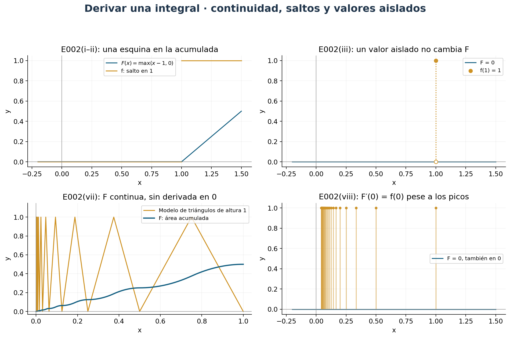
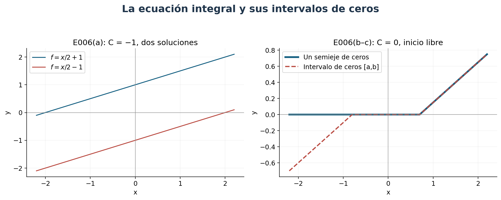
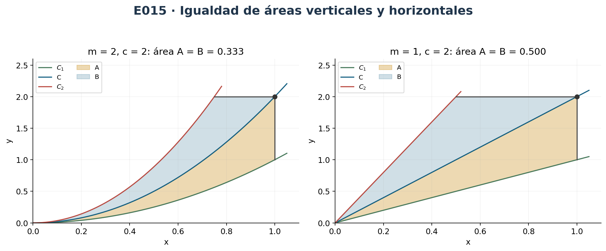
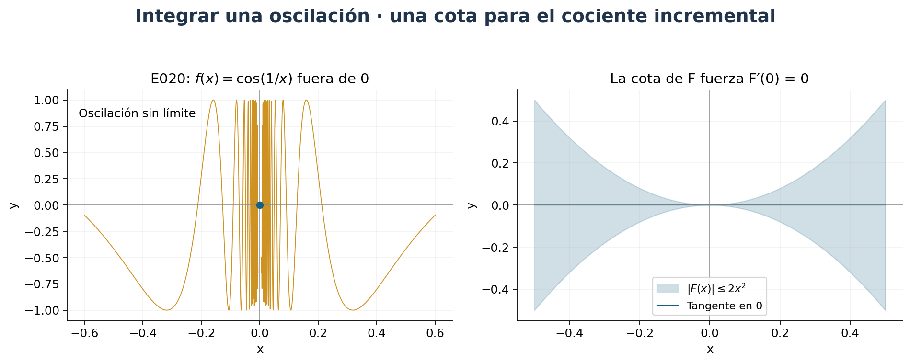
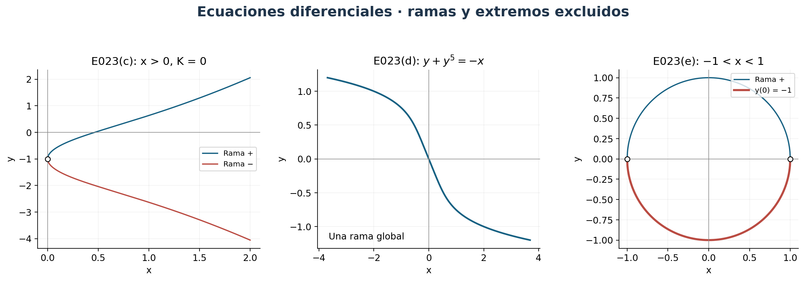
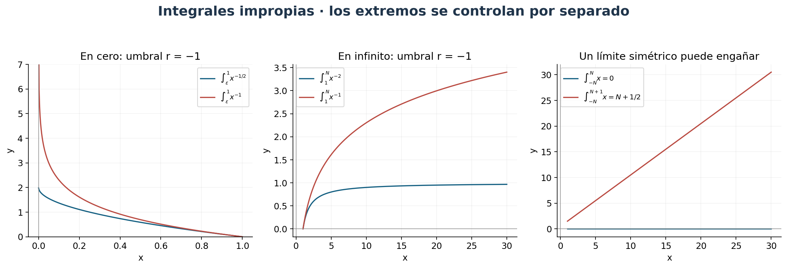

[← Capítulo 13](capitulo-13.qmd) · [Colecciones](../index.qmd#spivak-calculus-cuarta-edición) · [Capítulo 15 →](capitulo-15.qmd)

Una integral con extremo variable contiene información local. Si el integrando es continuo en $c$, el promedio de sus valores entre $c$ y $c+h$ tiende a $f(c)$; ese promedio es precisamente el cociente incremental de $F(x)=\int_a^xf$. Esta observación permite derivar integrales, construir funciones mediante sus derivadas y evaluar áreas por diferencias de primitivas.

Fuente: Michael Spivak, *Calculus*, cuarta edición, ejercicios 1–30, pp. 296–302 / PDF 316–322. No hay apéndice de este capítulo. Los enunciados se condensan conservando sus datos matemáticos; las soluciones y figuras son propias. Las discrepancias con la referencia se registran en el informe de revisión, separado del desarrollo lector.

## Herramientas y convenciones {#seccion-711}

Usamos el primer teorema fundamental: si $f$ es integrable y continua en $c$, entonces $(\int_a^xf)'_{x=c}=f(c)$. El segundo afirma que, si $G'=f$ y $f$ es integrable, $\int_a^bf=G(b)-G(a)$. En extremos del dominio, las derivadas son unilaterales cuando así se indique. Las integrales con límites invertidos tienen signo orientado.

Las integrales impropias se introducirán explícitamente en E025–E030. Una función no acotada en un intervalo cerrado no tiene integral de Riemann propia; asignar un valor en un extremo no elimina la falta de acotación cerca de él. En E005(ii) esta distinción es indispensable.

Las identidades y derivadas trigonométricas empleadas por los ejercicios se usan con la interpretación habitual en radianes, como hace el propio texto; el capítulo 15 construye esas funciones rigurosamente. Para potencias racionales basta la diferenciación de raíces ya disponible. En las fórmulas de integrales impropias se explica cómo extender los resultados a exponentes reales por comparación, sin anticipar derivadas de potencias reales arbitrarias.

## Ejercicio 1 — `SPV4-C14-E001` {#e001}

**Referencia:** pp. 296–297 / PDF 316–317. Hallar las ocho derivadas.

**(i)** Para $F(x)=\int_a^{x^3}\sin^3t\,dt$, el teorema fundamental y la cadena dan

$$\boxed{F'(x)=3x^2\sin^3(x^3).}$$

**(ii)** Sean $H(x)=\int_1^x\sin^3t\,dt$ y $F(x)=\int_3^{H(x)}dt/(1+\sin^6t+t^2)$. El denominador es siempre positivo y el integrando continuo. Entonces

$$\boxed{F'(x)=\frac{\sin^3x}{1+\sin^6(H(x))+H(x)^2}.}$$

**(iii)** Si $F(x)=\int_{15}^x(\int_8^y dt/(1+t^2+\sin^2t))dy$, la integral interna es una función continua de $y$. Por ello

$$\boxed{F'(x)=\int_8^x\frac{dt}{1+t^2+\sin^2t}.}$$

La primera derivación elimina solo la integral exterior.

**(iv)** Para $F(x)=\int_x^b dt/(1+t^2+\sin^2t)$, invertir el extremo variable introduce un signo:

$$\boxed{F'(x)=-\frac1{1+x^2+\sin^2x}.}$$

**(v)** En $F(x)=\int_a^b x\,dt/(1+t^2+\sin^2t)$ los límites son constantes y $x$ es constante respecto de $t$. Sacándolo fuera,

$$\boxed{F'(x)=\int_a^b\frac{dt}{1+t^2+\sin^2t}.}$$

**(vi)** Para $F(x)=\sin(\int_0^x\sin(\int_0^y\sin^3t\,dt)dy)$, se deriva de fuera hacia dentro:

$$\boxed{F'(x)=\cos\left(\int_0^x\sin\left(\int_0^y\sin^3t\,dt\right)dy\right)
\sin\left(\int_0^x\sin^3t\,dt\right).}$$

La integral más interna permanece en el valor del integrando exterior.

**(vii)** Si $F(x)=\int_1^xdt/t$, $x>0$, entonces $F'=1/x>0$, así que tiene inversa en su imagen $J$. La fórmula de la inversa da

$$\boxed{(F^{-1})'(u)=F^{-1}(u),\qquad u\in J.}$$

De hecho $J=\mathbb R$: C13-E015 da $F(2^n)=nF(2)\to\infty$ y $F(2^{-n})=-nF(2)\to-\infty$, con $F(2)>0$; la continuidad llena los valores intermedios.

**(viii)** Si $F(x)=\int_0^xdt/\sqrt{1-t^2}$, su dominio propio es $(-1,1)$ y $F'>0$ allí. Para $u$ en su imagen,

$$\boxed{(F^{-1})'(u)=\sqrt{1-[F^{-1}(u)]^2}.}$$

Los extremos $\pm1$ exigirían integrales impropias, consideradas en E028(e); no se incluyen silenciosamente en esta aplicación del teorema.

## Ejercicio 2 — `SPV4-C14-E002` {#e002}

**Referencia:** p. 297 / PDF 317. Con $F(x)=\int_0^xf$, determinar dónde $F'(x)=f(x)$.

**(i)** $f=0$ para $x\le1$ y $f=1$ para $x>1$. Se obtiene $F(x)=0$ si $x\le1$ y $F(x)=x-1$ si $x>1$. La igualdad vale para todo $x\ne1$; en $1$ las derivadas laterales son cero y uno, por lo que no hay derivada.

**(ii)** Si se cambia solo $f(1)$ a uno, la integral y la conclusión anterior permanecen iguales. La derivada de una integral no puede recuperar por sí sola una modificación aislada del integrando.

**(iii)** Si $f(1)=1$ y $f=0$ en los otros puntos, $F=0$ en toda la recta. Así $F'=f$ exactamente cuando $x\ne1$.

**(iv)** Para la función de Thomae, $f=0$ en irracionales y $f(p/q)=1/q$ con fracción reducida y $q>0$, toda integral sobre un intervalo compacto es cero. La prueba de C13-E034 se traslada a cualquier compacto: solo hay finitos racionales con denominador acotado en él. Así $F=0$ y $F'=f$ exactamente en los irracionales.

**(v)** Para $f(x)=0$ si $x\le0$ y $f(x)=x$ si $x\ge0$, la función es continua incluso en cero. Tenemos $F=0$ para $x\le0$ y $F=x^2/2$ para $x\ge0$; la igualdad vale en todos los reales, incluido cero por cociente incremental.

**(vi)** Sea $f=1/\lfloor1/x\rfloor$ para $0<x\le1$, y cero para $x\le0$ o $x>1$. Es integrable por C13-E007(vi). Sus únicos saltos están en $x=1/n$, $n\ge1$. Allí las medias laterales de la integral tienen límites distintos: para $n\ge2$, $1/n$ a la izquierda y $1/(n-1)$ a la derecha; para $n=1$, uno a la izquierda y cero a la derecha. No hay derivada en esos puntos. En cero, $0\le f(x)\le x/(1-x)\to0$ para $0<x<1$, y por continuidad se aplica el teorema. Por tanto la igualdad vale exactamente fuera de $\{1/n:n\ge1\}$, incluido cero.

**(vii)** La figura 6 tiene triángulos de altura uno sobre $[1/2,1]$, $[1/4,1/2]$, etc., valor cero en el origen y fuera de $[0,1]$. La función es continua fuera de cero, incluso en los vértices y en uno, y allí $F'=f$. En $x_N=2^{-N}$, el área acumulada es $F(x_N)=x_N/2$, de modo que $F(x_N)/x_N=1/2$, mientras el cociente por la izquierda de cero es cero. No hay derivada bilateral en cero. La respuesta es todos los $x\ne0$.

**(viii)** Si $f=1$ en los puntos $1/n$ y cero en los demás, su integral es cero en cualquier compacto: se aísla una cola cerca de cero y el resto son finitas modificaciones puntuales. Por tanto $F'=0$ en toda la recta, y $F'=f$ exactamente fuera de los puntos $1/n$, incluido cero, aunque $f$ sea discontinua allí.

{#fig-spv4-c14-f01 fig-alt="Capítulo 14: Integrandos y funciones acumuladas"}

## Ejercicio 3 — `SPV4-C14-E003` {#e003}

**Referencia:** p. 297 / PDF 317. Examinar la constancia de dos expresiones.

**(i)** Sea $H(x)=\int_0^xdt/(1+t^2)+\int_0^{1/x}dt/(1+t^2)$, definida para $x\ne0$. Su derivada es

$$H'(x)=\frac1{1+x^2}-\frac1{x^2(1+1/x^2)}=0.$$

Por el teorema del valor medio es constante en cada componente de su dominio. En $x>0$ vale $2\int_0^1dt/(1+t^2)>0$; en $x<0$ vale el opuesto, por paridad del integrando e inversión de límites. **No hay una sola constante en todo $\mathbb R\setminus\{0\}$.** La afirmación necesita restringir el dominio a una de las semirrectas. Tras identificar las funciones trigonométricas inversas en C15, esas constantes son $\pm\pi/2$; esa identificación no se necesita para esta prueba.

**(ii)** Para $K(x)=\int_{-\cos x}^{\sin x}dt/\sqrt{1-t^2}$, $0<x<\pi/2$, los extremos están dentro de $(-1,1)$. Derivar ambos extremos da

$$K'(x)=\frac{\cos x}{\sqrt{1-\sin^2x}}-\frac{\sin x}{\sqrt{1-\cos^2x}}
=\frac{\cos x}{|\cos x|}-\frac{\sin x}{|\sin x|}=0.$$

El intervalo dado hace positivos ambos denominadores simplificados. Por el valor medio, $K$ es constante; puede expresarse como $\int_{-1/\sqrt2}^{1/\sqrt2}dt/\sqrt{1-t^2}$ evaluando en $\pi/4$. No se prolonga la simplificación de signos fuera de ese intervalo.

## Ejercicio 4 — `SPV4-C14-E004` {#e004}

**Referencia:** p. 298 / PDF 318. Calcular $(f^{-1})'(0)$ sin evaluar $f$.

**(i)** Para $f(x)=\int_0^x[1+\sin(\sin t)]dt$, $f(0)=0$ y $f'(0)=1$. Además $1+\sin(\sin t)\ge1-\sin1>0$, de modo que $f$ es estrictamente creciente y su inversa existe. Así $\boxed{(f^{-1})'(0)=1}$.

**(ii)** Para $f(x)=\int_1^x\cos(\cos t)dt$, $f(1)=0$ y $f'(x)=\cos(\cos x)\ge\cos1>0$. La preimagen de cero es uno y

$$\boxed{(f^{-1})'(0)=\frac1{\cos(\cos1)}.}$$

Se evalúa la derivada en la preimagen, no en el argumento cero de la inversa.

## Ejercicio 5 — `SPV4-C14-E005` {#e005}

**Referencia:** p. 298 / PDF 318. Buscar $g$ en dos ecuaciones integrales.

**(i)** Queremos $\int_0^xtg(t)dt=x+x^2$. Tomamos $g(t)=1/t+2$ para $t\ne0$, y asignamos cualquier valor finito en cero. El producto $tg(t)$ vale $1+2t$ salvo en cero, donde vale cero; es integrable y la modificación en ese punto no cambia la integral. Por el segundo teorema fundamental,

$$\int_0^xtg(t)dt=\int_0^x(1+2t)dt=x+x^2$$

para todos los reales. No se requiere que $g$ misma sea integrable cerca de cero.

**(ii)** La ecuación impresa es $\int_0^{x^2}tg(t)dt=x+x^2$. En toda la recta es imposible: el lado izquierdo es par en $x$ y el derecho no. Tampoco tiene solución con integral **propia** para todos los $x\ge0$ cercanos a cero. Si $tg(t)$ fuera integrable en algún $[0,A]$, estaría acotada por $B$, y $|\int_0^{x^2}tg(t)dt|\le Bx^2$, incompatible con $x+x^2$ al dividir por $x>0$ y dejar $x\downarrow0$.

Hay una solución para $x\ge0$ al interpretar la integral como **impropia**:

$$g(t)=\frac1{2t^{3/2}}+\frac1t\quad(t>0),\qquad g(0)=0.$$

En efecto, $tg(t)=1/(2\sqrt t)+1$, y

$$\lim_{\varepsilon\downarrow0}\int_\varepsilon^{x^2}tg(t)dt
=\lim_{\varepsilon\downarrow0}[\sqrt t+t]_\varepsilon^{x^2}=x+x^2\quad(x>0).$$

En cero la integral se define como cero. Para $x<0$, la misma elección produce $|x|+x^2$, no $x+x^2$. En la semirrecta negativa se podría usar por separado $g(t)=-1/(2t^{3/2})+1/t$, pero ninguna elección satisface simultáneamente ambas semirrectas. Las integrales impropias se formalizan en E028.

## Ejercicio 6 — `SPV4-C14-E006` {#e006}

**Referencia:** p. 298 / PDF 318. Funciones continuas con $\int_0^xf=f(x)^2+C$.

**(a)** Se pide $C\ne0$ y a lo sumo un cero de $f$, sobre toda $\mathbb R$. En $x=0$, $f(0)^2=-C$, así que $C<0$. En cualquier intervalo donde $f\ne0$, la identidad muestra que $f^2$ es diferenciable. Como allí $f$ es una raíz de signo fijo, también es diferenciable, y

$$f=2ff',\qquad f'=1/2.$$

Si no tuviera ceros, sería afín de pendiente $1/2$ en toda la recta, pero una función así tiene un cero. Si tiene su único cero $r$, en cada semirrecta es $x/2+k_\pm$; por continuidad en $r$, ambos términos constantes son $-r/2$. Por tanto

$$\boxed{f(x)=x/2+\sqrt{-C}\quad\text{o}\quad f(x)=x/2-\sqrt{-C},\qquad C<0.}$$

Sustituir da $\int_0^xf=x^2/4\pm x\sqrt{-C}$, igual a $f(x)^2+C$. Para $C>0$ no hay solución real.

**(b)** Una solución nula en $(-\infty,b]$, $b>0$, obliga a $C=0$ al evaluar en cero. Por tanto es incompatible con conservar $C\ne0$ de (a); este inciso debe liberar esa restricción. Con $C=0$ sirve

$$\boxed{f(x)=\begin{cases}0,&x\le b,\\(x-b)/2,&x>b.\end{cases}}$$

Para $x\le b$, ambas partes de la ecuación son cero; para $x>b$, $\int_b^x(t-b)/2\,dt=(x-b)^2/4=f(x)^2$. El punto de partida $b$ es libre, no queda fijado por una constante no nula.

**(c)** Para $C=0$ y $a<0<b$,

$$\boxed{f(x)=\begin{cases}(x-a)/2,&x<a,\\0,&a\le x\le b,\\(x-b)/2,&x>b.\end{cases}}$$

Es continua. Para $x>b$ se comprueba como en (b). Para $x<a$, $\int_0^xf=\int_a^x(t-a)/2\,dt=(x-a)^2/4=f(x)^2$, incluyendo el signo orientado. Dentro de $[a,b]$ las dos partes son cero.

{#fig-spv4-c14-f02 fig-alt="Capítulo 14: Soluciones con y sin intervalo de ceros"}

## Ejercicio 7 — `SPV4-C14-E007` {#e007}

**Referencia:** p. 298 / PDF 318. Aplicar el valor medio ponderado de C13-E023.

**(i)** Con $w(x)=x^6\ge0$ y $h(x)=1/\sqrt{1+x^2}$, existe $\xi\in[0,1]$ tal que

$$\int_0^1\frac{x^6}{\sqrt{1+x^2}}dx
=\frac1{\sqrt{1+\xi^2}}\int_0^1x^6dx
=\frac1{7\sqrt{1+\xi^2}}.$$

Como $1/\sqrt2\le1/\sqrt{1+\xi^2}\le1$, se obtienen las cotas $1/(7\sqrt2)$ y $1/7$.

**(ii)** En $[0,1/2]$,

$$\sqrt{\frac{1-x}{1+x}}=\frac{1-x}{\sqrt{1-x^2}}.$$

Tomamos $w(x)=1-x\ge0$ y $h(x)=1/\sqrt{1-x^2}$. La integral vale $h(\xi)\int_0^{1/2}(1-x)dx=(3/8)h(\xi)$. Puesto que $1\le h(\xi)\le2/\sqrt3$,

$$\boxed{\frac38\le\int_0^{1/2}\sqrt{\frac{1-x}{1+x}}dx\le\frac{\sqrt3}{4}.}$$

## Ejercicio 8 — `SPV4-C14-E008` {#e008}

**Referencia:** p. 298 / PDF 318. Derivar $F(x)=\int_0^xxf(t)dt$.

Suponiendo $f$ continua, $x$ es constante respecto de $t$, así que $F(x)=xA(x)$, con $A(x)=\int_0^xf(t)dt$. Producto y teorema fundamental dan

$$\boxed{F'(x)=\int_0^xf(t)dt+xf(x).}$$

Basta continuidad de $f$ en el punto de derivación e integrabilidad en los intervalos pertinentes. Si solo se supusiera integrabilidad, $A'$ podría no existir; no se aplica el teorema sin su hipótesis local.

## Ejercicio 9 — `SPV4-C14-E009` {#e009}

**Referencia:** p. 298 / PDF 318. Probar $\int_0^xf(u)(x-u)du=\int_0^x(\int_0^uf(t)dt)du$, para $f$ continua.

Sea $A(x)=\int_0^xf$. El miembro izquierdo es $L(x)=xA(x)-\int_0^xuf(u)du$. Por E008 y el teorema fundamental, $L'=A+xf(x)-xf(x)=A$. El miembro derecho también tiene derivada $A$. Ambos valen cero en cero; su diferencia tiene derivada cero en el intervalo considerado, luego es cero por el valor medio. Esta prueba cubre también $x<0$, con integrales orientadas.

## Ejercicio 10* — `SPV4-C14-E010` {#e010}

**Referencia:** p. 298 / PDF 318. Probar la identidad de tres integraciones sucesivas.

Definamos $A(x)=\int_0^xf(t)dt$, $B(x)=\int_0^xA(u_1)du_1$, $D(x)=\int_0^xB(u_2)du_2$, para $f$ continua. La identidad pedida es

$$\boxed{\int_0^xf(u)(x-u)^2du=2D(x).}$$

Para comprobarla sin derivar bajo un signo integral con parámetro, expandimos el cuadrado. La derivada del lado izquierdo es

$$\frac d{dx}\left[x^2\int_0^xf-2x\int_0^xuf(u)du+\int_0^xu^2f(u)du\right]
=2\int_0^xf(u)(x-u)du=2B(x),$$

por E009. El lado derecho tiene la misma derivada y ambos se anulan en cero. De nuevo, el valor medio prueba la igualdad en cualquier intervalo que contenga cero.

## Ejercicio 11 — `SPV4-C14-E011` {#e011}

**Referencia:** p. 298 / PDF 318. Construir $f$ con $f'''(x)=1/\sqrt{1+\sin^2x}$.

El integrando $h(x)=1/\sqrt{1+\sin^2x}$ es continuo. Podemos tomar

$$\boxed{f(x)=\int_0^x\int_0^u\int_0^v h(t)dt\,dv\,du
=\frac12\int_0^xh(t)(x-t)^2dt.}$$

Tres aplicaciones del primer teorema fundamental dan $f'''=h$; la segunda expresión procede de E010. No se necesita una primitiva elemental. Todas las demás soluciones difieren en un polinomio de grado a lo sumo dos: aplicar sucesivamente el valor medio a una diferencia de tercera derivada cero da esa conclusión.

## Ejercicio 12 — `SPV4-C14-E012` {#e012}

**Referencia:** p. 299 / PDF 319. Periodicidad; los períodos son positivos y las funciones se definen en $\mathbb R$.

**(a)** Si $f(x+a)=f(x)$ y $f$ es integrable en $[0,a]$, la traslación de particiones prueba integrabilidad en cada intervalo trasladado. Escribamos $b=ma+r$ con $m\in\mathbb Z$, $0\le r<a$. Por periodicidad, $\int_b^{b+a}f=\int_r^{r+a}f$. Dividimos en $a$ y trasladamos el último tramo:

$$\int_r^{r+a}f=\int_r^af+\int_a^{a+r}f
=\int_r^af+\int_0^rf=\boxed{\int_0^af}.$$

**(b)** Sirve $f(x)=x+\sin x$: su derivada $1+\cos x$ es periódica, pero $f$ es no acotada y no puede ser periódica, pues una continua periódica está acotada por su comportamiento en un período compacto.

**(c)** Si $f'$ tiene período $a$, la función $Q(x)=f(x+a)-f(x)$ satisface $Q'=0$. Es constante y vale $Q(0)=f(a)-f(0)$. Si $f(a)=f(0)$, esa constante es cero: $f$ tiene período $a$. No se necesita que $f'$ sea integrable.

**(d*)** Si además $f$ tiene algún período $b>0$, es continua y acotada en toda la recta. Como $Q(x)=k=f(a)-f(0)$ por el argumento anterior, la inducción da $f(x+na)=f(x)+nk$ para todo entero $n\ge0$. La acotación fuerza $k=0$, por tanto $f(a)=f(0)$. No se requiere que los dos períodos sean conmensurables.

## Ejercicio 13 — `SPV4-C14-E013` {#e013}

**Referencia:** p. 299 / PDF 319. Evaluar $\int_0^b\sqrt[n]x\,dx$ con una primitiva, $b\ge0$, $n\ge1$ entero.

Tomamos $G(x)=\frac n{n+1}x\sqrt[n]x$ en $[0,\infty)$. Para $x>0$, las reglas de producto y de derivación de raíces dan $G'(x)=\sqrt[n]x$. En cero, $[G(h)-G(0)]/h=\frac n{n+1}\sqrt[n]h\to0$ por la derecha. Así, por el segundo teorema fundamental,

$$\boxed{\int_0^b\sqrt[n]x\,dx=\frac n{n+1}b^{(n+1)/n}.}$$

Coincide con C13-E021(c), donde se obtuvo desde sumas para la inversa.

## Ejercicio 14* — `SPV4-C14-E014` {#e014}

**Referencia:** p. 299 / PDF 319; remite a C12-E021 y C13-E021. Si $F'=f$, construir una primitiva de $g=f^{-1}$.

Para $f$ continua y estrictamente creciente, la identidad de C13-E021 entre dos valores $u_0,u$ de su imagen es

$$\int_{u_0}^ug(t)dt=ug(u)-u_0g(u_0)-\int_{g(u_0)}^{g(u)}f(t)dt.$$

Por el segundo teorema fundamental, la última integral es $F(g(u))-F(g(u_0))$. Por tanto

$$G(u)=ug(u)-F(g(u))=\int_{u_0}^ug(t)dt+\text{constante}.$$

Como $g$ es continua, el primer teorema fundamental prueba $\boxed{G'=g}$. Con las hipótesis diferenciables de C12-E021 se podría derivar directamente y cancelar $[u-f(g(u))]g'(u)$; la identidad integral incluso muestra que $G$ es diferenciable cuando la inversa no lo es. Para $f$ decreciente, la misma identidad se obtiene aplicando la versión creciente a $-f$ y reflejando la variable de su imagen; las orientaciones de los extremos dan la fórmula idéntica.

## Ejercicio 15* — `SPV4-C14-E015` {#e015}

**Referencia:** p. 299 / PDF 319. Curvas que bisecan áreas como en la figura 7.

**(a)** Sean $C_1:y=x^2$ y $C:y=2x^2$, $x\ge0$. En $P=(x,2x^2)$, la región inferior entre $C$ y $C_1$ tiene área $A(x)=x^3/3$. Si $h(y)$ es la abscisa de $C_2$ a altura $y$, el área horizontal entre $C_2$ y $C$ es

$$B(x)=\int_0^{2x^2}\left(\sqrt{y/2}-h(y)\right)dy.$$

La igualdad $A=B$ implica, al derivar para $x>0$, $x^2=[x-h(2x^2)]4x$, es decir, $h(2x^2)=3x/4$. Luego

$$\boxed{C_2:\ y=\frac{32}{9}x^2,\quad x\ge0.}$$

Recíprocamente, con esta $C_2$ las derivadas de $A$ y $B$ coinciden y ambas áreas son cero en el origen, lo que prueba la bisección para todo $P$.

**(b)** Para $C_1:y=x^m$ y $C:y=cx^m$, $c>1$, suponemos $m>0$ para que las ramas tengan inversas desde el origen. Para exponentes enteros y racionales se usan las reglas demostradas en C12; al permitir exponentes reales se entiende disponible la regla habitual de derivación de potencias. Ahora $A(x)=(c-1)x^{m+1}/(m+1)$ y

$$B(x)=\int_0^{cx^m}\bigl((y/c)^{1/m}-h(y)\bigr)dy.$$

Derivando, $(c-1)x^m=[x-h(cx^m)]cmx^{m-1}$. Por ello $h(cx^m)=qx$, donde

$$q=1-\frac{c-1}{cm}=\frac{m-1+1/c}{m}.$$

Si $q>0$, obtenemos

$$\boxed{C_2:\ y=cq^{-m}x^m,\quad x\ge0.}$$

Además $q<1$, de modo que $C_2$ queda a la izquierda de $C$ en la descripción horizontal. La igualdad de áreas se comprueba por sus derivadas y su valor inicial, como en (a). Para enteros $m\ge1$, $q>0$ automáticamente. Si se permiten exponentes $0<m<1$, hace falta $c<1/(1-m)$ para la disposición del dibujo en el primer cuadrante. Si $q=0$, la curva límite es el eje vertical; si $q<0$, la curva paramétrica $(qx,cx^m)$ queda a la izquierda del eje y ya no tiene la disposición del dibujo. Esta precisión evita suponer que toda elección real de $m,c$ produce una gráfica positiva de ese tipo.

{#fig-spv4-c14-f03 fig-alt="Capítulo 14: Bisección de áreas por las tres curvas"}

## Ejercicio 16 — `SPV4-C14-E016` {#e016}

**Referencia:** p. 299 / PDF 319. Derivadas y ley de $\int_1^adt/t$.

**(a)** Para $x>0$, $b>0$, sean $F(x)=\int_1^xdt/t$ y $G(x)=\int_b^{bx}dt/t$. El teorema fundamental y la cadena dan $F'(x)=1/x$ y $G'(x)=b/(bx)=1/x$.

**(b)** La diferencia $F-G$ es constante en $(0,\infty)$ y vale cero en $x=1$. Por tanto $F(a)=G(a)=\int_b^{ba}dt/t$. Sumando $\int_1^bdt/t$,

$$\boxed{\int_1^a\frac{dt}{t}+\int_1^b\frac{dt}{t}=\int_1^{ab}\frac{dt}{t},\qquad a,b>0.}$$

Se recupera C13-E015, y la orientación permite también $a$ o $b$ menores que uno.

## Ejercicio 17* — `SPV4-C14-E017` {#e017}

**Referencia:** p. 299 / PDF 319. Valor intermedio desde Darboux y el teorema fundamental.

Sea $f$ continua en $[a,b]$ y $y$ un valor entre $f(a)$ y $f(b)$. Definimos $F(x)=\int_a^xf$. El primer teorema fundamental da $F'=f$, con derivadas unilaterales en los extremos. El teorema de Darboux para derivadas, demostrado en C11-E060, garantiza que $F'$ toma todos los valores intermedios; así existe $c$ con $f(c)=y$.

Para valores estrictamente entre los extremos, puede evitarse cualquier formulación de Darboux en bordes: la continuidad de $f$ permite escoger $a<u<v<b$ con $y$ todavía entre $f(u),f(v)$ y aplicar Darboux dentro de $(a,b)$. Si $y=f(a)$ o $f(b)$, sirve el extremo correspondiente. La prueba alternativa presupone Darboux y el teorema fundamental establecidos sin usar como paso lógico el resultado que se quiere reconstruir.

## Ejercicio 18 — `SPV4-C14-E018` {#e018}

**Referencia:** p. 299 / PDF 319. Dos extremos variables.

Si $h$ es continua, $f,g$ diferenciables y sus valores están en el intervalo de definición de $h$, fijamos $d$ en él y $H(u)=\int_d^uh(t)dt$. Por aditividad,

$$F(x)=\int_{f(x)}^{g(x)}h(t)dt=H(g(x))-H(f(x)).$$

Como $H'=h$, la cadena da

$$\boxed{F'(x)=h(g(x))g'(x)-h(f(x))f'(x).}$$

La prueba cubre cruces de los extremos y el caso $f(x)=g(x)$; no exige un orden fijo entre ellos.

## Ejercicio 19 — `SPV4-C14-E019` {#e019}

**Referencia:** p. 299 / PDF 319. $f$ integrable en $[a,b]$, $c\in(a,b)$ y $F(x)=\int_a^xf$. Probar o refutar tres afirmaciones.

**(a)** Si $f$ es diferenciable en $c$, es continua allí, por lo que $F$ es diferenciable en $c$ y $F'(c)=f(c)$. La afirmación es verdadera.

**(b)** Que $f$ sea diferenciable solo en $c$ no garantiza que $F'$ exista en todo un entorno de $c$. Con la convención usual de exigir ese entorno para hablar de una derivada continua allí, la afirmación «$F'$ es continua en $c$» necesita esa salvedad. Un contraejemplo a la existencia del entorno es, en $[-1,1]$ y $c=0$,

$$f(0)=0,\qquad f(x)=x^2\lfloor1/x\rfloor\quad(x\ne0).$$

Es integrable: fuera de un entorno de cero tiene finitos saltos y en la cola $|f(x)|\le|x|+x^2$, que permite controlar las diferencias de Darboux. Además $f(x)/x=x\lfloor1/x\rfloor\to1$, así que $f'(0)=1$. Sin embargo, en cada $1/n$, $n\ge2$, $f$ tiene límites laterales distintos, luego $F$ tiene cocientes incrementales laterales distintos y $F'(1/n)$ no existe. Esos puntos se aproximan a cero.

Hay una distinción de dominio importante: **sobre el dominio natural $D$ donde $F'$ sí existe, $F'$ es continua en $c$ en sentido relativo**. En efecto, la continuidad de $f$ en $c$ permite imponer $|f(t)-f(c)|<\varepsilon$ para $|t-c|<\delta$. Si $x\in D$ y $|x-c|<\delta/2$, todos los promedios incrementales suficientemente cortos de $F$ alrededor de $x$ están entre $f(c)-\varepsilon$ y $f(c)+\varepsilon$. Al tomar límite, $|F'(x)-f(c)|\le\varepsilon$. Como $F'(c)=f(c)$, se prueba la continuidad relativa. Así, si se entiende la afirmación en ese sentido, es verdadera; lo que falta en general es el entorno completo de definición. El contraejemplo no se presenta como una discontinuidad relativa que no posee.

**(c)** Si $f'$ es continua en $c$, entendiendo que $f$ es diferenciable en un entorno de $c$, entonces $f$ es continua en ese entorno. Por el teorema fundamental, $F'=f$ allí, y $F'$ es continua en $c$. La afirmación es verdadera; la continuidad de $f'$ es más de lo necesario.

## Ejercicio 20* — `SPV4-C14-E020` {#e020}

**Referencia:** p. 300 / PDF 320. Para $f(x)=\cos(1/x)$ si $x\ne0$ y $f(0)=0$, decidir si $F(x)=\int_0^xf$ es diferenciable en cero.

La función está acotada y es continua salvo en cero, luego es integrable en compactos. Sea $G(x)=x^2\sin(1/x)$ para $x\ne0$, $G(0)=0$. Su cociente incremental en cero tiende a cero, así que $G'(0)=0$. Para $x\ne0$,

$$G'(x)=2x\sin(1/x)-\cos(1/x).$$

Definamos $k(x)=2x\sin(1/x)$ fuera de cero y $k(0)=0$. Es continua en cero y $f=k-G'$ en todos los puntos. La derivada $G'$ es integrable, pues está acotada en cada compacto y solo puede ser discontinua en cero. Por el segundo teorema fundamental,

$$F(x)=\int_0^xk(t)dt-G(x).$$

Como $|k(t)|\le2|t|$ y $|G(x)|\le x^2$,

$$|F(x)|\le x^2+x^2=2x^2.$$

Por tanto $|F(x)/x|\le2|x|\to0$ y $\boxed{F'(0)=0=f(0)}$, a pesar de la discontinuidad de $f$. La prueba funciona por ambos lados y no usa una integración por partes aún no desarrollada.

{#fig-spv4-c14-f04 fig-alt="Capítulo 14: Oscilación del integrando y cota de la acumulada"}

## Ejercicio 21 — `SPV4-C14-E021` {#e021}

**Referencia:** p. 300 / PDF 320. Si $f'$ es integrable en $[0,1]$ y $f(0)=0$, demostrar $|f(x)|\le\sqrt{\int_0^1(f')^2}$.

El segundo teorema fundamental da $f(x)=\int_0^xf'$. Cauchy–Schwarz con la función constante uno, sobre $[0,x]$, implica

$$|f(x)|^2\le x\int_0^x(f')^2\le\int_0^1(f')^2,\qquad0\le x\le1.$$

El cuadrado de $f'$ es integrable por C13-E038; la segunda desigualdad usa $x\le1$ y la no negatividad del integrando. Tomando raíces se obtiene lo pedido. La condición inicial es necesaria: $f=1$ tiene $f'=0$ e incumple $1\le0$.

## Ejercicio 22* — `SPV4-C14-E022` {#e022}

**Referencia:** p. 300 / PDF 320. Si $f(0)=0$ y $0<f'\le1$, probar $\int_0^xf^3\le(\int_0^xf)^2$ para $x\ge0$.

Por el valor medio, $f(x)\ge0$ para $x\ge0$. Sean

$$A(x)=\int_0^xf,\qquad B(x)=2A(x)-f(x)^2.$$

Entonces $B(0)=0$ y $B'(x)=2f(x)[1-f'(x)]\ge0$, de modo que $B\ge0$. Definimos $H(x)=A(x)^2-\int_0^xf(t)^3dt$. El teorema fundamental da

$$H'(x)=2A(x)f(x)-f(x)^3=f(x)B(x)\ge0.$$

Como $H(0)=0$, resulta $\boxed{H(x)\ge0}$. Este argumento solo integra funciones continuas $f,f^3$; no presupone que una derivada acotada $f'$ sea necesariamente integrable.

## Ejercicio 23* — `SPV4-C14-E023` {#e023}

**Referencia:** p. 300 / PDF 320. Separación de variables; $G'=g$, $F'=f$, sobre intervalos conectados.

**(a)** Si $y$ es diferenciable y satisface $g(y(x))y'(x)=f(x)$, la cadena da $[G(y(x))-F(x)]'=0$. Por el valor medio,

$$\boxed{G(y(x))=F(x)+C.}$$

**(b)** Recíprocamente, si $y$ es diferenciable y satisface esa identidad, derivarla da $g(y)y'=f$. La hipótesis de diferenciabilidad de $y$ no debe suprimirse: $G(t)=t^2$, $F(x)=x^2$, $y(x)=|x|$ satisfacen $G(y)=F$, pero $y$ no es diferenciable en cero. Si $g$ no se anula en la rama considerada, la diferenciabilidad sí puede obtenerse previamente mediante el teorema de la inversa.

**(c)** Para $y'=(1+x^2)/(1+y)$, se exige $y\ne-1$. Las primitivas dan

$$y+y^2/2=x+x^3/3+C,\qquad(y+1)^2=K+2x+2x^3/3.$$

El radicando $R(x)=K+2x+2x^3/3$ es estrictamente creciente, tiende a ambos infinitos y tiene un único cero $\alpha$. Todas las soluciones sobre intervalos abiertos no degenerados son restricciones de las dos ramas

$$\boxed{y(x)=-1\pm\sqrt{K+2x+2x^3/3},\qquad x>\alpha.}$$

El signo es fijo en un intervalo conectado, porque no se puede cruzar $y=-1$. Diferenciar cada rama comprueba la ecuación. No se incluye $x=\alpha$, donde el denominador original se anula. Ninguna solución tiene dominio $\mathbb R$.

**(d)** Para $y'=-1/(1+5y^4)$, la identidad es $y+y^5=-x+C$. El polinomio $P(t)=t+t^5$ tiene $P'=1+5t^4>0$ y recorre toda la recta; su inversa existe y es diferenciable. Así todas las soluciones son

$$\boxed{y(x)=P^{-1}(C-x).}$$

Se definen globalmente en $\mathbb R$ o se restringen a un intervalo. La diferenciación de la inversa verifica la ecuación.

**(e)** De $yy'=-x$ obtenemos $y^2+x^2=R^2$. En un intervalo abierto no degenerado, $R>0$ y todas las soluciones son restricciones de

$$\boxed{y(x)=\pm\sqrt{R^2-x^2},\qquad -R<x<R.}$$

No se pueden añadir los extremos $\pm R$: allí $y=0$ y la ecuación exigiría $0=\mp R$, imposible con derivada finita. El caso $R=0$ solo da un punto, no una solución en un intervalo abierto. La condición $y(0)=-1$ determina $R=1$ y la rama negativa: $y(x)=-\sqrt{1-x^2}$, con dominio máximo $(-1,1)$.

{#fig-spv4-c14-f05 fig-alt="Capítulo 14: Ramas y dominios de las ecuaciones diferenciales"}

## Ejercicio 24 — `SPV4-C14-E024` {#e024}

**Referencia:** p. 301 / PDF 321. Clasificar las funciones de schwarziano cero.

Sea $f$ tres veces diferenciable en un intervalo, con $f'\ne0$, y

$$S(f)=\frac{f'''}{f'}-\frac32\left(\frac{f''}{f'}\right)^2=0.$$

**(a)** Por cociente y cadena,

$$\left(\frac{(f'')^2}{(f')^3}\right)'
=\frac{2f''f'''f'-3(f'')^3}{(f')^4}
=\frac{2f''}{(f')^2}S(f)=0.$$

El valor medio prueba que la expresión es constante en el intervalo. No se divide por $f''$, que puede ser cero.

**(b)** Como $f'$ es continua y no nula, tiene signo fijo $s\in\{-1,1\}$. Pongamos $w=|f'|^{-1/2}>0$. Dos derivaciones dan

$$w'=-\frac12w\frac{f''}{f'},\qquad
w''=w\left[\frac34\left(\frac{f''}{f'}\right)^2-\frac12\frac{f'''}{f'}\right]=0.$$

Así $w=\alpha x+\beta>0$ y $f'=s/(\alpha x+\beta)^2$. Si $\alpha=0$, $f$ es afín con pendiente no nula, que es un caso fraccionario lineal. Si $\alpha\ne0$, una primitiva es

$$f(x)=A-\frac{s}{\alpha(\alpha x+\beta)}
=\frac{A\alpha x+A\beta-s/\alpha}{\alpha x+\beta}.$$

Por tanto $\boxed{f(x)=(ax+b)/(cx+d)}$, con $ad-bc\ne0$ y $cx+d\ne0$ en el intervalo. La verificación recíproca por derivación da $S(f)=0$. La clasificación es por intervalos conectados sin polos; no obliga a conservar los mismos coeficientes en componentes desconectadas de un dominio.

## Ejercicio 25 — `SPV4-C14-E025` {#e025}

**Referencia:** p. 301 / PDF 321. Se define $\int_a^\infty f=\lim_{N\to\infty}\int_a^Nf$, cuando el límite es finito y $f$ es integrable en cada intervalo truncado.

**(a)** Para $r<-1$, el resultado es

$$\boxed{\int_1^\infty x^r dx=-\frac1{r+1}.}$$

Para $r$ racional, una primitiva en los positivos es $x^{r+1}/(r+1)$, y la evaluación hasta $N$ es $(N^{r+1}-1)/(r+1)$, cuyo límite es el indicado. Para $r$ real, elegimos racionales $p<r<q<-1$. En $x\ge1$, $x^p\le x^r\le x^q$; la integral acumulada de $x^r$ es creciente y acotada por la de $x^q$, luego tiene límite. Este límite queda entre $-1/(p+1)$ y $-1/(q+1)$. Al aproximar $p,q$ a $r$, ambas cotas tienden al valor anunciado. Se usa la continuidad y orden de las potencias reales ya construidas; no una regla de diferenciación aún no demostrada para todo exponente real.

**(b)** Sea $c=\int_1^2dt/t>0$. C13-E015 implica $\int_1^{2^n}dt/t=nc\to\infty$. La integral acumulada es creciente; por tanto $\int_1^\infty dx/x$ diverge a $+\infty$ y no existe como número finito.

**(c)** Si $0\le g\le f$ en $[0,\infty)$ y $\int_0^\infty f=L<\infty$, entonces $G(N)=\int_0^Ng$ es no decreciente y $0\le G(N)\le\int_0^Nf\le L$. Por completitud, tiene límite finito. Esto prueba existencia de la integral impropia de $g$; la integrabilidad en cada truncamiento es una hipótesis necesaria del enunciado.

**(d)** En $[0,1]$, $1/(1+x^2)$ es continua y acotada. Para $x\ge1$, $0\le1/(1+x^2)\le x^{-2}$, cuya integral de cola converge por (a). La comparación y la suma con la parte finita prueban existencia de $\int_0^\infty dx/(1+x^2)$.

## Ejercicio 26 — `SPV4-C14-E026` {#e026}

**Referencia:** p. 301 / PDF 321. Decidir la convergencia de tres integrales sobre $[0,\infty)$.

**(i)** $\int_0^\infty dx/\sqrt{1+x^3}$ converge: el integrando es continuo en $[0,1]$, y para $x\ge1$ es $\le x^{-3/2}$, de cola convergente.

**(ii)** $\int_0^\infty x\,dx/(1+x^{3/2})$ diverge a $+\infty$: para $x\ge1$, $1+x^{3/2}\le2x^{3/2}$, de modo que el integrando es $\ge\tfrac12x^{-1/2}$ y su integral truncada crece sin cota.

**(iii)** $\int_0^\infty dx/(x\sqrt{1+x})$ tiene dos extremos impropios. La cola en infinito converge, pues para $x\ge1$ el integrando es $\le x^{-3/2}$. Pero para $0<x\le1$ es $\ge1/(\sqrt2 x)$, que diverge en cero por el argumento de E028(c). Así la integral total **no converge**; controlar solo la cola daría una conclusión errónea.

## Ejercicio 27 — `SPV4-C14-E027` {#e027}

**Referencia:** p. 301 / PDF 321. La integral sobre toda la recta se define como la suma de dos límites independientes: $\int_{-\infty}^0f+\int_0^\infty f$, si ambos son finitos.

**(a)** $\int_{-\infty}^\infty dx/(1+x^2)$ existe: su mitad positiva converge por E025(d) y la reflexión hace igual la mitad negativa. No es necesario conocer su valor para probar existencia.

**(b)** $\int_{-\infty}^\infty x\,dx$ no existe: las integrales hasta $N$ y desde $-N$ divergen respectivamente a $+\infty$ y $-\infty$. No se suman esos infinitos como números. Aunque $\int_{-N}^Nx\,dx=0$ para todo $N$, ese límite simétrico es un **valor principal**, no la integral impropia definida en el enunciado.

**(c)** Si las dos mitades convergen y $u(t)\to-\infty$, $v(t)\to+\infty$, entonces, para $t$ suficientemente avanzado,

$$\int_{u(t)}^{v(t)}f=\int_{u(t)}^0f+\int_0^{v(t)}f
\longrightarrow\int_{-\infty}^0f+\int_0^\infty f.$$

Esto incluye $u(N)=-N$, $v(N)=N$, $N+1$ o $N^2$, y da la generalización solicitada sin imponer una relación entre velocidades de escape. La convergencia de un recorrido de extremos particular no implica la convergencia de las dos mitades, como muestra (b).

{#fig-spv4-c14-f06 fig-alt="Capítulo 14: Colas, singularidades y límites independientes"}

## Ejercicio 28 — `SPV4-C14-E028` {#e028}

**Referencia:** p. 302 / PDF 322. Integrales impropias en extremos finitos.

**(a)** Para $a>0$,

$$\boxed{\lim_{\varepsilon\downarrow0}\int_\varepsilon^a\frac{dx}{\sqrt x}
=\lim_{\varepsilon\downarrow0}2(\sqrt a-\sqrt\varepsilon)=2\sqrt a.}$$

El símbolo $\int_0^a dx/\sqrt x$ designa este límite, no una integral de Riemann propia sobre $[0,a]$.

**(b)** Si $-1<r<0$, para $r$ racional se evalúa con $x^{r+1}/(r+1)$ y se obtiene $a^{r+1}/(r+1)$. Para $r$ real, primero trabajamos en $(0,1]$: racionales $-1<p<r<q<0$ dan $x^q\le x^r\le x^p$. Los límites para los racionales, comparación y aproximación $p,q\to r$ prueban el valor $1/(r+1)$. La escala de C13-E016, aplicada antes de pasar al límite, da

$$\boxed{\int_0^a x^r dx=\frac{a^{r+1}}{r+1}.}$$

**(c)** Para $\varepsilon=a/2^n$, el cambio de escala de C13-E016 da $\int_{a/2^n}^a dx/x=\int_1^{2^n}dt/t=nc$, con $c=\int_1^2dt/t>0$. Por monotonía al disminuir $\varepsilon$, el límite es $+\infty$. No existe integral impropia finita de $1/x$ en cero.

**(d)** Para $a<0$, definimos $\int_a^0|x|^r dx=\lim_{\varepsilon\downarrow0}\int_a^{-\varepsilon}|x|^r dx$. La reflexión $u=-x$ transforma cada truncamiento en $\int_\varepsilon^{-a}u^rdu$. Para $-1<r<0$, (b) da

$$\boxed{\int_a^0|x|^r dx=\frac{(-a)^{r+1}}{r+1}.}$$

**(e)** Definimos

$$\int_{-1}^1\frac{dx}{\sqrt{1-x^2}}
=\lim_{u\downarrow-1}\int_u^0\frac{dx}{\sqrt{1-x^2}}
+\lim_{v\uparrow1}\int_0^v\frac{dx}{\sqrt{1-x^2}}.$$

Para $-1<x\le0$, $1-x\ge1$, así que $0<1/\sqrt{(1-x)(1+x)}\le1/\sqrt{1+x}$. Esta última integral es finita por (a) y traslación. La integral truncada es creciente al acercar el extremo a $-1$ y está acotada; por tanto converge. La reflexión prueba lo mismo en $1$, o se usa la cota $1/\sqrt{1-x}$. Ambos límites existen por separado. La identificación posterior del valor con $\pi$ pertenece al desarrollo trigonométrico; el ejercicio pide existencia y la prueba no necesita ese valor.

## Ejercicio 29 — `SPV4-C14-E029` {#e029}

**Referencia:** p. 302 / PDF 322. Dos límites en cero.

**(a)** Si $f$ es continua en $[0,1]$, sea $B=\max|f|$. Para $0<x<1$, como $1/t\le t^{-3/2}$ en $(0,1]$,

$$\left|x\int_x^1\frac{f(t)}t dt\right|
\le Bx\int_x^1t^{-3/2}dt
=2B(\sqrt x-x)\longrightarrow0.$$

El límite es $\boxed{0}$. La cota evita introducir logaritmos o una regla de l'Hôpital.

**(b*)** Si $f$ es integrable en $[0,1]$ y continua en cero, escribimos

$$x\int_x^1\frac{f(t)}{t^2}dt
=f(0)(1-x)+x\int_x^1\frac{f(t)-f(0)}{t^2}dt.$$

Dado $\varepsilon>0$, elegimos $\delta>0$ con $|f(t)-f(0)|<\varepsilon$ para $0\le t\le\delta$. Para $0<x<\delta$, el error de la parte $[x,\delta]$ es $\le\varepsilon x\int_x^\delta t^{-2}dt\le\varepsilon$. La parte $[\delta,1]$ tiene módulo $\le xC_\delta\to0$, donde $C_\delta=\int_\delta^1|f(t)-f(0)|t^{-2}dt$ es finito por integrabilidad del producto. Así el segundo término tiende a cero y el límite es $\boxed{f(0)}$.

## Ejercicio 30 — `SPV4-C14-E030` {#e030}

**Referencia:** p. 302 / PDF 322. Combinar una singularidad finita con un extremo infinito.

**(a)** Para $f(x)=x^{-1/2}$ en $0<x\le1$ y $f(x)=x^{-2}$ en $x\ge1$, definimos la integral como suma de los dos límites independientes en cero e infinito. El valor en cero es irrelevante, pero no hace acotada la función. E028(a) y E025(a) dan

$$\boxed{\int_0^\infty f(x)dx=\int_0^1x^{-1/2}dx+\int_1^\infty x^{-2}dx=2+1=3.}$$

**(b)** Ninguna potencia $x^r$ tiene integral impropia finita sobre $(0,\infty)$. Si $r>-1$, la parte cercana a cero converge, pero la cola diverge; para $-1<r<0$ esto se ve ya en la fórmula de los truncamientos, y para $r\ge0$ basta $x^r\ge1$ en $x\ge1$. Si $r<-1$, la cola converge y la parte en cero diverge, pues $x^r\ge x^{-1}$ en $(0,1]$. Si $r=-1$, divergen ambas partes por E025(b) y E028(c). Para exponentes reales $r>-1$ sin regla de potencias disponible, una cota inferior por $x^q$ con racional $-1<q<r$ en $x\ge1$ basta para probar divergencia. El umbral exige $r>-1$ en cero y $r<-1$ en infinito, condiciones incompatibles.

## Continuación {#seccion-36503}

El capítulo 15, **«Las funciones trigonométricas»**, comienza en p. 303 / PDF 323. Allí se justifican las construcciones trigonométricas que estos ejercicios han usado en su interpretación habitual.

---

[← Capítulo 13](capitulo-13.qmd) · [Colecciones](../index.qmd#spivak-calculus-cuarta-edición) · [Capítulo 15 →](capitulo-15.qmd)

Soluciones originales de Alevi Peña · Matemática Abierta. [Licencia GFDL 1.3 o posterior](/COPYING.FDL).
