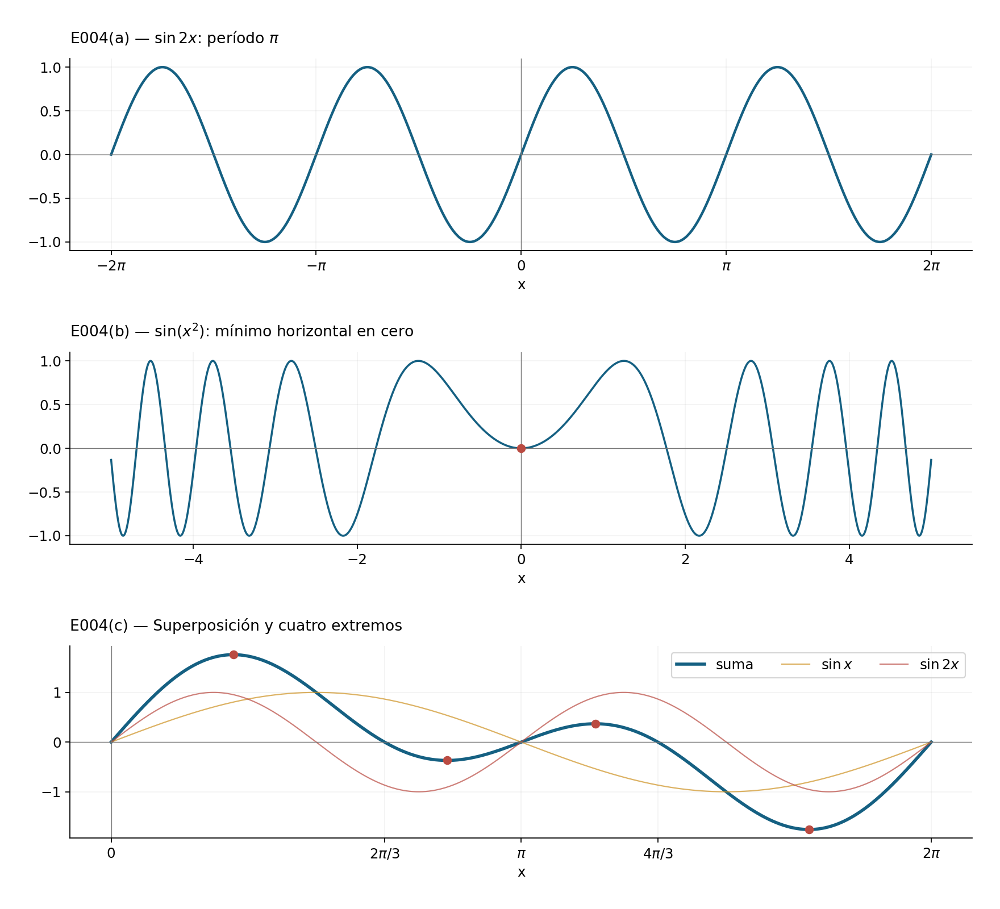
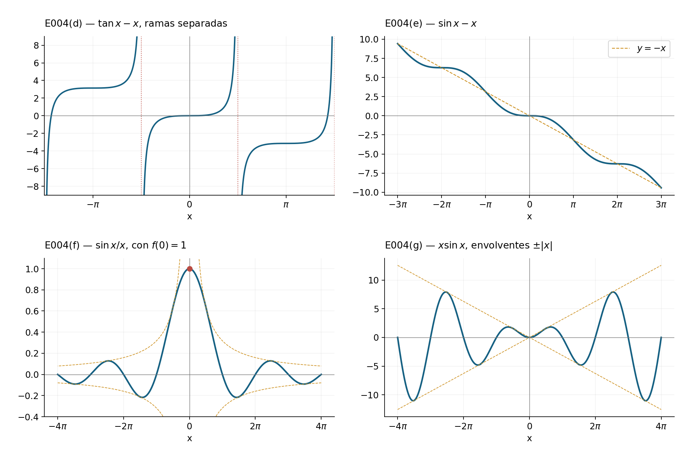
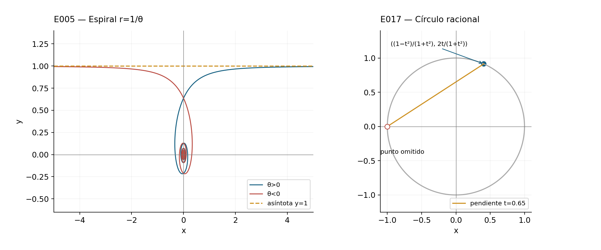
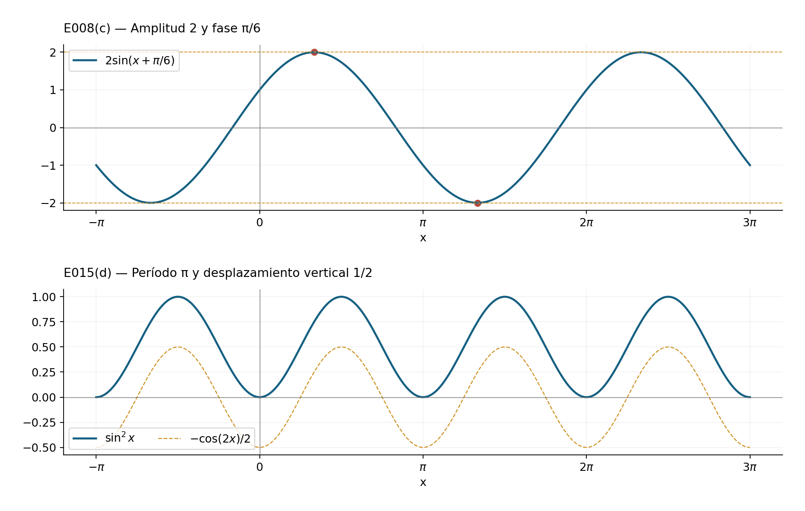
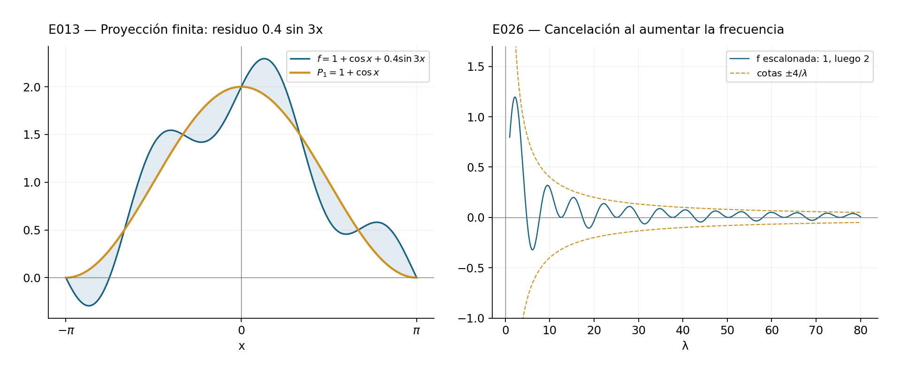
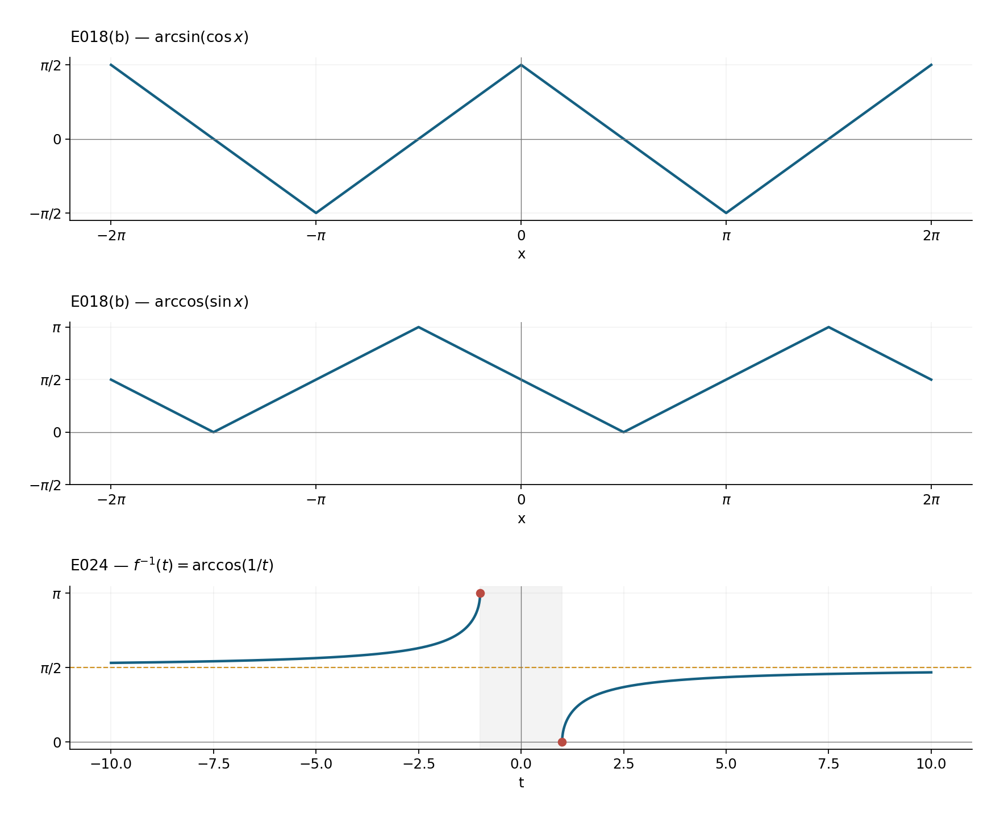
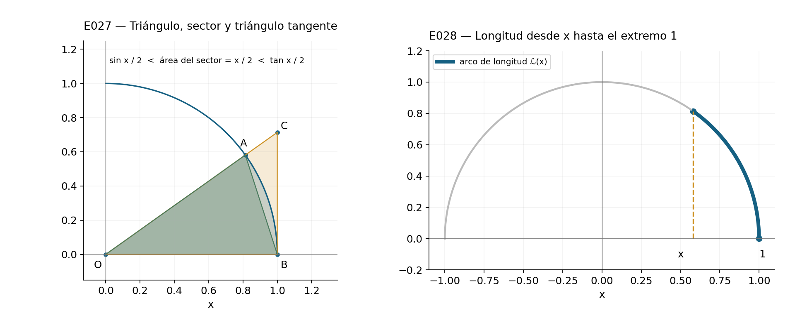
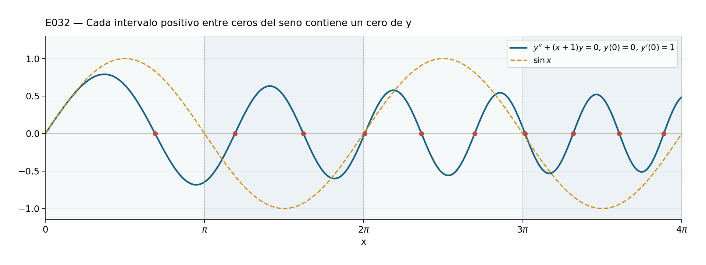

::: {.spivak-nav}

[← Capítulo 14](capitulo-14.qmd) · [Colecciones](../index.qmd#spivak-calculus-cuarta-edición) · [Capítulo 16 →](capitulo-16.qmd)

:::

Solucionario explicado de Spivak, *Calculus*, cuarta edición. Problemas de pp. 315–323 (PDF 335–343). Se resuelven los 33 problemas, sin apéndice. Los ángulos se miden en radianes salvo en E021. Las inversas son las ramas principales: $\arcsin:[-1,1]\to[-\pi/2,\pi/2]$, $\arccos:[-1,1]\to[0,\pi]$, $\arctan:\mathbb R\to(-\pi/2,\pi/2)$.

Los enunciados se identifican por su contenido matemático, sin reproducir extensamente el texto comercial. Las figuras son originales; sus scripts y las comprobaciones acompañan el paquete. En E027–E030 se respetan los fundamentos alternativos propuestos: no se usa como premisa el resultado que se pretende construir. El cotejo secundario y sus límites de independencia constan en el informe de cierre.

## E001 — Derivadas de funciones inversas compuestas {#e001}

Fuente: p. 315 / PDF 335.

### (i) SPV4-C15-E001-i

Sean $u=\arctan x$ y $v=\arctan u$. Aplicando tres veces la regla de la cadena,
$$\frac{d}{dx}\arctan v=\frac{1}{(1+x^2)(1+u^2)(1+v^2)}.$$
Todo está definido y es diferenciable en $\mathbb R$.

### (ii) SPV4-C15-E001-ii

Pongamos $u=\arccos x$, $v=\arctan u$. Como $u\ge0$, la composición $\arcsin v$ existe exactamente cuando $0\le v\le1$, es decir,
$$\cos(\tan1)\le x\le1.$$
En el interior de ese intervalo,
$$\frac{d}{dx}\arcsin(\arctan(\arccos x))=
-\frac{1}{\sqrt{1-x^2}\,[1+(\arccos x)^2]\sqrt{1-[\arctan(\arccos x)]^2}}.$$
En ambos extremos el cociente unilateral tiene magnitud infinita; la fórmula no afirma derivabilidad finita allí. Es esencial comprobar el dominio de la inversa exterior, además del de $\arccos$.

### (iii) SPV4-C15-E001-iii

En cada intervalo que evita $x=\pi/2+k\pi$, el producto interior tiene derivada $\sec^2x\,\arctan x+\tan x/(1+x^2)$. Por tanto,
$$\frac{d}{dx}\arctan(\tan x\,\arctan x)=
\frac{\sec^2x\,\arctan x+\tan x/(1+x^2)}{1+(\tan x\,\arctan x)^2}.$$

### (iv) SPV4-C15-E001-iv

La raíz es positiva, de modo que el argumento pertenece a $(0,1]$ para todo $x$. La identidad correcta es
$$\arcsin\frac1{\sqrt{1+x^2}}=\frac\pi2-\arctan|x|.$$
En efecto, el miembro derecho pertenece a $(0,\pi/2]$ y su seno es el argumento. Así,
$$f'(x)=\begin{cases}1/(1+x^2),&x<0,\\-1/(1+x^2),&x>0.\end{cases}$$
En cero las derivadas laterales son $1$ y $-1$: no existe derivada. Sustituir $\sqrt{x^2}$ por $x$ perdería toda la rama negativa.

## E002 — Seis límites por l'Hôpital {#e002}

Fuente: p. 315 / PDF 335. Todos los límites son cuando $x\to0$. En los cocientes sucesivos se cumplen las hipótesis de l'Hôpital en ambos semientornos: las funciones son diferenciables y las derivadas de los denominadores no se anulan fuera de cero.

### (i) SPV4-C15-E002-i

Tres aplicaciones dan
$$\frac{\sin x-x+x^3/6}{x^3}\ \longrightarrow
\frac{\cos x-1+x^2/2}{3x^2}\ \longrightarrow
\frac{-\sin x+x}{6x}\ \longrightarrow\ \frac{1-\cos x}{6}\longrightarrow0.$$

### (ii) SPV4-C15-E002-ii

Con denominador $x^4$ se obtiene sucesivamente
$$\frac{\cos x-1+x^2/2}{4x^3},\quad
\frac{-\sin x+x}{12x^2},\quad
\frac{1-\cos x}{24x},\quad \frac{\sin x}{24}.$$
El último límite es cero; por tanto también lo es el primero.

### (iii) SPV4-C15-E002-iii

Para $(\cos x-1+x^2/2)/x^2$, dos aplicaciones dan $(-\sin x+x)/(2x)$ y $(1-\cos x)/2$. El límite es $0$.

### (iv) SPV4-C15-E002-iv

Para el mismo numerador dividido por $x^4$, los cuatro cocientes derivados son
$$\frac{-\sin x+x}{4x^3},\quad\frac{1-\cos x}{12x^2},\quad
\frac{\sin x}{24x},\quad\frac{\cos x}{24}.$$
El resultado es $1/24$.

### (v) SPV4-C15-E002-v

Una aplicación simplifica especialmente el problema:
$$\frac{\arctan x-x+x^3/3}{x^3}\ \longrightarrow
\frac{1/(1+x^2)-1+x^2}{3x^2}
=\frac{x^2}{3(1+x^2)}\longrightarrow0.$$

### (vi) SPV4-C15-E002-vi

Primero se reúnen las fracciones:
$$\frac1x-\frac1{\sin x}=\frac{\sin x-x}{x\sin x}.$$
Dos aplicaciones de l'Hôpital producen
$$\frac{\cos x-1}{\sin x+x\cos x},\qquad
\frac{-\sin x}{2\cos x-x\sin x}\longrightarrow0.$$
El denominador de la primera derivada es asintótico a $2x$ y el siguiente tiende a $2$, lo que justifica las aplicaciones localmente.

## E003 — Derivadas del seno cardinal en cero {#e003}

Fuente: p. 316 / PDF 336. Sea $f(x)=\sin x/x$ si $x\ne0$, $f(0)=1$.

### (a) SPV4-C15-E003-a

Por definición,
$$f'(0)=\lim_{h\to0}\frac{\sin h-h}{h^2}.
$$
Dos aplicaciones de l'Hôpital dan $(\cos h-1)/(2h)$ y $-\sin h/2$, cuyo límite es cero. Por tanto $f'(0)=0$.

### (b) SPV4-C15-E003-b

Para $h\ne0$, $f'(h)=(h\cos h-\sin h)/h^2$. La segunda derivada exige el cociente de *esta derivada*:
$$f''(0)=\lim_{h\to0}\frac{h\cos h-\sin h}{h^3}
=\lim_{h\to0}\frac{-h\sin h}{3h^2}
=-\frac13.$$
Se usó l'Hôpital y después $\sin h/h\to1$. Una diferencia simétrica de segundo orden, por sí sola, no habría establecido la existencia de $f''(0)$.

## E004 — Siete gráficas y su estructura {#e004}

Fuente: p. 316 / PDF 336.

### (a) SPV4-C15-E004-a

$y=\sin2x$ tiene período $\pi$, amplitud $1$, ceros $k\pi/2$, máximos en $\pi/4+k\pi$ y mínimos en $3\pi/4+k\pi$. Su derivada es $2\cos2x$; el signo de esta determina los tramos crecientes y decrecientes.

### (b) SPV4-C15-E004-b

$y=\sin(x^2)$ es par. Sus ceros son $x=\pm\sqrt{k\pi}$, $k\ge0$, y sus extremos no nulos se encuentran en
$$x=\pm\sqrt{\pi/2+k\pi},\qquad y=(-1)^k.$$
La derivada $2x\cos(x^2)$ también se anula en cero; allí hay un mínimo local, pues $\sin(x^2)>0$ en un entorno perforado. Las oscilaciones se comprimen porque las distancias entre raíces consecutivas tienden a cero. No es periódica: un período $p>0$ exigiría $f(p)=f(0)=0$ y $f'(p)=f'(0)=0$. Pero la primera igualdad obliga a $\cos(p^2)=\pm1$, de donde $f'(p)=2p\cos(p^2)\ne0$, contradicción.

### (c) SPV4-C15-E004-c

Se factoriza $\sin x+\sin2x=\sin x(1+2\cos x)$. En $[0,2\pi]$ sus ceros son $0,2\pi/3,\pi,4\pi/3,2\pi$. Para localizar extremos,
$$f'(x)=\cos x+2\cos2x=4\cos^2x+\cos x-2.$$
Sean
$$\alpha=\arccos\frac{-1+\sqrt{33}}8,\qquad
\beta=\arccos\frac{-1-\sqrt{33}}8.$$
Con $0<\alpha<\beta<\pi$, el signo de la cuadrática muestra máximos en $\alpha$ y $2\pi-\beta$, mínimos en $\beta$ y $2\pi-\alpha$. Se repite con período $2\pi$.

{#fig-spv4-c15-f01 fig-alt="Capítulo 15: E004(a–c): compresión y superposición de oscilaciones"}

### (d) SPV4-C15-E004-d

Para $\tan x-x$ se separan las ramas entre $\pi/2+k\pi$. La derivada es $\tan^2x\ge0$ y solo se anula en $k\pi$; cada rama es estrictamente creciente. En la rama central los límites son $-\infty,+\infty$, el único cero es $0$ y este es una inflexión horizontal, pues $f''=2\tan x\sec^2x$ cambia de signo. Las demás se obtienen por
$$f(x+k\pi)=f(x)-k\pi.$$
Hay, pues, una traslación horizontal de $k\pi$ y vertical de $-k\pi$, conservando separadas las asíntotas.

### (e) SPV4-C15-E004-e

$\sin x-x$ es estrictamente decreciente: $f'=\cos x-1\le0$, y en todo intervalo existe un subintervalo donde es negativa. Su único cero es $0$. Como $f''=-\sin x$, hay inflexiones en $k\pi$; las de $2k\pi$ tienen tangente horizontal. Además $|f(x)+x|\le1$, de modo que la curva oscila alrededor de la recta $y=-x$.

### (f) SPV4-C15-E004-f

Se usa la extensión continua $f(0)=1$. Es par, tiene ceros en $k\pi$, $k\ne0$, y tiende a cero por $|f(x)|\le1/|x|$. Su máximo global es $1$, pues $|\sin x|<|x|$ para $x\ne0$ (E025). Fuera de cero,
$$f'(x)=\frac{x\cos x-\sin x}{x^2}.$$
Los otros extremos positivos resuelven $\tan x=x$. Para cada $k\ge1$ hay exactamente uno en $(k\pi,k\pi+\pi/2)$: $\tan x-x$ crece estrictamente desde $-k\pi$ hasta $+\infty$. En la mitad restante de cada lóbulo no puede haber raíz, pues $\tan x<0<x$. La simetría da los negativos. Los signos de $f'$ alternan y las alturas de los lóbulos disminuyen hacia cero.

### (g) SPV4-C15-E004-g

$x\sin x$ es par y está entre $\pm|x|$. Sus ceros son $k\pi$; en cero tiene mínimo local y tangente horizontal. Los demás extremos positivos satisfacen $\tan x=-x$. En cada $((k+1/2)\pi,(k+1)\pi)$, $k\ge0$, la función $\tan x+x$ crece desde $-\infty$ hasta un valor positivo, por lo que hay un único extremo. En la otra mitad de cada lóbulo ambos términos tienen igual signo y no hay raíz. Los máximos y mínimos alternan; los negativos se reflejan respecto al eje vertical.

{#fig-spv4-c15-f02 fig-alt="Capítulo 15: E004(d–g): ramas, envolventes y ceros"}

## E005* — Espiral hiperbólica {#e005}

Fuente: p. 316 / PDF 336. Para $a>0$ y $\theta\ne0$,
$$x(\theta)=\frac{a\cos\theta}{\theta},\qquad
y(\theta)=\frac{a\sin\theta}{\theta}.$$
Al tender $\theta\to0^+$, $x\to+\infty$ y $y\to a$; por la izquierda, $x\to-\infty$ y $y\to a$. La asíntota es $y=a$, no el eje polar. Al crecer $|\theta|$, la distancia al origen es $|a/\theta|\to0$: la curva se enrolla indefinidamente hacia el origen, sin alcanzarlo. Como $x$ es impar e $y$ par respecto al parámetro, hay simetría respecto al eje vertical. La expansión geométrica cerca de cero se lee sin series: $x\theta\to a$, $y\to a$.

La figura usa $a=1$ y separa las dos componentes del parámetro; para $a<0$ se aplica una homotecia de razón negativa, con asíntota $y=a$. Si $a=0$, todo el trazado es el origen y no hay una rama infinita.

ID: SPV4-C15-E005.

{#fig-spv4-c15-f03 fig-alt="Capítulo 15: E005 y E017: espiral y parametrización racional del círculo"}

## E006 — Fórmula de adición del coseno {#e006}

Fuente: p. 316 / PDF 336. La identidad del seno ya establecida en el capítulo es
$$\sin(x+y)=\sin x\cos y+\cos x\sin y.$$
Al derivar respecto de $x$, manteniendo $y$ fijo, se obtiene
$$\boxed{\cos(x+y)=\cos x\cos y-\sin x\sin y}.$$
La derivación es válida para todos los reales. Alternativamente, ambos lados resuelven $u''=-u$ y tienen los mismos datos iniciales; la unicidad demostrada mediante la energía da la misma identidad.

ID: SPV4-C15-E006.

## E007 — Ángulos dobles, triples y valores exactos {#e007}

Fuente: p. 317 / PDF 337.

### (a) SPV4-C15-E007-a

En las fórmulas de adición se toma $y=x$:
$$\sin2x=2\sin x\cos x,\qquad
\cos2x=\cos^2x-\sin^2x=1-2\sin^2x=2\cos^2x-1.$$
Después se suma $2x+x$:
$$\begin{aligned}
\sin3x&=2\sin x\cos^2x+(1-2\sin^2x)\sin x
=3\sin x-4\sin^3x,\\
\cos3x&=(2\cos^2x-1)\cos x-2\sin^2x\cos x
=4\cos^3x-3\cos x.
\end{aligned}$$

### (b) SPV4-C15-E007-b

Como $\cos(\pi/2)=0$, la fórmula doble da $\cos^2(\pi/4)=1/2$. En el primer cuadrante seno y coseno son positivos y sus cuadrados suman uno; así ambos valen $\sqrt2/2$ y $\tan(\pi/4)=1$.

Sea $c=\cos(\pi/6)>0$. La fórmula triple da $0=4c^3-3c$, luego $c=\sqrt3/2$. La identidad fundamental y la positividad dan $\sin(\pi/6)=1/2$.

## E008 — Amplitud y fase {#e008}

Fuente: p. 317 / PDF 337.

### (a) SPV4-C15-E008-a

Por adición,
$$A\sin(x+B)=(A\cos B)\sin x+(A\sin B)\cos x.$$
Por tanto $a=A\cos B$, $b=A\sin B$. Son también condiciones necesarias, evaluando en $x=\pi/2$ y $x=0$.

### (b) SPV4-C15-E008-b

Si $(a,b)\ne(0,0)$, se toma $A=\sqrt{a^2+b^2}>0$ y un ángulo $B$ con $\cos B=a/A$, $\sin B=b/A$; existe porque el par está en el círculo unitario (véase también E022). Entonces la identidad de (a) demuestra la representación para todo $x$. Se puede elegir $B=\operatorname{atan2}(b,a)$, determinado módulo $2\pi$. Si $a=b=0$, basta $A=0$ y cualquier fase. Exigir $A\ge0$ elimina una duplicación innecesaria de signos.

### (c) SPV4-C15-E008-c

Aquí $A=2$, $B=\pi/6$:
$$\sqrt3\sin x+\cos x=2\sin(x+\pi/6).$$
Es una sinusoide de período $2\pi$, amplitud $2$, desplazada $\pi/6$ a la izquierda. Ceros en $-\pi/6+k\pi$, máximos en $\pi/3+2k\pi$, mínimos en $4\pi/3+2k\pi$.

{#fig-spv4-c15-f04 fig-alt="Capítulo 15: E008(c) y E015(d): amplitud, fase y período"}

## E009 — Tangente y suma de arcotangentes {#e009}

Fuente: p. 317 / PDF 337.

### (a) SPV4-C15-E009-a

Dividiendo las dos fórmulas de adición por $\cos x\cos y$,
$$\tan(x+y)=\frac{\tan x+\tan y}{1-\tan x\tan y}.$$
Se requiere $\cos x\ne0$, $\cos y\ne0$ y $\cos(x+y)\ne0$; la última condición equivale a $1-\tan x\tan y\ne0$ cuando las dos primeras se cumplen.

### (b) SPV4-C15-E009-b

Sean $u=\arctan x$, $v=\arctan y$. Su suma está en $(-\pi,\pi)$ y
$$\cos(u+v)=\frac{1-xy}{\sqrt{(1+x^2)(1+y^2)}}.$$
Así, si $xy<1$, la suma está en la rama principal y
$$u+v=\arctan\frac{x+y}{1-xy}.$$
Si $xy>1$, ambos números tienen el mismo signo: se añade $\pi$ al miembro derecho si $x,y>0$, y se resta $\pi$ si $x,y<0$. Si $xy=1$, la fracción no existe y la suma vale $\pi/2$ para los positivos, $-\pi/2$ para los negativos. Conocer solo la tangente no distingue ángulos que difieren en $\pi$.

## E010 — Suma de arcos senos {#e010}

Fuente: p. 317 / PDF 337. Para $\alpha,\beta\in[-1,1]$, sean $u=\arcsin\alpha$, $v=\arcsin\beta$. Sus cosenos son raíces no negativas, luego
$$\sin(u+v)=\alpha\sqrt{1-\beta^2}+\beta\sqrt{1-\alpha^2}.$$
Aplicar $\arcsin$ devuelve $u+v$ exactamente cuando $u+v\in[-\pi/2,\pi/2]$. Como $u+v\in[-\pi,\pi]$, esto equivale a
$$\sqrt{(1-\alpha^2)(1-\beta^2)}-\alpha\beta\ge0.$$
Si $\alpha\beta\le0$, siempre se cumple. Si $\alpha\beta>0$, ambos miembros comparados son no negativos y al elevar al cuadrado la condición se reduce a $\alpha^2+\beta^2\le1$. Estas son las restricciones completas, incluidos los extremos. Fuera de ellas, la inversa da $\pi-(u+v)$ si la suma es mayor que $\pi/2$, y $-\pi-(u+v)$ si es menor que $-\pi/2$.

ID: SPV4-C15-E010.

## E011 — Productos como sumas {#e011}

Fuente: p. 317 / PDF 337. Restar las fórmulas de $\cos(A-B)$ y $\cos(A+B)$, sumar las de $\sin(A+B)$ y $\sin(A-B)$, y sumar las dos del coseno produce, respectivamente,
$$\begin{aligned}
\sin(mx)\sin(nx)&=\tfrac12[\cos((m-n)x)-\cos((m+n)x)],\\
\sin(mx)\cos(nx)&=\tfrac12[\sin((m+n)x)+\sin((m-n)x)],\\
\cos(mx)\cos(nx)&=\tfrac12[\cos((m+n)x)+\cos((m-n)x)].
\end{aligned}$$
Son identidades para cualesquiera $m,n,x$ reales, incluso si alguna frecuencia es cero.

ID: SPV4-C15-E011.

## E012 — Ortogonalidad {#e012}

Fuente: p. 318 / PDF 338. Para enteros positivos $m,n$, el seno de cualquier frecuencia entera tiene integral cero en $[-\pi,\pi]$ por imparidad. Para entero no nulo $j$,
$$\int_{-\pi}^{\pi}\cos(jx)\,dx=\left[\frac{\sin(jx)}j\right]_{-\pi}^{\pi}=0,$$
mientras que la integral de $\cos0=1$ es $2\pi$. Aplicando E011,
$$\begin{aligned}
\int_{-\pi}^{\pi}\sin(mx)\sin(nx)\,dx&=\begin{cases}0&m\ne n,\\\pi&m=n,\end{cases}\\
\int_{-\pi}^{\pi}\cos(mx)\cos(nx)\,dx&=\begin{cases}0&m\ne n,\\\pi&m=n,\end{cases}\\
\int_{-\pi}^{\pi}\sin(mx)\cos(nx)\,dx&=0.
\end{aligned}$$
La especificación «positivos» importa: para $m=n=0$ la norma del coseno es $2\pi$ y la del seno es cero.

ID: SPV4-C15-E012.

## E013 — Mejor aproximación trigonométrica cuadrática {#e013}

Fuente: pp. 318–319 / PDF 338–339. Sea $f$ integrable de Riemann en $[-\pi,\pi]$; también lo son $f^2$ y sus productos con funciones continuas.

### (a) SPV4-C15-E013-a

Para $n\ge1$, escribamos $I=\int_{-\pi}^{\pi}f(x)\cos(nx)\,dx$. Al expandir,
$$\int_{-\pi}^{\pi}(f-a\cos nx)^2
=\int f^2-2aI+\pi a^2
=\int f^2-\frac{I^2}\pi+\pi\left(a-\frac I\pi\right)^2.$$
El mínimo único se alcanza en $a=I/\pi$. El mismo cálculo con seno da $a=\pi^{-1}\int f(x)\sin(nx)\,dx$. Si se admite $n=0$, el coseno requiere $a=(2\pi)^{-1}\int f$, y el seno es cero, de modo que todos los $a$ minimizan; no se debe aplicar sin más la norma de una frecuencia positiva.

### (b) SPV4-C15-E013-b

Definamos
$$a_n=\frac1\pi\int_{-\pi}^{\pi}f(x)\cos(nx)\,dx\quad(n\ge0),\qquad
b_n=\frac1\pi\int_{-\pi}^{\pi}f(x)\sin(nx)\,dx\quad(n\ge1).$$
Para $P=c_0/2+\sum_{n=1}^N(c_n\cos nx+d_n\sin nx)$, la ortogonalidad elimina todos los términos cruzados. Queda
$$\begin{aligned}
\int(f-P)^2={}&\int f^2-2\pi\left(\frac{a_0c_0}2+\sum_{n=1}^N(a_nc_n+b_nd_n)\right)\\
&+\pi\left(\frac{c_0^2}2+\sum_{n=1}^N(c_n^2+d_n^2)\right)\\
={}&\int f^2-\pi\left(\frac{a_0^2}2+\sum_{n=1}^N(a_n^2+b_n^2)\right)\\
&+\pi\left(\frac{(c_0-a_0)^2}2+\sum_{n=1}^N[(c_n-a_n)^2+(d_n-b_n)^2]\right).
\end{aligned}$$
Todas las integrales sin extremos en estas fórmulas son sobre $[-\pi,\pi]$. El último sumando es no negativo y solo se anula para $c_0=a_0$, $c_n=a_n$, $d_n=b_n$. Esto prueba el mínimo único para cada $N$ finito; no presupone ni prueba convergencia de una serie infinita de Fourier.

{#fig-spv4-c15-f05 fig-alt="Capítulo 15: E013 y E026: proyección finita y cancelación oscilatoria"}

## E014 — Sumas como productos {#e014}

Fuente: p. 319 / PDF 339.

### (a) SPV4-C15-E014-a

Sea $p=(x+y)/2$, $q=(x-y)/2$, de modo que $x=p+q$, $y=p-q$. Sumando y restando las fórmulas de adición,
$$\sin x+\sin y=2\sin\frac{x+y}2\cos\frac{x-y}2,\qquad
\sin x-\sin y=2\cos\frac{x+y}2\sin\frac{x-y}2.$$

### (b) SPV4-C15-E014-b

Con la misma sustitución,
$$\cos x+\cos y=2\cos\frac{x+y}2\cos\frac{x-y}2,\qquad
\cos x-\cos y=-2\sin\frac{x+y}2\sin\frac{x-y}2.$$
El signo negativo de la segunda identidad procede de restar $\cos(p-q)$ a $\cos(p+q)$.

## E015 — Cuadrados y ángulos medios {#e015}

Fuente: p. 319 / PDF 339.

### (a) SPV4-C15-E015-a

Despejar los cuadrados en $\cos2x=1-2\sin^2x=2\cos^2x-1$ da
$$\sin^2x=\frac{1-\cos2x}2,\qquad\cos^2x=\frac{1+\cos2x}2.$$

### (b) SPV4-C15-E015-b

Se sustituye $x/2$ en (a). Para el intervalo pedido $0\le x\le\pi/2$, seno y coseno de $x/2$ son no negativos, por lo que
$$\sin\frac x2=\sqrt{\frac{1-\cos x}2},\qquad
\cos\frac x2=\sqrt{\frac{1+\cos x}2}.$$
Sin una restricción de cuadrante, las raíces representan valores absolutos y habría que seleccionar los signos.

### (c) SPV4-C15-E015-c

Integrando las identidades de (a),
$$\int_a^b\sin^2x\,dx=\frac{b-a}2-\frac{\sin2b-\sin2a}4,\qquad
\int_a^b\cos^2x\,dx=\frac{b-a}2+\frac{\sin2b-\sin2a}4.$$
Valen también con extremos invertidos, por orientación.

### (d) SPV4-C15-E015-d

$\sin^2x$ tiene período $\pi$, rango $[0,1]$, mínimos cero en $k\pi$ y máximos uno en $\pi/2+k\pi$. Su derivada es $\sin2x$, que determina los ascensos y descensos de cada lóbulo. La lámina de E008 muestra esta reducción a media altura de una onda de frecuencia doble.

## E016 — Seno y coseno de una arcotangente {#e016}

Fuente: p. 319 / PDF 339. Para $u=\arctan x$ se tiene $\cos u>0$ y $\sin u=x\cos u$. Sustituyendo en $\sin^2u+\cos^2u=1$,
$$\boxed{\cos(\arctan x)=\frac1{\sqrt{1+x^2}},\qquad
\sin(\arctan x)=\frac{x}{\sqrt{1+x^2}}}.$$
La positividad del coseno selecciona la raíz; las fórmulas valen para todo $x\in\mathbb R$.

ID: SPV4-C15-E016.

## E017 — Parametrización racional del círculo {#e017}

Fuente: p. 319 / PDF 339. Si $x=\tan(u/2)$, con $u\ne(2k+1)\pi$, entonces
$$1+x^2=\frac1{\cos^2(u/2)}.$$
Las fórmulas dobles dan
$$\boxed{\sin u=\frac{2x}{1+x^2},\qquad\cos u=\frac{1-x^2}{1+x^2}}.$$
No se necesita que $u/2$ esté en la rama principal: el cálculo usa su tangente y sus cuadrados. Para $x$ real se recorre el círculo salvo $(-1,0)$, que se aproxima cuando $|x|\to\infty$. La lámina paramétrica muestra también la recta de pendiente $x$ que parte de $(-1,0)$ y corta de nuevo el círculo en ese punto racional.

ID: SPV4-C15-E017.

## E018 — Desfase y plegado de las inversas {#e018}

Fuente: p. 319 / PDF 339.

### (a) SPV4-C15-E018-a

Por adición y los valores de $\sin(\pi/2)$ y $\cos(\pi/2)$,
$$\sin(x+\pi/2)=\cos x.$$

### (b) SPV4-C15-E018-b

Las inversas devuelven sus ramas principales, por lo que las respuestas globales son ondas triangulares. Para cada entero $k$,
$$\arcsin(\cos x)=\begin{cases}
\pi/2+x-2k\pi,&(2k-1)\pi\le x\le2k\pi,\\
\pi/2-x+2k\pi,&2k\pi\le x\le(2k+1)\pi.
\end{cases}$$
Y
$$\arccos(\sin x)=\begin{cases}
\pi/2-x+2k\pi,&-\pi/2+2k\pi\le x\le\pi/2+2k\pi,\\
x-2k\pi-\pi/2,&\pi/2+2k\pi\le x\le3\pi/2+2k\pi.
\end{cases}$$
Para comprobar cada tramo, el valor propuesto pertenece al rango de la inversa y su seno o coseno es el argumento. Las expresiones coinciden en los extremos compartidos. En particular, $\arcsin(\cos x)=\pi/2-x$ solo en $[0,\pi]$, y $\arccos(\sin x)=\pi/2-x$ solo en $[-\pi/2,\pi/2]$.

{#fig-spv4-c15-f06 fig-alt="Capítulo 15: E018 y E024: ramas principales y secante inversa"}

## E019 — Dos integrales de la arcotangente {#e019}

Fuente: p. 319 / PDF 339.

### (a) SPV4-C15-E019-a

La derivada de $\arctan t$ es $(1+t^2)^{-1}$. Por el teorema fundamental,
$$\int_0^1\frac{dt}{1+t^2}=\arctan1-\arctan0=\frac\pi4.$$

### (b) SPV4-C15-E019-b

Se entiende como integral impropia:
$$\int_0^\infty\frac{dt}{1+t^2}=\lim_{R\to\infty}\arctan R=\frac\pi2.$$
El límite existe porque la arcotangente es creciente y su imagen es $(-\pi/2,\pi/2)$; si el límite fuera menor que $\pi/2$, la continuidad de la tangente allí contradiría $\tan(\arctan R)=R\to\infty$.

## E020 — Una sustitución en el límite fundamental {#e020}

Fuente: p. 319 / PDF 339. Con $t=1/x$, cuando $x\to+\infty$, $t\to0^+$ y
$$x\sin(1/x)=\frac{\sin t}{t}\longrightarrow1.$$

ID: SPV4-C15-E020.

## E021 — Medición en grados {#e021}

Fuente: p. 319 / PDF 339.

### (a) SPV4-C15-E021-a

Un ángulo de $x$ grados tiene $\pi x/180$ radianes. Si $S(x)=\sin(\pi x/180)$ y $C(x)=\cos(\pi x/180)$, la cadena da
$$S'(x)=\frac\pi{180}C(x),\qquad C'(x)=-\frac\pi{180}S(x).$$
El factor de conversión forma parte de la derivada.

### (b) SPV4-C15-E021-b

Poniendo $c=\pi/180$,
$$\lim_{x\to0}\frac{S(x)}x=c\lim_{x\to0}\frac{\sin(cx)}{cx}=c,$$
y con $t=1/x$,
$$\lim_{x\to\infty}xS(1/x)=\lim_{t\to0^+}\frac{S(t)}t=c.$$
Los dos valores son $\pi/180$; el valor uno corresponde a radianes.

## E022 — Todo punto del círculo tiene un ángulo {#e022}

Fuente: p. 319 / PDF 339. Sea $(a,b)$ con $a^2+b^2=1$. Si $b\ge0$, tome $\theta=\arccos a\in[0,\pi]$; entonces $\sin\theta=\sqrt{1-a^2}=b$. Si $b<0$, tome $\theta=-\arccos a$; por paridad, su coseno es $a$ y su seno $-\sqrt{1-a^2}=b$. Esto da siempre $(a,b)=(\cos\theta,\sin\theta)$. Añadir $2k\pi$ proporciona todos los representantes de la misma dirección.

ID: SPV4-C15-E022.

## E023 — Intervalos de inyectividad del seno {#e023}

Fuente: p. 320 / PDF 340.

### (a) SPV4-C15-E023-a

Entre extremos consecutivos el seno es estrictamente monótono y, por tanto, inyectivo. Un intervalo inyectivo no puede contener un extremo local como punto interior: a sus dos lados existen puntos simétricos respecto al extremo con igual seno. En consecuencia está contenido entre dos extremos consecutivos y su longitud no supera $\pi$.

Los intervalos **maximales por inclusión** son
$$[-\pi/2+2k\pi,\pi/2+2k\pi],\qquad
[\pi/2+2k\pi,3\pi/2+2k\pi].$$
Su longitud máxima es $\pi$. Si «intervalo de longitud máxima» se interpreta literalmente sin exigir maximalidad por inclusión, también los intervalos abiertos y semiabiertos con esos extremos tienen longitud $\pi$ e inyectividad; no sería correcto afirmar que la longitud por sí sola obliga a incluir los extremos.

### (b) SPV4-C15-E023-b

Para la restricción creciente $g$ a $(-\pi/2+2k\pi,\pi/2+2k\pi)$, la imagen es $(-1,1)$ y
$$g^{-1}(y)=2k\pi+\arcsin y,\qquad
(g^{-1})'(y)=\frac1{\sqrt{1-y^2}}.$$
La regla inversa también lo muestra: $1/g'(g^{-1}y)=1/\cos(g^{-1}y)$ y el coseno es positivo en esa rama.

## E024 — Inversa de la secante restringida {#e024}

Fuente: p. 320 / PDF 340. La función $f(x)=\sec x$ en $[0,\pi]$ debe excluir $x=\pi/2$, donde no está definida. Su dominio efectivo es $[0,\pi/2)\cup(\pi/2,\pi]$. Es inyectiva: en cada componente es estrictamente creciente y sus imágenes $[1,\infty)$ y $(-\infty,-1]$ son disjuntas. Por ello
$$f^{-1}(y)=\arccos(1/y),\qquad y\in(-\infty,-1]\cup[1,\infty).$$
La gráfica tiene dos ramas separadas, con puntos cerrados $(-1,\pi)$ y $(1,0)$. En los ejes $(t,f^{-1}(t))$, la asíntota horizontal tiene altura $\pi/2$. En ambas ramas interiores,
$$\frac{d}{dy}f^{-1}(y)=\frac{1}{y^2\sqrt{1-1/y^2}}>0.$$
Al acercarse a $y=\pm1$ la pendiente diverge. La lámina de inversas usa la variable horizontal $t$, para evitar confundirla con el ángulo original.

ID: SPV4-C15-E024.

## E025 — Desigualdad estricta del seno {#e025}

Fuente: p. 320 / PDF 340. Supongamos $x<y$. Por el teorema fundamental y la desigualdad integral,
$$|\sin y-\sin x|\le\int_x^y|\cos t|\,dt<y-x.$$
La última desigualdad es estricta: la función continua $1-|\cos t|$ es no negativa y no es idénticamente cero en ningún intervalo de longitud positiva. En efecto, $|\cos t|=1$ solo en los puntos aislados $k\pi$. Existe, pues, un pequeño intervalo interior donde es positiva y su integral es estrictamente positiva. Intercambiar $x,y$ cubre el otro orden. Para $x=y$ hay igualdad y por eso se excluye.

ID: SPV4-C15-E025.

## E026* — Lema de Riemann–Lebesgue para funciones integrables {#e026}

Fuente: p. 320 / PDF 340. Se prueba que $\int_a^bf(x)\sin(\lambda x)\,dx\to0$ cuando $\lambda\to+\infty$ para toda $f$ integrable de Riemann.

### (a) SPV4-C15-E026-a

Para un intervalo fijo $[c,d]$ y $\lambda>0$,
$$\int_c^d\sin(\lambda x)\,dx=\frac{\cos(\lambda c)-\cos(\lambda d)}\lambda,$$
de magnitud a lo sumo $2/\lambda$, que tiende a cero.

### (b) SPV4-C15-E026-b

Si $s$ es escalonada con valores $c_j$ en los intervalos de una partición finita, la linealidad y (a) dan
$$\left|\int_a^bs(x)\sin(\lambda x)\,dx\right|
\le\frac2\lambda\sum_j|c_j|\longrightarrow0.$$
Los valores en los puntos de la partición no alteran la integral.

### (c) SPV4-C15-E026-c

Dado $\varepsilon>0$, la integrabilidad de Riemann permite una escalonada inferior $s\le f$ tal que $\int_a^b|f-s|<\varepsilon/2$: se elige una partición con suma superior menos inferior menor que $\varepsilon/2$. Entonces
$$\left|\int_a^bf(x)\sin(\lambda x)\,dx\right|
\le\int_a^b|f-s|+\left|\int_a^bs(x)\sin(\lambda x)\,dx\right|.$$
El segundo término es menor que $\varepsilon/2$ para todo $\lambda$ suficientemente grande, por (b). Queda la cota $\varepsilon$. No se requiere derivabilidad de $f$ ni integración por partes; incluso una integrable discontinua queda cubierta.

## E027 — Construcción geométrica por áreas {#e027}

Fuente: pp. 320–321 / PDF 340–341. En este ejercicio el ángulo en radianes se define por el doble del área del sector unitario. Se usan continuidad geométrica y las identidades de adición, pero no las derivadas que se pretende deducir.

### (a) SPV4-C15-E027-a

Para $0<x<\pi/4$, sean $O=(0,0)$, $B=(1,0)$, $A=(\cos x,\sin x)$ y $C=(1,\tan x)$. La inclusión estricta del triángulo $OAB$ en el sector, y de este en $OCB$, da
$$\frac{\sin x}2<\frac x2<\frac{\tan x}2.$$
Las diferencias contienen regiones de área positiva, lo que justifica la estrictitud; las dos áreas triangulares proceden de base por altura sobre dos.

### (b) SPV4-C15-E027-b

La desigualdad anterior equivale a $\cos x<\sin x/x<1$ para $x>0$ pequeño. Como $\cos x\to1$ por continuidad geométrica, el teorema del sándwich da el límite uno por la derecha. El cociente es par, así que
$$\lim_{x\to0}\frac{\sin x}{x}=1.$$

### (c) SPV4-C15-E027-c

Racionalizando mediante $1-\cos^2x=\sin^2x$,
$$\frac{1-\cos x}{x}=\frac{\sin x}{x}\frac{\sin x}{1+\cos x}\longrightarrow0.$$
El denominador $1+\cos x$ no se anula cerca de cero. No se ha usado l'Hôpital.

### (d) SPV4-C15-E027-d

La adición permite escribir
$$\frac{\sin(t+h)-\sin t}{h}
=\sin t\frac{\cos h-1}{h}+\cos t\frac{\sin h}{h}\longrightarrow\cos t.$$
Así $\sin'=\cos$ a partir de la definición geométrica. Del mismo modo, la adición del coseno da $\cos'=-\sin$, si se desea completar el par de derivadas.

{#fig-spv4-c15-f07 fig-alt="Capítulo 15: E027 y E028: sector unitario y arco superior"}

## E028* — Construcción por longitud de arco {#e028}

Fuente: p. 321 / PDF 341. Sea $\mathcal L(x)$ la longitud de la gráfica $y=\sqrt{1-t^2}$ entre $t=x$ y $t=1$, para $-1\le x\le1$.

### (a) SPV4-C15-E028-a

En un intervalo compacto interior, la fórmula de longitud da
$$\sqrt{1+(y'(t))^2}=\sqrt{1+\frac{t^2}{1-t^2}}=\frac1{\sqrt{1-t^2}}.$$
Por tanto, para $-1<x<r<1$, la longitud entre $x$ y $r$ es $\int_x^r(1-t^2)^{-1/2}\,dt$. La integral converge al acercarse a $1$, pues para $0\le t<1$ el integrando no supera $(1-t)^{-1/2}$; análogamente converge en $-1$.

Falta justificar que el límite de las longitudes truncadas es la longitud con el extremo incluido. La longitud se define como supremo de sumas poligonales. Cualquier poligonal de un arco truncado se extiende al extremo, luego su longitud no supera la completa. Recíprocamente, dada una partición finita del arco completo, se mueve el último vértice de $(1,0)$ a $(r,\sqrt{1-r^2})$ manteniendo los anteriores. Por continuidad, la suma poligonal resultante tiende a la original cuando $r\uparrow1$. Así cada suma original está acotada por el límite de las longitudes truncadas. Tomar supremos prueba la igualdad. Como control adicional, la longitud de la cola sobre $[1-\varepsilon,1]$ está acotada por la suma de sus variaciones horizontal y vertical, $\varepsilon+\sqrt{2\varepsilon-\varepsilon^2}$, que tiende a cero; no por $2\varepsilon$ en general. Si $x=-1$, se mueven ambos vértices extremos hacia el interior y se repite el argumento. Concluimos
$$\boxed{\mathcal L(x)=\int_x^1\frac{dt}{\sqrt{1-t^2}}}$$
con la interpretación impropia en los extremos singulares y $\mathcal L(1)=0$.

### (b) SPV4-C15-E028-b

Para $-1<x<1$, se fija $r$ con $x<r<1$ y se separa la integral en $[x,r]$ y la cola fija. El teorema fundamental se aplica al primer tramo, dando
$$\mathcal L'(x)=-\frac1{\sqrt{1-x^2}}.$$
También muestra que $\mathcal L$ es estrictamente decreciente; las colas convergentes garantizan continuidad hasta los extremos.

### (c) SPV4-C15-E028-c

Defina ahora $\pi=\mathcal L(-1)$ y $\cos$ como la inversa de $\mathcal L:[-1,1]\to[0,\pi]$. Defina $\sin u=\sqrt{1-\cos^2u}$ en ese intervalo. Para $0<u<\pi$, la inversión de (b) da
$$\cos'(u)=\frac1{\mathcal L'(\cos u)}=-\sqrt{1-\cos^2u}=-\sin u.$$
Como el seno es positivo en el interior, se puede derivar su raíz:
$$\sin'(u)=\frac{-\cos u\,\cos'(u)}{\sqrt{1-\cos^2u}}=\cos u.$$
Esta es una construcción independiente; no se evaluó la integral con una arcocoseno ya definida. Las extensiones por simetría y periodicidad recuperan las funciones globales, pero las dos derivadas solicitadas aquí se prueban en $(0,\pi)$.

## E029* — Construcción mediante una integral racional {#e029}

Fuente: p. 321 / PDF 341. En este ejercicio los nombres trigonométricos se introducen después de construir las funciones.

### (a) SPV4-C15-E029-a

Sea $\alpha(t)=\int_0^t(1+v^2)^{-1}\,dv$. Es impar y estrictamente creciente, con derivada positiva. Para $t\ge1$, la cola está acotada por $\int_1^t v^{-2}\,dv\le1$. Así existe $L=\lim_{t\to\infty}\alpha(t)$, finito y positivo; por imparidad el otro límite es $-L$. Definiendo $\pi=2L$, la imagen de $\alpha$ es $(-\pi/2,\pi/2)$ por continuidad y monotonía. Su inversa $T$ está definida en todo ese intervalo.

### (b) SPV4-C15-E029-b

La regla inversa y el teorema fundamental dan
$$T'(x)=\frac1{\alpha'(T(x))}=1+T(x)^2.$$
Además $T(0)=0$ y $T(x)\to\pm\infty$ cuando $x\to\pm\pi/2$ desde el interior; un límite finito contradiría la imagen abierta de $\alpha$.

Introduzcamos el nombre $\tan x=T(x)$ y definamos $s(x)=T(x)/\sqrt{1+T(x)^2}$.

### (c.i) SPV4-C15-E029-c-i

Como $T(x)\to+\infty$,
$$\lim_{x\to\pi/2^-}s(x)=\lim_{t\to\infty}\frac{t}{\sqrt{1+t^2}}=1.$$

### (c.ii) SPV4-C15-E029-c-ii

En el otro extremo $T(x)\to-\infty$, y el mismo cociente tiende a $-1$, pues $\sqrt{t^2}=|t|$.

### (c.iii) SPV4-C15-E029-c-iii

La regla de la cadena, junto con (b), da
$$s'(x)=\frac{T'(x)}{(1+T(x)^2)^{3/2}}=\frac1{\sqrt{1+T(x)^2}}.$$
Para $x\ne0$ esto es $s(x)/T(x)$; en cero la expresión continua vale $1$. No se divide por $T(0)=0$.

### (c.iv) SPV4-C15-E029-c-iv

Derivando de nuevo,
$$s''(x)=-\frac{T(x)T'(x)}{(1+T(x)^2)^{3/2}}
=-\frac{T(x)}{\sqrt{1+T(x)^2}}=-s(x).$$
Vale en todo el intervalo, incluido cero. Se ha construido así una solución normalizada del oscilador sin usar previamente seno ni coseno.

## E030* — Construcción a partir de una solución del oscilador {#e030}

Fuente: pp. 321–322 / PDF 341–342. Se supone dada una solución no idénticamente nula $y_0$ de $y_0''+y_0=0$ en $\mathbb R$. La ecuación implica sucesivamente suavidad de todos los órdenes, por lo que también $y_0'$ resuelve la ecuación.

### (a) SPV4-C15-E030-a

Para cualquier solución $y$,
$$\frac{d}{dx}(y^2+(y')^2)=2y'(y+y'')=0.$$
La energía es constante. Si $y(0)=y'(0)=0$, la constante es cero y $y\equiv0$. En particular $A=y_0(0)$, $B=y_0'(0)$ no se anulan simultáneamente, y $R^2=A^2+B^2>0$. La misma observación aplicada a la diferencia de dos soluciones prueba unicidad para datos iniciales dados.

### (b) SPV4-C15-E030-b

La combinación
$$s(x)=\frac{B\,y_0(x)-A\,y_0'(x)}{R^2}$$
resuelve $s''+s=0$ y satisface $s(0)=0$,
$$s'(0)=\frac{B^2-Ay_0''(0)}{R^2}=\frac{B^2+A^2}{R^2}=1.$$
Es la única solución con esos datos, por (a). Definamos $c=s'$; entonces $c'=-s$, $c(0)=1$ y $s^2+c^2=1$.

### (c) SPV4-C15-E030-c

Si $c(x)>0$ para todo $x>0$, entonces $s$ es creciente y $s(x)>0$ para $x>0$. Así $c'=-s<0$ y $c'(0)=0$. El ejercicio 6 del apéndice de C11 afirma que una función positiva y decreciente en $[0,\infty)$, dos veces diferenciable y con derivada inicial cero, tiene segunda derivada cero en algún punto positivo. Aplicado a $c$, contradice $c''=-c<0$. Se ha usado exactamente el resultado solicitado.

También puede verse directamente el mecanismo: para cada $\delta>0$ y $x\ge\delta$,
$$c'(x)=-s(x)\le-s(\delta)<0,$$
de donde $c(x)\le c(\delta)-(x-\delta)s(\delta)$, que acaba siendo negativo: contradicción. Por continuidad, $c$ tiene algún cero positivo. Como $c(0)=1$, no tiene ceros en un entorno de cero; el conjunto de ceros positivos tiene, pues, un mínimo $x_0>0$ (se toma el ínfimo dentro de un intervalo compacto que contenga un cero). Definimos $\pi=2x_0$. Por minimalidad, $c>0$ en $[0,x_0)$.

### (d) SPV4-C15-E030-d

Así $s$ crece desde cero hasta $x_0$, luego $s(x_0)>0$. La energía y $c(x_0)=0$ dan $s(x_0)^2=1$, de modo que $s(x_0)=1$.

### (e) SPV4-C15-E030-e

La unicidad proporciona las identidades de adición sin circularidad. Para $v$ fijo, $s(u+v)$ y $s(u)c(v)+c(u)s(v)$ resuelven la misma ecuación en $u$ y tienen datos $(s(v),c(v))$ en cero. Son iguales. Derivando en $u$,
$$c(u+v)=c(u)c(v)-s(u)s(v).$$
Con $u=v=x_0=\pi/2$, se obtiene $s(\pi)=0$, $c(\pi)=-1$. Con $u=v=\pi$, se obtiene $s(2\pi)=0$, $c(2\pi)=1$. Las funciones $s,c$ merecen ya los nombres seno y coseno.

### (f) SPV4-C15-E030-f

Las funciones $s(x+2\pi)$ y $s(x)$ tienen los mismos datos iniciales $(0,1)$; la unicidad da $s(x+2\pi)=s(x)$ para todo real. Al derivar, $c(x+2\pi)=c(x)$. Se han construido las funciones periódicas a partir de la solución inicialmente supuesta, sin tomar sus valores o períodos de la trigonometría geométrica.

## E031 — El seno no es racional ni algebraico {#e031}

Fuente: p. 322 / PDF 342.

### (a) SPV4-C15-E031-a

Si $\sin x=P(x)/Q(x)$ con polinomios y $Q\not\equiv0$, para los infinitos enteros $k$ con $Q(k\pi)\ne0$ se tendría $P(k\pi)=0$. Un polinomio no nulo no tiene infinitas raíces; por tanto $P\equiv0$, lo que contradice, por ejemplo, $\sin(\pi/2)=1$. Los posibles polos de $Q$ excluyen solo finitos puntos y no salvan la representación.

### (b) SPV4-C15-E031-b

Supongamos una relación polinómica no trivial en $\sin x$ con coeficientes racionales de $x$, válida en su dominio común. Al multiplicar por denominadores obtenemos
$$\sum_{j=0}^n P_j(x)\sin^j x=0$$
con polinomios no todos nulos; la igualdad se extiende por continuidad a los finitos puntos que se excluyeron. Sea $r$ el menor índice con $P_r\not\equiv0$. Fuera de los ceros del seno dividimos por $\sin^r x$, y por continuidad la relación resultante también vale en cada $k\pi$:
$$P_r(x)+\sum_{j=r+1}^nP_j(x)\sin^{j-r}x=0.$$
Evaluar en $k\pi$ obliga a $P_r(k\pi)=0$ para todos los enteros $k$, contradiciendo que $P_r$ es un polinomio no nulo. No existe tal relación; en particular, tampoco la relación mónica con coeficientes racionales propuesta por el ejercicio. La afirmación se refiere a una identidad funcional global, no a que cada valor numérico del seno sea trascendente.

## E032* — Comparación de Sturm {#e032}

Fuente: pp. 322–323 / PDF 342–343. Sean $\phi_i''+g_i\phi_i=0$ y $g_2>g_1$ en el interior del intervalo considerado. Para el argumento integral se toma la regularidad usual: $g_i$ continuas y soluciones $C^2$ hasta los extremos. También basta que las expresiones integradas sean continuas e integrables allí.

### (a) SPV4-C15-E032-a

Multiplicar las ecuaciones por la otra solución y restar da
$$\phi_1''\phi_2-\phi_2''\phi_1=(g_2-g_1)\phi_1\phi_2.$$
Defina $W=\phi_1'\phi_2-\phi_1\phi_2'$. La regla del producto cancela los términos con primeras derivadas y muestra que $W'$ es el miembro izquierdo. El «$=0$» añadido al final de la igualdad impresa del enunciado es una errata: el producto es positivo bajo las hipótesis de (b), no cero.

### (b) SPV4-C15-E032-b

Si $\phi_1,\phi_2>0$ en $(a,b)$, el miembro derecho es positivo allí. Por continuidad su integral es estrictamente positiva, luego
$$W(b)-W(a)=\int_a^b(g_2-g_1)\phi_1\phi_2\,dx>0.$$
El signo no necesita ser estricto en los extremos.

### (c) SPV4-C15-E032-c

Si además $\phi_1(a)=\phi_1(b)=0$, la positividad interior implica $\phi_1'(a)\ge0$, $\phi_1'(b)\le0$. La continuidad y la positividad interior de $\phi_2$ implican $\phi_2(a),\phi_2(b)\ge0$. En consecuencia,
$$W(b)-W(a)=\phi_1'(b)\phi_2(b)-\phi_1'(a)\phi_2(a)\le0,$$
contradicción. La segunda solución debe tener un cero interior si la primera es positiva entre dos ceros.

### (d) SPV4-C15-E032-d

Entre dos ceros consecutivos de una solución no trivial $\phi_1$, su signo es constante. Si $\phi_2$ no tuviera cero interior, su signo también sería constante allí. Sustituir cualquiera de ellas por su opuesta permite hacer ambas positivas sin alterar sus ecuaciones; (c) da la contradicción. Por tanto $\phi_2$ tiene un cero entre cada par de ceros consecutivos de $\phi_1$.

Aplicación: para $y''+(x+1)y=0$, compare con $\phi_1=\sin x$, $g_1=1$, $g_2=x+1$. Se obtiene un cero de cada solución $y$ en cada $(n\pi,(n+1)\pi)$, $n=0,1,2,\ldots$, porque $x+1>1$ en esos interiores. La solución idénticamente cero también cumple la conclusión. Esta comparación no justifica intervalos negativos, donde se invierte la desigualdad de coeficientes. La lámina ilustra una solución con datos $y(0)=0,y'(0)=1$; el dibujo acompaña la prueba, no demuestra el teorema.

{#fig-spv4-c15-f08 fig-alt="Capítulo 15: E032: ceros intercalados en los intervalos positivos"}

## E033 — Sumas finitas e integrales desde Riemann {#e033}

Fuente: p. 323 / PDF 343. Sea $n$ entero positivo.

### (a) SPV4-C15-E033-a

Aplicando E014(a) con los dos ángulos $(k+1/2)x$ y $(k-1/2)x$,
$$\sin((k+1/2)x)-\sin((k-1/2)x)=2\sin(x/2)\cos(kx).$$

### (b) SPV4-C15-E033-b

Sumar (a) para $k=1,\ldots,n$ hace telescopar el miembro izquierdo:
$$2\sin(x/2)\sum_{k=1}^n\cos(kx)=\sin((n+1/2)x)-\sin(x/2).$$
Así, si $x\notin2\pi\mathbb Z$,
$$\boxed{\frac12+\sum_{k=1}^n\cos(kx)=\frac{\sin((n+1/2)x)}{2\sin(x/2)}}.$$
En $x=2m\pi$ la suma izquierda vale $n+1/2$; la fracción tiene ese mismo límite, aunque no está definida como cociente allí.

### (c) SPV4-C15-E033-c

La identidad $\cos((k-1/2)x)-\cos((k+1/2)x)=2\sin(kx)\sin(x/2)$ se suma del mismo modo:
$$2\sin(x/2)\sum_{k=1}^n\sin(kx)=\cos(x/2)-\cos((n+1/2)x).$$
La fórmula de diferencia de cosenos convierte el numerador en $2\sin((n+1)x/2)\sin(nx/2)$, de donde
$$\boxed{\sum_{k=1}^n\sin(kx)=\frac{\sin((n+1)x/2)\sin(nx/2)}{\sin(x/2)}}.$$
El dominio del cociente excluye $2\pi\mathbb Z$; su extensión continua vale cero en esos puntos.

### (d) SPV4-C15-E033-d

Para $b>0$, tome $\Delta=b/n$ y las sumas de Riemann por extremos derechos. Por continuidad de seno y coseno, sus límites son las integrales. Usando (c),
$$\Delta\sum_{k=1}^n\sin(k\Delta)
=\frac{\Delta}{\sin(\Delta/2)}\sin\frac{(n+1)\Delta}2\sin\frac{n\Delta}2
\longrightarrow2\sin^2(b/2)=1-\cos b.$$
Usando (b),
$$\Delta\sum_{k=1}^n\cos(k\Delta)
=\frac{\Delta}{2\sin(\Delta/2)}\sin((n+1/2)\Delta)-\frac\Delta2
\longrightarrow\sin b.$$
Se empleó $\sin t/t\to1$, no el teorema fundamental para evaluar las integrales. Para $n$ suficientemente grande, $0<\Delta<2\pi$, así que los denominadores no se anulan. Para $b=0$ ambos resultados son inmediatos. Si $b<0$, cambiar $x=-t$ y usar paridad y orientación da las mismas fórmulas:
$$\boxed{\int_0^b\sin x\,dx=1-\cos b,\qquad\int_0^b\cos x\,dx=\sin b}.$$

La continuidad de los integrandos asegura la existencia de estas integrales; las sumas finitas explican su valor directamente desde la definición.

---

::: {.spivak-nav}

[← Capítulo 14](capitulo-14.qmd) · [Colecciones](../index.qmd#spivak-calculus-cuarta-edición) · [Capítulo 16 →](capitulo-16.qmd)

:::

Soluciones originales de Alevi Peña · Matemática Abierta. [Licencia GFDL 1.3 o posterior](/COPYING.FDL).
