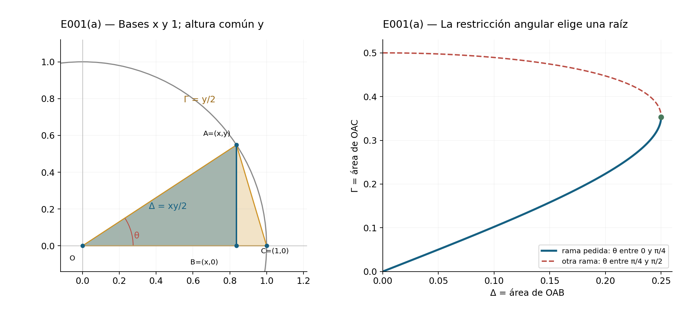
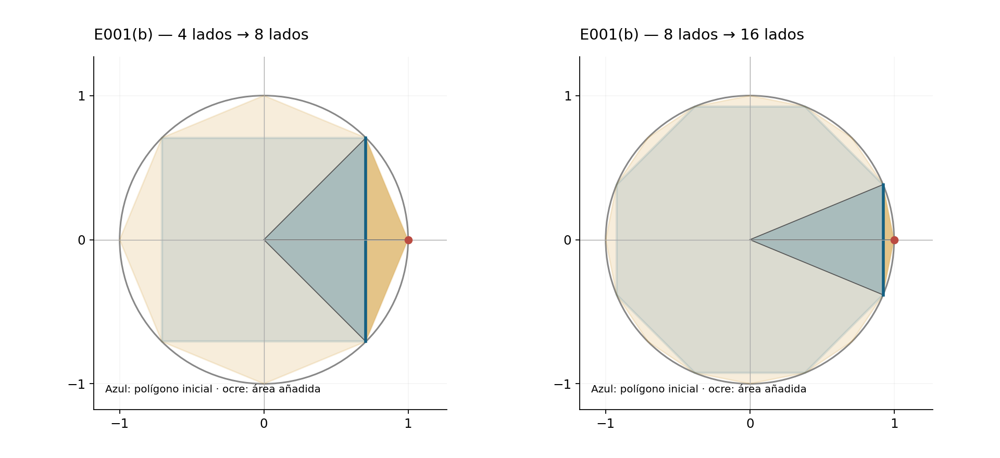
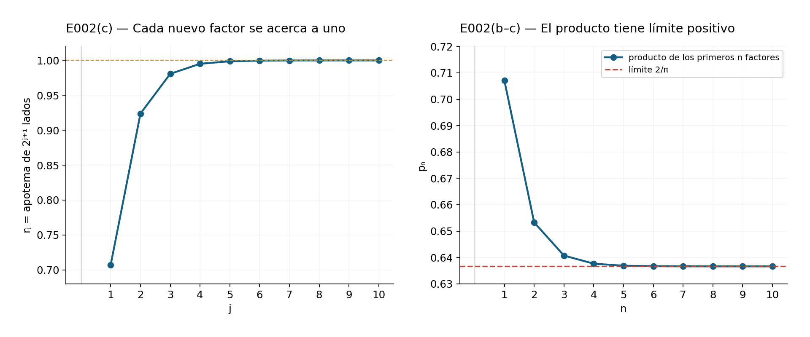
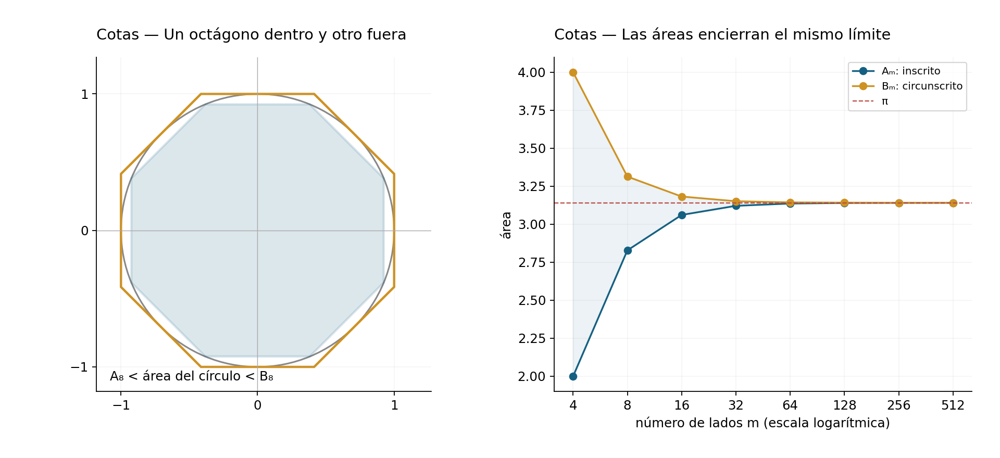

::: {.spivak-nav}

[← Capítulo 15](capitulo-15.qmd) · [Colecciones](../index.qmd#spivak-calculus-cuarta-edición) · [Capítulo 17 →](capitulo-17.qmd)

:::

Solucionario explicado de Michael Spivak, *Calculus*, cuarta edición. Los dos problemas del capítulo se encuentran en pp. 327–329 / PDF 347–349 y contienen cinco incisos. No hay apéndice de ejercicios. El capítulo completo está marcado con estrella en el libro; sus dos problemas no llevan estrellas individuales.

Los ejercicios estudian cómo aproximar el área del círculo mediante polígonos y cómo expresar ese límite mediante raíces cuadradas. La demostración de irracionalidad desarrollada en el cuerpo del capítulo prueba una afirmación distinta: ninguna fracción representa exactamente $\pi$; de hecho, prueba que $\pi^2$ también es irracional. Una sucesión de aproximaciones cada vez mejores no basta para establecer esa imposibilidad. Por eso distinguiremos en las soluciones la igualdad geométrica finita, el paso al límite y la estimación del error.

Todos los ángulos se miden en radianes y el círculo tiene radio uno. Denotaremos por $P_m$ un polígono regular inscrito de $m\ge3$ lados, por $A_m$ su área y por $\alpha_m$ su apotema. La orientación del polígono no modifica ninguna de estas cantidades. Las figuras originales se acompañan de sus archivos vectoriales y scripts de reproducción.

## E001 — Duplicación del número de lados {#e001}

Fuente: pp. 327–328 / PDF 347–348.

### (a) SPV4-C16-E001-a

Sean $O=(0,0)$, $A=(x,y)$ un punto del círculo en el primer cuadrante, $B=(x,0)$ y $C=(1,0)$. Suponemos $0\le\theta=\angle AOB\le\pi/4$, de modo que $0\le y\le x$. Se pide expresar el área de $OAC$ en función de la de $OAB$.

Pongamos $\Delta=\operatorname{area}(OAB)$ y $\Gamma=\operatorname{area}(OAC)$. Las dos áreas comparten altura $y$, pero tienen bases $x$ y $1$:
$$\Delta=\frac{xy}{2},\qquad \Gamma=\frac y2.$$
El punto $A$ pertenece al círculo, así que $x^2+y^2=1$. Al eliminar $x$, obtenemos
$$4\Delta^2=x^2y^2=(1-y^2)y^2.$$
Esta ecuación es cuadrática en $z=y^2$:
$$z^2-z+4\Delta^2=0,\qquad
z=\frac{1\pm\sqrt{1-16\Delta^2}}2.$$
La restricción angular decide cuál de las raíces corresponde al dibujo. Como $y\le x$ y $x^2+y^2=1$, necesariamente $y^2\le1/2$; elegimos la raíz menor. Además $y\ge0$, por lo que
$$\boxed{\Gamma=\frac12\sqrt{\frac{1-\sqrt{1-16\Delta^2}}2}}.$$
El radicando interior es no negativo: $xy\le(x^2+y^2)/2=1/2$ implica $0\le\Delta\le1/4$. En el extremo $\theta=\pi/4$ las dos raíces coinciden y $\Gamma=\sqrt2/4$; en $\theta=0$ ambos triángulos son degenerados y sus áreas son cero. Se incluyen así los dos extremos permitidos.

La raíz mayor tiene una interpretación concreta. Si se quitara la restricción y se tomara $\pi/4<\theta<\pi/2$, entonces $y^2>1/2$ y sería esa otra raíz la correcta. El área $\Delta$ por sí sola no distingue el ángulo $\theta$ de su complementario.

{#fig-spv4-c16-f01 fig-alt="Capítulo 16: E001(a): dos triángulos de igual altura y selección de la raíz"}

### (b) SPV4-C16-E001-b

Para duplicar los lados, se añaden los puntos medios de los arcos entre vértices consecutivos. Se pide demostrar la recurrencia
$$\boxed{A_{2m}=\frac m2\sqrt{2-2\sqrt{1-\left(\frac{2A_m}{m}\right)^2}}}.$$
La fórmula con esos signos vale para $m\ge4$. El enunciado no escribe esa restricción, pero se necesita para usar la rama angular de (a).

Consideremos un lado de $P_m$ cuyos extremos sean $A=(x,y)$ y $A'=(x,-y)$, con $C=(1,0)$ en el punto medio del arco correspondiente y $B=(x,0)$ en el punto medio del lado. El triángulo central $OAA'$ tiene área $xy=2\Delta$, y hay $m$ triángulos congruentes de este tipo. Por tanto
$$A_m=2m\Delta.$$
En $P_{2m}$, los nuevos lados de ese mismo sector son $AC$ y $CA'$. Los dos triángulos $OAC$ y $OCA'$ tienen área $\Gamma$ cada uno, y entre todos los sectores hay $2m$ de ellos. Así,
$$A_{2m}=2m\Gamma.$$
El ángulo $\angle AOB$ es $\pi/m$; si $m\ge4$, no supera $\pi/4$ y podemos aplicar (a). Sustituyendo $\Delta=A_m/(2m)$,
$$\begin{aligned}
A_{2m}
&=m\sqrt{\frac{1-\sqrt{1-16[A_m/(2m)]^2}}2}\\
&=\frac m2\sqrt{2-2\sqrt{1-(2A_m/m)^2}}.
\end{aligned}$$
El factor $m/2$ procede del número de triángulos y de la raíz del denominador dos; perderlo alteraría incluso el paso inicial del cuadrado al octágono.

Como control geométrico independiente, un triángulo central tiene dos lados unitarios y ángulo $2\pi/m$, luego
$$A_m=\frac m2\sin\frac{2\pi}{m},\qquad
A_{2m}=m\sin\frac\pi m.$$
Para $m\ge4$, el coseno de $2\pi/m$ es no negativo. La fórmula del ángulo medio reproduce exactamente la recurrencia anterior.

**El caso del triángulo.** Cuando $m=3$, el ángulo $\pi/m$ es mayor que $\pi/4$: debe usarse la raíz mayor de (a). En ese caso,
$$A_6=\frac32\sqrt{2+2\sqrt{1-(2A_3/3)^2}}=\frac{3\sqrt3}{2},
\qquad A_3=\frac{3\sqrt3}{4}.$$
La fórmula impresa con la raíz menor daría $3/2$, que no es el área del hexágono regular unitario. Esto muestra por qué la restricción no es solo una formalidad. La iteración solicitada desde $A_4=2$ queda enteramente dentro del dominio válido:
$$A_8=2\sqrt2,\qquad A_{16}=4\sqrt{2-\sqrt2}.$$

{#fig-spv4-c16-f02 fig-alt="Capítulo 16: E001(b): al insertar vértices sobre los arcos, el polígono crece dentro del círculo"}

Para justificar que el procedimiento aproxima $\pi$, basta la fórmula trigonométrica del área y el límite fundamental de C15:
$$A_m=\pi\,\frac{\sin(2\pi/m)}{2\pi/m}\longrightarrow\pi.$$
En la sucesión obtenida duplicando lados, la inclusión $P_m\subset P_{2m}$ es estricta en regiones de área positiva; por ello $A_m<A_{2m}<\pi$. La convergencia que se remite a C08-E011 queda aquí demostrada directamente con las herramientas disponibles.

La expresión de raíces anidadas tiene una dificultad al calcular con precisión finita: para $m$ grande, resta de uno un número muy próximo a uno. Una versión algebraicamente equivalente evita esa resta. Si $u=2A_m/m$, racionalizamos
$$1-\sqrt{1-u^2}=\frac{u^2}{1+\sqrt{1-u^2}},$$
y obtenemos
$$A_{2m}=A_m\sqrt{\frac{2}{1+\sqrt{1-(2A_m/m)^2}}}.$$
Es válida en el mismo rango $m\ge4$ y se usa para las comprobaciones numéricas. La precisión de un cálculo depende también de cómo se evalúa una identidad correcta.

## E002 — Apotemas y producto de Viète {#e002}

Fuente: pp. 328–329 / PDF 348–349.

### (a) SPV4-C16-E002-a

Se pide demostrar $A_m/A_{2m}=\alpha_m$. Retomemos los triángulos del ejercicio anterior. Para todo $m\ge3$, sus bases y altura son positivas, y
$$\frac{\operatorname{area}(OAB)}{\operatorname{area}(OAC)}
=\frac{xy/2}{y/2}=x=OB.$$
Al multiplicar ambas áreas por el mismo número $2m$ se obtienen, respectivamente, $A_m$ y $A_{2m}$. La distancia del centro al lado $AA'$ es precisamente $OB=\alpha_m$. Por tanto,
$$\boxed{\frac{A_m}{A_{2m}}=\alpha_m}.$$
Aquí no se necesitó seleccionar una raíz cuadrática; la relación vale también para $m=3$. El triángulo rectángulo $OAB$, de hipotenusa uno y ángulo $\pi/m$ en $O$, da además
$$\alpha_m=\cos\frac\pi m.$$
Con las fórmulas de áreas, la misma identidad se verifica usando $\sin2t=2\sin t\cos t$:
$$\frac{(m/2)\sin(2\pi/m)}{m\sin(\pi/m)}=\cos\frac\pi m.$$

### (b) SPV4-C16-E002-b

Se pide demostrar la identidad finita
$$\boxed{\frac2{A_{2^k}}=\alpha_4\alpha_8\cdots\alpha_{2^{k-1}}}.$$
Para $k\ge3$, se multiplican las relaciones de (a) desde $m=4$ hasta $m=2^{k-1}$:
$$\begin{aligned}
\alpha_4\alpha_8\cdots\alpha_{2^{k-1}}
&=\frac{A_4}{A_8}\frac{A_8}{A_{16}}\cdots\frac{A_{2^{k-1}}}{A_{2^k}}\\
&=\frac{A_4}{A_{2^k}}=\frac2{A_{2^k}}.
\end{aligned}$$
Todos los factores de área intermedios se cancelan. Para $k=2$, el producto no tiene factores: con la convención de producto vacío igual a uno, la fórmula sigue siendo cierta porque $2/A_4=1$. No se extiende a $k=1$, donde se hablaría de un polígono de dos lados ajeno a la definición.

Cada apotema está entre cero y uno. Los productos parciales, por tanto, disminuyen, aunque eso por sí solo todavía permitiría que su límite fuera cero. La identidad finita da su valor exacto y elimina esa incertidumbre. Como $A_{2^k}\to\pi$ y $\pi>0$,
$$\lim_{k\to\infty}\alpha_4\alpha_8\cdots\alpha_{2^{k-1}}=\frac2\pi>0.$$
Es el paso al límite de una sucesión de productos finitos; no se están cancelando informalmente cantidades en una expresión infinita.

### (c) SPV4-C16-E002-c

Se pide expresar los apotemas de $P_4,P_8,P_{16},\ldots$ mediante raíces anidadas y deducir el producto de Viète. Como $\pi/m$ está en el primer cuadrante, la fórmula del ángulo medio usa la raíz positiva:
$$\alpha_{2m}=\cos\frac\pi{2m}=\sqrt{\frac{1+\cos(\pi/m)}2}
=\sqrt{\frac{1+\alpha_m}2}.$$
El valor inicial es $\alpha_4=\cos(\pi/4)=1/\sqrt2$. Los primeros términos son
$$\begin{aligned}
\alpha_4&=\sqrt{\frac12},\\
\alpha_8&=\sqrt{\frac12+\frac12\sqrt{\frac12}},\\
\alpha_{16}&=\sqrt{\frac12+\frac12\sqrt{\frac12+\frac12\sqrt{\frac12}}}.
\end{aligned}$$
Para no depender de puntos suspensivos al definir todos los términos, pongamos
$$r_1=\sqrt{\frac12},\qquad r_{j+1}=\sqrt{\frac{1+r_j}{2}}\quad(j\ge1).$$
La inducción anterior prueba $r_j=\alpha_{2^{j+1}}$. Si $p_n=\prod_{j=1}^n r_j$, el inciso (b), con $k=n+2$, da
$$p_n=\frac2{A_{2^{n+2}}}.$$
Al tomar límites, queda demostrado el significado preciso de la fórmula
$$\boxed{\frac2\pi=
\sqrt{\frac12}\;
\sqrt{\frac12+\frac12\sqrt{\frac12}}\;
\sqrt{\frac12+\frac12\sqrt{\frac12+\frac12\sqrt{\frac12}}}\;\cdots}.$$
Los $r_j$ crecen hacia uno: si $0<r_j<1$, entonces $(1+r_j)/2-r_j^2=(1-r_j)(2r_j+1)/2>0$, de donde $r_j<r_{j+1}<1$. La continuidad en el límite obliga a $r=\sqrt{(1+r)/2}$ y, como $r>0$, se obtiene $r=1$. Este hecho concuerda con que los lados se acercan al círculo, pero la convergencia del producto a un valor positivo se demostró con las áreas.

{#fig-spv4-c16-f03 fig-alt="Capítulo 16: E002: apotemas y productos parciales, con su límite positivo"}

### Cotas explícitas para la aproximación

Esta consecuencia completa la afirmación de que el procedimiento permite aproximar $\pi$ cuanto se desee; no añade un inciso al inventario. Al prolongar los radios que pasan por los puntos medios de los lados, podemos construir el polígono regular circunscrito de apotema uno. Es homotético a $P_m$ con razón $1/\alpha_m$, de modo que su área es
$$B_m=\frac{A_m}{\alpha_m^2}=m\tan\frac\pi m.$$
El disco queda estrictamente entre los dos polígonos, salvo por sus puntos de contacto:
$$A_m<\pi<B_m.$$
Estas desigualdades pueden evaluarse usando solo raíces: empiece con $A_4=2$, $\alpha_4=\sqrt{1/2}$ y repita
$$A_{2m}=\frac{A_m}{\alpha_m},\qquad
\alpha_{2m}=\sqrt{\frac{1+\alpha_m}2},\qquad
B_m=\frac{A_m}{\alpha_m^2}.$$
No se necesita introducir un valor decimal previo de $\pi$ para construir las cotas. Puesto que $A_m\to\pi$ y $\alpha_m\to1$, la diferencia $B_m-A_m$ tiende a cero. Dada una tolerancia $\varepsilon>0$, basta continuar hasta $B_m-A_m<\varepsilon$: cualquier número del intervalo tendrá error menor que $\varepsilon$. El punto medio tiene error menor que la mitad de la anchura.

| Lados $m$ | Cota inferior decimal | Cota superior decimal |
|---:|---:|---:|
| 4 | 2.000000 | 4.000000 |
| 8 | 2.828427 | 3.313709 |
| 16 | 3.061467 | 3.182598 |
| 32 | 3.121445 | 3.151725 |
| 64 | 3.136548 | 3.144119 |
| 128 | 3.140331 | 3.142224 |

Los extremos de la tabla se redondean hacia afuera a seis decimales: el inferior hacia abajo y el superior hacia arriba. No son igualdades con las áreas exactas. Por ejemplo, la última fila asegura $3.140331<\pi<3.142224$. Los cálculos se reproducen con intervalos racionales: cada raíz se encierra entre fracciones cuyos cuadrados se comparan exactamente con el radicando.

{#fig-spv4-c16-f04 fig-alt="Capítulo 16: E002: polígonos inscritos y circunscritos y estrechamiento de las cotas"}

## Dependencias y alcance de los resultados {#seccion-11460}

Las soluciones usan áreas de triángulos y homotecias, la identidad fundamental y el ángulo medio de C15-E015, la adición del seno y $\sin t/t\to1$. No se emplean series infinitas, logaritmos ni una teoría general de productos infinitos. La fórmula de E001(b) requiere $m\ge4$ por la elección de la raíz; las relaciones de apotemas y áreas de E002(a) son válidas para todo $m\ge3$. El producto se obtiene empezando en el cuadrado.

La convergencia de las áreas justifica el producto y las aproximaciones. La irracionalidad de $\pi^2$, demostrada en el cuerpo del capítulo, usa además un argumento aritmético de integrales que son enteros y quedan estrictamente entre cero y uno. No se deduce esa irracionalidad del producto de Viète ni de los decimales de la tabla.

---

::: {.spivak-nav}

[← Capítulo 15](capitulo-15.qmd) · [Colecciones](../index.qmd#spivak-calculus-cuarta-edición) · [Capítulo 17 →](capitulo-17.qmd)

:::

Soluciones originales de Alevi Peña · Matemática Abierta. [Licencia GFDL 1.3 o posterior](/COPYING.FDL).
