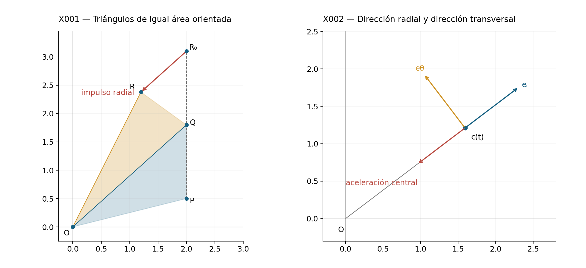
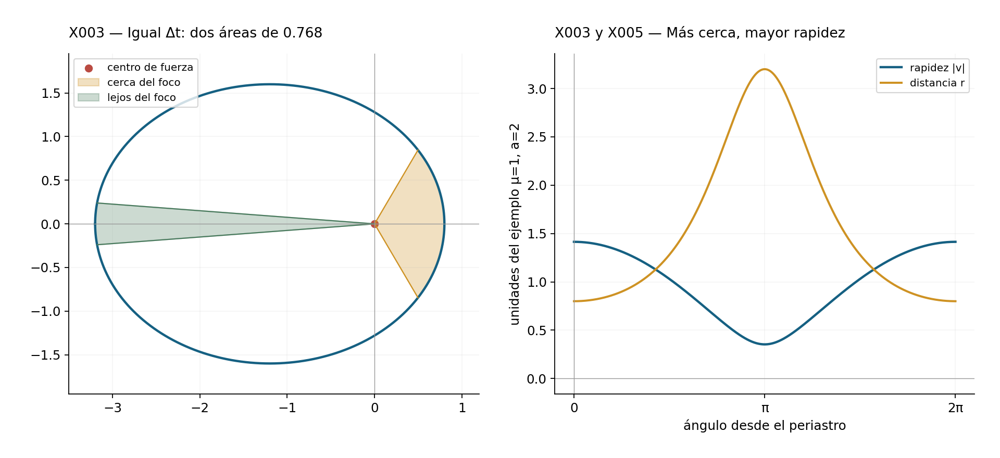
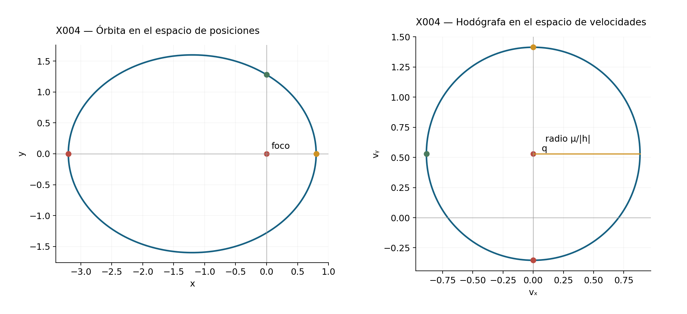
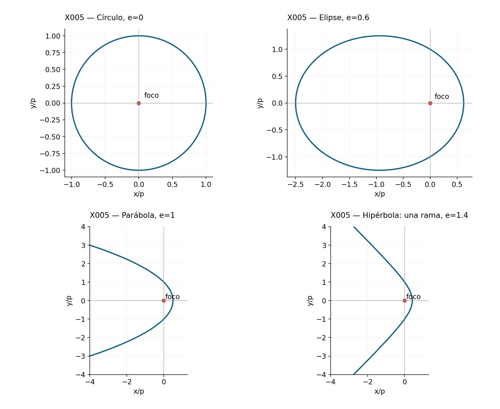
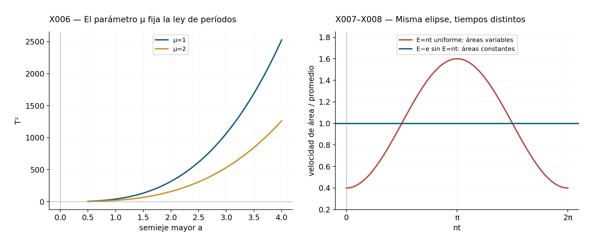

[← Capítulo 16](capitulo-16.qmd) · [Colecciones](../index.qmd#spivak-calculus-cuarta-edición) · [Capítulo 18 →](capitulo-18.qmd)

Guía matemática del capítulo 17 de Michael Spivak, *Calculus*, cuarta edición, pp. 330–338 / PDF 350–358. **Este capítulo no contiene problemas propuestos ni apéndice de ejercicios.** Se desarrollan sus cuatro teoremas en ocho bloques de explicación y comprobación. Los identificadores X001–X008 son unidades expositivas de esta guía; no se añaden al contador de ejercicios del solucionario.

## X001 — Qué conserva una fuerza dirigida al centro {#x001}

ID: `SPV4-C17-X001`. Referencia: pp. 330–331.

Un planeta se mueve más deprisa cerca del Sol que lejos de él. La segunda ley de Kepler permite describir esa variación sin conocer todavía la fuerza: el segmento que une el Sol con el planeta barre áreas iguales en tiempos iguales. Queremos entender qué condición sobre la aceleración produce esa constancia y cómo una ley de fuerza determina después la forma de la órbita.

Trabajaremos en un plano con el centro de fuerza fijo en el origen. La posición es una curva $c:I\to\mathbb R^2$ de clase $C^2$, definida en un intervalo de tiempo $I$, y su distancia al centro es $r(t)=|c(t)|>0$. Se excluye la colisión con el centro en el intervalo estudiado. El modelo gravitatorio que usaremos tiene la forma
$$\boxed{c''(t)=-\frac{\mu}{r(t)^3}c(t)
=-\frac{\mu}{r(t)^2}e_r(t),\qquad \mu>0.}$$
Aquí $e_r=c/r$ es el vector unitario que apunta hacia afuera. El signo menos hace que la aceleración apunte hacia el centro. La magnitud es $\mu/r^2$, mientras que la expresión vectorial con $c$ lleva $r^3$ en el denominador. Para una partícula de masa constante, la ley de Newton permite pasar de aceleración a fuerza multiplicando por esa masa.

La intuición geométrica del capítulo se puede hacer exacta para un movimiento por impulsos. Si dos posiciones sucesivas son $P,Q$ y el tiempo transcurrido es $\Delta t$, continuar con la misma velocidad llevaría a $R_0=2Q-P$. Un impulso dirigido sobre la recta $OQ$ cambia esa posición a
$$R=2Q-P+\lambda Q,$$
para algún escalar $\lambda$. Usando $\det(u,v)=u_1v_2-u_2v_1$,
$$\det(Q,R)=\det(Q,2Q-P+\lambda Q)=-\det(Q,P)=\det(P,Q).$$
Las áreas orientadas de los triángulos $OPQ$ y $OQR$ son, por tanto, iguales. El desplazamiento producido por el impulso es paralelo al radio $OQ$ y no altera la altura respecto de ese radio. La igualdad de determinantes incluye también el signo de la orientación; comparar solo áreas no orientadas puede perder esa información.

Este argumento explica el movimiento por impulsos. El paso al movimiento continuo se demostrará mediante derivadas e integrales, sin suponer que una figura poligonal basta para justificar un límite dinámico.

## X002 — Derivar una posición escrita en coordenadas polares {#x002}

ID: `SPV4-C17-X002`. Referencia: pp. 331–332 y 337.

Elegimos un ángulo continuo $\theta(t)$ a lo largo de la trayectoria, sin reducirlo después de cada vuelta al intervalo $[0,2\pi)$. Como $r>0$ y el tiempo recorre un intervalo, puede continuarse una elección local del argumento. Escribimos
$$e_r=(\cos\theta,\sin\theta),\qquad
e_\theta=(-\sin\theta,\cos\theta),\qquad c=r e_r.$$
Estos vectores son ortogonales, unitarios y satisfacen $\det(e_r,e_\theta)=1$. La regla de la cadena da
$$\frac{d e_r}{dt}=\theta'e_\theta,\qquad
\frac{d e_\theta}{dt}=-\theta'e_r.$$
Al derivar $c=r e_r$, hay que derivar tanto la distancia como la dirección del radio:
$$\boxed{c'=r'e_r+r\theta'e_\theta.}$$
La componente radial de la velocidad es $r'$; la transversal es $r\theta'$. Derivamos cada término por separado:
$$\begin{aligned}
c''&=r''e_r+r'\theta'e_\theta
 +(r'\theta'+r\theta'')e_\theta-r(\theta')^2e_r\\
&=\boxed{[r''-r(\theta')^2]e_r+[2r'\theta'+r\theta'']e_\theta.}
\end{aligned}$$
La componente transversal contiene dos copias de $r'\theta'$, procedentes de derivar términos distintos. Si $r$ es constante, queda $-r(\theta')^2e_r+r\theta''e_\theta$, la fórmula del movimiento circular con posible variación de velocidad angular.

El determinante de posición y velocidad se simplifica por la misma descomposición:
$$\det(c,c')=\det(r e_r,r'e_r+r\theta'e_\theta)
=r^2\theta'.$$
Denotaremos esta cantidad por $h$. Tiene unidades de área dividida por tiempo. En la fuerza central resultará constante; todavía no hemos usado esa hipótesis.

## X003 — Ley de áreas y primer teorema {#x003}

ID: `SPV4-C17-X003`. Referencia: pp. 332–333. Corresponde al teorema 1.

En un tramo donde $\theta$ es estrictamente monótona y $\theta'\ne0$, podemos considerar el radio como función del ángulo:
$$\rho(\varphi)=r(\theta^{-1}(\varphi)).$$
La fórmula de área polar, demostrada en C13-E024, da el área orientada barrida desde $t_0$ hasta $t$:
$$\mathcal A(t)=\frac12\int_{\theta(t_0)}^{\theta(t)}\rho(\varphi)^2\,d\varphi.$$
El teorema fundamental y la cadena implican
$$\boxed{\mathcal A'(t)=\frac12r(t)^2\theta'(t)=\frac12\det(c(t),c'(t)).}$$
Para cualquier curva $C^1$ que no pase por el centro, la integral temporal $\frac12\int_{t_0}^t\det(c,c')\,ds$ define la misma área orientada acumulada por tramos. Esta formulación cubre cambios de sentido o radios momentáneamente estacionarios. Tras varias vueltas se cuenta el área con multiplicidad, no el área de la unión de las regiones ya recorridas. La velocidad de área no orientada es $|\det(c,c')|/2$ cuando el sentido está fijado.

Derivando el determinante,
$$\frac{d}{dt}\det(c,c')=\det(c',c')+\det(c,c'')=\det(c,c'').$$
Como $c\ne0$, la igualdad $\det(c,c'')=0$ equivale a que $c''$ sea un múltiplo de $c$. Es exactamente la condición de aceleración central: puede ser atractiva, repulsiva o nula. Por ello,
$$\boxed{\text{aceleración central}\quad\Longleftrightarrow\quad
\det(c,c')=h\text{ constante}\quad\Longleftrightarrow\quad
\mathcal A'(t)=h/2.}$$
Así queda probado el primer teorema, incluidas ambas implicaciones. La igualdad de áreas en tiempos iguales procede de
$$\mathcal A(t_2)-\mathcal A(t_1)=\frac h2(t_2-t_1),$$
y no depende de dónde comience el intervalo temporal.

**El caso $h=0$.** En este caso $r^2\theta'=0$ y, puesto que $r>0$, $\theta'=0$. El movimiento es radial, sobre un rayo mientras no se alcance el origen. La ley de áreas sigue siendo válida, con área barrida nula. Sin embargo, no se puede dividir por $h$ ni invertir el ángulo. Desde X004 hasta X007 trataremos las órbitas no radiales, con $h\ne0$; cambiando la orientación del plano podemos tomar $h>0$ para dibujarlas.

## X004 — La velocidad como función del ángulo {#x004}

ID: `SPV4-C17-X004`. Referencia: pp. 334–335. Demostración del teorema 2, con su hipótesis no radial explícita.

Supongamos $c''=-\mu e_r/r^2$ y $h=r^2\theta'\ne0$. Entonces $\theta'=h/r^2$ no se anula y conserva su signo. Podemos cambiar la variable independiente del tiempo al ángulo. Definamos
$$D(\varphi)=c'(\theta^{-1}(\varphi)).$$
$D$ describe la curva de velocidades, llamada hodógrafa. Derivar respecto del ángulo equivale a dividir la derivada temporal por $\theta'$:
$$D'(\varphi)=\frac{c''}{\theta'}\bigg|_{t=\theta^{-1}(\varphi)}
=-\frac\mu h(\cos\varphi,\sin\varphi).$$
Las componentes tienen primitivas trigonométricas conocidas. Existe un vector constante $q=(q_x,q_y)$ tal que
$$\boxed{D(\varphi)=\frac\mu h(-\sin\varphi,\cos\varphi)+q.}$$
La hodógrafa está sobre una circunferencia de radio $\mu/|h|$ y centro $q$. Para una órbita abierta solo se recorre el arco correspondiente a los ángulos admisibles; no se afirma que se complete siempre la circunferencia.

La trayectoria se recupera sin hallar $\theta(t)$. Sustituimos esta expresión de la velocidad en el determinante conservado:
$$\begin{aligned}
h&=\det(r e_r,\tfrac\mu h e_\theta+q)\\
 &=r\left[\frac\mu h+q_y\cos\theta-q_x\sin\theta\right].
\end{aligned}$$
Dividir por $rh$ da
$$\frac1r=\frac\mu{h^2}+\frac{q_y}h\cos\theta-\frac{q_x}h\sin\theta.$$
Pongamos $p=h^2/\mu>0$. La combinación de seno y coseno puede escribirse como una sola onda, como en C15-E008. Existen $e\ge0$ y $\omega$ tales que
$$e\cos\omega=\frac{p q_y}h,\qquad
e\sin\omega=-\frac{p q_x}h.$$
Si ambas coordenadas son cero tomamos $e=0$ y cualquier $\omega$. En todos los casos,
$$\boxed{r=\frac p{1+e\cos(\theta-\omega)}}.$$
Es la ecuación polar de una cónica con foco en el origen. La constante $p$ es el semilado recto y $e$ la excentricidad. La rotación del eje polar permite trabajar con $u=\theta-\omega$ sin cambiar el movimiento físico.

## X005 — Qué cónica aparece y qué parte puede recorrerse {#x005}

ID: `SPV4-C17-X005`. Referencia: pp. 334–335 y remisión a las cónicas de C04. Complemento de alcance del teorema 2.

La distancia $r$ debe ser positiva. La ecuación obtenida exige
$$1+e\cos u>0.$$
En ejes rotados, $x=r\cos u$, $y=r\sin u$; por tanto $r+ex=p$. Al elevar al cuadrado se obtiene
$$\boxed{(1-e^2)x^2+y^2+2pex-p^2=0.}$$
La ecuación cuadrática se interpreta junto con $r=p-ex>0$, pues elevar al cuadrado puede añadir otra rama.

Si $0\le e<1$, el denominador polar es positivo para todo $u$. Completando cuadrados,
$$\frac{(x+ae)^2}{a^2}+\frac{y^2}{b^2}=1,\qquad
a=\frac p{1-e^2},\quad b=\frac p{\sqrt{1-e^2}}.$$
Son los **semiejes**, no las longitudes de los ejes completos. El centro es $(-ae,0)$ y uno de los focos es el origen. El caso $e=0$ es el círculo de radio $p$, una elipse con focos coincidentes. Las distancias mínima y máxima al foco son
$$r_{\min}=\frac p{1+e}=a(1-e),\qquad
r_{\max}=\frac p{1-e}=a(1+e).$$

Si $e=1$, la ecuación es $y^2+2px-p^2=0$, una parábola con vértice $(p/2,0)$ y foco en el origen. Los ángulos $u=\pm\pi$ son límites de la rama: allí el denominador se anula y $r\to\infty$. No son puntos de la órbita.

Si $e>1$, aparece una hipérbola. Los ángulos admisibles, para una vuelta de la coordenada angular, son
$$-\arccos(-1/e)<u<\arccos(-1/e).$$
La trayectoria ocupa una sola rama. Su punto más cercano al foco tiene $x=p/(1+e)>0$; al acercarse a los extremos angulares la distancia diverge. La otra rama de la ecuación cuadrática no cumple $r=p-ex>0$ y debe descartarse. Las figuras no unen los extremos por una línea que atraviese un polo.

La energía por unidad de masa permite relacionar esta clasificación con la velocidad. Definimos
$$\mathcal E=\frac12|c'|^2-\frac\mu r.$$
Como $r'=c\cdot c'/r$,
$$\mathcal E'=c'\cdot\left(-\frac{\mu c}{r^3}\right)+\frac{\mu r'}{r^2}=0.$$
Para la cónica obtenida, $r'=\mu e\sin u/h$ y $r\theta'=h/r=\mu(1+e\cos u)/h$. La ortogonalidad de las componentes de velocidad da
$$|c'|^2=\frac{\mu^2}{h^2}(1+2e\cos u+e^2),\qquad
\boxed{\mathcal E=\frac{\mu^2}{2h^2}(e^2-1).}$$
Así, en el caso no radial, energía negativa corresponde a elipse; energía cero, a parábola; energía positiva, a hipérbola. La condición $h\ne0$ continúa siendo indispensable: una caída radial bajo la misma ley satisface $r''=-\mu/r^2$ y no queda descrita por una cónica regular de semilado recto positivo.

## X006 — Período y tercer teorema {#x006}

ID: `SPV4-C17-X006`. Referencia: p. 336. Corresponde al teorema 3, dentro de las hipótesis de los resultados previos.

Consideremos una órbita elíptica no radial, con semiejes $a,b$. El área de la elipse es $\pi ab$, mientras que la velocidad de área no orientada es $|h|/2$. Por tanto, el tiempo de una vuelta completa es
$$T=\frac{2\pi ab}{|h|}.$$
La geometría de la elipse da $b^2=ap$, y la dinámica da $h^2=\mu p$. Al elevar al cuadrado la expresión del período y sustituir ambas identidades,
$$T^2=\frac{4\pi^2a^2b^2}{h^2}
=\frac{4\pi^2a^3p}{\mu p}.$$
Concluimos
$$\boxed{T^2=\frac{4\pi^2}{\mu}a^3,\qquad
\frac{a^3}{T^2}=\frac\mu{4\pi^2}.}$$
Si varias órbitas obedecen una ley de inverso del cuadrado con el mismo parámetro $\mu$, sus cocientes $a^3/T^2$ coinciden. Recíprocamente, para órbitas elípticas con foco en el mismo centro y que cumplen la ley de áreas, X007 da $\mu=h^2/p$ para cada una; la igualdad de $a^3/T^2$ obliga a que esos parámetros sean iguales. Este es el sentido preciso de la equivalencia.

La constancia de $a^3/T^2$, tomada sola, no determina una aceleración: hay que conservar las hipótesis de forma orbital y ley de áreas. Tampoco deben confundirse semieje y eje completo. Si llamáramos $L=2a$ a la longitud del eje mayor, la fórmula sería $L^3/T^2=2\mu/\pi^2$. La proporcionalidad se mantiene, pero el factor numérico cambia por ocho.

En el modelo de centro fijo, $\mu$ es común a las partículas que se comparan. Para el problema newtoniano de dos cuerpos de masas $M$ y $m$, la coordenada relativa satisface la misma ecuación con $\mu=G(M+m)$. Esto se obtiene restando sus aceleraciones: si $c=x_m-x_M$, entonces $x_m''=-GMc/r^3$ y $x_M''=+Gmc/r^3$, de donde $c''=-G(M+m)c/r^3$. La igualdad exacta del cociente entre cuerpos de distinta masa no se traslada sin esa precisión al modelo de dos cuerpos. El capítulo trabaja con el centro fijo.

## X007 — De la cónica y la ley de áreas a la fuerza {#x007}

ID: `SPV4-C17-X007`. Referencia: pp. 337–338. Corresponde al teorema 4.

Supongamos que una trayectoria regular se mantiene en una cónica
$$r=\frac p{1+e\cos(\theta-\omega)},\qquad p>0,$$
y que su aceleración es central, con $h=r^2\theta'\ne0$. Por X003 se cumple la ley de áreas. Para hallar la aceleración sin resolver el tiempo, definamos el recíproco del radio como función angular:
$$u(\theta)=\frac1r=\frac{1+e\cos(\theta-\omega)}p.$$
Usaremos $u_\theta,u_{\theta\theta}$ para sus derivadas angulares, reservando las primas para el tiempo. Como $\theta'=hu^2$,
$$r'=-\frac{u_\theta}{u^2}\theta'=-h u_\theta,
\qquad r''=-h^2u^2u_{\theta\theta}.$$
Además $r(\theta')^2=h^2u^3$. La componente transversal de la aceleración es cero porque
$$2r'\theta'+r\theta''=\frac1r\frac d{dt}(r^2\theta')=0.$$
La componente radial de X002 queda entonces
$$c''=-h^2u^2(u_{\theta\theta}+u)e_r.$$
La función angular de la cónica satisface directamente $u_{\theta\theta}+u=1/p$. En consecuencia,
$$\boxed{c''=-\frac{h^2}{p r^2}e_r.}$$
Es una aceleración atractiva de inverso del cuadrado, con parámetro $\mu=h^2/p>0$. Hemos probado la recíproca sin suponer el teorema 2 en la dirección que queríamos deducir. La ecuación intermedia es la forma de Binet para una fuerza central; aquí solo se han usado la cadena y las derivadas trigonométricas.

La **forma de la trayectoria** no fija por sí sola la fuerza. Por ejemplo, recorramos una elipse con
$$c(t)=\bigl(a(\cos nt-e),\ b\sin nt\bigr),\qquad
b=a\sqrt{1-e^2},\quad 0<e<1.$$
Tiene foco en el origen y período $2\pi/n$, pero
$$\det(c,c')=abn(1-e\cos nt)$$
no es constante. Su aceleración apunta al centro geométrico de la elipse, no al foco. Por eso la hipótesis central del teorema 4, o equivalentemente la ley de áreas, es esencial. Este ejemplo se representa en la lámina de período y tiempo.

## X008 — Cómo recuperar el tiempo y hasta dónde llega el modelo {#x008}

ID: `SPV4-C17-X008`. Referencia: pp. 334 y 336–338; desarrollo de la parametrización implícita anunciada por el capítulo.

Una vez conocida la forma $r(\theta)$ y el valor de $h\ne0$, el tiempo se obtiene de
$$\frac{dt}{d\theta}=\frac{r(\theta)^2}{h},\qquad
t-t_0=\frac1h\int_{\theta_0}^{\theta}r(\varphi)^2\,d\varphi.$$
La derivada de esta función tiene signo constante y no se anula en el intervalo angular admisible. Se puede invertir para recuperar $\theta(t)$, y luego $c(t)$. Así se determina el movimiento, aunque la inversa no tenga una expresión elemental. También se prueba la suficiencia: parametrizar una cónica de esta manera impone $r^2\theta'=h$ y X007 da la ecuación gravitatoria.

Para la elipse resulta útil el ángulo auxiliar $E$, llamado anomalía excéntrica:
$$x=a(\cos E-e),\qquad y=b\sin E,\qquad b=a\sqrt{1-e^2}.$$
Calculando respecto de $E$,
$$\det(c,c_E)=ab(1-e\cos E).$$
Si $h>0$, la ley de áreas obliga a $ab(1-e\cos E)E'=h$. Medido desde el punto más cercano al foco, donde $E=0$,
$$\boxed{E-e\sin E=nt,\qquad n=\frac h{ab}=\frac{2\pi}{T}.}$$
Como $1-e\cos E\ge1-e>0$, el miembro izquierdo es estrictamente creciente. Además difiere de $E$ en una cantidad acotada; toma todos los valores reales. Hay, pues, un único $E$ para cada tiempo, y aumentar el tiempo en $T$ aumenta $E$ en $2\pi$. Esta es una descripción global y rigurosa del movimiento elíptico.

Por ejemplo, con $\mu=1$, $a=2$ y $e=3/5$, tenemos $p=32/25$, $b=8/5$, $h=4\sqrt2/5$ y $T=4\pi\sqrt2$. Las distancias extremas son $4/5$ y $16/5$. Allí $r'=0$, de modo que la rapidez es $|h|/r$; la rapidez en el punto más cercano es cuatro veces la del punto más lejano. La figura de áreas iguales usa exactamente estos parámetros.

Las conclusiones se refieren al modelo newtoniano idealizado indicado al comienzo: centro fijo, movimiento plano, ausencia de colisiones y ley de fuerza especificada. El desarrollo no afirma que cualquier movimiento central sea elíptico, ni que una partícula radial quede cubierta por la inversión angular, ni que la tercera ley aislada determine una fuerza. Bajo las hipótesis no radiales establecidas, los cuatro teoremas quedan demostrados en ambas direcciones cuando corresponde.

---

[← Capítulo 16](capitulo-16.qmd) · [Colecciones](../index.qmd#spivak-calculus-cuarta-edición) · [Capítulo 18 →](capitulo-18.qmd)

Soluciones originales de Alevi Peña · Matemática Abierta. [Licencia GFDL 1.3 o posterior](/COPYING.FDL).
