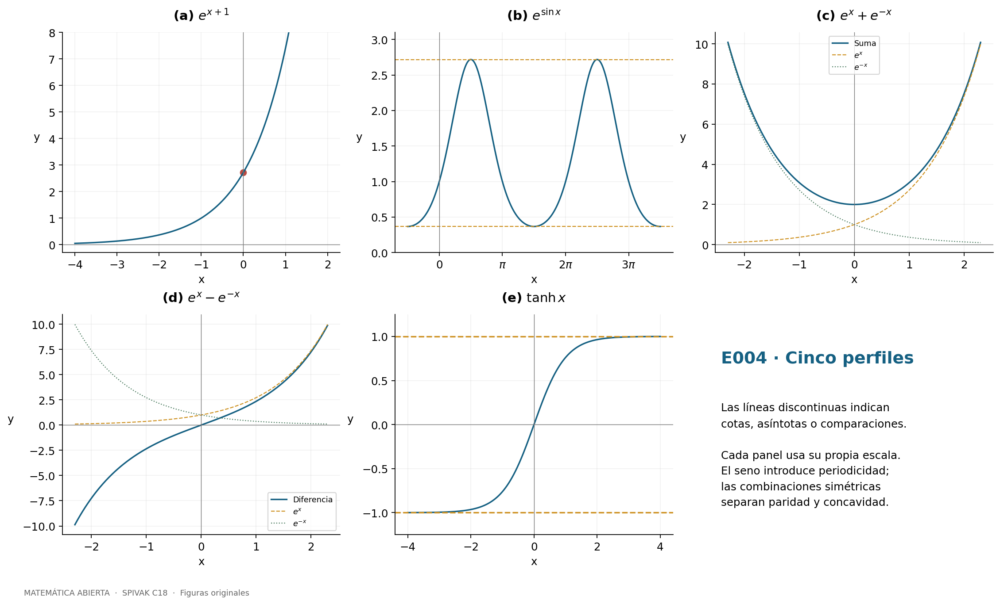
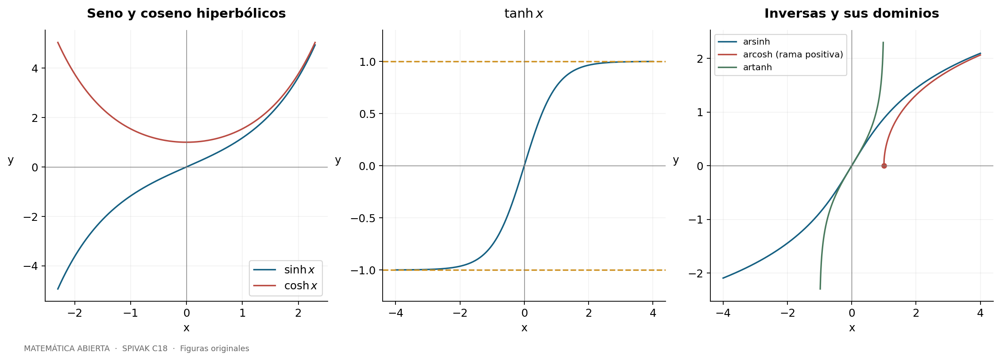
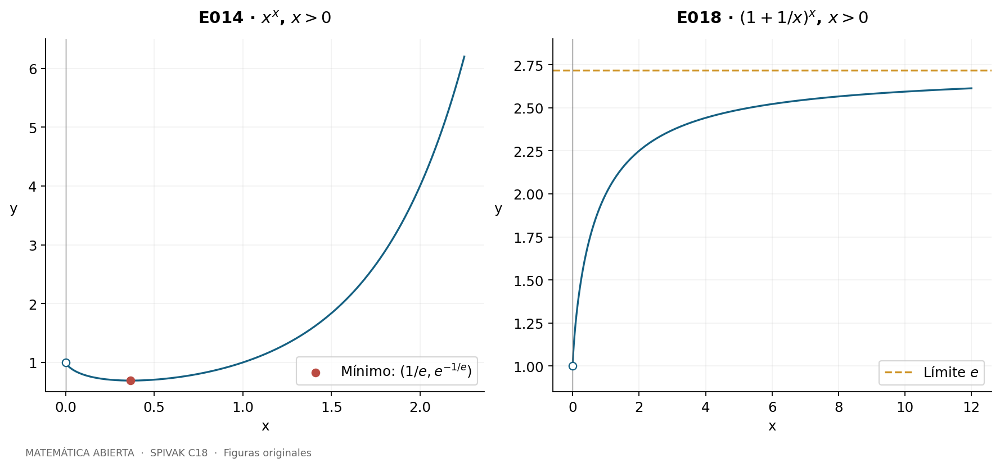
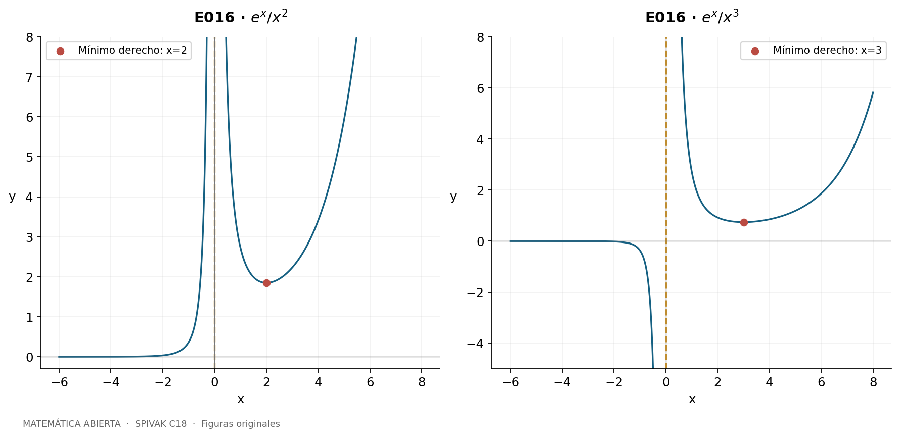
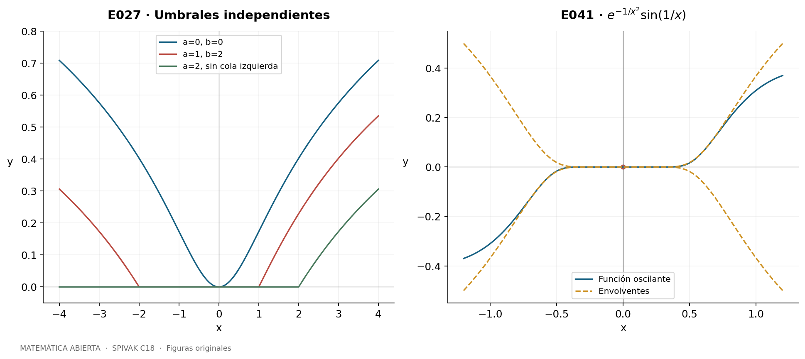
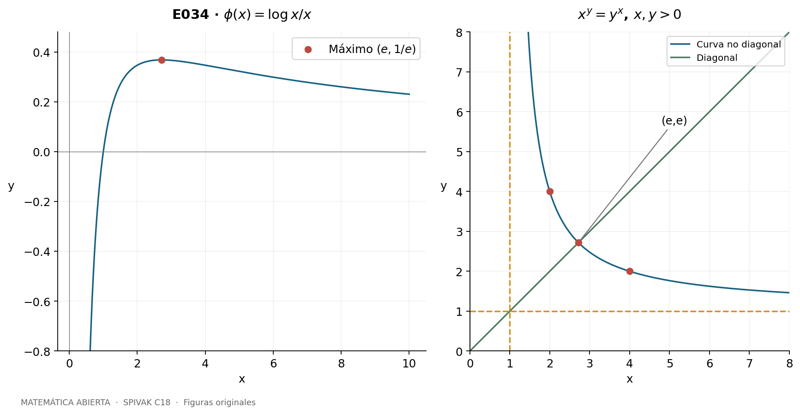
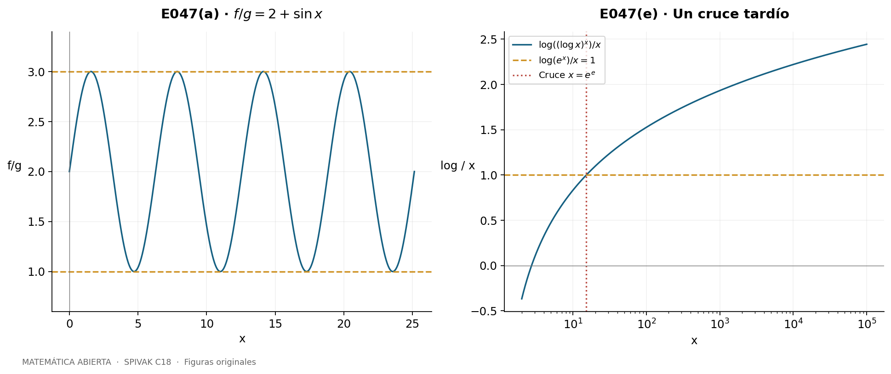

[← Capítulo 17](capitulo-17.qmd) · [Colecciones](../index.qmd#spivak-calculus-cuarta-edición) · [Capítulo 19 →](capitulo-19.qmd)

A. Peña · Matemática Abierta · 2026-10-15.

**49 problemas resueltos completos**, con sus incisos, figuras originales y revisión matemática interna. Fuente primaria: Michael Spivak, *Calculus*, 4.ª edición, capítulo 18, pp. 339–362; problemas en pp. 351–362 (PDF 371–382). C19 comienza en p. 363. No hay apéndice de C18.

Se conservan los datos y tareas matemáticos indispensables y se desarrollan soluciones propias en español. Las referencias permiten localizar cada original. Las potencias de base variable se interpretan mediante $u^v=\exp(v\log u)$ para $u>0$, salvo potencias enteras y raíces reales expresamente indicadas. $\log$ denota logaritmo natural; $\log_a$ exige $a>0$, $a\ne1$. Los teoremas de derivación se aplican en interiores de sus dominios. Una letra $C$ en una primitiva es una constante arbitraria en cada intervalo conexo.

## Herramientas del capítulo {#seccion-849}

La definición $L(x)=\int_1^x dt/t$ da $L'(x)=1/x$, monotonía estricta y $L(xy)=L(x)+L(y)$: para $y$ fijo, $L(xy)-L(x)$ tiene derivada cero y vale $L(y)$ en $x=1$. El cambio $t=2u$ muestra que cada intervalo $[2^j,2^{j+1}]$ aporta la misma integral positiva; por tanto $L$ no está acotada superiormente. Como $L(1/x)=-L(x)$, tampoco lo está inferiormente. Su inversa $E:\mathbb R\to(0,\infty)$ satisface

$$E'=E,\qquad E(s+t)=E(s)E(t),\qquad E(0)=1.$$

Se escribe $e=E(1)$ y $E(x)=e^x$. En particular,

$$(a^x)'=(\log a)a^x,\qquad (u^v)'=u^v\left(v'\log u+v\frac{u'}u\right),\qquad (\log_a x)'=\frac1{x\log a}.$$

La segunda fórmula procede de derivar $\exp(v\log u)$, no de tratar el exponente variable como constante. En las pruebas de límites se indica cuándo se usa l’Hôpital. E032 y E046 desarrollan construcciones alternativas sin suponer los resultados que están justificando.
## E001 — Derivadas y dominios {#e001}

Fuente: Spivak, *Calculus*, 4.ª ed., C18, problema 1, p. 351 (PDF: página impresa + 20).

**`SPV4-C18-E001-i`** Para la torre $f(x)=e^{e^{e^{e^x}}}$, definamos $u_1=e^x$ y $u_{j+1}=e^{u_j}$. Cada nivel aporta la derivada de su exponente; así
$$f'=u_4u_3u_2u_1=e^{e^{e^{e^x}}}e^{e^{e^x}}e^{e^x}e^x.$$
Está definida y es derivable para todo real.

**`SPV4-C18-E001-ii`** Sean $A=e^{1+e^{1+x}}$, $B=1+A$, $C=1+\log B$ y $D=1+\log C$. La función pedida es $\log D$. Todos los argumentos son positivos y la cadena da
$$f'=\frac{Ae^{1+x}}{BCD}.$$
Aquí $A'=Ae^{1+x}$; hay tres logaritmos y dos exponenciales variables.

**`SPV4-C18-E001-iii`** Para $f=(\sin x)^{\sin(\sin x)}$, con $\sin x>0$, derivamos su logaritmo:
$$f'=f\left[\cos(\sin x)\cos x\log(\sin x)+\sin(\sin x)\cot x\right].$$

**`SPV4-C18-E001-iv`** Si $F(x)=\int_0^x e^{-t^2}dt$, el teorema fundamental da $F'=e^{-x^2}$. Por ello
$$\left(e^{F(x)}\right)'=e^{F(x)}e^{-x^2}.$$
No hace falta una primitiva elemental del integrando; dominio $\mathbb R$.

**`SPV4-C18-E001-v`** Sea $s=\sin x>0$, $u=s^s$ y $f=s^u$. Primero $u'=u\cos x(1+\log s)$. Después
$$f'=fu\left[\cos x(1+\log s)\log s+\cot x\right].$$
Se respeta la asociación $s^{(s^s)}$.

**`SPV4-C18-E001-vi`** Como $\log_{e^x}(\sin x)=\log(\sin x)/x$, para $x\ne0$ y $\sin x>0$,
$$f'=\frac{x\cot x-\log(\sin x)}{x^2}.$$
La base variable $e^x$ no puede ser 1.

**`SPV4-C18-E001-vii`** El dato literal es $[\arcsin(x/\sin x)]^{\log(\sin e^x)}$. **No tiene dominio real.** Si $x\ne0$ y $\sin x\ne0$, la desigualdad estricta $|\sin x|<|x|$ da $|x/\sin x|>1$; en los ceros de $\sin x$ el cociente no existe. En particular, $x=0$ tampoco está definido. Por tanto no hay derivada real que calcular. La notación formal de la regla de la cadena no subsana este defecto. Se conserva el enunciado literal y no se sustituye silenciosamente por $\arcsin(\sin x/x)$.

**`SPV4-C18-E001-viii`** El coeficiente $\log(3+e^4)$ es constante. En $0<x<1$,
$$f'=4\log(3+e^4)e^{4x}+\frac{(\log3)(\arcsin x)^{\log3-1}}{\sqrt{1-x^2}}.$$
El dato es $\log(3+e^4)e^{4x}+(\arcsin x)^{\log3}$. Admitiendo la extensión $0^{\log3}=0$, en $x=0$ existe derivada derecha y el segundo sumando aporta cero, pues $\log3>1$ y $\arcsin x/x\to1$. En $x=1$ el segundo término tiene pendiente infinita; no se declara derivada ordinaria en los extremos.

**`SPV4-C18-E001-ix`** Para $f=(\log x)^{\log x}$, $x>1$,
$$f'=\frac{f}{x}[1+\log(\log x)].$$
El requisito $x>1$ asegura que la base del exponente real sea positiva.

**`SPV4-C18-E001-x`** Para $x>0$, $x^x=e^{x\log x}$ y
$$(x^x)'=x^x(1+\log x).$$

**`SPV4-C18-E001-xi`** La función es $\sin(x^{\sin(x^{\sin x})})$. Para $x>0$, pongamos
$$u=x^{\sin x},\quad v=\sin u,\quad w=x^v.$$
Entonces $u'=u[\cos x\log x+\sin x/x]$, $v'=\cos u\,u'$ y $w'=w[v'\log x+v/x]$. La respuesta, con cada cadena visible, es
$$f'=\cos w\,w\left\{\cos u\,u\left[\cos x\log x+\frac{\sin x}{x}\right]\log x+\frac{\sin u}{x}\right\}.$$

## E002 — Diferenciación logarítmica {#e002}

Fuente: Spivak, *Calculus*, 4.ª ed., C18, problema 2, p. 351–352 (PDF: página impresa + 20).

**`SPV4-C18-E002-a`** Para $f>0$ diferenciable, la regla de la cadena produce $(\log f)'=f'/f$. Multiplicar por $f$ recupera $f'$. Para funciones sin ceros de signo negativo se usa $\log|f|$; E020 justifica esa extensión. En un cero, esta división no es válida.

**`SPV4-C18-E002-b-i`** Si $f=(1+x)(1+e^{x^2})$, entonces, donde $f\ne0$,
$$\frac{f'}f=\frac1{1+x}+\frac{2xe^{x^2}}{1+e^{x^2}}.$$
Al multiplicar y simplificar se obtiene, para todo $x$,
$$f'=1+e^{x^2}+2x(1+x)e^{x^2}.$$
En $x=-1$, que se había excluido al tomar logaritmos, la fórmula directa da $1+e$.

**`SPV4-C18-E002-b-ii`** Sea
$$f(x)=\frac{(3-x)^{1/3}x^2}{(1-x)(3+x)^{2/3}},$$
con raíces cúbicas reales. Su dominio es $\mathbb R\setminus\{-3,1\}$. Donde además $x\ne0,3$, tomar $\log|f|$ da
$$f'=f\left[-\frac1{3(3-x)}+\frac2x+\frac1{1-x}-\frac2{3(3+x)}\right].$$
Cada signo viene de derivar un término de $\frac13\log|3-x|+2\log|x|-\log|1-x|-\frac23\log|3+x|$. En $x=0$ la forma original es $x^2$ por un factor suave, luego $f'(0)=0$. En $x=3$, el factor que multiplica $(3-x)^{1/3}$ es no nulo, de modo que el cociente incremental tiene magnitud proporcional a $|h|^{-2/3}$: no hay derivada finita.

**`SPV4-C18-E002-b-iii`** En los intervalos donde seno y coseno son positivos se diferencian los dos sumandos por separado:
$$\begin{aligned}
f'={}&(\sin x)^{\cos x}[-\sin x\log(\sin x)+\cos x\cot x]\\
&+(\cos x)^{\sin x}[\cos x\log(\cos x)-\sin x\tan x].
\end{aligned}$$
El logaritmo de una suma no es la suma de sus logaritmos.

**`SPV4-C18-E002-b-iv`** Para $f=(e^x-e^{-x})/[e^{2x}(1+x^3)]$, $x\ne-1$, el cálculo con $\log|f|$ da, si $x\ne0$,
$$f'=f\left[\frac{e^x+e^{-x}}{e^x-e^{-x}}-2-\frac{3x^2}{1+x^3}\right].$$
En $0$, se vuelve al cociente original: numerador cero, derivada del numerador 2 y denominador 1, así que $f'(0)=2$. Para evitar la singularidad removible puede escribirse en todo su dominio
$$f'=\frac{e^{-x}+e^{-3x}}{1+x^3}-\frac{(e^{-x}-e^{-3x})[2(1+x^3)+3x^2]}{(1+x^3)^2}.$$

## E003 — Integral de una derivada logarítmica {#e003}

Fuente: Spivak, *Calculus*, 4.ª ed., C18, problema 3, p. 352 (PDF: página impresa + 20).

**`SPV4-C18-E003`** Si $f>0$ en $[a,b]$ y $f'/f$ es integrable (por ejemplo, $f\in C^1$), E002 y el teorema fundamental dan
$$\int_a^b\frac{f'(x)}{f(x)}dx=\log f(b)-\log f(a)=\log\frac{f(b)}{f(a)}.$$
La mera diferenciabilidad no garantiza una integral de Riemann propia de la derivada. Por ejemplo, $f(0)=2$, $f(x)=2+x^2\sin(1/x^2)$ en $[0,1/2]$ es positiva y diferenciable, pero su derivada $2x\sin(1/x^2)-2\cos(1/x^2)/x$ no está acotada. La fórmula debe entenderse con la hipótesis de existencia de la integral.

## E004 — Cinco gráficas exponenciales {#e004}

Fuente: Spivak, *Calculus*, 4.ª ed., C18, problema 4, p. 352 (PDF: página impresa + 20).

**`SPV4-C18-E004-a`** $e^{x+1}$ es la exponencial trasladada una unidad a la izquierda; pasa por $(0,e)$, crece estrictamente, es convexa y tiene asíntota $y=0$ hacia $-\infty$.

**`SPV4-C18-E004-b`** $e^{\sin x}$ tiene período $2\pi$ y rango $[e^{-1},e]$. Su derivada $e^{\sin x}\cos x$ cambia de positiva a negativa en $\pi/2+2k\pi$ (máximos $e$) y de negativa a positiva en $3\pi/2+2k\pi$ (mínimos $e^{-1}$). La segunda derivada es $e^{\sin x}(\cos^2x-\sin x)$: las inflexiones satisfacen $\sin x=(\sqrt5-1)/2$.

**`SPV4-C18-E004-c`** $e^x+e^{-x}$ es par, estrictamente convexa y tiene mínimo 2 en 0. Decrece a la izquierda y crece a la derecha; diverge en ambos extremos. Supera a cada una de las curvas $e^x$ y $e^{-x}$; su diferencia con $e^x$ tiende a cero a la derecha y con $e^{-x}$ a la izquierda.

**`SPV4-C18-E004-d`** $e^x-e^{-x}$ es impar, pasa por el origen y crece en toda la recta porque su derivada es $e^x+e^{-x}>0$. Tiene inflexión en 0, concavidad negativa antes y positiva después. Queda por debajo de $e^x$; su diferencia con ella es $-e^{-x}$, que tiende a cero a la derecha. A la izquierda se aproxima a $-e^{-x}$, con diferencia $e^x$; la lámina permite compararla también con la curva positiva $e^{-x}$.

**`SPV4-C18-E004-e`** $(e^x-e^{-x})/(e^x+e^{-x})=\tanh x$ es impar, de rango $(-1,1)$, creciente con derivada $4/(e^x+e^{-x})^2>0$. Tiene asíntotas $y=\pm1$ y una inflexión en 0; es convexa para $x<0$ y cóncava para $x>0$.

{#fig-spv4-c18-f01 fig-alt="Capítulo 18: E004: traslación, oscilación y combinaciones exponenciales"}

## E005 — Límites por l’Hôpital {#e005}

Fuente: Spivak, *Calculus*, 4.ª ed., C18, problema 5, p. 352 (PDF: página impresa + 20).

Todos los cocientes son $0/0$ al tender $x$ a cero; los denominadores derivados no se anulan para $x\ne0$ cerca de cero.

**`SPV4-C18-E005-i`** Para $(e^x-1-x-x^2/2)/x^2$, dos aplicaciones dan $(e^x-1)/2\to\boxed0$.

**`SPV4-C18-E005-ii`** Para $(e^x-1-x-x^2/2-x^3/6)/x^3$, tres aplicaciones dan $(e^x-1)/6\to\boxed0$.

**`SPV4-C18-E005-iii`** Con el numerador de (i) y denominador $x^3$, tres aplicaciones dan $e^x/6\to\boxed{1/6}$.

**`SPV4-C18-E005-iv`** Sea $N=\log(1+x)-x+x^2/2$. Entonces $N'=1/(1+x)-1+x$, $N''=1-1/(1+x)^2$ y $N^{(3)}=2/(1+x)^3$. Dos aplicaciones a $N/x^2$ dan $N''/2\to\boxed0$.

**`SPV4-C18-E005-v`** Tres aplicaciones a $N/x^3$ dan $N^{(3)}/6\to\boxed{1/3}$.

**`SPV4-C18-E005-vi`** El numerador $N-x^3/3$ tiene primeras dos derivadas nulas en cero y tercera derivada $2/(1+x)^3-2$. Tres aplicaciones, con denominador $x^3$, dan $[2/(1+x)^3-2]/6\to\boxed0$.

Se han usado derivadas, sin presuponer desarrollos de Taylor.

## E006 — Límites de potencias indeterminadas {#e006}

Fuente: Spivak, *Calculus*, 4.ª ed., C18, problema 6, p. 352 (PDF: página impresa + 20).

Se toma logaritmo en una vecindad con base positiva y se exponencia el límite finito obtenido.

**`SPV4-C18-E006-i`** $\log((1-x)^{1/x})=\log(1-x)/x\to-1$ por l’Hôpital; límite $\boxed{e^{-1}}$.

**`SPV4-C18-E006-ii`** Para $x\to\pi/4$,
$$\log((\tan x)^{\tan2x})=\frac{\log(\tan x)}{\cot2x}\longrightarrow\frac{2}{-2}=-1.$$
El denominador deriva a $-2\csc^2(2x)$ y el numerador a $1/(\sin x\cos x)$. Límite $\boxed{e^{-1}}$ por ambos lados dentro de la vecindad positiva.

**`SPV4-C18-E006-iii`** $\log((\cos x)^{1/x^2})=\log(\cos x)/x^2\to-1/2$, pues tras una aplicación queda $-\tan x/(2x)$. Límite $\boxed{e^{-1/2}}$.

## E007 — Gráficas hiperbólicas {#e007}

Fuente: Spivak, *Calculus*, 4.ª ed., C18, problema 7, p. 353 (PDF: página impresa + 20).

**`SPV4-C18-E007`** Las definiciones son $\sinh x=(e^x-e^{-x})/2$, $\cosh x=(e^x+e^{-x})/2$ y $\tanh x=\sinh x/\cosh x$. Las dos primeras gráficas son las de E004(d,c) con ordenadas divididas entre 2. $\sinh$ es impar, creciente y de rango $\mathbb R$; $\cosh$ es par, convexa, de mínimo 1 y rango $[1,\infty)$. $\tanh$ conserva la gráfica de E004(e). Se representan expresamente las tres funciones.

{#fig-spv4-c18-f02 fig-alt="Capítulo 18: E007 y E009: funciones hiperbólicas e inversas"}

## E008 — Identidades y derivadas hiperbólicas {#e008}

Fuente: Spivak, *Calculus*, 4.ª ed., C18, problema 8, p. 353 (PDF: página impresa + 20).

Escribamos $u=e^x$, de modo que $e^{-x}=1/u$.

**`SPV4-C18-E008-a`** $\cosh^2x-\sinh^2x=[(u+u^{-1})^2-(u-u^{-1})^2]/4=1$.

**`SPV4-C18-E008-b`** Dividir (a) por $\cosh^2x>0$ da $\tanh^2x+1/\cosh^2x=1$.

**`SPV4-C18-E008-c`** Al expandir $\sinh x\cosh y+\cosh x\sinh y$, se cancelan los términos $e^{x-y}$ y $e^{-x+y}$ y quedan $(e^{x+y}-e^{-(x+y)})/2=\sinh(x+y)$.

**`SPV4-C18-E008-d`** La expansión de $\cosh x\cosh y+\sinh x\sinh y$ cancela los mismos términos mixtos y deja $(e^{x+y}+e^{-(x+y)})/2=\cosh(x+y)$.

**`SPV4-C18-E008-e`** $\sinh' x=(e^x+e^{-x})/2=\cosh x$.

**`SPV4-C18-E008-f`** $\cosh' x=(e^x-e^{-x})/2=\sinh x$.

**`SPV4-C18-E008-g`** La regla del cociente y (a) dan $\tanh' x=(\cosh^2x-\sinh^2x)/\cosh^2x=1/\cosh^2x$.

## E009 — Inversas hiperbólicas y ramas {#e009}

Fuente: Spivak, *Calculus*, 4.ª ed., C18, problema 9, p. 353 (PDF: página impresa + 20).

Se invierte $\sinh$ en $\mathbb R$, $\cosh$ restringida a $[0,\infty)$ y $\tanh$ en $\mathbb R$.

**`SPV4-C18-E009-a`** Si $t=\operatorname{arcosh}x$, entonces $t\ge0$, $x\ge1$ y $\sinh t\ge0$. De E008(a), $\sinh(\operatorname{arcosh}x)=\sqrt{x^2-1}$. La raíz es la positiva.

**`SPV4-C18-E009-b`** Para $t=\operatorname{arsinh}x$, $\cosh t>0$ y $\cosh(\operatorname{arsinh}x)=\sqrt{1+x^2}$ para todo real $x$.

**`SPV4-C18-E009-c`** Por la derivada inversa y (b), $(\operatorname{arsinh}x)'=1/\sqrt{1+x^2}$ en toda la recta.

**`SPV4-C18-E009-d`** En $x>1$, $(\operatorname{arcosh}x)'=1/\sqrt{x^2-1}$. En $x=1$ la inversa está definida pero tiene pendiente derecha infinita, pues $\sinh0=0$.

**`SPV4-C18-E009-e`** En $|x|<1$, E008(b,g) da $(\operatorname{artanh}x)'=1/(1-x^2)$. Fuera de ese intervalo no existe inversa real de $\tanh$.

## E010 — Fórmulas logarítmicas e integrales {#e010}

Fuente: Spivak, *Calculus*, 4.ª ed., C18, problema 10, p. 354 (PDF: página impresa + 20).

**`SPV4-C18-E010-a`** Para invertir $x=(e^t-e^{-t})/2$, sea $u=e^t>0$. La ecuación $u^2-2xu-1=0$ tiene única raíz positiva $u=x+\sqrt{x^2+1}$, luego
$$\operatorname{arsinh}x=\log(x+\sqrt{1+x^2}),\quad x\in\mathbb R.$$
Para $x=(u+u^{-1})/2$ y la rama $t\ge0$, se requiere $u\ge1$, por lo que
$$\operatorname{arcosh}x=\log(x+\sqrt{x^2-1}),\quad x\ge1.$$
Finalmente, $x=(u^2-1)/(u^2+1)$ equivale a $u^2=(1+x)/(1-x)$ y da
$$\operatorname{artanh}x=\tfrac12\log\frac{1+x}{1-x},\quad |x|<1.$$
Las otras raíces de las cuadráticas no cumplen la positividad o la rama elegida.

**`SPV4-C18-E010-b`** Derivar las fórmulas anteriores y aplicar el teorema fundamental produce
$$\int_a^b\frac{dx}{\sqrt{1+x^2}}=[\log(x+\sqrt{1+x^2})]_a^b,$$
para cualesquiera $a,b$. Si $a,b$ pertenecen a un mismo componente de $(-\infty,-1)\cup(1,\infty)$,
$$\int_a^b\frac{dx}{\sqrt{x^2-1}}=[\log|x+\sqrt{x^2-1}|]_a^b.$$
En el componente negativo esta primitiva es $-\operatorname{arcosh}(-x)$, no $\operatorname{arcosh}x$. Para $a,b\in(-1,1)$,
$$\int_a^b\frac{dx}{1-x^2}=\frac12\left[\log\frac{1+x}{1-x}\right]_a^b.$$
También se obtiene la última descomponiendo $1/(1-x^2)=\frac12[1/(1-x)+1/(1+x)]$. No se atraviesan los polos $\pm1$ con una integral propia.

## E011 — Una integral no acotada {#e011}

Fuente: Spivak, *Calculus*, 4.ª ed., C18, problema 11, p. 354 (PDF: página impresa + 20).

**`SPV4-C18-E011`** Sea $F(x)=\int_2^x dt/\log t$, $x\ge2$. Para $t\ge2$, $0<\log t\le t$, de modo que
$$F(x)\ge\int_2^x\frac{dt}{t}=\log(x/2)\longrightarrow\infty.$$
En particular, $F$ no está acotada en $[2,\infty)$.

## E012 — Promedios logarítmicos de una función monótona {#e012}

Fuente: Spivak, *Calculus*, 4.ª ed., C18, problema 12, p. 354 (PDF: página impresa + 20).

**`SPV4-C18-E012`** Sea $f$ no decreciente en $[1,\infty)$ y $F(x)=\int_1^x f(t)dt/t$. La monotonía asegura integrabilidad en cada compacto. El cociente se considera en $x>1$, porque en 1 es $0/0$.

Si $|f|\le M$, entonces $|F(x)|\le M\log x$ y $F(x)/\log x$ está acotado. Recíprocamente, supongamos $F(x)/\log x\le K$ para todo $x>1$; una cota absoluta implica esta cota superior. Para $y>1$, dividimos en $[1,y]$ y $[y,y^2]$. La monotonía da
$$F(y^2)\ge f(1)\log y+f(y)\log y.$$
Como $\log(y^2)=2\log y$, resulta $f(y)\le2K-f(1)$. Además $f(y)\ge f(1)$: $f$ está acotada por ambos lados, incluso si toma valores negativos. No se presupone continuidad ni $f(1+)=f(1)$.

## E013 — Comparación de potencias, logaritmos y exponenciales {#e013}

Fuente: Spivak, *Calculus*, 4.ª ed., C18, problema 13, p. 354 (PDF: página impresa + 20).

Se toma $n$ entero positivo.

**`SPV4-C18-E013-a`** Si $0<a<1$, $\log a<0$ y $a^x=e^{x\log a}\to0$ cuando $x\to\infty$.

**`SPV4-C18-E013-b`** Con $u=\log x\to\infty$, $x/(\log x)^n=e^u/u^n\to\infty$. Para demostrarlo sin remitir a la conclusión, aplicamos l’Hôpital $n$ veces a $u^n/e^u$: el último cociente es $n!/e^u\to0$, y todos son positivos para $u>0$.

**`SPV4-C18-E013-c`** Invertir el cociente positivo anterior da $(\log x)^n/x\to0$.

**`SPV4-C18-E013-d`** Cuando $x\to0^+$, sea $u=-\log x\to\infty$. Entonces $x(\log x)^n=(-1)^n u^ne^{-u}\to0$ por (b), independientemente de su signo.

**`SPV4-C18-E013-e`** $\log(x^x)=x\log x\to0$ por (d), así que $x^x\to1$ cuando $x\to0^+$.

## E014 — La curva de x elevado a x {#e014}

Fuente: Spivak, *Calculus*, 4.ª ed., C18, problema 14, p. 354 (PDF: página impresa + 20).

**`SPV4-C18-E014`** Para $x>0$, $f=x^x$ satisface
$$f'=f(1+\log x),\qquad f''=f\left[(1+\log x)^2+\frac1x\right]>0.$$
Decrece en $(0,e^{-1})$, crece en $(e^{-1},\infty)$ y tiene mínimo global $e^{-1/e}$ en $x=e^{-1}$. Es estrictamente convexa. E013(e) da límite 1 en $0^+$, pero $(0,1)$ no pertenece al dominio original; hacia infinito diverge. Pasa por $(1,1)$.

{#fig-spv4-c18-f03 fig-alt="Capítulo 18: E014 y E018: potencias variables"}

## E015 — Dominio exponencial mediante una cota de la derivada {#e015}

Fuente: Spivak, *Calculus*, 4.ª ed., C18, problema 15, p. 354 (PDF: página impresa + 20).

**`SPV4-C18-E015-a`** Para $n\ge1$ y $x>0$, sea $f=e^x/x^n$. Su derivada es $e^x(x-n)/x^{n+1}$; decrece hasta $n$ y crece después. En particular, para $x>n$,
$$f(x)>f(n)=\frac{e^n}{n^n}.$$

**`SPV4-C18-E015-b`** Si $x>n+1$, aplicar (a) al exponente $n+1$ da
$$f'(x)=(x-n)\frac{e^x}{x^{n+1}}>\frac{e^{n+1}}{(n+1)^{n+1}}=:m>0.$$
El teorema del valor medio implica $f(x)\ge f(n+1)+m(x-n-1)$ para $x>n+1$. Por tanto $f(x)\to\infty$, no solo que sea creciente. Si se incluye $n=0$, la conclusión de crecimiento es directamente $e^x\to\infty$; el argumento de mínimo en $x=n$ se formuló para $n\ge1$.

## E016 — Gráficas de la exponencial dividida por una potencia {#e016}

Fuente: Spivak, *Calculus*, 4.ª ed., C18, problema 16, p. 354 (PDF: página impresa + 20).

**`SPV4-C18-E016`** Para $n\ge1$ el dominio natural es $x\ne0$. Además de la derivada de E015,
$$f''(x)=\frac{e^x}{x^n}\frac{(x-n)^2+n}{x^2}.$$
En $x>0$, la gráfica es convexa, tiene mínimo $e^n/n^n$ en $n$, y diverge tanto en $0^+$ como en $+\infty$. En $x<0$, el factor $1-n/x$ es positivo, por lo que $f'$ y $f''$ tienen el signo de $f$. Si $n$ es par, la rama izquierda es positiva, creciente y convexa, desde $0^+$ en $-\infty$ hasta $+\infty$ en $0^-$. Si $n$ es impar es negativa, decreciente y cóncava, desde $0^-$ hasta $-\infty$. La asíntota izquierda es $y=0$ y la vertical es $x=0$. Se muestran ambas paridades; ningún trazo une las ramas a través del polo.

{#fig-spv4-c18-f04 fig-alt="Capítulo 18: E016: ramas para exponentes pares e impares"}

## E017 — La constante e en límites de potencias {#e017}

Fuente: Spivak, *Calculus*, 4.ª ed., C18, problema 17, p. 355 (PDF: página impresa + 20).

**`SPV4-C18-E017-a`** Por definición de derivada de $\log$ en 1,
$$\lim_{y\to0}\frac{\log(1+y)}y=\log'(1)=1.$$
Esto evita l’Hôpital.

**`SPV4-C18-E017-b`** Sustituir $y=1/x$ da $x\log(1+1/x)\to1$ cuando $x\to\infty$.

**`SPV4-C18-E017-c`** Exponenciar (b) da $(1+1/x)^x\to e$.

**`SPV4-C18-E017-d`** Si $a\ne0$, con $y=a/x$, $x\log(1+a/x)=a\log(1+y)/y\to a$; la base es positiva para $x$ suficientemente grande. El límite es $e^a$. Para $a=0$ es constantemente 1.

**`SPV4-C18-E017-e`** Para $b>0$, sea $c=\log b$. Si $c\ne0$, con $u=c/x$,
$$x(b^{1/x}-1)=c\frac{e^u-1}{u}\to c$$
por la derivada de $\exp$ en 0. Si $b=1$, el cociente original es cero. El resultado es $\log b$ en ambos casos.

## E018 — Gráfica del límite clásico de e {#e018}

Fuente: Spivak, *Calculus*, 4.ª ed., C18, problema 18, p. 355 (PDF: página impresa + 20).

**`SPV4-C18-E018`** Sea $f=(1+1/x)^x$, $x>0$, y $L=\log f=x\log(1+1/x)$. Entonces
$$L'=\log(1+1/x)-\frac1{x+1}>0,\qquad L''=-\frac1{x(x+1)^2}<0.$$
La desigualdad estricta se obtiene de $\log(1+t)=\int_0^t du/(1+u)>t/(1+t)$, $t>0$. Por ello $f$ es creciente. Su límite en infinito es $e$ por E017; en cero es 1, pues con $u=1/x$, $L=\log(1+u)/u\to0$. Ninguna de las dos ordenadas extremas se alcanza.

La gráfica es además cóncava. En efecto, $L'=\int_0^1 t/(x+t)^2dt$ y $-L''=2\int_0^1 t/(x+t)^3dt$. Schwarz da
$$(L')^2\le\left(\int_0^1\frac{t}{(x+t)^3}dt\right)\left(\int_0^1\frac{t}{x+t}dt\right)<-L''/2.$$
Así $f''=f[(L')^2+L'']<0$. La lámina de E014 incluye esta curva y las dos ordenadas límite.

## E019 — Capitalización como modelo matemático {#e019}

Fuente: Spivak, *Calculus*, 4.ª ed., C18, problema 19, p. 355 (PDF: página impresa + 20).

**`SPV4-C18-E019`** Sea $r=a/100\ge0$ la tasa anual del modelo. Con capital inicial 1 y $k$ períodos iguales, el capital final es $(1+r/k)^k$. Si $r>0$, $\log(1+r/k)<r/k$ muestra que cada capital es menor que $e^r$, mientras que E017(d) prueba que tienden a $e^r$ al crecer $k$. Por definición de supremo, el mayor valor límite es $\boxed{e^{a/100}}$; no se alcanza con un $k$ finito cuando $a>0$. Para $a=0$, todos los valores son 1. Para capital inicial $P$, se multiplica por $P$. La afirmación es sobre el modelo de tasa constante del ejercicio.

## E020 — Logaritmos de valores absolutos {#e020}

Fuente: Spivak, *Calculus*, 4.ª ed., C18, problema 20, p. 355 (PDF: página impresa + 20).

**`SPV4-C18-E020-a`** Si $x>0$, $\log|x|=\log x$. Si $x<0$, es $\log(-x)$ y su derivada es $(-1)/(-x)=1/x$. Por tanto $(\log|x|)'=1/x$ en $\mathbb R\setminus\{0\}$.

**`SPV4-C18-E020-b`** Para $f$ diferenciable y $f(x)\ne0$, la cadena aplicada a (a) da $(\log|f|)'=f'/f$. Localmente el signo de $f$ es constante por continuidad. En un cero de $f$ el logaritmo no está definido y no se divide por $f$.

## E021 — Todas las soluciones de una ecuación exponencial {#e021}

Fuente: Spivak, *Calculus*, 4.ª ed., C18, problema 21, p. 355 (PDF: página impresa + 20).

Se trabaja en un intervalo conexo.

**`SPV4-C18-E021-a`** Si $f'=cf$ y $f$ no se anula, E020 da $(\log|f|)'=c$, luego $\log|f|=cx+d$ por el valor medio. Así $|f|=e^de^{cx}$. La continuidad obliga a que el signo sea constante; por ello $f=ke^{cx}$ con $k\ne0$.

**`SPV4-C18-E021-b`** Para una solución cualquiera, el conjunto $\{f\ne0\}$ es abierto. En cada componente se aplica (a). Un extremo finito interior al intervalo de definición no puede tener valor cero, pues el límite de $ke^{cx}$ allí es no nulo. Por continuidad sería un punto interior del mismo conjunto, contradicción. Si hay algún punto no nulo, su componente ocupa todo el intervalo; si no lo hay, $f\equiv0$. Se incluyen, por tanto, exactamente las funciones $ke^{cx}$, ahora con $k$ arbitrario.

**`SPV4-C18-E021-c`** Una prueba que trata los ceros de una vez consiste en derivar $fe^{-cx}$: su derivada es $e^{-cx}(f'-cf)=0$. El valor medio lo hace constante y vuelve a dar $f=ke^{cx}$.

**`SPV4-C18-E021-d`** Si $f'=fg'$ con $g$ diferenciable, entonces $(fe^{-g})'=e^{-g}(f'-fg')=0$. Todas las soluciones son $f=ke^g$, incluso $k=0$; la sustitución verifica la recíproca.

## E022 — Decaimiento y semivida {#e022}

Fuente: Spivak, *Calculus*, 4.ª ed., C18, problema 22, p. 355–356 (PDF: página impresa + 20).

**`SPV4-C18-E022-a`** En el modelo $A'=cA$, $c<0$, E021 da $A(t)=A(0)e^{ct}$. La constante negativa de la ecuación es el opuesto de una tasa positiva $\lambda=-c$; no es una probabilidad negativa.

**`SPV4-C18-E022-b`** Para $A(0)>0$, $A(t+\tau)=A(t)/2$ equivale a $e^{c\tau}=1/2$, luego
$$\tau=-\frac{\log2}{c}=\frac{\log2}{\lambda}.$$
No depende del instante ni de la cantidad inicial positiva. Si $A(0)=0$, la solución es nula y la igualdad por sí sola no determina un único tiempo; el parámetro del modelo sigue siendo $\log2/\lambda$.

## E023 — Ley de enfriamiento {#e023}

Fuente: Spivak, *Calculus*, 4.ª ed., C18, problema 23, p. 356 (PDF: página impresa + 20).

**`SPV4-C18-E023`** Para ambiente constante $M$ y coeficiente $k>0$, la ecuación es $T'=-k(T-M)$. Con $u=T-M$, resulta $u'=-ku$, y E021 da
$$T(t)=M+(T(0)-M)e^{-kt}.$$
La sustitución verifica la ecuación y el dato inicial. Si $T(0)>M$ hay enfriamiento; si es menor, calentamiento; si es igual, equilibrio. En los dos primeros casos la temperatura se acerca a $M$ sin cruzarla en tiempo finito.

## E024 — Una ecuación integral homogénea {#e024}

Fuente: Spivak, *Calculus*, 4.ª ed., C18, problema 24, p. 356 (PDF: página impresa + 20).

**`SPV4-C18-E024`** Si $f(x)=\int_0^x f(t)dt$, la igualdad hace continua a $f$ siempre que las integrales propias existan localmente. Por el teorema fundamental, $f'=f$ y, evaluando en cero, $f(0)=0$. E021 implica $f\equiv0$. Esta función satisface la igualdad, así que es la única.

## E025 — Constantes de integración y parte del dominio no observada {#e025}

Fuente: Spivak, *Calculus*, 4.ª ed., C18, problema 25, p. 356 (PDF: página impresa + 20).

**`SPV4-C18-E025-i`** La igualdad $\int_0^x f(t)dt=e^x$ es imposible: en $x=0$ exigiría $0=1$. Derivar y obtener $f=e^x$ no resuelve la igualdad original, ya que su integral es $e^x-1$.

**`SPV4-C18-E025-ii`** Si $f$ es continua y $\int_0^{x^2}f(t)dt=1-e^{2x^2}$, ponemos $u=x^2$. Todo $u\ge0$ es alcanzado, por lo que
$$\int_0^u f(t)dt=1-e^{2u},\qquad f(u)=-2e^{2u}\quad(u\ge0).$$
En cero el valor se obtiene por continuidad. En $u<0$ la ecuación no observa a $f$: cualquier función continua en $(-\infty,0]$ con valor $-2$ en cero puede unirse a la rama anterior. Estas y solo estas son las soluciones continuas en toda la recta. Si se pide dominio $[0,\infty)$, la solución es única. Integrar la rama positiva comprueba la igualdad para todo $x$.

## E026 — Una constante definida por la propia función {#e026}

Fuente: Spivak, *Calculus*, 4.ª ed., C18, problema 26, p. 356 (PDF: página impresa + 20).

**`SPV4-C18-E026`** Sea $C=\int_0^1 f(t)dt$. La ecuación $f'=f+C$ hace que $u=f+C$ satisfaga $u'=u$, así que $f=Ae^x-C$. Integrando entre 0 y 1,
$$C=A(e-1)-C,\quad C=\frac{A(e-1)}2.$$
Todas las soluciones son
$$f(x)=A\left(e^x-\frac{e-1}2\right),\qquad A\in\mathbb R.$$
Su integral en $[0,1]$ es precisamente $A(e-1)/2$, y su derivada verifica la ecuación; no queda una constante independiente adicional.

## E027 — Todas las soluciones de una ecuación integral no lineal {#e027}

Fuente: Spivak, *Calculus*, 4.ª ed., C18, problema 27, p. 356 (PDF: página impresa + 20).

**`SPV4-C18-E027`** Buscamos $f$ continua en $\mathbb R$ con
$$f(x)^2=\int_0^x\frac{tf(t)}{1+t^2}dt.$$
En cero, $f(0)=0$. En cualquier intervalo donde $f\ne0$, la raíz local de $f^2$ es diferenciable; derivar y dividir por $f$ da $2f'=x/(1+x^2)$. Por tanto, con $u(x)=\frac14\log(1+x^2)$,
$$f(x)=u(x)+K$$
en cada componente no nula.

En el semieje positivo, $u$ es estrictamente creciente. Una componente $(a,b)$ con $a\ge0$ tiene $f(a)=0$ por continuidad (también si $a=0$), de modo que $f=u-u(a)$. Si $b$ fuese finito, no podría tener $f(b)=0$ porque $u(b)>u(a)$. Luego toda componente no nula derecha es una cola $(a,\infty)$ y solo puede haber una. El mismo argumento en el semieje negativo, donde $u$ es estrictamente decreciente, deja una cola $(-\infty,-b)$. Así, con dos parámetros independientes $a,b\in[0,\infty]$, todas las soluciones son
$$f(x)=\begin{cases}
\frac14\log\dfrac{1+x^2}{1+b^2},&x<-b,\quad b<\infty,\\
0,&-b\le x\le a,\\
\frac14\log\dfrac{1+x^2}{1+a^2},&x>a,\quad a<\infty.
\end{cases}$$
El parámetro infinito significa ausencia de esa cola, sin evaluar una fórmula con $\infty$. Todas son no negativas; la solución nula corresponde a ambos parámetros infinitos. Para verificar suficiencia, $f^2$ es diferenciable incluso en las uniones porque allí $f=0$ y crece a lo sumo linealmente. Su derivada es $xf(x)/(1+x^2)$ y $f(0)^2=0$; el teorema fundamental da la ecuación. $f$ no necesita ser diferenciable en un umbral positivo. Dividir por $f$ globalmente habría perdido estas soluciones con espera.

{#fig-spv4-c18-f05 fig-alt="Capítulo 18: E027 y E041: espera e infinitas derivadas nulas"}

## E028 — Desigualdad integral de Grönwall {#e028}

Fuente: Spivak, *Calculus*, 4.ª ed., C18, problema 28, p. 356 (PDF: página impresa + 20).

**`SPV4-C18-E028-a`** Sean $f,g$ continuas en $[a,b]$, $g\ge0$, y $f(x)\le C+\int_a^x fg$. Pongamos $F=C+\int_a^x fg$ y $G=\int_a^x g$. Entonces $F'=fg$, $G'=g$ y
$$(Fe^{-G})'=g(f-F)e^{-G}\le0.$$
Como $F(a)=C$, se obtiene $F(x)\le Ce^{G(x)}$ y, en consecuencia,
$$f(x)\le C\exp\left(\int_a^x g(t)dt\right).$$
No se ha dividido por $F$ ni supuesto $C>0$.

**`SPV4-C18-E028-b`** Si $f,g\ge0$, $g$ continua, $f'=gf$ y $f(0)=0$, entonces para $x\ge0$ la forma integral y (a), con $C=0$, dan $f(x)\le0$. Para $x\le0$, $f'=gf\ge0$ implica $f(x)\le f(0)=0$ por el valor medio. La no negatividad obliga a $f\equiv0$ en ambos lados. Se puede aplicar el argumento en cualquier compacto del dominio.

## E029 — Cota polinómica inferior de la exponencial {#e029}

Fuente: Spivak, *Calculus*, 4.ª ed., C18, problema 29, p. 356 (PDF: página impresa + 20).

**`SPV4-C18-E029-a`** Sea $S_n(x)=\sum_{k=0}^n x^k/k!$. Para $x\ge0$, $S_0=1\le e^x$. Si $S_{n-1}\le e^x$, entonces $S_n'=S_{n-1}\le(e^x)'$, y $S_n(0)=e^0=1$; integrando la desigualdad de derivadas desde cero se obtiene $S_n\le e^x$. Esto prueba la afirmación por inducción, sin asumir la serie infinita.

**`SPV4-C18-E029-b`** Aplicar (a) con $n+1$ da $e^x\ge x^{n+1}/(n+1)!$ para $x>0$. Así
$$\frac{e^x}{x^n}\ge\frac{x}{(n+1)!}\longrightarrow\infty.$$
Es una segunda demostración de la dominación de cualquier potencia fija.

## E030 — La misma dominación por l’Hôpital {#e030}

Fuente: Spivak, *Calculus*, 4.ª ed., C18, problema 30, p. 356 (PDF: página impresa + 20).

**`SPV4-C18-E030`** Para entero $n\ge1$, el cociente $x^n/e^x$ es de tipo $\infty/\infty$ y puede someterse sucesivamente a l’Hôpital: tras $n$ derivaciones queda $n!/e^x\to0$. Las derivadas del denominador son siempre positivas; en los pasos anteriores los cocientes conservan el tipo requerido. Como $x^n/e^x>0$, invertir da $e^x/x^n\to\infty$. Para $n=0$ es inmediato. Es una prueba distinta de las cotas de E015 y E029.

## E031 — Una integral exponencial en intervalos móviles {#e031}

Fuente: Spivak, *Calculus*, 4.ª ed., C18, problema 31, p. 357 (PDF: página impresa + 20).

**`SPV4-C18-E031-a`** Sea $F(y)=\int_0^y e^{t^2}dt$ y $J(y)=e^{-y^2}F(y)$. Como $F(y)\ge y\to\infty$, l’Hôpital aplicado a $F(y)/e^{y^2}$ da límite $\lim1/(2y)=0$.

Para afinar los tres casos siguientes necesitamos además
$$\frac{F(y)}{e^{y^2}/(2y)}\longrightarrow1,$$
por l’Hôpital, ya que la derivada del denominador es $e^{y^2}(1-1/(2y^2))$. Es decir, $J(y)$ dividido por $1/(2y)$ tiende a 1. Para $z=x+\delta(x)$,
$$e^{-x^2}\int_x^z e^{t^2}dt=e^{z^2-x^2}J(z)-J(x).$$
En los tres casos $z/x\to1$ y $J(x)\to0$.

**`SPV4-C18-E031-b-i`** Si $\delta=1/x$, el factor exponencial es $e^{2+1/x^2}\to e^2$ y $J(z)\to0$. El límite es $\boxed0$.

**`SPV4-C18-E031-b-ii`** Si $\delta=\log x/x$, el factor es $x^2e^{(\log x)^2/x^2}$, y $J(z)$ dividido por $1/(2x)$ tiende a 1. El primer producto dividido por $x/2$ tiende a 1; el límite pedido es $\boxed{+\infty}$.

**`SPV4-C18-E031-b-iii`** Si $\delta=\log x/(2x)$, el factor es $xe^{(\log x)^2/(4x^2)}$. Multiplicando por $J(z)$ se obtiene límite $\boxed{1/2}$. Los términos exponenciales residuales tienden a 1 por E013(c); esto justifica también la estimación del inciso anterior.

## E032 — Construcción clásica sin circularidad {#e032}

Fuente: Spivak, *Calculus*, 4.ª ed., C18, problema 32, p. 357–358 (PDF: página impresa + 20).

Se parte de la construcción continua de las potencias reales $a^x$ con sus leyes algebraicas, para $a>0$, $a\ne1$, y de su inversa continua $\log_a$. No usamos aquí sus derivadas ni el límite de E017 para establecer el límite clásico.

**`SPV4-C18-E032-a`** Con $k=h/x$, para $x>0$,
$$\frac{\log_a(x+h)-\log_a x}{h}=\frac1x\log_a\left((1+k)^{1/k}\right).$$
Es una identidad para $h\ne0$ suficientemente pequeño. Si se prueba que la potencia interior tiende a un número $e$, la continuidad de $\log_a$ dará derivada $\log_a e/x$. La existencia del límite todavía debe probarse, y se hace en (b–d).

**`SPV4-C18-E032-b`** Por el binomio,
$$a_n=(1+1/n)^n=2+\sum_{k=2}^n\frac1{k!}\prod_{j=1}^{k-1}\left(1-\frac jn\right).$$
Al pasar de $n$ a $n+1$, cada factor presente aumenta y aparece un sumando positivo. Para $n=1$, $a_2=9/4>2=a_1$; para $n\ge2$ ya el término $k=2$ aumenta estrictamente. Luego $(a_n)$ es estrictamente creciente.

**`SPV4-C18-E032-c`** Cada producto es menor que 1 y $k!\ge2^{k-1}$ para $k\ge2$. Así
$$a_n\le2+\sum_{k=2}^n\frac1{2^{k-1}}<3.$$
Por completitud existe $e=\sup\{a_n\}$ y $a_n\to e$: para cualquier $\varepsilon>0$, algún término supera $e-\varepsilon$ y todos los siguientes también. Además $e>2$. Para obtener la cota estricta $e<3$ uniforme, se puede separar $k=2$ y usar $k!\ge 2\cdot3^{k-2}$ para $k\ge2$, con desigualdad estricta desde $k=4$: $a_n\le2+\frac12\sum_{j=0}^\infty3^{-j}=11/4<3$. Esta cota basta, aunque no es óptima.

**`SPV4-C18-E032-d`** Para $n\le x\le n+1$, $x>0$, monotonía de base y exponente, ambos con base mayor que 1, da
$$\left(1+\frac1{n+1}\right)^n\le(1+1/x)^x\le\left(1+\frac1n\right)^{n+1}.$$
Los extremos son $a_{n+1}/(1+1/(n+1))$ y $a_n(1+1/n)$, que tienden a $e$. Por encaje, el límite vale $e$ para $x\to+\infty$. Si $x=-u\to-\infty$, ponemos $v=u-1$ y obtenemos
$$(1-1/u)^{-u}=(1+1/v)^{v+1}\longrightarrow e.$$
Por tanto $(1+k)^{1/k}\to e$ por ambos lados de cero. Volviendo a (a), $(\log_a x)'=\log_a e/x$. En particular, para la base recién construida $e$, $\log_e e=1$, de modo que $\log_e'=1/x$. Como $\log_e1=0$, coincide con $\int_1^x dt/t$ por el valor medio. Su inversa es la exponencial definida al comienzo y satisface $E'=E$. Así ambas construcciones producen la misma constante.

## E033 — Normalización del logaritmo de Napier {#e033}

Fuente: Spivak, *Calculus*, 4.ª ed., C18, problema 33, p. 358 (PDF: página impresa + 20).

**`SPV4-C18-E033`** En la idealización del ejercicio, la longitud es $L=10^7$, $P'=L-P$ y $Q'=L$. Con la normalización inicial de ambos móviles en el origen, $P(0)=Q(0)=0$, las soluciones son
$$P(t)=L(1-e^{-t}),\qquad Q(t)=Lt.$$
Si $x=L-P(t)$, entonces $x=Le^{-t}$ y $t=\log(L/x)$. La coordenada que define el logaritmo de Napier es
$$N(x)=L\log(L/x)=10^7\log(10^7/x).$$
Para movimiento hacia adelante $t\ge0$, el dominio recorrido es $0<x\le L$; la fórmula se extiende a todos los positivos permitiendo tiempos negativos. No es simplemente el logaritmo natural: incluye escala y desplazamiento. Los datos iniciales fijan ese desplazamiento; con $P(0)=P_0$, $Q(0)=Q_0$ se obtendría $Q_0+L\log((L-P_0)/x)$.

## E034 — Igualdad de potencias cruzadas {#e034}

Fuente: Spivak, *Calculus*, 4.ª ed., C18, problema 34, p. 358–359 (PDF: página impresa + 20).

En todos estos incisos las variables de potencias reales son positivas.

**`SPV4-C18-E034-a`** Sea $\phi(x)=\log x/x$. Sus derivadas son
$$\phi'=(1-\log x)/x^2,\qquad\phi''=(2\log x-3)/x^3.$$
Crece hasta $e$, decrece después y alcanza máximo $1/e$. Tiene cero en 1, límite $-\infty$ en $0^+$ y límite $0^+$ en infinito. Su inflexión es $e^{3/2}$.

**`SPV4-C18-E034-b`** Como $e<3<\pi$, la monotonía decreciente de $\phi$ en $(e,\infty)$ da $\log\pi/\pi<1/e$. Así $e\log\pi<\pi$ y $\boxed{\pi^e<e^\pi}$. Se dispone de $e<3$ por E032 y de $\pi>3$ porque $\sin(\pi/6)=1/2<\pi/6$.

**`SPV4-C18-E034-c`** Tomar logaritmos en $x^y=y^x$ equivale a $\phi(x)=\phi(y)$. Para $0<x\le1$, la ordenada es no positiva y se alcanza una sola vez en todo el dominio, así que $y=x$. Para $x=e$, el máximo también tiene única preimagen. Para $x>1$, $x\ne e$, hay exactamente otra preimagen: queda en $(e,\infty)$ si $1<x<e$, y en $(1,e)$ si $x>e$, por continuidad y monotonía estricta de las dos ramas.

**`SPV4-C18-E034-d`** Para enteros positivos, todos los pares diagonales $(m,m)$ son soluciones. Si $x<y$ son distintos, (c) exige $1<x<e<3$, luego $x=2$. Ya que $2^4=4^2$, la unicidad de la otra preimagen obliga a $y=4$. Los pares no diagonales son exactamente $(2,4)$ y $(4,2)$.

**`SPV4-C18-E034-e`** El conjunto solución consta de la diagonal $y=x$ y la curva no diagonal, con su punto de cruce $(e,e)$ incluido en la clausura. Si $t=y/x\ne1$, la ecuación se transforma en $x^{t-1}=t$, luego
$$x=t^{1/(t-1)},\qquad y=t^{t/(t-1)},\quad t>0,\ t\ne1.$$
Al tender $t$ a 1, ambas coordenadas tienden a $e$. Cuando una coordenada tiende a $1^+$, la otra diverge. Las asíntotas de esta curva son $x=1$ y $y=1$; la reflexión en la diagonal permuta sus dos partes.

**`SPV4-C18-E034-f`** Restrinjamos $\phi$ a $f_1:(1,e)\to(0,1/e)$ y $f_2:(e,\infty)\to(0,1/e)$. Ambas son biyectivas, sus derivadas no se anulan y el teorema de la inversa da $g=f_2^{-1}\circ f_1$, diferenciable. Por la cadena,
$$g'(x)=\frac{[g(x)]^2}{1-\log g(x)}\frac{1-\log x}{x^2}<0.$$
Se ha probado existencia y derivabilidad sin suponer de antemano una función implícita.

{#fig-spv4-c18-f06 fig-alt="Capítulo 18: E034: función logaritmo sobre x y conjunto de potencias cruzadas"}

## E035 — Convexidad y medias ponderadas {#e035}

Fuente: Spivak, *Calculus*, 4.ª ed., C18, problema 35, p. 359 (PDF: página impresa + 20).

**`SPV4-C18-E035-a`** $\exp''x=e^x>0$ en $\mathbb R$, mientras que $\log''x=-1/x^2<0$ en $(0,\infty)$. Son, respectivamente, estrictamente convexa y estrictamente cóncava; el criterio se obtiene del crecimiento o decrecimiento de la pendiente por el valor medio.

**`SPV4-C18-E035-b`** Si $p_i>0$, $\sum p_i=1$ y $z_i>0$, la desigualdad finita para una función convexa, aplicada a $\exp$ y $\log z_i$, da
$$\prod_{i=1}^n z_i^{p_i}=\exp\left(\sum_{i=1}^n p_i\log z_i\right)\le\sum_{i=1}^n p_i z_i.$$
La desigualdad convexa finita se prueba por inducción: se agrupan los primeros $n-1$ puntos con peso $q=1-p_n$, se normalizan sus pesos dividiendo por $q$, y se aplica primero la hipótesis inductiva y después convexidad a los dos puntos de pesos $q,p_n$. La estricta convexidad muestra igualdad exactamente cuando todos los $z_i$ coinciden (el caso $n=1$ es trivial).

**`SPV4-C18-E035-c`** Con $p_i=1/n$ se obtiene $(z_1\cdots z_n)^{1/n}\le(z_1+\cdots+z_n)/n$, es decir $G_n\le A_n$. Si se permiten $z_i=0$, se pasa al límite desde $z_i+\varepsilon$; igualdad para datos no negativos solo si todos coinciden, incluidos todos cero.

## E036 — Jensen integral y sus hipótesis de integrabilidad {#e036}

Fuente: Spivak, *Calculus*, 4.ª ed., C18, problema 36, p. 359 (PDF: página impresa + 20).

La positividad puntual de una función integrable no asegura que esté separada de cero ni que su logaritmo tenga integral propia. Se explicita esta cuestión al aplicar el enunciado.

**`SPV4-C18-E036-a`** Para una partición uniforme $P_n$, sean $m_i=\inf_{I_i}f$. Si $f\ge m>0$, la continuidad creciente de $\log$ da $\inf_{I_i}\log f=\log m_i$. Entonces
$$\frac{L(\log f,P_n)}{b-a}=\frac1n\sum_i\log m_i\le\log\left(\frac1n\sum_i m_i\right)=\log\frac{L(f,P_n)}{b-a},$$
por la desigualdad geométrica–aritmética de E035(c). La misma prueba funciona si los ínfimos son positivos aunque varíen con $i$. Si algún $m_i=0$, las sumas de $\log f$ pueden ser $-\infty$: no son sumas inferiores reales ordinarias.

**`SPV4-C18-E036-b`** Para $f$ Riemann integrable con $0<m\le f\le M$, también $\log f$ es integrable, pues $\log$ es Lipschitz en $[m,M]$. Las sumas inferiores uniformes convergen a las integrales: su error es menor que el de una partición buena más un término que tiende a cero al refinar la malla. Pasar al límite en (a) da
$$\frac1{b-a}\int_a^b\log f\le\log\left(\frac1{b-a}\int_a^b f\right).$$
**Advertencia sobre la formulación literal:** en $[0,1]$, $f(0)=1$ y $f(x)=x$ para $x>0$ es positiva e integrable, pero $\log f$ es no acotada; su integral de Riemann propia no existe. Así, «toda $f>0$ integrable» requiere añadir existencia de la integral de $\log f$, una cota positiva inferior, o una interpretación impropia/extendida. Si $\log f$ es Riemann integrable, su acotación ya obliga a $f\ge e^{-K}>0$ y la prueba anterior se aplica. Para la versión extendida se usa $f_\varepsilon=\max(f,\varepsilon)$ y se toma $\varepsilon\downarrow0$; puede obtenerse lado izquierdo $-\infty$.

**`SPV4-C18-E036-c`** Para una prueba directa bajo las hipótesis propias anteriores, en cada partición uniforme se elige $\xi_i\in I_i$. Jensen finita para la función cóncava $\log$ da
$$\frac1n\sum_i\log f(\xi_i)\le\log\left(\frac1n\sum_i f(\xi_i)\right).$$
La integrabilidad de ambas funciones hace converger las dos sumas a sus promedios integrales. La continuidad de $\log$ en el promedio positivo permite pasar al límite. Alternativamente, si $A=(b-a)^{-1}\int f>0$, la desigualdad puntual $\log u\le\log A+(u-A)/A$, obtenida de la concavidad, se integra y da lo mismo.

**`SPV4-C18-E036-d`** Una formulación general suficiente es: si $f:[a,b]\to[m,M]$ es Riemann integrable y $g$ es continua y convexa en $[m,M]$, entonces $g\circ f$ es integrable y
$$g\left(\frac1{b-a}\int_a^b f\right)\le\frac1{b-a}\int_a^b g(f).$$
Para $g$ cóncava se invierte la desigualdad. La prueba es la misma de sumas etiquetadas y Jensen finita; la integrabilidad de la composición sigue de continuidad uniforme de $g$ y del criterio de oscilación para $f$. Para usar $g=\log$, se exige $m>0$. En particular, toda $f$ positiva continua en el compacto satisface automáticamente esa hipótesis.

## E037 — Exponencial con normalización multiplicativa {#e037}

Fuente: Spivak, *Calculus*, 4.ª ed., C18, problema 37, p. 359 (PDF: página impresa + 20).

**`SPV4-C18-E037`** Si $f'=f$, E021 da $f=ke^x$. La condición $f(x+y)=f(x)f(y)$ equivale a $ke^{x+y}=k^2e^{x+y}$, luego $k=k^2$. Así $k=0$ o $k=1$, y las únicas funciones son $0$ y $\exp$. Ambas cumplen las dos condiciones. También puede obtenerse primero $f(0)=f(0)^2$.

## E038 — Ecuación funcional multiplicativa continua {#e038}

Fuente: Spivak, *Calculus*, 4.ª ed., C18, problema 38, p. 360 (PDF: página impresa + 20).

**`SPV4-C18-E038`** Sea $f$ continua en $\mathbb R$, $f(x+y)=f(x)f(y)$. Si tiene algún cero $f(a)=0$, entonces $f(t)=f(a)f(t-a)=0$ para todo $t$. Si no es la función nula, no tiene ceros, $f(0)=1$ y $f(x)=f(x/2)^2>0$. Sea $b=f(1)>0$. Por inducción $f(m)=b^m$ para enteros no negativos, $f(-x)=1/f(x)$ para los negativos, y $f(m/n)^n=f(m)=b^m$; la raíz positiva obliga a $f(m/n)=b^{m/n}$.

Para cualquier real $x$, elíjase una sucesión racional $q_j\to x$. La continuidad de $f$ y de $b^x$ da $f(x)=\lim f(q_j)=\lim b^{q_j}=b^x$. Recíprocamente, toda $b^x$ con $b>0$, y también la función nula, cumple la identidad. La continuidad es la condición que permite pasar de los racionales a todos los reales.

## E039 — Ecuación funcional logarítmica continua {#e039}

Fuente: Spivak, *Calculus*, 4.ª ed., C18, problema 39, p. 360 (PDF: página impresa + 20).

**`SPV4-C18-E039`** Para $f$ continua en $(0,\infty)$ con $f(xy)=f(x)+f(y)$, pongamos $g(t)=f(e^t)$. Entonces $g$ es continua y aditiva. Por inducción e inversión, $g(q)=qg(1)$ para todo racional $q$; aproximar cualquier real por racionales da $g(t)=ct$, $c=g(1)=f(e)$. Como todo $x>0$ es $e^{\log x}$,
$$f(x)=f(e)\log x.$$
Todo $c\log x$ verifica la ecuación, incluido $c=0$. Por ello la alternativa nula del enunciado está incluida en esta fórmula.

## E040 — Una función suave plana en el origen {#e040}

Fuente: Spivak, *Calculus*, 4.ª ed., C18, problema 40, p. 360 (PDF: página impresa + 20).

**`SPV4-C18-E040`** Sea $f(0)=0$ y $f(x)=e^{-1/x^2}$ si $x\ne0$. Primero, para cualquier polinomio $P$, $e^{-1/x^2}P(1/x)\to0$: poniendo $y=1/|x|\to\infty$, basta $y^m/e^{y^2}\to0$, que sigue de E030 con variable $y^2$ y un entero mayor que $m/2$.

Para $x\ne0$, la derivada de $e^{-1/x^2}P(1/x)$ tiene la misma forma, con polinomio
$$T(P)(u)=2u^3P(u)-u^2P'(u).$$
Definamos $P_0=1$ y $P_{k+1}=T(P_k)$. Procedemos por inducción: si $f^{(k)}(x)=e^{-1/x^2}P_k(1/x)$ fuera de cero y $f^{(k)}(0)=0$, entonces su cociente incremental en cero es
$$e^{-1/h^2}\frac{P_k(1/h)}h\longrightarrow0,$$
por el límite polinómico ya probado. Así existe $f^{(k+1)}(0)=0$, y fuera de cero tiene el polinomio $P_{k+1}$. El mismo límite muestra continuidad de cada derivada en cero. Se concluye $f\in C^\infty$ y $f^{(k)}(0)=0$ para todo $k\ge0$, aunque $f(x)>0$ fuera de cero.

## E041 — Oscilación con todas las derivadas nulas {#e041}

Fuente: Spivak, *Calculus*, 4.ª ed., C18, problema 41, p. 360 (PDF: página impresa + 20).

**`SPV4-C18-E041`** Ahora $f(x)=e^{-1/x^2}\sin(1/x)$ fuera de cero, con $f(0)=0$. La familia estable por derivación es
$$e^{-1/x^2}[P(1/x)\sin(1/x)+Q(1/x)\cos(1/x)].$$
Si $u=1/x$, los polinomios de la derivada son
$$\widetilde P=2u^3P-u^2P'+u^2Q,\qquad \widetilde Q=2u^3Q-u^2Q'-u^2P.$$
Se comienza con $P_0=1$, $Q_0=0$. Como seno y coseno tienen módulo a lo sumo 1, cada expresión, y su cociente por $x$, tiende a cero por el lema de E040. La misma inducción de cocientes incrementales prueba que todas las derivadas existen, son continuas y valen cero en el origen. Las infinitas oscilaciones no impiden suavidad: su amplitud decrece más deprisa que cualquier potencia. La figura de E027 muestra la función junto a sus envolventes $\pm e^{-1/x^2}$.

## E042 — Raíces características y multiplicidades {#e042}

Fuente: Spivak, *Calculus*, 4.ª ed., C18, problema 42, p. 360 (PDF: página impresa + 20).

Sea $p(z)=\sum_{j=0}^n a_jz^j$, $a_n\ne0$, y $p(D)y=\sum a_j y^{(j)}$, con $D$ la derivación. Se consideran raíces reales $\alpha$.

**`SPV4-C18-E042-a`** Como $D^je^{\alpha x}=\alpha^je^{\alpha x}$, se tiene $p(D)e^{\alpha x}=p(\alpha)e^{\alpha x}=0$ si $p(\alpha)=0$.

**`SPV4-C18-E042-b`** La regla del producto repetida da $D^j(xe^{\alpha x})=e^{\alpha x}(x\alpha^j+j\alpha^{j-1})$, interpretando el segundo término como derivada del monomio $z^j$, incluso si $\alpha=0$. Entonces
$$p(D)(xe^{\alpha x})=e^{\alpha x}[xp(\alpha)+p'(\alpha)]=0$$
para una raíz doble. Esta escritura evita expresiones indefinidas como $0\cdot0^{-1}$.

**`SPV4-C18-E042-c`** La identidad $D(e^{\alpha x}u)=e^{\alpha x}(D+\alpha)u$ iterada da
$$p(D)(e^{\alpha x}u)=e^{\alpha x}\sum_{j=0}^n\frac{p^{(j)}(\alpha)}{j!}D^ju.$$
Aquí la identidad del polinomio trasladado es algebraica, no un teorema de series. Si la multiplicidad es $r$ y $u=x^k$, $0\le k\le r-1$, los coeficientes con $j<r$ son cero y las derivadas con $j\ge r$ también. Por ello $x^ke^{\alpha x}$ es solución.

**`SPV4-C18-E042-d`** La derivación y la suma son lineales, luego $p(D)(\sum c_i y_i)=\sum c_i p(D)y_i=0$. Así todas las combinaciones lineales de las soluciones construidas satisfacen la ecuación. Este inciso prueba suficiencia; no afirma aquí que no haya otras soluciones en el caso general.

## E043 — Unicidad con dos datos iniciales nulos {#e043}

Fuente: Spivak, *Calculus*, 4.ª ed., C18, problema 43, p. 360 (PDF: página impresa + 20).

Supongamos $f''=f$ y $f(0)=f'(0)=0$.

**`SPV4-C18-E043-a`** La derivada de $f^2-(f')^2$ es $2f'(f-f'')=0$. La expresión es constante y vale cero en el origen; así $f^2=(f')^2$ en toda la recta.

**`SPV4-C18-E043-b`** En un intervalo donde $f\ne0$, $f'/f$ es continua y su cuadrado vale 1 por (a). No puede saltar entre $1$ y $-1$ sin pasar por 0, por el valor intermedio. Su signo es constante; por E021, $f=ce^x$ o $f=ce^{-x}$ en todo ese intervalo, con $c\ne0$.

**`SPV4-C18-E043-c`** Si $f(x_0)\ne0$ para algún $x_0>0$, el conjunto de ceros en $[0,x_0]$ es cerrado no vacío y no contiene una vecindad izquierda de $x_0$. Tiene máximo $a<x_0$, con $f(a)=0$ y $f\ne0$ en $(a,x_0)$. Por (b), allí $f=ce^{\pm x}$ con $c\ne0$. Su límite en $a$ es $ce^{\pm a}\ne0$, contradiciendo continuidad. Si el punto no nulo fuese negativo, se aplica lo mismo a $f(-x)$, que satisface idéntica ecuación y datos. No existen puntos no nulos: $f\equiv0$.

## E044 — Todas las soluciones de la ecuación hiperbólica {#e044}

Fuente: Spivak, *Calculus*, 4.ª ed., C18, problema 44, p. 361 (PDF: página impresa + 20).

**`SPV4-C18-E044-a`** Si $f''=f$, sean
$$a=\frac{f(0)+f'(0)}2,\qquad b=\frac{f(0)-f'(0)}2.$$
La función $h=f-ae^x-be^{-x}$ satisface $h''=h$ y $h(0)=h'(0)=0$. E043 fuerza $h=0$, así que $f=ae^x+be^{-x}$. A la inversa, cualquier combinación de esa forma cumple la ecuación.

**`SPV4-C18-E044-b`** De las definiciones hiperbólicas,
$$f(x)=f'(0)\sinh x+f(0)\cosh x.$$
Los coeficientes de esta base son distintos de los de la base exponencial: están fijados directamente por los datos iniciales. Las derivadas de E008 comprueban otra vez la ecuación.

## E045 — Ecuaciones entre derivadas de orden alto {#e045}

Fuente: Spivak, *Calculus*, 4.ª ed., C18, problema 45, p. 361 (PDF: página impresa + 20).

**`SPV4-C18-E045-a`** Para $n\ge1$, sea $g=f^{(n-1)}$. La condición $f^{(n)}=f^{(n-1)}$ es $g'=g$, luego $g=Ae^x$. Si $n\ge2$, al restar $Ae^x$ de $f$ queda una función con derivada de orden $n-1$ nula; aplicar repetidamente el valor medio muestra que es un polinomio de grado a lo sumo $n-2$. Todas las soluciones son
$$f=Ae^x+P_{n-2}(x).$$
Para $n=1$ no hay parte polinómica y $f=Ae^x$. Derivar verifica suficiencia.

**`SPV4-C18-E045-b`** Para $n\ge2$, $g=f^{(n-2)}$ satisface $g''=g$. E044 da $g=Ae^x+Be^{-x}$. Se eligen coeficientes $a=A$, $b=(-1)^{n-2}B$ para que la derivada de orden $n-2$ de $ae^x+be^{-x}$ sea $g$. La diferencia tiene esa derivada nula, así que, si $n\ge3$,
$$f=ae^x+be^{-x}+P_{n-3}(x).$$
Para $n=2$ se omite el polinomio. En todos los casos sus coeficientes son arbitrarios; no se usan grados negativos como si fueran polinomios ordinarios.

## E046 — Construcción de la exponencial desde una ecuación diferencial {#e046}

Fuente: Spivak, *Calculus*, 4.ª ed., C18, problema 46, p. 361 (PDF: página impresa + 20).

Se supone que existe una solución diferenciable no idénticamente nula de $f'=f$ en toda la recta. Esta prueba no usa previamente la exponencial ni la unicidad de E021.

**`SPV4-C18-E046-a`** Elijamos $x_0$ con $f(x_0)\ne0$. Para $g(x)=f(x_0+x)f(x_0-x)$, la regla del producto da $g'=0$. Por tanto $g(x)=f(x_0)^2>0$ para todo $x$. Ningún factor puede anularse, y, como $x_0+x$ recorre la recta, $f$ no tiene ceros.

**`SPV4-C18-E046-b`** En particular $f(0)\ne0$. Dividir por ese valor produce una solución $F'=F$, $F(0)=1$.

**`SPV4-C18-E046-c`** Para $y$ fijo, $H(x)=F(x+y)/F(x)$ está definida por (a). Su derivada es cero porque $F'=F$, luego $H(x)=H(0)=F(y)$. Se obtiene $F(x+y)=F(x)F(y)$.

**`SPV4-C18-E046-d`** La continuidad y ausencia de ceros, junto con $F(0)=1$, implican $F>0$. Así $F'=F>0$ y $F$ es inyectiva. Además, para $x\ge0$, $F(x)\ge1$, luego $F'(x)\ge1$ y $F(x)\ge1+x\to\infty$. Por (c), $F(-x)=1/F(x)\to0$. Continuidad y monotonía muestran que su imagen es exactamente $(0,\infty)$. Su inversa existe allí y
$$(F^{-1})'(u)=\frac1{F'(F^{-1}(u))}=\frac1u.$$
Como la inversa vale cero en 1, coincide con la función integral $\int_1^u dt/t$. Esto identifica $F$ con la exponencial sin circularidad.

## E047 — Comparación de órdenes de crecimiento {#e047}

Fuente: Spivak, *Calculus*, 4.ª ed., C18, problema 47, p. 361–362 (PDF: página impresa + 20).

La definición del problema exige funciones continuas que tiendan a $+\infty$. Escribimos $f\gg g$ si $f/g\to\infty$, y $f\sim g$ si ese cociente tiende a una constante finita no nula. Aquí $\sim$ permite una constante distinta de 1; no se confunde con otra convención frecuente de equivalencia asintótica.

**`SPV4-C18-E047-a`** No siempre se da una de las tres alternativas. Por ejemplo, en $\mathbb R$, $g(x)=x^2+1$ y $f(x)=(x^2+1)(2+\sin x)$ son positivas, continuas y divergen hacia $+\infty$. Su cociente oscila entre 1 y 3: no tiene límite, no diverge y su recíproco tampoco diverge.

**`SPV4-C18-E047-b`** Si $f\gg g$, entonces $(f+g)/f=1+g/f\to1$, por lo que $f+g\sim f$.

**`SPV4-C18-E047-c`** Si $\log f/\log g\ge c>1$ eventualmente, como $g\to\infty$ se puede suponer $\log g>0$. Entonces $f\ge g^c$ y $f/g\ge g^{c-1}\to\infty$; así $f\gg g$.

**`SPV4-C18-E047-d`** Sí. Para cualquier $M>0$, existe $T$ tal que $f(t)\ge2M g(t)$ y $g(t)>0$ para $t\ge T$. Si $F(x)=\int_0^x f$ y $G(x)=\int_0^x g$, entonces $G\to\infty$ y
$$F(x)\ge F(T)+2M[G(x)-G(T)].$$
Dividiendo por $G(x)$ se obtiene eventualmente $F/G>M$. Como $M$ es arbitrario, $F\gg G$. Las contribuciones anteriores a $T$ son constantes y no afectan al límite; no se presupone diferenciabilidad de $f,g$.

Para los órdenes siguientes el signo $\prec$ indica que la función a la derecha domina estrictamente a la izquierda; $\sim$ conserva la definición anterior. Los órdenes valen para $x$ positivo suficientemente grande.

**`SPV4-C18-E047-e-i`**
$$\log(4x)\prec x+e^{-5x}\prec x^3\sim x^3+\log(x^3)\prec x^3\log x\prec e^x\prec(\log x)^x\prec x^x.$$
El empate tiene cociente 1 porque $3\log x/x^3\to0$. La comparación $e^x\prec(\log x)^x$ se debe a $x(\log\log x-1)\to\infty$, no al valor de las funciones para $x$ pequeño. Las otras comparaciones se obtienen de E013 y de tomar logaritmos de los cocientes.

**`SPV4-C18-E047-e-ii`**
$$\log(x^x)\prec x\log^2x\prec x^{\log x}\prec e^{5x}\prec(\log x)^x\prec x^x\prec e^{x^2}.$$
En efecto, $\log(x^x)=x\log x$; $\log(x^{\log x})=(\log x)^2$, que supera a $\log(x\log^2x)=\log x+2\log\log x$ pero es despreciable frente a $x$. Finalmente $\log\log x\to\infty$, $\log\log x/\log x\to0$ y $\log x/x\to0$, lo que ordena las últimas cuatro funciones mediante sus exponentes.

**`SPV4-C18-E047-e-iii`**
$$x^e\prec e^{x/2}\prec2^x\prec e^x\prec(\log x)^{2x}\prec x^x\prec e^{x^2}.$$
Aquí $1/2<\log2<1$ (por ejemplo, integrando $1/t$ en $[1,2]$), $2\log\log x$ termina superando a 1 y es despreciable frente a $\log x$. Las diferencias entre exponentes tienden a $+\infty$, que es lo necesario para dominar, no solo una desigualdad eventual entre ellos.

{#fig-spv4-c18-f07 fig-alt="Capítulo 18: E047: cocientes oscilantes y cambios de orden tardíos"}

## E048 — Una función que domina a una sucesión dada {#e048}

Fuente: Spivak, *Calculus*, 4.ª ed., C18, problema 48, p. 362 (PDF: página impresa + 20).

**`SPV4-C18-E048`** Bajo la convención de E047, se entiende que las funciones $g_i$ son continuas y tienden a $+\infty$. Construiremos una envolvente que incluso domina sus valores absolutos sin usar esa última hipótesis. Para $n\ge1$, sea
$$M_n=1+\max_{1\le i\le n}\max_{0\le t\le n}|g_i(t)|.$$
Cada máximo es finito por continuidad en el compacto y $M_n$ es no decreciente. Definamos $f(n)=(n+1)M_{n+1}$ para enteros $n\ge0$, e interpolemos linealmente en cada $[n,n+1]$. La sucesión de valores es creciente, luego para $x\in[n,n+1]$,
$$f(x)\ge(n+1)M_{n+1}\ge(n+1)|g_i(x)|\quad\text{si }i\le n+1.$$
Además $f(x)\ge n+1\to\infty$ y $f$ es continua; puede prolongarse constantemente a $x<0$. Para cada $i$ fijo, $g_i(x)>0$ eventualmente y la cota anterior da $f(x)/g_i(x)\to\infty$. Así $f\gg g_i$ para todo $i$.

Si el enunciado se lee como «cualesquiera continuas», sin la convención de divergencia de E047, la relación definida allí no tiene por qué aplicarse: $g_i\equiv0$ ni siquiera permite el cociente. La construcción prueba la versión precisa de dominación de $|g_i|$ por factores que divergen, y la conclusión $\gg$ cuando los $g_i$ cumplen la definición.

## E049 — Irracionalidad de un logaritmo decimal {#e049}

Fuente: Spivak, *Calculus*, 4.ª ed., C18, problema 49, p. 362 (PDF: página impresa + 20).

**`SPV4-C18-E049`** Si $\log_{10}2=p/q$ fuese racional, podríamos tomar enteros $p,q>0$, porque $0<\log_{10}2<1$. Al elevar $10^{p/q}=2$ a $q$, se obtiene $10^p=2^q$, es decir $2^p5^p=2^q$. El lado izquierdo es divisible por 5 y el derecho no, contradicción por factorización única (o por divisibilidad de potencias de 2). Por tanto $\log_{10}2$ es irracional.

## Cierre del capítulo {#seccion-55475}

Todos los problemas E001–E049 y sus unidades explícitas están desarrollados. El inventario y el informe de revisión registran las precisiones de dominio, la exposición secundaria previa y el cotejo de respuestas. Las figuras son originales y reproducibles. Siguiente: **C19 — Integración en términos elementales**, p. 363 / PDF 383.

---

[← Capítulo 17](capitulo-17.qmd) · [Colecciones](../index.qmd#spivak-calculus-cuarta-edición) · [Capítulo 19 →](capitulo-19.qmd)

Soluciones originales de Alevi Peña · Matemática Abierta. [Licencia GFDL 1.3 o posterior](/COPYING.FDL).
