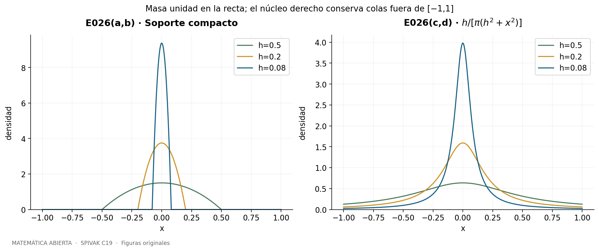
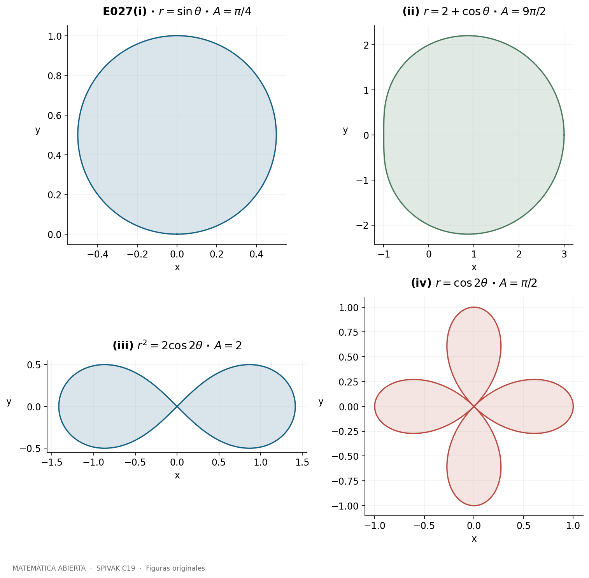
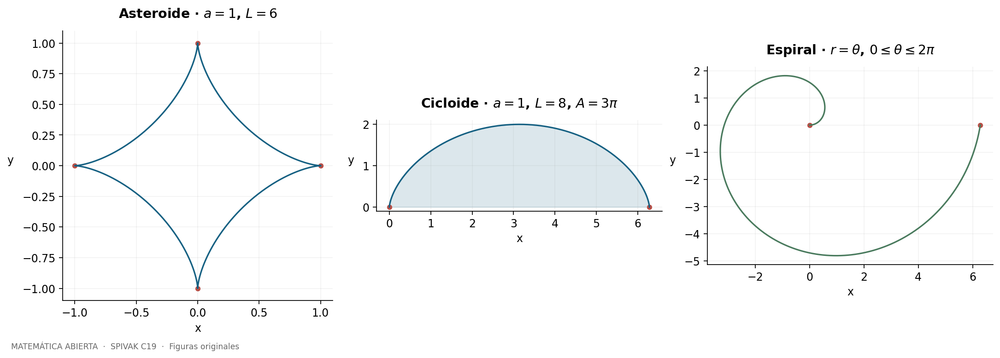
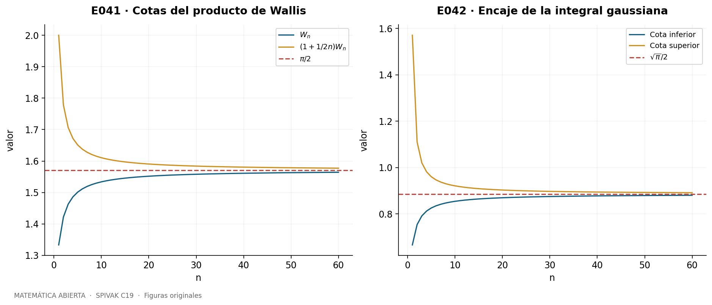
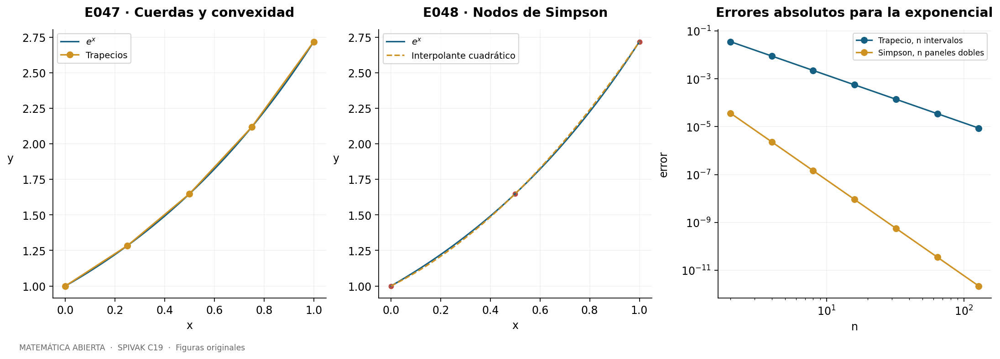
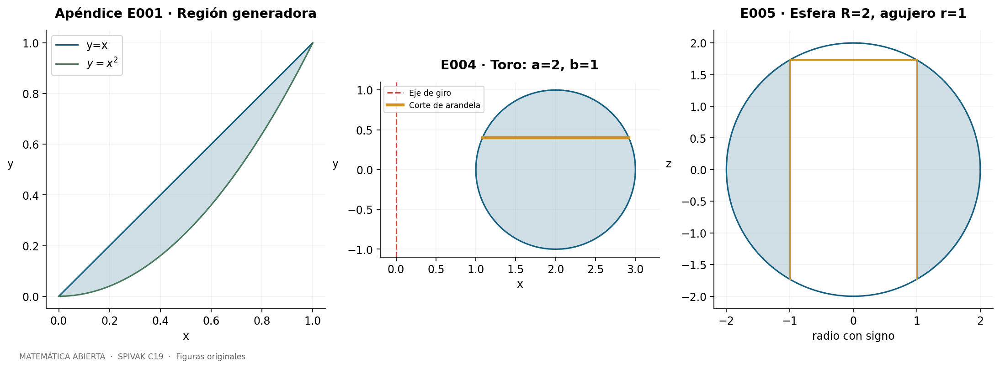
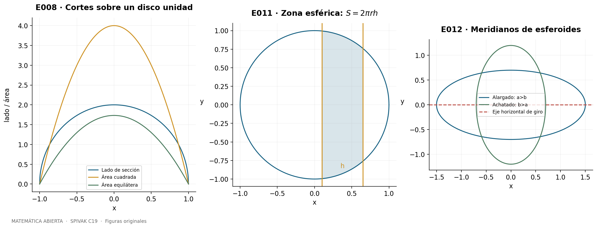
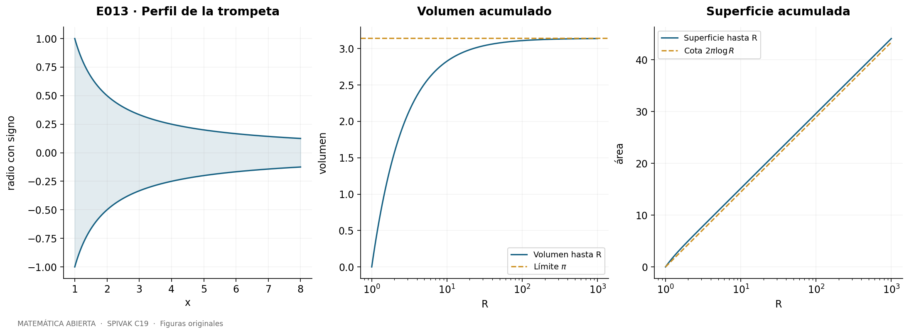

::: {.spivak-nav}

[← Capítulo 18](capitulo-18.qmd) · [Colecciones](../index.qmd#spivak-calculus-cuarta-edición) · [Capítulo 20 →](capitulo-20.qmd)

:::

A. Peña · Matemática Abierta · 2026-10-15.

Soluciones propias de los **49 problemas principales y los 13 del apéndice «La integral cosmopolita»**, con todos sus apartados explícitos. La fuente fija los datos; las explicaciones y figuras se desarrollan aquí en español. La referencia de cada problema permite localizar el enunciado completo sin reproducir su prosa.

Fuente primaria: Michael Spivak, *Calculus*, cuarta edición, pp. 363–408. Problemas principales: pp. 381–401; apéndice: pp. 402–408, ejercicios en 404–408. En el PDF original recuperado para esta entrega, **página PDF = página impresa + 19**. El historial usaba otra paginación digital, con desplazamiento +20; las páginas impresas y la edición siguen siendo la referencia estable. C20 comienza en p. 411 / PDF 430 de esta copia.

## Cómo leer las primitivas {#seccion-798}

Escribimos $\int f(x)\,dx=F(x)+C$ para expresar que $F'=f$ en un intervalo del dominio. La constante es independiente en componentes separados por polos. Una raíz cuadrada siempre es la no negativa: $\sqrt{u^2}=|u|$. Por eso una sustitución trigonométrica necesita una rama donde conozcamos el signo del coseno o de la secante. Los logaritmos de cocientes que pueden ser negativos llevan valor absoluto. Los parámetros se consideran reales; las bases de exponenciales $a^x,b^x$ se suponen positivas.

La sustitución expresa la regla de la cadena en sentido inverso:
$$\int f(g(x))g'(x)\,dx=F(g(x))+C,\qquad F'=f.$$
Para integrales definidas se cambian también los extremos. La fórmula de partes procede de integrar $(uv)'=u'v+uv'$:
$$\int_a^b u'v=[uv]_a^b-\int_a^b uv'.$$
Las hipótesis suficientes habituales son funciones $C^1$; en integrales impropias se aplica primero en intervalos compactos y solo después se toman límites. Ningún paso autoriza restar dos integrales divergentes como si fueran números.

Los primeros diez problemas entrenan estos métodos. Cada solución muestra la transformación que permite obtener su primitiva; las verificaciones por derivación y cuadratura del paquete acompañan, sin reemplazarlas, a las demostraciones.

## E001 — Simplificación algebraica antes de integrar {#e001}

Fuente: Spivak, *Calculus*, 4.ª ed., C19, problema 1, p. 381.

**`SPV4-C19-E001-i`** Para $x>0$, $(\sqrt[5]{x^3}+\sqrt[6]x)/\sqrt x=x^{1/10}+x^{-1/3}$. La regla de potencias da
$$\int\frac{\sqrt[5]{x^3}+\sqrt[6]x}{\sqrt x}dx=\frac{10}{11}x^{11/10}+\frac32x^{2/3}+C.$$

**`SPV4-C19-E001-ii`** El dominio real es $x\ge1$. Multiplicamos por la diferencia de raíces:
$$\frac1{\sqrt{x-1}+\sqrt{x+1}}=\frac{\sqrt{x+1}-\sqrt{x-1}}2.$$
Por tanto la primitiva interior es $[(x+1)^{3/2}-(x-1)^{3/2}]/3+C$. Se prolonga con derivada derecha en 1.

**`SPV4-C19-E001-iii`** Dividir entre $e^{4x}$ transforma la suma en $e^{-3x}+e^{-2x}+e^{-x}$. Su integral es
$$-\frac13e^{-3x}-\frac12e^{-2x}-e^{-x}+C.$$

**`SPV4-C19-E001-iv`** Si $a,b>0$, el cociente es $(a/b)^x$. Si $a\ne b$,
$$\int\frac{a^x}{b^x}dx=\frac{(a/b)^x}{\log(a/b)}+C.$$
Si $a=b$, el integrando es 1 y la respuesta es $x+C$.

**`SPV4-C19-E001-v`** Como $\tan^2x=\sec^2x-1$,
$$\int\tan^2x\,dx=\tan x-x+C,$$
en cada intervalo que no contenga un cero de $\cos x$.

**`SPV4-C19-E001-vi`** Si $a\ne0$, ponemos $A=|a|$ y $u=x/A$. Entonces
$$\int\frac{dx}{a^2+x^2}=\frac1A\arctan(x/A)+C.$$
Si $a=0$, la respuesta es $-1/x+C$ para $x\ne0$.

**`SPV4-C19-E001-vii`** Para $a\ne0$, $A=|a|$ y $u=x/A$ dan
$$\int\frac{dx}{\sqrt{a^2-x^2}}=\arcsin(x/A)+C,\quad |x|<A.$$
Para $a=0$ no existe intervalo real de definición.

**`SPV4-C19-E001-viii`** Donde $\cos x\ne0$, racionalizar da $(1-\sin x)/\cos^2x=\sec^2x-\sec x\tan x$, cuya primitiva es $\tan x-\sec x$. La forma
$$-\frac{\cos x}{1+\sin x}+C$$
es válida en todo el dominio original $1+\sin x\ne0$, incluidos los ceros de coseno con seno 1, donde la forma separada tenía una singularidad removible.

**`SPV4-C19-E001-ix`** La división polinómica da $(8x^2+6x+4)/(x+1)=8x-2+6/(x+1)$. Así la integral es $4x^2-2x+6\log|x+1|+C$, $x\ne-1$.

**`SPV4-C19-E001-x`** Completar el cuadrado da $2x-x^2=1-(x-1)^2$. Con $u=x-1$,
$$\int\frac{dx}{\sqrt{2x-x^2}}=\arcsin(x-1)+C,\quad0<x<2.$$

## E002 — Sustituciones directas {#e002}

Fuente: Spivak, *Calculus*, 4.ª ed., C19, problema 2, p. 381–382.

**`SPV4-C19-E002-i`** Con $u=e^x$, $du=e^x dx$, la integral $\int e^x\sin(e^x)dx$ se convierte en $\int\sin u\,du$. Resultado: $-\cos(e^x)+C$.

**`SPV4-C19-E002-ii`** Con $u=-x^2$, $du=-2x\,dx$, se obtiene $\int xe^{-x^2}dx=-e^{-x^2}/2+C$.

**`SPV4-C19-E002-iii`** Si $u=\log x$, $du=dx/x$, entonces $\int(\log x)/x\,dx=(\log x)^2/2+C$, $x>0$.

**`SPV4-C19-E002-iv`** El denominador es $(1+e^x)^2$. Con $u=1+e^x$ resulta $\int u^{-2}du=-1/u+C$, es decir $-1/(1+e^x)+C$.

**`SPV4-C19-E002-v`** Para $u=e^x$, $\int e^{e^x}e^x dx=\int e^u du=e^{e^x}+C$.

**`SPV4-C19-E002-vi`** Con $u=x^2$, $du=2x\,dx$, se obtiene
$$\int\frac{x\,dx}{\sqrt{1-x^4}}=\frac12\arcsin(x^2)+C,\quad |x|<1.$$

**`SPV4-C19-E002-vii`** Con $u=\sqrt x$, $dx=2u\,du$, $\int e^{\sqrt x}/\sqrt x\,dx=2e^{\sqrt x}+C$ para $x>0$.

**`SPV4-C19-E002-viii`** Si $u=1-x^2$, $du=-2x\,dx$, entonces $\int x\sqrt{1-x^2}dx=-(1-x^2)^{3/2}/3+C$, $|x|<1$; se extiende a los extremos por continuidad.

**`SPV4-C19-E002-ix`** En el dominio literal $\cos x>0$, tomemos $u=\log(\cos x)$, $du=-\tan x\,dx$. La respuesta es $-[\log(\cos x)]^2/2+C$.

**`SPV4-C19-E002-x`** Para $x>1$, $u=\log(\log x)$ tiene diferencial $du=dx/(x\log x)$. Por tanto
$$\int\frac{\log(\log x)}{x\log x}dx=\frac12[\log(\log x)]^2+C.$$

## E003 — Integración por partes {#e003}

Fuente: Spivak, *Calculus*, 4.ª ed., C19, problema 3, p. 382.

**`SPV4-C19-E003-i`** Tomando $u=x^2$, $dv=e^xdx$, y repitiendo partes en el término restante,
$$\int x^2e^xdx=x^2e^x-2\int xe^xdx=e^x(x^2-2x+2)+C.$$

**`SPV4-C19-E003-ii`** Con $t=x^2$, $x^3dx=t\,dt/2$. Una integración por partes da
$$\int x^3e^{x^2}dx=\tfrac12\int te^t dt=\tfrac12e^{x^2}(x^2-1)+C.$$

**`SPV4-C19-E003-iii`** Sean $I=\int e^{ax}\sin bx\,dx$ y $J=\int e^{ax}\cos bx\,dx$. Si $a\ne0$, partes da $I=e^{ax}\sin bx/a-(b/a)J$ y $J=e^{ax}\cos bx/a+(b/a)I$, entendiendo las igualdades hasta constantes. Al resolver,
$$I=\frac{e^{ax}(a\sin bx-b\cos bx)}{a^2+b^2}+C.$$
La fórmula vale también para $a=0,b\ne0$, como se comprueba directamente; si $a=b=0$, el integrando es cero y la primitiva es una constante.

**`SPV4-C19-E003-iv`** Dos integraciones por partes producen
$$\int x^2\sin x\,dx=-x^2\cos x+2\int x\cos x\,dx=-x^2\cos x+2x\sin x+2\cos x+C.$$

**`SPV4-C19-E003-v`** Para $x>0$, partes con $u=(\log x)^3$, $dv=dx$ reduce el exponente:
$$\int(\log x)^3dx=x(\log x)^3-3\int(\log x)^2dx.$$
Repitiendo se obtiene $x[(\log x)^3-3(\log x)^2+6\log x-6]+C$.

**`SPV4-C19-E003-vi`** Con $t=\log x>0$, la integral es $\int\log t\,dt=t\log t-t+C$. Así
$$\int\frac{\log(\log x)}x dx=\log x\log(\log x)-\log x+C,\quad x>1.$$

**`SPV4-C19-E003-vii`** Sea $I=\int\sec^3x\,dx$. Partes con $u=\sec x$, $dv=\sec^2x\,dx$ da
$$I=\sec x\tan x-\int\sec x\tan^2x\,dx=\sec x\tan x-I+\int\sec x\,dx.$$
Luego
$$I=\tfrac12[\sec x\tan x+\log|\sec x+\tan x|]+C.$$
El logaritmo absoluto permite cualquier intervalo sin ceros de coseno.

**`SPV4-C19-E003-viii`** Con $t=\log x$, $dx=e^t dt$, se reduce a $\int e^t\cos t\,dt$. Partes dos veces, como en (iii), da
$$\int\cos(\log x)dx=\frac x2[\cos(\log x)+\sin(\log x)]+C,\quad x>0.$$

**`SPV4-C19-E003-ix`** Tomamos $u=\log x$, $dv=x^{1/2}dx$. Entonces
$$\int\sqrt x\log x\,dx=\frac23x^{3/2}\log x-\frac23\int x^{1/2}dx=\frac23x^{3/2}\log x-\frac49x^{3/2}+C,$$
para $x>0$.

**`SPV4-C19-E003-x`** Partes con $u=(\log x)^2$, $dv=x\,dx$ reduce a $\int x\log x\,dx$. Una segunda aplicación da
$$\int x(\log x)^2dx=\frac{x^2}2\left[(\log x)^2-\log x+\frac12\right]+C,\quad x>0.$$

## E004 — Sustituciones trigonométricas y signos {#e004}

Fuente: Spivak, *Calculus*, 4.ª ed., C19, problema 4, p. 383.

**`SPV4-C19-E004-i`** Tomamos $x=\sin u$ con $-\pi/2<u<\pi/2$, donde $\sqrt{1-x^2}=\cos u>0$ y $dx=\cos u\,du$. La integral se convierte en $\int du$ y resulta $\arcsin x+C$, $|x|<1$.

**`SPV4-C19-E004-ii`** Con $x=\tan u$, $|u|<\pi/2$, $\sqrt{1+x^2}=\sec u>0$ y $dx=\sec^2u\,du$. Se integra $\sec u$, obteniendo
$$\log(x+\sqrt{1+x^2})+C,$$
para todo real $x$; el argumento es siempre positivo.

**`SPV4-C19-E004-iii`** Para $x>1$, ponemos $x=\sec u$, $0<u<\pi/2$. La integral es $\int\sec u\,du$. Para $x<-1$ elegimos $x=-\sec u$ y aparece su opuesto. Ambas respuestas se reúnen en
$$\int\frac{dx}{\sqrt{x^2-1}}=\log|x+\sqrt{x^2-1}|+C,\quad |x|>1.$$

**`SPV4-C19-E004-iv`** Con las mismas ramas $x=\pm\sec u$, $0<u<\pi/2$, el cociente $dx/[x\sqrt{x^2-1}]$ es $du$. Como $\tan u=\sqrt{x^2-1}$,
$$\int\frac{dx}{x\sqrt{x^2-1}}=\arctan\sqrt{x^2-1}+C.$$
Esta elección funciona en los dos componentes; no se reemplaza x por |x| en el integrando.

**`SPV4-C19-E004-v`** Para $x=\sin u$, $|u|<\pi/2$, $u\ne0$, se obtiene $\int\csc u\,du=\log|\tan(u/2)|+C$. Usando $\tan(u/2)=\sin u/(1+\cos u)$,
$$\int\frac{dx}{x\sqrt{1-x^2}}=\log\left|\frac{x}{1+\sqrt{1-x^2}}\right|+C,\quad 0<|x|<1.$$

**`SPV4-C19-E004-vi`** Con $x=\tan u$, $|u|<\pi/2$, el integrando pasa a $\csc u\,du$. Por tanto
$$\int\frac{dx}{x\sqrt{1+x^2}}=\log\left|\frac{x}{1+\sqrt{1+x^2}}\right|+C,\quad x\ne0.$$

**`SPV4-C19-E004-vii`** Con $x=\sin u$, la integral pasa a $\int\sin^3u\cos^2u\,du$. Poniendo $v=\cos u$, resulta $-\int(v^2-v^4)dv$, luego
$$\int x^3\sqrt{1-x^2}dx=-\frac{(1-x^2)^{3/2}}3+\frac{(1-x^2)^{5/2}}5+C,$$
para $|x|<1$. También se obtiene directamente con $v=\sqrt{1-x^2}$.

**`SPV4-C19-E004-viii`** Para $x=\sin u$, se integra $\cos^2u=(1+\cos2u)/2$. Así
$$\int\sqrt{1-x^2}dx=\frac12[x\sqrt{1-x^2}+\arcsin x]+C,\quad |x|<1.$$

**`SPV4-C19-E004-ix`** Con $x=\tan u$ se integra $\sec^3u$. E003(vii) da
$$\int\sqrt{1+x^2}dx=\frac12[x\sqrt{1+x^2}+\log(x+\sqrt{1+x^2})]+C,$$
en toda la recta.

**`SPV4-C19-E004-x`** Con $x=\sec u$ en la rama positiva se integra $\sec^3u-\sec u$; con $x=-\sec u$ se conserva el signo correspondiente. El resultado común es
$$\int\sqrt{x^2-1}dx=\frac12[x\sqrt{x^2-1}-\log|x+\sqrt{x^2-1}|]+C,\quad |x|>1.$$

## E005 — Sustituciones compuestas {#e005}

Fuente: Spivak, *Calculus*, 4.ª ed., C19, problema 5, p. 383–384.

**`SPV4-C19-E005-i`** Sea $u=\sqrt{x+1}$, $dx=2u\,du$. Como $2u/(1+u)=2-2/(1+u)$,
$$\int\frac{dx}{1+\sqrt{x+1}}=2\sqrt{x+1}-2\log(1+\sqrt{x+1})+C,$$
para $x>-1$, con extensión al extremo.

**`SPV4-C19-E005-ii`** Con $u=e^x$, $dx=du/u$, se obtiene $\int[1/u-1/(1+u)]du$. La respuesta es $x-\log(1+e^x)+C$.

**`SPV4-C19-E005-iii`** Para $x>0$, $u=x^{1/6}$ da $\sqrt x=u^3$, $\sqrt[3]x=u^2$, $dx=6u^5du$. La integral es
$$6\int\frac{u^3}{u+1}du=2u^3-3u^2+6u-6\log(u+1)+C.$$
Sustituir $u=x^{1/6}$ termina el cálculo.

**`SPV4-C19-E005-iv`** Con $u=\sqrt{1+e^x}>1$, $dx=2u\,du/(u^2-1)$. El factor $u$ se cancela y
$$\int\frac{dx}{\sqrt{1+e^x}}=\log\frac{\sqrt{1+e^x}-1}{\sqrt{1+e^x}+1}+C.$$

**`SPV4-C19-E005-v`** Con $u=\tan x$, $dx=du/(1+u^2)$,
$$\frac1{(u+2)(u^2+1)}=\frac1{5(u+2)}+\frac{-u+2}{5(u^2+1)}.$$
La primitiva es $\frac15\log|u+2|-\frac1{10}\log(1+u^2)+\frac25\arctan u+C$. En cada intervalo del dominio original también se escribe
$$\frac15\log|2\cos x+\sin x|+\frac25x+C.$$
Esta última forma se extiende a algunos puntos donde la expresión original con tan no está definida; tales puntos siguen excluidos del problema.

**`SPV4-C19-E005-vi`** Para $u=\sqrt{\sqrt x+1}$, $\sqrt x=u^2-1$, $dx=4u(u^2-1)du$. Por tanto
$$\int\frac{dx}{\sqrt{\sqrt x+1}}=\frac43u^3-4u+C=\frac43(\sqrt x+1)^{3/2}-4\sqrt{\sqrt x+1}+C,$$
para $x>0$, y por extensión derecha en 0.

**`SPV4-C19-E005-vii`** Sea $u=2^x>0$, $dx=du/(u\log2)$. Entonces
$$\frac{u^2+1}{u(u+1)}=1+\frac1u-\frac2{u+1}.$$
Así $\int(4^x+1)/(2^x+1)dx=2^x/\log2+x-2\log(1+2^x)/\log2+C$.

**`SPV4-C19-E005-viii`** Con $u=\sqrt x$, $dx=2u\,du$, partes da $\int e^{\sqrt x}dx=2e^{\sqrt x}(\sqrt x-1)+C$ para $x>0$, con extensión derecha en 0.

**`SPV4-C19-E005-ix`** Para $0<x<1$, sea $u=\sqrt x$. El integrando por $dx$ se vuelve $2u(1+u)du/\sqrt{1-u^2}$. Separamos las potencias $u$ y $u^2$ y usamos E004(viii):
$$\int\frac{\sqrt{1-x}}{1-\sqrt x}dx=\arcsin\sqrt x-(\sqrt x+2)\sqrt{1-x}+C.$$
La función original está definida en 0 y admite la correspondiente derivada derecha; no en 1.

**`SPV4-C19-E005-x`** El dominio interior es $x>1$ o $x<-1$. Con $u=1/x$, $dx/x^2=-du$, y $\sqrt{(x-1)/(x+1)}=(1-u)/\sqrt{1-u^2}$, se obtiene
$$\int\sqrt{\frac{x-1}{x+1}}\frac{dx}{x^2}=-\arcsin(1/x)-\sqrt{1-1/x^2}+C.$$
En $x=1$ el integrando tiene valor cero y se admite extensión derecha; $x=-1$ está excluido.

## E006 — Fracciones parciales {#e006}

Fuente: Spivak, *Calculus*, 4.ª ed., C19, problema 6, p. 384.

**`SPV4-C19-E006-i`** El denominador factoriza $(x-1)(x+1)^2$. La identidad
$$\frac{2x^2+7x-1}{(x-1)(x+1)^2}=\frac2{x-1}+\frac3{(x+1)^2}$$
se comprueba multiplicando por el denominador. La primitiva es $2\log|x-1|-3/(x+1)+C$.

**`SPV4-C19-E006-ii`** Como $x^3-3x^2+3x-1=(x-1)^3$ y $2x+1=2(x-1)+3$,
$$\int\frac{2x+1}{(x-1)^3}dx=-\frac2{x-1}-\frac3{2(x-1)^2}+C.$$

**`SPV4-C19-E006-iii`** La descomposición exacta es
$$\frac{x^3+7x^2-5x+5}{(x-1)^2(x+1)^3}=\frac1{(x-1)^2}+\frac4{(x+1)^3}.$$
Integrar cada potencia da $-1/(x-1)-2/(x+1)^2+C$.

**`SPV4-C19-E006-iv`** Al igualar numeradores se obtiene
$$\frac{2x^2+x+1}{(x+3)(x-1)^2}=\frac1{x+3}+\frac1{x-1}+\frac1{(x-1)^2}.$$
La integral es $\log|x+3|+\log|x-1|-1/(x-1)+C$.

**`SPV4-C19-E006-v`** Separar la derivada del denominador da
$$\int\frac{x+4}{x^2+1}dx=\frac12\log(1+x^2)+4\arctan x+C.$$

**`SPV4-C19-E006-vi`** Como $(x^3+x+2)/(x^2+1)^2=x/(x^2+1)+2/(x^2+1)^2$, E010(i), con $a=1$, da
$$\frac12\log(1+x^2)+\frac{x}{1+x^2}+\arctan x+C.$$

**`SPV4-C19-E006-vii`** El denominador es $(x+1)(x^2+x+1)$ y la fracción se descompone en $1/(x+1)+2x/(x^2+x+1)$. Escribiendo $2x=(2x+1)-1$ y completando el cuadrado,
$$\int\frac{3x^2+3x+1}{x^3+2x^2+2x+1}dx=\log|x+1|+\log(x^2+x+1)-\frac2{\sqrt3}\arctan\frac{2x+1}{\sqrt3}+C.$$

**`SPV4-C19-E006-viii`** Definamos $q_\pm=x^2\pm\sqrt2x+1$. La factorización $x^4+1=q_+q_-$ lleva a
$$\frac1{x^4+1}=\frac{x/(2\sqrt2)+1/2}{q_+}+\frac{-x/(2\sqrt2)+1/2}{q_-}.$$
Integrando las derivadas logarítmicas y los cuadrados completos resulta
$$\frac1{4\sqrt2}\log\frac{q_+}{q_-}+\frac1{2\sqrt2}[\arctan(\sqrt2x+1)+\arctan(\sqrt2x-1)]+C.$$
Los dos cuadráticos son positivos; mantener las dos arctangentes evita saltos de rama.

**`SPV4-C19-E006-ix`** Sea $Q=x^2+x+1$ y $J_n=\int dx/Q^n$, con una elección de constante. Como $2x=Q'-1$, la integral pedida es $-1/Q-J_2$. Completar $Q=(x+1/2)^2+3/4$ da
$$J_1=\frac2{\sqrt3}\arctan\frac{2x+1}{\sqrt3},\qquad J_2=\frac{2x+1}{3Q}+\frac23J_1.$$
Por tanto la respuesta explícita es $-1/Q-(2x+1)/(3Q)-(2/3)J_1+C$. La fórmula de $J_2$ se verifica derivando o mediante la reducción de E021.

**`SPV4-C19-E006-x`** Con $Q,J_1,J_2$ como en (ix), $3x=\frac32(Q'-1)$ da $-3/(4Q^2)-\frac32J_3$. La misma reducción produce
$$J_3=\frac{2x+1}{6Q^2}+J_2.$$
Así la respuesta completamente determinada es
$$-\frac3{4Q^2}-\frac{2x+1}{4Q^2}-\frac{2x+1}{2Q}-\frac2{\sqrt3}\arctan\frac{2x+1}{\sqrt3}+C.$$
En (ix) y (x), $Q>0$ en toda la recta.

## E007 — Una potencia bajo la raíz {#e007}

Fuente: Spivak, *Calculus*, 4.ª ed., C19, problema 7, p. 385.

**`SPV4-C19-E007`** En el semieje positivo, para $n\ne2$, pongamos $p=n-2$ y consideremos un intervalo donde $x^p>1$. Entonces $\sqrt{x^n-x^2}=x\sqrt{x^p-1}$. Con $u=\sqrt{x^p-1}$,
$$\frac{dx}{x\sqrt{x^p-1}}=\frac2p\frac{du}{1+u^2}.$$
Una primitiva es
$$\frac2{n-2}\arctan\sqrt{x^{n-2}-1}+C.$$
La segunda sugerencia del original, $y=x^{-p/2}$, da $dx/(x\sqrt{x^p-1})=-(2/p)dy/\sqrt{1-y^2}$ y la forma equivalente
$$-\frac2{n-2}\arcsin\left(x^{1-n/2}\right)+C.$$
Ambas difieren en una constante porque $\arctan u+\arcsin(1/\sqrt{1+u^2})=\pi/2$ para $u>0$.

Para $n$ entero positivo: si $n=1$, el dominio es $0<x<1$; si $n=2$, no hay dominio porque el radicando es idénticamente cero; si $n\ge3$ impar, solo hay $x>1$; si $n\ge4$ par, hay además $x<-1$. En esta última rama la raíz exterior contiene $|x|$, y una primitiva es
$$\frac{2\operatorname{sgn}x}{n-2}\arctan\sqrt{|x|^{n-2}-1}+C.$$
El signo importa: factorizar la raíz como x por otra raíz no es válido para x negativo. Para exponentes reales se mantiene la versión $x>0$ y la condición explícita sobre el radicando.

## E008 — Combinación de métodos {#e008}

Fuente: Spivak, *Calculus*, 4.ª ed., C19, problema 8, p. 385.

**`SPV4-C19-E008-i`** Con $u=\arctan x$, $du=dx/(1+x^2)$, se obtiene $\int\arctan x/(1+x^2)dx=(\arctan x)^2/2+C$.

**`SPV4-C19-E008-ii`** Partes con $u=\arctan x$, $dv=x\,dx/(1+x^2)^2$, da $v=-1/[2(1+x^2)]$. Por E010(i),
$$\int\frac{x\arctan x}{(1+x^2)^2}dx=-\frac{\arctan x}{2(1+x^2)}+\frac{x}{4(1+x^2)}+\frac14\arctan x+C.$$

**`SPV4-C19-E008-iii`** Como $\log\sqrt{1+x^2}=\frac12\log(1+x^2)$, partes reduce a $\int x^2/(1+x^2)dx=x-\arctan x$. Resultado:
$$\frac x2\log(1+x^2)-x+\arctan x+C.$$

**`SPV4-C19-E008-iv`** Con $u=1+x^2$, $du=2x\,dx$, se tiene $\int x\log\sqrt{1+x^2}dx=\frac14\int\log u\,du$, por lo que la respuesta es $[(1+x^2)\log(1+x^2)-(1+x^2)]/4+C$.

**`SPV4-C19-E008-v`** Sea $u=\sqrt2x/(1+x^2)$. Entonces
$$u'=\frac{\sqrt2(1-x^2)}{(1+x^2)^2},\qquad\sqrt{1-u^2}=\frac{\sqrt{1+x^4}}{1+x^2}.$$
La integral se transforma exactamente en $-\frac1{\sqrt2}\int du/\sqrt{1-u^2}$ y vale
$$-\frac1{\sqrt2}\arcsin\frac{\sqrt2x}{1+x^2}+C.$$
El argumento tiene módulo a lo sumo $1/\sqrt2$; no hay cambio de rama ni singularidad en cero. Aunque la sustitución no es inyectiva globalmente, la identidad de derivadas valida la primitiva en toda la recta.

**`SPV4-C19-E008-vi`** Para $0<x<1$, partes con $u=\arcsin\sqrt x$ da $x\arcsin\sqrt x-\frac12\int\sqrt x/\sqrt{1-x}\,dx$. Con $x=\sin^2t$, la última integral es $t-\sin t\cos t$. Por tanto
$$\int\arcsin\sqrt x\,dx=(x-\tfrac12)\arcsin\sqrt x+\tfrac12\sqrt{x(1-x)}+C.$$
Se extiende a los extremos por continuidad y derivadas laterales.

**`SPV4-C19-E008-vii`** Usamos la primitiva $H=-\cos x/(1+\sin x)$ de E001(viii). Partes da $xH-\int Hdx$; como $\int Hdx=-\log(1+\sin x)$,
$$\int\frac{x}{1+\sin x}dx=-\frac{x\cos x}{1+\sin x}+\log(1+\sin x)+C.$$
Es válida en cada componente del dominio literal, incluidos los puntos con seno 1.

**`SPV4-C19-E008-viii`** Separar el numerador deja $e^{\sin x}[x\cos x-\sin x/\cos^2x]$. Es la derivada de un producto:
$$\frac{d}{dx}\{e^{\sin x}(x-\sec x)\}=e^{\sin x}\left[x\cos x-\frac{\sin x}{\cos^2x}\right].$$
La primitiva es, por tanto, $e^{\sin x}(x-\sec x)+C$, con $\cos x\ne0$.

**`SPV4-C19-E008-ix`** En un intervalo donde $\tan x>0$, ponemos $u=\sqrt{\tan x}$: $dx=2u\,du/(1+u^4)$. La integral es $\int2u^2du/(1+u^4)$. Con $q_\pm=u^2\pm\sqrt2u+1$,
$$\frac{2u^2}{1+u^4}=\frac u{\sqrt2}\left(\frac1{q_-}-\frac1{q_+}\right).$$
Integrando los dos cuadráticos se obtiene
$$\frac1{2\sqrt2}\log\frac{q_-}{q_+}+\frac1{\sqrt2}[\arctan(\sqrt2u-1)+\arctan(\sqrt2u+1)]+C.$$
Se sustituye $u=\sqrt{\tan x}$. En los extremos con tan cero, la primitiva admite extensión lateral.

**`SPV4-C19-E008-x`** Factorizamos $x^6+1=(x^2+1)q_+q_-$, $q_\pm=x^2\pm\sqrt3x+1$. Igualar numeradores da
$$\frac1{x^6+1}=\frac1{3(x^2+1)}+\frac{\sqrt3x+2}{6q_+}+\frac{-\sqrt3x+2}{6q_-}.$$
Completar los cuadrados $q_\pm=(x\pm\sqrt3/2)^2+1/4$ y separar sus derivadas da
$$\frac13\arctan x+\frac{\sqrt3}{12}\log\frac{q_+}{q_-}+\frac16[\arctan(2x+\sqrt3)+\arctan(2x-\sqrt3)]+C.$$
Las arctangentes separadas y los cuadráticos positivos hacen válida la fórmula en toda la recta.

## E009 — Más práctica de álgebra y partes {#e009}

Fuente: Spivak, *Calculus*, 4.ª ed., C19, problema 9, p. 385–386.

**`SPV4-C19-E009-i`** Para $A=|a|>0$, partes da $x\log(a^2+x^2)-2\int x^2/(a^2+x^2)dx$. Escribiendo $x^2/(A^2+x^2)=1-A^2/(A^2+x^2)$,
$$\int\log(a^2+x^2)dx=x\log(a^2+x^2)-2x+2A\arctan(x/A)+C.$$
Si $a=0$, vale $2x\log|x|-2x+C$ en cada semieje.

**`SPV4-C19-E009-ii`** Separamos $(1+\cos x)/\sin^2x=\csc^2x+\csc x\cot x$. Su primitiva es $-\cot x-\csc x+C$, en intervalos sin ceros de seno.

**`SPV4-C19-E009-iii`** Separando el numerador, la primera parte se integra con $u=4-x^2$ y la segunda con $x=2\sin t$:
$$\int\frac{x+1}{\sqrt{4-x^2}}dx=-\sqrt{4-x^2}+\arcsin(x/2)+C,\quad |x|<2.$$

**`SPV4-C19-E009-iv`** Partes con $u=\arctan x$, $dv=x\,dx$ da $x^2\arctan x/2-\frac12\int x^2/(1+x^2)dx$. La respuesta es $(x^2+1)\arctan x/2-x/2+C$.

**`SPV4-C19-E009-v`** Escribimos $\sin^3x=\sin x(1-\cos^2x)$. Con $u=\cos x$, $du=-\sin x\,dx$, resulta $-\cos x+\cos^3x/3+C$.

**`SPV4-C19-E009-vi`** El mismo cambio $u=\cos x$ transforma $\sin^3x/\cos^2x\,dx$ en $-(u^{-2}-1)du$. La primitiva es $\sec x+\cos x+C$, con coseno no nulo.

**`SPV4-C19-E009-vii`** Partes da $x^3\arctan x/3-\frac13\int x^3/(1+x^2)dx$. Como $x^3/(1+x^2)=x-x/(1+x^2)$,
$$\int x^2\arctan x\,dx=\frac{x^3}3\arctan x-\frac{x^2}6+\frac16\log(1+x^2)+C.$$

**`SPV4-C19-E009-viii`** Pongamos $u=x-1$. El radicando es $u^2+1$ y el numerador $u+1$. Separar da
$$\int\frac{x\,dx}{\sqrt{x^2-2x+2}}=\sqrt{x^2-2x+2}+\log(x-1+\sqrt{x^2-2x+2})+C.$$
El argumento del logaritmo es positivo para todo x.

**`SPV4-C19-E009-ix`** Con $u=\sec x$, $du=\sec x\tan x\,dx$, la integral $\int\sec^3x\tan x\,dx$ es $\int u^2du=\sec^3x/3+C$.

**`SPV4-C19-E009-x`** Usamos $\tan^2x=\sec^2x-1$. Partes en $\int x\sec^2x\,dx$ da $x\tan x-\int\tan x\,dx$, por lo que
$$\int x\tan^2x\,dx=x\tan x+\log|\cos x|-\frac{x^2}2+C.$$

## E010 — Raíces, inversas y sustituciones {#e010}

Fuente: Spivak, *Calculus*, 4.ª ed., C19, problema 10, p. 386.

**`SPV4-C19-E010-i`** Para $A=|a|>0$, tomamos $x=A\tan u$. La integral se convierte en $A^{-3}\int\cos^2u\,du$, luego
$$\int\frac{dx}{(a^2+x^2)^2}=\frac{x}{2A^2(A^2+x^2)}+\frac1{2A^3}\arctan(x/A)+C.$$
Si $a=0$, la primitiva es $-1/(3x^3)+C$, $x\ne0$.

**`SPV4-C19-E010-ii`** La identidad $1-\sin x=(\cos(x/2)-\sin(x/2))^2$ implica
$$\sqrt{1-\sin x}=|\cos(x/2)-\sin(x/2)|.$$
En un intervalo entre ceros consecutivos, sea $\varepsilon$ el signo de esa diferencia. Una primitiva local es $2\varepsilon[\sin(x/2)+\cos(x/2)]+C$. Los ceros son $x=\pi/2+2k\pi$ y las constantes se eligen para que las piezas coincidan allí; las derivadas laterales valen cero y se obtiene una primitiva global $C^1$. Una fórmula global explícita es: si $T=(x-\pi/2)/2$, $k=\lfloor T/\pi\rfloor$,
$$F(x)=2\sqrt2[2k+1-\cos(T-k\pi)].$$
Las dos fórmulas vecinas tienen el mismo valor en cada frontera. Omitir el valor absoluto daría una respuesta errónea en la mitad de los intervalos.

**`SPV4-C19-E010-iii`** Con $u=\sqrt x$, $dx=2u\,du$, partes da $u^2\arctan u-\int u^2/(1+u^2)du$. Así
$$\int\arctan\sqrt x\,dx=(x+1)\arctan\sqrt x-\sqrt x+C,\quad x>0,$$
con extensión derecha en cero.

**`SPV4-C19-E010-iv`** Sea $u=\sqrt{x+1}$, $dx=2u\,du$. Partes en $2\int u\sin u\,du$ da
$$\int\sin\sqrt{x+1}\,dx=2[\sin\sqrt{x+1}-\sqrt{x+1}\cos\sqrt{x+1}]+C,$$
para $x>-1$, con extensión derecha al extremo.

**`SPV4-C19-E010-v`** Para $x>\sqrt[3]2$, $u=\sqrt{x^3-2}$ da $dx/x=2u\,du/[3(u^2+2)]$. Por tanto
$$\int\frac{\sqrt{x^3-2}}x dx=\frac23\left[\sqrt{x^3-2}-\sqrt2\arctan\frac{\sqrt{x^3-2}}{\sqrt2}\right]+C.$$
La respuesta se prolonga al extremo $x=\sqrt[3]2$.

**`SPV4-C19-E010-vi`** El dominio real del logaritmo literal es $x\ge1$. En $x>1$ su derivada es $1/\sqrt{x^2-1}$; partes da
$$\int\log(x+\sqrt{x^2-1})dx=x\log(x+\sqrt{x^2-1})-\sqrt{x^2-1}+C.$$
Comparación con la sustitución: $x=\cosh u$, $u\ge0$, transforma la integral en $\int u\sinh u\,du=u\cosh u-\sinh u+C$, exactamente la misma fórmula.

**`SPV4-C19-E010-vii`** Para $x>0$, partes da $x\log(x+\sqrt x)-\int x\,d\log(x+\sqrt x)$. Si $u=\sqrt x$, el último integrando es
$$\frac{u(2u+1)}{u+1}du=\left(2u-1+\frac1{u+1}\right)du.$$
Por tanto la primitiva es
$$x\log(x+\sqrt x)-x+\sqrt x-\log(1+\sqrt x)+C.$$
Como alternativa, sustituir primero $x=u^2$ da $2\int u[\log u+\log(u+1)]du$; partes en ambos sumandos lleva a la misma expresión.

**`SPV4-C19-E010-viii`** Usamos la raíz quinta real $u=\sqrt[5]x$, $dx=5u^4du$. Entonces
$$\int\frac{dx}{x-x^{3/5}}=5\int\frac{u}{u^2-1}du=\frac52\log|x^{2/5}-1|+C.$$
El dominio original excluye $x=-1,0,1$; la raíz de orden impar se interpreta también para negativos. No se reintroduce el cero por simplificar el cociente.

**`SPV4-C19-E010-ix`** Partes, seguida de $t=\arcsin x$, da
$$\int(\arcsin x)^2dx=x(\arcsin x)^2-2\int\frac{x\arcsin x}{\sqrt{1-x^2}}dx.$$
La integral restante es $\int t\sin t\,dt=-t\cos t+\sin t$. Resultado:
$$x(\arcsin x)^2+2\arcsin x\sqrt{1-x^2}-2x+C,\quad |x|<1.$$

**`SPV4-C19-E010-x`** Sea $u=x^2$, de modo que $x^5dx=u^2du/2$. Partes da $u^3\arctan u/6-\frac16\int u^3/(1+u^2)du$. Dividir $u^3/(1+u^2)=u-u/(1+u^2)$ da
$$\int x^5\arctan(x^2)dx=\frac{x^6}6\arctan(x^2)-\frac{x^4}{12}+\frac1{12}\log(1+x^4)+C.$$

## E011 — Sustituciones hiperbólicas {#e011}

Fuente: Spivak, *Calculus*, 4.ª ed., C19, problema 11, p. 386.

**`SPV4-C19-E011`** Las sustituciones hiperbólicas ofrecen otra derivación de E004. Si $x=\sinh u$, entonces $dx=\cosh u\,du$ y $\sqrt{1+x^2}=\cosh u$. Así E004(ii), (vi) y (ix) se transforman, respectivamente, en
$$\int du=u,\qquad\int\operatorname{csch}u\,du=\log|\tanh(u/2)|,\qquad\int\cosh^2u\,du=\tfrac12(u+\sinh u\cosh u).$$
Al volver a x, son las tres respuestas ya dadas. La fórmula de csch se deriva de $\tanh(u/2)=\sinh u/(1+\cosh u)$ y diferenciación logarítmica.

Si $x=\varepsilon\cosh u$, $u>0$, $\varepsilon=\pm1$, la raíz $\sqrt{x^2-1}=\sinh u$ es positiva y $dx=\varepsilon\sinh u\,du$. E004(iii), (iv) y (x) se convierten en
$$\varepsilon\int du,\qquad\int\operatorname{sech}u\,du=\arctan(\sinh u),\qquad\varepsilon\int\sinh^2u\,du=\tfrac\varepsilon2(\sinh u\cosh u-u).$$
Esto cubre también la rama negativa y reproduce los logaritmos absolutos de E004.

Para cubrir las cuatro integrales restantes, con raíz $\sqrt{1-x^2}$, puede usarse $x=\tanh u$, $dx=\operatorname{sech}^2u\,du$ y $\sqrt{1-x^2}=\operatorname{sech}u$. E004(i), (v), (vii) y (viii) se transforman en
$$\int\operatorname{sech}u\,du,\quad \int\operatorname{csch}u\,du,\quad\int\tanh^3u\operatorname{sech}^3u\,du,\quad\int\operatorname{sech}^3u\,du.$$
Sus primitivas son, en ese orden,
$$\arctan(\sinh u),\quad\log|\tanh(u/2)|,\quad-\frac{\operatorname{sech}^3u}{3}+\frac{\operatorname{sech}^5u}{5},\quad\frac{\operatorname{sech}u\tanh u+\arctan(\sinh u)}2.$$
La tercera sale con $v=\operatorname{sech}u$ y la última por partes; sus derivadas dan los integrandos anteriores. Como $\arctan(\sinh u)=\arcsin(\tanh u)$, al volver a x se recuperan exactamente las fórmulas de E004. Quedan así tratadas las diez tareas, aunque para la raíz $1-x^2$ la sustitución trigonométrica es más corta.

## E012 — Racionalización mediante el ángulo mitad {#e012}

Fuente: Spivak, *Calculus*, 4.ª ed., C19, problema 12, p. 386–387.

**`SPV4-C19-E012-i`** La sustitución $t=\tan(x/2)$, en un intervalo que no contenga un polo suyo, da $dx=2dt/(1+t^2)$, $\sin x=2t/(1+t^2)$ y $\cos x=(1-t^2)/(1+t^2)$. Así
$$\int\frac{dx}{1+\sin x}=2\int\frac{dt}{(t+1)^2}=-\frac2{1+\tan(x/2)}+C.$$
La primitiva de E001(viii) es $(t-1)/(t+1)=1-2/(t+1)$: difieren en 1. Los polos introducidos por la carta $\tan(x/2)$ se superan cambiando de carta y ajustando la constante si el integrando original es regular.

**`SPV4-C19-E012-ii`** Como $1-\sin^2x=\cos^2x$, basta $t=\tan x$, que da directamente $\int dt=\tan x+C$. El ángulo mitad también funciona: produce $2\int(1+t^2)/(1-t^2)^2dt=2t/(1-t^2)+C$, la misma tangente. El cambio más simple reconoce ya la derivada de tan.

**`SPV4-C19-E012-iii`** Si $(a,b)\ne(0,0)$, el ángulo mitad transforma la integral en
$$2\int\frac{dt}{b+2at-bt^2}.$$
Para $b\ne0$, sean $R=\sqrt{a^2+b^2}$ y $v=bt-a$. Se obtiene $2\int dv/(R^2-v^2)$ y la respuesta
$$\frac1R\log\left|\frac{R+bt-a}{R-bt+a}\right|+C.$$
Para $b=0$, $a\ne0$, el resultado es $\log|t|/a+C$. Una segunda vía elige $\delta$ con $\cos\delta=a/R$, $\sin\delta=b/R$; entonces $a\sin x+b\cos x=R\sin(x+\delta)$ y una forma común es $R^{-1}\log|\tan((x+\delta)/2)|+C$. Si $a=b=0$ no hay integrando definido. Las fórmulas se usan donde el denominador original no sea cero.

**`SPV4-C19-E012-iv`** El ángulo mitad da $\int8t^2/(1+t^2)^3dt$. Para integrarlo sin perder su origen, se descompone
$$\frac{8t^2}{(1+t^2)^3}=\frac8{(1+t^2)^2}-\frac8{(1+t^2)^3}.$$
La reducción racional de E021 produce $\arctan t-t(1-t^2)/(1+t^2)^2+C$. En una carta, $\arctan t=x/2$ hasta una constante, y $2t(1-t^2)/(1+t^2)^2=\sin2x/2$. Por tanto resulta $x/2-\sin2x/4+C$, como también da directamente la identidad de ángulo doble.

**`SPV4-C19-E012-v`** Ahora el denominador racional es $3t^2+10t+3=3(t+1/3)(t+3)$. Entonces
$$\int\frac{dx}{3+5\sin x}=\frac14\log\left|\frac{t+1/3}{t+3}\right|+C,\quad t=\tan(x/2).$$
La fórmula se aplica por cartas, ajustando constantes al atravesar sus polos artificiales; los ceros de $3+5\sin x$ sí separan componentes del dominio.

## E013 — Dos derivaciones de la integral de secante {#e013}

Fuente: Spivak, *Calculus*, 4.ª ed., C19, problema 13, p. 387–388.

**`SPV4-C19-E013-a`** Escribimos $\sec x=\cos x/(1-\sin^2x)$. Con $u=\sin x$,
$$\int\sec x\,dx=\frac12\int\left(\frac1{1+u}+\frac1{1-u}\right)du=\frac12\log\frac{1+\sin x}{1-\sin x}+C.$$
Donde coseno no es cero, los dos argumentos del último cociente son positivos. Puesto que $(1+\sin x)/(1-\sin x)=(\sec x+\tan x)^2$, la respuesta es $\log|\sec x+\tan x|+C$. El valor absoluto es necesario en intervalos con coseno negativo.

**`SPV4-C19-E013-b`** Con $t=\tan(x/2)$ se obtiene $2\int dt/(1-t^2)=\log|(1+t)/(1-t)|+C$. La identidad de suma de tangentes identifica el cociente con $\tan(x/2+\pi/4)$, y también con $\sec x+\tan x$. Así
$$\int\sec x\,dx=\log|\tan(x/2+\pi/4)|+C.$$
Las igualdades se entienden en cartas que evitan polos y luego por continuidad donde el integrando sea regular. No se omiten los valores absolutos por una elección local de rama.

## E014 — Dónde aparece la constante de integración {#e014}

Fuente: Spivak, *Calculus*, 4.ª ed., C19, problema 14, p. 388.

**`SPV4-C19-E014`** Una integral indefinida designa una familia de primitivas, no un número fijo. Si elegimos una primitiva concreta $I$ de $e^x\sin x$, las dos integraciones por partes solo implican
$$I(x)=e^x\sin x-e^x\cos x-I(x)+K,$$
para alguna constante K, porque ambos lados tienen la misma derivada. Al despejar,
$$I(x)=\frac{e^x(\sin x-\cos x)}2+\frac K2.$$
La constante arbitraria es $C=K/2$. También puede fijarse una base $x_0$, escribir todas las integrales como $\int_{x_0}^x$ y conservar las evaluaciones de borde. El término en $x_0$ produce esa constante. Igualar dos apariciones de una familia sin registrar sus elecciones de constante era el paso que parecía imponer $C=0$.

## E015 — Una integral que solo depende de los extremos {#e015}

Fuente: Spivak, *Calculus*, 4.ª ed., C19, problema 15, p. 388.

**`SPV4-C19-E015`** Observamos que
$$\frac{d}{dx}[f'(x)\sin x-f(x)\cos x]=[f''(x)+f(x)]\sin x.$$
Con $f''$ continua, el teorema fundamental da
$$2=[f'\sin x-f\cos x]_0^\pi=f(\pi)+f(0).$$
Como $f(\pi)=1$, necesariamente $\boxed{f(0)=1}$. La identidad puede obtenerse igualmente mediante partes dos veces; no requiere conocer $f$ en el interior.

## E016 — Integración de una función inversa {#e016}

Fuente: Spivak, *Calculus*, 4.ª ed., C19, problema 16, p. 388.

**`SPV4-C19-E016-a`** Partes con $u=\arcsin x$, $dv=dx$ da
$$\int\arcsin x\,dx=x\arcsin x-\int\frac{x\,dx}{\sqrt{1-x^2}}=x\arcsin x+\sqrt{1-x^2}+C,$$
para $|x|<1$, con extensión continua a los extremos.

**`SPV4-C19-E016-b`** Sea $f$ una biyección $C^1$ entre intervalos, con $f'\ne0$, y $F'=f$. Si $u=f^{-1}(x)$, entonces $dx=f'(u)du$. Partes produce
$$\int f^{-1}(x)dx=\int uf'(u)du=uf(u)-F(u)+C=x f^{-1}(x)-F(f^{-1}(x))+C.$$
La prueba se adapta a funciones continuas estrictamente monótonas usando áreas orientadas, sin exigir una inversa derivable en cada punto. En forma definida,
$$\int_{f(a)}^{f(b)}f^{-1}(x)dx=b f(b)-a f(a)-\int_a^b f(t)dt.$$
La orientación incluye funciones decrecientes. Esta es la identidad de áreas complementarias de los problemas anteriores: partes y sustitución explican analíticamente la misma cancelación geométrica.

## E017 — Dos formas de integrar la cuarta potencia del seno {#e017}

Fuente: Spivak, *Calculus*, 4.ª ed., C19, problema 17, p. 388.

**`SPV4-C19-E017-a`** La reducción de E021 da
$$I_4=-\frac14\sin^3x\cos x+\frac34I_2=-\frac14\sin^3x\cos x-\frac38\sin x\cos x+\frac38x+C.$$
Por otro lado,
$$\sin^4x=\frac38-\frac12\cos2x+\frac18\cos4x,$$
obtenida al cuadrar $\sin^2x=(1-\cos2x)/2$ y volver a reducir $\cos^22x$. Así
$$I_4=\frac38x-\frac14\sin2x+\frac1{32}\sin4x+C.$$

**`SPV4-C19-E017-b`** Ambas primitivas sin constante valen cero en 0. Su diferencia, de derivada nula, es por tanto cero. Al igualarlas se obtiene
$$8\sin^3x\cos x+12\sin x\cos x=8\sin2x-\sin4x.$$
Usando $\sin2x=2\sin x\cos x$, esto equivale a
$$\sin4x=4\sin x\cos x(1-2\sin^2x)=4\sin x\cos x(\cos^2x-\sin^2x).$$
La constante se determinó antes de deducir la identidad, en lugar de suponer que dos primitivas elegidas arbitrariamente coinciden.

## E018 — Una relación entre dos primitivas no elementales {#e018}

Fuente: Spivak, *Calculus*, 4.ª ed., C19, problema 18, p. 388.

**`SPV4-C19-E018`** En $x>1$, partes con $u=\log(\log x)$ y $dv=dx$ da
$$\int\log(\log x)dx=x\log(\log x)-\int\frac{dx}{\log x}.$$
La igualdad es entre elecciones compatibles de primitivas, con una constante libre al final. En forma inequívoca, para $x,x_0>1$,
$$\int_{x_0}^x\log(\log t)dt=[t\log(\log t)]_{x_0}^x-\int_{x_0}^x\frac{dt}{\log t}.$$
La relación no afirma que alguna de ellas sea elemental; no se necesita tal afirmación para usar partes.

## E019 — Reducción de una integral gaussiana {#e019}

Fuente: Spivak, *Calculus*, 4.ª ed., C19, problema 19, p. 388.

**`SPV4-C19-E019`** Como $d(e^{-x^2})=-2xe^{-x^2}dx$, partes da
$$\int x^2e^{-x^2}dx=-\frac12\int x\,d(e^{-x^2})=-\frac x2e^{-x^2}+\frac12\int e^{-x^2}dx.$$
Para fijar constantes puede elegirse $G(x)=\int_0^xe^{-t^2}dt$; todas las primitivas pedidas son $-xe^{-x^2}/2+G(x)/2+C$. Esta fórmula no presupone que $G$ sea elemental.

## E020 — Existencia de una primitiva elemental {#e020}

Fuente: Spivak, *Calculus*, 4.ª ed., C19, problema 20, p. 388.

**`SPV4-C19-E020`** Con $u=e^x$, $du=e^xdx$,
$$\int\frac{e^x}{e^{5x}+e^x+1}dx=\int\frac{du}{u^5+u+1}.$$
La última función es racional. La factorización real de polinomios en factores lineales y cuadráticos, junto con fracciones parciales y la reducción de potencias de cuadráticos, expresa su primitiva mediante racionales, logaritmos y arctangentes. Sustituir $u=e^x$ conserva la clase elemental. No hace falta factorizar explícitamente el polinomio; además, en $u>0$ el denominador es positivo, por lo que no hay polos en el dominio procedente de x real.

## E021 — Demostración de las tres fórmulas de reducción {#e021}

Fuente: Spivak, *Calculus*, 4.ª ed., C19, problema 21, p. 388.

**`SPV4-C19-E021`** Sea $I_n=\int\sin^nx\,dx$, $n\ge2$. Partes con $u=\sin^{n-1}x$, $dv=\sin x\,dx$ da
$$I_n=-\sin^{n-1}x\cos x+(n-1)\int\sin^{n-2}x\cos^2x\,dx.$$
Reemplazar $\cos^2x$ por $1-\sin^2x$ y reunir $I_n$ produce
$$I_n=-\frac1n\sin^{n-1}x\cos x+\frac{n-1}{n}I_{n-2}.$$
Para $K_n=\int\cos^nx\,dx$, partes con $u=\cos^{n-1}x$, $dv=\cos x\,dx$ da $K_n=\cos^{n-1}x\sin x+(n-1)(K_{n-2}-K_n)$, y así
$$K_n=\frac1n\cos^{n-1}x\sin x+\frac{n-1}{n}K_{n-2}.$$
Las bases son $I_0=K_0=x$, $I_1=-\cos x$, $K_1=\sin x$, con constantes aparte.

Para $J_n=\int(1+x^2)^{-n}dx$, $n\ge2$, escribimos
$$J_n=J_{n-1}-\int\frac{x^2}{(1+x^2)^n}dx.$$
La última integral, por partes usando $d((1+x^2)^{1-n})=-2(n-1)x(1+x^2)^{-n}dx$, vale
$$-\frac{x}{2(n-1)(1+x^2)^{n-1}}+\frac{J_{n-1}}{2(n-1)}.$$
Por tanto
$$J_n=\frac{x}{(2n-2)(1+x^2)^{n-1}}+\frac{2n-3}{2n-2}J_{n-1},\qquad J_1=\arctan x.$$
Son las tres fórmulas solicitadas. En todas ellas se eligen constantes compatibles o se añade una sola constante libre al final.

## E022 — Reducciones de exponenciales y logaritmos {#e022}

Fuente: Spivak, *Calculus*, 4.ª ed., C19, problema 22, p. 388.

**`SPV4-C19-E022-a`** Para entero $n\ge1$, partes con $u=x^n$, $dv=e^xdx$ da $I_n=x^ne^x-nI_{n-1}$, donde $I_n=\int x^ne^xdx$ e $I_0=e^x$. Iterar termina tras n pasos y da $e^x\sum_{j=0}^n(-1)^j n!x^{n-j}/(n-j)!+C$.

**`SPV4-C19-E022-b`** Para $x>0$ y entero $n\ge1$, partes con $u=(\log x)^n$, $dv=dx$ da $L_n=x(\log x)^n-nL_{n-1}$, donde $L_0=x$. La fórmula cerrada es $x\sum_{j=0}^n(-1)^j n!(\log x)^{n-j}/(n-j)!+C$.

## E023 — Un área hiperbólica y el signo del parámetro {#e023}

Fuente: Spivak, *Calculus*, 4.ª ed., C19, problema 23, p. 388.

**`SPV4-C19-E023`** Para $x\ge0$, la sustitución $t=\cosh u$, $0\le u\le x$, da $\sqrt{t^2-1}=\sinh u$ y
$$\int_1^{\cosh x}\sqrt{t^2-1}\,dt=\int_0^x\sinh^2u\,du=\frac{\sinh x\cosh x-x}{2}.$$
Hemos usado $\sinh^2u=(\cosh2u-1)/2$. Para x negativo, la raíz es $|\sinh u|$ y no puede sustituirse por $\sinh u$. La identidad válida para todo real es
$$\int_1^{\cosh x}\sqrt{t^2-1}\,dt=\frac{\cosh x\,|\sinh x|-|x|}{2}.$$
La fórmula literal con x sin valor absoluto necesita la condición $x\ge0$.[^e023]

El área del sector entre el eje horizontal, el rayo hasta $(\cosh x,\sinh x)$ y la hipérbola, para $x\ge0$, es el área del triángulo $\cosh x\sinh x/2$ menos esta integral: queda $x/2$, que explica la analogía con el ángulo circular.

## E024 — Reflexión de una integral {#e024}

Fuente: Spivak, *Calculus*, 4.ª ed., C19, problema 24, p. 389.

**`SPV4-C19-E024`** Para f integrable en $[a,b]$, pongamos $u=a+b-x$, $du=-dx$. Los extremos x=a,b se convierten en u=b,a. Por tanto
$$\int_a^b f(a+b-x)dx=-\int_b^a f(u)du=\int_a^b f(u)du.$$
Geométricamente se refleja el gráfico en la vertical $x=(a+b)/2$: cada franja conserva su anchura y su altura con signo. La inversión de los extremos es la razón de que no quede un signo negativo.

## E025 — Escala del área de un círculo {#e025}

Fuente: Spivak, *Calculus*, 4.ª ed., C19, problema 25, p. 389.

**`SPV4-C19-E025`** Para $r>0$, la simetría del círculo y la integral del semicírculo superior dan $A(r)=4\int_0^r\sqrt{r^2-x^2}dx$. Con $x=ru$,
$$A(r)=4r^2\int_0^1\sqrt{1-u^2}du=r^2A(1)=\pi r^2.$$
La última igualdad usa la definición de $\pi$ como área del círculo unidad. No se ha supuesto la misma ley de escala que se está demostrando. Para r=0 el área es cero.

## E026 — Concentración de masa y aproximación al valor puntual {#e026}

Fuente: Spivak, *Calculus*, 4.ª ed., C19, problema 26, p. 389.

**`SPV4-C19-E026-a`** Sean $\phi\ge0$ integrable, $\phi(x)=0$ para $|x|\ge1$, $\int_{-1}^1\phi=1$ y $\phi_h(x)=\phi(x/h)/h$, h>0. Si $|x|\ge h$, el argumento x/h está fuera del soporte. Con $u=x/h$,
$$\int_{-h}^h\phi_h(x)dx=\int_{-1}^1\phi(u)du=1.$$

**`SPV4-C19-E026-b`** Si f es integrable en $[-1,1]$ y continua en 0, para $0<h<1$ las dos integrales pedidas son iguales por el soporte. Dado $\varepsilon>0$, la continuidad hace $|f(x)-f(0)|<\varepsilon$ cuando $|x|<\delta$. Para $h<\delta$,
$$\left|\int_{-h}^h\phi_h(x)f(x)dx-f(0)\right|\le\varepsilon\int_{-h}^h\phi_h=\varepsilon.$$
Así ambos límites son f(0); la no negatividad y la masa unidad son las hipótesis usadas.

**`SPV4-C19-E026-c`** Directamente,
$$\int_{-1}^1\frac{h}{h^2+x^2}dx=[\arctan(x/h)]_{-1}^1=2\arctan(1/h)\longrightarrow\pi.$$

**`SPV4-C19-E026-d`** Sea $M=\sup_{[-1,1]}|f|<\infty$. Restamos $f(0)$ por la masa del núcleo, y dividimos el intervalo en $|x|<\delta$ y su complemento. En la primera parte el error absoluto es a lo sumo $\varepsilon\pi$, por continuidad y (c). En la segunda,
$$\left|\int_{\delta\le|x|\le1}\frac{h[f(x)-f(0)]}{h^2+x^2}dx\right|\le 2Mh\int_{\delta\le|x|\le1}\frac{dx}{x^2}\le\frac{4Mh}{\delta}\to0.$$
Finalmente $f(0)\int h/(h^2+x^2)\to\pi f(0)$ por (c). Por tanto el límite es $\pi f(0)$. Aquí el núcleo no tiene soporte compacto: el control de las colas era el paso adicional necesario.

{#fig-spv4-c19-f01 fig-alt="Capítulo 19: E026: concentración con soporte y con colas"}

## E027 — Áreas de cuatro curvas polares {#e027}

Fuente: Spivak, *Calculus*, 4.ª ed., C19, problema 27, p. 389.

**`SPV4-C19-E027-i`** Para a>0, $r=a\sin\theta$ traza un círculo de radio a/2 una sola vez cuando $0\le\theta\le\pi$. Su área es $\frac12a^2\int_0^\pi\sin^2\theta\,d\theta=\pi a^2/4$. Para a negativo cambia la posición, no el área; a=0 da cero.

**`SPV4-C19-E027-ii`** Como $r=2+\cos\theta>0$, una vuelta $0\le\theta\le2\pi$ no retraza el interior. El área es
$$\frac12\int_0^{2\pi}(4+4\cos\theta+\cos^2\theta)d\theta=\frac{9\pi}2.$$

**`SPV4-C19-E027-iii`** La ecuación $r^2=2a^2\cos2\theta$ solo permite ángulos con coseno no negativo. Un lóbulo corresponde a $[-\pi/4,\pi/4]$ y tiene área $a^2\int_{-\pi/4}^{\pi/4}\cos2\theta\,d\theta=a^2$. El lóbulo opuesto aporta lo mismo: área total $2a^2$. No se integra la expresión r² donde es negativa.

**`SPV4-C19-E027-iv`** Para $r=a\cos2\theta$, un pétalo se recorre con $-\pi/4\le\theta\le\pi/4$. Su área es $\frac12a^2\int\cos^22\theta\,d\theta=\pi a^2/8$. Hay cuatro pétalos distintos, incluidos los que se describen mediante radios negativos; el área total es $\pi a^2/2$.

{#fig-spv4-c19-f02 fig-alt="Capítulo 19: E027: intervalos que recorren cada región una sola vez"}

## E028 — Identidad entre el área polar y la cartesiana {#e028}

Fuente: Spivak, *Calculus*, 4.ª ed., C19, problema 28, p. 390.

**`SPV4-C19-E028`** Escribamos $x(\theta)=r(\theta)\cos\theta$, $y(\theta)=r(\theta)\sin\theta$, con r de clase $C^1$ en el arco descrito y x monótona entre $x_0=x(\theta_0)$ y $x_1=x(\theta_1)<x_0$. El arco es el gráfico $y=g(x)$. Al derivar, los términos con r′ se cancelan:
$$xy'-yx'=r^2.$$
Integrar por partes da
$$\frac12\int_{\theta_0}^{\theta_1}r^2d\theta=\frac12[xy]_{\theta_0}^{\theta_1}-\int_{\theta_0}^{\theta_1}yx'\,d\theta=\frac{x_1y_1-x_0y_0}{2}+\int_{x_1}^{x_0}g(x)dx.$$
En la configuración del dibujo, $x_1y_1/2$ y $x_0y_0/2$ son las áreas de los dos triángulos. Esto prueba la igualdad sin inferirla de la intuición gráfica. Si cambia la orientación, la misma identidad conserva áreas con signo; si x no es monótona, se descompone el arco antes de tratarlo como un gráfico.

## E029 — Invariancia de longitud al cambiar el parámetro {#e029}

Fuente: Spivak, *Calculus*, 4.ª ed., C19, problema 29, p. 390.

**`SPV4-C19-E029-a`** Con la hipótesis necesaria de que h sea continua, creciente y lleve los extremos de $[\bar a,\bar b]$ a a,b, h es una biyección creciente de los intervalos. Cada partición $s_0<\cdots<s_n$ determina $t_i=h(s_i)$ y la suma de distancias entre puntos de $c\circ h$ es exactamente la suma de distancias de c para esa partición. La inversa transforma cualquier partición de $[a,b]$ en una de $[\bar a,\bar b]$. Los dos conjuntos de sumas poligonales, y sus supremos, coinciden, incluso si la longitud es infinita. Para h continua no decreciente y sobreyectiva se eliminan valores repetidos y se eligen preimágenes ordenadas; la conclusión sigue válida.

La monotonía aislada no asegura que h recorra el intervalo entero. Por ejemplo, en $[0,1]$, tome $h(s)=s/2$ si $s<1/2$ y $h(s)=(s+1)/2$ si $s\ge1/2$. Es estrictamente creciente, preserva extremos y salta de 1/4 a 3/4. La curva $c(t)=(\max(0,1-4|t-1/2|),0)$ sale y vuelve al origen solo durante $(1/4,3/4)$: tiene longitud 2, pero $c\circ h$ es constante y su longitud es cero. La interpretación de «la misma curva a otra velocidad» necesita continuidad/sobreyectividad.[^e029]

**`SPV4-C19-E029-b`** Si $c=(u,v)$ y h son $C^1$ y h no decrece, h′≥0. La velocidad de la composición es
$$\sqrt{(u'(h)h')^2+(v'(h)h')^2}=\sqrt{u'(h)^2+v'(h)^2}\,h'.$$
La sustitución t=h(s) da la misma integral de velocidad $\int_a^b\sqrt{u'^2+v'^2}\,dt$. Los puntos donde h′=0 no requieren dividir por h′. La hipótesis de diferenciabilidad ya asegura la continuidad que necesitaba (a).

## E030 — Seis longitudes cartesianas o paramétricas {#e030}

Fuente: Spivak, *Calculus*, 4.ª ed., C19, problema 30, p. 390.

**`SPV4-C19-E030-i`** Para $f=(x^2+2)^{3/2}/3$, $f'=x\sqrt{x^2+2}$ y $\sqrt{1+f'^2}=x^2+1$. Así $L=\int_0^1(x^2+1)dx=4/3$.

**`SPV4-C19-E030-ii`** Para $f=x^3+1/(12x)$, $f'=3x^2-1/(12x^2)$. Como cuatro veces el producto de los dos términos positivos es 1,
$$\sqrt{1+f'^2}=3x^2+\frac1{12x^2},\qquad L=[x^3-1/(12x)]_1^2=\frac{169}{24}.$$

**`SPV4-C19-E030-iii`** Para $x=a^3\cos^3t$, $y=a^3\sin^3t$, la velocidad es $3|a|^3|\sin t\cos t|$. Los cuatro cuadrantes contribuyen igual:
$$L=12|a|^3\int_0^{\pi/2}\sin t\cos t\,dt=6|a|^3.$$
En particular, para a≥0 es $6a^3$. Los puntos con velocidad cero son las cúspides y no impiden la integral de longitud.

**`SPV4-C19-E030-iv`** Para $f=\log\cos x$ en $[0,\pi/6]$, $f'=-\tan x$ y la velocidad es $\sec x>0$. Así $L=[\log(\sec x+\tan x)]_0^{\pi/6}=\log3/2$.

**`SPV4-C19-E030-v`** Para $f=\log x$ en $[1,e]$, la velocidad es $\sqrt{1+x^2}/x$. Una primitiva es
$$H(x)=\sqrt{1+x^2}+\log\frac{x}{1+\sqrt{1+x^2}},$$
como se obtiene separando $\sqrt{1+x^2}/x=x/\sqrt{1+x^2}+1/[x\sqrt{1+x^2}]$ y usando E004(vi). Por tanto $L=H(e)-H(1)$.

**`SPV4-C19-E030-vi`** Para $f=\arcsin(e^x)$, $-\log2\le x<0$, la velocidad es $1/\sqrt{1-e^{2x}}$. Con t=e^x,
$$L=\int_{1/2}^1\frac{dt}{t\sqrt{1-t^2}}=\log(2+\sqrt3).$$
La integral se evalúa por E004(v). Es impropia en el extremo t=1 y converge por esa primitiva; así se justifica la longitud hasta el punto con tangente vertical.

## E031 — Cinco longitudes polares {#e031}

Fuente: Spivak, *Calculus*, 4.ª ed., C19, problema 31, p. 390.

**`SPV4-C19-E031-i`** Para $r=a\cos\theta$, una vuelta del círculo corresponde a un intervalo angular de longitud π. Como $\sqrt{r^2+r'^2}=|a|$, la longitud geométrica es $\pi|a|$. Integrar entre 0 y 2π la duplicaría porque la curva tiene período paramétrico π.

**`SPV4-C19-E031-ii`** Para $r=a(1-\cos\theta)$, $\sqrt{r^2+r'^2}=2|a||\sin(\theta/2)|$. Una vuelta $0\le\theta\le2\pi$ da $L=8|a|$.

**`SPV4-C19-E031-iii`** Como $a\sin^2(\theta/2)=a(1-\cos\theta)/2$, la curva anterior está escalada por 1/2. Su longitud es $4|a|$; también se obtiene integrando $|a|\sin(\theta/2)$ entre 0 y 2π.

**`SPV4-C19-E031-iv`** Para la espiral $r=\theta$, $0\le\theta\le2\pi$, la longitud es
$$\int_0^{2\pi}\sqrt{1+\theta^2}d\theta=\pi\sqrt{1+4\pi^2}+\frac12\log(2\pi+\sqrt{1+4\pi^2}).$$
Se ha usado E004(ix), sin cerrar el arco espiral por un segmento radial.

**`SPV4-C19-E031-v`** Para $r=3\sec\theta$, $0\le\theta\le\pi/3$, la curva es la recta x=3 y va desde y=0 hasta $3\sqrt3$. Su longitud es $3\sqrt3$. La fórmula polar confirma $\sqrt{r^2+r'^2}=3\sec^2\theta$, cuya integral da el mismo valor.

## E032 — Longitud y área de un arco de cicloide {#e032}

Fuente: Spivak, *Calculus*, 4.ª ed., C19, problema 32, p. 391.

**`SPV4-C19-E032-a`** Con a>0, $x=a(t-\sin t)$, $y=a(1-\cos t)$, $0\le t\le2\pi$, la velocidad es
$$a\sqrt{(1-\cos t)^2+\sin^2t}=2a\sin(t/2).$$
Por tanto $L=2a\int_0^{2\pi}\sin(t/2)dt=8a$. Las cúspides de los extremos tienen velocidad cero y quedan incluidas por continuidad.

**`SPV4-C19-E032-b`** La función x(t) crece estrictamente en el arco, aunque su derivada se anule en los extremos. La sustitución paramétrica da
$$A=\int y\,dx=a^2\int_0^{2\pi}(1-\cos t)^2dt=a^2(2\pi+\pi)=3\pi a^2.$$
Se usan $\int\cos t=0$ y $\int\cos^2t=\pi$ en una vuelta. Para a<0 la longitud pasa a $8|a|$ y el área geométrica sigue siendo $3\pi a^2$; a=0 es degenerado.

{#fig-spv4-c19-f03 fig-alt="Capítulo 19: E030–E032: asteroide, cicloide y espiral; sus parámetros"}

## E033 — Integración repetida como una sola integral {#e033}

Fuente: Spivak, *Calculus*, 4.ª ed., C19, problema 33, p. 391.

**`SPV4-C19-E033`** Sea f continua, $Tf(x)=\int_0^x f(t)dt$. Para entero n≥0 queremos demostrar
$$T^{n+1}f(x)=\frac1{n!}\int_0^x f(u)(x-u)^n du.$$
Para n=0 es la definición. Supongamos la fórmula para n−1 y para cualquier función continua. Sea $F=Tf$. En la integral derecha para n≥1, partes con $dF=f(u)du$ da términos de borde nulos: F(0)=0 y $(x-x)^n=0$. Queda
$$\frac1{(n-1)!}\int_0^x F(u)(x-u)^{n-1}du=T^nF(x)=T^{n+1}f(x).$$
Esto cierra la inducción y muestra exactamente n+1 integraciones anidadas. También vale para x negativo con integrales orientadas, sin intercambiar informalmente un orden infinito de operaciones.

## E034 — Lema de Riemann–Lebesgue para una función C1 {#e034}

Fuente: Spivak, *Calculus*, 4.ª ed., C19, problema 34, p. 391.

**`SPV4-C19-E034`** Para $f\in C^1[a,b]$ y λ>0, partes da
$$\int_a^b f(t)\sin(\lambda t)dt=\left[-\frac{f(t)\cos(\lambda t)}\lambda\right]_a^b+\frac1\lambda\int_a^b f'(t)\cos(\lambda t)dt.$$
En consecuencia,
$$\left|\int_a^b f(t)\sin(\lambda t)dt\right|\le\frac{|f(a)|+|f(b)|+\int_a^b|f'|}{\lambda}\to0.$$
Es una cota cuantitativa para la versión solicitada. Para extender el límite a funciones Riemann integrables, se aproximan por funciones escalonadas en integral absoluta: cada escalón tiene integral oscilante acotada por 2/λ, mientras que el error de aproximación se controla uniformemente en λ por su integral absoluta. Se elige primero esa aproximación y luego λ, sin suponer diferenciabilidad del integrando general.

## E035 — Segundo teorema del valor medio integral {#e035}

Fuente: Spivak, *Calculus*, 4.ª ed., C19, problema 35, p. 391.

**`SPV4-C19-E035-a`** Si φ no decrece, −φ no aumenta. Aplicar el teorema a −φ y multiplicar ambos lados por −1 da exactamente la fórmula para φ, con el mismo punto ξ.

**`SPV4-C19-E035-b`** Para φ no creciente, sea $\psi=\phi-\phi(b)$. Entonces ψ no crece y ψ(b)=0. Si se conoce $\int f\psi=\psi(a)\int_a^\xi f$, añadir $\phi(b)\int_a^b f$ da
$$\int_a^b f\phi=\phi(a)\int_a^\xi f+\phi(b)\int_\xi^b f.$$

**`SPV4-C19-E035-c`** Bajo las hipótesis de esta prueba, f es continua y $\phi\in C^1$. Para φ no creciente y φ(b)=0, sea $F(x)=\int_a^x f$. Partes da
$$\int_a^b f\phi=-\int_a^b F\phi'.$$
El peso −φ′ es no negativo y su integral es φ(a). Si φ(a)=0, φ es idénticamente cero y cualquier ξ sirve. Si φ(a)>0, el promedio ponderado de F queda entre su mínimo y máximo; la continuidad de F y el valor intermedio dan ξ∈[a,b] con $\int f\phi=\phi(a)F(\xi)$. Junto con (a,b) se obtiene la fórmula general. No se exige que f tenga signo constante.

**`SPV4-C19-E035-d`** La monotonía no puede suprimirse: en $[0,1]$, tome $f(x)=\phi(x)=x(1-x)$. Los valores φ(0)=φ(1)=0 harían que el lado derecho fuese cero para todo ξ, pero
$$\int_0^1 f\phi=\int_0^1x^2(1-x)^2dx=\frac1{30}>0.$$
Ambas funciones son suaves; la propiedad que falta es la monotonía de φ.

## E036 — Sumación por partes y versión sin derivadas {#e036}

Fuente: Spivak, *Calculus*, 4.ª ed., C19, problema 36, p. 392–393.

**`SPV4-C19-E036-a`** Sean $s_k=\sum_{j=1}^k a_j$, $s_0=0$. Como $a_k=s_k-s_{k-1}$,
$$\sum_{k=1}^n a_kb_k=\sum_{k=1}^n(s_k-s_{k-1})b_k=\sum_{k=1}^{n-1}s_k(b_k-b_{k+1})+s_nb_n.$$
La segunda igualdad se obtiene desplazando el índice de la suma con s anterior: todos los términos interiores se emparejan y quedan exactamente los dos bordes. Es una identidad algebraica, sin hipótesis de signo o de convergencia.

**`SPV4-C19-E036-b`** Si $b_1\ge\cdots\ge b_n\ge0$ y $m\le s_k\le M$, todos los pesos de (a) son no negativos y suman $(b_1-b_2)+\cdots+(b_{n-1}-b_n)+b_n=b_1$. Por tanto
$$b_1m\le\sum_{k=1}^n a_kb_k\le b_1M.$$
Para una cola desde k, las sumas parciales apropiadas son $s_j-s_{k-1}$, de modo que la conclusión que siempre se deduce de las hipótesis dadas es
$$b_k(m-s_{k-1})\le\sum_{j=k}^n a_jb_j\le b_k(M-s_{k-1}).$$
La cota lateral con los mismos m,M que imprime el original necesita suponer que esas sumas parciales de cola estén también entre m y M.[^e036] Por ejemplo, $a_1=1$, $a_2=-1$, $b_1=b_2=1$, m=0, M=1 satisface las cotas de las sumas desde 1, pero la cola desde 2 vale −1, no está entre 0 y 1. La prueba y el enunciado principal del lema permanecen válidos.

**`SPV4-C19-E036-c`** Sea $f$ Riemann integrable y φ no creciente con φ(b)=0; entonces φ≥0, es integrable y fφ también. En una partición $P=\{t_0,\dots,t_n\}$, aplique (b) a $a_i=f(t_{i-1})(t_i-t_{i-1})$, $b_i=\phi(t_{i-1})$. El resultado sitúa $\sum a_ib_i$ entre φ(a) por el mínimo y máximo de las sumas parciales $s_k$.

Sea $F(x)=\int_a^xf$. Esta función es continua. Para particiones cuya malla tiende a cero,
$$\max_k|s_k-F(t_k)|\le U(f,P)-L(f,P)\longrightarrow0.$$
La desigualdad vale al comparar, intervalo por intervalo, la integral con el valor extremo de f; el límite es el criterio de integrabilidad de Riemann. Así todos los $s_k$ están entre $\min F-o(1)$ y $\max F+o(1)$, donde $o(1)$ significa un error que tiende a cero. La suma completa de fφ converge a su integral. Pasando al límite,
$$\phi(a)\min F\le\int_a^b f\phi\le\phi(a)\max F.$$
El valor intermedio de F da $\int f\phi=\phi(a)\int_a^\xi f$ para algún ξ∈[a,b], con el caso φ(a)=0 separado como antes. Las reducciones de E035(a,b) prueban el segundo teorema para f integrable y φ monótona, sin exigir derivadas.

## E037 — Cuatro integrales impropias {#e037}

Fuente: Spivak, *Calculus*, 4.ª ed., C19, problema 37, p. 393.

**`SPV4-C19-E037-a-i`** El integrando $\sin(x+1/x)$ es continuo para x>0 y tiene módulo ≤1. Por tanto la integral de su valor absoluto en $(0,1]$ es a lo sumo 1: las integrales truncadas son de Cauchy porque un intervalo de longitud δ aporta a lo sumo δ. Converge absolutamente, aunque no tenga límite en cero.

**`SPV4-C19-E037-a-ii`** La misma estimación $0\le\sin^2(x+1/x)\le1$ prueba convergencia absoluta de su integral en $(0,1]$. La oscilación en un único extremo no produce divergencia de una función acotada en un intervalo finito.

**`SPV4-C19-E037-b-i`** Como $\sin u/u\to1$ en cero, para x suficientemente grande $\sin(1/x)\ge1/(2x)$. La integral de 1/x diverge y el integrando es positivo; por comparación, $\int_1^\infty\sin(1/x)dx=+\infty$.

**`SPV4-C19-E037-b-ii`** La desigualdad $|\sin u|\le|u|$ da $0\le\sin^2(1/x)\le1/x^2$. Como $\int_1^\infty dx/x^2=1$, esta integral converge absolutamente.

## E038 — Integrales impropias de logaritmos trigonométricos {#e038}

Fuente: Spivak, *Calculus*, 4.ª ed., C19, problema 38, p. 394.

**`SPV4-C19-E038-a`** Para ε>0,
$$\int_\varepsilon^1\log x\,dx=[x\log x-x]_\varepsilon^1=-1-\varepsilon\log\varepsilon+\varepsilon\longrightarrow-1,$$
porque $\varepsilon\log\varepsilon\to0$. El valor es −1 y la convergencia es absoluta, ya que log x≤0 en (0,1).

**`SPV4-C19-E038-b`** Para $0<x\le\pi/2$, $2x/\pi\le\sin x\le x$. Así el valor absoluto de $\log\sin x$, cerca de cero, está acotado por una constante más $|\log x|$, integrable por (a). Cerca de π se usa $\sin x=\sin(\pi-x)$. En cualquier intervalo interior la función es continua; por tanto $I=\int_0^\pi\log(\sin x)dx$ converge absolutamente.

**`SPV4-C19-E038-c`** La sustitución x=2u, aplicada primero con extremos truncados, y $\sin2u=2\sin u\cos u$ dan
$$I=2\int_0^{\pi/2}\log(\sin u)du+2\int_0^{\pi/2}\log(\cos u)du+\pi\log2.$$
Todas estas integrales convergen absolutamente por (b) y por reflexión, así que se puede separar la suma y pasar a los extremos.

**`SPV4-C19-E038-d`** Sean $A=\int_0^{\pi/2}\log\sin x\,dx$ y $B=\int_0^{\pi/2}\log\cos x\,dx$. La sustitución $u=\pi/2-x$ da B=A, y la simetría de seno da I=2A. Por (c), $2A=4A+\pi\log2$, de donde
$$B=A=-\frac\pi2\log2.$$

**`SPV4-C19-E038-e`** La misma reflexión identifica las dos mitades de la integral de log seno. Por tanto
$$\int_0^\pi\log(\sin x)dx=2A=-\pi\log2.$$
La evaluación procede de identidades entre integrales convergentes; no se ha separado una diferencia de infinitos.

## E039 — Partes para integrales impropias {#e039}

Fuente: Spivak, *Calculus*, 4.ª ed., C19, problema 39, p. 394.

**`SPV4-C19-E039`** Sean u,v de clase $C^1$ en cada compacto de $[a,\infty)$. Para R finito,
$$\int_a^R u'v=u(R)v(R)-u(a)v(a)-\int_a^R uv'.$$
Si el producto u(R)v(R) tiene límite finito y una de las dos integrales converge, el límite de la otra existe y se obtiene
$$\int_a^\infty u'v=\lim_{R\to\infty}u(R)v(R)-u(a)v(a)-\int_a^\infty uv'.$$
Más generalmente basta que dos de los tres términos dependientes de R tengan límite finito. La fórmula es consecuencia de esta igualdad finita y del álgebra de límites. Sin hipótesis de convergencia no asigna significado a una resta indeterminada de términos infinitos.

## E040 — Función gamma y factoriales {#e040}

Fuente: Spivak, *Calculus*, 4.ª ed., C19, problema 40, p. 394.

**`SPV4-C19-E040-a`** Para x>0, en $0<t\le1$, $0\le e^{-t}t^{x-1}\le t^{x-1}$, cuya integral es 1/x. En $t\ge1$, elija un entero N≥max(x−1,0). La dominación exponencial sobre potencias asegura una constante M con $t^N\le M e^{t/2}$. Por tanto $e^{-t}t^{x-1}\le Me^{-t/2}$, integrable en la cola. Las dos comparaciones prueban que
$$\Gamma(x)=\int_0^\infty e^{-t}t^{x-1}dt$$
está definida y es positiva para todo x>0.

**`SPV4-C19-E040-b`** En $[\varepsilon,R]$, partes con u=t^x, $dv=e^{-t}dt$ da
$$\int_\varepsilon^R e^{-t}t^xdt=[-e^{-t}t^x]_\varepsilon^R+x\int_\varepsilon^R e^{-t}t^{x-1}dt.$$
El borde en infinito se anula por dominación exponencial; el borde en cero se anula porque x>0. La convergencia probada en (a) permite pasar a los límites y da $\Gamma(x+1)=x\Gamma(x)$.

**`SPV4-C19-E040-c`** $\Gamma(1)=\int_0^\infty e^{-t}dt=1$. Aplicando (b) sucesivamente, $\Gamma(n)=(n-1)!$ para todo entero n≥1. El valor de gamma en n corresponde al factorial anterior, no a n!.

## E041 — Integrales de potencias y producto de Wallis {#e041}

Fuente: Spivak, *Calculus*, 4.ª ed., C19, problema 41, p. 394–396.

**`SPV4-C19-E041-a`** Sea $I_n=\int_0^{\pi/2}\sin^nx\,dx$. Para n≥2, la reducción de E021 tiene término de borde $-\sin^{n-1}x\cos x/n$, nulo en ambos extremos. Por ello
$$I_n=\frac{n-1}{n}I_{n-2},\qquad I_0=\pi/2,\quad I_1=1.$$

**`SPV4-C19-E041-b`** Iterar separadamente según paridad da
$$I_{2n+1}=\prod_{k=1}^n\frac{2k}{2k+1},\qquad I_{2n}=\frac\pi2\prod_{k=1}^n\frac{2k-1}{2k}.$$
Definamos $W_n=\prod_{k=1}^n(2k)^2/[(2k-1)(2k+1)]$. Al dividir las fórmulas anteriores se obtiene
$$\frac\pi2=W_n\frac{I_{2n}}{I_{2n+1}}.$$
Los productos vacíos para n=0 valen 1; las cotas del inciso siguiente se formulan para n≥1.

**`SPV4-C19-E041-c`** Como $0<\sin x<1$ en el intervalo interior, $I_{2n+1}<I_{2n}<I_{2n-1}$. Además $I_{2n+1}=2n I_{2n-1}/(2n+1)$. Dividir entre la integral positiva da
$$1<\frac{I_{2n}}{I_{2n+1}}<1+\frac1{2n}.$$
Así el cociente tiende a 1 y $W_n\to\pi/2$. Incluso se obtienen cotas concretas $W_n<\pi/2<(1+1/(2n))W_n$. Esta prueba da significado al producto infinito como límite de productos finitos.

**`SPV4-C19-E041-d`** Sea $R_n=\prod_{k=1}^n 2k/(2k-1)$. Como $\prod_{k=1}^n(2k+1)/(2k-1)=2n+1$, se tiene $W_n=R_n^2/(2n+1)$. Por tanto
$$\left(\frac{R_n}{\sqrt n}\right)^2=\left(2+\frac1n\right)W_n\longrightarrow\pi.$$
Todos los factores son positivos: tomar la raíz continua da $R_n/\sqrt n\to\sqrt\pi$, que es la segunda forma solicitada.

## E042 — Evaluación gaussiana mediante cotas elementales {#e042}

Fuente: Spivak, *Calculus*, 4.ª ed., C19, problema 42, p. 397.

**`SPV4-C19-E042-a`** Con x=sin t, $\int_0^1(1-x^2)^n dx=\int_0^{\pi/2}\cos^{2n+1}t\,dt=I_{2n+1}$ por reflexión. Así vale $\prod_{k=1}^n2k/(2k+1)$. Con x=tan t,
$$\int_0^\infty\frac{dx}{(1+x^2)^n}=\int_0^{\pi/2}\cos^{2n-2}t\,dt=\frac\pi2\prod_{k=1}^{n-1}\frac{2k-1}{2k},\quad n\ge1.$$
El producto vacío n=1 recupera π/2; ambas integrales están justificadas por sustituciones en intervalos truncados y sus límites.

**`SPV4-C19-E042-b`** Para $0\le z\le1$, la función $e^{-z}-1+z$ parte de cero y tiene derivada $1-e^{-z}\ge0$, luego $1-z\le e^{-z}$. Para z≥0, $e^z-1-z$ también tiene derivada no negativa, de modo que $e^z\ge1+z$ y $e^{-z}\le1/(1+z)$. Sustituir z=x² prueba las dos desigualdades pedidas. Las restricciones garantizan que al elevar a una potencia los lados sean no negativos.

**`SPV4-C19-E042-c`** Elevamos a n e integramos la cota inferior en [0,1] y la superior en $[0,\infty)$. Con y=√n x resulta
$$\sqrt n\prod_{k=1}^n\frac{2k}{2k+1}\le\int_0^{\sqrt n}e^{-y^2}dy\le\int_0^\infty e^{-y^2}dy\le\frac\pi2\sqrt n\prod_{k=1}^{n-1}\frac{2k-1}{2k}.$$
La existencia de la integral intermedia se justifica ya con n=1 en la cota superior: $e^{-y^2}\le1/(1+y^2)$. No se presupone su valor.

**`SPV4-C19-E042-d`** Con $R_n$ de E041(d), el extremo inferior es $\sqrt n R_n/(2n+1)=(R_n/\sqrt n)n/(2n+1)\to\sqrt\pi/2$. El superior es $(\pi/2)\sqrt n/R_{n-1}\to\sqrt\pi/2$, por E041(d) y $(n-1)/n\to1$. Por encaje,
$$\boxed{\int_0^\infty e^{-y^2}dy=\frac{\sqrt\pi}{2}}.$$
La prueba usa integrales de una variable y productos finitos; no necesita un cambio a coordenadas polares en una integral doble.

{#fig-spv4-c19-f04 fig-alt="Capítulo 19: E041–E042: Wallis y cotas de la integral gaussiana"}

## E043 — Integral de Dirichlet {#e043}

Fuente: Spivak, *Calculus*, 4.ª ed., C19, problema 43, p. 397–398.

**`SPV4-C19-E043-a`** Para $0<a<b$, partes con $u=1/x$, $dv=\sin x\,dx$ da
$$\int_a^b\frac{\sin x}{x}dx=\frac{\cos a}{a}-\frac{\cos b}{b}-\int_a^b\frac{\cos x}{x^2}dx.$$
Cerca de cero, $\sin x/x\to1$, así que la singularidad es removible y la integral converge. Para la cola a≥1, el término de borde en b tiende a cero y $\int_a^\infty|\cos x|/x^2\le1/a$. Por tanto existe la integral impropia desde cero hasta infinito. Se han tratado los dos extremos separadamente; no se toma a→0 en los términos de borde que por separado divergen.

**`SPV4-C19-E043-b`** La identidad finita de sumación trigonométrica es
$$\frac{\sin((n+1/2)t)}{\sin(t/2)}=1+2\sum_{k=1}^n\cos kt.$$
Se prueba multiplicando por $\sin(t/2)$ y usando $2\sin(t/2)\cos kt=\sin((k+1/2)t)-\sin((k-1/2)t)$: la suma telescopa. Se extiende en t=0 por continuidad. Integrar entre 0 y π anula todos los cosenos y da π, para cada entero n≥0.

**`SPV4-C19-E043-c`** Sea $q(t)=2/t-1/\sin(t/2)$ en (0,π]. La cota $|\sin z-z|\le|z|^3/6$ se deduce integrando $|1-\cos z|\le z^2/2$, y $\sin(t/2)\ge t/\pi$. Así
$$|q(t)|=\frac{|2\sin(t/2)-t|}{t\sin(t/2)}\le\frac{\pi t}{24}.$$
Por tanto q se prolonga continuamente con q(0)=0 y es Riemann integrable. La versión general del lema de Riemann–Lebesgue, explicada al final de E034, da
$$\int_0^\pi q(t)\sin((\lambda+1/2)t)dt\longrightarrow0.$$
No hace falta que λ sea entero en este inciso.

**`SPV4-C19-E043-d`** Tomamos λ=n entero en (c). Por (b),
$$2\int_0^\pi\frac{\sin((n+1/2)t)}t dt\longrightarrow\pi.$$
Con u=(n+1/2)t, el lado izquierdo es $2\int_0^{(n+1/2)\pi}\sin u/u\,du$. Su límite es el doble de la integral impropia cuya existencia se probó en (a). Así
$$\boxed{\int_0^\infty\frac{\sin x}{x}dx=\frac\pi2}.$$
La identidad exacta de (b) se usa solo en enteros; no se la extiende indebidamente a todas las frecuencias reales.

## E044 — Integral del cuadrado de sinc {#e044}

Fuente: Spivak, *Calculus*, 4.ª ed., C19, problema 44, p. 398.

**`SPV4-C19-E044`** En $[\varepsilon,R]$, partes con u=sin²x, $dv=dx/x^2$ da
$$\int_\varepsilon^R\frac{\sin^2x}{x^2}dx=\left[-\frac{\sin^2x}{x}\right]_\varepsilon^R+\int_\varepsilon^R\frac{\sin2x}{x}dx.$$
Los dos bordes tienden a cero: en cero $\sin^2x/x\le x$ y en infinito está acotado por 1/x. El cambio u=2x hace que la última integral tenga el límite de E043. Por tanto
$$\boxed{\int_0^\infty(\sin x/x)^2dx=\frac\pi2}.$$
La convergencia también se ve directamente: el integrando está acotado cerca de cero y por 1/x² en la cola.

## E045 — Gamma en un semientero {#e045}

Fuente: Spivak, *Calculus*, 4.ª ed., C19, problema 45, p. 398.

**`SPV4-C19-E045-a`** Para x>0, la sustitución u=t^x es creciente y $du=xt^{x-1}dt$. En integrales truncadas da
$$\Gamma(x)=\frac1x\int_0^\infty e^{-u^{1/x}}du.$$
La convergencia se hereda de E040 por el mismo cambio; no se efectúa una sustitución global sin controlar los extremos.

**`SPV4-C19-E045-b`** Para x=1/2, la fórmula anterior da $\Gamma(1/2)=2\int_0^\infty e^{-u^2}du=\sqrt\pi$ por E042. La recurrencia proporciona después, por ejemplo, $\Gamma(3/2)=\sqrt\pi/2$.

## E046 — Teorema de Frullani y una variante oscilante {#e046}

Fuente: Spivak, *Calculus*, 4.ª ed., C19, problema 46, p. 398–399.

**`SPV4-C19-E046-a`** Sean α,β>0, f(x)/x integrable en cada compacto de (0,∞), y $f(0+)=A$, $f(\infty)=B$ finitos. Para 0<ε<R, dos sustituciones y cancelación de integrales sobre intervalos finitos dan
$$\int_\varepsilon^R\frac{f(\alpha x)-f(\beta x)}x dx=\int_{\alpha\varepsilon}^{\beta\varepsilon}\frac{f(t)}t dt-\int_{\alpha R}^{\beta R}\frac{f(t)}t dt.$$
Las integrales se orientan si β<α. Sustituir t=εu en la primera muestra que tiende a $A\log(\beta/\alpha)$, pues f(εu)→A uniformemente para u entre los dos positivos fijos α,β. Análogamente, la segunda tiende a $B\log(\beta/\alpha)$. Se puede tomar primero ε→0 con R fijo y luego R→∞: esto demuestra convergencia impropia en cada extremo por separado, además de
$$\int_0^\infty\frac{f(\alpha x)-f(\beta x)}x dx=(A-B)\log\frac\beta\alpha.$$

**`SPV4-C19-E046-b`** Si en lugar del límite B se supone que $\int_a^\infty f(t)/t\,dt$ converge para todo a>0, el criterio de Cauchy hace $\int_{\alpha R}^{\beta R}f(t)/t\,dt\to0$, también cuando la convergencia sea condicional. El extremo en cero se trata como en (a), y la misma identidad truncada da $A\log(\beta/\alpha)$. No se necesita que f tenga límite en infinito.

**`SPV4-C19-E046-c-i`** Para f(t)=e^{-t}, A=1, B=0. La fórmula de (a) da, para α,β>0,
$$\int_0^\infty\frac{e^{-\alpha x}-e^{-\beta x}}x dx=\log(\beta/\alpha).$$
El caso α=β es cero y concuerda con la fórmula.

**`SPV4-C19-E046-c-ii`** Para f(t)=cos t, A=1 pero no existe B. Sí converge $\int_a^\infty\cos t/t\,dt$: partes da $[\sin t/t]_a^R+\int_a^R\sin t/t^2dt$, con borde convergente y última integral absoluta. Por (b), para α,β>0,
$$\int_0^\infty\frac{\cos(\alpha x)-\cos(\beta x)}x dx=\log(\beta/\alpha).$$
No se intenta aplicar (a) con un límite inexistente del coseno.

## E047 — Error de la regla del trapecio {#e047}

Fuente: Spivak, *Calculus*, 4.ª ed., C19, problema 47, p. 400.

**`SPV4-C19-E047-a`** Supongamos $f\in C^2[a,b]$ y $P_i$ el interpolante lineal en $[t_{i-1},t_i]$. Para un x interior, el resto de interpolación de grado uno es
$$f(x)-P_i(x)=\frac12f''(\xi_x)(x-t_{i-1})(x-t_i),$$
con ξx dentro del subintervalo; se demuestra restando un múltiplo del producto para crear tres ceros y aplicando Rolle dos veces. Si ni y Ni son el mínimo y máximo de f′′, el producto es no positivo, por lo que al multiplicar se invierte el orden. Al integrar,
$$\frac{n_i I}{2}\ge\int_{t_{i-1}}^{t_i}(f-P_i)\ge\frac{N_i I}{2},\quad I=\int_{t_{i-1}}^{t_i}(x-t_{i-1})(x-t_i)dx.$$

**`SPV4-C19-E047-b`** Para longitud h del subintervalo, ponemos y=x−t anterior. Así $I=\int_0^h y(y-h)dy=h^3/3-h^3/2=-h^3/6$. Por tanto
$$-\frac{n_ih^3}{12}\ge\int_{t_{i-1}}^{t_i}(f-P_i)\ge-\frac{N_ih^3}{12}.$$
El error es negativo para una función convexa: los trapecios quedan por encima de su gráfica.

**`SPV4-C19-E047-c`** La integral de cada $P_i$ es el área orientada de su trapecio. Al sumar, con h=(b−a)/n, se obtiene $T_n=\frac h2[f(a)+2\sum_{i=1}^{n-1}f(a+ih)+f(b)]$. Las cotas anteriores sitúan $-12(\int f-T_n)/(nh^3)$ entre el mínimo y máximo de f′′. La continuidad y el valor intermedio dan
$$\int_a^b f=T_n-\frac{(b-a)^3}{12n^2}f''(c),\qquad c\in(a,b).$$
Para justificar que c sea interior: si el valor medio coincide con un extremo global de f′′, la diferencia entre f y la parábola con esa curvatura tiene un signo de convexidad. Error integral cero obliga a que su diferencia con la cuerda, continua y de signo fijo, sea idénticamente cero en cada panel; entonces f′′ es constante y cualquier punto interior sirve. En los demás casos el valor está estrictamente entre extremos y se alcanza dentro. En particular, $|\int f-T_n|\le(b-a)^3\|f''\|_\infty/(12n^2)$.

## E048 — Fórmula elemental de Simpson {#e048}

Fuente: Spivak, *Calculus*, 4.ª ed., C19, problema 48, p. 400–401.

**`SPV4-C19-E048-a`** El interpolante cuadrático de los valores en 0,1,2 es
$$P(x)=f(0)\frac{(x-1)(x-2)}2-f(1)x(x-2)+f(2)\frac{x(x-1)}2.$$
Las integrales de las tres funciones base en [0,2] son 1/3,4/3,1/3. Se obtiene $\int_0^2P=[f(0)+4f(1)+f(2)]/3$.

**`SPV4-C19-E048-b`** Con $x=a+(b-a)u/2$, el interpolante tiene nodos u=0,1,2 y $dx=(b-a)du/2$. Por (a),
$$\int_a^bP=\frac{b-a}{6}\left[f(a)+4f\left(\frac{a+b}2\right)+f(b)\right].$$

**`SPV4-C19-E048-c`** Si f es cúbica, f−P tiene los tres ceros a,m,b, con m=(a+b)/2. El resto de interpolación es exactamente $f^{(3)}(x-a)(x-m)(x-b)/6$, pues f′′′ es constante. El producto es impar respecto de m, así que su integral simétrica en [a,b] es cero. Por tanto $\int f=\int P$: Simpson integra exactamente también el grado tres, aunque el interpolante elegido sea cuadrático. Para grados menores es inmediato.

## E049 — Resto de Simpson y fórmula compuesta {#e049}

Fuente: Spivak, *Calculus*, 4.ª ed., C19, problema 49, p. 401.

**`SPV4-C19-E049-a`** Sean m=(a+b)/2 y P el interpolante de E048. Para conservar sus tres valores se busca $Q=P+A(x-a)(x-m)(x-b)$. Su derivada en m es $P'(m)+A(m-a)(m-b)$. Como a<b, el factor no es cero y basta
$$A=\frac{f'(m)-P'(m)}{(m-a)(m-b)}.$$
Esto construye el único polinomio de grado a lo sumo tres con los tres valores y la derivada exigidos; si A=0 su grado puede ser menor.

**`SPV4-C19-E049-b`** Supongamos que f tiene cuatro derivadas en el intervalo en el sentido requerido para aplicar Rolle. Para x distinto de a,m,b, sea $w(t)=(t-a)(t-m)^2(t-b)$ y $K=[f(x)-Q(x)]/w(x)$. La función $H(t)=f(t)-Q(t)-Kw(t)$ se anula en a,m,b,x y además H′(m)=0. Contando el cero doble en m, Rolle repetido cuatro veces da un ξ∈(a,b) con $H^{(4)}(\xi)=0$. Como Q tiene grado ≤3 y $w^{(4)}=24$,
$$f(x)-Q(x)=\frac{f^{(4)}(\xi)}{4!}(x-a)(x-m)^2(x-b).$$
En los tres nodos ambos lados son cero, así que puede elegirse cualquier ξ. El argumento no presupone continuidad de la cuarta derivada para el resto puntual.

**`SPV4-C19-E049-c`** Si $f^{(4)}$ es continua, el producto w es no positivo en [a,b]. Tras centrar en m y poner ℓ=(b−a)/2,
$$\int_a^b w(x)dx=\int_{-\ell}^{\ell}(s^4-\ell^2s^2)ds=-\frac{(b-a)^5}{120}.$$
El resto de (b) queda entre los extremos de f⁽⁴⁾ multiplicados por w/24. Integrando y usando continuidad se obtiene un c∈(a,b) con
$$\int_a^b f=\frac{b-a}{6}[f(a)+4f(m)+f(b)]-\frac{(b-a)^5}{2880}f^{(4)}(c).$$
Aquí $\int Q$ es la fórmula de E048 porque Q es cúbico. La elección interior de c se justifica como en E047: una igualdad con un extremo global obligaría, por signo fijo y continuidad del resto, a que f−Q fuera el múltiplo correspondiente de w; entonces su cuarta derivada es constante. En otro caso el promedio queda estrictamente entre extremos y se alcanza en el interior.

**`SPV4-C19-E049-d`** Dividimos [a,b] en 2n subintervalos de longitud h=(b−a)/(2n) y aplicamos (c) a cada panel doble $[t_{2i-2},t_{2i}]$. Los extremos interiores pares aparecen dos veces y los puntos medios impares cuatro. Resulta
$$S_{2n}=\frac{b-a}{6n}\left[f(a)+4\sum_{i=1}^nf(t_{2i-1})+2\sum_{i=1}^{n-1}f(t_{2i})+f(b)\right].$$
El error es $-(2h)^5\sum_i f^{(4)}(c_i)/2880$. El promedio de esos n valores se alcanza en algún $\bar c\in(a,b)$ por continuidad; por tanto
$$\int_a^b f=S_{2n}-\frac{(b-a)^5}{2880n^4}f^{(4)}(\bar c).$$
En particular, el error absoluto está acotado por $(b-a)^5\|f^{(4)}\|_\infty/(2880n^4)$. Se indica n como número de paneles dobles para evitar confundirlo con los 2n subintervalos.

{#fig-spv4-c19-f05 fig-alt="Capítulo 19: E047–E049: interpolación y órdenes del error de cuadratura"}

## Apéndice — La integral cosmopolita {#seccion-70502}

Para una región de revolución sin solapamientos, las sumas de discos o arandelas llevan a $V=\pi\int(R^2-r^2)dx$; las capas cilíndricas, con radio no negativo, a $V=2\pi\int x f(x)dx$. Se especifican siempre el eje y la región. Para una curva $y=f(x)\ge0$ de clase $C^1$, el área lateral de revolución alrededor del eje horizontal es $S=2\pi\int f\sqrt{1+f'^2}dx$. La suma elemental que la motiva es el área de troncos de cono, $\pi(r_1+r_2)s$, no la de cilindros de altura dx. En puntos con tangente vertical se toman límites de segmentos regulares. Estas fórmulas calculan superficie lateral; las tapas planas, si se piden, se añaden aparte.

Para secciones transversales de área A(x), el mismo encaje entre sólidos escalonados da $V=\int A(x)dx$ cuando esas aproximaciones son válidas. Los siguientes problemas muestran cómo elegir la sección apropiada.

## A01-E001 — La región entre una recta y una parábola {#e001-2}

Fuente: Spivak, *Calculus*, 4.ª ed., C19, apéndice, problema 1, p. 404.

**`SPV4-C19-A01-E001-a`** Las curvas y=x, y=x² se cortan en x=0,1; en ese intervalo x≥x². Al girar alrededor del eje horizontal, las arandelas tienen radios exterior x e interior x². Así
$$V_x=\pi\int_0^1(x^2-x^4)dx=\frac{2\pi}{15}.$$

**`SPV4-C19-A01-E001-b`** Al girar la misma región alrededor del eje vertical, las capas tienen radio x y altura x−x². Por tanto
$$V_y=2\pi\int_0^1x(x-x^2)dx=\frac\pi6.$$
Como control, las arandelas horizontales van de x=y a x=√y: $\pi\int_0^1(y-y^2)dy=\pi/6$.

## A01-E002 — Volumen de la esfera {#e002-2}

Fuente: Spivak, *Calculus*, 4.ª ed., C19, apéndice, problema 2, p. 404.

**`SPV4-C19-A01-E002`** Para radio r>0, una sección perpendicular al eje x tiene área $\pi(r^2-x^2)$, −r≤x≤r. Por discos,
$$V=\pi\int_{-r}^r(r^2-x^2)dx=\frac43\pi r^3.$$
Si r=0 el volumen es cero.

## A01-E003 — Volumen de un elipsoide de revolución {#e003-2}

Fuente: Spivak, *Calculus*, 4.ª ed., C19, apéndice, problema 3, p. 405.

**`SPV4-C19-A01-E003`** Para semiejes a,b>0, la elipse $x^2/a^2+y^2/b^2=1$ gira alrededor del eje horizontal. La sección a abscisa x es un disco de radio $b\sqrt{1-x^2/a^2}$. Así
$$V=\pi b^2\int_{-a}^a(1-x^2/a^2)dx=\frac43\pi ab^2.$$
El semieje axial aparece una vez y los dos transversales aparecen mediante b²; no se confunden semiejes con diámetros.

## A01-E004 — Volumen del toro {#e004-2}

Fuente: Spivak, *Calculus*, 4.ª ed., C19, apéndice, problema 4, p. 405.

**`SPV4-C19-A01-E004`** Para a>b>0, el círculo $(x-a)^2+y^2=b^2$ gira alrededor del eje vertical. A altura y, los radios de la arandela son $a\pm\sqrt{b^2-y^2}$. Su diferencia de cuadrados es $4a\sqrt{b^2-y^2}$. Entonces
$$V=4\pi a\int_{-b}^b\sqrt{b^2-y^2}dy=4\pi a\frac{\pi b^2}2=2\pi^2ab^2.$$
La condición a>b evita la intersección del círculo generador con el eje y el consiguiente cambio geométrico.

## A01-E005 — Esfera perforada {#e005-2}

Fuente: Spivak, *Calculus*, 4.ª ed., C19, apéndice, problema 5, p. 405.

**`SPV4-C19-A01-E005`** El radio de la esfera es 2a y el del agujero cilíndrico coaxial es a, con a>0. Para coordenada axial z, queda una arandela si $4a^2-z^2\ge a^2$, es decir $|z|\le\sqrt3a$. Su área es $\pi(3a^2-z^2)$, luego
$$V=\pi\int_{-\sqrt3a}^{\sqrt3a}(3a^2-z^2)dz=4\sqrt3\pi a^3.$$
El cilindro no se resta completo a través de toda la esfera: cerca de los polos su radio ya supera el de la sección y no queda material. En términos de la altura restante $H=2\sqrt3a$, el mismo resultado es $\pi H^3/6$.

{#fig-spv4-c19-f06 fig-alt="Capítulo 19: Apéndice E001–E005: regiones generadoras y cortes"}

## A01-E006 — Un sólido generado por el coseno {#e006-2}

Fuente: Spivak, *Calculus*, 4.ª ed., C19, apéndice, problema 6, p. 406.

**`SPV4-C19-A01-E006-a`** La figura representa el giro alrededor del eje vertical de la región $0\le x\le\pi/2$, $0\le y\le\cos x$. Las capas tienen radio x y altura cos x. Por partes,
$$V=2\pi\int_0^{\pi/2}x\cos x\,dx=2\pi[x\sin x+\cos x]_0^{\pi/2}=\pi^2-2\pi.$$

**`SPV4-C19-A01-E006-b`** A altura y∈[0,1], el radio del disco es arccos y. La integral alternativa es
$$V=\pi\int_0^1(\arccos y)^2dy.$$
La sustitución y=cos t y una integración por partes la identifican con $2\pi\int_0^{\pi/2}t\cos t\,dt$, recuperando el valor de (a). El eje escogido determina cuál método es más directo.

## A01-E007 — Identidad entre discos, capas e inversión {#e007-2}

Fuente: Spivak, *Calculus*, 4.ª ed., C19, apéndice, problema 7, p. 406.

**`SPV4-C19-A01-E007`** En la configuración geométrica se supone $0\le a<b$, f≥0, continua, estrictamente creciente, y con regularidad suficiente para el cálculo por partes; algebraicamente la identidad orientada puede ampliarse. Con y=f(x),
$$2\int_{f(a)}^{f(b)}y f^{-1}(y)dy=\int_a^b2x f(x)f'(x)dx=\int_a^b x\,d(f(x)^2).$$
Partes da
$$2\pi\int_{f(a)}^{f(b)}y f^{-1}(y)dy=\pi b f(b)^2-\pi a f(a)^2-\pi\int_a^bf(x)^2dx.$$
Esto prueba la igualdad analítica de la fuente. El miembro izquierdo es un volumen en la configuración dibujada; si f decrece, los límites se orientan y no se presenta automáticamente como un volumen positivo. La identidad puede extenderse a f continua estrictamente monótona mediante la fórmula integral de la inversa y aproximación, pero las hipótesis anteriores bastan para el argumento diferencial solicitado.

## A01-E008 — Secciones cuadradas o triangulares sobre una base circular {#e008-2}

Fuente: Spivak, *Calculus*, 4.ª ed., C19, apéndice, problema 8, p. 407.

**`SPV4-C19-A01-E008-a`** Sea x la coordenada a lo largo de un diámetro del círculo de radio a>0. La cuerda perpendicular tiene longitud $s(x)=2\sqrt{a^2-x^2}$. Si es el lado de la sección cuadrada, $A(x)=s(x)^2=4(a^2-x^2)$. Por secciones,
$$V=\int_{-a}^a4(a^2-x^2)dx=\frac{16a^3}3.$$

**`SPV4-C19-A01-E008-b`** Para triángulos equiláteros del mismo lado s, $A(x)=\sqrt3s^2/4=\sqrt3(a^2-x^2)$. Así
$$V=\frac{4\sqrt3a^3}3.$$
Las dos fórmulas resultan de áreas de sección, no del área circular de la base multiplicada por una altura única.

## A01-E009 — Volumen de una pirámide {#e009-2}

Fuente: Spivak, *Calculus*, 4.ª ed., C19, apéndice, problema 9, p. 407.

**`SPV4-C19-A01-E009`** Sea h>0 la altura perpendicular y A el área de la base. A distancia z desde la base, la sección paralela es semejante a la base con razón lineal $1-z/h$, incluso para una pirámide oblicua. Su área es $A(1-z/h)^2$. Por tanto
$$V=\int_0^hA(1-z/h)^2dz=\frac{Ah}3.$$
El factor cuadrático procede de la semejanza de figuras planas. Las posiciones de los centros de sección no cambian sus áreas.

## A01-E010 — Intersección de dos cilindros {#e010-2}

Fuente: Spivak, *Calculus*, 4.ª ed., C19, apéndice, problema 10, p. 407.

**`SPV4-C19-A01-E010`** Se toma la configuración de la figura: cilindros de igual radio r>0 y ejes perpendiculares que se cortan. En coordenadas pueden escribirse $x^2+z^2\le r^2$, $y^2+z^2\le r^2$. A altura z, ambas restricciones dejan un cuadrado de lado $2\sqrt{r^2-z^2}$. Su área es $4(r^2-z^2)$ y
$$V=\int_{-r}^r4(r^2-z^2)dz=\frac{16r^3}3.$$
Se explicita el radio, no indicado numéricamente en el dibujo. Para cilindros de otros radios o ángulos la sección cambia; este resultado corresponde a la intersección ortogonal de dos cilindros iguales.

## A01-E011 — Área esférica, zonas y un problema de tablones {#e011-2}

Fuente: Spivak, *Calculus*, 4.ª ed., C19, apéndice, problema 11, p. 407–408.

**`SPV4-C19-A01-E011-a`** Para la esfera $x^2+y^2=r^2$, $y=\sqrt{r^2-x^2}$ y $y'=-x/\sqrt{r^2-x^2}$. En el interior,
$$y\sqrt{1+y'^2}=r.$$
La fórmula de área lateral aplicada primero a un intervalo recortado y luego por límite da $S=2\pi\int_{-r}^r r\,dx=4\pi r^2$. La singularidad de y′ en los polos se cancela en el producto; no se la ignora al invocar una fórmula C1.

**`SPV4-C19-A01-E011-b`** Entre dos planos perpendiculares al mismo eje, separados por h y ambos dentro de la esfera, la misma densidad constante da $S=2\pi r h$. El área de la zona depende solo de la separación axial, y no de la latitud de los planos. Un plano tangente se admite por límite.

**`SPV4-C19-A01-E011-c`** Se interpreta «apenas cubierta» como una cobertura exacta por un número finito de tablones de anchuras positivas: en la disposición paralela, sus franjas de anchura $w_i$ particionan el diámetro transversal y $\sum w_i=2r$. Las longitudes deben bastar para la cobertura original. Reemplazar cada tablón por la franja infinita que lo contiene solo puede facilitar una nueva cobertura.

Proyectemos sobre el plano del charco la esfera de radio r. La preimagen de una franja, limitada por dos rectas paralelas, es la zona entre dos planos paralelos verticales. Si su anchura dentro del disco es w≤wi, (b) dice que el área de esa zona es $2\pi rw\le2\pi rw_i$. Si las franjas cubrieran el disco, sus zonas cubrirían la esfera. La suma de sus áreas es a lo sumo $2\pi r\sum w_i=4\pi r^2$, exactamente el área de la esfera. Por ello no puede haber pérdida de anchura fuera del disco ni solapamiento de interiores de zonas: ambos harían imposible cubrirla.

En una partición finita de la esfera en estas zonas, dos piezas adyacentes deben compartir un arco de su círculo frontera. Si las direcciones de sus franjas fueran distintas, sus planos frontera serían distintos y sus círculos en la esfera solo podrían cortarse en como máximo dos puntos, nunca en un arco. Así toda zona adyacente tiene planos paralelos a los de su vecina. Para justificar que esto alcanza a todas las piezas, se unen dos puntos interiores por un camino sobre la esfera que evite el conjunto finito de intersecciones de círculos y cruce las fronteras transversalmente; cada cruce pasa entre zonas que comparten un arco. La esfera es conexa y se puede elegir tal camino. Todas las direcciones tienen, por tanto, que ser paralelas.

Una disposición con direcciones no paralelas no puede mantener esa cobertura con la misma anchura total. El argumento usa la condición de cobertura ajustada y un número finito de tablones; con holgura de anchura la afirmación sería falsa. La restricción de longitud del original no reemplaza esta condición de igualdad: una vez que se pasa a franjas infinitas, el impedimento viene de sus anchuras y orientaciones.

## A01-E012 — Superficies de elipsoide y toro {#e012-2}

Fuente: Spivak, *Calculus*, 4.ª ed., C19, apéndice, problema 12, p. 408.

**`SPV4-C19-A01-E012-a`** La referencia del enunciado al problema 19-3 se entiende como E003 de este apéndice. Para semiejes a,b>0 y giro horizontal, $f(x)=b\sqrt{1-x^2/a^2}$, −a≤x≤a. La densidad superficial se simplifica a
$$f\sqrt{1+f'^2}=b\sqrt{1+\frac{b^2-a^2}{a^4}x^2}.$$
Así $S=2\pi b\int_{-a}^a\sqrt{1+(b^2-a^2)x^2/a^4}dx$. Las fórmulas de E004(viii,ix) dan los tres casos:
$$S=\begin{cases}
2\pi b^2+2\pi ab\,\dfrac{\arcsin e}{e},&a>b,\quad e=\sqrt{1-b^2/a^2},\\
4\pi a^2,&a=b,\\
2\pi b^2+2\pi a^2\,\dfrac{\operatorname{artanh}e}{e},&b>a,\quad e=\sqrt{1-a^2/b^2}.
\end{cases}$$
En el tercer caso, integrar con $q=\sqrt{b^2-a^2}/a$ produce primero $2\pi b^2+2\pi ab\operatorname{arsinh}(q)/q$; usar $q=(b/a)e$ y $\operatorname{arsinh}q=\operatorname{artanh}e$ da la forma escrita. Al tender e a cero ambos cocientes tienden a 1 y se recupera la esfera. No se confunde un esferoide alargado con uno achatado.

**`SPV4-C19-A01-E012-b`** La referencia 19-4 se entiende como E004 del apéndice. Parametricemos el círculo generador por $\rho(t)=a+b\cos t$, $z(t)=b\sin t$, $0\le t\le2\pi$, a>b>0. El elemento de arco es b dt y el radio al eje es siempre positivo. El área de las bandas de revolución es $2\pi\rho\,ds$, así que
$$S=2\pi b\int_0^{2\pi}(a+b\cos t)dt=4\pi^2ab.$$
Se puede dividir en las dos semicircunferencias y aplicar la fórmula de superficie de un gráfico para justificar el paso paramétrico sin duplicar la superficie.

{#fig-spv4-c19-f07 fig-alt="Capítulo 19: Apéndice: secciones, superficies y zona esférica"}

## A01-E013 — Trompeta de volumen finito y superficie infinita {#e013-2}

Fuente: Spivak, *Calculus*, 4.ª ed., C19, apéndice, problema 13, p. 408.

**`SPV4-C19-A01-E013-a`** El gráfico y=1/x, x≥1, gira alrededor del eje horizontal. Sus discos tienen área π/x², de modo que el volumen impropio es
$$V=\pi\int_1^\infty\frac{dx}{x^2}=\pi.$$

**`SPV4-C19-A01-E013-b`** La superficie lateral hasta R tiene área
$$S(R)=2\pi\int_1^R\frac1x\sqrt{1+\frac1{x^4}}dx\ge2\pi\log R.$$
Como la última expresión diverge, la superficie total es infinita, aunque los volúmenes converjan.

**`SPV4-C19-A01-E013-c`** Llenar el interior no equivale a depositar sobre toda la superficie una capa de espesor uniforme positivo. En el extremo lejano, el radio del tubo tiende a cero; el material disponible se estrecha sin una cota inferior de grosor. El volumen que queda más allá de R es π/R, aunque el área lateral de esa cola sea infinita.

Una película que conserve un espesor normal positivo fijo en una superficie sin solapamientos exigiría volumen proporcional a su área y no puede modelarse aquí como una capa uniforme en toda la trompeta. De hecho, lejos en la cola ese espesor superaría el propio radio y las capas se solaparían. El llenado idealizado permite espesores que tienden a cero y no contradice ninguna de las dos integrales. El modelo continuo tampoco describe una pintura real hasta escalas arbitrariamente pequeñas.

{#fig-spv4-c19-f08 fig-alt="Capítulo 19: Apéndice E013: volumen acumulado y área de la trompeta"}

## Notas de corrección y alcance {#seccion-83682}

[^e023]: En la fórmula del problema 23, p. 388, se explicita la condición x≥0 omitida en el dato literal; para todo x real se incorporan valores absolutos. La integral depende de cosh x y es par, mientras que el miembro derecho original sin esa restricción es impar.

[^e029]: En el problema 29(a), p. 390, se explicita continuidad/sobreyectividad del cambio de parámetro. Una función meramente creciente con saltos no garantiza la conservación de la longitud; se incluye un contraejemplo. En (b), diferenciabilidad ya implica continuidad.

[^e036]: En la cota de colas del problema 36(b), p. 393, se corrige el desplazamiento de las cotas de sumas parciales y se conserva el lema principal. El contraejemplo muestra por qué la afirmación lateral literal no se deduce de sus hipótesis.

El inventario y el informe de revisión registran el cotejo diferido, las hipótesis, el control matemático y la inspección de figuras. Todos los ejercicios principales y del apéndice quedan desarrollados. Siguiente: **C20 — Aproximación mediante funciones polinómicas**, p. 411 / PDF 430 de la copia fuente usada en esta entrega.

---

::: {.spivak-nav}

[← Capítulo 18](capitulo-18.qmd) · [Colecciones](../index.qmd#spivak-calculus-cuarta-edición) · [Capítulo 20 →](capitulo-20.qmd)

:::

Soluciones originales de Alevi Peña · Matemática Abierta. [Licencia GFDL 1.3 o posterior](/COPYING.FDL).
