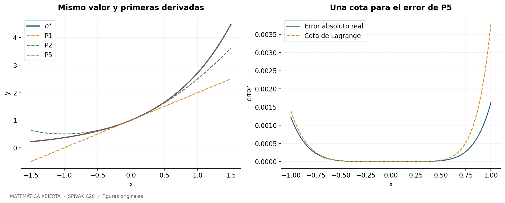
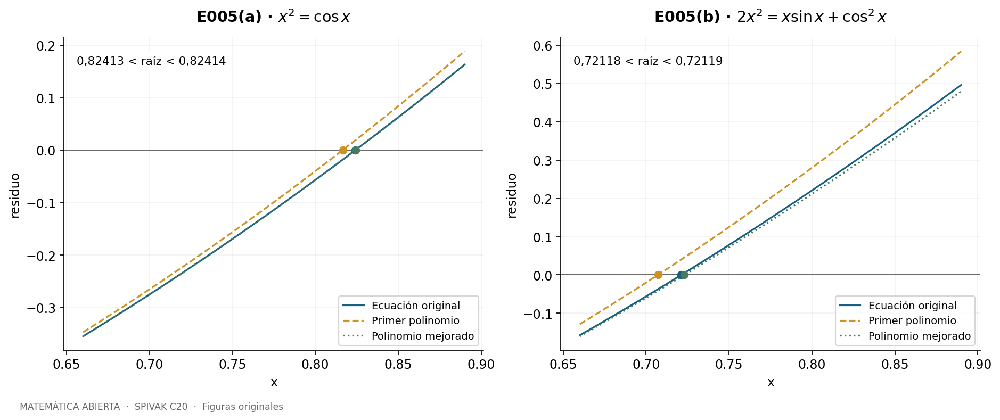
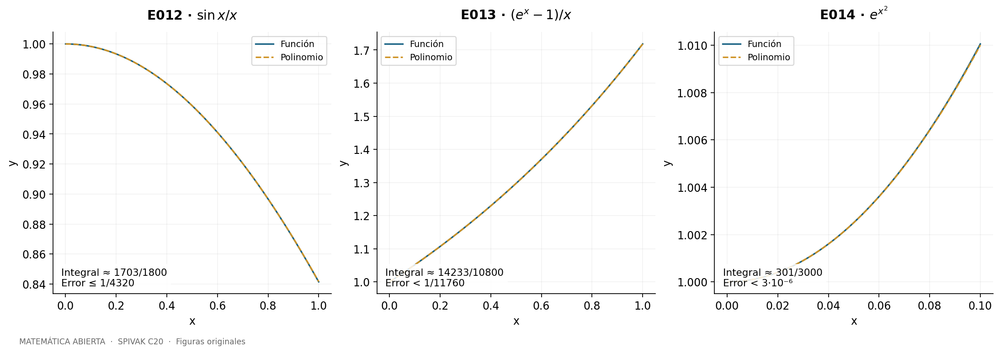
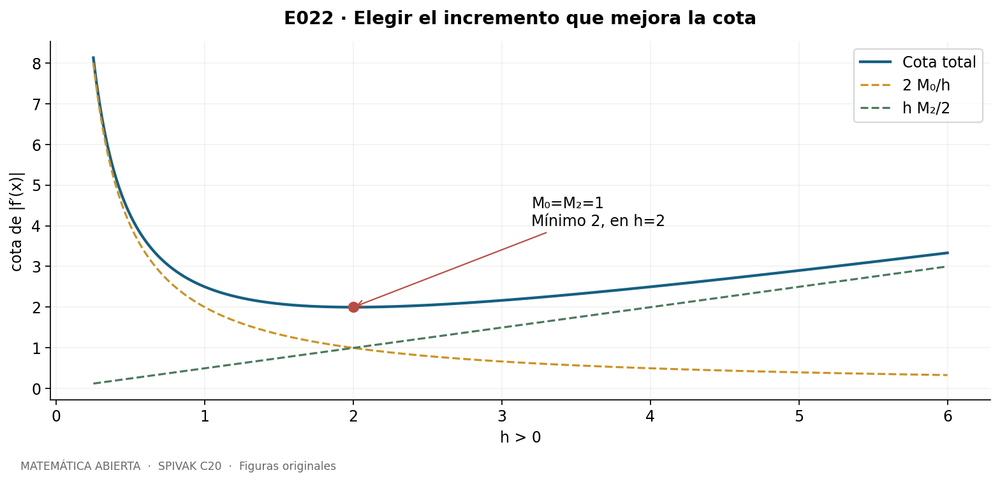
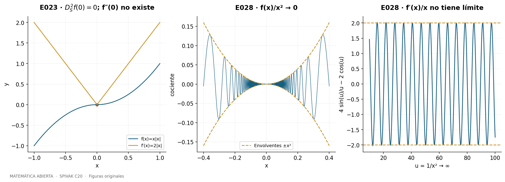
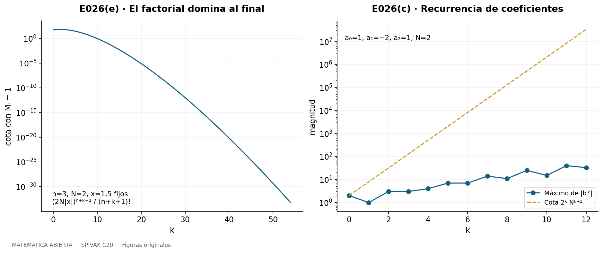

::: {.spivak-nav}

[← Capítulo 19](capitulo-19.qmd) · [Colecciones](../index.qmd#spivak-calculus-cuarta-edición) · [Capítulo 21 →](capitulo-21.qmd)

:::

A. Peña · Matemática Abierta · 2026-10-15.

Soluciones propias de los **28 problemas y sus 90 unidades explícitas**, incluidas todas las tareas de los ejercicios con estrellas. Este capítulo no tiene apéndice de ejercicios. Las referencias remiten a Michael Spivak, *Calculus*, cuarta edición, pp. 411–441; problemas en pp. 431–441 / PDF 450–460 de la copia original consultada. En esta copia, página PDF = página impresa +19. C21, «e es trascendente», comienza en p. 442 / PDF 461.

## Qué información conserva un polinomio de Taylor {#seccion-484}

Si conocemos una función y sus primeras derivadas en a, podemos construir un polinomio que comparta esos datos:
$$P_{n,a,f}(x)=\sum_{k=0}^n\frac{f^{(k)}(a)}{k!}(x-a)^k.$$
La derivada de orden k, evaluada en a, elimina todos los términos salvo el de grado k; de ahí el factorial. Aquí «grado n» significa grado a lo sumo n: un coeficiente superior puede ser cero.

El teorema local afirma que $f(x)-P_{n,a,f}(x)=o((x-a)^n)$. La notación significa que el cociente por $(x-a)^n$ tiende a cero cuando x tiende a a. Si un polinomio no nulo de grado ≤n tuviera esa propiedad, su término de menor grado, digamos $c(x-a)^j$, produciría un cociente que no tiende a cero. Por eso el polinomio local es único. La existencia de una aproximación polinómica, por sí sola, no garantiza todas las derivadas: E028 examina precisamente esa diferencia.

Para calcular un valor lejos del centro hace falta controlar el resto. Bajo las hipótesis de Taylor, con n+1 derivadas en el segmento pertinente,
$$R_{n,a}(x)=\frac{f^{(n+1)}(\xi)}{(n+1)!}(x-a)^{n+1},$$
para algún ξ entre a y x. Si la derivada n+1 es continua, también se dispone de
$$R_{n,a}(x)=\frac1{n!}\int_a^x f^{(n+1)}(t)(x-t)^n\,dt.$$
Las integrales se orientan cuando x<a. En particular, una cota absoluta M de esa derivada da $|R_{n,a}(x)|\le M|x-a|^{n+1}/(n+1)!$. E017–E020 distinguen las hipótesis y prueban las relaciones entre estas fórmulas. No se supone que un desarrollo infinito coincida con la función: cada cálculo que sigue emplea un polinomio finito y su error.

{#fig-spv4-c20-f01 fig-alt="Capítulo 20: Aproximación de la exponencial y error controlado"}

## E001 — Polinomios en centros distintos {#e001}

Fuente: Spivak, *Calculus*, 4.ª ed., C20, problema 1, p. 431.

**`SPV4-C20-E001-i`** Para $f(x)=e^{e^x}$, escribimos $e^x=1+x+x^2/2+x^3/6+o(x^3)$. Al sustituir en la exponencial exterior, los términos hasta grado tres son
$$P_{3,0,f}(x)=e\left(1+x+x^2+\frac56x^3\right).$$
En efecto, si $u=x+x^2/2+x^3/6$, los grados ≤3 de $1+u+u^2/2+u^3/6$ son $1+x+x^2+5x^3/6$. El resto es o(x³), lo que identifica el polinomio por unicidad.

**`SPV4-C20-E001-ii`** Para $e^{\sin x}$, usamos $\sin x=x-x^3/6+o(x^3)$. La exponencial produce $1+(x-x^3/6)+x^2/2+x^3/6+o(x^3)$. Los dos términos cúbicos se cancelan:
$$P_{3,0}(x)=1+x+\frac12x^2.$$
Su grado efectivo es dos.

**`SPV4-C20-E001-iii`** Ponga $h=x-\pi/2$. Como $\sin(\pi/2+h)=\cos h$,
$$P_{2n,\pi/2,\sin}(x)=\sum_{j=0}^n\frac{(-1)^j}{(2j)!}(x-\pi/2)^{2j}.$$
La traslación del centro convierte el ciclo de derivadas de seno en el de coseno.

**`SPV4-C20-E001-iv`** Con $h=x-\pi$, $\cos(\pi+h)=-\cos h$. Por tanto
$$P_{2n,\pi,\cos}(x)=-\sum_{j=0}^n\frac{(-1)^j}{(2j)!}(x-\pi)^{2j}.$$
En particular el término constante es −1, como exige el valor de coseno en π.

**`SPV4-C20-E001-v`** Todas las derivadas de exp valen e en 1. Luego
$$P_{n,1,\exp}(x)=e\sum_{k=0}^n\frac{(x-1)^k}{k!}.$$
El centro cambia las potencias y el factor común, aunque la función siga siendo la misma.

**`SPV4-C20-E001-vi`** Para k≥1, $\log^{(k)}(2)=(-1)^{k-1}(k-1)!/2^k$. Así
$$P_{n,2,\log}(x)=\log2+\sum_{k=1}^n\frac{(-1)^{k-1}}{k2^k}(x-2)^k.$$
La función se considera en x>0; la suma es vacía para n=0.

**`SPV4-C20-E001-vii`** Para $f=x^5+x^3+x$, el término x⁵ no contribuye a las derivadas de orden ≤4 en cero. Por ello $P_{4,0,f}=x+x^3$. La diferencia x⁵ es o(x⁴).

**`SPV4-C20-E001-viii`** Con h=x−1, expandir las potencias finitas da $f(1+h)=3+9h+13h^2+11h^3+5h^4+h^5$. Por tanto
$$P_{4,1,f}(x)=3+9(x-1)+13(x-1)^2+11(x-1)^3+5(x-1)^4.$$
El coeficiente del término descartado no es relevante para las primeras cuatro derivadas.

**`SPV4-C20-E001-ix`** La identidad geométrica finita
$$\frac1{1+x^2}=\sum_{j=0}^n(-1)^jx^{2j}+\frac{(-1)^{n+1}x^{2n+2}}{1+x^2}$$
muestra un resto o(x^{2n+1}). Así $P_{2n+1,0}(x)=\sum_{j=0}^n(-1)^jx^{2j}$. No hay término impar, y el grado efectivo es 2n.

**`SPV4-C20-E001-x`** Para x≠−1,
$$\frac1{1+x}=\sum_{k=0}^n(-1)^kx^k+\frac{(-1)^{n+1}x^{n+1}}{1+x}.$$
El resto es o(xⁿ) en cero, de modo que $P_{n,0}(x)=\sum_{k=0}^n(-1)^kx^k$. La identidad es finita y no exige todavía discutir convergencia de series.

## E002 — Escribir polinomios en potencias de x−3 {#e002}

Fuente: Spivak, *Calculus*, 4.ª ed., C20, problema 2, p. 431.

**`SPV4-C20-E002-i`** Ponga h=x−3. Sustituir x=h+3 en $x^2-4x-9$ da $h^2+2h-12$, es decir
$$(x-3)^2+2(x-3)-12.$$
Un polinomio de grado d coincide exactamente con su Taylor de orden d, pues las derivadas de orden superior son cero.

**`SPV4-C20-E002-ii`** La sustitución x=h+3, seguida de agrupar grados, da
$$x^4-12x^3+44x^2+2x+1=h^4-10h^2+50h+160.$$
Se comprueba también con f(3)=160, f′(3)=50, f′′(3)/2=−10, f′′′(3)=0 y f⁽⁴⁾/24=1.

**`SPV4-C20-E002-iii`** El binomio finito da
$$x^5=243+405h+270h^2+90h^3+15h^4+h^5,\qquad h=x-3.$$
Cada coeficiente es $\binom5k3^{5-k}$, equivalente a la correspondiente derivada dividida por k!.

**`SPV4-C20-E002-iv`** Para parámetros a,b,c reales,
$$ax^2+bx+c=a(x-3)^2+(6a+b)(x-3)+(9a+3b+c).$$
La fórmula sigue siendo válida cuando a=0 o también b=0: «mismo grado» puede entenderse como el grado efectivo, o como una cota superior suficiente.

## E003 — Sumas finitas con precisión prescrita {#e003}

Fuente: Spivak, *Calculus*, 4.ª ed., C20, problema 3, p. 431–432.

**`SPV4-C20-E003-i`** Defina $S_m(t)=\sum_{j=0}^m(-1)^jt^{2j+1}/(2j+1)!$. El polinomio de seno de orden 2m+2 es el mismo, por lo que Taylor permite
$$|\sin t-S_m(t)|\le\frac{|t|^{2m+3}}{(2m+3)!}.$$
Para sin 1 sirve $S_8(1)$: $1/19!<10^{-17}$. Se aprovecha el coeficiente par nulo para ahorrar un término.

**`SPV4-C20-E003-ii`** Para sin 2 elegimos
$$S_9(2)=\sum_{j=0}^9\frac{(-1)^j2^{2j+1}}{(2j+1)!}.$$
Su error es ≤$2^{21}/21!<10^{-12}$. Incluso la cota menos fina $2^{20}/20!<10^{-12}$, que usa la tabla indicada, basta.

**`SPV4-C20-E003-iii`** Para sin(1/2),
$$S_8(1/2)=\sum_{j=0}^8\frac{(-1)^j}{2^{2j+1}(2j+1)!}$$
tiene error ≤$1/[2^{19}19!]<10^{-20}$. La cota con $2^{18}18!$ también cumple la precisión pedida.

**`SPV4-C20-E003-iv`** Sea $E_n(t)=\sum_{k=0}^nt^k/k!$. En [0,1], eᵗ<3; así $E_7(1)$ tiene error menor que $3/8!=3/40320<10^{-4}$. La cota e<3 ya está disponible del capítulo anterior; no se necesita conocer sus decimales.

**`SPV4-C20-E003-v`** En [0,2], eᵗ<9. Por tanto
$$E_{13}(2)=\sum_{k=0}^{13}\frac{2^k}{k!},\qquad |e^2-E_{13}(2)|<\frac{9\,2^{14}}{14!}<10^{-5}.$$
Todas las sumas pedidas son racionales explícitos; las desigualdades de error se verifican con enteros, no a partir del valor decimal desconocido.

## E004 — Precisiones extremas y elección explícita del grado {#e004}

Fuente: Spivak, *Calculus*, 4.ª ed., C20, problema 4, p. 432.

**`SPV4-C20-E004-i`** Sea K=10¹⁰. La suma concreta $S_K(1)$ cumple
$$|\sin1-S_K(1)|\le\frac1{(2K+3)!}<10^{-K}.$$
Para justificarlo sin una tabla inmensa, los factores 10,11,…,2K+3 del factorial son al menos 10; hay 2K−6 de ellos. Así $(2K+3)!\ge10^{2K-6}>10^K$. La suma es finita y especificada, aunque su evaluación directa sea impráctica.

**`SPV4-C20-E004-ii`** Para e y error menor que 10⁻¹⁰⁰⁰, sirve $E_{1010}(1)$. En efecto,
$$|e-E_{1010}(1)|<\frac3{1011!}\le3\,10^{-1002}<10^{-1000},$$
pues el producto de los factores de 10 a 1011 contiene 1002 factores, todos ≥10.

**`SPV4-C20-E004-iii`** Para sin 10 tomamos
$$S_{28}(10)=\sum_{j=0}^{28}\frac{(-1)^j10^{2j+1}}{(2j+1)!}.$$
La cota incluso menos fina $10^{58}/58!<10^{-20}$ basta. Esta desigualdad puede comprobarse por la comparación entera $10^{78}<58!$; el verificador incluido la realiza exactamente.

**`SPV4-C20-E004-iv`** En [0,10], eᵗ<3¹⁰. La suma
$$E_{75}(10)=\sum_{k=0}^{75}\frac{10^k}{k!}$$
tiene error menor que $3^{10}10^{76}/76!<10^{-30}$. La comprobación es $3^{10}10^{106}<76!$, otra desigualdad exacta entre enteros. No se usa e¹⁰ para estimarse a sí misma.

**`SPV4-C20-E004-v`** Para $A_m(t)=\sum_{j=0}^m(-1)^jt^{2j+1}/(2j+1)$, integrar la identidad geométrica finita da
$$\arctan t-A_m(t)=(-1)^{m+1}\int_0^t\frac{u^{2m+2}}{1+u^2}\,du.$$
Por tanto el error tiene módulo ≤$|t|^{2m+3}/(2m+3)$. Con t=1/10 y m=K=10¹⁰ es menor que $10^{-K}$. Queda una suma específica y una prueba del error que no exige calcular sus miles de millones de términos.

## E005 — Aproximar las raíces y certificar el error {#e005}

Fuente: Spivak, *Calculus*, 4.ª ed., C20, problema 5, p. 432.

**`SPV4-C20-E005-a`** Para $F(x)=x^2-\cos x$, las raíces son simétricas y la positiva α está en (0,1): F(0)=−1, F(1)>0 y $F'(x)=2x+\sin x>0$ allí. No hay raíces con |x|>1, porque x²>1≥cos x. El Taylor de orden tres de coseno es $1-x^2/2$. Igualarlo a x² da
$$r_0=\sqrt{2/3}.$$
El de orden cinco añade x⁴/24. Si y=x², la ecuación es $y^2-36y+24=0$. La raíz pequeña produce
$$r_1=\sqrt{18-10\sqrt3}\approx0{,}8243130014.$$
La otra raíz del polinomio auxiliar no aproxima una solución original, pues supera 1.

Las cotas de los mismos órdenes ya dan intervalos sin calcular nuevas derivadas. Del resto de orden tres, $|\alpha^2-(1-\alpha^2/2)|\le1/24$, se deduce $\sqrt{23}/6\le\alpha\le5/6$. El resto de orden cinco tiene módulo ≤1/720; con y=α², da $|y^2-36y+24|\le1/30$. Como 0<y<1, la rama decreciente del cuadrático implica
$$\sqrt{18-\sqrt{300+1/30}}\le\alpha\le\sqrt{18-\sqrt{300-1/30}}.$$
El intervalo es aproximadamente [0,823729; 0,824897], ya mucho más estrecho.

Para obtener una certificación aún más precisa, sea $C_{10}(t)=\sum_{j=0}^5(-1)^jt^{2j}/(2j)!$ y $\epsilon_c(t)=t^{11}/11!$, t∈[0,1]. Taylor asegura $|\cos t-C_{10}(t)|\le\epsilon_c(t)$. Sustituir los racionales u=82413/100000 y v=82414/100000 da, por aritmética racional,
$$u^2-C_{10}(u)+\epsilon_c(u)<0,\qquad v^2-C_{10}(v)-\epsilon_c(v)>0.$$
Así $0{,}82413<\alpha<0{,}82414$. Esta certificación implica
$$0<\alpha-r_0<0{,}007644,\qquad0<r_1-\alpha<0{,}000184.$$
Para la raíz negativa se cambian los signos de las aproximaciones y se conservan las cotas absolutas. Las cifras no se obtienen suponiendo el valor exacto de α: los dos signos anteriores lo encierran.

**`SPV4-C20-E005-b`** Considere $G(x)=2x^2-x\sin x-\cos^2x$, función par. De $2x^2\le|x|+1$ se deduce que cualquier raíz satisface |x|≤1. En (0,1),
$$G'(x)=4x-\sin x-x\cos x+\sin2x\ge2x>0,$$
pues sin x≤x, cos x≤1 y sin 2x>0. Como G(0)=−1 y G(1)=1−sin1+sin²1≥3/4>0, hay exactamente dos raíces ±β.

Los primeros términos dan $x\sin x+\cos^2x=1+x^4/6+o(x^4)$. La aproximación cuadrática da $q_0=1/\sqrt2$; incluyendo el término de grado cuatro, con y=x² se obtiene $y^2-12y+6=0$. La raíz pertinente es
$$q_1=\sqrt{6-\sqrt{30}}\approx0{,}7230314135.$$
Para acotar el error usamos además $S_9(t)=t-t^3/3!+\cdots+t^9/9!$, con $|\sin t-S_9(t)|\le t^{10}/10!$. Si $G_*(t)=2t^2-tS_9(t)-C_{10}(t)^2$, entonces
$$|G(t)-G_*(t)|\le t\frac{t^{10}}{10!}+\epsilon_c(t)[2+\epsilon_c(t)].$$
El término final usa |cos t|≤1. En u=72118/100000, el valor de $G_*(u)$ más esta cota es negativo; en v=72119/100000, $G_*(v)$ menos la cota es positivo. Por tanto
$$0{,}72118<\beta<0{,}72119,$$
y quedan los errores certificados $0<\beta-q_0<0{,}014084$ y $0<q_1-\beta<0{,}001852$. El polinomio de mayor grado mejora aquí la aproximación, aunque sigue siendo indispensable estimar su resto.

{#fig-spv4-c20-f02 fig-alt="Capítulo 20: Raíces verdaderas y aproximaciones polinómicas"}

## E006 — Identidades de arctangente y cinco decimales de π {#e006}

Fuente: Spivak, *Calculus*, 4.ª ed., C20, problema 6, p. 433.

**`SPV4-C20-E006-a`** Sean u=arctan(1/2) y v=arctan(1/3). Son positivos y u+v<1/2+1/3<π/2. La fórmula de adición da
$$\tan(u+v)=\frac{1/2+1/3}{1-1/6}=1,$$
de modo que u+v=π/4; la restricción angular elimina otros valores con la misma tangente.

Para α=arctan(1/5), las duplicaciones dan tan 2α=5/12 y tan 4α=120/119. Sea γ=arctan(1/239). Entonces
$$\tan(4\alpha-\gamma)=\frac{120/119-1/239}{1+120/(119\cdot239)}=1.$$
Además $0<4\alpha-\gamma<4/5<\pi/2$: para la cota inferior basta $\alpha=\int_0^{1/5}dt/(1+t^2)\ge5/26$ y γ<1/239. Resulta $\pi/4=4\arctan(1/5)-\arctan(1/239)$.

**`SPV4-C20-E006-b`** Con $A_m$ de E004(v), calculamos el racional
$$Q=16A_4(1/5)-4A_1(1/239)=\frac{5277328977275528}{1679825970703125}.$$
La identidad de (a) y la cota integral de arctangente dan
$$|\pi-Q|\le B=\frac{16}{11\cdot5^{11}}+\frac4{5\cdot239^5}<2{,}980\cdot10^{-8}.$$
La comparación racional exacta verifica $3{,}14159<Q-B$ y $Q+B<3{,}14160$. Por ello los cinco primeros decimales de π son 14159. El intervalo certificado es aproximadamente (3,1415926526; 3,1415927122), con sus extremos racionales exactos Q±B.

## E007 — Operaciones con coeficientes {#e007}

Fuente: Spivak, *Calculus*, 4.ª ed., C20, problema 7, p. 433.

**`SPV4-C20-E007-i`** Si $a_i=f^{(i)}(a)/i!$ y $b_i=g^{(i)}(a)/i!$, la linealidad de las derivadas da $c_i=a_i+b_i$. No se requiere que los desarrollos infinitos converjan.

**`SPV4-C20-E007-ii`** Leibniz da $(fg)^{(i)}(a)=\sum_{j=0}^i\binom ij f^{(j)}(a)g^{(i-j)}(a)$. Dividir entre i! cancela los factoriales y produce
$$c_i=\sum_{j=0}^ia_jb_{i-j}.$$
Cada par de grados cuya suma es i aporta al coeficiente de grado i.

**`SPV4-C20-E007-iii`** Para f′, $c_i=f^{(i+1)}(a)/i!=(i+1)a_{i+1}$. Para determinar su Taylor de orden n hacen falta las derivadas de f hasta orden n+1: un dato adicional respecto del orden n de f.

**`SPV4-C20-E007-iv`** Para $h(x)=\int_a^xf(t)dt$, suponga f continua cerca de a y con las derivadas necesarias. El teorema fundamental da h′=f y h(a)=0. Así $c_0=0$ y
$$c_i=\frac{a_{i-1}}i,\qquad i\ge1.$$
El grado se eleva una unidad al integrar cada monomio.

**`SPV4-C20-E007-v`** Para $k(x)=\int_0^xf(t)dt$, se supone además definida la integral entre 0 y a. Los coeficientes de grado positivo son los de (iv), pero
$$c_0=k(a)=\int_0^af(t)dt.$$
Este término no se determina en general por los datos locales de f en a: cambiar f lejos de a puede modificarlo sin alterar ninguna derivada en a.

## E008 — Sustituir una potencia en el argumento {#e008}

Fuente: Spivak, *Calculus*, 4.ª ed., C20, problema 8, p. 433.

**`SPV4-C20-E008-a`** Para $f(x)=\sin(x^2)$, escribimos $\sin u=S_n(u)+r(u)$, con $r(u)=o(u^{2n+1})$. Sustituir u=x² da $r(x^2)=o(x^{4n+2})$, pues el cociente es el mismo cociente original a lo largo de u=x²→0. Así, por unicidad del polinomio local,
$$P_{4n+2,0,f}(x)=\sum_{j=0}^n\frac{(-1)^jx^{4j+2}}{(2j+1)!}.$$
La función compuesta es suave, por lo que su polinomio de Taylor existe.

**`SPV4-C20-E008-b`** Comparar coeficientes en (a), para n arbitrario, da
$$f^{(k)}(0)=\begin{cases}(-1)^j(4j+2)!/(2j+1)!,&k=4j+2,\quad j\ge0,\\0,&\text{en los demás casos}.\end{cases}$$
Incluye f(0)=0. No es necesario diferenciar repetidamente una composición cada vez más extensa.

**`SPV4-C20-E008-c`** Sea m un entero positivo, $f(x)=g(x^m)$ y g suficientemente diferenciable cerca de cero. Para cualquier orden k, sustituya xᵐ en un Taylor de g de orden al menos k. Su resto es o(x^{mk}) y, por tanto, o(xᵏ). Truncar los términos de grado superior a k identifica el polinomio de f. Se obtiene
$$f^{(k)}(0)=\begin{cases}\dfrac{k!}{j!}g^{(j)}(0),&k=mj,\\0,&m\nmid k.\end{cases}$$
Para k=0 se entiende j=0. Si m es par basta el límite del resto de g por el lado positivo; la existencia de las derivadas de g en un entorno asegura la suavidad compuesta usada aquí.

## E009 — Álgebra de aproximaciones locales {#e009}

Fuente: Spivak, *Calculus*, 4.ª ed., C20, problema 9, p. 433–434.

**`SPV4-C20-E009-a`** Ponga h=x−a y escriba f=P+r, g=Q+s, con r,s=o(hⁿ). Entonces f+g=P+Q+(r+s) y r+s=o(hⁿ). El polinomio P+Q tiene grado ≤n y comparte la aproximación local de f+g. Por unicidad,
$$P_{n,a,f+g}=P_{n,a,f}+P_{n,a,g}.$$
La existencia de las derivadas necesarias se mantiene como hipótesis; un resto pequeño por sí solo no las crea.

**`SPV4-C20-E009-b`** Multiplicar da $fg=PQ+Ps+Qr+rs$. Los polinomios P,Q están acotados cerca de a; por ello los tres últimos términos son o(hⁿ). Los monomios de PQ de grado >n también son o(hⁿ). Si $[\cdot]_n$ denota truncación en potencias de h,
$$P_{n,a,fg}=[P_{n,a,f}P_{n,a,g}]_n.$$
Para n=0, r,s→0 y el mismo razonamiento sigue siendo válido.

**`SPV4-C20-E009-c`** Para polinomios p,q y $R(x)=o((x-a)^n)$, use la identidad algebraica
$$p(u+v)-p(u)=v\,H(u,v),$$
donde H es un polinomio en u,v. Como q(x) y R(x) quedan acotados al acercarse x a a, $\bar R(x)=R(x)H(q(x),R(x))$ es o((x−a)ⁿ). Esto prueba $p(q(x)+R(x))=p(q(x))+\bar R(x)$, sin diferenciar R.

En la coordenada h=x−a, si p solo contiene monomios de grado >n y q tiene término constante cero, entonces q(h)=h\,q_1(h). Toda potencia q(h)ʲ, con j>n, es divisible por hʲ; por tanto p(q(h)) no tiene términos de grado ≤n. Los límites se toman en **x→a**; se corrige el rótulo x→0 impreso en este apartado.[^e009]

**`SPV4-C20-E009-d`** Para a=0 y g(0)=0, escriba $f(y)=P(y)+o(y^n)$, $g(x)=Q(x)+o(x^n)$. Como g(x)=O(x), el resto exterior evaluado en g(x) es o(xⁿ): si g(x)=0 se fija allí el resto cero; en otro caso se usa $|g(x)|\le C|x|$. Para n=0 basta continuidad. Por (c), $P(g(x))=P(Q(x))+o(x^n)$. Truncar el producto compuesto da
$$P_{n,0,f\circ g}=[P_{n,0,f}\circ P_{n,0,g}]_n.$$
La condición g(0)=0 alinea los centros y evita que grados descartados de f vuelvan a contribuir a términos pequeños.

**`SPV4-C20-E009-e`** Para a arbitrario y b=g(a), use h=x−a y $H(h)=g(a+h)-b$, cuyo término constante es cero. La función exterior se traslada como $F(u)=f(b+u)$. Aplicar (d) a F∘H y volver a x da
$$P_{n,a,f\circ g}(x)=\left[P_{n,b,f}\big(P_{n,a,g}(x)\big)\right]_n,$$
donde la truncación se hace en x−a. El polinomio exterior está escrito en y−b; al sustituir aparece $P_{n,a,g}(x)-b$, con constante nula, como se necesita.

**`SPV4-C20-E009-f`** Si g(a)=0, cerca de a el denominador 1−g no se anula. La identidad geométrica finita da
$$\frac1{1-g}=1+g+\cdots+g^n+\frac{g^{n+1}}{1-g}.$$
Como g(x)=O(x−a), el último término es O((x−a)^{n+1}), y sustituir en cada potencia el Taylor de g solo añade o((x−a)ⁿ), por (b,c). En consecuencia
$$P_{n,a,1/(1-g)}=\left[1+P_{n,a,g}+P_{n,a,g}^2+\cdots+P_{n,a,g}^n\right]_n.$$
Para n=0 la identidad se interpreta con el resto que tiende a cero.

## E010 — Aplicaciones del álgebra de Taylor {#e010}

Fuente: Spivak, *Calculus*, 4.ª ed., C20, problema 10, p. 434.

**`SPV4-C20-E010-a`** Con f=eˣ y g=sin x, sumamos sus coeficientes hasta grado cinco:
$$P_{5,f+g}(x)=1+2x+\frac{x^2}2+\frac{x^4}{24}+\frac{x^5}{60}.$$
Los coeficientes cúbicos 1/6 y −1/6 se cancelan.

**`SPV4-C20-E010-b`** Multiplicamos $(1+x+x^2/2+x^3/6+x^4/24+x^5/120)$ por $(x-x^3/6+x^5/120)$ y retenemos grados ≤5:
$$P_{5,fg}(x)=x+x^2+\frac{x^3}3-\frac{x^5}{30}.$$
El término de grado cuatro es cero; el de grado cinco es 1/24−1/12+1/120=−1/30.

**`SPV4-C20-E010-c`** Escriba cos x=1−g(x), con $P_{5,g}=x^2/2-x^4/24$. E009(f) da $P_{5,1/\cos}=1+x^2/2+5x^4/24$. Multiplicar por el polinomio de seno produce
$$P_{5,\tan}(x)=x+\frac{x^3}3+\frac{2x^5}{15}.$$
La reciprocidad es local alrededor de cero, donde coseno no se anula.

**`SPV4-C20-E010-d`** Para $e^{2x}\cos x$, multiplique $1+2x+2x^2+4x^3/3+2x^4/3$ por $1-x^2/2+x^4/24$. Agrupar da
$$P_{4}(x)=1+2x+\frac32x^2+\frac13x^3-\frac7{24}x^4.$$
El coeficiente final es 2/3−1+1/24.

**`SPV4-C20-E010-e`** Ahora $\cos2x=1-2x^2+2x^4/3+o(x^5)$; su recíproco tiene polinomio $1+2x^2+10x^4/3$. Multiplicar por seno da
$$P_{5,\sin x/\cos2x}(x)=x+\frac{11}6x^3+\frac{361}{120}x^5.$$
El coeficiente quinto es 10/3−1/3+1/120. Los polos exteriores no afectan la aproximación local en cero.

**`SPV4-C20-E010-f`** Para $x^3/[(1+x^2)e^x]$ basta determinar el factor restante hasta orden tres. Tenemos $1/(1+x^2)=1-x^2+o(x^3)$ y $e^{-x}=1-x+x^2/2-x^3/6+o(x^3)$. Su producto es $1-x-x^2/2+5x^3/6+o(x^3)$. Por tanto
$$P_6(x)=x^3-x^4-\frac12x^5+\frac56x^6.$$
El factor x³ permite reducir la cantidad de coeficientes que hay que calcular.

## E011 — Límites mediante los primeros términos no nulos {#e011}

Fuente: Spivak, *Calculus*, 4.ª ed., C20, problema 11, p. 434–435.

**`SPV4-C20-E011-a`** El numerador $e^x-1-x-x^2/2=x^3/6+o(x^3)$ y $x-\sin x=x^3/6+o(x^3)$. Dividir ambos por x³ prueba que el límite de su cociente es **1**. El denominador no se anula en un entorno perforado suficientemente pequeño.

**`SPV4-C20-E011-b`** Multiplicar los polinomios de eˣ y 1/(1+x) hasta orden tres da $e^x/(1+x)=1+x^2/2-x^3/3+o(x^3)$. El numerador pedido es −x³/3+o(x³), mientras el denominador sigue siendo x³/6+o(x³). El límite es **−2**.

**`SPV4-C20-E011-c`** Como $\sin^2x=x^2-x^4/3+o(x^4)$,
$$\frac1{\sin^2x}-\frac1{x^2}=\frac{x^2-\sin^2x}{x^2\sin^2x}.$$
El numerador es x⁴/3+o(x⁴) y el denominador x⁴+o(x⁴); el límite es **1/3**.

**`SPV4-C20-E011-d`** Se tiene $1-\cos(x^2)=x^4/2+o(x^4)$ y $x^2\sin^2x=x^4+o(x^4)$. El límite de su cociente es **1/2**. Confundir sin²x con sin(x²) cambiaría el problema.

**`SPV4-C20-E011-e`** Separe la diferencia en
$$\left(\frac1{\sin^2x}-\frac1{x^2}\right)+\left(\frac1{x^2}-\frac1{\sin(x^2)}\right).$$
El primer término tiende a 1/3 por (c). Con u=x², el segundo es $(\sin u-u)/(u\sin u)=O(u)$ y tiende a cero. El límite es **1/3**.

**`SPV4-C20-E011-f`** Usamos $\sin x=x-x^3/6+o(x^3)$ y $\arctan x=x-x^3/3+o(x^3)$. El producto, menos x², es −x⁴/2+o(x⁴). Como $1-\cos(x^2)=x^4/2+o(x^4)$, el límite es **−1**.

## E012 — Integrar la prolongación de seno entre x {#e012}

Fuente: Spivak, *Calculus*, 4.ª ed., C20, problema 12, p. 435.

**`SPV4-C20-E012`** Definamos f(x)=sin x/x para x≠0 y f(0)=1. La identidad $f(x)=\int_0^1\cos(tx)dt$ justifica que la prolongación es suave: en cualquier compacto las derivadas del integrando son continuas y la diferenciación bajo esta integral finita se justifica por convergencia uniforme de los cocientes incrementales, a partir de la continuidad uniforme de la siguiente derivada.

Dividir el Taylor de seno de orden 2n+1 y su resto por x da
$$f(x)=\sum_{j=0}^n\frac{(-1)^jx^{2j}}{(2j+1)!}+R(x),\qquad |R(x)|\le\frac{|x|^{2n+1}}{(2n+2)!}.$$
En cero el resto es cero. Es o(x^{2n}) y, por unicidad, la suma es el Taylor de orden 2n de f. Con n=2, integrar de cero a uno da
$$\int_0^1f(x)dx\approx1-\frac1{18}+\frac1{600}=\frac{1703}{1800}.$$
El error integral está acotado por $\int_0^1x^5dx/6!=1/4320<10^{-3}$. El decimal 0,946 de la fuente es un redondeo; el valor aproximante certificado es el racional 1703/1800.

## E013 — La prolongación de (exp x−1)/x {#e013}

Fuente: Spivak, *Calculus*, 4.ª ed., C20, problema 13, p. 435.

**`SPV4-C20-E013-a`** Para f(x)=(eˣ−1)/x, f(0)=1, la identidad $f(x)=\int_0^1e^{tx}dt$ muestra suavidad por el mismo argumento de diferenciación uniforme de E012. Evaluar las derivadas bajo la integral da
$$f^{(k)}(0)=\int_0^1t^kdt=\frac1{k+1}.$$
De ahí
$$P_{n,0,f}(x)=\sum_{k=0}^n\frac{x^k}{(k+1)!}.$$
También puede obtenerse restando 1 al Taylor de eˣ de orden n+1 y dividiendo entre x. En esa vía el resto satisface
$$|R_{n,0,f}(x)|\le\frac{e^{\max(0,x)}|x|^{n+1}}{(n+2)!},$$
con R(0)=0. La misma cota se obtiene integrando el resto de orden n de e^{tx}: la integral de t^{n+1} introduce el factor 1/(n+2).

**`SPV4-C20-E013-b`** En [0,1], eˣ<3. Elegimos n=5 e integramos P₅:
$$\int_0^1f(x)dx\approx\sum_{k=0}^5\frac1{(k+1)(k+1)!}=\frac{14233}{10800}\approx1{,}3178703704.$$
El error es menor que $3/[7\cdot7!]=1/11760<10^{-4}$. Se ha integrado una cota uniforme explícita del resto; no se ha inferido la precisión de la cantidad de decimales mostrados.

## E014 — Una integral sin primitiva elemental {#e014}

Fuente: Spivak, *Calculus*, 4.ª ed., C20, problema 14, p. 435.

**`SPV4-C20-E014`** En [0,1/10], ponemos u=x². Taylor de orden uno de la exponencial da $e^u=1+u+r(u)$, con $|r(u)|\le3u^2/2$, pues 0≤u≤1/100 y eᵘ<3. Por tanto
$$\int_0^{1/10}e^{x^2}dx\approx\int_0^{1/10}(1+x^2)dx=\frac{301}{3000}.$$
El error es menor que $\frac32\int_0^{1/10}x^4dx=3/10^6<10^{-5}$. La falta de una primitiva elemental no dificulta este cálculo con precisión certificada.

{#fig-spv4-c20-f03 fig-alt="Capítulo 20: Integrales y cotas de los restos"}

## E015 — Resto de la exponencial en el semieje negativo {#e015}

Fuente: Spivak, *Calculus*, 4.ª ed., C20, problema 15, p. 436.

**`SPV4-C20-E015`** Si x<0, Taylor en cero da $R_{n,0}(x)=e^\xi x^{n+1}/(n+1)!$ con x<ξ<0. Como 0<eᵠ≤1 para ξ≤0,
$$|R_{n,0}(x)|\le\frac{|x|^{n+1}}{(n+1)!}.$$
Para x=0 el resto es cero. La mejora frente a una cota simétrica procede del signo del argumento; no se usa e^{|x|} donde basta 1.

## E016 — Resto del logaritmo hacia la izquierda {#e016}

Fuente: Spivak, *Calculus*, 4.ª ed., C20, problema 16, p. 436.

**`SPV4-C20-E016`** Sea n≥0, tomando el Taylor constante cero para n=0. La identidad geométrica finita y la integración dan
$$R_{n,0}(x)=(-1)^n\int_0^x\frac{t^n}{1+t}dt,\qquad x>-1.$$
Para −1<x<0, en el segmento [x,0] se tiene 1+t≥1+x>0. Así
$$|R_{n,0}(x)|\le\frac1{1+x}\int_x^0|t|^n dt=\frac{|x|^{n+1}}{(1+x)(n+1)}.$$
En x=0 ambos lados son cero. La fórmula evita una cota de Lagrange demasiado grande que elevaría 1/(1+x) a una potencia innecesaria.

## E017 — Prueba inductiva de la aproximación local {#e017}

Fuente: Spivak, *Calculus*, 4.ª ed., C20, problema 17, p. 436.

**`SPV4-C20-E017-a`** Suponga g continua en el segmento que une a y x y diferenciable en su interior, con $|g'(t)|\le M|t-a|^n$ y n entero ≥0. Aplique el teorema del valor medio de Cauchy a g y H(t)=(t−a)^{n+1}. Para algún c estrictamente entre a y x,
$$\frac{g(x)-g(a)}{(x-a)^{n+1}}=\frac{g'(c)}{(n+1)(c-a)^n}.$$
El denominador no es cero, pues c≠a. Tomar módulos prueba $|g(x)-g(a)|\le M|x-a|^{n+1}/(n+1)$, para ambos lados de a. No se supuso integrabilidad o continuidad de g′.

**`SPV4-C20-E017-b`** Si $g'(x)/(x-a)^n\to0$, para cada ε>0 existe δ>0 tal que $|g'(x)|\le\varepsilon|x-a|^n$ cuando 0<|x−a|<δ. Aplicar (a), manteniendo continuidad de g en a, da
$$\left|\frac{g(x)-g(a)}{(x-a)^{n+1}}\right|\le\frac\varepsilon{n+1}.$$
Esto prueba el límite cero. La continuidad en a, implícita en el uso de g diferenciable, es necesaria: no podría cambiarse arbitrariamente g(a).

**`SPV4-C20-E017-c`** Si $g=f-P_{n,a,f}$, diferenciar término a término el polinomio finito produce
$$P'_{n,a,f}(x)=\sum_{j=0}^{n-1}\frac{f^{(j+1)}(a)}{j!}(x-a)^j=P_{n-1,a,f'}(x).$$
Por tanto $g'=f'-P_{n-1,a,f'}$. Los factoriales son precisamente los que hacen compatible la derivación con el cambio de orden.

**`SPV4-C20-E017-d`** La base n=0 es continuidad: f(x)−f(a)→0. Suponga probada la aproximación de orden n−1 para funciones con esas derivadas en a. Aplicada a f′ da, por (c),
$$\frac{g'(x)}{(x-a)^{n-1}}\to0.$$
Como g(a)=0, (b), con exponente n−1, implica $g(x)/(x-a)^n\to0$. Queda probada la afirmación para n y se cierra la inducción sin l’Hôpital. La existencia de la derivada iterada en a se entiende con las derivadas anteriores definidas en un entorno de a; no se exige continuidad de la derivada superior.

## E018 — Deducir el teorema local de Taylor con resto {#e018}

Fuente: Spivak, *Calculus*, 4.ª ed., C20, problema 18, p. 436.

**`SPV4-C20-E018`** Para n≥1, suponga que existen n+1 derivadas en un entorno de a. En particular f⁽ⁿ⁾ es continua en a, porque es diferenciable allí. Aplique la forma de Lagrange al Taylor de orden n−1:
$$f(x)=P_{n-1,a,f}(x)+\frac{f^{(n)}(\xi_x)}{n!}(x-a)^n.$$
Restar el término $f^{(n)}(a)(x-a)^n/n!$ y dividir da
$$\frac{f(x)-P_{n,a,f}(x)}{(x-a)^n}=\frac{f^{(n)}(\xi_x)-f^{(n)}(a)}{n!}\to0,$$
ya que ξx queda entre a y x y tiende a a. Para n=0 basta continuidad. Así se obtiene el resultado local bajo la hipótesis adicional indicada. No se infiere que la derivada n+1 esté acotada solo por existir: la prueba usa continuidad de la derivada n en a. E017 da la versión de hipótesis más débiles.

## E019 — Mover el centro y derivar el resto {#e019}

Fuente: Spivak, *Calculus*, 4.ª ed., C20, problema 19, p. 436–437.

**`SPV4-C20-E019-a`** Fije x y trate t como variable. Defina
$$S(t)=f(x)-\sum_{k=0}^n\frac{f^{(k)}(t)}{k!}(x-t)^k.$$
Para k≥1, la derivada de un sumando es $-f^{(k)}(t)(x-t)^{k-1}/(k-1)!+f^{(k+1)}(t)(x-t)^k/k!$. Al sumar se cancelan términos consecutivos, incluido el f′ procedente de k=0, y queda
$$S'(t)=-\frac{f^{(n+1)}(t)}{n!}(x-t)^n.$$
Tenemos S(x)=0 y S(a)=Rₙ,ₐ(x). Aplique Cauchy a S y $H(t)=(x-t)^{n+1}$ en el segmento entre a y x. Para algún c interior,
$$\frac{R_{n,a}(x)}{(x-a)^{n+1}}=\frac{S'(c)}{H'(c)}=\frac{f^{(n+1)}(c)}{(n+1)!}.$$
Esta es la forma de Lagrange. Para x=a el resto es cero y no hace falta el cociente. Las hipótesis son continuidad en el segmento y las derivadas que permiten estas aplicaciones del valor medio; no se requiere continuidad de f⁽ⁿ⁺¹⁾.

**`SPV4-C20-E019-b`** El teorema ordinario del valor medio aplicado a S da $[S(x)-S(a)]/(x-a)=S'(c)$. Usando los valores y la derivada del apartado anterior,
$$R_{n,a}(x)=\frac{f^{(n+1)}(c)}{n!}(x-c)^n(x-a),$$
con c entre a y x. Es la forma de Cauchy del resto. Aunque el punto c tiene la misma función existencial en las dos fórmulas, no se afirma que sea un único punto común que haga válidas ambas simultáneamente.

## E020 — Las dos formas de valor medio desde la integral {#e020}

Fuente: Spivak, *Calculus*, 4.ª ed., C20, problema 20, p. 437.

**`SPV4-C20-E020`** Suponga $f^{(n+1)}$ continua en el segmento; es una hipótesis adicional respecto de su mera existencia en el teorema de Taylor. Con h=x−a y t=a+sh, la fórmula integral se transforma en
$$R_{n,a}(x)=\frac{h^{n+1}}{n!}\int_0^1 f^{(n+1)}(a+sh)(1-s)^n ds.$$
Esta parametrización vale también para h<0 y conserva automáticamente la orientación.

El valor medio ponderado, con peso no negativo (1−s)ⁿ, da un θ∈(0,1) tal que la integral es $f^{(n+1)}(a+\theta h)/(n+1)$. Resulta Lagrange. El punto puede elegirse interior: si el promedio coincide con un extremo del integrando continuo bajo un peso positivo en (0,1), la función es constante allí y cualquier punto interior sirve.

Aplicar el valor medio ordinario al producto continuo dentro de la integral da, quizá con otro θ,
$$R_{n,a}(x)=\frac{h^{n+1}}{n!}f^{(n+1)}(a+\theta h)(1-\theta)^n.$$
Con c=a+θh, esto es $f^{(n+1)}(c)(x-c)^n(x-a)/n!$, la forma de Cauchy. La hipótesis continua justifica las dos aplicaciones; no se deriva gratuitamente de la existencia de n+1 derivadas. La existencia de una derivada adicional en el entorno es una condición suficiente para ella.

## E021 — Coeficientes binomiales de exponente real {#e021}

Fuente: Spivak, *Calculus*, 4.ª ed., C20, problema 21, p. 437–438.

**`SPV4-C20-E021`** Para α real y x>−1, las derivadas de $f(x)=(1+x)^\alpha$ son
$$f^{(k)}(x)=\alpha(\alpha-1)\cdots(\alpha-k+1)(1+x)^{\alpha-k}.$$
Se prueba por inducción con la regla de potencias. Con $\binom\alpha0=1$ y $\binom\alpha k=\alpha(\alpha-1)\cdots(\alpha-k+1)/k!$,
$$P_{n,0,f}(x)=\sum_{k=0}^n\binom\alpha kx^k.$$
La fórmula de Cauchy de E019 da, para un t entre 0 y x,
$$R_{n,0}(x)=(n+1)\binom\alpha{n+1}x(1+t)^{\alpha-1}\left(\frac{x-t}{1+t}\right)^n.$$
Aquí se han agrupado $(1+t)^{\alpha-n-1}(x-t)^n$; la base 1+t es positiva. Lagrange produce, para un punto que puede ser diferente,
$$R_{n,0}(x)=\binom\alpha{n+1}x^{n+1}(1+t)^{\alpha-n-1}.$$
Ambas se anulan en x=0. Si α es entero no negativo y n≥α, el desarrollo ya es el polinomio completo y el resto es cero.

Para α no entero, ningún factor del numerador es cero. El cociente de dos coeficientes consecutivos es $(\alpha-k)/(k+1)$, negativo una vez k>α: a partir de ese índice los signos alternan. Para exponentes enteros negativos los coeficientes tampoco se anulan; la misma regla de signos sigue siendo válida. No se usan estas fórmulas fuera de x>−1 sin especificar una definición real apropiada de la potencia.

## E022 — Acotar una derivada mediante la función y su curvatura {#e022}

Fuente: Spivak, *Calculus*, 4.ª ed., C20, problema 22, p. 438.

**`SPV4-C20-E022-a`** Sean f dos veces diferenciable en (0,∞), $|f|\le M_0$ y $|f''|\le M_2$, con M₀,M₂≥0. Para x>0 y h>0, el segmento [x,x+h] está en el dominio. Taylor de orden uno da
$$f(x+h)=f(x)+hf'(x)+\frac{h^2}2f''(c).$$
Despejar y tomar módulos produce
$$|f'(x)|\le\frac{|f(x+h)|+|f(x)|}h+\frac h2M_2\le\frac{2M_0}h+\frac h2M_2.$$
La elección del incremento hacia la derecha evita salir del semieje cuando h es grande.

**`SPV4-C20-E022-b`** Si M₀,M₂>0, el mínimo de $2M_0/h+hM_2/2$ se alcanza en $h=2\sqrt{M_0/M_2}$, y su valor es $2\sqrt{M_0M_2}$. Por tanto
$$|f'(x)|\le2\sqrt{M_0M_2}.$$
Si M₀=0, f=0 y f′=0. Si M₂=0, deje h→∞ en (a) y también obtiene f′=0. Los casos degenerados quedan incluidos y no se divide entre una cota nula.

**`SPV4-C20-E022-c`** Suponga ahora f(x)→0 y f′′ acotada por M₂. Dado η>0, existe A tal que |f(t)|≤η para t>A. La prueba de (a,b), aplicada a la restricción en ese semieje, usa solo puntos t≥x>A y da $|f'(x)|\le2\sqrt{\eta M_2}$. El lado derecho puede hacerse tan pequeño como se quiera, de modo que f′(x)→0. Si M₂=0, (a) en la cola da la conclusión directamente.

**`SPV4-C20-E022-d`** Suponga finitos los límites f(x)→L y f′′(x)→A. La segunda derivada está acotada en una cola. Aplicar (c) a f−L muestra f′(x)→0. Si A>0, para x grande se tendría f′′(x)>A/2; el valor medio en cualquier segmento [X,x] de esa cola daría $f'(x)\ge f'(X)+(A/2)(x-X)$, contradiciendo f′→0. Si A<0 se obtiene la contradicción opuesta. Por tanto A=0 y
$$\lim_{x\to\infty}f''(x)=\lim_{x\to\infty}f'(x)=0.$$
No se necesitó acotación de f′′ cerca del extremo cero, donde los límites en infinito no proporcionan información.

{#fig-spv4-c20-f04 fig-alt="Capítulo 20: Equilibrio de las dos cotas para la derivada"}

## E023 — Derivadas simétricas y sus límites {#e023}

Fuente: Spivak, *Calculus*, 4.ª ed., C20, problema 23, p. 438–439.

**`SPV4-C20-E023-a`** Si f′′(a) existe en el sentido de derivada iterada, el teorema local da
$$f(a\pm h)=f(a)\pm f'(a)h+\frac12f''(a)h^2+o(h^2).$$
Al sumar, los términos lineales se cancelan. Restar 2f(a), dividir entre h² y pasar al límite prueba
$$\lim_{h\to0}\frac{f(a+h)+f(a-h)-2f(a)}{h^2}=f''(a).$$
Llamaremos $D_S^2f(a)$ a este límite cuando exista. Su existencia es más débil que la de la segunda derivada ordinaria.

**`SPV4-C20-E023-b`** Para f(x)=x² si x≥0 y f(x)=−x² si x≤0, la función es impar y f(0)=0. El numerador simétrico es cero para todo h, por lo que $D_S^2f(0)=0$. Sin embargo, f′(0)=0 y f′(x)=2|x| para x≠0. El cociente $[f'(h)-f'(0)]/h$ vale 2 para h>0 y −2 para h<0; f′′(0) no existe.

**`SPV4-C20-E023-c`** Si a es un máximo local, para |h| pequeño tanto f(a+h) como f(a−h) son ≤f(a). El numerador simétrico es no positivo y h²>0 para h≠0. Si existe su límite finito, también es ≤0. Esta conclusión no exige que f′ exista.

**`SPV4-C20-E023-d`** Si f′′′(a) existe, el Taylor local de orden tres da
$$f(a+h)-f(a-h)=2hf'(a)+\frac13f^{(3)}(a)h^3+o(h^3).$$
Los términos constante y cuadrático se cancelan; cada término cúbico aporta f′′′(a)h³/6 con el mismo signo. Por tanto
$$\lim_{h\to0}\frac{f(a+h)-f(a-h)-2hf'(a)}{h^3}=\frac{f^{(3)}(a)}3.$$
El factor 1/3 procede de 2/3!, no de una segunda diferencia.

## E024 — La gráfica por encima de la tangente {#e024}

Fuente: Spivak, *Calculus*, 4.ª ed., C20, problema 24, p. 439.

**`SPV4-C20-E024`** Sea f dos veces diferenciable en un intervalo y f′′>0 en él. Fije a y otro punto x. La forma de Lagrange de Taylor de orden uno da
$$f(x)-[f(a)+f'(a)(x-a)]=\frac12f''(c)(x-a)^2>0,$$
porque c pertenece al segmento interior entre a y x y x≠a. En x=a la diferencia es cero. Así cada tangente toca la gráfica solo en el punto de contacto y queda estrictamente por debajo en el resto del intervalo. La prueba cubre ambos lados de a y no requiere continuidad de f′′.

## E025 — Unicidad para f′′=f con datos nulos {#e025}

Fuente: Spivak, *Calculus*, 4.ª ed., C20, problema 25, p. 439.

**`SPV4-C20-E025`** Suponga f′′=f en un intervalo abierto que contiene cero, con f(0)=f′(0)=0. La ecuación permite derivar repetidamente: f es suave y cada derivada es f o f′ según su paridad. Todas sus derivadas en cero son, por tanto, nulas.

Fije x en el intervalo y el compacto I entre cero y x. La continuidad de f y f′ da una cota común $M=\max_I\max(|f|,|f'|)$. Taylor de cualquier orden m en cero produce
$$|f(x)|\le M\frac{|x|^{m+1}}{(m+1)!}.$$
Para x fijo, el cociente de términos consecutivos |x|/(m+2) termina siendo ≤1/2, así que el lado derecho tiende a cero. Resulta f(x)=0. El punto x fue arbitrario; f es idénticamente cero en el intervalo. La cota se toma en todo el segmento que contiene al punto del resto, no solo en el extremo x.

## E026 — Unicidad para ecuaciones lineales de orden n {#e026}

Fuente: Spivak, *Calculus*, 4.ª ed., C20, problema 26, p. 439–440.

**`SPV4-C20-E026-a`** Sea n≥1 y $f^{(n)}=\sum_{j=0}^{n-1}a_jf^{(j)}$ en un intervalo abierto que contiene cero, con coeficientes reales constantes. La ecuación hace suave a f: su lado derecho es continuo, luego f⁽ⁿ⁾ es continua; derivar la igualdad aumenta sucesivamente la regularidad. Diferenciando una vez, y usando de nuevo la ecuación para el término con f⁽ⁿ⁾,
$$f^{(n+1)}=\sum_{j=0}^{n-1}(a_{j-1}+a_{n-1}a_j)f^{(j)},\qquad a_{-1}=0.$$
El término aⱼ₋₁ procede de desplazar la derivada de los términos que no alcanzan el orden n.

**`SPV4-C20-E026-b`** Si $b_j^1=a_{j-1}+a_{n-1}a_j$, al derivar (a) se obtiene
$$b_j^2=b_{j-1}^1+b_{n-1}^1a_j,$$
con $b_{-1}^1=0$. Sustituir da la fórmula explícita
$$f^{(n+2)}=\sum_{j=0}^{n-1}\left[a_{j-2}+a_{n-1}a_{j-1}+(a_{n-2}+a_{n-1}^2)a_j\right]f^{(j)}.$$
Se fija aⱼ=0 para índices negativos. Con esta convención también n=1 funciona: f′=a₀f implica f′′′=a₀³f.

**`SPV4-C20-E026-c`** Ponga $N=\max(1,|a_0|,\ldots,|a_{n-1}|)$ y $b_j^0=a_j$. En general, si $f^{(n+k)}=\sum_jb_j^kf^{(j)}$, diferenciar y reducir el orden n da
$$b_j^{k+1}=b_{j-1}^k+b_{n-1}^ka_j,\qquad b_{-1}^k=0.$$
Si $|b_j^k|\le2^kN^{k+1}$, entonces
$$|b_j^{k+1}|\le2^kN^{k+1}(1+N)\le2^{k+1}N^{k+2}.$$
La base k=0 es |aⱼ|≤N; por inducción queda $|b_j^k|\le2^kN^{k+1}$ para todo k≥0. En particular, k=1 da 2N² y k=2 da 4N³. La cota no multiplica por n en cada paso, porque cada coeficiente nuevo solo recibe los dos aportes indicados.

**`SPV4-C20-E026-d`** Para un punto x fijo, tome $M_x=\sum_{j=0}^{n-1}|f^{(j)}(x)|$. Por (c),
$$|f^{(n+k)}(x)|\le M_x2^kN^{k+1}.$$
Para usar después Taylor se necesita la versión uniforme: en el segmento compacto I entre cero y x, defina
$$M_I=\sum_{j=0}^{n-1}\max_{t\in I}|f^{(j)}(t)|<\infty.$$
La misma desigualdad vale para todo t∈I con Mᵢ en lugar de Mₓ. Es el paso adicional que permite controlar el punto desconocido del resto.

**`SPV4-C20-E026-e`** Suponga $f^{(j)}(0)=0$ para 0≤j≤n−1. La ecuación y (c) hacen nulas también todas las derivadas superiores en cero. El Taylor de orden n+k es, por tanto, cero. Por Lagrange y la cota uniforme de (d),
$$|f(x)|\le\frac{M_I2^{k+1}N^{k+2}|x|^{n+k+1}}{(n+k+1)!}\le\frac{M_I|2Nx|^{n+k+1}}{(n+k+1)!}.$$
La segunda desigualdad usa n≥1 y N≥1: $2^{k+1}N^{k+2}\le(2N)^{n+k+1}$. Para x fijo, una potencia fija elevada al orden dividida por el factorial tiende a cero, por el argumento del cociente dado en E025. De ahí f(x)=0 y f≡0. La constante Mᵢ es independiente de k, condición indispensable para este límite.

**`SPV4-C20-E026-f`** Si f₁,f₂ satisfacen la misma ecuación y comparten los n datos iniciales, su diferencia satisface la ecuación por linealidad y tiene todos esos datos nulos. El apartado (e) obliga a que f₁−f₂=0: los datos iniciales determinan a lo sumo una solución.

Para precisar la observación posterior del texto, si el polinomio característico tiene n raíces reales distintas α₁,…,αₙ, cada e^{αᵢx} es solución. Los datos iniciales de su combinación son $\sum_i c_i\alpha_i^j$, 0≤j<n. Este sistema puede resolverse para cualquier dato: la matriz de Vandermonde es invertible. Puede probarse sin teoría de matrices usando los polinomios de interpolación $L_i(z)=\prod_{r\ne i}(z-\alpha_r)/(\alpha_i-\alpha_r)=\sum_{j=0}^{n-1}\ell_{ij}z^j$. Para datos prescritos $y_j$, elija $c_i=\sum_j\ell_{ij}y_j$. La identidad de interpolación $z^k=\sum_i\alpha_i^kL_i(z)$, válida para k<n, implica $\sum_i\alpha_i^k\ell_{ij}=\delta_{kj}$; por tanto $\sum_i c_i\alpha_i^k=y_k$. Se realizan todos los datos y, por unicidad, se obtienen todas las soluciones. Para raíces múltiples o complejas se requieren los bloques correspondientes; no se concluye que basten n exponenciales reales distintas cuando tal hipótesis falla.

## E027 — Rigidez a partir de la segunda derivada de Schwarz {#e027}

Fuente: Spivak, *Calculus*, 4.ª ed., C20, problema 27, p. 441.

**`SPV4-C20-E027-a`** Suponga f continua en [a,b], a<b, f(a)=f(b) y $D_S^2f(x)=0$ para todo punto interior. Si f(x₀)>f(a) en algún x₀ interior, elija ε>0 tan pequeño que
$$g(x)=f(x)-\varepsilon(x-a)(b-x)$$
siga cumpliendo g(x₀)>g(a)=g(b). La continuidad en el compacto obliga a que su máximo se alcance en un punto y interior. E023(c) da $D_S^2g(y)\le0$. Pero la segunda derivada ordinaria, y por tanto la de Schwarz, de (x−a)(b−x) es −2. La linealidad del límite da $D_S^2g(y)=2\varepsilon>0$, contradicción.

No puede haber un valor por encima del borde. Aplicar el mismo argumento a −f excluye un valor por debajo. Todos los valores coinciden con f(a), así que f es constante.

**`SPV4-C20-E027-b`** Sea ℓ la recta que une (a,f(a)) y (b,f(b)):
$$\ell(x)=f(a)+\frac{f(b)-f(a)}{b-a}(x-a).$$
La función f−ℓ es continua, tiene valores cero en los extremos y derivada de Schwarz nula en el interior, porque la segunda diferencia de una función afín es cero. Por (a), f−ℓ es constante; sus extremos fijan esa constante en cero. Por tanto f=ℓ. «Lineal» se entiende aquí como afín; no se impone que la recta pase por el origen.

## E028 — Aproximación cuadrática sin segunda derivada {#e028}

Fuente: Spivak, *Calculus*, 4.ª ed., C20, problema 28, p. 441.

**`SPV4-C20-E028-a`** Sea f(x)=x⁴sin(1/x²) para x≠0 y f(0)=0. Como $|f(x)|\le x^4$, se tiene f(x)/x²→0: f coincide con el polinomio cero hasta orden dos en cero. Además f′(0)=lim f(h)/h=0. Para x≠0,
$$f'(x)=4x^3\sin(1/x^2)-2x\cos(1/x^2),$$
y por ello $f'(x)/x=4x^2\sin(1/x^2)-2\cos(1/x^2)$ no tiene límite en cero. Por ejemplo, con $x_k=(2\pi k)^{-1/2}$ el cociente vale −2, y con $y_k=((2k+1)\pi)^{-1/2}$ vale 2. Así f′′(0) no existe.

Fuera de cero f es suave y tiene Taylor local cuadrático. La función de coeficientes cuadráticos es m(a)=f′′(a) si a≠0 y m(0)=0. Una diferenciación da
$$f''(x)=12x^2\sin(1/x^2)-10\cos(1/x^2)-\frac4{x^2}\sin(1/x^2),\quad x\ne0.$$
En los mismos puntos xₖ e yₖ, f′′ vale −10 y 10, respectivamente, y no tiende a m(0). Esto prueba la discontinuidad afirmada y muestra que una aproximación de Peano no puede identificarse sin más con una derivada iterada.

**`SPV4-C20-E028-b`** Suponga f diferenciable y, para todo a del intervalo,
$$f(x)=f(a)+f'(a)(x-a)+\frac{m(a)}2(x-a)^2+o((x-a)^2),\qquad m(a)=0.$$
Evaluar en x=a±h, sumar y dividir entre h² muestra que $D_S^2f(a)=m(a)=0$. En cualquier subintervalo compacto, f es continua y E027(b) dice que es afín. Alrededor de cualquier punto a podemos elegir tal subintervalo; f′ es allí constante y f′′(a)=0=m(a). La conclusión es local en cada componente del dominio.

**`SPV4-C20-E028-c`** Suponga la misma aproximación en cada a y que m es continua en el intervalo abierto. Elija un punto fijo c y construya dos primitivas sucesivas:
$$F(x)=\int_c^x\left(\int_c^t m(s)ds\right)dt.$$
El teorema fundamental da F′′=m. Taylor local de F muestra que tiene la misma clase de aproximación con coeficiente cuadrático m(a). Al restarla de la de f, la función f−F es diferenciable y tiene coeficiente cuadrático cero en cada punto. Por (b), $(f-F)''=0$. En consecuencia f′′ existe en todos los puntos y
$$f''(a)=F''(a)=m(a).$$
La continuidad de m se usa para construir una función C² con esa segunda derivada; es precisamente la hipótesis ausente en el contraejemplo de (a).

{#fig-spv4-c20-f05 fig-alt="Capítulo 20: Aproximación de segundo orden y diferencias simétricas"}

{#fig-spv4-c20-f06 fig-alt="Capítulo 20: Unicidad: cotas factoriales para un punto fijo"}

## Notas de corrección y alcance {#seccion-43842}

[^e009]: En E009(c), p. 434, se corrige el rótulo x→0 a x→a para expresar la aproximación en el centro a. Se escribe además la composición en la coordenada h=x−a; así la afirmación sobre términos de grado superior a n conserva inequívocamente su centro. La identidad algebraica usada en la prueba sigue siendo válida con el límite literal x→0, pero no enunciaría el resultado local pretendido para a arbitrario.

Las cotas numéricas se sustentan en restos de Taylor y comparaciones racionales. Las figuras se generan con fórmulas propias y se acompañan de sus datos. El inventario registra las 90 unidades, el cotejo posterior y las respuestas ya visibles en la fuente primaria. Los controles computacionales complementan las pruebas y no sustituyen una revisión matemática externa.

Siguiente: **C21 — e es trascendente**, p. 442 / PDF 461 de la copia consultada.

---

::: {.spivak-nav}

[← Capítulo 19](capitulo-19.qmd) · [Colecciones](../index.qmd#spivak-calculus-cuarta-edición) · [Capítulo 21 →](capitulo-21.qmd)

:::

Soluciones originales de Alevi Peña · Matemática Abierta. [Licencia GFDL 1.3 o posterior](/COPYING.FDL).
