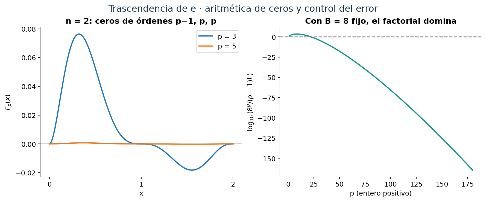
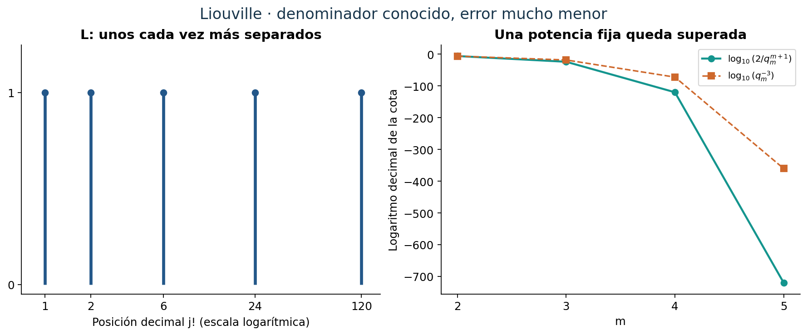
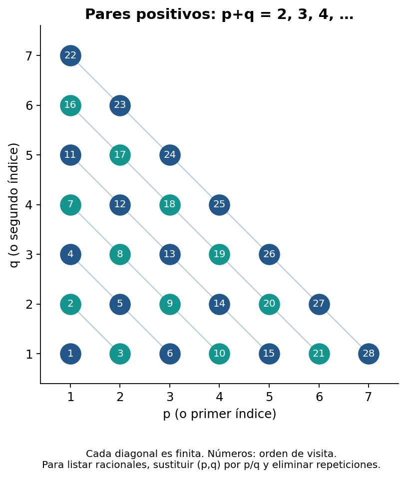
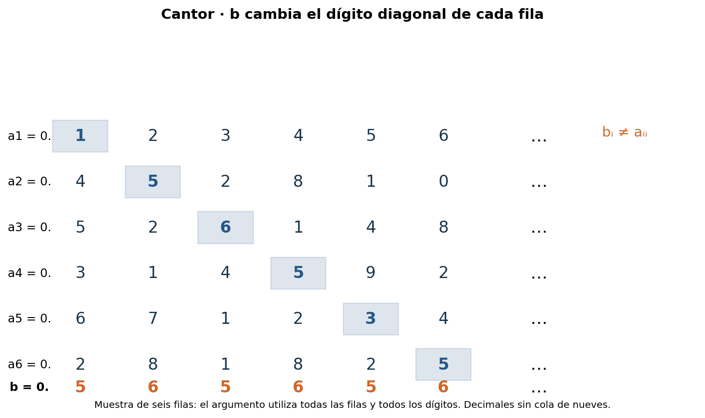
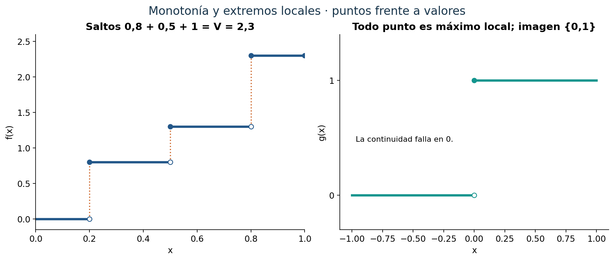

::: {.spivak-nav}

[← Capítulo 20](capitulo-20.qmd) · [Colecciones](../index.qmd#spivak-calculus-cuarta-edición) · [Capítulo 22 →](capitulo-22.qmd)

:::

A. Peña · Matemática Abierta · 2026-10-15.

Soluciones propias de los **8 problemas y sus 21 unidades explícitas**, incluidas todas las tareas con estrellas. Se desarrolla además la prueba central del capítulo, separada del contador de ejercicios. No hay apéndice. Fuente: Michael Spivak, *Calculus*, cuarta edición, C21, pp. 442–451; ejercicios en pp. 448–451 / PDF 467–470 de la copia consultada. Aquí página PDF = página impresa +19. Las formulaciones conservan el contenido matemático y reducen la prosa original. El desarrollo, las explicaciones y las figuras son propios.

## De irracional a trascendente {#seccion-579}

Un real $\alpha$ es **algebraico** si existe un polinomio no nulo $P\in\mathbb Z[X]$ tal que $P(\alpha)=0$. Es **trascendente** si no existe tal polinomio. Excluir el polinomio cero es esencial: ese polinomio se anula en todos los reales. Podemos usar coeficientes racionales en la definición sin cambiarla, pues multiplicar por un denominador común produce coeficientes enteros.

Todo racional $s/t$, con $t\ne0$, es algebraico: anula $tX-s$. El número $\sqrt2$ también es algebraico, aunque irracional: anula $X^2-2$. Por eso demostrar que e es irracional elimina únicamente las ecuaciones de grado uno. Ahora debemos eliminar cualquier grado finito.

## Teorema central — La trascendencia de e {#seccion-1266}

Referencia: Spivak, C21, pp. 442–447. Ofrecemos una explicación propia de la construcción por integrales del capítulo. Las herramientas analíticas son integrales impropias, integración por partes y el crecimiento factorial. La parte aritmética se explicita para que no quede escondida en la notación.

### 1. Lo que tendría que ocurrir si e fuera algebraico

Supongamos que
$$\sum_{k=0}^n a_ke^k=0,\qquad a_k\in\mathbb Z,\quad a_0\ne0,\quad a_n\ne0.$$
Podemos exigir $a_0\ne0$: si una relación inicial tiene término constante cero, dividimos el polinomio por la mayor potencia común de X; como e no es cero, sigue siendo una relación para e. El grado resultante es $n\ge1$, pues una constante no nula no se anula.

Buscaremos enteros $M,M_1,\ldots,M_n$ y errores $\varepsilon_k$ con
$$e^kM=M_k+\varepsilon_k.$$
Al sustituir, la relación supuesta se convierte en
$$I+\sum_{k=1}^na_k\varepsilon_k=0,
\qquad I=a_0M+\sum_{k=1}^na_kM_k.$$
La contradicción aparecerá si $I$ es un entero no nulo y la suma de errores tiene valor absoluto menor que uno. La dificultad es obtener ambas condiciones con la misma construcción.

### 2. Primos, factoriales y el polinomio auxiliar

Usaremos dos hechos aritméticos. Hay primos arbitrariamente grandes: si sólo hubiera una lista finita, un divisor primo del producto de todos ellos más uno no pertenecería a la lista. Además, si un primo p no divide dos enteros, tampoco divide su producto. Para justificarlo, si p no divide u, entonces el máximo común divisor de p y u es uno; la identidad de Bézout da $rp+su=1$, y multiplicar por v muestra que $p\mid uv$ implicaría $p\mid v$. La identidad de Bézout se obtiene tomando el menor entero positivo de la forma $rp+su$ y usando división con resto: ese mínimo divide p y u.

Tomemos un primo $p>\max(n,|a_0|)$ y definamos
$$Q(x)=\prod_{j=1}^n(x-j),\qquad
F_p(x)=\frac{x^{p-1}Q(x)^p}{(p-1)!}.$$
El numerador tiene coeficientes enteros. Su cero en 0 tiene orden $p-1$, mientras que sus ceros en $1,\ldots,n$ tienen orden p. Esta diferencia de una unidad hará que M sobreviva módulo p y los demás enteros desaparezcan.

Para todo entero $r\ge0$,
$$\int_0^\infty x^re^{-x}\,dx=r!.$$
La convergencia y los términos de borde se justifican porque la exponencial domina cualquier potencia: de Taylor, $e^x\ge x^{r+2}/(r+2)!$ para $x>0$, de modo que $x^re^{-x}=O(x^{-2})$ en el infinito; para el término $x^re^{-x}$ del borde también podemos usar una potencia superior. Integración por partes da la recurrencia $r\int_0^\infty x^{r-1}e^{-x}\,dx$, y el caso r=0 vale uno. Toda integral de un polinomio por $e^{-x}$ converge absolutamente.

### 3. Un entero que no se anula módulo p

Sea
$$M=\int_0^\infty F_p(x)e^{-x}\,dx.$$
Escribamos $Q(x)^p=\sum_{\alpha=0}^{np}C_\alpha x^\alpha$, con $C_\alpha\in\mathbb Z$. Entonces
$$M=\sum_{\alpha=0}^{np}C_\alpha\frac{(p-1+\alpha)!}{(p-1)!}.$$
Todos los cocientes factoriales son enteros. Cuando $\alpha\ge1$, el cociente contiene el factor p. Para $\alpha=0$ el cociente es uno. Por consiguiente
$$M\equiv C_0=\bigl((-1)^n n!\bigr)^p\pmod p.$$
Como $p>n$, ningún factor de $n!$ es divisible por p; el lema aritmético anterior muestra que $p\nmid C_0$. Así M es un entero no nulo, aunque no necesitamos determinar su signo.

### 4. Enteros que sí se anulan módulo p

Para $1\le k\le n$ pongamos
$$M_k=e^k\int_k^\infty F_p(x)e^{-x}\,dx.$$
El cambio $u=x-k$ elimina el factor exponencial exterior:
$$M_k=\frac1{(p-1)!}\int_0^\infty
(u+k)^{p-1}\prod_{j=1}^n(u+k-j)^p e^{-u}\,du.$$
El polinomio del integrando tiene coeficientes enteros y contiene $u^p$, por el factor correspondiente a j=k. Su expansión tiene por tanto la forma $\sum_{r=p}^{(n+1)p-1}d_ru^r$, con $d_r\in\mathbb Z$. Luego
$$M_k=\sum_{r=p}^{(n+1)p-1}d_r\frac{r!}{(p-1)!}.$$
Cada cociente es un entero divisible por p. En consecuencia $M_k\in p\mathbb Z$. Se obtiene
$$I=a_0M+\sum_{k=1}^na_kM_k\equiv a_0C_0\not\equiv0\pmod p.$$
Aquí usamos $0<|a_0|<p$. De modo que $I\in\mathbb Z\setminus\{0\}$ y $|I|\ge1$.

### 5. El error uniforme se vuelve tan pequeño como queramos

Definamos
$$\varepsilon_k=e^k\int_0^kF_p(x)e^{-x}\,dx.$$
Separar la integral de M en $[0,k]$ y $[k,\infty)$ prueba exactamente que $e^kM=M_k+\varepsilon_k$.

Para $0\le x\le n$, cada factor $|x-j|$ es a lo sumo n, de manera que $|Q(x)|\le n^n$. Además $x^{p-1}\le n^{p-1}$ y $e^k\le e^n$. Usando $\int_0^ke^{-x}\,dx\le1$, obtenemos simultáneamente para todos los k
$$|\varepsilon_k|\le
\frac{e^n n^{p-1+np}}{(p-1)!}
\le e^n\frac{B^p}{(p-1)!},\qquad B=n^{n+1}.$$
El número B queda fijo cuando varía p. Si $r_p=B^p/(p-1)!$, entonces $r_{p+1}/r_p=B/p$. Para $p\ge2B$ esta razón es a lo sumo 1/2; una cota geométrica muestra que $r_p\to0$. Esto vale también al restringir p a los primos, que son arbitrariamente grandes.

Podemos por tanto elegir un primo que, además de las restricciones anteriores, cumpla
$$\left(\sum_{k=1}^n|a_k|\right)e^n\frac{B^p}{(p-1)!}<\frac12.$$
No se está escogiendo un p diferente para cada k: una sola cota controla todos los errores.

### 6. La contradicción

La relación algebraica supuesta exige $I=-\sum a_k\varepsilon_k$. Pero acabamos de demostrar a la vez que
$$1\le|I|=\left|\sum_{k=1}^na_k\varepsilon_k\right|<\frac12.$$
Es imposible. Por lo tanto **e es trascendente**.

El papel de la integral puede resumirse con precisión: transforma monomios en factoriales. La multiplicidad de los ceros decide qué factoriales contienen p. La estimación analítica sólo actúa en los segmentos acotados $[0,k]$, mientras que la aritmética se obtiene de las integrales impropias completas.

{#fig-spv4-c21-f01 fig-alt="Capítulo 21: Ceros auxiliares y dominio del factorial"}

## E001 — Operaciones con un algebraico y un racional {#e001}

Fuente: Spivak, C21, problema 1, p. 448. Sea $P(X)=\sum_{j=0}^na_jX^j\in\mathbb Z[X]$ no nulo, de grado n, con $P(\alpha)=0$.

**`SPV4-C21-E001-a` — Problema.** Si $\alpha>0$ es algebraico, probar que $\sqrt\alpha$ es algebraico.

**Solución.** Para $\beta=\sqrt\alpha$ se tiene $P(\beta^2)=P(\alpha)=0$. El polinomio $P(X^2)$ tiene coeficientes enteros y término principal $a_nX^{2n}\ne0$. Es una ecuación algebraica válida para $\beta$; no hace falta que sea de grado mínimo.

**`SPV4-C21-E001-b` — Problema.** Si $\alpha$ es algebraico y $r\in\mathbb Q$, probar que $\alpha+r$ y $r\alpha$ son algebraicos.

**Solución.** Escriba $r=s/t$, con $s\in\mathbb Z$ y $t\in\mathbb N$. El número $\beta=\alpha+s/t$ anula
$$A(X)=t^nP(X-s/t)=\sum_{j=0}^na_jt^{n-j}(tX-s)^j.$$
Los coeficientes son enteros y el coeficiente principal es $a_nt^n\ne0$.

Si $s\ne0$, el número $\gamma=(s/t)\alpha$ anula
$$B(X)=s^nP(tX/s)=\sum_{j=0}^na_jt^js^{n-j}X^j.$$
De nuevo hay coeficientes enteros y término principal $a_nt^nX^n\ne0$. Si s=0, el producto es cero y anula X. La separación de ese caso evita dividir por cero. Estas construcciones prueban exactamente las operaciones pedidas; no presuponen que la suma de dos algebraicos arbitrarios sea algebraica.

## E002 — Dos ecuaciones de grado cuatro {#e002}

Fuente: Spivak, C21, problema 2, p. 448.

**`SPV4-C21-E002` — Problema.** Encontrar ecuaciones polinómicas enteras que prueben la algebraicidad de $\sqrt2+\sqrt3$ y $\sqrt2(1+\sqrt3)$.

**Solución.** Si $u=\sqrt2+\sqrt3$, entonces $u^2=5+2\sqrt6$, y por ello $(u^2-5)^2=24$. Al desarrollar,
$$u^4-10u^2+1=0.$$
Si $v=\sqrt2(1+\sqrt3)$, entonces $v^2=8+4\sqrt3$. Ahora $(v^2-8)^2=48$, lo que da
$$v^4-16v^2+16=0.$$
Los dos polinomios son no nulos y de coeficientes enteros. Elevar al cuadrado puede introducir otras raíces, pero eso no afecta la conclusión: sólo necesitamos una ecuación satisfecha por cada número propuesto.

## E003* — La desigualdad de Liouville {#e003}

Fuente: Spivak, C21, problema 3, p. 448. Sea $\alpha$ algebraico e irracional y sea $P\in\mathbb Z[X]$ no nulo de grado mínimo n tal que $P(\alpha)=0$. Necesariamente $n\ge2$. La minimalidad se entiende entre polinomios de coeficientes racionales o enteros, que son equivalentes al eliminar denominadores.

**`SPV4-C21-E003-a` — Problema.** Probar que $P(p/q)\ne0$ para todo racional $p/q$.

**Solución.** Si $P(r)=0$ para un racional r, la división polinómica en $\mathbb Q[X]$ da $P(X)=(X-r)H(X)$, con H de grado n−1. Al evaluar en $\alpha$, el factor $\alpha-r$ no es cero, pues $\alpha$ es irracional. Por ello $H(\alpha)=0$. Multiplicar H por un denominador común produciría un polinomio entero no nulo de grado menor que n que anula $\alpha$, contradicción.

**`SPV4-C21-E003-b` — Problema.** Probar que $|P(p/q)|\ge q^{-n}$ para $p\in\mathbb Z$, $q\in\mathbb N$.

**Solución.** La cantidad
$$q^nP(p/q)=\sum_{j=0}^na_jp^jq^{n-j}$$
es un entero no nulo por (a). Su valor absoluto es al menos uno. Al dividir por $q^n>0$ resulta la cota. No se exige que la fracción esté reducida.

**`SPV4-C21-E003-c` — Problema.** Sea $M=\sup\{|P'(x)|:|x-\alpha|<1\}$. Si $|\alpha-p/q|<1$, probar
$$\left|\alpha-\frac pq\right|>\frac1{Mq^n}.$$
Deducir la cota global $|\alpha-p/q|>c/q^n$ con $c=\min(1,1/M)>0$.

**Solución.** La derivada es continua en $[\alpha-1,\alpha+1]$, por lo que M es finito. Además M>0: de lo contrario P′ sería cero en un intervalo y, por ser un polinomio, sería idénticamente cero, incompatible con $n\ge2$.

Ponga r=p/q. El segmento entre r y $\alpha$ está en $|x-\alpha|<1$. El teorema del valor medio da $|P(r)-P(\alpha)|\le M|r-\alpha|$. Para obtener el signo estricto pedido hace falta un paso adicional. En efecto,
$$|P(r)-P(\alpha)|=\left|\int_\alpha^rP'(t)\,dt\right|<M|r-\alpha|.$$
¿Por qué es estricta? P′ no puede tener valor absoluto M en todo ese segmento: si lo tuviera, por continuidad y M>0 tendría signo constante y sería el polinomio constante M o −M en un intervalo. Una identidad polinómica lo haría constante en toda la recta, y P tendría grado uno. Por tanto existe un pequeño subintervalo donde $|P'|<M$, lo que hace estricta la cota integral. Como r es racional, $r\ne\alpha$, y ese segmento tiene longitud positiva.

Junto con (b), esto da $q^{-n}\le|P(r)|<M|r-\alpha|$, que prueba la primera afirmación. Si $|r-\alpha|<1$, también se obtiene la cota con c. Si $|r-\alpha|\ge1$, la igualdad a uno es imposible, pues implicaría $\alpha=r\pm1\in\mathbb Q$. Así $|r-\alpha|>1\ge c/q^n$. Queda probada la afirmación para todos los racionales.

**Observación.** Un algebraico irracional puede aproximarse con racionales, pero una potencia fija del denominador impide que los errores sean arbitrariamente menores que $q^{-n}$. La constante c depende del número y de su polinomio, no del racional que se aproxima.

## E004* — Un número de Liouville {#e004}

Fuente: Spivak, C21, problema 4, p. 448.

**`SPV4-C21-E004` — Problema.** Probar que el real cuyo decimal tiene unos en las posiciones $j!$, para $j\ge1$, y ceros en las restantes es trascendente:
$$L=\sum_{j=1}^\infty10^{-j!}=0.110001000000000000000001\ldots.$$

**Idea.** Truncar antes de un intervalo enorme de ceros produce un racional con denominador conocido y un error que supera cualquier potencia fija de ese denominador.

**Solución.** La suma converge por comparación con $\sum_{\ell\ge1}10^{-\ell}$. Para $m\ge2$, sea
$$\frac{p_m}{q_m}=\sum_{j=1}^m10^{-j!},\qquad q_m=10^{m!},\qquad
p_m=\sum_{j=1}^m10^{m!-j!}\in\mathbb Z.$$
No necesitamos que $p_m/q_m$ esté reducido. Todas las posiciones posteriores son al menos $(m+1)!$. Por tanto
$$0<L-\frac{p_m}{q_m}\le\sum_{\ell=(m+1)!}^\infty10^{-\ell}
=\frac{10}{9}\,10^{-(m+1)!}
<\frac2{q_m^{m+1}}.$$

Primero descartamos que L sea racional. Si $L=A/B$, con B positivo, la diferencia positiva entre L y $p_m/q_m$ tendría numerador entero no nulo sobre $Bq_m$; sería al menos $1/(Bq_m)$. Esto contradice la cota anterior cuando $2B<q_m^m$, lo que ocurre para m suficientemente grande. Así L es irracional.

Si fuera algebraico, E003 daría un grado $n\ge2$ y una constante c>0 con $|L-p/q|>c/q^n$ para todo racional. Elijamos $m\ge n$ tan grande que $q_m>2/c$. Entonces
$$0<L-\frac{p_m}{q_m}<\frac2{q_m^{m+1}}
\le\frac2{q_m^{n+1}}<\frac c{q_m^n},$$
contradicción. Por tanto L no satisface ninguna ecuación polinómica entera no nula, de ningún grado.

**Observación.** Tener un decimal no periódico sólo probaría irracionalidad. El argumento utiliza cuantitativamente la separación factorial de las posiciones para excluir todos los grados.

{#fig-spv4-c21-f02 fig-alt="Capítulo 21: Posiciones factoriales y aproximaciones racionales de L"}

## E005* — Construcciones numerables {#e005}

Fuente: Spivak, C21, problema 5, pp. 449–450. Diremos «numerable» en el sentido de «a lo sumo numerable», incluyendo conjuntos finitos y el vacío. Para un conjunto infinito, las listas obtenidas pueden convertirse en una enumeración sin repeticiones conservando sólo la primera aparición de cada elemento. Las listas finitas se tratan directamente. En (d) trabajamos con enumeraciones fijadas de los conjuntos dados.

**`SPV4-C21-E005-a` — Problema.** Si A y B son numerables, probar que $A\cup B$ es numerable.

**Solución.** Intercale las listas $a_1,b_1,a_2,b_2,\ldots$. Todo elemento de la unión aparece en una posición finita. Se omiten las entradas que no existan si una lista es finita, y las repeticiones. Si ambas son finitas, la unión es finita.

**`SPV4-C21-E005-b` — Problema.** Probar que los racionales positivos son numerables.

**Solución.** Para cada entero $s\ge2$, liste los pares positivos (p,q) con p+q=s en orden creciente de p. Cada diagonal es finita. Concatenarlas enumera todos los pares positivos, pues (p,q) se alcanza en la diagonal p+q. Sustituya cada par por p/q y suprima repeticiones. Todo racional positivo aparece y no se omite ninguno. Hay infinitos, pues se incluyen los enteros positivos. Además $\mathbb Q=\mathbb Q_{>0}\cup(-\mathbb Q_{>0})\cup\{0\}$ es numerable por (a); esta extensión se usará en E008.

**`SPV4-C21-E005-c` — Problema.** Probar que $\mathbb Z^2$ es numerable.

**Solución.** Enumere los enteros mediante $z(0)=0$, $z(2k-1)=k$ y $z(2k)=-k$ para $k\ge1$. Recorra los índices $(i,j)\in\mathbb N_0^2$ por diagonales i+j=0,1,2,…, cada una finita, y escriba $(z(i),z(j))$. La aplicación z es biyectiva: la posición de un entero positivo k es 2k−1 y la de −k es 2k. Por eso cada par entero aparece exactamente una vez.

**`SPV4-C21-E005-d` — Problema.** Si $A_1,A_2,\ldots$ son numerables, probar que $\bigcup_{j\ge1}A_j$ es numerable.

**Solución.** Fijadas listas $A_j=\{a_{j,1},a_{j,2},\ldots\}$, recorra los pares (j,k) positivos por las diagonales j+k=2,3,… y escriba $a_{j,k}$. Omita entradas inexistentes en filas finitas o vacías y elimine repeticiones. Cada elemento pertenece a alguna fila y ocupa en ella una posición finita, de manera que aparece en una diagonal finita. El recorrido completo tiene sólo una cantidad numerable de posiciones.

**Observación.** La afirmación se usa en el marco usual de conjuntos, donde se pueden fijar esas enumeraciones. Si se trabaja en teoría de conjuntos sin elección, la selección simultánea de enumeraciones es una hipótesis que debe distinguirse de la simple construcción diagonal.

**`SPV4-C21-E005-e` — Problema.** Probar que $\mathbb Z^3$ es numerable.

**Solución.** Por (c) hay una lista $u_0,u_1,\ldots$ de todos los pares enteros. Todo triple se escribe de manera única como $(u_i,z(j))$, entendiendo que se despliegan las dos coordenadas de $u_i$. Enumerar los índices (i,j) por diagonales enumera los triples.

**`SPV4-C21-E005-f` — Problema.** Para cada entero fijo $n\ge1$, probar que las n-tuplas de enteros forman un conjunto numerable.[^tuplas]

**Solución.** Para n=1 sirve la enumeración z. Si las n-tuplas tienen una lista $u_0,u_1,\ldots$, cada (n+1)-tupla se representa por $(u_i,z(j))$ y se enumera por el recorrido diagonal de (i,j). La inducción prueba el resultado para todo n finito. El hecho de fijar n es esencial para esta inducción; no se está tratando el conjunto de sucesiones infinitas de enteros.

**`SPV4-C21-E005-g` — Problema.** Para cada grado fijo $n\ge1$, probar que el conjunto de raíces reales de todos los polinomios enteros de grado n es numerable.

**Solución.** Un polinomio de grado n queda determinado por una (n+1)-tupla entera $(a_0,\ldots,a_n)$ con $a_n\ne0$. Por (f), esas tuplas se pueden enumerar. Cada polinomio tiene a lo sumo n raíces reales distintas: si tuviera más, factorizar sucesivamente por cada raíz excedería el grado. Ordene de menor a mayor las raíces de cada polinomio; cada fila será finita, quizá vacía. La unión numerable de estas filas es numerable por (d). Es indispensable excluir el polinomio cero, cuyo conjunto de raíces es toda la recta.

**`SPV4-C21-E005-h` — Problema.** Probar que los números algebraicos reales forman un conjunto numerable.

**Solución.** Todo algebraico es raíz de un polinomio entero de algún grado $n\ge1$. La unión, sobre los grados positivos, de los conjuntos de raíces de (g) es numerable por (d), y coincide exactamente con los algebraicos. Contiene todos los racionales, así que es infinito.

[^tuplas]: En E005(f), el texto impreso no repite la palabra «enteros» junto a las coordenadas. Se hace explícita por la continuidad con (c),(e) y por su uso en (g). Para coordenadas reales la afirmación ya sería falsa en n=1, como demuestra E006.

{#fig-spv4-c21-f03 fig-alt="Capítulo 21: Recorrido diagonal de pares positivos"}

## E006* — La diagonal de Cantor {#e006}

Fuente: Spivak, C21, problema 6, p. 450.

**`SPV4-C21-E006` — Problema.** Probar que los reales de (0,1) no son numerables mediante una construcción decimal diagonal.

**Solución.** Supongamos una lista de todos ellos,
$$a_i=0.a_{i1}a_{i2}a_{i3}\ldots\quad(i\ge1).$$
Para evitar las dos representaciones de ciertos decimales, elegimos siempre la que no termina en una cola infinita de nueves: un decimal finito se completa con ceros. Definamos
$$b=0.b_1b_2b_3\ldots,\qquad
b_i=\begin{cases}5,&a_{ii}\ne5,\\6,&a_{ii}=5.\end{cases}$$
Todos los dígitos de b son 5 o 6. En particular $0<b<1$, y su expansión no tiene cola de nueves ni es un decimal finito. Para cada i, el dígito i de b difiere del dígito i de $a_i$. Por la unicidad de las expansiones elegidas, $b\ne a_i$. Eso contradice que la lista contuviera todos los números del intervalo.

La precaución decimal importa: diferir en un dígito no basta para comparar dos expansiones arbitrarias, como muestra $0.5000\ldots=0.4999\ldots$. Nuestra elección elimina exactamente esa ambigüedad.

**Consecuencia.** Si los trascendentes fueran numerables, su unión con los algebraicos de E005 también lo sería. Esa unión es $\mathbb R$, que contiene el intervalo no numerable (0,1), contradicción. Los trascendentes son por tanto no numerables. Este argumento compara cardinalidades; no introduce una noción de medida ni de probabilidad, y por sí solo no identifica un número trascendente particular.

{#fig-spv4-c21-f04 fig-alt="Capítulo 21: Una muestra finita de la construcción diagonal infinita"}

## E007* — Discontinuidades de una función monótona {#e007}

Fuente: Spivak, C21, problema 7, p. 450. Sea $f:[0,1]\to\mathbb R$ no decreciente y $V=f(1)-f(0)\ge0$.

Para $0<a<1$, definamos
$$L_a=\sup_{0\le x<a}f(x)=\lim_{x\to a^-}f(x),\qquad
R_a=\inf_{a<x\le1}f(x)=\lim_{x\to a^+}f(x).$$
Monotonía y acotación garantizan su existencia y $L_a\le f(a)\le R_a$. En los extremos fijamos $L_0=f(0)$ y $R_1=f(1)$; $R_0$ y $L_1$ son los límites interiores habituales. Esto equivale a extender f constantemente a ambos lados de [0,1] y resuelve la notación bilateral del enunciado en los extremos.[^extremos] Sea $J_a=R_a-L_a\ge0$.

**`SPV4-C21-E007-a` — Problema.** Para cada $\varepsilon>0$, probar que sólo hay finitos a con $J_a>\varepsilon$, con cantidad a lo sumo $V/\varepsilon$.

**Solución.** Si a<b, elija x estrictamente entre ellos. Entonces $R_a\le f(x)\le L_b$, incluso cuando a=0 o b=1. Los intervalos abiertos $(L_a,R_a)$ asociados a saltos positivos están por tanto ordenados y no se superponen, todos dentro de $[f(0),f(1)]$.

Para puntos distintos $a_1<\cdots<a_m$, sumar las longitudes y los huecos entre esos intervalos da
$$\sum_{i=1}^mJ_{a_i}\le V.$$
Si cada salto supera $\varepsilon$ y m>0, resulta $m\varepsilon<\sum_iJ_{a_i}\le V$, y por ello $m<V/\varepsilon$. En particular hay a lo sumo $\lfloor V/\varepsilon\rfloor$ puntos. Para concluir la finitud no hemos supuesto que los puntos puedan enumerarse: si hubiera más que esa cantidad, podríamos seleccionar un subconjunto finito con demasiados elementos y obtendríamos la misma contradicción. Si V=0, no hay saltos positivos.

**`SPV4-C21-E007-b` — Problema.** Probar que el conjunto de discontinuidades de f es numerable.

**Solución.** En un punto interior, f es continua si y sólo si $L_a=f(a)=R_a$, equivalente a $J_a=0$. Con las definiciones anteriores esto vale también para la continuidad relativa al intervalo en 0 y 1. Por tanto el conjunto de discontinuidades es
$$D=\{a:J_a>0\}=\bigcup_{m=1}^\infty\{a:J_a>1/m\}.$$
La igualdad se debe a que cualquier número positivo supera 1/m para algún entero m. Cada conjunto de la derecha es finito por (a); la unión es numerable por E005(d).

**Observación.** El resultado permite infinitas discontinuidades, siempre que sus saltos consuman una variación total finita. No se ha probado aquí una afirmación sobre el conjunto de puntos de no derivabilidad.

[^extremos]: El original usa límites bilaterales al referirse a a en [0,1], sin definir la función fuera del intervalo. Si se prefiere limitar la prueba a (0,1), añadir los dos extremos posibles tampoco altera la numerabilidad; nuestra normalización conserva además la cota total de (a) con los extremos incluidos.

{#fig-spv4-c21-f05 fig-alt="Capítulo 21: Saltos ordenados y valores de máximos locales"}

## E008* — Cuando todo punto es un extremo local {#e008}

Fuente: Spivak, C21, problema 8, p. 451; remite a C11, problema 70(a,b), p. 218 / PDF 237, cotejado con el facsímil. Los extremos locales son no estrictos y relativos al dominio. Se trabaja en un intervalo I; para la remisión original, $I=[a,b]$.

**`SPV4-C21-E008-a` — Problema.** Si cada punto de I es un máximo local de $f:I\to\mathbb R$, sin suponer continuidad, probar que f sólo toma una cantidad numerable de valores.

**Solución.** Si x es un máximo local, existe $\delta>0$ tal que $f(y)\le f(x)$ para $y\in I\cap(x-\delta,x+\delta)$. Por densidad racional elija r,s racionales con
$$x-\delta<r<x<s<x+\delta.$$
Entonces $f(x)=\max\{f(y):y\in I\cap(r,s)\}$. Hay sólo una cantidad numerable de pares racionales (r,s): enumere los racionales, y luego sus pares por diagonales. Para cada par, si ese máximo existe, su **valor** es único. Así los valores de los máximos locales pertenecen a un conjunto numerable, el conjunto de esos máximos sobre intervalos de extremos racionales. Como cada punto es un máximo local, toda la imagen f(I) es numerable.

La prueba establece algo más útil: para una función cualquiera, el conjunto de **valores** de sus máximos locales es numerable, aunque no todos los puntos sean máximos. No afirma que el conjunto de puntos de máximo local sea numerable: una función constante tiene todos los puntos como máximos y sólo un valor.

**`SPV4-C21-E008-b` — Problema.** Deducir que una función continua en [a,b] con todos sus puntos máximos locales es constante; también si todos son mínimos locales.

**Solución.** Si no fuera constante, existirían u,v con $f(u)<f(v)$. Por el teorema del valor intermedio su imagen contendría el intervalo $[f(u),f(v)]$. Todo intervalo de longitud positiva es no numerable: la aplicación $t\mapsto f(u)+t(f(v)-f(u))$ inyecta (0,1) en él. Eso contradice (a). Luego f es constante. Para mínimos locales aplique el mismo argumento a −f. Si a=b, la conclusión es inmediata.

**`SPV4-C21-E008-c` — Problema.** Probar el resultado de C11-70(b): si f es continua en [a,b] y cada punto es máximo local o mínimo local, permitiendo ambos tipos, entonces f es constante.

**Solución.** Sea A el conjunto de valores de f en sus máximos locales y B el conjunto de valores en sus mínimos locales. La versión más general demostrada en (a) da que A es numerable. Aplicada a −f, muestra lo mismo para B. Por hipótesis $f([a,b])=A\cup B$, de modo que la imagen es numerable. Si hubiera dos valores distintos, continuidad y valor intermedio producirían un intervalo de longitud positiva dentro de la imagen, contradicción. Por tanto f es constante.

**Observación.** La continuidad es indispensable para las dos últimas conclusiones. Por ejemplo, la función que vale 1 en los racionales y 0 en los irracionales tiene cada punto como máximo local o mínimo local, pero no es constante en ningún intervalo de longitud positiva. Su imagen de dos elementos sí satisface la numerabilidad de los valores. No se debe confundir el paso «imagen numerable» con «imagen de un solo elemento»: la continuidad es la que permite ese paso.

## Dependencias y alcance de la entrega {#seccion-25965}

Se utilizan factorización polinómica, densidad de los racionales, valor intermedio, valor medio, integración y crecimiento exponencial, disponibles antes de C21. El conteo diagonal se construye dentro de los ejercicios. El teorema central desarrolla la identidad factorial usada en C19-40, y explicita los hechos aritméticos necesarios. No se utiliza un teorema general sobre cuerpos algebraicos ni teoría de medida. La exposición central tiene seis bloques y no se suma a las 21 unidades de los ocho problemas.

---

::: {.spivak-nav}

[← Capítulo 20](capitulo-20.qmd) · [Colecciones](../index.qmd#spivak-calculus-cuarta-edición) · [Capítulo 22 →](capitulo-22.qmd)

:::

Soluciones originales de Alevi Peña · Matemática Abierta. [Licencia GFDL 1.3 o posterior](/COPYING.FDL).
