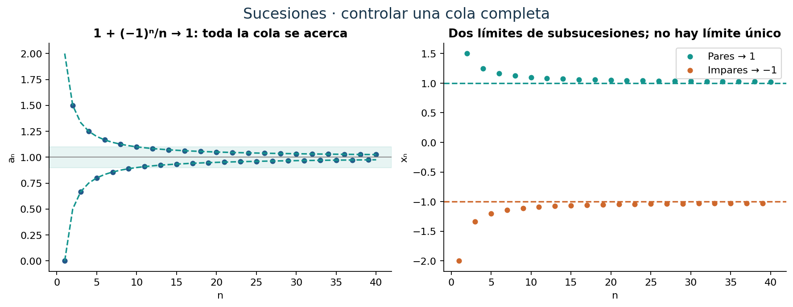
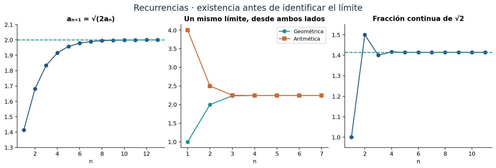
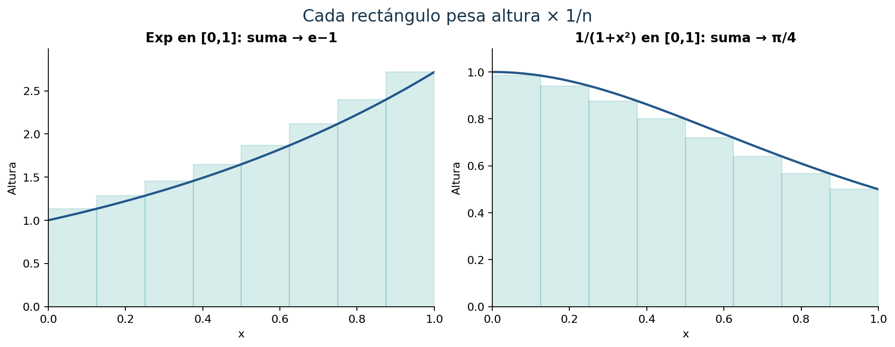
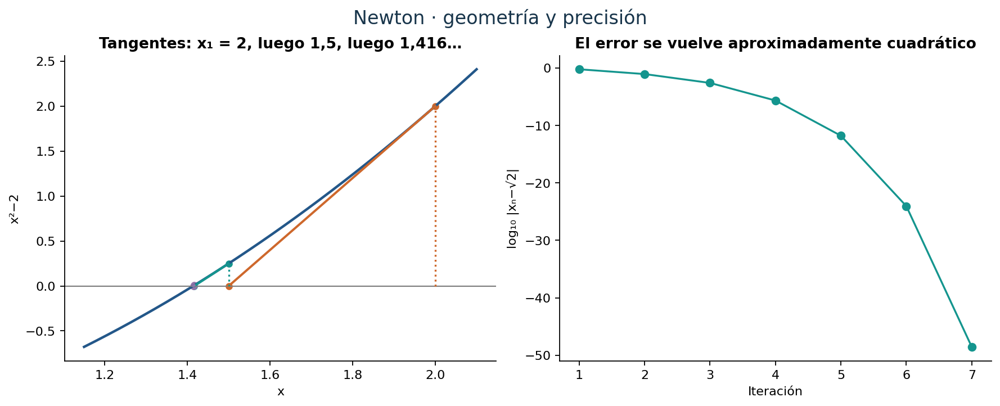
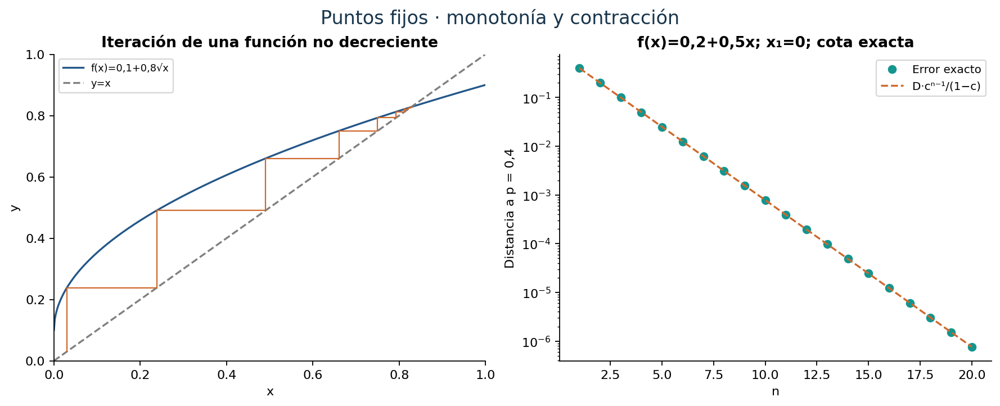
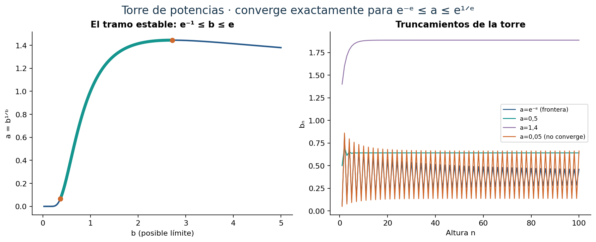
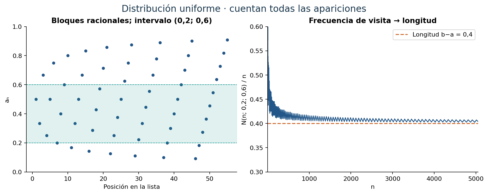

::: {.spivak-nav}

[← Capítulo 21](capitulo-21.qmd) · [Colecciones](../index.qmd#spivak-calculus-cuarta-edición) · [Capítulo 23 →](capitulo-23.qmd)

:::

A. Peña · Matemática Abierta · 2026-10-15.

Soluciones propias de los **33 problemas y sus 115 unidades terminales**, con todas las tareas de los ejercicios con estrellas. No hay apéndice. Fuente: Michael Spivak, *Calculus*, cuarta edición, C22, pp. 452–470; ejercicios pp. 460–470 / PDF 479–489 de la copia consultada (desplazamiento +19). Las formulaciones se reducen al contenido matemático necesario; las soluciones y las figuras son propias. La numeración interna conserva los subincisos romanos de E027(b) y E030(a).

## Qué significa que una sucesión se acerque a un número {#seccion-524}

Los primeros términos de una sucesión pueden sugerir un destino y luego apartarse de él. Para que $a_n\to\ell$ necesitamos controlar toda una cola: para cada $\varepsilon>0$ debe existir N tal que $|a_n-\ell|<\varepsilon$ siempre que n>N. Modificar un número finito de términos no altera esta condición. En cambio, una subsucesión sólo conserva términos con índices estrictamente crecientes; puede acercarse a un límite aunque el conjunto de la sucesión siga oscilando.

La monotonía proporciona una manera de demostrar existencia sin adivinar el límite. Si $a_n$ no decrece y está acotada superiormente, el supremo L de sus valores es su límite: algún término supera $L-\varepsilon$, y todos los posteriores quedan entre ese término y L. Para una sucesión no creciente se usa el ínfimo. Una vez probada la convergencia de una recurrencia, la continuidad permite pasar al límite e identificarlo. Resolver primero la ecuación del posible límite sólo produce candidatos; todavía falta demostrar que la sucesión converge.

También podemos reconocer la convergencia sin conocer el destino: una sucesión es de Cauchy si, para cada $\varepsilon>0$, hay N tal que $|a_m-a_n|<\varepsilon$ para todos m,n>N. En los reales esta condición equivale a converger. La completitud interviene de forma decisiva: una sucesión de Cauchy es acotada, tiene una subsucesión convergente por Bolzano–Weierstrass, y E004 muestra que eso obliga a converger a la sucesión entera.

Usaremos las reglas algebraicas de límites y la continuidad, justificadas por sus definiciones. La notación $a_n\to+\infty$ significa que para cada K real todos los términos suficientemente tardíos superan K; no significa convergencia a un número real.

{#fig-spv4-c22-f01 fig-alt="Capítulo 22: Colas convergentes, oscilación y envolventes"}

## E001 — Diez límites {#e001}

Fuente: Spivak, C22, problema 1, p. 460.

**`SPV4-C22-E001-i`** Probar $n/(n+1)\to1$. La diferencia con uno tiene valor absoluto $1/(n+1)$, que tiende a cero. Por ejemplo, basta tomar $N>1/\varepsilon$ en la definición.

**`SPV4-C22-E001-ii`** Probar $(n+3)/(n^3+4)\to0$. Dividiendo por $n^3$, obtenemos $(n^{-2}+3n^{-3})/(1+4n^{-3})\to0$; el denominador tiende a uno y nunca se anula.

**`SPV4-C22-E001-iii`** Probar $(n^2+1)^{1/8}-(n+1)^{1/4}\to0$. Si $u>0$, el valor medio aplicado a $t^{1/r}$ en $[u,u+1]$, con r>1, da
$$0<(u+1)^{1/r}-u^{1/r}\le\frac1{r u^{1-1/r}}.$$
Introducimos el término común $n^{1/4}=(n^2)^{1/8}$. La primera diferencia queda acotada por $1/(8n^{7/4})$ y la segunda por $1/(4n^{3/4})$. Por la desigualdad triangular, el valor absoluto de la expresión pedida es a lo sumo la suma de estas dos cotas, que tiende a cero. No se restan dos expresiones divergentes sin controlar su diferencia.

**`SPV4-C22-E001-iv`** Probar $n!/n^n\to0$. En el producto $\prod_{k=1}^n(k/n)$, los primeros $\lfloor n/2\rfloor$ factores son a lo sumo 1/2 y los restantes son a lo sumo uno. Luego
$$0<\frac{n!}{n^n}\le2^{-\lfloor n/2\rfloor}\longrightarrow0.$$

**`SPV4-C22-E001-v`** Si a>0, probar $a^{1/n}\to1$. Escribimos $a^{1/n}=\exp((\log a)/n)$ y usamos continuidad de la exponencial. E010 ofrece una prueba que sólo usa potencias enteras y raíces.

**`SPV4-C22-E001-vi`** Probar $n^{1/n}\to1$. Como $\log n/n\to0$, se tiene $n^{1/n}=\exp(\log n/n)\to1$. La cota elemental correspondiente se desarrolla en E010(e).

**`SPV4-C22-E001-vii`** Probar $(n^2+n)^{1/n}\to1$. Su logaritmo es $[2\log n+\log(1+1/n)]/n\to0$, de modo que el límite es uno por continuidad de exp.

**`SPV4-C22-E001-viii`** Para a,b≥0, probar $(a^n+b^n)^{1/n}\to\max(a,b)$. Sea M=max(a,b). Si M=0, todos los términos son cero. Si M>0,
$$M\le(a^n+b^n)^{1/n}\le2^{1/n}M.$$
Ambos extremos tienden a M. Se incluyen el empate y el caso de una base nula.

**`SPV4-C22-E001-ix`** Si $\alpha(n)$ cuenta los primos distintos que dividen n, probar $\alpha(n)/n\to0$. El producto de esos primos divide n y es al menos $2^{\alpha(n)}$. Por tanto $0\le\alpha(n)\le\log n/\log2$, y al dividir por n obtenemos el límite cero. Para n=1, el contador es cero.

**`SPV4-C22-E001-x`*** Para p entero no negativo, y más generalmente para p real $p>-1$, probar
$$\frac{\sum_{k=1}^nk^p}{n^{p+1}}\longrightarrow\frac1{p+1}.$$
La expresión es la suma derecha $n^{-1}\sum_{k=1}^n(k/n)^p$ de la función continua $x^p$ en [0,1]. Converge a $\int_0^1x^p\,dx=1/(p+1)$. La misma prueba sirve para todo p real no negativo. Para $-1<p<0$, la función $x^p$ es positiva y decreciente en [1,∞), y la comparación integral da
$$\int_1^{n+1}x^p\,dx\le\sum_{k=1}^nk^p\le1+\int_1^nx^p\,dx.$$
Al dividir por $n^{p+1}$, ambos extremos tienden a $1/(p+1)$. Si se permite p real, la restricción $p>-1$ es necesaria para la fórmula: en p=−1 las sumas armónicas divergen, y para p<−1 el numerador es al menos uno mientras que el denominador tiende a cero. El enunciado impreso no precisa el rango de p; la prueba cubre todo el rango real donde su resultado es válido.

## E002 — Siete límites para calcular {#e002}

Fuente: Spivak, C22, problema 2, pp. 460–461. Las raíces y los cocientes se consideran donde están definidos; omitir un prefijo finito no afecta un límite.

**`SPV4-C22-E002-i`**
$$\frac n{n+1}-\frac{n+1}n=\frac{-2n-1}{n(n+1)}\longrightarrow0.$$

**`SPV4-C22-E002-ii`** Para a,b reales fijos, calcular $n-\sqrt{n+a}\sqrt{n+b}$. Para n suficientemente grande los radicandos son positivos. Racionalizamos:
$$n-\sqrt{(n+a)(n+b)}
=\frac{-(a+b)n-ab}{n+\sqrt{(n+a)(n+b)}}\longrightarrow-\frac{a+b}{2},$$
después de dividir numerador y denominador por n.

**`SPV4-C22-E002-iii`** Al dividir por $2^n$,
$$\frac{2^n+(-1)^n}{2^{n+1}+(-1)^{n+1}}
=\frac{1+(-1/2)^n}{2-(-1/2)^n}\longrightarrow\frac12.$$
El denominador es positivo para n≥1.

**`SPV4-C22-E002-iv`** El valor absoluto de $(-1)^n\sqrt n\sin(n^n)/(n+1)$ es a lo sumo $\sqrt n/(n+1)\le1/\sqrt n$. Por encaje, el límite es cero; no necesitamos analizar la oscilación de $\sin(n^n)$.

**`SPV4-C22-E002-v`** Calcular $(a^n-b^n)/(a^n+b^n)$. Para bases positivas, el límite es 1 si a>b, −1 si a<b y 0 si a=b. El original no explicita restricciones sobre a,b; damos también la clasificación para bases reales.[^bases]

Si $|a|>|b|$, dividimos por $a^n$ y usamos $(b/a)^n\to0$: el límite es 1. Si $|b|>|a|$, dividir por $b^n$ da −1. Si a=b≠0, el cociente es siempre cero. Si a=−b≠0, el denominador se anula en todos los índices impares y no hay una sucesión definida en una cola completa; en los pares el cociente es cero. Si a=b=0, todos los términos son indefinidos. Estos casos agotan todas las bases reales, incluidas las nulas.

**`SPV4-C22-E002-vi`** Para |c|<1, calcular $nc^n$. Si c=0 el resultado es inmediato. Para 0<r=|c|<1, ponga d=−log r>0. El valor absoluto es $ne^{-dn}$. De Taylor, $e^{dn}\ge(dn)^2/2$, por lo que $ne^{-dn}\le2/(d^2n)\to0$. El límite pedido es cero.

**`SPV4-C22-E002-vii`** Calcular $2^{n^2}/n!$. Como $n!\le n^n$,
$$\frac{2^{n^2}}{n!}\ge\left(\frac{2^n}{n}\right)^n.$$
Por (vi), $n/2^n\to0$, de modo que $2^n/n\ge2$ para n grande. La expresión queda entonces por encima de $2^n\to+\infty$. **El límite es $+\infty$**. El exponente del 2 es n², no se trata de $2n^2/n!$.

[^bases]: Se explicita la clasificación porque el enunciado impreso de E002(v) carece de una condición sobre las bases. Para a,b≥0 basta excluir el par (0,0); para bases positivas se recupera la clasificación habitual por a>b, a<b o a=b.

## E003 — Límites de subsucesiones {#e003}

Fuente: Spivak, C22, problema 3, p. 461.

**`SPV4-C22-E003-a`** Si $a_n\in\mathbb Z$ y $a_n\to L$, probar que la sucesión termina siendo constante. Para n,m suficientemente grandes, ambos términos están a distancia menor que 1/3 de L; entonces $|a_n-a_m|<2/3<1$. Dos enteros distintos distan al menos uno, así que todos los términos de esa cola son el mismo entero k. Por tanto L=k. La recíproca es inmediata.

**`SPV4-C22-E003-b`** Determinar todas las subsucesiones convergentes de 1,−1,1,−1,… Por (a), son exactamente aquellas que, a partir de algún índice propio, toman sólo el valor 1, o sólo el valor −1. Pueden incluir cualquier prefijo finito compatible con el orden de índices. Sus límites son respectivamente 1 y −1; no se exige que la subsucesión sea constante desde su primer término.

**`SPV4-C22-E003-c`** Para la sucesión formada concatenando los bloques (1), (1,2), (1,2,3),…, las subsucesiones convergentes son exactamente las que terminan tomando un único entero positivo k. Cada k aparece en todos los bloques de longitud al menos k, así que todas esas posibilidades existen. No hay otros límites por (a).

**`SPV4-C22-E003-d`** Para los bloques $(1/m,2/m,\ldots,(m-1)/m)$, m=2,3,…, determinar todos los límites de subsucesiones. Como todos los términos están entre cero y uno, cualquier límite pertenece a [0,1]. Recíprocamente, para $t\in[0,1]$ elija
$$k_m=\min(m-1,\max(1,\lfloor mt\rfloor)).$$
Se tiene $1\le k_m\le m-1$ y $|k_m/m-t|\le1/m$. Tomar ese término de cada bloque produce índices estrictamente crecientes y una subsucesión que converge a t. Los límites posibles son exactamente todos los puntos de [0,1], incluidos sus extremos.

## E004 — Una cola de Cauchy y una subsucesión {#e004}

Fuente: Spivak, C22, problema 4, p. 461.

**`SPV4-C22-E004-a`** Si $a_n$ es de Cauchy y $a_{n_j}\to L$, probar $a_n\to L$. Dado ε>0, elija N tal que $|a_n-a_m|<\varepsilon/2$ para n,m>N. Elija luego j con $n_j>N$ y $|a_{n_j}-L|<\varepsilon/2$. Ese único término de la subsucesión sirve para comparar toda la cola:
$$|a_n-L|\le|a_n-a_{n_j}|+|a_{n_j}-L|<\varepsilon\quad(n>N).$$

**`SPV4-C22-E004-b`** Si $a_n\to L$, toda subsucesión converge a L. Dado N para la cola original, los índices estrictamente crecientes satisfacen $n_j\ge j$. Para j>N se tiene $n_j>N$ y por ello $|a_{n_j}-L|<\varepsilon$. El límite no cambia.

## E005 — Radicales anidados {#e005}

Fuente: Spivak, C22, problema 5, p. 461.

**`SPV4-C22-E005-a`** Si 0<a<2, probar $a<\sqrt{2a}<2$. Ambas desigualdades se pueden elevar al cuadrado porque todos los términos son positivos. Se reducen respectivamente a $a^2<2a$ y $2a<4$, que siguen de 0<a<2.

**`SPV4-C22-E005-b`** Probar convergencia de $a_1=\sqrt2$, $a_{n+1}=\sqrt{2a_n}$. Como $0<a_1<2$, (a) da inductivamente $a_n<a_{n+1}<2$. Es una sucesión creciente y acotada, de modo que converge.

**`SPV4-C22-E005-c`** Calcular el límite. Si L es su límite, entonces $L\ge\sqrt2>0$ y por continuidad $L=\sqrt{2L}$. La ecuación $L(L-2)=0$ deja los candidatos 0 y 2; la cota positiva excluye 0. Por tanto L=2.

## E006 — Media aritmético-geométrica {#e006}

Fuente: Spivak, C22, problema 6, p. 461. Sean $0<a_1<b_1$ y
$$a_{n+1}=\sqrt{a_nb_n},\qquad b_{n+1}=\frac{a_n+b_n}{2}.$$

**`SPV4-C22-E006-a`** Probar que ambas sucesiones convergen. Para 0<u<v,
$$u<\sqrt{uv}<\frac{u+v}{2}<v.$$
Las desigualdades exteriores siguen de u<v y la central de $(\sqrt v-\sqrt u)^2>0$. Inductivamente, $a_n$ crece, $b_n$ decrece y $a_1\le a_n<b_n\le b_1$. Ambas convergen, a límites A≤B positivos.

**`SPV4-C22-E006-b`** Probar que A=B. Pasar al límite en la segunda recurrencia da $B=(A+B)/2$, por lo que A=B. También hay una cota explícita:
$$0<b_{n+1}-a_{n+1}=\frac{(\sqrt{b_n}-\sqrt{a_n})^2}{2}\le\frac{b_n-a_n}{2}.$$
Así la distancia entre ambas sucesiones tiende a cero por comparación geométrica.

{#fig-spv4-c22-f02 fig-alt="Capítulo 22: Radicales, medias y aproximaciones alternantes"}

## E007 — Fracciones continuas {#e007}

Fuente: Spivak, C22, problema 7, pp. 461–462.

**`SPV4-C22-E007-a`** Partiendo de k=l=1 y reemplazando (k,l) por (k+2l,k+l), probar que los cocientes satisfacen $a_1=1$, $a_{n+1}=1+1/(1+a_n)$. En efecto,
$$\frac{k+2l}{k+l}=\frac{k/l+2}{k/l+1}=1+\frac1{1+k/l}.$$
Los denominadores son positivos y la regla da 1,3/2,7/5,…

**`SPV4-C22-E007-b`** Probar que $a_n\to\sqrt2$. Defina $T(x)=(x+2)/(x+1)$. Para x≥1,
$$T(x)-\sqrt2=-\frac{\sqrt2-1}{x+1}(x-\sqrt2).$$
Por tanto los errores alternan de signo y disminuyen en valor absoluto por un factor a lo sumo $(\sqrt2-1)/2<1$. Todos los términos están en [1,3/2], pues T transforma ese intervalo en sí mismo. La cota geométrica prueba convergencia a $\sqrt2$; además, los impares crecen hacia él y los pares decrecen hacia él. La fracción continua se interpreta como límite de estos truncamientos finitos.

**`SPV4-C22-E007-c`** Para a,b naturales positivos, justificar
$$\sqrt{a^2+b}=a+\frac b{2a+\frac b{2a+\cdots}}.$$
Defina $s=\sqrt{a^2+b}>a$ y los truncamientos $x_1=a$, $x_{n+1}=T(x_n)$, donde $T(x)=a+b/(a+x)$. Todos están en $[a,T(a)]$. La aplicación T decrece y tiene el único punto fijo positivo s. Su segunda iteración cumple
$$T(T(x))-x=\frac{2a(s^2-x^2)}{2a(a+x)+b}.$$
Así, si a≤x<s, entonces $x<T(T(x))<s$; si x>s, entonces $s<T(T(x))<x$. Los impares son crecientes y acotados por s; los pares son decrecientes y mayores que s. Sus límites A≤s≤B satisfacen $T(T(A))=A$ y $T(T(B))=B$. La identidad anterior obliga a $A^2=B^2=s^2$, y como son positivos, A=B=s. Esto prueba que los truncamientos convergen, además de verificar la ecuación formal.

## E008 — Dos límites que detectan los racionales {#e008}

Fuente: Spivak, C22, problema 8, p. 462.

**`SPV4-C22-E008`** Identificar
$$f(x)=\lim_{n\to\infty}\left[\lim_{k\to\infty}(\cos(n!\pi x))^{2k}\right].$$
Para n fijo, el límite interior vale uno si $|\cos(n!\pi x)|=1$ y cero en caso contrario. La primera condición equivale a $n!x\in\mathbb Z$. Si x=p/q es racional, para n≥q el factorial es divisible por q y todos esos límites interiores valen uno. Si x es irracional, $n!x$ nunca es entero y todos valen cero. Por tanto
$$f(x)=\begin{cases}1,&x\in\mathbb Q,\\0,&x\notin\mathbb Q.\end{cases}$$
Es la función de Dirichlet. El orden de los dos límites forma parte del problema y no se intercambia.

## E009 — Sumas que esconden integrales {#e009}

Fuente: Spivak, C22, problema 9, p. 462. En todas las expresiones n tiende a infinito.

**`SPV4-C22-E009-i`** La suma $n^{-1}\sum_{k=1}^n(e^k)^{1/n}=n^{-1}\sum_{k=1}^ne^{k/n}$ es una suma derecha para exp en [0,1]. Su límite es $\int_0^1e^x\,dx=e-1$.

**`SPV4-C22-E009-ii`** Ahora hay 2n términos, con el mismo denominador n:
$$\frac1n\sum_{k=1}^{2n}e^{k/n}\longrightarrow\int_0^2e^x\,dx=e^2-1.$$
El ancho de cada subintervalo es 1/n; no se introduce indebidamente un factor 1/2.

**`SPV4-C22-E009-iii`**
$$\sum_{k=n+1}^{2n}\frac1k=\frac1n\sum_{j=1}^n\frac1{1+j/n}\longrightarrow\int_0^1\frac{dx}{1+x}=\log2.$$

**`SPV4-C22-E009-iv`** La suma incluye ambos extremos n y 2n, pero basta contar sus n+1 términos:
$$0\le\sum_{k=n}^{2n}\frac1{k^2}\le\frac{n+1}{n^2}\longrightarrow0.$$
Ésta es la expresión que se resuelve directamente por una cota elemental.

**`SPV4-C22-E009-v`**
$$\sum_{j=1}^n\frac n{(n+j)^2}
=\frac1n\sum_{j=1}^n\frac1{(1+j/n)^2}\longrightarrow\int_0^1\frac{dx}{(1+x)^2}=\frac12.$$

**`SPV4-C22-E009-vi`**
$$\sum_{j=1}^n\frac n{n^2+j^2}
=\frac1n\sum_{j=1}^n\frac1{1+(j/n)^2}\longrightarrow\int_0^1\frac{dx}{1+x^2}=\frac\pi4.$$
Todas las funciones integradas son continuas en los intervalos indicados, por lo que las sumas de Riemann convergen.

{#fig-spv4-c22-f03 fig-alt="Capítulo 22: Sumas de Riemann con el ancho correcto"}

## E010 — Potencias y raíces sin exponenciales {#e010}

Fuente: Spivak, C22, problema 10, pp. 462–463. Las pruebas siguientes usan el binomio con exponentes enteros y el orden de las raíces positivas.

**`SPV4-C22-E010-a`** Si a>1, escriba a=1+h, h>0. El binomio da $a^n=(1+h)^n\ge1+nh\to+\infty$.

**`SPV4-C22-E010-b`** Si 0<a<1, aplique (a) a 1/a: su potencia tiende a infinito y el recíproco $a^n$ tiende a cero.

**`SPV4-C22-E010-c`** Si a>1, escriba $a^{1/n}=1+h_n$, $h_n>0$. Del binomio, $a\ge1+nh_n$, así que $0<h_n\le(a-1)/n\to0$. Luego $a^{1/n}\to1$. También es válida la cota cuadrática $h_n^2\le2a/[n(n-1)]$ para n≥2.

**`SPV4-C22-E010-d`** Si 0<a<1, la raíz de 1/a converge a uno por (c); su recíproca $a^{1/n}$ también converge a uno. Si a=1 la conclusión es inmediata.

**`SPV4-C22-E010-e`** Escriba $n^{1/n}=1+h_n$, con $h_n\ge0$. Para n≥2, el término cuadrático del binomio da
$$n=(1+h_n)^n\ge\frac{n(n-1)}2h_n^2.$$
Por ello $0\le h_n\le\sqrt{2/(n-1)}\to0$. Se obtiene $n^{1/n}\to1$ sin logaritmos ni exponenciales reales.

## E011 — Acotación y existencia de un máximo {#e011}

Fuente: Spivak, C22, problema 11, p. 463.

**`SPV4-C22-E011-a`** Toda sucesión convergente es acotada. Si $a_n\to L$, una cola cumple $|a_n-L|<1$, luego $|a_n|<|L|+1$. Tome el máximo de esa cota y los valores absolutos del prefijo finito. Es una cota de toda la sucesión.

**`SPV4-C22-E011-b`** Si $a_n\to0$ y algún $a_k=A>0$, probar que el conjunto de sus valores tiene máximo. Elija N≥k de modo que $|a_n|<A/2$ para n>N. El máximo M del conjunto finito $\{a_1,\ldots,a_N\}$ existe y cumple M≥A. Todos los términos posteriores son menores que A/2<M, así que M es el máximo buscado. La condición de un término positivo evita ejemplos como $a_n=-1/n$, cuyo supremo cero no se alcanza.

## E012 — La constante de Euler {#e012}

Fuente: Spivak, C22, problema 12, p. 463.

**`SPV4-C22-E012-a`** Probar
$$\frac1{n+1}<\log(n+1)-\log n<\frac1n.$$
En (n,n+1), la función 1/x queda estrictamente entre esas constantes. Integrar sobre un intervalo de longitud uno prueba ambas desigualdades.

**`SPV4-C22-E012-b`** Sean $H_n=\sum_{k=1}^n1/k$ y $a_n=H_n-\log n$. La diferencia
$$a_{n+1}-a_n=\frac1{n+1}-\log(n+1)+\log n$$
es negativa por (a). Además $\log n=\int_1^n dx/x<\sum_{k=1}^{n-1}1/k=H_{n-1}$ para n≥2, por lo que $a_n>1/n>0$; en n=1 vale uno. La sucesión decrece y está acotada inferiormente, así que tiene un límite $\gamma\ge0$. Se llama constante de Euler o de Euler–Mascheroni; no debe confundirse con el número e. Aquí sólo se necesita demostrar su existencia.

## E013 — Comparar factoriales con integrales {#e013}

Fuente: Spivak, C22, problema 13, p. 463.

**`SPV4-C22-E013-a`** Para f estrictamente creciente en [1,∞) y entero n≥2, probar
$$\sum_{k=1}^{n-1}f(k)<\int_1^nf(x)\,dx<\sum_{k=2}^nf(k).$$
Una función monótona es integrable en cada segmento compacto. En cada [k,k+1], $f(k)\le f(x)\le f(k+1)$. La desigualdad integral es estricta: en un subintervalo interior, por ejemplo a partir del punto medio, f ya supera f(k) en una cantidad positiva; análogamente para la cota superior. Sumando obtenemos el resultado. Si sólo es no decreciente, se conservan las desigualdades no estrictas. Para n=1 las tres expresiones valen cero y no procede un signo estricto.[^estricta]

**`SPV4-C22-E013-b`** Deducir
$$\frac{n^n}{e^{n-1}}<n!<\frac{(n+1)^{n+1}}{e^n},\qquad
\frac{(n!)^{1/n}}n\longrightarrow\frac1e.$$
Aplique (a) a log en [1,n]. Como $\int_1^n\log x\,dx=n\log n-n+1$, la comparación con $\log(n!)$ da la primera cota para n≥2. Aplicar la cota inferior de (a) en [1,n+1] da $\log(n!)<(n+1)\log(n+1)-n$, que prueba la segunda. Para n=1 la primera cota es igualdad; la segunda sigue siendo estricta.

Tomando logaritmos y dividiendo por n,
$$-1+\frac1n<\frac{\log(n!)}n-\log n
<-1+\frac{\log n}{n}+\left(1+\frac1n\right)\log(1+1/n)$$
para n≥2. Ambos extremos tienden a −1. Exponenciar prueba el límite. No se deduce que $n!/(n/e)^n\to1$: elevar a potencias que crecen puede amplificar errores relativos pequeños.

[^estricta]: Se explicitan el crecimiento estricto y n≥2 para conservar los signos del original. En E013(b), la cota inferior impresa necesita n≥2 si se exige «<»; en n=1 hay igualdad.

## E014 — Método de Newton y error cuadrático {#e014}

Fuente: Spivak, C22, problema 14, p. 464. Escribimos $x_{k+1}=x_k-f(x_k)/f'(x_k)$ cuando $f'(x_k)\ne0$. Para (b)–(d), c es una raíz existente, $x_1>c$, y f es dos veces derivable en un intervalo que contiene [c,x₁], con $f',f''>0$. En (d) se requiere además una cota finita M para f″ en ese segmento.[^newton]

**`SPV4-C22-E014-a`** La tangente en $(x_1,f(x_1))$ tiene ecuación $y=f(x_1)+f'(x_1)(x-x_1)$. Al imponer y=0 y dividir por $f'(x_1)\ne0$, su corte con el eje es $x_2=x_1-f(x_1)/f'(x_1)$. Si la derivada fuera cero, ese paso de Newton no estaría definido.

**`SPV4-C22-E014-b`** Probar $x_1>x_2>\cdots>c$. Para c<x≤x₁, $f(x)>0$ por $f'>0$, así que su paso de Newton es menor que x. El valor medio da $f(x)=f'(\xi)(x-c)$ con c<ξ<x. Como $f''>0$, f′ es estrictamente creciente y $f'(\xi)<f'(x)$. Luego
$$0<\frac{f(x)}{f'(x)}<x-c,$$
por lo que $c<x-f(x)/f'(x)<x$. La inducción prueba la cadena. En estas condiciones la sucesión ya converge: es decreciente y acotada por c. Si L es el límite, f′ es continua y positiva en L, y pasar al límite en la recurrencia da f(L)=0. Como f es estrictamente creciente, su única raíz en el segmento es c y L=c.

**`SPV4-C22-E014-c`** Para $\delta_k=x_k-c$, obtener la expresión intermedia y la cota cuadrática del original. Por valor medio, $\delta_k=f(x_k)/f'(\xi_k)$ para algún $\xi_k\in(c,x_k)$. Restar el paso de Newton da
$$\delta_{k+1}=\frac{f(x_k)}{f'(\xi_k)}-\frac{f(x_k)}{f'(x_k)}
=\frac{f(x_k)[f'(x_k)-f'(\xi_k)]}{f'(\xi_k)f'(x_k)}.$$
Otro valor medio, esta vez para f′, proporciona $\eta_k\in(\xi_k,x_k)$ con $f'(x_k)-f'(\xi_k)=f''(\eta_k)(x_k-\xi_k)$. Como $f(x_k)/f'(\xi_k)=\delta_k$ y $0<x_k-\xi_k<\delta_k$,
$$0<\delta_{k+1}\le\frac{f''(\eta_k)}{f'(x_k)}\delta_k^2.$$
Se han mantenido los dos factores del denominador antes de cancelar; perder uno produciría una cota incorrecta.

**`SPV4-C22-E014-d`** Sean $m=f'(c)=\inf_{[c,x_1]}f'>0$ y $M=\sup_{[c,x_1]}f''<\infty$. Probar que si $\delta_1<m/M$, Newton converge a c. De (c), $\delta_{k+1}\le K\delta_k^2$, K=M/m. Si q=Kδ₁<1, entonces, por inducción,
$$K\delta_k\le q^{2^{k-1}},\qquad
0<\delta_k\le\frac1Kq^{2^{k-1}}\longrightarrow0.$$
El caso M=0, si se permite f afín en una variante no estricta de las hipótesis, llega a la raíz en un paso. La condición local de (d) proporciona una cota de rapidez; bajo las hipótesis globales de (b), la convergencia también se demostró sin esa restricción adicional.

**`SPV4-C22-E014-e`** Para $f(x)=x^2-A$, la recurrencia es
$$x_{k+1}=\frac12\left(x_k+\frac A{x_k}\right),\qquad x_k\ne0.$$
Si A>0 y x₁>0, entonces
$$x_{k+1}-\sqrt A=\frac{(x_k-\sqrt A)^2}{2x_k}\ge0.$$
Después del primer paso, los términos quedan por encima de la raíz positiva y decrecen hacia ella, salvo que ya la hayan alcanzado. Para A=2 y x₁=1,4, los siguientes valores son aproximadamente 1,414285714286; 1,414213564214; 1,414213562373. El primero está por debajo de la raíz; la identidad explica por qué el siguiente queda por encima sin aplicar indebidamente (b) al primer término.

[^newton]: En (b), los signos $f',f''>0$ y $f(x_1)>0$ no garantizan por sí solos una raíz; por ejemplo, $f(x)=e^x$ cumple esos signos y no se anula. Se hace explícita la raíz c que el texto y su figura ya utilizan. En (d), el uso de M presupone que sea finito; basta, por ejemplo, que f″ sea continua en el segmento.

{#fig-spv4-c22-f04 fig-alt="Capítulo 22: Tangentes de Newton y crecimiento de la precisión"}

## E015 — Cuatro aplicaciones de Newton {#e015}

Fuente: Spivak, C22, problema 15, p. 465. Damos las recurrencias y un encierro de anchura $10^{-12}$ para cada raíz positiva. Las cifras se comprueban por cambio de signo en los extremos, no sólo por la estabilización de la pantalla.

**`SPV4-C22-E015-i`** Para $f(x)=\tan x-\cos^2x$ cerca de cero,
$$x_{k+1}=x_k-\frac{\tan x_k-\cos^2x_k}{\sec^2x_k+2\sin x_k\cos x_k}.$$
Con x₁=1 se obtiene la raíz $r\approx0,598766705255$, que está en
$$(0,598766705254,\ 0,598766705255).$$
En [0,1], la ecuación equivale a $\sin x-\cos^3x=0$, porque cos x>0. Esta última función tiene derivada $\cos x+3\cos^2x\sin x>0$, y cambia de signo entre 0 y 1; por tanto la raíz es única allí. Newton converge desde 1: f′>0 en [0,1] y  $f^{\prime\prime}(x)=2\sec^2x\tan x+2\cos(2x)>0$. En [0,π/4] ambos sumandos son no negativos y el segundo o el primero es positivo; en [π/4,1], el primero es al menos 4 y el segundo al menos −2. Se aplica E014(b). Para $-\pi/2<x<0$ el seno es negativo y $\cos^3x$ positivo, así que no hay una raíz negativa junto a cero.

**`SPV4-C22-E015-ii`** Para $f(x)=\cos x-x^2$,
$$x_{k+1}=x_k+\frac{\cos x_k-x_k^2}{\sin x_k+2x_k}.$$
No se empieza en cero, donde f′=0. Con x₁=1 se obtiene $r\approx0,824132312303$, situado en
$$(0,824132312302,\ 0,824132312303).$$
La función es estrictamente decreciente en (0,1), cambia de signo entre 0 y 1 y es negativa para x>1. Por simetría hay también la raíz −r, obtenida comenzando en −1. Ésas son todas las raíces reales, pues para |x|>1 se tiene $\cos x-x^2<0$. El encierro negativo se obtiene cambiando signos e invirtiendo los extremos. La convergencia desde 1 se justifica aplicando E014(b) a g(x)=x²−cos x: g′=2x+sin x>0 y g″=2+cos x>0 entre la raíz positiva y 1; desde −1 los iterados son los opuestos por simetría.

**`SPV4-C22-E015-iii`** Para $f(x)=x^3+x-1$ en [0,1],
$$x_{k+1}=x_k-\frac{x_k^3+x_k-1}{3x_k^2+1}.$$
Con x₁=1 se obtiene $r\approx0,682327803828$, y
$$0,682327803828<r<0,682327803829.$$
Como f′=3x²+1>0 y los valores en 0 y 1 tienen signos opuestos, existe exactamente una raíz en el intervalo. La convexidad y E014(b) justifican la convergencia desde 1.

**`SPV4-C22-E015-iv`** Para $f(x)=x^3-3x^2+1$ en [0,1],
$$x_{k+1}=x_k-\frac{x_k^3-3x_k^2+1}{3x_k^2-6x_k}.$$
Desde x₁=1 se obtiene $r\approx0,652703644666$, con
$$0,652703644666<r<0,652703644667.$$
En (0,1), f′=3x(x−2)<0 y los extremos tienen signos opuestos, así que la raíz es única allí. Para justificar la convergencia, use el argumento de E014(b) para $g=-f$ en [r,1]: g′>0, g″=6−6x>0 en el interior, y g(1)>0; por ello g′ es estrictamente creciente en [r,1]. Los pasos de Newton de g y f coinciden. No se empieza en x=0, donde el denominador se anula.

## E016* — Promedios de Cesàro {#e016}

Fuente: Spivak, C22, problema 16, p. 465.

**`SPV4-C22-E016`** Si $a_n\to\ell$, probar $(a_1+\cdots+a_n)/n\to\ell$. Dado ε>0, elija N con $|a_k-\ell|<\varepsilon/2$ para k>N, y sea $C=\sum_{k=1}^N|a_k-\ell|$. Para n>N,
$$\left|\frac1n\sum_{k=1}^na_k-\ell\right|
\le\frac Cn+\frac{n-N}{n}\frac\varepsilon2\le\frac Cn+\frac\varepsilon2.$$
Para n también mayor que 2C/ε, esto es menor que ε. Un prefijo finito pesa cada vez menos en el promedio. La recíproca es falsa: la sucesión alternante 1,−1,… no converge, aunque sus promedios tienden a cero.

## E017 — De incrementos a crecimiento medio {#e017}

Fuente: Spivak, C22, problema 17, p. 465.

**`SPV4-C22-E017-a`** Si $a_{n+1}-a_n\to\ell$, probar $a_n/n\to\ell$. La identidad telescópica
$$a_n=a_1+\sum_{k=1}^{n-1}(a_{k+1}-a_k)$$
reduce la tarea a E016 para la sucesión de incrementos: su promedio converge a ℓ. Dividir por n introduce el factor (n−1)/n→1 y el término $a_1/n\to0$, de donde resulta la conclusión.

**`SPV4-C22-E017-b`** Si f es continua en una semirrecta y $f(x+1)-f(x)\to\ell$ cuando x→∞, probar f(x)/x→ℓ. Defina $h(x)=f(x)-\ell x$. Dado ε>0, elija un entero N en el dominio tal que $|h(u+1)-h(u)|<\varepsilon$ para todo u≥N. La continuidad acota h en [N,N+1], digamos |h|≤C. Escriba $x=N+t+k$, con 0≤t<1 y k entero no negativo. Telescopar da
$$|h(x)|\le|h(N+t)|+\sum_{j=0}^{k-1}|h(N+t+j+1)-h(N+t+j)|\le C+k\varepsilon.$$
Como k/x→1 y C/x→0, se obtiene $\limsup_{x\to\infty}|h(x)/x|\le\varepsilon$. La arbitrariedad de ε implica h(x)/x→0. La cota uniforme sobre un intervalo base controla también los valores no enteros; conocer sólo f(n)/n no bastaría sin otro argumento.

## E018* — Del cociente a la raíz {#e018}

Fuente: Spivak, C22, problema 18, p. 465.

**`SPV4-C22-E018`** Si aₙ>0 y $a_{n+1}/a_n\to\ell$, probar $a_n^{1/n}\to\ell$. El límite ℓ es no negativo. Si ℓ>0, fije 0<ε<ℓ y elija N de modo que
$$\ell-\varepsilon<\frac{a_{k+1}}{a_k}<\ell+\varepsilon\quad(k\ge N).$$
Multiplicar los n−N cocientes da
$$a_N(\ell-\varepsilon)^{n-N}\le a_n\le a_N(\ell+\varepsilon)^{n-N}.$$
Tomar raíces n-ésimas y usar E001(v) muestra que el límite inferior es al menos ℓ−ε y el superior a lo sumo ℓ+ε. Al hacer ε→0 se obtiene ℓ.

Si ℓ=0, para cualquier ε>0 la misma cota superior vale con ε en lugar de ℓ+ε y da $\limsup a_n^{1/n}\le\varepsilon$. Como las raíces son positivas, su límite es cero. No se toma logaritmo de ℓ ni se divide por él en este caso.

## E019 — Límites en intervalos cerrados y abiertos {#e019}

Fuente: Spivak, C22, problema 19, p. 465.

**`SPV4-C22-E019-a`** Si todos los aₙ están en [0,1] y aₙ→L, entonces L∈[0,1]. Si L<0, la bola de radio −L/2 alrededor de L queda por debajo de cero y no puede contener una cola; si L>1 se usa el radio (L−1)/2. Ambas posibilidades contradicen la convergencia.

**`SPV4-C22-E019-b`** Una sucesión de puntos de (0,1) puede salir de ese intervalo al tomar el límite: $a_n=1/(n+1)$ converge a 0. De forma análoga, $1-1/(n+1)$ converge a 1. La propiedad de (a) depende de incluir los extremos.

## E020 — El límite de una iteración es un punto fijo {#e020}

Fuente: Spivak, C22, problema 20, p. 465.

**`SPV4-C22-E020`** Si f es continua y la iteración $b_1=x$, $b_{n+1}=f(b_n)$ converge a ℓ, probar f(ℓ)=ℓ. La sucesión desplazada $b_{n+1}$ tiene el mismo límite que bₙ. Por continuidad, $f(b_n)\to f(\ell)$, y por la recurrencia también tiende a ℓ. La unicidad del límite da f(ℓ)=ℓ. Se entiende que ℓ pertenece al dominio de continuidad de f; para f definida en R esto es automático.

## E021 — Iteración monótona y puntos fijos comunes {#e021}

Fuente: Spivak, C22, problema 21, pp. 465–466. Aquí basta que «creciente» signifique no decreciente.

**`SPV4-C22-E021-a`** Sea f continua de [0,1] en [0,1] y no decreciente. Probar que la iteración desde cualquier x∈[0,1] converge a un punto fijo. Si f(x)≥x, aplicar f a cada desigualdad muestra $x\le f(x)\le f(f(x))\le\cdots$; si f(x)≤x, las desigualdades se invierten. En ambos casos los términos permanecen en [0,1] y forman una sucesión monótona y acotada. Su límite existe, pertenece a [0,1] por E019 y es un punto fijo por E020. El caso f(x)=x produce una sucesión constante.

**`SPV4-C22-E021-b`*** Sean f,g continuas de [0,1] en sí mismo, con $f\circ g=g\circ f$ y f no decreciente. Probar que tienen un punto fijo común. La función continua g(x)−x es no negativa en 0 y no positiva en 1; por valor intermedio tiene un cero x₀. Itere f desde él: $x_n=f^n(x_0)$. Por (a), xₙ→L y f(L)=L. Además, la conmutación da
$$g(x_n)=g(f^n(x_0))=f^n(g(x_0))=f^n(x_0)=x_n.$$
Por continuidad de g, también g(L)=L. La monotonía de g no se necesita.

## E022 — Colas geométricas {#e022}

Fuente: Spivak, C22, problema 22, p. 466. Los índices cumplen 0≤m≤n.

**`SPV4-C22-E022-a`** Para c≠1, probar
$$\sum_{k=m}^nc^k=\frac{c^m-c^{n+1}}{1-c}.$$
Multiplicar la suma por c y restarla de la suma original cancela todos los términos interiores: $(1-c)\sum c^k=c^m-c^{n+1}$. Se divide por 1−c. Para c=0 y m=0 se adopta el término inicial $c^0=1$, como en la identidad polinómica geométrica.

**`SPV4-C22-E022-b`** Si |c|<1, probar que la suma anterior tiende a cero al tender m,n a infinito con m≤n. Para 0<r=|c|<1,
$$\left|\sum_{k=m}^nc^k\right|\le\sum_{k=m}^nr^k\le\frac{r^m}{1-r}\longrightarrow0.$$
La cota es independiente de n≥m. Si c=0, la cola es cero para m≥1.

**`SPV4-C22-E022-c`** Si $|x_{n+1}-x_n|\le c^n$ con 0<c<1, probar que xₙ es de Cauchy. Para m>n,
$$|x_m-x_n|\le\sum_{k=n}^{m-1}|x_{k+1}-x_k|\le\frac{c^n}{1-c}.$$
Dado ε>0, elija N con $c^N/(1-c)<\varepsilon$. La cota vale para todos m>n≥N; el caso m<n se obtiene por simetría y m=n es inmediato.

## E023 — Lema de contracción en la recta {#e023}

Fuente: Spivak, C22, problema 23, p. 466. Sea $f:\mathbb R\to\mathbb R$ tal que $|f(x)-f(y)|\le c|x-y|$ para todos x,y, con c<1. La existencia de tal función obliga a c≥0: para x≠y, una cota derecha negativa sería imposible. Trabajamos pues con 0≤c<1.

**`SPV4-C22-E023-a`** Probar continuidad. Para c>0, $|x-y|<\varepsilon/c$ implica $|f(x)-f(y)|<\varepsilon$. Si c=0, f es constante y continua. La condición da incluso continuidad uniforme.

**`SPV4-C22-E023-b`** Si p,q son puntos fijos, entonces $|p-q|=|f(p)-f(q)|\le c|p-q|$. Como 1−c>0, necesariamente |p−q|=0. Hay a lo sumo un punto fijo.

**`SPV4-C22-E023-c`** Probar existencia iterando desde cualquier x₁. Si $D=|x_2-x_1|$, la desigualdad de contracción da inductivamente
$$|x_{n+1}-x_n|\le c^{n-1}D.$$
Por la misma suma geométrica de E022, para m>n se tiene $|x_m-x_n|\le Dc^{n-1}/(1-c)$ si 0<c<1. La sucesión es de Cauchy y converge a p∈R por completitud. De (a) y E020, f(p)=p. Si c=0, todos los términos a partir del segundo son iguales a la constante f(x), que es un punto fijo. Si D=0, ya se empezó en uno. Al hacer m→∞ en la cota obtenemos además
$$|x_n-p|\le\frac{D c^{n-1}}{1-c}\quad(0<c<1).$$

## E024 — Condiciones sobre la derivada {#e024}

Fuente: Spivak, C22, problema 24, p. 466. Las funciones se consideran en toda R.

**`SPV4-C22-E024-a`** Si f es derivable y |f′(x)|<1 para todo x, probar que tiene a lo sumo un punto fijo. Si p≠q fueran dos, el valor medio daría $[f(q)-f(p)]/(q-p)=1=f'(\xi)$ para algún ξ intermedio, contradicción. No se requiere una cota uniforme c<1 para esta unicidad.

**`SPV4-C22-E024-b`** Si $|f'(x)|\le c<1$ para todo x, el valor medio implica $|f(x)-f(y)|\le c|x-y|$. E023 garantiza la existencia de un punto fijo, que también es único.

**`SPV4-C22-E024-c`** La hipótesis |f′|≤1 no basta para existencia: f(x)=x+1 tiene derivada uno y la ecuación f(x)=x exigiría 1=0. Incluso la desigualdad estricta puntual |f′|<1 no basta por sí sola: $f(x)=x+\log(1+e^{-x})$ satisface $f(x)>x$ y $f'(x)=e^x/(1+e^x)\in(0,1)$. La segunda observación explica el papel de la cota uniforme de (b).

{#fig-spv4-c22-f05 fig-alt="Capítulo 22: Iteración monótona, contracción y cota del error"}

## E025 — Una condición necesaria de estabilidad {#e025}

Fuente: Spivak, C22, problema 25, pp. 466–467.

**`SPV4-C22-E025`** Sea $b_{n+1}=f(b_n)$, con bₙ→b, y supóngase que f′ existe en un entorno de b y es continua en b. Si ningún bₙ es b, probar |f′(b)|≤1. La continuidad de f da primero f(b)=b. Si |f′(b)|>1, existe q>1 y un entorno de b donde |f′(x)|≥q. Para n grande, tanto bₙ como todo el segmento entre bₙ y b están en ese entorno. Por valor medio,
$$|b_{n+1}-b|=|f(b_n)-f(b)|\ge q|b_n-b|.$$
Desde algún N la distancia positiva sería al menos $q^{n-N}|b_N-b|$, incompatible con que tienda a cero. Luego |f′(b)|≤1.

La excepción de alcanzar exactamente b es necesaria: una iteración que llega a un punto fijo continúa constante, aunque ese punto repela a otros valores cercanos. Por ejemplo, f(x)=2x con b₁=0 converge a cero y tiene f′(0)=2.

## E026 — Una torre infinita de potencias {#e026}

Fuente: Spivak, C22, problema 26, p. 467. Para a>0, defina $b_1=a$, $b_{n+1}=a^{b_n}$. «La torre converge» significa que esta sucesión de truncamientos tiene límite real. Probaremos que ocurre exactamente cuando
$$e^{-e}\le a\le e^{1/e}.$$

**`SPV4-C22-E026-a`** Si bₙ→b, por continuidad b=aᵇ>0, y por tanto a=b^{1/b}. Analizar $g(y)=y^{1/y}$ para y>0: como $\log g(y)=(\log y)/y$,
$$\frac{g'(y)}{g(y)}=\frac{1-\log y}{y^2}.$$
Así g crece hasta y=e, decrece después, tiende a cero cuando y→0⁺ y tiende a uno cuando y→∞. Su máximo es $g(e)=e^{1/e}$. Necesariamente 0<a≤e^{1/e}.

**`SPV4-C22-E026-b`** Para 1≤a≤e^{1/e}, probar que bₙ es no decreciente y bₙ≤e. En a=1 es constante. Si a>1, $b_2=a^a\ge a=b_1$, y como x↦aˣ crece, la desigualdad se propaga por inducción. Además b₁≤e y, si bₙ≤e,
$$b_{n+1}=a^{b_n}\le a^e\le(e^{1/e})^e=e.$$
La monotonía y esta cota prueban convergencia, incluido el extremo a=e^{1/e}.

**`SPV4-C22-E026-c`** Si la torre converge, probar $e^{-1}\le b\le e$ y $e^{-e}\le a\le e^{1/e}$. En a=1 el límite es uno. Si a≠1, ningún término puede ser ya el punto fijo: la función x↦aˣ es inyectiva, de modo que un término fijo obligaría retroactivamente a b₁=a=b y entonces $a^a=a$, imposible salvo a=1. Se puede aplicar E025, que da
$$|b\log a|=|\log b|\le1.$$
Por ello e⁻¹≤b≤e. En ese intervalo g es creciente, de modo que $g(e^{-1})=e^{-e}\le a=g(b)\le g(e)=e^{1/e}$. Esto prueba la necesidad del extremo inferior, que el análisis de g en (a) no daba.

En lo que sigue suponemos $e^{-e}\le a<1$ y escribimos A=−log a, de modo que 0<A≤e.

**`SPV4-C22-E026-d`** Probar que $h(x)=a^x/\log x$ decrece estrictamente en (0,1). Su derivada es
$$h'(x)=\frac{a^x}{x(\log x)^2}\bigl[(\log a)x\log x-1\bigr].$$
Para 0<x<1, $-x\log x\le1/e$, con igualdad sólo en x=1/e: se verifica derivando −x log x. Así el factor entre corchetes es $A(-x\log x)-1\le A/e-1\le0$. Salvo, quizá, un único punto cuando A=e, la derivada es negativa; por tanto h es estrictamente decreciente en todo (0,1). La igualdad aislada de la derivada en el extremo del parámetro no elimina el decrecimiento estricto de h.

**`SPV4-C22-E026-e`** Sea b el único punto fijo de x↦aˣ. Probar a<b<1 y, para 0<x<b, $x<a^{a^x}<b$; deducir la convergencia de los términos impares y la ecuación de su límite.[^torre]

La función F(x)=aˣ−x es estrictamente decreciente; F(a)=aᵃ−a>0 porque 0<a<1, y F(1)=a−1<0. Por valor intermedio existe exactamente un punto fijo b∈(a,1). Sea H(x)=a^{a^x}, que es estrictamente creciente. Como H(b)=b, para x<b se tiene H(x)<b. Por (d), h(x)>h(b); y $h(b)=b/\log b=1/\log a$. Multiplicar esta desigualdad por el producto positivo $(\log x)(\log a)$ da
$$(\log a)a^x>\log x,$$
que, al exponenciar, equivale a H(x)>x.

Como b₁=a<b y $b_{2n+3}=H(b_{2n+1})$, los términos impares crecen y quedan por debajo de b. Tienen un límite L con a≤L≤b. La continuidad de H da H(L)=L.

**`SPV4-C22-E026-f`** Probar L=b. Si L<b, la desigualdad estricta de (e), aplicada a L>0, daría H(L)>L. Esto contradice H(L)=L. Por tanto el límite de los impares es b.

**`SPV4-C22-E026-g`** Los pares satisfacen $b_{2n+2}=a^{b_{2n+1}}$, y por continuidad convergen a aᵇ=b. Como pares e impares convergen al mismo número, la sucesión completa converge a b: dado ε, basta escoger un índice que supere los dos umbrales de sus colas. Queda incluida la frontera a=e⁻ᵉ; si a<e⁻ᵉ o a>e^{1/e}, las condiciones necesarias de (a),(c) impiden la convergencia.

[^torre]: Se corrige en el texto la remisión «usar (e)» de E026(e), que debe ser «usar (d)»: (d) es la monotonía de h utilizada en la prueba. El original también escribe $a_{2n+1},a_{2n+2}$ en los límites aunque la sucesión fue definida como bₙ; aquí se mantiene b en toda la tarea. Estas correcciones de remisión y notación no alteran el problema.

{#fig-spv4-c22-f06 fig-alt="Capítulo 22: Dominio de convergencia de la torre y separación de paridades"}

## E027 — Límite superior e inferior {#e027}

Fuente: Spivak, C22, problema 27, pp. 467–468. Sea xₙ una sucesión real acotada y defina $u_n=\sup\{x_k:k\ge n\}$.

**`SPV4-C22-E027-a`** Probar convergencia de uₙ. Cada cola es no vacía y acotada, por lo que su supremo existe. Al quitar su primer término el supremo no puede aumentar: $u_{n+1}\le u_n$. Una cota inferior de xₙ también acota inferiormente uₙ. Por monotonía, uₙ converge; se define
$$\limsup_{n\to\infty}x_n=\lim_{n\to\infty}u_n.$$

Para (b), calcular el límite superior de las cuatro sucesiones siguientes.

**`SPV4-C22-E027-b-i`** Si xₙ=1/n, el supremo de la cola es 1/n, y el límite superior es 0.

**`SPV4-C22-E027-b-ii`** Si $x_n=(-1)^n/n$, todos los valores de una cola tienen módulo ≤1/n; por tanto |uₙ|≤1/n y el límite superior es 0.

**`SPV4-C22-E027-b-iii`** Si $x_n=(-1)^n(1+1/n)$, el mayor valor de cada cola es el primer término de índice par de esa cola: $u_n=1+1/e_n$, donde eₙ es el menor entero par ≥n. Como eₙ→∞, el límite superior es 1. Los términos negativos no contribuyen al supremo, pero sí darán límite inferior −1.

**`SPV4-C22-E027-b-iv`** Si $x_n=n^{1/n}$, E001(vi) da xₙ→1. Dado ε>0, todos los términos de una cola suficientemente tardía están entre 1−ε y 1+ε; su supremo también está entre esas cotas. El límite superior es 1. No se necesita afirmar una fórmula para el supremo de las primeras colas.

**`SPV4-C22-E027-c`** Definir límite inferior y probar $\liminf x_n\le\limsup x_n$. Ponga $v_n=\inf\{x_k:k\ge n\}$. Al acortar la cola, vₙ no decrece; está acotada superiormente y por tanto converge. Se define $\liminf x_n=\lim v_n$. Como vₙ≤uₙ para todo n, la desigualdad persiste al pasar al límite.

**`SPV4-C22-E027-d`** Probar que xₙ converge si y sólo si sus límites inferior y superior coinciden, y que ése es su límite. Si xₙ→L, la condición $L-\varepsilon<x_k<L+\varepsilon$ en una cola encierra tanto sus ínfimos como sus supremos en $[L-\varepsilon,L+\varepsilon]$, luego ambos límites son L. Recíprocamente, si vₙ→L y uₙ→L, la desigualdad $v_n\le x_n\le u_n$ y el encaje dan xₙ→L.

**`SPV4-C22-E027-e`** Si los términos xₙ son distintos, probar que el límite superior de la sucesión coincide con el límite superior del conjunto $A=\{x_n:n\ge1\}$, definido en C08-18.

Recordemos la definición, cotejada en pp. 142–143 / PDF 161–162: una **casi cota superior** t cumple que sólo hay finitos elementos de A mayores o iguales que t; el límite superior de un conjunto infinito acotado es el ínfimo del conjunto de esas casi cotas. Sea U=limsup xₙ. Si t>U, hay N con u_N<t, así que sólo los primeros N−1 términos pueden ser ≥t: t es una casi cota. Si t<U, para todo N el supremo u_N es mayor que t, y por ello algún término de esa cola supera t. Hay infinitos índices con xₙ>t; como los valores son distintos, hay infinitos elementos de A mayores que t. Así t no es una casi cota. Esto determina el ínfimo de las casi cotas como U. No importa si U mismo pertenece o no a ese conjunto.

La distinción entre índices y valores explica la hipótesis: si xₙ=1 constantemente, la sucesión tiene límite superior 1, pero el conjunto A={1} es finito y la definición anterior para conjuntos infinitos no se aplica.

## E028 — Extender desde los racionales {#e028}

Fuente: Spivak, C22, problema 28, p. 468. Sea I un intervalo no degenerado y $f:I\cap\mathbb Q\to\mathbb R$ uniformemente continua: para cada ε>0 existe δ>0 que controla $|f(r)-f(s)|<\varepsilon$ siempre que r,s sean racionales de I y |r−s|<δ. La densidad de los racionales permite aproximar todo x∈I desde el dominio de f, también en extremos incluidos.

**`SPV4-C22-E028-a`** Si rₙ son racionales de I y rₙ→x∈I, probar que f(rₙ) converge. La sucesión rₙ es de Cauchy. Para ε>0, elija el δ de continuidad uniforme, y luego N tal que |rₙ−rₘ|<δ para n,m>N. Entonces $|f(r_n)-f(r_m)|<\varepsilon$; las imágenes son de Cauchy y convergen por completitud de R.

**`SPV4-C22-E028-b`** Probar que el límite no depende de la sucesión aproximante. Si también sₙ→x, entonces |rₙ−sₙ|→0. La continuidad uniforme da $|f(r_n)-f(s_n)|\to0$; como ambas sucesiones de imágenes convergen, sus límites son iguales. Podemos definir F(x) como ese límite. Para x racional, usar la sucesión constante rₙ=x da F(x)=f(x); F es realmente una extensión.

**`SPV4-C22-E028-c`** Probar continuidad uniforme de F en I. Dado ε>0, elija δ>0 para f con tolerancia ε/2. Si x,y∈I y |x−y|<δ/3, tome racionales rₙ→x y sₙ→y. Para n grande, |rₙ−x|<δ/3 y |sₙ−y|<δ/3, por lo que |rₙ−sₙ|<δ. Resulta $|f(r_n)-f(s_n)|<\varepsilon/2$. Al pasar al límite, $|F(x)-F(y)|\le\varepsilon/2<\varepsilon$. El mismo radio δ/3 sirve para todos los puntos del intervalo. La extensión es única entre las funciones continuas que coinciden con f en los racionales, por el mismo paso al límite.

**Observación.** La condición de intervalo no degenerado hace explícita la densidad del dominio racional necesaria para extender. En un intervalo reducido a un punto irracional, el dominio racional sería vacío y no determinaría un valor único.

## E029 — Construcción continua de las potencias reales {#e029}

Fuente: Spivak, C22, problema 29, p. 468. Sea a>0 y para r racional defina aʳ por potencias enteras y raíces positivas. Las identidades racionales $a^{r+s}=a^ra^s$ y $a^{-r}=1/a^r$ se obtienen llevando los exponentes a un denominador común. Se busca una construcción sin presuponer la exponencial real.

**`SPV4-C22-E029-a`** Para r<s racionales, probar aʳ<aˢ si a>1, y aʳ>aˢ si 0<a<1. Escriba s−r=m/q con m,q positivos. Si a>1, su raíz q-ésima es mayor que uno y $a^{s-r}>1$, de donde $a^s=a^ra^{s-r}>a^r$. Si 0<a<1, la raíz está entre cero y uno y la desigualdad se invierte. Para a=1 todos los valores son uno.

**`SPV4-C22-E029-b`** Probar que aʳ→1 cuando r racional tiende a cero. Para a>1, si |r|<1/N, la monotonía de (a) da
$$a^{-1/N}\le a^r\le a^{1/N}.$$
Los dos extremos convergen a uno por E010(c),(d). Dado ε, elija N de modo que ambos queden a distancia menor que ε de uno; el radio 1/N funciona para todos los r racionales. Para 0<a<1 se aplica el argumento a 1/a y se toman recíprocos; también puede invertirse el orden de las mismas cotas. Para a=1 es inmediato.

**`SPV4-C22-E029-c`** Probar continuidad uniforme racional en cualquier segmento compacto [u,v]. Elija un entero K>max(|u|,|v|). Por monotonía, todos los valores aˢ, s racional de ese segmento, están acotados por $C=\max(a^K,a^{-K})>0$. La identidad
$$|a^r-a^s|=a^s|a^{r-s}-1|\le C|a^{r-s}-1|$$
y (b), con tolerancia ε/C, dan un δ que sirve para todos los r,s racionales del segmento. E028 produce una extensión continua en cada [−K,K]. Por unicidad las extensiones coinciden en sus intersecciones, y definen una función F continua en toda la recta.

**`SPV4-C22-E029-d`** Probar la monotonía y la ley F(x+y)=F(x)F(y). La monotonía no estricta se obtiene aproximando x<y con racionales rₙ<sₙ y pasando al límite en las desigualdades de (a). Además F(x)>0 para todo x: en un segmento que lo contenga, las potencias racionales tienen una cota inferior positiva $\min(a^K,a^{-K})$, que conserva el límite.

Para racionales rₙ→x y sₙ→y, la continuidad y la identidad racional dan
$$F(x+y)=\lim a^{r_n+s_n}=\lim(a^{r_n}a^{s_n})=F(x)F(y).$$
Si a>1 y h>0, elija un racional t con 0<t<h. La monotonía no estricta y (a) implican F(h)≥F(t)=aᵗ>1; por la ley de adición, F(x+h)=F(x)F(h)>F(x). Para 0<a<1 se tiene F(h)≤aᵗ<1 y la desigualdad es estrictamente decreciente. Así no se deduce crecimiento estricto de un mero límite de desigualdades estrictas: se agrega la comparación racional interior. La construcción coincide con la potencia real usual por continuidad y acuerdo en un dominio denso.

## E030* — Puntos de acumulación y Bolzano–Weierstrass {#e030}

Fuente: Spivak, C22, problema 30, p. 469. Un real x es punto de acumulación de A si cada intervalo $(x-\varepsilon,x+\varepsilon)$ contiene algún elemento de A distinto de x. Un punto de acumulación puede pertenecer o no al conjunto.

En (a) se piden todos los puntos de acumulación de los conjuntos indicados.

**`SPV4-C22-E030-a-i`** Para $A=\{1/n:n\ge1\}$, el conjunto de puntos de acumulación es {0}. Los términos 1/n se acercan a cero. Para x≠0, una vecindad suficientemente pequeña de x queda alejada de cero y sólo contiene finitos valores 1/n; reduciéndola para excluir esos valores distintos de x no queda ninguno. Así ningún otro x es de acumulación.

**`SPV4-C22-E030-a-ii`** Para $A=\{1/n+1/m:n,m\ge1\}$, los puntos de acumulación son
$$\{0\}\cup\{1/j:j\ge1\}.$$
El cero se aproxima con 2/n, y 1/j con 1/j+1/m al hacer m→∞. Para excluir otros puntos, si x fuera de acumulación podríamos escoger valores distintos de A que converjan a x, con representaciones 1/nₖ+1/mₖ. Si nₖ tiene una subsucesión constante n, los m correspondientes deben tender a infinito a lo largo de otra subsucesión: sólo hay finitos pares con ambos índices acotados y los valores escogidos son distintos. El límite sería 1/n. Si no hay una subsucesión constante en el primer índice, podemos escoger nₖ→∞; el segundo índice tiene a su vez una subsucesión constante m o una que tiende a infinito. Los límites correspondientes son 1/m o cero. Éstas son todas las posibilidades.

**`SPV4-C22-E030-a-iii`** Para $A=\{(-1)^n(1+1/n):n\ge1\}$, los pares se acercan a 1 y los impares a −1. Fuera de vecindades de esos dos puntos queda sólo un número finito de términos; cualquier otro punto puede aislarse de ellos mediante una vecindad más pequeña. Los puntos de acumulación son exactamente {−1,1}.

**`SPV4-C22-E030-a-iv`** El conjunto Z no tiene puntos de acumulación reales. Si x es entero, el intervalo de radio 1/2 no contiene otro entero. Si x no es entero, un radio menor que su distancia a los enteros vecinos excluye todos los enteros.

**`SPV4-C22-E030-a-v`** Todo real es punto de acumulación de Q por la densidad racional. Si x es racional, se elige otro racional suficientemente próximo; por ejemplo x+1/n. Si es irracional, cualquier racional cercano ya es distinto de x.

**`SPV4-C22-E030-b`** Probar que x es de acumulación si y sólo si toda vecindad suya contiene infinitos puntos de A. Si una vecindad sólo contuviera finitos, reduzca el radio para que sea menor que todas las distancias positivas a esos puntos distintos de x. No quedaría ninguno, contradicción. Recíprocamente, infinitos puntos en cada vecindad no pueden reducirse al único punto x, así que la definición se cumple.

**`SPV4-C22-E030-c`** Para A infinito y acotado, probar que $U=\limsup A$ es su mayor punto de acumulación y $L=\liminf A$ el menor. Se usan las casi cotas de C08-18, recordadas en E027(e). Toda t>U es casi cota superior: existe una casi cota menor que t por la definición de ínfimo, y el conjunto de casi cotas es cerrado hacia arriba. Toda t<U no es casi cota y deja infinitos elementos de A por encima de t.

Dado ε>0, hay infinitos elementos ≥U−ε/2 y sólo finitos ≥U+ε/2. Por tanto hay infinitos en $[U-\varepsilon/2,U+\varepsilon/2)$, contenidos en la vecindad de radio ε; (b) prueba que U es de acumulación. Si z>U, elija t con U<t<z. Una pequeña vecindad de z queda por encima de t y contiene sólo finitos elementos de A; al reducirla de nuevo puede excluir todos los distintos de z. Así z no es de acumulación. Aplicando este argumento a −A se obtiene que L es el menor punto de acumulación. La infinitud y la acotación de A son las condiciones de la definición usada, no afirmaciones para cualquier conjunto finito o no acotado.

**`SPV4-C22-E030-d`** Probar Bolzano–Weierstrass para un conjunto infinito A⊂[a,b] usando la versión para sucesiones. Escoja una sucesión de elementos distintos xₙ de A. Es acotada, por lo que tiene una subsucesión convergente a c∈[a,b]. Cada vecindad de c contiene todos los términos suficientemente tardíos de esa subsucesión, que siguen siendo distintos; contiene infinitos puntos de A. Por (b), c es de acumulación.

**`SPV4-C22-E030-e`** Probarlo usando intervalos encajados. Divida [a,b] en dos mitades cerradas. Al menos una contiene infinitos puntos de A, pues de lo contrario su unión sería finita. Repita dentro de esa mitad. Se obtienen segmentos cerrados encajados Iₙ con infinitos puntos de A y longitud (b−a)/2ⁿ. Por el teorema de intervalos encajados comparten un punto c, que es único al tender las longitudes a cero. Dado ε>0, algún Iₙ tiene longitud menor que ε y queda dentro de $(c-\varepsilon,c+\varepsilon)$; como contiene infinitos puntos de A, c es de acumulación. Si a=b, no puede existir un A infinito dentro del segmento, de modo que ese caso no plantea una excepción.

## E031 — Dos consecuencias de compacidad secuencial {#e031}

Fuente: Spivak, C22, problema 31, p. 469. Sea f continua en [a,b].

**`SPV4-C22-E031-a`** Probar que f está acotada superiormente usando Bolzano–Weierstrass. Si no lo estuviera, podríamos elegir xₙ∈[a,b] con f(xₙ)>n. Alguna subsucesión xₙⱼ converge a c∈[a,b]. Por continuidad f(xₙⱼ)→f(c), un número finito; pero f(xₙⱼ)>nⱼ→∞, contradicción. Aplicado a −f, el mismo razonamiento proporciona una cota inferior.

**`SPV4-C22-E031-b`** Probar continuidad uniforme usando el mismo teorema. Si fallara, existiría ε₀>0 y, para cada n, puntos xₙ,yₙ∈[a,b] con $|x_n-y_n|<1/n$ y $|f(x_n)-f(y_n)|\ge\varepsilon_0$. Elija una subsucesión xₙⱼ→c∈[a,b]. La cota de distancias obliga a yₙⱼ→c. Por continuidad, las dos sucesiones de imágenes tienden a f(c), luego su diferencia tiende a cero, contradicción. La misma subsucesión de índices se conserva en ambas listas.

## E032** — Distribución uniforme e integración {#e032}

Fuente: Spivak, C22, problema 32, pp. 469–470. Una sucesión de puntos de [0,1] se llama uniformemente distribuida si, para todos 0≤a<b≤1, la fracción de sus primeros n términos que están en (a,b) tiende a b−a. Se cuentan **apariciones**, incluidas repeticiones, no sólo valores distintos.

**`SPV4-C22-E032-a`** Probar esta propiedad para la sucesión formada por los bloques $(1/m,2/m,\ldots,(m-1)/m)$, m=2,3,… Sea $T_M=M(M-1)/2$ el número de términos hasta el bloque de denominador M. Si d=b−a, el número Cₘ de términos del bloque m que caen en (a,b) es
$$C_m=\lceil bm\rceil-\lfloor am\rfloor-1.$$
La fórmula cuenta los enteros estrictamente entre am y bm, incluyendo correctamente los casos de extremos enteros. De ella se obtiene $|C_m-md|\le1$, y por tanto $|C_m-(m-1)d|\le2$. En los bloques completos,
$$|N(T_M;a,b)-dT_M|\le2(M-1).$$
Para un n cualquiera con $T_M\le n<T_{M+1}$, queda un fragmento de a lo sumo M términos del bloque siguiente. Su contribución al error respecto de d veces su longitud es a lo sumo M. Así
$$\left|\frac{N(n;a,b)}n-d\right|\le\frac{3M}{n}\le\frac6{M-1}\longrightarrow0.$$
Ésta es una prueba para todos los prefijos, no sólo para los finales de bloque.[^conteo]

**`SPV4-C22-E032-b`** Si s es escalonada en [0,1] y aₙ está uniformemente distribuida, probar
$$\frac1n\sum_{k=1}^ns(a_k)\longrightarrow\int_0^1s(x)\,dx.$$
Elija una partición $0=t_0<t_1<\cdots<t_r=1$ tal que s sea constante cⱼ en cada intervalo abierto (tⱼ₋₁,tⱼ). La frecuencia de términos en él converge a $t_j-t_{j-1}$. La frecuencia conjunta de los puntos de la partición es uno menos la suma de esas frecuencias; por tanto converge a $1-\sum_j(t_j-t_{j-1})=0$. Esto incluye 0 y 1, aunque la definición use intervalos abiertos.

Como s tiene sólo un número finito de valores excepcionales en los puntos de partición, su aporte al promedio queda acotado por una constante multiplicada por esa frecuencia, y tiende a cero. Los intervalos abiertos aportan el límite $\sum_jc_j(t_j-t_{j-1})$, igual a la integral de s. Los valores de s en los extremos no se ignoran sin justificar su frecuencia.

**`SPV4-C22-E032-c`** Si f es integrable en el sentido de Riemann en [0,1], probar la misma igualdad para f. Dado ε>0, por integrabilidad existen funciones escalonadas s≤f≤t tales que $\int_0^1(t-s)<\varepsilon$. Se pueden asignar los valores en los puntos de la partición para conservar esas desigualdades, sin alterar las integrales. Para todo n,
$$\frac1n\sum s(a_k)\le\frac1n\sum f(a_k)\le\frac1n\sum t(a_k).$$
Por (b), los extremos convergen a las integrales de s y t, que encierran la integral de f y distan menos de ε. Resulta que los límites inferior y superior del promedio de f están a distancia menor que ε de $\int f$. Como ε es arbitrario, ambos coinciden con esa integral. No se supone continuidad de f: la aproximación por escalonadas es la que utiliza exactamente su integrabilidad.

[^conteo]: El original da $N(2;1/3,2/3)=2$ y $N(4;1/3,2/3)=3$, cifras correspondientes al intervalo cerrado [1/3,2/3]. Con el intervalo abierto (a,b) definido en el problema, los dos valores correctos son 1. Se mantienen la definición abierta y el resultado asintótico, y se corrigen esos ejemplos: $N(2;1/3,2/3)=N(4;1/3,2/3)=1$.

{#fig-spv4-c22-f07 fig-alt="Capítulo 22: Bloques racionales y frecuencias de visita"}

## E033** — Discontinuidades removibles {#e033}

Fuente: Spivak, C22, problema 33, p. 470. Sea f:[0,1]→R y supóngase que para cada a∈[0,1] existe el límite finito $L(a)=\lim_{y\to a,\ y\ne a}f(y)$, relativo al intervalo. En 0 y 1 se trata del límite lateral interior.

**`SPV4-C22-E033-a`** Para cada ε>0, probar que el conjunto $D_\varepsilon=\{a:|L(a)-f(a)|>\varepsilon\}$ es finito. Si fuera infinito, Bolzano–Weierstrass daría un punto de acumulación x∈[0,1] y una sucesión de puntos distintos aₙ∈Dε, aₙ≠x, con aₙ→x. Como L(x) existe, para n grande se tiene $|f(a_n)-L(x)|<\varepsilon/4$.

Para cada uno de esos aₙ, podemos elegir un punto yₙ del dominio, distinto de aₙ y de x, de modo que $|y_n-a_n|<1/n$ y $|f(y_n)-L(a_n)|<\varepsilon/4$: es la definición del límite L(aₙ), y en un intervalo no faltan puntos para evitar esos dos valores. Como yₙ→x y yₙ≠x, también $|f(y_n)-L(x)|<\varepsilon/4$ para n grande. La desigualdad triangular da entonces
$$|L(a_n)-f(a_n)|\le|L(a_n)-f(y_n)|+|f(y_n)-L(x)|+|L(x)-f(a_n)|<\frac{3\varepsilon}4,$$
contradicción con aₙ∈Dε. Así Dε es finito. La prueba no presupone continuidad de la función a↦L(a).

**`SPV4-C22-E033-b`** Probar que f sólo es discontinua en un conjunto numerable. Como el límite L(a) existe en cada punto, la continuidad equivale a L(a)=f(a). El conjunto de discontinuidades es por tanto
$$D=\bigcup_{m=1}^\infty D_{1/m}.$$
Cada conjunto de la derecha es finito por (a), de modo que D es numerable por C21-E005(d). Como [0,1] es no numerable, no puede ser discontinua en todos los puntos. La afirmación cubre las discontinuidades removibles y conserva los extremos mediante límites relativos al dominio.

## Dependencias y continuidad del trabajo {#seccion-56956}

Las pruebas utilizan las herramientas desarrolladas hasta C22: completitud de R, valor medio e intermedio, integrales de Riemann e impropias cuando corresponden, continuidad y potencias. Las construcciones de E010 y E029 evitan presuponer la exponencial real en la ruta que se propone construirla. Bolzano–Weierstrass y el criterio de Cauchy pertenecen al capítulo; sus usos no se trasladan tácitamente a Q. Las remisiones C08-18 y C08-14 se explicitan, y la unión numerable de conjuntos finitos se apoya en C21-E005.

---

::: {.spivak-nav}

[← Capítulo 21](capitulo-21.qmd) · [Colecciones](../index.qmd#spivak-calculus-cuarta-edición) · [Capítulo 23 →](capitulo-23.qmd)

:::

Soluciones originales de Alevi Peña · Matemática Abierta. [Licencia GFDL 1.3 o posterior](/COPYING.FDL).
