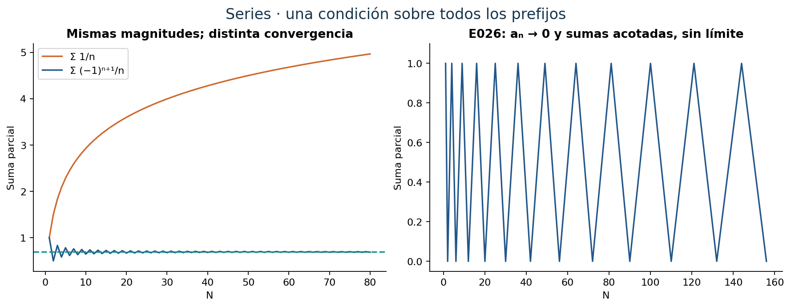
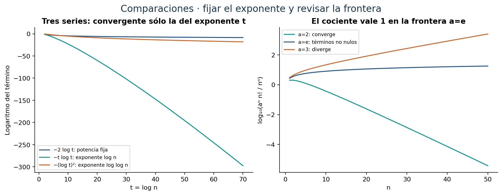
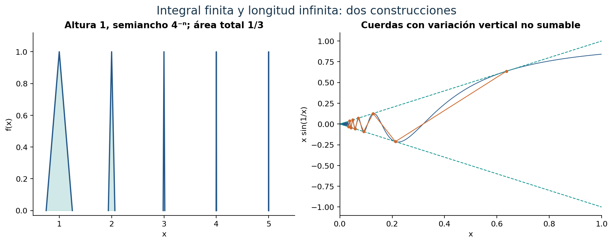
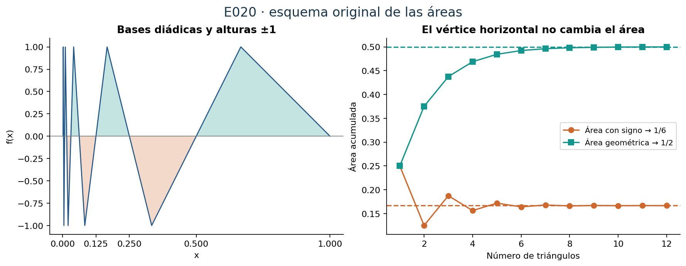
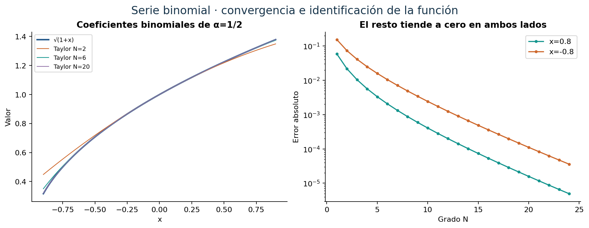
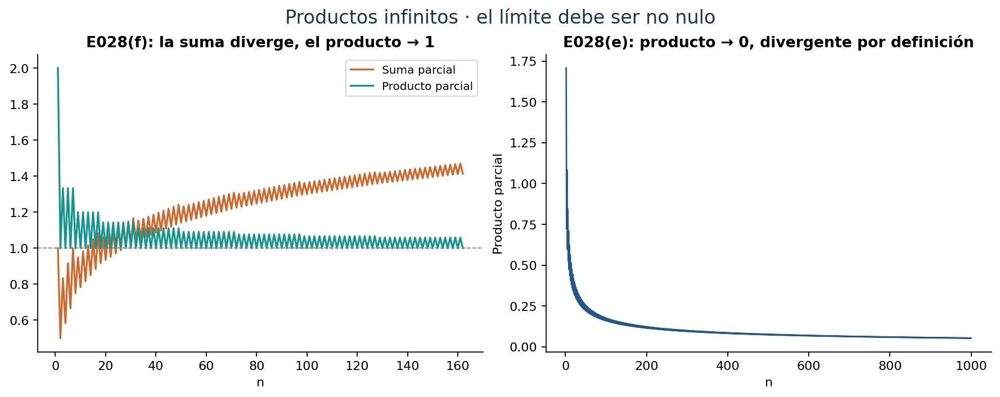
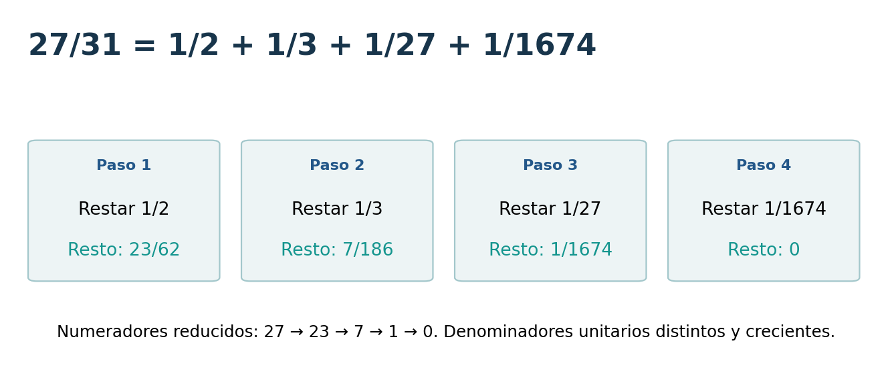

[← Capítulo 22](capitulo-22.qmd) · [Colecciones](../index.qmd#spivak-calculus-cuarta-edición) · [Capítulo 24 →](capitulo-24.qmd)

A. Peña · Matemática Abierta · 2026-10-15.

Soluciones propias de los **30 problemas y sus 80 unidades explícitas**, incluidas todas las tareas con estrellas. No hay apéndice. Fuente: Michael Spivak, *Calculus*, cuarta edición, C23, pp. 471–498; ejercicios pp. 489–498 / PDF 508–517 de la copia consultada (PDF = impresa +19). Los enunciados se reducen al contenido matemático necesario. Las soluciones, explicaciones y figuras son propias; las correcciones al texto fuente se documentan al pie.

## Una serie se decide mirando sus sumas parciales {#seccion-497}

Para dar sentido a $a_1+a_2+\cdots$ empezamos por las sumas finitas $s_N=\sum_{n=1}^Na_n$. La serie converge si esa sucesión tiene un límite real S; entonces escribimos $\sum_{n=1}^\infty a_n=S$. La condición $a_n\to0$ es necesaria, porque $a_n=s_n-s_{n-1}$, pero no suficiente: la serie armónica tiene términos que tienden a cero y sumas sin cota superior.

Si todos los términos son no negativos, las sumas parciales no decrecen. Basta entonces acotarlas para probar convergencia, y una serie conocida puede proporcionar esa cota. De aquí provienen las comparaciones con $\sum q^n$ para |q|<1 y con $\sum n^{-p}$, que converge exactamente para p>1. El criterio integral justifica esta última clasificación y muchas comparaciones logarítmicas.

Con signos distintos puede haber cancelación. La convergencia absoluta, $\sum|a_n|<\infty$, permite controlar las colas por sus magnitudes; los cambios de orden y la separación en subseries conservan entonces la suma. La convergencia condicional exige más cuidado: algunos términos positivos y negativos pueden equilibrarse sólo por el orden en que aparecen. En ambos casos utilizaremos el criterio de Cauchy para series:
$$\forall\varepsilon>0\ \exists N\ \forall q\ge p>N:
\left|\sum_{n=p}^qa_n\right|<\varepsilon.$$
Es exactamente el criterio de Cauchy de las sumas parciales. Una agrupación finita de términos consecutivos conserva las sumas parciales que terminan en un bloque; para concluir sobre todos los índices también controlaremos lo que sucede dentro de los bloques.

{#fig-spv4-c23-f01 fig-alt="Capítulo 23: Sumas parciales y cancelación"}

## E001 — Veinte decisiones de convergencia {#e001}

Fuente: Spivak, C23, problema 1, pp. 489–491. Clasificamos las series indicadas; las sumas comienzan en el índice que evita términos indefinidos. Un cambio finito no altera la convergencia. «Diverge a infinito» se refiere al límite de las sumas parciales.

**`SPV4-C23-E001-i`** Para cualquier θ real, $\sum_{n\ge1}\sin(n\theta)/n^2$ converge absolutamente, pues $|\sin(n\theta)/n^2|\le1/n^2$ y la serie de cuadrados recíprocos converge.

**`SPV4-C23-E001-ii`** La serie $1-1/3+1/5-1/7+\cdots$ converge por Leibniz: las magnitudes 1/(2n−1) decrecen a cero. No converge absolutamente, pues $1/(2n-1)\ge1/(2n)$ y la armónica diverge. Es condicionalmente convergente.

**`SPV4-C23-E001-iii`** La serie $1-1/2+2/3-1/3+2/4-1/4+2/5-1/5+\cdots$ diverge a +∞. Después del primer par, cada par $(2/k,-1/k)$, k≥3, suma 1/k. Las sumas al final de esos pares son $1/2+\sum_{k=3}^N1/k\to\infty$. Entre dos finales consecutivos se añade primero un término positivo; esas sumas también tienden a infinito. Alternar signos, por sí solo, no satisface las hipótesis de Leibniz.

**`SPV4-C23-E001-iv`** $\sum_{n\ge1}(-1)^n(\log n)/n$ converge condicionalmente. Para x>e, la derivada de (log x)/x es $(1-\log x)/x^2<0$, y sus valores tienden a cero. Leibniz se aplica desde una cola. La serie de valores absolutos diverge por el criterio integral, ya que $\int_e^R(\log x)/x\,dx=[(\log x)^2-1]/2\to\infty$.

**`SPV4-C23-E001-v`** $\sum_{n\ge2}(n^2-1)^{-1/3}$ diverge: cada término es mayor que $n^{-2/3}$, cuya serie diverge. El índice de la raíz es tres.

**`SPV4-C23-E001-vi`** $\sum_{n\ge1}(n^2+1)^{-1/3}$ también diverge. Como $n^2+1\le2n^2$, el término es al menos $2^{-1/3}n^{-2/3}$. Cambiar el signo dentro de la raíz cúbica no cambia esta comparación de orden.

**`SPV4-C23-E001-vii`** Para $u_n=n^2/n!$, $u_{n+1}/u_n=(n+1)/n^2\to0$. El criterio del cociente prueba convergencia.

**`SPV4-C23-E001-viii`** $\sum(\log n)/n$ diverge a +∞ por la integral calculada en (iv). No hay cancelación de signos.

**`SPV4-C23-E001-ix`** $\sum_{n\ge2}1/\log n$ diverge, pues $\log n\le n$ y por ello $1/\log n\ge1/n$.

**`SPV4-C23-E001-x`** $\sum_{n\ge2}(\log n)^{-k}$ diverge para cualquier k real fijo. Si k≤0, sus términos no tienden a cero. Si k>0, $k\log\log n<\log n$ para n suficientemente grande, porque $\log t/t\to0$. Así $(\log n)^k<n$ y el término supera 1/n en una cola. Se incluye, en particular, todo k natural.

**`SPV4-C23-E001-xi`** $\sum_{n\ge2}(\log n)^{-n}$ converge. Para n≥8 se tiene log n>2, y los términos quedan por debajo de $2^{-n}$. La magnitud grande de los primeros términos es irrelevante para la convergencia.

**`SPV4-C23-E001-xii`** $\sum_{n\ge2}(-1)^n(\log n)^{-n}$ converge absolutamente por (xi).

**`SPV4-C23-E001-xiii`** $\sum n^2/(n^3+1)$ diverge, porque $n^3+1\le2n^3$ para n≥1 y su término es al menos 1/(2n).

**`SPV4-C23-E001-xiv`** $\sum\sin(1/n)$ diverge. Como $\sin t/t\to1$ cuando t→0, para n grande se cumple $\sin(1/n)\ge1/(2n)>0$. La comparación armónica da divergencia a +∞.

**`SPV4-C23-E001-xv`** $\sum_{n\ge2}1/(n\log n)$ diverge. La función es positiva y decreciente en [2,∞), y $\int_2^R dx/(x\log x)=\log\log R-\log\log2\to\infty$.

**`SPV4-C23-E001-xvi`** $\sum_{n\ge2}1/[n(\log n)^2]$ converge: su función continua positiva decrece y
$$\int_2^\infty\frac{dx}{x(\log x)^2}=\frac1{\log2}<\infty.$$

**`SPV4-C23-E001-xvii`** $\sum_{n\ge2}1/[n^2\log n]$ converge, ya que $1/[n^2\log n]\le1/[n^2\log2]$.

**`SPV4-C23-E001-xviii`** Para $u_n=n!/n^n$, el cociente es
$$\frac{u_{n+1}}{u_n}=\left(\frac n{n+1}\right)^n\longrightarrow e^{-1}<1.$$
Por tanto la serie converge.

**`SPV4-C23-E001-xix`** Para $u_n=2^nn!/n^n$, el cociente tiende a 2/e<1. La serie converge.

**`SPV4-C23-E001-xx`** Para $u_n=3^nn!/n^n$, el cociente tiende a 3/e>1. Los términos crecen al menos geométricamente a partir de una cola y no tienden a cero; la serie diverge. Las comparaciones 2<e<3 son las cotas elementales ya conocidas para e.

## E002* — El caso frontera que no decide el cociente {#e002}

Fuente: Spivak, C23, problema 2, p. 491. Trabajamos primero con parámetros a>0; al final aclaramos qué ocurre si se permiten negativos.

**`SPV4-C23-E002-a`** Probar que $\sum e^nn!/n^n$ diverge, completando la clasificación de $\sum a^nn!/n^n$. El cociente tiende a a/e: converge si 0<a<e y diverge si a>e. En a=e, C22-E013 da, para n≥2,
$$n!>\frac{n^n}{e^{n-1}},\qquad \frac{e^nn!}{n^n}>e.$$
Los términos ni siquiera tienden a cero. Por tanto, para a≥0 la convergencia ocurre exactamente en 0≤a<e, incluyendo la serie nula de a=0.

**`SPV4-C23-E002-b`** Decidir cuándo converge $\sum n^n/(a^nn!)$, a>0. El cociente de términos consecutivos tiende a e/a; converge si a>e y diverge si a<e. En a=e, la cota superior de C22-E013 da
$$\frac{n^n}{e^nn!}>\frac{n^n}{(n+1)^{n+1}}
=\frac1{n+1}\left(\frac n{n+1}\right)^n\ge\frac1{e(n+1)}.$$
La última desigualdad procede de $(1+1/n)^n\le e$, equivalente a $n\log(1+1/n)\le1$. La comparación armónica prueba divergencia también en a=e.

**Observación sobre el dominio.** La frase de (a) «a<e» necesita a≥0 si se lee como clasificación del parámetro.[^parametro] Para a real, la primera serie converge absolutamente si |a|<e y diverge si |a|≥e, por la misma cota de sus magnitudes. En la segunda a=0 no está definido; para |a|>e hay convergencia absoluta, para 0<|a|<e los términos no tienden a cero, y en a=−e hay convergencia condicional. Para justificar este último extremo sin usar Stirling, ponga $v_n=n^n/(e^nn!)$. Su cociente es $(1+1/n)^n/e<1$, y vₙ→0: el valor medio integral de log, o su concavidad, da
$$\int_{k-1}^k\log x\,dx-\log k\le-\frac1{2k}\quad(k\ge2).$$
En efecto, $\log k-\log x=\int_x^kdt/t\ge(k-x)/k$; al integrar resulta esa cota. Sumando,
$$\log v_n=n\log n-n-\log(n!)\le-1-\frac12\sum_{k=2}^n\frac1k\longrightarrow-\infty.$$
Así Leibniz se aplica a $(-1)^nv_n$, y la divergencia absoluta es la frontera positiva recién probada.

[^parametro]: El impreso no precisa positividad de a en la discusión introductoria de E002. Se explicita el dominio positivo de las comparaciones originales y se añade la clasificación real para evitar interpretar, por ejemplo, a<−e como un caso convergente.

## E003* — Tres exponentes logarítmicos {#e003}

Fuente: Spivak, C23, problema 3, p. 491.

**`SPV4-C23-E003-a`** Probar que $\int_1^\infty e^y/y^y\,dy$ converge considerando $\sum(e/n)^n$. Para n≥6 se tiene e/n<1/2 y, por tanto, (e/n)ⁿ≤2⁻ⁿ. La comparación geométrica prueba convergencia. La función $g(y)=e^y/y^y=\exp(y-y\log y)$ es positiva y $g'(y)=-g(y)\log y\le0$ para y≥1. El criterio integral, o la comparación de cada integral sobre [n,n+1] con g(n), prueba la convergencia de la integral.

**`SPV4-C23-E003-b`** Probar que $\sum_{n\ge2}(\log n)^{-\log n}$ converge. Su término es $f(n)$, donde $f(x)=\exp[-(\log x)(\log\log x)]$. Para x suficientemente grande, la derivada de su logaritmo es $-(\log\log x+1)/x<0$. En la integral de esa cola hacemos y=log x:
$$\int\frac{dx}{(\log x)^{\log x}}=\int\frac{e^y}{y^y}\,dy.$$
La cola converge por (a); el prefijo finito es continuo y no afecta la conclusión. Se aplica el criterio integral sólo donde la monotonía ya está garantizada.

**`SPV4-C23-E003-c`** Probar que $\sum_{n\ge2}(\log n)^{-\log\log n}$ diverge. Ahora $f(x)=\exp[-(\log\log x)^2]$ es positiva y decreciente para x>e. El mismo cambio y=log x transforma su integral en
$$\int\exp\bigl(y-(\log y)^2\bigr)\,dy.$$
Como $(\log y)^2/y\to0$, para y grande el integrando es al menos e^{y/2}, de integral divergente. El criterio integral da la divergencia de la serie. El logaritmo iterado en el exponente modifica decisivamente el resultado.

{#fig-spv4-c23-f02 fig-alt="Capítulo 23: Tres escalas logarítmicas"}

## E004 — Una potencia apenas mayor que uno {#e004}

Fuente: Spivak, C23, problema 4, p. 492.

**`SPV4-C23-E004`** Decidir si converge $\sum n^{-1-1/n}$. Como $n^{1/n}\to1$, para n grande $n^{1/n}\le2$. Luego $n^{-1-1/n}\ge1/(2n)$; la serie diverge. El criterio de las p-series presupone un exponente fijo: aquí el exponente depende de n.

## E005 — Elevar los términos al cubo {#e005}

Fuente: Spivak, C23, problema 5, p. 492.

**`SPV4-C23-E005-a`** Si $\sum a_n$ converge absolutamente, probar lo mismo para $\sum a_n^3$. Como aₙ→0, en una cola |aₙ|≤1 y entonces $|a_n|^3\le|a_n|$. La comparación y el prefijo finito prueban convergencia absoluta.

**`SPV4-C23-E005-b`*** Mostrar que la convergencia condicional de $\sum a_n$ no basta. Para cada m≥1 concatene el bloque $(u_m,u_m,-2u_m)$, donde $u_m=m^{-1/3}$. Cada bloque suma cero y las sumas parciales interiores tienen módulo a lo sumo 2uₘ→0. Por eso la serie completa converge a cero. No converge absolutamente, pues cada bloque de magnitudes suma 4m^{-1/3}. En cambio, los cubos del bloque suman
$$u_m^3+u_m^3-8u_m^3=-\frac6m.$$
Sus sumas al final de los bloques tienden a −∞; las variaciones interiores son O(1/m), de modo que la serie de cubos diverge a −∞.

## E006 — Muestrear una función en 1/n {#e006}

Fuente: Spivak, C23, problema 6, p. 492. Sea f continua en un intervalo alrededor de cero y $a_n=f(1/n)$ para n suficientemente grande. Un prefijo ajeno al dominio puede fijarse arbitrariamente.

**`SPV4-C23-E006-a`** Si $\sum a_n$ converge, aₙ→0; por continuidad, $f(0)=\lim f(1/n)=0$.

**`SPV4-C23-E006-b`** Si además existe f′(0), probar f′(0)=0. De (a), f(0)=0 y
$$na_n=\frac{f(1/n)-f(0)}{1/n}\longrightarrow f'(0).$$
Si este límite fuera L≠0, los términos tendrían finalmente el signo de L y módulo al menos |L|/(2n). La comparación armónica haría divergir la serie a +∞ o −∞. Luego L=0.

**`SPV4-C23-E006-c`** Si existe f″(0) y f(0)=f′(0)=0, probar que $\sum a_n$ converge. La existencia de f″(0) implica $|f'(t)|\le C|t|$ cerca de cero, para alguna C, porque $f'(t)/t\to f''(0)$. Por valor medio, $f(x)=f'(\xi)x$ con ξ entre 0 y x, y entonces $|f(x)|\le Cx^2$. En particular $|a_n|\le C/n^2$ para n grande. La serie converge absolutamente. No se supone continuidad de f″ en un intervalo.

**`SPV4-C23-E006-d`** ¿Debe existir f′(0) si la serie converge? No. Tome f(0)=0 y $f(x)=x\sin(\pi/x)$ para x≠0. Es continua en cero porque |f(x)|≤|x|, y f(1/n)=0 para todos los n. Sin embargo $f(x)/x=\sin(\pi/x)$ no tiene límite en cero: por ejemplo, en $x=1/(2m+1/2)$ vale uno y en $x=1/(2m+3/2)$ vale −1. No hay derivada.

**`SPV4-C23-E006-e`** ¿Basta f(0)=f′(0)=0 para la convergencia? No. En $0<|x|<e^{-1}$ defina $f(x)=x/\log(1/|x|)$ y f(0)=0. La razón f(x)/x tiende a cero, de modo que f′(0)=0 y f es continua en cero. Para n grande, $f(1/n)=1/(n\log n)$, cuya serie diverge por E001(xv).

## E007 — Decimales como series {#e007}

Fuente: Spivak, C23, problema 7, p. 492.

**`SPV4-C23-E007-a`** Para dígitos enteros 0≤aₙ≤9, probar que $\sum a_n10^{-n}$ existe y está en [0,1]. Sus sumas parciales no decrecen y
$$0\le\sum_{n=1}^Na_n10^{-n}\le\sum_{n=1}^N9\,10^{-n}=1-10^{-N}<1.$$
Por monotonía y acotación tienen un límite entre cero y uno. El valor uno se alcanza si todos los dígitos son nueve.

**`SPV4-C23-E007-b`** Construir esos dígitos para cada x∈[0,1]. Si x<1, ponga r₀=x y, recursivamente, $a_n=\lfloor10r_{n-1}\rfloor$, $r_n=10r_{n-1}-a_n$. Entonces 0≤rₙ<1 y 0≤aₙ≤9, y por inducción
$$x=\sum_{j=1}^na_j10^{-j}+r_n10^{-n}.$$
El resto tiende a cero. Para x=1 se toman todos los dígitos nueve, pues la indicación inicial $a_1=\lfloor10x\rfloor$ produciría el dígito inadmisible diez si se usara sin separar ese extremo.[^decimal]

**`SPV4-C23-E007-c`** Si el bloque de longitud k, a₁,…,aₖ, se repite desde el principio, sea $A=\sum_{j=1}^ka_j10^{k-j}$ el entero que representa. Por la suma geométrica,
$$x=\frac A{10^k}\sum_{m=0}^\infty10^{-mk}=\frac A{10^k-1}.$$
Si la repetición empieza después de N dígitos, con entero inicial B y bloque repetido A, la fórmula es
$$x=\frac B{10^N}+\frac A{10^N(10^k-1)}.$$
En ambos casos el número es racional, incluidos los bloques de ceros o nueves.

**`SPV4-C23-E007-d`** Si el valor de un decimal es racional, probar que cualquier representación suya es eventualmente periódica. Para x=p/q en [0,1), la división larga mantiene restos enteros entre 0 y q−1. Si aparece cero, la expansión termina y se completa con ceros; si no, algún resto se repite por haber sólo finitos posibles. A partir de esa repetición se repiten también los dígitos. Esto prueba la afirmación para la expansión de división larga.

Para incluir cualquier otra expansión, si dos listas de dígitos difieren primero en la posición j y, por ejemplo, aⱼ<bⱼ, la igualdad de sus valores exige
$$10^{-j}\le(b_j-a_j)10^{-j}
=\sum_{n>j}(a_n-b_n)10^{-n}\le\sum_{n>j}9\,10^{-n}=10^{-j}.$$
Todas las desigualdades deben ser igualdades: bⱼ−aⱼ=1 y, después de j, todos los dígitos de la primera lista son nueve y los de la segunda cero. Es la única ambigüedad posible y ambas colas son periódicas. Para x=0 sólo caben ceros; para x=1, todos nueves. Queda cubierta cualquier representación del racional.

[^decimal]: La sugerencia de E007(b) necesita tratar x=1 por separado; se conserva todo el intervalo cerrado del enunciado. La doble representación decimal se controla explícitamente en (d).

## E008 — El error de una serie alternante {#e008}

Fuente: Spivak, C23, problema 8, p. 492; hipótesis de Leibniz cotejadas en p. 481 / PDF 500.

**`SPV4-C23-E008` — Problema corregido.** Si a₁≥a₂≥…≥0 y aₙ→0, sea $S=\sum(-1)^{n+1}a_n$ y $s_N=\sum_{n=1}^N(-1)^{n+1}a_n$. Probar
$$|S-s_N|\le a_{N+1}.$$
Precisar el signo estricto del original.[^leibniz]

**Solución.** Aplique el encierro de las sumas pares e impares a la cola alternante que empieza en aₙ₊₁. Su suma, con primer signo positivo, pertenece a [0,aₙ₊₁]. En símbolos,
$$0\le(-1)^N(S-s_N)\le a_{N+1}.$$
Esto prueba la cota y el signo del error. Si la sucesión es positiva y estrictamente decreciente, la cola es mayor o igual que $a_{N+1}-a_{N+2}>0$ y menor o igual que $a_{N+1}-a_{N+2}+a_{N+3}<a_{N+1}$; se recupera el signo estricto.

Con las hipótesis no estrictas puede haber igualdad. Tome $a_{2m-1}=a_{2m}=1/m$. Las sumas al final de cada par son cero y las intermedias tienden a cero, así que S=0. Para N=1, $|S-s_1|=1=a_2$. Todos los términos son positivos y cumplen las hipótesis impresas de Leibniz.

[^leibniz]: E008 imprime «<aₙ₊₁», pero el teorema al que remite permite aₙ≥aₙ₊₁. Se corrige a «≤», se demuestra el resultado válido y se indica una hipótesis suficiente para el signo estricto. El contraejemplo muestra que se trata de una corrección matemática necesaria.

## E009 — Criterio de la raíz {#e009}

Fuente: Spivak, C23, problema 9, p. 493.

**`SPV4-C23-E009-a`** Para aₙ≥0 y $a_n^{1/n}\to r$, probar convergencia si r<1 y divergencia si r>1. En el primer caso elija r<s<1. En una cola, $a_n^{1/n}\le s$, por lo que aₙ≤sⁿ y se compara con una geométrica. En el segundo elija 1<s<r: aₙ≥sⁿ en una cola y sus términos no tienden a cero.

El mismo argumento prueba la forma con límite superior R: si $\limsup a_n^{1/n}<1$, existe s<1 que acota todas las raíces de una cola, y la serie converge. Si R>1, hay infinitos índices con raíz mayor que un s>1, por lo que los términos no tienden a cero. Incluso infinitas raíces ≥1 bastan para divergencia, pues entonces aₙ≥1 en esos índices. Cuando R=1 el criterio no decide: $\sum1/n^2$ converge y $\sum1/n$ diverge, aunque ambas raíces n-ésimas tiendan a uno.

**`SPV4-C23-E009-b`** Probar que, cuando el criterio del cociente decide, el de la raíz también decide. Para términos positivos y un cociente con límite finito r≥0, C22-E018 da $a_n^{1/n}\to r$, incluidos r=0 y los dos casos r<1, r>1. Si los cocientes tienden a +∞, para cualquier K>1 todos los cocientes de una cola son ≥K; multiplicarlos muestra que el límite inferior de las raíces es al menos K, y por arbitrariedad de K las raíces tienden a +∞. También las versiones uniformes $a_{n+1}/a_n\le q<1$ en una cola o $a_{n+1}/a_n\ge q>1$ producen las correspondientes cotas geométricas. Los términos nulos que hagan indefinido el cociente quedan fuera de esa aplicación, aunque el criterio de la raíz siga disponible.

## E010 — Un producto de Cauchy que diverge {#e010}

Fuente: Spivak, C23, problema 10, p. 493.

**`SPV4-C23-E010`** Sean $a_n=b_n=(-1)^n/\sqrt n$ y $c_n=\sum_{k=1}^na_kb_{n+1-k}$. Probar |cₙ|≥1 y la divergencia de $\sum c_n$. Todos los productos de la n-ésima diagonal tienen el mismo signo $(-1)^{n+1}$, así que
$$|c_n|=\sum_{k=1}^n\frac1{\sqrt{k(n+1-k)}}.$$
Como k≤n y n+1−k≤n, cada denominador es a lo sumo n. Los n sumandos son al menos 1/n y la suma es ≥1. Por tanto cₙ no tiende a cero. Las dos series originales convergen por Leibniz, pero no absolutamente; su producto de Cauchy puede fallar incluso la condición necesaria de convergencia.

## E011 — Omitir cifras cambia una suma de recíprocos {#e011}

Fuente: Spivak, C23, problema 11, p. 493. Se usa la representación decimal usual sin ceros iniciales.

**`SPV4-C23-E011-a`** Probar que la suma de los recíprocos de los naturales sin cifra nueve converge. Entre los números de m cifras, hay $8\cdot9^{m-1}$ que no contienen nueve: ocho posibilidades para la primera cifra, 1,…,8, y nueve para cada posición restante, 0,…,8. Cada uno es al menos $10^{m-1}$. La contribución de todo ese bloque es entonces a lo sumo
$$\frac{8\cdot9^{m-1}}{10^{m-1}}=8(9/10)^{m-1}.$$
La suma sobre m es geométrica y finita. Como los términos son positivos, esta cota de los bloques acota todas las sumas parciales.

**`SPV4-C23-E011-b`** Probar lo mismo para los naturales que no contienen las diez cifras. Para cada dígito d, la cantidad de números de m cifras que lo omiten es a lo sumo 9ᵐ: es una cota válida aunque permita ceros iniciales. Por ello su suma de recíprocos es a lo sumo $10(9/10)^m$. El conjunto pedido es la unión de los diez conjuntos que omiten un dígito específico. Sumando sus cotas se obtiene una suma finita; los números que omiten varios dígitos se cuentan más de una vez en la cota, lo que sólo la aumenta.

## E012 — Suma de Cesàro sin convergencia ordinaria {#e012}

Fuente: Spivak, C23, problema 12, pp. 493–494. Se define la suma de Cesàro de $\sum a_n$ como el límite, cuando existe, de $\sigma_N=(s_1+\cdots+s_N)/N$.

**`SPV4-C23-E012`** Dar una serie divergente con suma de Cesàro. Para aₙ=(−1)ⁿ⁺¹, las sumas parciales son 1,0,1,0,… y no convergen. Sin embargo $\sigma_N=\lceil N/2\rceil/N\to1/2$. Es sumable por Cesàro con valor 1/2. Esto no convierte 1/2 en una suma ordinaria de la serie.

## E013 — Cesàro, positividad y una cota adicional {#e013}

Fuente: Spivak, C23, problema 13, p. 494.

**`SPV4-C23-E013`** Si aₙ>0, la serie es sumable por Cesàro y n aₙ está acotada, probar convergencia ordinaria. Sea C una cota superior de n aₙ. Una inversión de dos sumas finitas da
$$\sigma_n=\frac1n\sum_{k=1}^ns_k
=\frac1n\sum_{j=1}^n(n-j+1)a_j,$$
y por tanto
$$s_n-\frac n{n+1}\sigma_n=\frac1{n+1}\sum_{j=1}^nj a_j\le\frac{nC}{n+1}\le C.$$
La sucesión σₙ converge y es acotada; de la identidad resulta una cota superior para sₙ. Como los términos son positivos, sₙ no decrece, así que converge. Su límite coincide con la suma de Cesàro por C22-E016.

**Observación.** Con positividad, la hipótesis sobre n aₙ puede incluso omitirse: $\sigma_{2n}\ge s_n/2$, porque al menos n de las sumas parciales promediadas son ≥sₙ. La acotación de σₙ ya acota sₙ. La prueba principal conserva y utiliza las dos hipótesis pedidas.

## E014 — Reordenar sin el criterio de Cauchy {#e014}

Fuente: Spivak, C23, problema 14, p. 494. Un reordenamiento significa $b_n=a_{\pi(n)}$ para una biyección π:N→N; se reordenan índices, también cuando hay valores repetidos. Primero suponemos aₙ≥0 y escribimos $s_n=\sum_{j=1}^na_j$, $t_m=\sum_{j=1}^mb_j$.

**`SPV4-C23-E014-a`** Para cada n existe m con sₙ≤tₘ: tome $m=\max\{\pi^{-1}(1),\ldots,\pi^{-1}(n)\}$. Los primeros m términos reordenados contienen todos los primeros n originales; sus términos adicionales son no negativos.

**`SPV4-C23-E014-b`** Si $\sum b_n=T$ existe, (a) da sₙ≤T para todo n. La sucesión sₙ es no decreciente y acotada, así que converge a S≤T. Esto prueba también la existencia de la suma del lado izquierdo.

**`SPV4-C23-E014-c`** Aplicar (b) al reordenamiento inverso da T≤S; por tanto S=T. La convergencia de cualquiera de las dos series implica la de la otra y la igualdad de sus sumas. Si no convergen, ambas sumas parciales tienden a +∞; no se afirma una igualdad de dos sumas reales inexistentes.

**`SPV4-C23-E014-d`** Extender el resultado a convergencia absoluta. Defina $a_n^+=\max(a_n,0)$ y $a_n^-=\max(-a_n,0)$. Ambas series son no negativas y convergen, porque están dominadas por $\sum|a_n|$. Sus reordenamientos conservan las sumas por (a)–(c). Restando, el reordenamiento de aₙ converge a $\sum a_n^+-\sum a_n^-=\sum a_n$. Además, $|b_n|=|a_{\pi(n)}|$ y la parte no negativa muestra que $\sum|b_n|=\sum|a_n|$. No se usó el criterio de Cauchy en esta demostración.

## E015 — Subseries y separación de paridades {#e015}

Fuente: Spivak, C23, problema 15, p. 494.

**`SPV4-C23-E015-a`** Si $\sum|a_n|$ converge y bₖ=aₙₖ es una subsucesión, sus sumas parciales de magnitudes cumplen
$$\sum_{k=1}^M|b_k|\le\sum_{n=1}^{n_M}|a_n|\le\sum_{n=1}^\infty|a_n|.$$
Son no decrecientes y acotadas, de modo que la subserie converge absolutamente.

**`SPV4-C23-E015-b`** Sin convergencia absoluta puede fallar: la armónica alternante converge, pero su subserie de términos positivos $1+1/3+1/5+\cdots$ diverge. Más generalmente, si una serie es condicionalmente convergente, las sumas de sus partes positiva y negativa no pueden ser ambas finitas; de hecho ambas son infinitas, pues su diferencia converge y su suma absoluta diverge. Una subserie de cada signo proporciona el fallo.

**`SPV4-C23-E015-c`*** Probar que una serie absolutamente convergente se separa en la suma de los términos impares y la de los pares. Ambas subseries convergen por (a). Para cada N,
$$s_{2N}=\sum_{k=1}^Na_{2k-1}+\sum_{k=1}^Na_{2k}.$$
Pasar al límite en esta identidad finita da la igualdad pedida. No se distribuye informalmente una suma infinita antes de justificar los dos límites.

## E016 — Desigualdad triangular para series {#e016}

Fuente: Spivak, C23, problema 16, p. 494.

**`SPV4-C23-E016`** Si $\sum a_n$ converge absolutamente, probar $|\sum a_n|\le\sum|a_n|$. Para cada N la desigualdad triangular finita da $|s_N|\le\sum_{n=1}^N|a_n|$. Ambos lados tienen límite; la continuidad de valor absoluto conserva la desigualdad al pasar al límite.

## E017* — La integral de sinc no converge absolutamente {#e017}

Fuente: Spivak, C23, problema 17, p. 494; remisión a C19-E043.

**`SPV4-C23-E017`** Probar que $\int_0^\infty|\sin x/x|\,dx$ diverge. Cerca de cero se completa el integrando con valor uno y es continuo, así que allí no hay problema. Para cada k≥0, en el intervalo $[k\pi+\pi/6,k\pi+5\pi/6]$ se cumple |sin x|≥1/2 y x≤(k+1)π. Su contribución es al menos
$$\frac{2\pi/3}{2(k+1)\pi}=\frac1{3(k+1)}.$$
Los intervalos son disjuntos y las cotas suman una serie armónica divergente. Por tanto la integral absoluta diverge. Esto es compatible con la convergencia de la integral con signo demostrada en C19: las oscilaciones cancelan áreas que en valor absoluto se acumulan.

## E018* — Picos estrechos e integral finita {#e018}

Fuente: Spivak, C23, problema 18, p. 494.

**`SPV4-C23-E018`** Construir f continua y no negativa con $\int_0^\infty f<\infty$ pero sin límite cuando x→∞. Para n≥1 tome un pico triangular de altura uno, centro n y semiancho δₙ=4⁻ⁿ:
$$f(x)=\begin{cases}1-|x-n|/\delta_n,&|x-n|\le\delta_n\text{ para algún }n\ge1,\\0,&\text{en otro caso}.\end{cases}$$
Los soportes son disjuntos, los bordes de cada triángulo valen cero y en cualquier segmento compacto sólo hay finitos picos. Así f es continua, incluso si se la define en toda R con cero para los puntos restantes. El área de cada pico es δₙ, por lo que
$$\int_0^\infty f(x)\,dx=\sum_{n=1}^\infty4^{-n}=\frac13.$$
La igualdad se justifica primero en segmentos que contienen picos completos y luego por monotonía y la cota de las áreas restantes. Pero f(n)=1 y f(n+1/2)=0; dos sucesiones que tienden a infinito producen valores distintos. No existe el límite.

## E019* — Una gráfica continua de longitud infinita {#e019}

Fuente: Spivak, C23, problema 19, p. 495; definición de longitud poligonal en C13-E025, p. 277 / PDF 296, cotejada con la copia actual.

**`SPV4-C23-E019`** Sea f(0)=0 y f(x)=x sin(1/x) para 0<x≤1. Probar que las longitudes poligonales inscritas no están acotadas. Para una partición P={t₀,…,tᵣ},
$$\ell(f,P)=\sum_{j=1}^r\sqrt{(t_j-t_{j-1})^2+[f(t_j)-f(t_{j-1})]^2}.$$
Cada segmento mide al menos su variación vertical. Tome $x_j=2/[(2j+1)\pi]$, j=0,…,m. Entonces $f(x_j)=(-1)^jx_j$. Una partición que contenga 0,xₘ,…,x₀,1 satisface
$$\ell(f,P)\ge\sum_{j=0}^{m-1}|f(x_j)-f(x_{j+1})|
=\sum_{j=0}^{m-1}(x_j+x_{j+1})\ge2\sum_{j=1}^{m-1}x_j.$$
La última suma crece sin cota porque es un múltiplo de la suma de los recíprocos impares. Por tanto las longitudes son no acotadas. La continuidad en cero, derivada de |f(x)|≤x, no asegura longitud finita.

{#fig-spv4-c23-f03 fig-alt="Capítulo 23: Picos integrables y oscilaciones de longitud infinita"}

## E020 — Área geométrica e integral con signo {#e020}

Fuente: Spivak, C23, problema 20 y figura 5, p. 495 / PDF 514. Se conserva sólo la información geométrica que determina las áreas: en cada intervalo $[2^{-k},2^{-k+1}]$, k≥1, hay un triángulo de altura uno en valor absoluto, alternando positivo para k impar y negativo para k par.

**`SPV4-C23-E020`** Calcular $\int_0^1f$ y el área total sombreada. La base del k-ésimo triángulo mide 2⁻ᵏ, así que su área con signo es $(-1)^{k+1}2^{-k-1}$. La función está acotada por uno; cualquier tramo residual junto a cero tiene contribución absoluta no mayor que su longitud. Se puede integrar primero desde un extremo diádico hasta uno y hacer que ese extremo tienda a cero. La misma cota, o una partición con un intervalo inicial pequeño y una parte restante poligonal, prueba la integrabilidad de Riemann en todo [0,1]. Por tanto
$$\int_0^1f(x)\,dx=\frac14-\frac18+\frac1{16}-\cdots=\frac16.$$
El área geométrica suma todas las magnitudes:
$$\int_0^1|f(x)|\,dx=\frac14+\frac18+\frac1{16}+\cdots=\frac12.$$
El valor asignado a f(0) no afecta estas integrales. La posición horizontal de cada vértice no cambia el área del triángulo, de modo que no es necesario inferirla de la escala del dibujo.

{#fig-spv4-c23-f04 fig-alt="Capítulo 23: Áreas alternantes de bases diádicas"}

## E021* — La serie binomial {#e021}

Fuente: Spivak, C23, problema 21, p. 495. Para α real defina $\binom\alpha0=1$ y $\binom\alpha k=\alpha(\alpha-1)\cdots(\alpha-k+1)/k!$ para k≥1. Queremos probar
$$(1+x)^\alpha=\sum_{k=0}^\infty\binom\alpha kx^k\qquad(|x|<1).$$
Los coeficientes son los de Taylor en cero. Convergencia de una serie de coeficientes no identifica por sí sola la función: también hay que controlar el resto.

**`SPV4-C23-E021-a`** Probar convergencia para |r|<1 y que los términos tienden a cero. Si α es un entero no negativo, la serie termina y es un polinomio. En los demás casos, para r≠0 los términos son no nulos y el cociente de sus magnitudes es
$$\left|\frac{\binom\alpha{k+1}r^{k+1}}{\binom\alpha k r^k}\right|
=|r|\frac{|\alpha-k|}{k+1}\longrightarrow|r|<1.$$
Por el criterio del cociente hay convergencia absoluta y, por ello, $\binom\alpha n r^n\to0$. En r=0 la afirmación es inmediata.

**`SPV4-C23-E021-b`** Para 0≤x<1, probar que el resto de Taylor Rₙ(x) tiende a cero mediante la forma de Lagrange. Para n+1>α y algún t entre 0 y x,
$$R_n(x)=\binom\alpha{n+1}(1+t)^{\alpha-n-1}x^{n+1}.$$
El factor de potencia tiene valor entre cero y uno porque 1+t≥1 y el exponente es negativo. Luego $|R_n(x)|\le|\binom\alpha{n+1}x^{n+1}|\to0$ por (a). En x=0 el resto es cero. Se obtiene la identidad binomial en el semintervalo no negativo.

**`SPV4-C23-E021-c`** Para −1<x<0, probar las dos cotas indicadas y anular el resto de Cauchy. Si x≤t≤0, entonces
$$|x(1+t)^{\alpha-1}|\le|x|M,\qquad M=\max(1,(1+x)^{\alpha-1}),$$
pues 1+t recorre el segmento positivo [1+x,1]. Además
$$\left|\frac{x-t}{1+t}\right|=|x|\frac{1-t/x}{1+t}\le|x|.$$
Para la última desigualdad basta observar que $t(1+x)\le0$, equivalente a $-x+t\le(-x)(1+t)$; el denominador es positivo.

La forma de Cauchy, válida también para x negativo, es
$$R_n(x)=\frac{f^{(n+1)}(t)}{n!}(x-t)^n x
=\alpha\binom{\alpha-1}n x(1+t)^{\alpha-1}
\left(\frac{x-t}{1+t}\right)^n.$$
Aquí se usó $(n+1)\binom\alpha{n+1}=\alpha\binom{\alpha-1}n$. Las cotas dan
$$|R_n(x)|\le|\alpha|\,|x|M\left|\binom{\alpha-1}n x^n\right|\longrightarrow0$$
por (a), aplicada al parámetro α−1. Si α=0, f es constante y el resto es directamente cero. Queda demostrada la identidad en todo |x|<1 sin derivar ni integrar informalmente una serie infinita.

{#fig-spv4-c23-f05 fig-alt="Capítulo 23: La serie binomial y el resto finito"}

## E022 — Criterios de Dirichlet y Abel {#e022}

Fuente: Spivak, C23, problema 22, pp. 495–496. Usaremos una identidad de sumación por partes finita, que dejamos demostrada dentro de la solución.

**`SPV4-C23-E022-a`** Si las sumas parciales de aₙ están acotadas y bₙ no crece y tiende a cero, probar convergencia de $\sum a_nb_n$. Sea $A_k=\sum_{j=1}^ka_j$, con |Aₖ|≤C y A₀=0. Para p≤k≤q, defina $B_k=\sum_{j=p}^ka_j=A_k-A_{p-1}$, de modo que |Bₖ|≤2C. Al sustituir aₖ=Bₖ−Bₖ₋₁ y desplazar un índice se obtiene exactamente
$$\sum_{k=p}^qa_kb_k=B_qb_q+\sum_{k=p}^{q-1}B_k(b_k-b_{k+1}).$$
Como bₙ no crece y tiende a cero, bₙ≥0. La suma de diferencias de b telescopa, y por eso
$$\left|\sum_{k=p}^qa_kb_k\right|\le2C\left[b_q+\sum_{k=p}^{q-1}(b_k-b_{k+1})\right]=2Cb_p\longrightarrow0.$$
La cota vale para todo q≥p y prueba el criterio de Cauchy. Si C=0, todos los aₙ son cero y la conclusión es inmediata.

**`SPV4-C23-E022-b`** Deducir Leibniz. Tome aₙ=(−1)ⁿ⁺¹, cuyas sumas parciales son cero o uno, y bₙ no negativa, no creciente y convergente a cero. (a) prueba la convergencia de la serie alternante. La estimación más precisa de su resto es E008.

**`SPV4-C23-E022-c`** Probar que $\sum\cos(nx)/n$ converge salvo cuando x∈2πZ. Para sin(x/2)≠0, la identidad
$$2\sin(x/2)\cos(nx)=\sin((n+1/2)x)-\sin((n-1/2)x)$$
telescopa al sumar de 1 a N y da
$$\left|\sum_{n=1}^N\cos(nx)\right|\le\frac1{|\sin(x/2)|}.$$
Es la cota de sumas trigonométricas requerida por la remisión a C15-E033; la hemos derivado aquí para hacer autónoma la prueba. Dirichlet con bₙ=1/n da convergencia. Si x=2kπ, todos los cosenos son uno y queda la armónica divergente.

**`SPV4-C23-E022-d`** Probar el criterio de Abel: si $\sum a_n$ converge y bₙ es monótona y acotada, entonces $\sum a_nb_n$ converge. La sucesión bₙ tiene un límite β. Si no crece, bₙ−β es no negativa, no creciente y tiende a cero; si no decrece, β−bₙ tiene esas propiedades. Las sumas parciales de aₙ están acotadas por convergencia, así que Dirichlet prueba convergencia de $\sum a_n(b_n-\beta)$, cambiando signo si hace falta. Añadir la serie convergente $\beta\sum a_n$ concluye la prueba.

## E023* — Condensación de Cauchy {#e023}

Fuente: Spivak, C23, problema 23, p. 496.

**`SPV4-C23-E023`** Si aₙ no crece, aₙ→0 y $\sum a_n$ converge, probar que $\sum_{k\ge1}2^ka_{2^k}$ converge. Monotonía y límite cero implican aₙ≥0. En el bloque $2^{k-1}\le j<2^k$, todos los términos son al menos a₂ᵏ. Hay 2ᵏ⁻¹ de ellos; por tanto
$$2^ka_{2^k}\le2\sum_{j=2^{k-1}}^{2^k-1}a_j.$$
Al sumar sobre k=1,…,K, los bloques son disjuntos y la suma condensada queda acotada por $2\sum_{j\ge1}a_j$. Sus términos son no negativos, de modo que converge. La dirección solicitada basta para demostrar la divergencia armónica por contradicción: su serie condensada tendría todos sus términos iguales a uno.

## E024* — Productos de sucesiones cuadrado-sumables {#e024}

Fuente: Spivak, C23, problema 24, p. 496.

**`SPV4-C23-E024-a`** Si $\sum a_n^2$ y $\sum b_n^2$ convergen, probar convergencia de $\sum a_nb_n$. De $(|a_n|-|b_n|)^2\ge0$ se obtiene $2|a_nb_n|\le a_n^2+b_n^2$. La comparación da incluso convergencia absoluta.

**`SPV4-C23-E024-b`** Si $\sum a_n^2$ converge y α>1/2, aplicar (a) a bₙ=n⁻ᵅ. Como $\sum b_n^2=\sum n^{-2\alpha}$ converge por 2α>1, se concluye que $\sum a_n/n^\alpha$ converge absolutamente. El resultado no depende del signo de aₙ.

## E025* — Una consecuencia de la monotonía {#e025}

Fuente: Spivak, C23, problema 25, p. 496.

**`SPV4-C23-E025`** Si aₙ>0, aₙ no crece y $\sum a_n$ converge, probar n aₙ→0. Para n≥2, el tramo desde m=⌊n/2⌋ hasta n tiene al menos n/2 términos, todos ≥aₙ. Por eso
$$0\le n a_n\le2\sum_{k=\lfloor n/2\rfloor}^na_k.$$
El extremo inferior del tramo tiende a infinito y el criterio de Cauchy hace tender su suma a cero. Por encaje, n aₙ→0. Sin monotonía, una serie positiva puede tener picos dispersos que invaliden esta conclusión.

## E026* — Términos pequeños y sumas acotadas no bastan {#e026}

Fuente: Spivak, C23, problema 26, p. 496.

**`SPV4-C23-E026`** Dar una serie con aₙ→0 y sumas parciales acotadas que no converja. Para cada m≥1, concatene m términos iguales a 1/m seguidos de m términos iguales a −1/m. Cada bloque completo suma cero, y dentro del bloque la suma parcial sube desde cero hasta uno y baja de nuevo a cero. Todas las sumas están en [0,1]. Como m→∞ a lo largo de los bloques, los términos tienden a cero. Sin embargo, los finales de bloque tienen suma cero y los puntos medios suma uno, de modo que las sumas parciales no tienen límite.

## E027 — Una transformación de términos positivos {#e027}

Fuente: Spivak, C23, problema 27, p. 496.

**`SPV4-C23-E027`** Si aₙ≥0 y $\sum a_n$ diverge, probar que $\sum a_n/(1+a_n)$ diverge, y decidir la recíproca. Si hay infinitos aₙ≥1, los términos transformados son ≥1/2 en esos índices y no tienden a cero. En otro caso, en una cola 0≤aₙ<1 y entonces aₙ/(1+aₙ)≥aₙ/2; la comparación prueba divergencia. La recíproca también es cierta: $a_n/(1+a_n)\le a_n$, así que la divergencia de la serie menor fuerza la de la mayor. Equivalentemente, ambas series positivas convergen o divergen juntas.

## E028 — Productos infinitos {#e028}

Fuente: Spivak, C23, problema 28, pp. 497–498. Para bₙ>0 se dice que $\prod b_n$ converge si sus productos parciales Pₙ tienen un límite **finito y distinto de cero**. Si Pₙ→0, el producto es divergente según esta convención, aunque la sucesión de productos tenga límite real.

**`SPV4-C23-E028-a`** Si el producto converge a P>0, entonces $b_n=P_n/P_{n-1}\to P/P=1$. El carácter no nulo del límite es lo que permite dividir.

**`SPV4-C23-E028-b`** El producto converge si y sólo si $\sum\log b_n$ converge. Para cada N,
$$\log P_N=\sum_{n=1}^N\log b_n.$$
Si Pₙ→P>0, la continuidad de log da convergencia de la suma a log P. Si la suma converge a L real, Pₙ=exp(Σlog bₙ)→eᴸ>0. Ambas direcciones se basan en identidades finitas antes de pasar al límite.

**`SPV4-C23-E028-c`** Para aₙ≥0, probar que $\prod(1+a_n)$ converge si y sólo si $\sum a_n$ converge. Para t≥0, integrar 1/(1+x) entre cero y t da
$$\frac t{1+t}\le\log(1+t)\le t.$$
Si $\sum a_n$ converge, la cota superior prueba convergencia de $\sum\log(1+a_n)$, y (b) da el producto. Si $\sum a_n$ diverge, E027 y la cota inferior hacen divergir la suma de logaritmos; el producto no converge a un valor finito no nulo. De hecho, en este caso Pₙ→+∞.

**`SPV4-C23-E028-d`** Usar Taylor para probar que, si x es suficientemente pequeño,
$$\frac14x^2\le x-\log(1+x)\le\frac34x^2,$$
y deducir las dos equivalencias pedidas. Para |x|≤1/4, la serie de logaritmo, ya justificada por Taylor, da
$$x-\log(1+x)=\frac{x^2}{2}+r(x),\qquad
|r(x)|\le\sum_{k=3}^\infty\frac{|x|^k}{k}
\le\frac{|x|^3}{3(1-|x|)}\le\frac{x^2}{9}.$$
Así la expresión queda entre (7/18)x² y (11/18)x², cotas más fuertes que las solicitadas, incluido x=0.

Si aₙ>−1 y $\sum a_n$ converge, entonces aₙ→0 y, en una cola, $r_n=a_n-\log(1+a_n)$ es no negativo y está entre aₙ²/4 y 3aₙ²/4. Por comparación, $\sum r_n$ converge si y sólo si $\sum a_n^2$ converge. La identidad finita $\sum\log(1+a_n)=\sum a_n-\sum r_n$ muestra que la serie de logaritmos converge si y sólo si la de cuadrados converge. Si los cuadrados divergen, las sumas de rₙ tienden a +∞ y las de logaritmos a −∞.

Si en cambio se supone inicialmente $\sum a_n^2<\infty$, otra vez aₙ→0 y la serie de rₙ converge. La misma identidad muestra que $\sum\log(1+a_n)$ converge si y sólo si $\sum a_n$ converge. La condición aₙ>−1 asegura que todos los logaritmos existan, también en el prefijo.

**`SPV4-C23-E028-e`** Para $a_n=(-1)^n/\sqrt n$, n≥2, la serie converge por Leibniz pero sus cuadrados forman una armónica divergente. Por (d), $\sum\log(1+a_n)\to-\infty$. Todos los factores 1+aₙ son positivos, pero sus productos parciales tienden a cero. Por la definición adoptada, $\prod_{n\ge2}(1+(-1)^n/\sqrt n)$ diverge. Se explica así por qué un límite cero no se admite como convergencia de un producto infinito.

**`SPV4-C23-E028-f`** Considere los bloques indexados por m=1,3,5,…: cada bloque contiene m pares $(1/m,-1/(m+1))$. Probar que $\sum a_n$ diverge pero $\prod(1+a_n)=1$. Cada par suma $1/[m(m+1)]$ y cada bloque suma 1/(m+1). La suma de bloques es $\sum_{j\ge1}1/(2j)$, divergente. Dentro del bloque los términos positivos aumentan las sumas y la caída siguiente no supera el aumento; todas las sumas tienden también a +∞.

En cambio, cada par de factores satisface
$$\left(1+\frac1m\right)\left(1-\frac1{m+1}\right)=1.$$
Todos los productos al final de un par son exactamente uno; después del primer factor del par valen 1+1/m. Como m→∞ a lo largo de los bloques, también esos productos intermedios tienden a uno. El producto completo converge a uno. Hay términos negativos, por lo que no se aplica (c).

{#fig-spv4-c23-f06 fig-alt="Capítulo 23: Sumas y productos: tres comportamientos distintos"}

## E029 — Dos productos telescópicos {#e029}

Fuente: Spivak, C23, problema 29, p. 498.

**`SPV4-C23-E029-a`** Calcular $\prod_{n=2}^\infty(1-1/n^2)$. Para N≥2,
$$\prod_{n=2}^N\left(1-\frac1{n^2}\right)
=\left(\prod_{n=2}^N\frac{n-1}n\right)
\left(\prod_{n=2}^N\frac{n+1}n\right)
=\frac{N+1}{2N}\longrightarrow\frac12.$$
Los factores son positivos y el límite es no nulo; el producto converge a 1/2.

**`SPV4-C23-E029-b`** Para |x|<1, calcular $\prod_{n=1}^\infty(1+x^{2^n})$. Factorizar repetidamente diferencias de cuadrados da
$$(1-x^2)\prod_{n=1}^N(1+x^{2^n})=1-x^{2^{N+1}}.$$
Como x²<1 y $x^{2^{N+1}}\to0$, el límite del producto es $1/(1-x^2)>0$. El primer exponente es dos: incluir por error el factor 1+x cambiaría la respuesta a 1/(1−x).

## E030 — Fracciones unitarias distintas {#e030}

Fuente: Spivak, C23, problema 30, p. 498. Se busca escribir cualquier racional positivo como suma finita de recíprocos de naturales distintos.

**`SPV4-C23-E030-a`** Si $1/(n+1)<x<1/n$, probar que el paso de restar 1/(n+1) reduce el numerador y que el proceso termina. Escriba x=p/q en términos positivos reducidos y p>1; si p=1 ya hay una fracción unitaria. Sea $k=\lceil q/p\rceil=n+1$. Entonces
$$0<x-\frac1k=\frac{kp-q}{qk},\qquad 0<kp-q<p.$$
La última desigualdad sigue de k−1<q/p<k. Si el cociente q/p fuera entero, x ya sería una fracción unitaria y se detendría el proceso. Al reducir la nueva fracción, su numerador sólo puede disminuir más. Cada paso no terminal reduce estrictamente un entero positivo, así que después de finitos pasos se llega a una fracción unitaria.

Los denominadores escogidos son distintos y crecientes: como x<1/(k−1), el nuevo resto es menor que $1/[k(k-1)]\le1/k$ para k≥2. La próxima fracción unitaria que no lo exceda tendrá denominador mayor que k, también cuando el resto ya sea unitario. Por ejemplo,
$$\frac{27}{31}=\frac12+\frac13+\frac1{27}+\frac1{1674}.$$
La afirmación incluye todo racional de (0,1): si es unitario se termina inmediatamente y, si no, pertenece a uno de los intervalos estrictos indicados.

**`SPV4-C23-E030-b`** Extender a todo racional x>0 usando la divergencia armónica. Sea H₀=0 y $H_M=\sum_{k=1}^M1/k$. Como Hₘ→∞, hay un mayor entero M≥0 con Hₘ≤x. El resto r=x−Hₘ es racional y cumple $0\le r<1/(M+1)$. Si r=0, ya se tiene una suma de recíprocos distintos. Si r>0, aplique (a): la primera fracción elegida tiene denominador al menos M+2 y las siguientes lo aumentan. Ninguna repite los denominadores 1,…,M del prefijo armónico. La unión de ese prefijo finito y la expansión finita del resto prueba la afirmación para todo racional positivo.

{#fig-spv4-c23-f07 fig-alt="Capítulo 23: Del racional a una suma finita de fracciones unitarias"}

## Dónde se usaron los límites y qué queda abierto {#seccion-42302}

Las comparaciones y los cálculos se apoyan en sumas y productos finitos antes de pasar al límite. Las reordenaciones sólo se usan después de demostrar sus hipótesis; los productos de Cauchy, los productos infinitos y los promedios de Cesàro conservan sus definiciones separadas. La prueba binomial usa Taylor con resto finito, sin anticipar los teoremas sobre derivación de series del capítulo siguiente. Los ejemplos de bloques muestran exactamente dónde intervienen los términos intermedios.

Las 80 unidades quedan desarrolladas y revisadas internamente. **Quedan siete capítulos del recorrido documental: C24–C30.** El siguiente es **C24 — Convergencia uniforme y series de potencias**, p. 499 / PDF 518 de la copia actual.

---

[← Capítulo 22](capitulo-22.qmd) · [Colecciones](../index.qmd#spivak-calculus-cuarta-edición) · [Capítulo 24 →](capitulo-24.qmd)

Soluciones originales de Alevi Peña · Matemática Abierta. [Licencia GFDL 1.3 o posterior](/COPYING.FDL).
