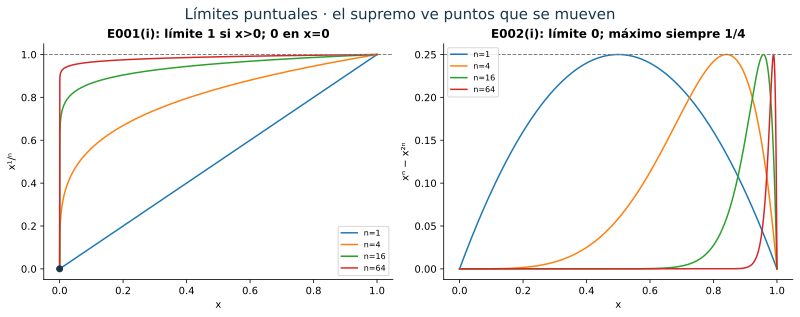
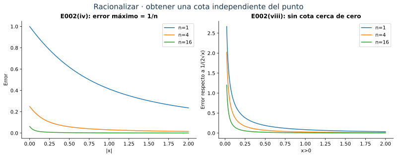
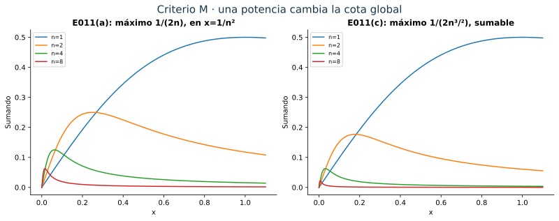
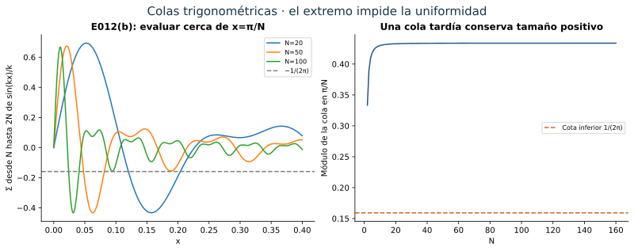
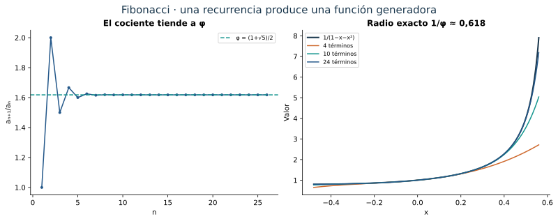
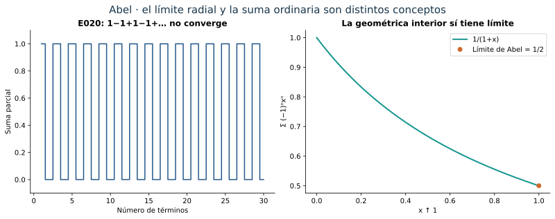
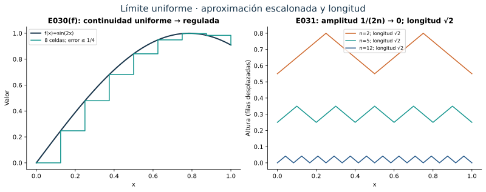

[← Capítulo 23](capitulo-23.qmd) · [Colecciones](../index.qmd#spivak-calculus-cuarta-edición) · [Capítulo 25 →](capitulo-25.qmd)

Alevi Peña · Matemática Abierta · Solucionario explicado · 2026-10-15

Soluciones propias de los 31 problemas del capítulo 24 de Michael Spivak, *Calculus*, cuarta edición, pp. 499–525. Los ejercicios ocupan pp. 516–525 (PDF 535–544 de la copia de trabajo). No hay apéndice. La numeración conserva todos los incisos; las tareas adicionales dentro de un inciso también se desarrollan.

## Herramientas que usaremos {#seccion-385}

La convergencia puntual permite que el índice dependa del punto. La uniforme exige un mismo índice para todo el dominio. En símbolos, la segunda equivale a
$$
\sup_{x\in A}|f_n(x)-f(x)|\longrightarrow0.
$$
El supremo puede ser infinito; tampoco necesita alcanzarse. Para una serie, el criterio de Cauchy uniforme pide que, dado $\eta>0$, todas las colas finitas desde un índice suficientemente grande tengan módulo menor que $\eta$, simultáneamente en todos los puntos. La completitud de los reales da el límite puntual y, dejando crecer el último índice, la misma cota da uniformidad.

El criterio M aplica cuando $|u_n(x)|\le M_n$ y $\sum M_n<\infty$: toda cola funcional queda dominada por una cola numérica. Dentro del intervalo abierto de convergencia de una serie de potencias se puede derivar e integrar término a término. En efecto, si converge en $x_0\ne0$, hay $M$ con $|a_nx_0^n|\le M$; para $|x|\le r<|x_0|$, los términos se dominan por $M(r/|x_0|)^n$ y sus derivadas por $(M/r)n(r/|x_0|)^n$, ambas series sumables. La convergencia uniforme de las derivadas y el teorema fundamental justifican la derivación; se puede repetir en intervalos menores. En particular,
$$
a_n=\frac{f^{(n)}(0)}{n!}.
$$
Los extremos deben estudiarse aparte. E019 permitirá pasar al extremo $1$ cuando la serie numérica allí ya converge.

## E001 — Cinco límites funcionales {#e001}

**(i) · SPV4-C24-E001-i.** Para $f_n(x)=x^{1/n}$ en $[0,1]$, el límite es $f(0)=0$ y $f(x)=1$ si $x>0$. Para cada $n$, tomando $x$ positivo muy pequeño, $1-x^{1/n}$ se acerca a uno: el supremo del error es uno. No hay convergencia uniforme. También lo confirma que el límite es discontinuo y todas las funciones iniciales son continuas.

**(ii) · SPV4-C24-E001-ii.** La función es $f_n(x)=\max(0,x-n)$. Cada $x$ fijo termina a la izquierda de $n$, así que el límite en $\mathbb R$ es cero. En cualquier $[a,b]$ todas las funciones con $n\ge b$ son exactamente cero: convergencia uniforme. En $\mathbb R$, el error no está acotado para ningún $n$, luego no es uniforme.

**(iii) · SPV4-C24-E001-iii.** Si $x>1$ es fijo, $e^x/x^n\to0$. Pero para $n$ fijo el cociente tiende a infinito al crecer $x$: en el desarrollo de $e^x$ basta conservar $x^{n+1}/(n+1)!$. El supremo del error es infinito, por lo que no hay uniformidad en $(1,\infty)$.

**(iv) · SPV4-C24-E001-iv.** $e^{-nx^2}$ tiende a cero para $x\ne0$ y vale uno en cero. El límite en $[-1,1]$ es la indicatriz del punto cero. Para cada $n$, el error en puntos no nulos cercanos a cero se acerca a uno. No es uniforme.

**(v) · SPV4-C24-E001-v.** Para $e^{-x^2}/n$ el límite es cero y el supremo exacto del error es $1/n$, alcanzado en cero. Converge uniformemente en toda la recta.

{#fig-spv4-c24-f01 fig-alt="Capítulo 24: Límites puntuales y errores que persisten"}

## E002 — Ocho comparaciones de uniformidad {#e002}

**(i) · SPV4-C24-E002-i.** $x^n-x^{2n}\to0$ en $[0,1]$, incluidos ambos extremos. Si ponemos $t=x^n$, la expresión es $t(1-t)$, cuyo máximo es $1/4$ en $t=1/2$. Así, en $x_n=2^{-1/n}$ el error siempre vale $1/4$. No es uniforme.

**(ii) · SPV4-C24-E002-ii.** Dividiendo numerador y denominador por $n$ vemos que $nx/(1+n+x)\to x$ para cada $x\ge0$. El error es
$$
x-\frac{nx}{1+n+x}=\frac{x(1+x)}{1+n+x}.
$$
Para $n$ fijo crece sin cota al crecer $x$. No hay convergencia uniforme en $[0,\infty)$.

**(iii) · SPV4-C24-E002-iii.** En $[a,\infty)$, $a>0$, el límite de $\sqrt{x^2+n^{-2}}$ es $x$. Al racionalizar,
$$
0\le\sqrt{x^2+n^{-2}}-x
=\frac{n^{-2}}{\sqrt{x^2+n^{-2}}+x}\le\frac1{2an^2}.
$$
La cota independiente de $x$ prueba uniformidad.

**(iv) · SPV4-C24-E002-iv.** En toda $\mathbb R$ el límite anterior es $|x|$. La desigualdad $\sqrt{s+t}\le\sqrt s+\sqrt t$, para $s,t\ge0$, da
$$
0\le\sqrt{x^2+n^{-2}}-|x|\le 1/n.
$$
El máximo se alcanza en cero, luego la convergencia también es uniforme.

**(v) · SPV4-C24-E002-v.** Para $d_n(x)=\sqrt{x+1/n}-\sqrt x$ en $[a,\infty)$,
$$
0\le d_n(x)=\frac{1/n}{\sqrt{x+1/n}+\sqrt x}\le\frac1{2n\sqrt a}.
$$
Límite cero, uniformemente.

**(vi) · SPV4-C24-E002-vi.** En $[0,\infty)$ la misma función sigue tendiendo a cero y satisface $0\le d_n(x)\le n^{-1/2}$. El valor en cero alcanza esa cota. Por tanto sigue siendo uniforme, aunque cambia la velocidad de la cota.

**(vii) · SPV4-C24-E002-vii.** Multiplicando por $n$ obtenemos
$$
h_n(x)=\frac1{\sqrt{x+1/n}+\sqrt x}\longrightarrow h(x)=\frac1{2\sqrt x}.
$$
Para $x\ge a>0$,
$$
0\le h(x)-h_n(x)
=\frac{d_n(x)}{2\sqrt x\,(\sqrt{x+1/n}+\sqrt x)}
\le\frac1{8na^{3/2}}.
$$
Converge uniformemente.

**(viii) · SPV4-C24-E002-viii.** En cero, $h_n(0)=\sqrt n$, así que en $[0,\infty)$ no existe un límite puntual real en todo el dominio. En $(0,\infty)$ sí existe $h(x)=1/(2\sqrt x)$, pero no hay uniformidad: para cada $n$, $h_n(x)\le\sqrt n$, mientras $h(x)\to\infty$ al acercarse a cero. El error tiene supremo infinito.

{#fig-spv4-c24-f02 fig-alt="Capítulo 24: Una racionalización produce cotas y detecta la frontera"}

## E003 — Cinco series de Taylor {#e003}

Escribimos $C_n=\binom{2n}{n}/4^n$. El producto que aparece al derivar $(1-x)^{-1/2}$ muestra que sus coeficientes son $C_n$; también se obtiene del binomio generalizado de C23.

**(i) · SPV4-C24-E003-i.** Para $a\ne0$,
$$
\frac1{x-a}=-\frac1a\frac1{1-x/a}
=-\sum_{n=0}^{\infty}\frac{x^n}{a^{n+1}},\qquad |x|<|a|.
$$
La identidad geométrica prueba la suma y la convergencia; en $x=\pm|a|$ los términos no tienden a cero.

**(ii) · SPV4-C24-E003-ii.** Si $a<0$, ponemos $b=-a>0$. Integrando la geométrica en un intervalo interior,
$$
\log(x-a)=\log b+
\sum_{n=1}^{\infty}\frac{(-1)^{n+1}x^n}{n b^n},\qquad |x|<b.
$$
En $x=b$ converge alternadamente a $\log(2b)$, por E019; en $x=-b$ diverge como la armónica negativa. Fuera de $[-b,b]$ el término no tiende a cero. El intervalo exacto de convergencia es $(-b,b]$.

**(iii) · SPV4-C24-E003-iii.**
$$
\frac1{\sqrt{1-x}}=\sum_{n=0}^{\infty}C_nx^n,\qquad |x|<1.
$$
Los coeficientes satisfacen $C_{n+1}/C_n=(2n+1)/(2n+2)$, que verifica radio uno. Para completar los extremos: $C_n\downarrow0$, pues el producto $\prod_{j=1}^n(1-1/(2j))$ tiene logaritmo a lo sumo $-\frac12\sum_{j=1}^n1/j$. En $x=-1$ converge alternadamente y E019 aplicado a los coeficientes $(-1)^nC_n$ da suma $1/\sqrt2$. En $x=1$ diverge: si $\sum C_n$ fuera finita, todas las sumas $\sum C_nx^n$, $0\le x<1$, quedarían acotadas por ella, contradiciendo $(1-x)^{-1/2}\to\infty$.

**(iv) · SPV4-C24-E003-iv.** Sustituyendo $x^2$,
$$
\frac1{\sqrt{1-x^2}}=\sum_{n=0}^{\infty}C_nx^{2n},\qquad |x|<1.
$$
En ambos extremos aparece $\sum C_n$, divergente. El intervalo exacto es $(-1,1)$.

**(v) · SPV4-C24-E003-v.** Integrando (iv) desde cero, uniformemente en cada intervalo compacto interior,
$$
\arcsin x=\sum_{n=0}^{\infty}\frac{C_n}{2n+1}x^{2n+1},\qquad |x|<1.
$$
También converge en ambos extremos. Para justificarlo sin asumir una asintótica de $C_n$, cada suma parcial de coeficientes positivos es el límite en $r\uparrow1$ de su polinomio y está acotada por $\lim_{r\uparrow1}\arcsin r=\pi/2$. Así $\sum C_n/(2n+1)$ converge; E019 identifica la suma como $\pi/2$. La paridad da $-\pi/2$ en $-1$. Por tanto el intervalo es $[-1,1]$.

## E004 — Tres funciones expresadas por sumas {#e004}

**(i) · SPV4-C24-E004-i.** La serie $\sum_{n\ge0}(-1)^nx^n/n!$ es la serie exponencial en $-x$: suma $e^{-x}$ para todo real $x$, con convergencia absoluta por el cociente $|x|/(n+1)$.

**(ii) · SPV4-C24-E004-ii.** La geométrica de razón $-x^3$ da
$$
1-x^3+x^6-\cdots=\frac1{1+x^3},\qquad |x|<1.
$$

**(iii) · SPV4-C24-E004-iii.** Sea $F(x)=\sum_{n\ge2}(-1)^nx^n/[n(n-1)]$. Dentro de $(-1,1)$,
$$
F'(x)=\sum_{n\ge2}\frac{(-1)^nx^{n-1}}{n-1}=\log(1+x).
$$
Como $F(0)=0$,
$$
F(x)=(1+x)\log(1+x)-x.
$$
Derivar sólo identifica la función hasta una constante: la condición en cero fija esa constante.

## E005 — Seis valores numéricos {#e005}

**(i) · SPV4-C24-E005-i.** La suma $\sum_{n\ge0}(-1)^n2^{2n}\pi^{2n}/(2n)!$ es $\cos(2\pi)=1$.

**(ii) · SPV4-C24-E005-ii.** Sumando las series de $e$ y $e^{-1}$ se cancelan los términos impares:
$$
\sum_{n\ge0}\frac1{(2n)!}=\frac{e+e^{-1}}2.
$$

**(iii) · SPV4-C24-E005-iii.** Restar las series de $\log(1+t)$ y $\log(1-t)$ produce
$$
\sum_{n\ge0}\frac{t^{2n+1}}{2n+1}
=\frac12\log\frac{1+t}{1-t}.
$$
En $t=1/2$, el valor pedido es $\frac12\log3$.

**(iv) · SPV4-C24-E005-iv.** Derivando $\sum x^n=1/(1-x)$ y multiplicando por $x$,
$$
\sum_{n\ge0}nx^n=\frac{x}{(1-x)^2}.
$$
En $x=1/2$ se obtiene $\sum n/2^n=2$.

**(v) · SPV4-C24-E005-v.** Integrar la geométrica da $\sum_{n\ge0}x^{n+1}/(n+1)=-\log(1-x)$. Dividiendo por $x$ y usando $x=1/3$,
$$
\sum_{n\ge0}\frac1{3^n(n+1)}=3\log(3/2).
$$

**(vi) · SPV4-C24-E005-vi.** De $\sum x^n/n!=e^x$ y $\sum nx^n/n!=xe^x$,
$$
\sum_{n\ge0}\frac{2n+1}{2^nn!}
=(2x+1)e^x\big|_{x=1/2}=2\sqrt e.
$$
Todas las operaciones se hacen dentro del radio de convergencia de las series empleadas.

## E006 — Derivadas de sinc en cero {#e006}

**SPV4-C24-E006.** La función con valor uno en cero coincide en toda la recta con
$$
f(x)=\sum_{m=0}^{\infty}\frac{(-1)^mx^{2m}}{(2m+1)!}.
$$
Para $x\ne0$ esto se obtiene dividiendo la serie del seno por $x$; en cero el término constante da el valor correcto. La serie tiene radio infinito, así que define una función con derivadas de todos los órdenes, incluso en cero. Por unicidad de coeficientes,
$$
f^{(k)}(0)=
\begin{cases}
0,&k\text{ impar},\\
(-1)^m/(2m+1),&k=2m.
\end{cases}
$$
Incluye $k=0$, cuyo valor es uno.

## E007 — Binomio mediante una ecuación diferencial {#e007}

**(a) · SPV4-C24-E007-a.** Pongamos $c_n=\binom{\alpha}{n}$. Ya sabemos que $\sum c_nx^n$ converge para $|x|<1$, o termina si $\alpha$ es entero no negativo. La identidad
$$
(n+1)c_{n+1}=(\alpha-n)c_n
$$
da, al derivar término a término y sumar coeficientes, que el coeficiente de $x^n$ en $(1+x)f'$ es $(n+1)c_{n+1}+nc_n=\alpha c_n$ (para $n=0$, el segundo sumando es cero). Así $(1+x)f'=\alpha f$.

**(b) · SPV4-C24-E007-b.** Como $1+x>0$ en $(-1,1)$,
$$
\left(\frac{f(x)}{(1+x)^\alpha}\right)'
=\frac{(1+x)f'(x)-\alpha f(x)}{(1+x)^{\alpha+1}}=0.
$$
El teorema del valor medio hace constante ese cociente en el intervalo. Para la serie, $f(0)=c_0=1$, luego la constante es uno:
$$
(1+x)^\alpha=\sum_{n=0}^{\infty}\binom{\alpha}{n}x^n,\qquad |x|<1.
$$

## E008 — La recíproca del criterio M falla {#e008}

**SPV4-C24-E008.** Tomemos $A=\mathbb N$ y $u_n(k)=1/n$ si $k=n$, cero en otro caso. Son funciones no negativas y acotadas, con $\sup_Au_n=1/n$, cuya serie diverge. Sin embargo, la suma funcional es $s(k)=1/k$. Después de sumar hasta $N$, el error es cero en $k\le N$ y $1/k$ en $k>N$. Su supremo es $1/(N+1)$, que tiende a cero. La serie converge uniformemente.

El mismo ejemplo se puede realizar con picos triangulares continuos de soportes disjuntos en $\mathbb R$, de altura $1/n$. En cada punto sólo interviene un pico y la cola tiene altura máxima $1/(N+1)$. La ausencia de continuidad en el primer modelo no causa el fenómeno.

## E009 — Una serie uniforme en toda la recta {#e009}

**SPV4-C24-E009.** Para $n\ge1$, la desigualdad $1+y^2\ge2|y|$ con $y=\sqrt n\,x$ da
$$
\left|\frac{x}{n(1+nx^2)}\right|\le\frac1{2n^{3/2}}.
$$
La igualdad se alcanza en $|x|=1/\sqrt n$. Como $\sum n^{-3/2}$ converge, el criterio M prueba convergencia absoluta y uniforme en $\mathbb R$. Además, la cola después de $N$ queda acotada por
$$
\frac12\sum_{n>N}n^{-3/2}\le \frac12\int_N^\infty t^{-3/2}\,dt=N^{-1/2}.
$$

## E010 — Oscilaciones cerca de cero {#e010}

**(a) · SPV4-C24-E010-a.** Si $x\ge a>0$, entonces $|\sin t|\le |t|$ produce
$$
\left|2^n\sin\frac1{3^nx}\right|
\le\frac1a(2/3)^n.
$$
La geométrica es sumable; la serie converge absoluta y uniformemente en $[a,\infty)$.

**(b) · SPV4-C24-E010-b.** Elijamos $x_N=2/(\pi3^N)$. Para $n\ge N$, el ángulo es $(\pi/2)3^{N-n}\in(0,\pi/2]$, de modo que todos esos sumandos son positivos y el primero vale $2^N$. Por tanto la cola infinita desde $N$ es al menos $2^N$. Incluso la cola finita de un solo término ya contradice el criterio de Cauchy uniforme. La convergencia puntual para todo $x>0$ se sigue de (a), pero no es uniforme en $(0,\infty)$.

## E011 — Cambiar una potencia cambia la uniformidad {#e011}

**(a) · SPV4-C24-E011-a.** El término $n=0$ es cero. Para $n\ge1$,
$$
\frac{nx}{1+n^4x^2}
=\frac1n\frac{n^2x}{1+(n^2x)^2}.
$$
Su máximo en $[0,\infty)$ es $1/(2n)$, en $x=1/n^2$. Esta cota global no es sumable. En cambio, para $x\ge a>0$,
$$
0\le\frac{nx}{1+n^4x^2}\le\frac1{n^3x}\le\frac1{an^3}.
$$
El criterio M prueba convergencia uniforme en $[a,\infty)$. Por simetría impar hay convergencia puntual absoluta para todo $x\ne0$, y en cero la suma vale cero.

**(b) · SPV4-C24-E011-b.** Si $n\ge\sqrt N$, entonces $n^4\ge N^2$ y
$$
\frac{n/N}{1+n^4/N^2}
=\frac{nN}{N^2+n^4}\ge\frac{N}{2n^3}.
$$
Sumando sólo esos términos positivos obtenemos la desigualdad pedida:
$$
f(1/N)\ge\frac N2\sum_{n\ge\sqrt N}\frac1{n^3}.
$$
Ahora sustituimos $N^2$ por $N$ en esa desigualdad (con $N$ entero positivo). El umbral es exactamente el entero $N$, y la comparación con una integral da
$$
f(1/N^2)\ge\frac{N^2}2\sum_{n=N}^{\infty}n^{-3}
\ge\frac{N^2}2\int_N^\infty t^{-3}\,dt=\frac14.
$$
Como $f(0)=0$, la suma no es continua en cero. Todas las sumas parciales son continuas; por ello la convergencia no puede ser uniforme en $\mathbb R$.

**(c) · SPV4-C24-E011-c.** Al cambiar $n^4$ por $n^5$, la cota global pasa a ser
$$
\left|\frac{nx}{1+n^5x^2}\right|
=n^{-3/2}\frac{|n^{5/2}x|}{1+(n^{5/2}x)^2}
\le\frac1{2n^{3/2}}.
$$
Ahora sí es sumable: la nueva serie converge absoluta y uniformemente en toda $\mathbb R$, y su suma es continua en cero.

{#fig-spv4-c24-f03 fig-alt="Capítulo 24: Picos de los sumandos y el efecto de la quinta potencia"}

## E012 — La serie del seno dividida por el índice {#e012}

**(a) · SPV4-C24-E012-a.** Basta considerar $0<\delta<\pi$; en $\delta=\pi$ sólo queda el punto $\pi$ y para $\delta>\pi$ el intervalo es vacío. La identidad
$$
2\sin(x/2)\sin(kx)
=\cos((k-\tfrac12)x)-\cos((k+\tfrac12)x)
$$
telescopa, y para cualquier bloque $m\le j$ da
$$
\left|\sum_{k=m}^{j}\sin(kx)\right|
\le \frac1{|\sin(x/2)|}
\le \frac1{\sin(\delta/2)}=:C_\delta
$$
en $[\delta,2\pi-\delta]$. Si $B_j=\sum_{k=m}^{j}\sin(kx)$, la sumación por partes finita da
$$
\sum_{k=m}^{n}\frac{\sin(kx)}k
=\frac{B_n}n+\sum_{k=m}^{n-1}B_k
\left(\frac1k-\frac1{k+1}\right).
$$
Su módulo es a lo sumo $C_\delta/m$, independientemente de $x$ y $n\ge m$. Es el criterio de Cauchy uniforme, que prueba la afirmación.

**(b) · SPV4-C24-E012-b.** Para $x=\pi/N$ y $N\ge2$, los senos de $k=N,\ldots,2N$ son no positivos. Cambiar $k=N+j$ muestra que el módulo de su suma es $\sum_{j=0}^N\sin(j\pi/N)$. La identidad telescópica anterior da
$$
\sum_{j=0}^N\sin(j\pi/N)=\cot\frac{\pi}{2N}.
$$
Si $t=\pi/(2N)\le\pi/4$, entonces $\cos t\ge1/2$ y $\sin t\le t$, por lo que $\cot t\ge1/(2t)=N/\pi$. Al tener todos los términos el mismo signo y $k\le2N$,
$$
\left|\sum_{k=N}^{2N}\frac{\sin(k\pi/N)}k\right|
=\sum_{k=N}^{2N}\frac{|\sin(k\pi/N)|}k
\ge\frac1{2N}\cot\frac{\pi}{2N}\ge\frac1{2\pi}.
$$
Hay colas arbitrariamente tardías que conservan ese tamaño. No existe convergencia uniforme en $[0,2\pi]$.

{#fig-spv4-c24-f04 fig-alt="Capítulo 24: Colas cerca del extremo y cotas lejos de él"}

## E013 — Unicidad y ceros que se acumulan {#e013}

Suponemos $R>0$. En (b) y (c) los puntos de la sucesión se toman no nulos y dentro de un entorno donde convergen las series.[^ceros]

**(a) · SPV4-C24-E013-a.** Si $f$ es idénticamente cero en $(-R,R)$, todas sus derivadas en cero se anulan. Como $a_n=f^{(n)}(0)/n!$, cada coeficiente es cero.

**(b) · SPV4-C24-E013-b.** Por continuidad, $f(x_j)=0$ y $x_j\to0$ implican $a_0=f(0)=0$. Si algún coeficiente no fuese cero, habría un primer índice $q$ con $a_q\ne0$. Entonces
$$
f(x)=x^q\left(a_q+\sum_{k=1}^{\infty}a_{q+k}x^k\right)=x^qH(x).
$$
La serie de $H$ converge en el mismo intervalo abierto y $H$ es continua con $H(0)=a_q\ne0$. Por continuidad, $|H(x)|\ge|a_q|/2$ en un entorno de cero. Allí $f(x)\ne0$ para todo $x\ne0$, contradiciendo los ceros $x_j$. Todos los coeficientes se anulan.

Para la aplicación, definamos $F(0)=0$ y $F(x)=e^{-1/x^2}\sin(1/x)$ si $x\ne0$. Tiene ceros no nulos $x_j=1/(j\pi)\to0$, pero también puntos no nulos arbitrariamente próximos a cero donde el seno vale uno. Si admitiera una serie de potencias en un entorno de cero, el resultado anterior la haría idénticamente cero allí, contradicción. De igual modo, una función analítica que se anula para todos los $x\le0$ cercanos a cero debe anularse en un entorno completo: basta elegir una sucesión de ceros negativos.

**(c) · SPV4-C24-E013-c.** En un intervalo abierto común alrededor de cero podemos restar las series término a término. La diferencia tiene coeficientes $a_n-b_n$ y ceros no nulos $t_j\to0$. Aplicando (b), $a_n=b_n$ para todo $n$. La igualdad de dos funciones en un único punto no bastaría.

[^ceros]: El impreso sólo dice que la sucesión converge a cero. Hay que exigir ceros no nulos arbitrariamente próximos a cero, equivalentes aquí a una subsucesión no nula que tiende a cero. Si todos los puntos fueran cero, $f(x)=x$ refutaría (b), y $f(x)=x$, $g(x)=0$ refutarían (c). También se entiende un intervalo de convergencia con interior alrededor de cero.

## E014 — Paridad y coeficientes {#e014}

**SPV4-C24-E014.** Trabajamos en un intervalo simétrico abierto donde converge la serie. Sustituir $-x$ cambia el coeficiente $a_n$ a $(-1)^na_n$. Si $f$ es par, $f(x)=f(-x)$ y la unicidad de coeficientes da $a_n=(-1)^na_n$: los coeficientes impares se anulan. Si es impar, $f(-x)=-f(x)$ da $(-1)^na_n=-a_n$: se anulan los pares, incluido $a_0$. Recíprocamente, las mismas sustituciones muestran que esas anulaciones implican la paridad correspondiente.

## E015 — Dos intervalos exactos {#e015}

**SPV4-C24-E015.** La serie de $\log(1-x)$ es
$$
-\sum_{n=1}^{\infty}\frac{x^n}{n}.
$$
Converge absolutamente para $|x|<1$, alternadamente para $x=-1$ y diverge para $x=1$. Si $|x|>1$, el cociente de las magnitudes de términos tiende a $|x|>1$, así que no tienden a cero. Su intervalo exacto es $[-1,1)$; en $-1$ la suma es $\log2$ por E019.

Restar las series de ambos logaritmos da
$$
\log\frac{1+x}{1-x}
=2\sum_{m=0}^{\infty}\frac{x^{2m+1}}{2m+1},\qquad |x|<1.
$$
En $1$ aparece una subserie armónica positiva divergente; en $-1$, su negativa. Fuera, los términos tampoco se anulan. El intervalo exacto es $(-1,1)$.

## E016 — Fibonacci a partir de su función generadora {#e016}

**(a) · SPV4-C24-E016-a.** Los términos son positivos y no decrecientes: $a_2=a_1=1$ y cada término nuevo es la suma de dos anteriores. Para $n\ge2$,
$$
\frac{a_{n+1}}{a_n}=1+\frac{a_{n-1}}{a_n}\le2.
$$
Para $n=1$ el cociente es uno.

**(b) · SPV4-C24-E016-b.** Para $x\ne0$, las magnitudes de los términos de $\sum_{n\ge1}a_nx^{n-1}$ tienen cociente a lo sumo $2|x|$. Si $|x|<1/2$, este número es menor que uno: la comparación geométrica, o la forma de cociente con cota estricta eventual, prueba convergencia absoluta. En cero la suma es uno.

**(c) · SPV4-C24-E016-c.** Dentro de ese intervalo podemos desplazar índices y restar series absolutamente convergentes. En $(1-x-x^2)f(x)$ el término constante es $a_1=1$, el lineal es $a_2-a_1=0$ y cada coeficiente posterior es $a_n-a_{n-1}-a_{n-2}=0$. Así
$$
f(x)=\frac1{1-x-x^2}=-\frac1{x^2+x-1}.
$$

**(d) · SPV4-C24-E016-d.** Sean $\phi=(1+\sqrt5)/2$ y $\psi=(1-\sqrt5)/2$. Entonces $\phi+\psi=1$, $\phi\psi=-1$ y
$$
\frac1{1-x-x^2}
=\frac1{\sqrt5}\left(\frac{\phi}{1-\phi x}-\frac{\psi}{1-\psi x}\right).
$$
Las geométricas de cada fracción dan
$$
f(x)=\sum_{m=0}^{\infty}
\frac{\phi^{m+1}-\psi^{m+1}}{\sqrt5}x^m,
\qquad |x|<1/\phi.
$$
Este intervalo está contenido en ambos radios geométricos.

**(e) · SPV4-C24-E016-e.** Las dos series coinciden al menos en $|x|<1/2$, así que sus coeficientes son iguales. Con $m=n-1$ resulta
$$
a_n=\frac{\phi^n-\psi^n}{\sqrt5},\qquad n\ge1.
$$
Además, como $|\psi|<1<\phi$, esta fórmula muestra que $a_n^{1/n}\to\phi$ y el radio exacto de la función generadora es $1/\phi$. La cota $1/2$ inicial era suficiente para demostrar la identidad sin presuponer la fórmula que se quería obtener.

{#fig-spv4-c24-f05 fig-alt="Capítulo 24: Fibonacci, cocientes y función generadora"}

## E017 — Producto de Cauchy mediante Leibniz {#e017}

**SPV4-C24-E017.** Se entiende que las tres series representan las funciones en un entorno abierto de cero. La fórmula de Leibniz para la derivada de orden $n$ da
$$
c_n=\frac{(fg)^{(n)}(0)}{n!}
=\frac1{n!}\sum_{k=0}^{n}\binom nk f^{(k)}(0)g^{(n-k)}(0).
$$
Sustituyendo $f^{(k)}(0)=k!a_k$ y $g^{(n-k)}(0)=(n-k)!b_{n-k}$, todos los factoriales se cancelan y queda
$$
c_n=\sum_{k=0}^{n}a_kb_{n-k}.
$$
Esto identifica necesariamente los coeficientes si ya existe una serie que representa el producto; la existencia de esa representación es una cuestión separada, resuelta en el texto mediante convergencia absoluta interior.

## E018 — La serie recíproca converge cerca de cero {#e018}

Suponemos que el punto de convergencia $x_0$ es **no nulo**.[^reciproca] Primero normalizamos $a_0=1$ y definimos $b_0=1$, $b_n=-\sum_{k=0}^{n-1}b_ka_{n-k}$. Como $a_nx_0^n\to0$, estos productos están acotados.

**(a) · SPV4-C24-E018-a.** Multiplicar la recurrencia por $x_0^n$ y aplicar la desigualdad triangular da
$$
|b_nx_0^n|
\le\sum_{k=0}^{n-1}|b_kx_0^k|\,|a_{n-k}x_0^{n-k}|
\le M\sum_{k=0}^{n-1}|b_kx_0^k|.
$$

**(b) · SPV4-C24-E018-b.** Elegimos $M\ge2$ que domine todos los $|a_nx_0^n|$; entonces $M/(M^2-1)\le1$. Por inducción,
$$
|b_nx_0^n|\le M^{2n}.
$$
Es cierto para $n=0$. Si vale antes de $n$, (a) da
$$
|b_nx_0^n|\le M\sum_{k=0}^{n-1}M^{2k}
=\frac{M}{M^2-1}(M^{2n}-1)\le M^{2n}.
$$

**(c) · SPV4-C24-E018-c.** Si $|x|<|x_0|/M^2$,
$$
|b_nx^n|\le\left(\frac{M^2|x|}{|x_0|}\right)^n,
$$
por lo que la serie de los $b_n$ converge absolutamente. También la de $f$ converge absolutamente allí. Su producto de Cauchy tiene coeficiente constante uno y todos los restantes cero por la recurrencia. Así $f(x)\sum b_nx^n=1$: $f$ no se anula en ese intervalo y la nueva serie representa $1/f$. Para $a_0\ne1$, aplicamos lo anterior a $f/a_0$ y dividimos la recíproca obtenida por $a_0$.

[^reciproca]: El enunciado inicial omite $x_0\ne0$. La convergencia sólo en cero no basta: $\sum n!x^n$ converge allí y diverge para todo $x\ne0$, por lo que no define una función en un entorno de cero cuya recíproca se pueda representar. La condición no nula ya forma parte del teorema de series de potencias usado en el capítulo.

## E019 — Teorema de Abel en el extremo {#e019}

**SPV4-C24-E019.** Supongamos que $\sum_{n\ge0}a_n$ converge. Dado $\eta>0$, el criterio de Cauchy numérico permite elegir $m_0$ tal que
$$
\left|\sum_{k=m}^{j}a_k\right|<\eta
\quad\text{para todo }j\ge m\ge m_0.
$$
Fijemos $m,n$ con $n\ge m\ge m_0$, y escribamos $A_j=\sum_{k=m}^{j}a_k$. Para $0\le x\le1$, la identidad finita de Abel es
$$
\sum_{k=m}^{n}a_kx^k
=A_nx^n+\sum_{k=m}^{n-1}A_k(x^k-x^{k+1}).
$$
Todos los pesos son no negativos y su suma telescópica es $x^m\le1$. Por tanto la cola tiene módulo menor que $\eta$ (o a lo sumo $\eta$, lo cual basta escogiendo previamente $\eta/2$). Es una cota simultánea en todo $[0,1]$. El criterio de Cauchy uniforme prueba la convergencia uniforme.

Cada suma parcial es un polinomio continuo, así que la suma $F$ es continua en $[0,1]$. En particular,
$$
\lim_{x\uparrow1}\sum_{n=0}^{\infty}a_nx^n
=F(1)=\sum_{n=0}^{\infty}a_n.
$$
El paso al extremo depende aquí de que la serie en el extremo converge; conocer únicamente una fórmula interior continua hasta el extremo no demostraría esa convergencia.

## E020 — Sumabilidad de Abel sin suma ordinaria {#e020}

**SPV4-C24-E020.** Tomemos $a_n=(-1)^n$ para $n\ge0$. Sus sumas parciales alternan entre uno y cero; no convergen, y ni siquiera los términos tienden a cero. Pero para $0\le x<1$,
$$
\sum_{n=0}^{\infty}a_nx^n=\frac1{1+x},
\qquad
\lim_{x\uparrow1}\frac1{1+x}=\frac12.
$$
Es sumable por Abel con valor $1/2$, sin ser sumable en el sentido ordinario. Esto no contradice E019, que afirma la implicación en la otra dirección.

{#fig-spv4-c24-f06 fig-alt="Capítulo 24: Sumas parciales y regularización de Abel"}

## E021 — Sumas en el borde y productos {#e021}

**(a)(i) · SPV4-C24-E021-a-i.** La serie $\sum_{n\ge2}(-1)^n/[n(n-1)]$ converge absolutamente, pues $1/[n(n-1)]=1/(n-1)-1/n$. E004(iii) y E019 permiten tomar $x\uparrow1$:
$$
\frac1{2\cdot1}-\frac1{3\cdot2}+\frac1{4\cdot3}-\cdots
=2\log2-1.
$$

**(a)(ii) · SPV4-C24-E021-a-ii.** La serie pedida es $\sum_{n\ge0}(-1)^n/(3n+1)$, convergente por el criterio alternado. Para $0\le r<1$, la geométrica integrada término a término da
$$
\sum_{n=0}^{\infty}\frac{(-1)^nr^{3n+1}}{3n+1}
=\int_0^r\frac{dt}{1+t^3}.
$$
Podemos aplicar E019 a la serie de potencias cuyos coeficientes en grados $3n+1$ son $(-1)^n/(3n+1)$ y los demás son cero: en $1$ su convergencia ya está probada. Al tomar $r\uparrow1$, su suma es la integral de cero a uno. Descomponemos
$$
\frac1{1+t^3}
=\frac1{3(t+1)}+\frac{-t+2}{3(t^2-t+1)}.
$$
Una primitiva es
$$
\frac13\log(t+1)-\frac16\log(t^2-t+1)
+\frac1{\sqrt3}\arctan\frac{2t-1}{\sqrt3}.
$$
Los logaritmos cuadráticos se anulan en ambos extremos; las arctangentes valen $\pi/6$ y $-\pi/6$. Así
$$
1-\frac14+\frac17-\frac1{10}+\cdots
=\frac{\log2}{3}+\frac{\pi}{3\sqrt3}.
$$

**(b) · SPV4-C24-E021-b.** Sean $A=\sum a_n$, $B=\sum b_n$ y $C=\sum c_n$ convergentes, con $c_n=\sum_{k=0}^na_kb_{n-k}$. Para $0\le x<1$, las series de potencias de $a_n$ y $b_n$ convergen absolutamente: sus coeficientes están acotados porque las series numéricas convergen, y se comparan con una geométrica. Por el producto de Cauchy interior,
$$
\sum_{n=0}^{\infty}c_nx^n
=\left(\sum_{n=0}^{\infty}a_nx^n\right)
\left(\sum_{n=0}^{\infty}b_nx^n\right).
$$
Aplicamos E019 a las tres series numéricas, que por hipótesis convergen. Al dejar $x\uparrow1$, el lado izquierdo tiende a $C$ y el derecho a $AB$. Por ello $C=AB$. No se ha supuesto convergencia absoluta de las series numéricas del extremo, ni se ha afirmado que su producto de Cauchy converja siempre.

## E022 — Agrupar términos altera la llegada al extremo {#e022}

**(a) · SPV4-C24-E022-a.** El único inciso del impreso tiene letra (a). Consideramos
$$
S(x)=\sum_{n=0}^{\infty}
\left(\frac{x^{2n+1}}{2n+1}-\frac{x^{n+1}}{2n+2}\right).
$$
En $[-a,a]$, con $0<a<1$, los módulos están dominados por $a^{2n+1}+a^{n+1}$, cuya suma converge. Hay convergencia absoluta y uniforme. Para $|x|<1$,
$$
\sum_{n\ge0}\frac{x^{2n+1}}{2n+1}
=\frac12\log\frac{1+x}{1-x},\qquad
\sum_{n\ge0}\frac{x^{n+1}}{2n+2}=-\frac12\log(1-x).
$$
Al restar resulta $S(x)=\frac12\log(1+x)$. En cambio, al sustituir directamente $x=1$, los bloques son $1/(2n+1)-1/(2n+2)$: sus sumas parciales son las sumas parciales pares de la armónica alternada, y convergen a $\log2$.

No hay contradicción con E019: esta serie tiene dos potencias distintas en cada bloque, mientras el teorema exige los coeficientes de una serie ordenada por potencias. Si se recolectan las potencias en el interior, el coeficiente de $x^k$ es $(-1)^{k+1}/(2k)$. La serie numérica de esos coeficientes suma $\frac12\log2$, exactamente el límite interior. En el extremo, recolectar así equivale a reordenar contribuciones que no convergen absolutamente.

## E023 — Un límite puntual puede dejar de estar acotado {#e023}

**(a) · SPV4-C24-E023-a.** Por uniformidad podemos elegir un índice fijo $N$ tal que $|f-f_N|<1$ en todo $[a,b]$. Como $f_N$ está acotada, existe $M$ con $|f_N|\le M$. Entonces $|f|\le M+1$. No se necesita continuidad ni una cota común para todas las funciones.

**(b) · SPV4-C24-E023-b.** En $[0,1]$ tomemos
$$
f_n(x)=\frac{x}{x^2+1/n}.
$$
Cada función es continua, su valor en cero es cero y, para $x>0$ fijo, tiende a $1/x$. El límite, definido como cero en cero y $1/x$ fuera, no está acotado. Para cualquier intervalo no degenerado $[a,b]$ sustituimos $x$ por $(x-a)/(b-a)$. Si $a=b$, ninguna función real en ese conjunto de un punto puede ser no acotada.

## E024 — Una derivada es límite puntual de funciones continuas {#e024}

**SPV4-C24-E024.** Si $f$ es diferenciable en $\mathbb R$, definamos
$$
g_n(x)=n\bigl(f(x+1/n)-f(x)\bigr).
$$
La diferenciabilidad implica continuidad de $f$, de modo que cada $g_n$ es continua. La definición de derivada da $g_n(x)\to f'(x)$ en cada punto. No se usa continuidad de $f'$. En un intervalo abierto $I$ se puede reemplazar $1/n$ por la función continua positiva $h_n(x)=\min(1/n,\operatorname{dist}(x,\mathbb R\setminus I)/2)$ y dividir por $h_n(x)$: el cociente sigue siendo continuo, está definido dentro de $I$ y converge puntualmente a $f'$. Para $I=\mathbb R$ usamos la primera fórmula.

## E025 — Funciones integrables con límite no integrable {#e025}

**SPV4-C24-E025.** En un intervalo compacto no degenerado enumeremos los racionales como $q_1,q_2,\ldots$ y pongamos $f_n(x)=1$ en los primeros $n$ puntos y cero en el resto. Cada $f_n$ es Riemann integrable con integral cero: se cubren sus finitos puntos excepcionales por intervalos de longitud total tan pequeña como se quiera, y la suma superior queda acotada por esa longitud; las sumas inferiores son cero.

Cada racional termina incluido en la lista y todo irracional tiene valor cero siempre. El límite puntual es la indicatriz de los racionales. En cualquier subintervalo hay racionales e irracionales, así que toda suma superior del límite vale $b-a$ y toda suma inferior vale cero. No es integrable. La convergencia no es uniforme: después de cualquier prefijo quedan racionales con error uno.

## E026 — Integrales, derivadas y una cola alternada {#e026}

**(a) · SPV4-C24-E026-a.** Por E023(a), el límite uniforme $f$ de las funciones integrables $f_n$ es acotado. Dado $\eta>0$ y $a<b$, elijamos $N$ con $\|f-f_N\|_\infty<\eta/[4(b-a)]$. La integrabilidad de $f_N$ da una partición $P$ con $U(f_N,P)-L(f_N,P)<\eta/2$. Las cotas para supremos e ínfimos en cada celda implican
$$
U(f,P)-L(f,P)
\le U(f_N,P)-L(f_N,P)+2(b-a)\|f-f_N\|_\infty<\eta.
$$
El criterio de Darboux prueba que $f$ es integrable. Para un intervalo de longitud cero, la afirmación es inmediata.

**(b) · SPV4-C24-E026-b.** Las hipótesis del teorema 3 son: $f_n$ diferenciables en $[a,b]$, derivadas integrables, $f_n\to f$ puntualmente y $f_n'\to g$ uniformemente, con $g$ continua. El teorema demuestra $f'=g$. Por el teorema fundamental y la cota de la integral,
$$
|f_n(x)-f(x)|
\le |f_n(a)-f(a)|+(b-a)\|f_n'-g\|_\infty.
$$
Ambos términos tienden a cero, independientemente de $x$. La convergencia es uniforme.

**(c) · SPV4-C24-E026-c.** Conservemos las hipótesis sobre derivadas, pero supongamos sólo $f_n(x_0)\to L$ para algún $x_0\in[a,b]$. Definamos
$$
f(x)=L+\int_{x_0}^x g(t)\,dt.
$$
Entonces $f'=g$, con derivadas laterales en los extremos, y
$$
\|f_n-f\|_\infty
\le |f_n(x_0)-L|+(b-a)\|f_n'-g\|_\infty\longrightarrow0.
$$
Esto prueba existencia y uniformidad sin presuponer un límite funcional. La longitud finita $b-a$ es esencial para esta cota; en un intervalo infinito sólo se obtiene directamente convergencia uniforme en compactos. Por ejemplo $f_n(x)=x/n$ tiene $f_n'\to0$ uniformemente en $[0,\infty)$ y $f_n(0)=0$, pero no converge uniformemente allí.

**(d) · SPV4-C24-E026-d.** Para cada $x\ge0$, las magnitudes $1/(x+n)$ decrecen a cero. La cota alternada, válida con el mismo índice para todos los $x$, da
$$
\left|\sum_{n=N+1}^{\infty}\frac{(-1)^n}{x+n}\right|
\le\frac1{x+N+1}\le\frac1{N+1}.
$$
La serie converge uniformemente en $[0,\infty)$. Esta prueba directa evita extender indebidamente (c) a un intervalo infinito.

## E027 — Un extremo móvil en la integral {#e027}

**SPV4-C24-E027.** Si $f_n\to f$ uniformemente en $[0,1]$, el límite es continuo y acotado. Separando el error,
$$
\left|\int_0^{1-1/n}f_n-\int_0^1 f\right|
\le\|f_n-f\|_\infty+\frac{\|f\|_\infty}{n}\longrightarrow0.
$$
Sin uniformidad puede fallar incluso con límite continuo cero. Para $n\ge2$, sea $f_n$ el pico triangular de base $[0,1/n]$, altura $2n$ y vértice en $1/(2n)$; fuera de esa base vale cero. Es continua y tiende puntualmente a cero, incluido cero. Su área es uno y toda su base está contenida en $[0,1-1/n]$. Por tanto las integrales truncadas valen uno, mientras la integral del límite es cero. Elegir arbitrariamente $f_1=0$ no afecta al límite.

## E028 — Teorema de Dini {#e028}

**(a) · SPV4-C24-E028-a.** Supongamos $f_n\ge f_{n+1}\ge0$ continuas en $[a,b]$ y $f_n(x)\to0$ puntualmente. Si la convergencia no fuese uniforme, existirían $\eta>0$, índices $n_j\to\infty$ y puntos $x_j$ con $f_{n_j}(x_j)\ge\eta$. Por Bolzano–Weierstrass, pasando a una subsucesión $x_j\to x\in[a,b]$. Fijemos $m$ con $f_m(x)<\eta/2$. Por continuidad de esa única función, $f_m(x_j)<\eta$ para $j$ grande. Pero entonces $n_j\ge m$ y
$$
\eta\le f_{n_j}(x_j)\le f_m(x_j)<\eta,
$$
contradicción. No se requiere que los puntos $x_j$ sean distintos.

**(b) · SPV4-C24-E028-b.** Si $f_n\downarrow f$ y $f$ es continua, $h_n=f_n-f$ son continuas, no negativas y decrecen puntualmente a cero. (a) da uniformidad. Si $f_n\uparrow f$, usamos $h_n=f-f_n$.

**(c) · SPV4-C24-E028-c.** En $[0,1]$, $f_n(x)=x^n$ decrece a la función cero en $[0,1)$ y uno en $1$, que no es continua. El supremo del error es uno: falla sin continuidad del límite. En $(0,1)$, la misma sucesión decrece al límite continuo cero, pero el supremo de $x^n$ sigue siendo uno. También falla sin la compacidad del intervalo cerrado. Un cambio afín da los correspondientes ejemplos en cualquier intervalo no degenerado.

## E029 — Límites con puntos que también se mueven {#e029}

**(a) · SPV4-C24-E029-a.** El límite uniforme de funciones continuas es continuo. Si $x_n\to x$,
$$
|f_n(x_n)-f(x)|
\le\|f_n-f\|_\infty+|f(x_n)-f(x)|\longrightarrow0.
$$

**(b) · SPV4-C24-E029-b.** Sin continuidad es falso. En $[0,1]$ tomemos todas las $f_n$ iguales a $f$, con $f(0)=1$ y $f(x)=0$ si $x>0$. La convergencia a $f$ es uniforme con error cero. Sin embargo, $x_n=1/n\to0$ y $f_n(x_n)=0$ no tiende a $f(0)=1$.

**(c) · SPV4-C24-E029-c.** Supongamos que $f$ es continua y que para toda sucesión $x_n\to x$ se tiene $f_n(x_n)\to f(x)$. Si fallara la uniformidad, habría índices $n_j$ estrictamente crecientes y puntos $y_j$ con $|f_{n_j}(y_j)-f(y_j)|\ge\eta>0$. Por compacidad extraemos $y_j\to x$. Definimos ahora una **sucesión completa** $z_n$ poniendo $z_{n_j}=y_j$ y $z_n=x$ en los restantes índices. Entonces $z_n\to x$, y la hipótesis aplicada sin renumerar funciones da $f_{n_j}(y_j)\to f(x)$. Por continuidad, $f(y_j)\to f(x)$, contradiciendo la cota $\eta$. Así hay convergencia uniforme. Completar la sucesión evita aplicar una hipótesis sobre $f_n$ a una familia renumerada sin justificación.

## E030 — Construcción de la integral para funciones reguladas {#e030}

En (a)–(f) construimos el funcional desde sumas finitas, sin utilizar propiedades previas de integrales. Una función escalonada es constante en cada intervalo abierto de una partición finita y puede tener valores particulares en los nodos.

**(a) · SPV4-C24-E030-a.** Definimos $I(s)=\sum_i s_i(t_i-t_{i-1})$. Añadir un nodo dentro de una celda sólo descompone su longitud: $s_i(v-u)=s_i(w-u)+s_i(v-w)$. Por tanto cualquier refinamiento mantiene el valor. Dos particiones admiten el refinamiento común dado por su unión; sus sumas son iguales. Los valores en los nodos no intervienen.

Para uso posterior, el mismo refinamiento común prueba directamente $I(s+t)=I(s)+I(t)$ y $I(cs)=cI(s)$. Además, si $|s|\le K$ en todo el intervalo, cada valor de celda satisface la misma cota y $|I(s)|\le K(b-a)$. En particular,
$$
|I(s)-I(t)|\le(b-a)\|s-t\|_\infty.
$$
Son consecuencias de la definición finita, sin apelar a integrales ya construidas.

**(b) · SPV4-C24-E030-b.** Si $s_n\to f$ uniformemente, para $m,n$ suficientemente grandes,
$$
\|s_n-s_m\|_\infty
\le\|s_n-f\|_\infty+\|f-s_m\|_\infty<\eta.
$$
Es la condición de Cauchy uniforme solicitada.

**(c) · SPV4-C24-E030-c.** La desigualdad de (a) da $|I(s_n)-I(s_m)|\le(b-a)\|s_n-s_m\|_\infty$. Por (b), la sucesión numérica es de Cauchy y tiene límite real. Para $a=b$, todos los valores de $I$ son cero.

**(d) · SPV4-C24-E030-d.** Si también $t_n\to f$ uniformemente, entonces $\|s_n-t_n\|_\infty\le\|s_n-f\|_\infty+\|f-t_n\|_\infty\to0$. Esto proporciona el índice común pedido.

**(e) · SPV4-C24-E030-e.** Por (a) y (d), $I(s_n)-I(t_n)\to0$. Los dos límites numéricos de (c) son iguales. Por ello queda bien definido $I(f)=\lim I(s_n)$ para toda función regulada, independientemente de la sucesión escalonada elegida.

**(f) · SPV4-C24-E030-f.** Si $f$ es continua en $[a,b]$, es uniformemente continua: de lo contrario existirían pares con distancia tendiendo a cero y valores separados por un $\eta>0$; una subsucesión convergente en el compacto y la continuidad en su límite lo contradicen. Para cada $n$ elijamos $\delta_n>0$ tal que $|x-y|<\delta_n$ implique $|f(x)-f(y)|<1/n$. Tomamos una partición de malla menor que $\delta_n$ y, en cada celda abierta, definimos $s_n$ como el valor de $f$ en su extremo izquierdo; en los nodos fijamos $s_n=f$. Es una función escalonada con $\|s_n-f\|_\infty\le1/n$. Así toda función continua es regulada, sin utilizar el concepto previo de integral.

**(g) · SPV4-C24-E030-g.** Fijemos un punto $c<b$ y $\eta>0$. Como $f$ es regulada, existe una escalonada $s$ con $\|f-s\|_\infty<\eta/4$. En algún intervalo $(c,c+\delta)$ no hay nodos de $s$, de modo que $s$ es constante allí. Para $c<x,y<c+\delta$,
$$
|f(x)-f(y)|\le |f(x)-s(x)|+|s(y)-f(y)|<\eta/2.
$$
Es el criterio de Cauchy para un límite lateral real: cualquier sucesión que tiende a $c$ por la derecha tiene valores de Cauchy, y dos sucesiones dan el mismo límite al intercalarlas. Por completitud existe $f(c+)$. Se razona igual por la izquierda si $c>a$. En los extremos sólo se pide el límite lateral disponible.

Para distinguir de la integrabilidad de Riemann ya conocida, tomemos $f(0)=0$ y $f(x)=\sin(1/x)$ en $(0,1]$. No existe $f(0+)$: en los recíprocos de $\pi/2+2j\pi$ vale uno y en los de $3\pi/2+2j\pi$ vale menos uno. Por tanto no es regulada. Sí es Riemann integrable: el intervalo $[0,\delta]$ aporta a una diferencia de Darboux a lo sumo $2\delta$, y en $[\delta,1]$ la continuidad permite elegir una partición con diferencia arbitrariamente pequeña. Juntando ambas particiones se prueba integrabilidad. Esta comparación usa la integral de Riemann únicamente para la tarea final de distinguir ambas clases; la construcción nueva de (a)–(f) no depende de ella.

## E031 — La longitud no es continua bajo límite uniforme {#e031}

**SPV4-C24-E031.** En cada intervalo $[k/n,(k+1)/n]$, $0\le k<n$, definamos $f_n$ lineal a trozos, con valor cero en los dos extremos y valor $1/(2n)$ en el punto medio. Cada diente tiene dos segmentos con desplazamiento horizontal y vertical de magnitud $1/(2n)$; sus pendientes son $1$ y $-1$. Entonces $\|f_n\|_\infty=1/(2n)\to0$: el límite uniforme es la función cero.

Cada uno de los $2n$ segmentos tiene longitud $\sqrt2/(2n)$, por lo que la gráfica poligonal tiene longitud exactamente $\sqrt2$. Esto coincide con la definición por supremo de longitudes poligonales: añadir todos los vértices a cualquier partición sólo aumenta la longitud, y dentro de un segmento recto las longitudes se suman exactamente. La gráfica del límite tiene longitud uno. Por ello
$$
\lim_{n\to\infty}\operatorname{long}(f_n)=\sqrt2\ne1=\operatorname{long}(0).
$$
La amplitud puede tender a cero mientras persiste la longitud añadida por los dientes.

{#fig-spv4-c24-f07 fig-alt="Capítulo 24: Funciones reguladas y dientes de longitud constante"}

## Cierre del capítulo {#seccion-39753}

Los 31 problemas quedan resueltos y revisados internamente, con sus 82 unidades terminales. Los incisos E021(a)(i),(ii) se cuentan por separado, sin sumar el padre (a). E022 conserva su único inciso (a); E030 contiene siete letras (a–g). Se incluyen las correcciones de hipótesis de E013 y E018 y los dos dominios pedidos en E001(ii) y E002(viii). El inventario y el registro de revisión acompañan este manuscrito.

---

[← Capítulo 23](capitulo-23.qmd) · [Colecciones](../index.qmd#spivak-calculus-cuarta-edición) · [Capítulo 25 →](capitulo-25.qmd)

Soluciones originales de Alevi Peña · Matemática Abierta. [Licencia GFDL 1.3 o posterior](/COPYING.FDL).
