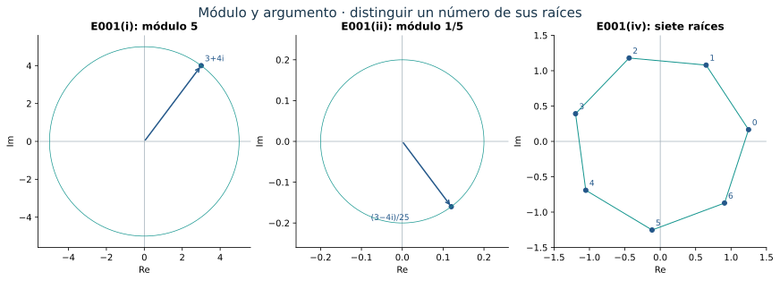
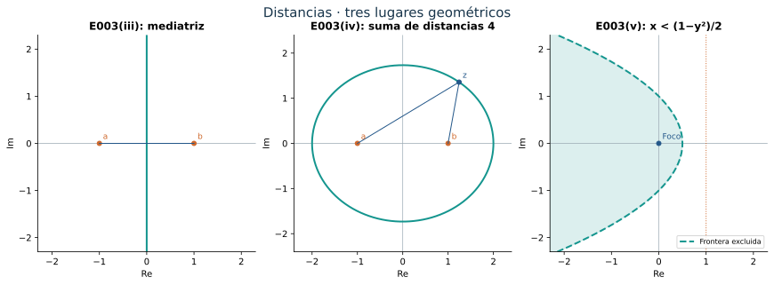
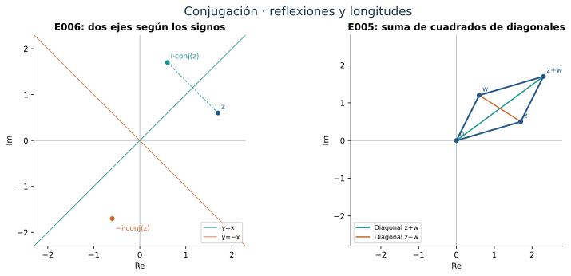
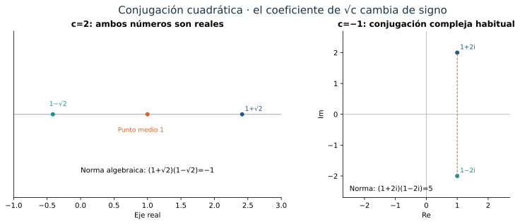
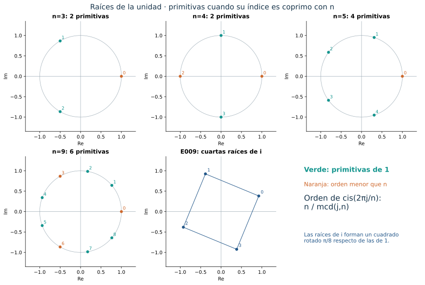
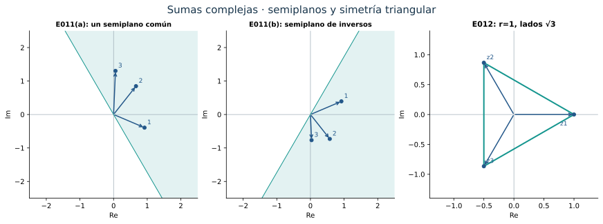

::: {.spivak-nav}

[← Capítulo 24](capitulo-24.qmd) · [Colecciones](../index.qmd#spivak-calculus-cuarta-edición) · [Capítulo 26 →](capitulo-26.qmd)

:::

Alevi Peña · Matemática Abierta · Solucionario explicado · 2026-10-15

Soluciones propias de los doce problemas de Michael Spivak, *Calculus*, cuarta edición, capítulo 25, pp. 526–540. Los ejercicios ocupan pp. 539–540 (PDF 558–559 de la copia de trabajo). No hay apéndice. Se conservan todos los incisos y se desarrollan también las tareas que comparten un mismo rótulo.

## Coordenadas, distancias y ángulos {#seccion-373}

Escribir $z=x+iy$ identifica un número complejo con el punto $(x,y)$. Su conjugado es $\bar z=x-iy$, y $|z|=\sqrt{x^2+y^2}$ es la distancia al origen. Para $z\ne0$, una expresión polar es
$$
z=r(\cos\theta+i\sin\theta),\qquad r=|z|>0.
$$
Todos sus argumentos son $\theta+2\pi k$, $k\in\mathbb Z$. Usaremos como representante el que pertenece a $[0,2\pi)$ cuando haya que comparar tamaños. Cero no tiene argumento.

Multiplicar suma ángulos y multiplica módulos. Con la notación $\operatorname{cis}\theta=\cos\theta+i\sin\theta$, la fórmula de adición da $\operatorname{cis}\alpha\,\operatorname{cis}\beta=\operatorname{cis}(\alpha+\beta)$. Por inducción,
$$
(r\operatorname{cis}\theta)^n=r^n\operatorname{cis}(n\theta).
$$
Si $w^n=r\operatorname{cis}\theta\ne0$, necesariamente $|w|=r^{1/n}$ y su ángulo satisface $n\arg w=\theta+2\pi k$. Las $n$ soluciones distintas son, por tanto,
$$
w_j=r^{1/n}\operatorname{cis}\frac{\theta+2\pi j}{n},
\qquad j=0,\ldots,n-1.
$$
Son distintas porque dos ángulos de la lista difieren en un múltiplo de $2\pi$ sólo si sus índices coinciden. Esta descripción obtiene todas las raíces sin escoger una raíz compleja como si fuera única.

## E001 — Módulos y argumentos {#e001}

Pongamos $\theta=\arctan(4/3)\in(0,\pi/2)$.

**(i) · SPV4-C25-E001-i.** Para $z=3+4i$,
$$
|z|=5,\qquad \arg z=\theta+2\pi k,\quad k\in\mathbb Z.
$$
El primer cuadrante fija el ángulo a partir de su tangente.

**(ii) · SPV4-C25-E001-ii.** Racionalizar da
$$
(3+4i)^{-1}=\frac{3-4i}{25}.
$$
Su módulo es $1/5$ y sus argumentos son $-\theta+2\pi k$. El representante en $[0,2\pi)$ es $2\pi-\theta$. El inverso refleja el ángulo y cambia el radio $r$ a $1/r$.

**(iii) · SPV4-C25-E001-iii.** Como $1+i=\sqrt2\,\operatorname{cis}(\pi/4)$,
$$
(1+i)^5=4\sqrt2\,\operatorname{cis}(5\pi/4)=-4-4i.
$$
Su módulo es $4\sqrt2$ y sus argumentos son $5\pi/4+2\pi k$.

**(iv) · SPV4-C25-E001-iv.** La raíz indicada es de orden **siete**. Los siete valores son
$$
w_j=5^{1/7}\operatorname{cis}\frac{\theta+2\pi j}{7},
\qquad j=0,\ldots,6.
$$
Cada uno tiene módulo $5^{1/7}$ y argumentos $(\theta+2\pi j)/7+2\pi k$. Los siete representantes escritos están en $[0,2\pi)$. Los puntos forman un heptágono regular; elevarlos a la séptima potencia lleva todos a $3+4i$.

**(v) · SPV4-C25-E001-v.** Aquí el número dado es $|3+4i|=5$, un real positivo. Su módulo vuelve a ser cinco y sus argumentos son $2\pi k$. El módulo de un número es ya un número real, al que se puede volver a aplicar el módulo.

{#fig-spv4-c25-f01 fig-alt="Capítulo 25: Forma polar, inverso y siete raíces"}

## E002 — Ecuaciones en el cuerpo complejo {#e002}

**(i) · SPV4-C25-E002-i.** Para $x^2+ix+1=0$, completar el cuadrado da
$$
(x+i/2)^2=-5/4.
$$
Así las dos soluciones son
$$
x=\frac{-i\pm i\sqrt5}{2}=\frac{i(-1\pm\sqrt5)}2.
$$
Son distintas y agotan las soluciones porque la diferencia entre dos cuadrados factoriza.

**(ii) · SPV4-C25-E002-ii.** La identidad
$$
x^4+x^2+1=(x^2+x+1)(x^2-x+1)
$$
reduce la ecuación a dos cuadráticas. Las cuatro soluciones son
$$
\frac{1+i\sqrt3}{2},\quad
\frac{-1+i\sqrt3}{2},\quad
\frac{-1-i\sqrt3}{2},\quad
\frac{1-i\sqrt3}{2}.
$$
Sus argumentos en $[0,2\pi)$ son $\pi/3,2\pi/3,4\pi/3,5\pi/3$. Son las raíces sextas de uno distintas de $1$ y $-1$: en efecto, $(x^2-1)(x^4+x^2+1)=x^6-1$.

**(iii) · SPV4-C25-E002-iii.** Se tiene $x^2+2ix-1=(x+i)^2$. La única solución es $x=-i$, de multiplicidad dos.

**(iv) · SPV4-C25-E002-iv.** En el sistema
$$
ix-(1+i)y=3,\qquad (2+i)x+iy=4,
$$
la primera ecuación da $x=-3i+(1-i)y$. Al sustituir en la segunda,
$$
(2+i)(-3i)+\bigl((2+i)(1-i)+i\bigr)y=4,
$$
es decir, $3-6i+3y=4$. Por tanto
$$
y=\frac13+2i,\qquad x=\frac73-\frac43i.
$$
Los pasos son equivalentes y el coeficiente final de $y$ es tres, no cero, de modo que la solución es única.

**(v) · SPV4-C25-E002-v.** El número dos es raíz del polinomio y
$$
x^3-x^2-x-2=(x-2)(x^2+x+1).
$$
Las tres soluciones son $2$ y $(-1\pm i\sqrt3)/2$. La factorización demuestra que no falta ninguna.

## E003 — Cinco lugares geométricos {#e003}

**(i) · SPV4-C25-E003-i.** Si $z=x+iy$, entonces $\bar z=-z$ equivale a $x-iy=-x-iy$, esto es, $x=0$. El conjunto es todo el eje imaginario, incluido cero.

**(ii) · SPV4-C25-E003-ii.** La igualdad $\bar z=z^{-1}$ requiere $z\ne0$. Multiplicando por $z$ resulta $|z|^2=1$. Recíprocamente, si $|z|=1$, entonces $\bar z=1/z$. El conjunto es la circunferencia unidad.

**(iii) · SPV4-C25-E003-iii.** La condición $|z-a|=|z-b|$ pide igual distancia a los puntos $a,b$. Si $a=b$, la cumplen todos los complejos. Si son distintos, es la mediatriz del segmento que los une. Una ecuación precisa se obtiene al elevar al cuadrado y cancelar $|z|^2$:
$$
2\operatorname{Re}\bigl(z(\bar b-\bar a)\bigr)=|b|^2-|a|^2.
$$
Es una recta porque $b-a\ne0$, pasa por $(a+b)/2$ y su normal apunta en la dirección $b-a$.

**(iv) · SPV4-C25-E003-iv.** Estudiamos $|z-a|+|z-b|=c$, con $c$ real, y escribimos $d=|a-b|$. La desigualdad triangular da $|z-a|+|z-b|\ge d$.

Si $a\ne b$, hay tres posibilidades. Para $c<d$ el conjunto es vacío. Para $c=d$ es el segmento cerrado $[a,b]$: la igualdad triangular exige que los vectores de $a$ a $z$ y de $z$ a $b$ tengan la misma dirección, incluidos los casos de un vector nulo. Para $c>d$ es una elipse de focos $a,b$, semieje mayor $A=c/2$ y semieje menor $B=\sqrt{c^2-d^2}/2$.

Para comprobar la descripción de la elipse, sea $m=(a+b)/2$, $t=(b-a)/d$ y escribamos $u+iv=(z-m)\bar t$. Esta traslación y rotación coloca los focos en $\pm h$, donde $h=d/2$. Si $r_+=\sqrt{(u+h)^2+v^2}$ y $r_-=\sqrt{(u-h)^2+v^2}$, la condición es $r_++r_-=2A$. Como $r_+^2-r_-^2=4hu$, obtenemos $r_\pm=A\pm hu/A$, y al elevar al cuadrado resulta
$$
\frac{u^2}{A^2}+\frac{v^2}{A^2-h^2}=1.
$$
Recíprocamente, esa ecuación implica $|u|\le A$ y, como $h<A$, los números $A\pm hu/A$ son positivos. Sus cuadrados son $(u\pm h)^2+v^2$, así que son precisamente $r_\pm$ y suman $2A$. No hemos añadido puntos al cuadrar.

Si $a=b$, la ecuación se reduce a $2|z-a|=c$: para $c>0$ es una circunferencia de centro $a$ y radio $c/2$; para $c=0$ es el punto $a$; para $c<0$ es vacía.

**(v) · SPV4-C25-E003-v.** Con $z=x+iy$, la condición es $\sqrt{x^2+y^2}<1-x$. Exige primero $1-x>0$. Al cuadrar,
$$
y^2<1-2x,\qquad\text{equivalentemente}\qquad
x<\frac{1-y^2}{2}.
$$
Esta última desigualdad ya implica $x<1/2$ y, por tanto, $1-x>0$, de modo que también es suficiente. El conjunto es la región abierta a la izquierda de la parábola $x=(1-y^2)/2$, sin incluir la frontera. Los puntos están más cerca del foco cero que de la directriz $x=1$.

{#fig-spv4-c25-f02 fig-alt="Capítulo 25: Mediatriz, elipse y región parabólica"}

## E004 — Recuperar coordenadas mediante conjugación {#e004}

**SPV4-C25-E004.** Para $z=x+iy$ con $x,y$ reales,
$$
|\bar z|=\sqrt{x^2+(-y)^2}=|z|,
\qquad
\frac{z+\bar z}{2}=x=\operatorname{Re}z,
\qquad
\frac{z-\bar z}{2i}=y=\operatorname{Im}z.
$$
La parte imaginaria es el número real $y$; el término imaginario dentro de $z$ es $iy$. La división por $i$ en la última fórmula distingue ambas cosas.

## E005 — La identidad del paralelogramo {#e005}

**SPV4-C25-E005.** Puesto que $|u|^2=u\bar u$,
$$
\begin{aligned}
|z+w|^2&=|z|^2+z\bar w+\bar z w+|w|^2,\\
|z-w|^2&=|z|^2-z\bar w-\bar z w+|w|^2.
\end{aligned}
$$
Al sumar se cancelan los términos cruzados y queda
$$
|z+w|^2+|z-w|^2=2(|z|^2+|w|^2).
$$
En el paralelogramo de vértices $0,z,z+w,w$, las diagonales tienen vectores $z+w$ y $z-w$. La suma de sus longitudes al cuadrado es igual a la suma de los cuadrados de los cuatro lados. La identidad también vale si el paralelogramo es degenerado.

## E006 — Dos reflexiones según las raíces elegidas {#e006}

**SPV4-C25-E006.** La expresión es
$$
T(z)=\sqrt i\,\overline{z\sqrt{-i}},
$$
con la barra sobre **todo** $z\sqrt{-i}$. Elijamos independientemente
$$
\sqrt i=\varepsilon\,\frac{1+i}{\sqrt2},
\qquad
\sqrt{-i}=\delta\,\frac{1-i}{\sqrt2},
\qquad \varepsilon,\delta\in\{1,-1\}.
$$
Entonces
$$
T(z)=\varepsilon\delta\,i\bar z.
$$
Para $\varepsilon\delta=1$ y $z=x+iy$, el resultado es $y+ix$: reflexión en la recta $y=x$. Para $\varepsilon\delta=-1$, es $-y-ix$: reflexión en la recta $y=-x$. Las cuatro elecciones de raíces producen, por tanto, dos transformaciones, cada una dos veces. Si $z=0$, ambas lo dejan fijo.

Geométricamente, con las elecciones positivas, multiplicar primero por $(1-i)/\sqrt2$ gira $-\pi/4$, la conjugación refleja en el eje real, y multiplicar después por $(1+i)/\sqrt2$ gira $\pi/4$. La recta que el primer giro lleva al eje real es $y=x$, que se convierte en el eje de reflexión final.

{#fig-spv4-c25-f03 fig-alt="Capítulo 25: Conjugación, reflexiones y paralelogramo"}

## E007 — Raíces conjugadas de polinomios reales {#e007}

Sea $P(z)=z^n+a_{n-1}z^{n-1}+\cdots+a_0$, con todos los $a_j$ reales.

**(a) · SPV4-C25-E007-a.** La conjugación preserva sumas y productos y deja fijos los coeficientes reales. Por ello
$$
\overline{P(z)}=P(\bar z).
$$
Si $P(a+bi)=0$, también $P(a-bi)=0$. Cuando $b\ne0$, son raíces distintas. La conjugación es una involución sin puntos fijos sobre el conjunto de raíces no reales, de modo que las agrupa por parejas.

También preserva multiplicidades: si $P(z)=(z-\alpha)^mQ(z)$ y $Q(\alpha)\ne0$, conjugar coeficientes y sustituir la variable conjugada da $P(z)=(z-\bar\alpha)^m\bar Q(z)$, con $\bar Q(\bar\alpha)=\overline{Q(\alpha)}\ne0$. Así el número de raíces no reales es par tanto si se cuentan distintas como si se cuentan con multiplicidad. No hace falta suponer aquí que todos los polinomios ya están completamente factorizados.

**(b) · SPV4-C25-E007-b.** Si $b\ne0$,[^factor] el producto de los dos factores conjugados es
$$
(z-a-bi)(z-a+bi)=z^2-2az+(a^2+b^2).
$$
Podemos comprobar la divisibilidad directamente sobre $\mathbb R$: al dividir $P$ por ese polinomio mónico obtenemos $P=HQ+rz+s$, donde $H=z^2-2az+(a^2+b^2)$, y $Q,r,s$ tienen coeficientes reales. Evaluando en $a+bi$, el resto debe satisfacer $r(a+bi)+s=0$. Su parte imaginaria es $rb=0$; como $b\ne0$, $r=0$, y después $s=0$. La división es exacta y el cociente es real.

[^factor]: E007(b) omite la condición $b\ne0$. Si $b=0$, sólo se sabe que $a$ es raíz, y no necesariamente raíz doble. Por ejemplo, $P(z)=z-1$ tiene raíz $a=1$, $b=0$, pero no es divisible por $(z-1)^2$. Se incorpora la hipótesis no real a la afirmación demostrada.

## E008 — Conjugación en una extensión cuadrática {#e008}

Fijemos un entero $c$ que no sea cuadrado de ningún entero y una raíz $s=\sqrt c$. Si $c>0$, podemos elegir la positiva; si $c<0$, una de las dos raíces imaginarias. La operación que estudiaremos es $\sigma(a+bs)=a-bs$. Para $c>0$ no coincide con la conjugación compleja habitual, que deja fijos todos los números reales.

**(a) · SPV4-C25-E008-a.** Primero comprobamos que $s$ no es racional. Si $c<0$, $s$ no es real. Si $c>0$ y $s=p/q$ con $p,q$ enteros coprimos, $q>0$, entonces $p^2=cq^2$. Cualquier primo divisor de $q$ dividiría $p$, contradicción. Por tanto $q=1$ y $c=p^2$, excluido por hipótesis.

Si $a+bs=a'+b's$ y $b\ne b'$, tendríamos $s=(a'-a)/(b-b')$, racional. Luego $b=b'$ y $a=a'$. La representación con coeficientes enteros es única y $\sigma$ está bien definida. El mismo argumento prueba unicidad con coeficientes racionales, que necesitaremos para inversos.

**(b) · SPV4-C25-E008-b.** Para $\alpha=a+bs$ y $\beta=d+es$ con coeficientes enteros, calcular da
$$
\sigma(\sigma(\alpha))=\alpha,\qquad
\sigma(\alpha)=\alpha\ \Longleftrightarrow\ b=0
\ \Longleftrightarrow\ \alpha\in\mathbb Z.
$$
En la equivalencia usamos $s\ne0$; $c=0$ está excluido porque es un cuadrado. Además,
$$
\sigma(\alpha+\beta)=\sigma(\alpha)+\sigma(\beta),
\qquad
\sigma(-\alpha)=-\sigma(\alpha).
$$
Para el producto,
$$
\alpha\beta=(ad+bec)+(ae+bd)s,
$$
de donde
$$
\sigma(\alpha\beta)=(ad+bec)-(ae+bd)s
=(a-bs)(d-es)=\sigma(\alpha)\sigma(\beta).
$$
Para interpretar correctamente el inverso, ampliamos la operación a $K=\{p+qs:p,q\in\mathbb Q\}$.[^inverso] Su representación también es única, y los cálculos anteriores siguen siendo válidos. Si $\alpha\ne0$, su norma algebraica es
$$
N(\alpha)=\alpha\sigma(\alpha)=a^2-cb^2.
$$
No puede anularse: para $b=0$ obligaría a $a=0$, y para $b\ne0$ implicaría $c=(a/b)^2$, contrario a lo probado en (a). Así
$$
\alpha^{-1}=\frac{a-bs}{a^2-cb^2}\in K,\qquad
\sigma(\alpha^{-1})
=\frac{a+bs}{a^2-cb^2}
=(\sigma(\alpha))^{-1}.
$$
Quedan demostradas todas las identidades pedidas. En $K$, los elementos fijos son los racionales; la caracterización por enteros corresponde al conjunto original $\mathbb Z[s]$.

**(c) · SPV4-C25-E008-c.** Si $P$ es mónico con coeficientes enteros, todos sus coeficientes están fijos por $\sigma$. Las identidades de (b) dan $\sigma(P(z))=P(\sigma(z))$. Por tanto, de $P(a+b\sqrt c)=0$ se deduce $P(a-b\sqrt c)=0$. Esta prueba usa sólo sumas y productos, así que es válida ya en $\mathbb Z[s]$ y no necesita inversos.

[^inverso]: E008 define inicialmente la conjugación sólo para coeficientes enteros, pero en (b) la aplica a inversos que pueden salir de ese conjunto: $2^{-1}=1/2$ es el ejemplo más sencillo. Se incorpora explícitamente la extensión a coeficientes racionales para que la identidad tenga dominio definido; no se afirma que $\mathbb Z[\sqrt c]$ sea un cuerpo.

{#fig-spv4-c25-f04 fig-alt="Capítulo 25: Dos conjugaciones y la norma algebraica"}

## E009 — Cuartas raíces de i {#e009}

**SPV4-C25-E009.** Dado que $i=\operatorname{cis}(\pi/2)$, las cuatro raíces son
$$
w_k=\operatorname{cis}\left(\frac{\pi}{8}+\frac{k\pi}{2}\right),
\qquad k=0,1,2,3.
$$
Son distintas, de módulo uno, y su cuarta potencia es $i$. Al escoger argumentos en $[0,2\pi)$, el menor es $\pi/8$; sin fijar ese intervalo no habría un argumento menor entre todos los valores posibles.

Las fórmulas de medio ángulo, con signos positivos porque $\pi/8$ está en el primer cuadrante, dan
$$
w_0=\frac{\sqrt{2+\sqrt2}}2
+i\,\frac{\sqrt{2-\sqrt2}}2.
$$
Esta es la forma sin funciones trigonométricas. Las otras raíces son $iw_0,-w_0,-iw_0$.

## E010 — Raíces de la unidad y raíces primitivas {#e010}

Suponemos $n$ entero positivo.

**(a) · SPV4-C25-E010-a.** Si $w^n=1$, entonces $w\ne0$ y, para cualquier entero $k$,
$$
(w^k)^n=(w^n)^k=1.
$$
Incluye exponentes negativos porque $w$ es invertible.

**(b) · SPV4-C25-E010-b.** Las raíces son $w_j=\operatorname{cis}(2\pi j/n)$, $0\le j<n$. El orden de $w_j$ es el menor entero positivo $m$ tal que $n$ divide a $jm$. Si $d=\gcd(j,n)$, escribimos $j=dj'$, $n=dn'$ con $j',n'$ coprimos. La condición equivale a $n'\mid j'm$, y por coprimalidad a $n'\mid m$. Por ello el orden es $n/d$.

Una raíz es primitiva exactamente cuando $\gcd(j,n)=1$: en ese caso las primeras $n$ potencias son distintas, y como son raíces por (a), recorren todas. Si el orden es menor, se repiten antes y no las recorren todas.

| n | Índices j de raíces primitivas | Cantidad |
|---:|---|---:|
| 3 | 1, 2 | 2 |
| 4 | 1, 3 | 2 |
| 5 | 1, 2, 3, 4 | 4 |
| 9 | 1, 2, 4, 5, 7, 8 | 6 |

**(c) · SPV4-C25-E010-c.** Para $w^n=1$ y $w\ne1$, la identidad geométrica finita da
$$
(1-w)\sum_{k=0}^{n-1}w^k=1-w^n=0.
$$
Como $1-w\ne0$, la suma es cero. No se necesita que $w$ sea primitiva. La exclusión $w\ne1$ es necesaria: con $w=1$ la suma vale $n$.

{#fig-spv4-c25-f05 fig-alt="Capítulo 25: Raíces de la unidad y cuartas raíces de i"}

## E011 — Un semiplano no permite cancelación total {#e011}

En ambos incisos, «de un lado de una recta» significa en un mismo **semiplano abierto**. Los puntos de la recta no están incluidos.

**(a) · SPV4-C25-E011-a.** Una recta por cero admite un vector normal unitario $u$. Eligiendo su signo, el semiplano que contiene los puntos puede escribirse
$$
H_u=\{z:\operatorname{Re}(\bar u z)>0\}.
$$
Si $z_1,\ldots,z_k\in H_u$ con $k\ge1$, entonces
$$
\operatorname{Re}\left(\bar u\sum_{j=1}^kz_j\right)
=\sum_{j=1}^k\operatorname{Re}(\bar u z_j)>0.
$$
La suma pertenece al mismo semiplano y, en particular, no es cero. Permitir la frontera invalidaría la afirmación: $1$ y $-1$ pertenecen al semiplano cerrado superior y suman cero.

**(b) · SPV4-C25-E011-b.** Ningún $z_j$ es cero. Como $z_j^{-1}=\bar z_j/|z_j|^2$,
$$
\operatorname{Re}(u z_j^{-1})
=\frac{\operatorname{Re}(u\bar z_j)}{|z_j|^2}
=\frac{\operatorname{Re}(\bar u z_j)}{|z_j|^2}>0.
$$
Todos los inversos pertenecen al semiplano $H_{\bar u}$, limitado por la recta conjugada de la original. Aplicando (a),
$$
z_1^{-1}+\cdots+z_k^{-1}\ne0.
$$
La inversión conjuga la dirección y reescala cada vector por un factor positivo. No necesariamente conserva el semiplano original, pero sí coloca todos los inversos en un semiplano común.

## E012 — Tres radios iguales cuya suma es cero {#e012}

**SPV4-C25-E012.** Sea $|z_1|=|z_2|=|z_3|=r>0$ y $z_1+z_2+z_3=0$.[^triangulo] Como $z_1+z_2=-z_3$,
$$
r^2=|z_1+z_2|^2=2r^2+2\operatorname{Re}(z_1\bar z_2),
$$
de donde $\operatorname{Re}(z_1\bar z_2)=-r^2/2$. La misma cuenta vale para cada pareja. En consecuencia,
$$
|z_j-z_\ell|^2
=2r^2-2\operatorname{Re}(z_j\bar z_\ell)=3r^2
\quad(j\ne\ell).
$$
Las tres distancias son $\sqrt3\,r>0$. Los puntos son distintos y forman un triángulo equilátero.

La sugerencia de girar hasta que $z_1$ sea real se justifica multiplicando todos los puntos por $\bar z_1/r$, de módulo uno. La operación preserva módulos, distancias y la ecuación de suma cero, y lleva $z_1$ a $r$. Entonces los otros dos puntos deben tener parte real $-r/2$ y partes imaginarias opuestas $\pm\sqrt3\,r/2$. Así se ve también que los radios están separados por ángulos de $2\pi/3$.

[^triangulo]: El enunciado omite excluir $r=0$. En ese caso los tres puntos son cero y no forman un triángulo no degenerado. Se incorpora $r>0$ a la afirmación geométrica, y se conserva explícitamente el caso excepcional.

{#fig-spv4-c25-f06 fig-alt="Capítulo 25: Semiplanos, inversos y el triángulo equilátero"}

## Estado y continuación {#seccion-18155}

Doce problemas y **30 unidades terminales** resueltos y revisados internamente, incluidas todas las identidades de E008(b), los dos ejes posibles de E006 y los casos límite de E003. Las correcciones de E007, E008 y E012 están incorporadas al desarrollo y explicadas al pie. El inventario y el informe de revisión acompañan este manuscrito.

---

::: {.spivak-nav}

[← Capítulo 24](capitulo-24.qmd) · [Colecciones](../index.qmd#spivak-calculus-cuarta-edición) · [Capítulo 26 →](capitulo-26.qmd)

:::

Soluciones originales de Alevi Peña · Matemática Abierta. [Licencia GFDL 1.3 o posterior](/COPYING.FDL).
