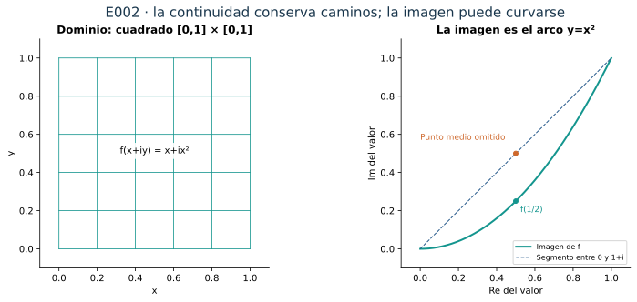
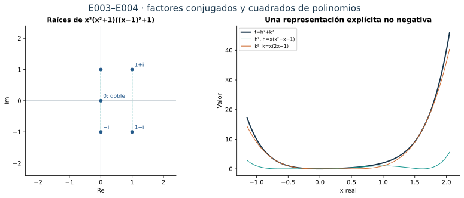
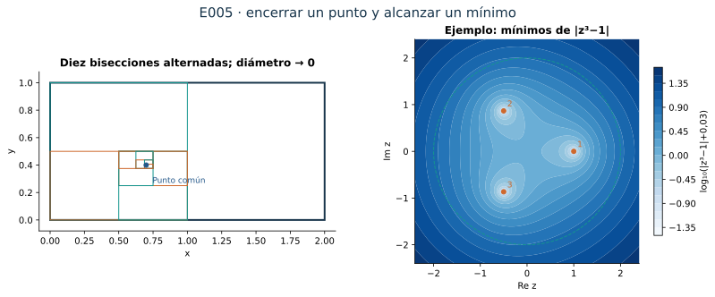
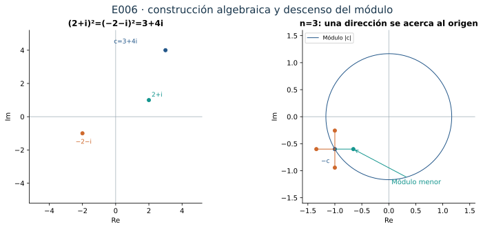
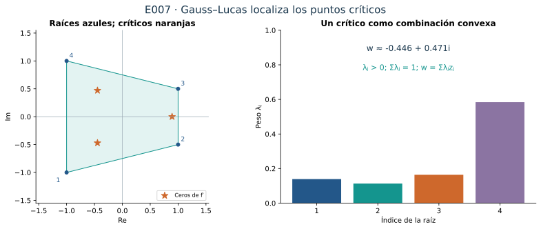
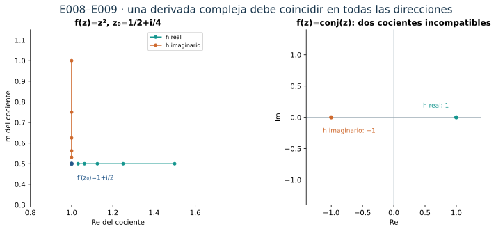

[← Capítulo 25](capitulo-25.qmd) · [Colecciones](../index.qmd#spivak-calculus-cuarta-edición) · [Capítulo 27 →](capitulo-27.qmd)

Alevi Peña · Matemática Abierta · Solucionario explicado · 2026-10-15

Soluciones propias de los diez problemas del capítulo 26 de Michael Spivak, *Calculus*, cuarta edición, pp. 541–554. Los ejercicios ocupan pp. 551–554 (PDF 570–573 de la copia de trabajo). No hay apéndice. Las demostraciones que sostienen el teorema fundamental del álgebra se explicitan para que las remisiones de los ejercicios no oculten dependencias.

**Solucionario: 26/30 capítulos, 86,7 %; faltan 4: C27–C30. C26: 10/10 problemas y 25/25 unidades.** Las dos barras del capítulo miden redacción y revisión internas completas. La barra general da igual peso a cada capítulo; no representa porcentaje global por ejercicios ni aprobación editorial integral. C01 mantiene su revisión editorial integral histórica de 9/25 problemas y 48/96 unidades.

## Continuidad y el argumento del mínimo {#seccion-823}

Una función compleja sigue asociando un valor a cada punto de su dominio; la diferencia visible es que tanto el punto como el valor pueden tener dos coordenadas. La distancia entre $z$ y $w$ es $|z-w|$, así que la continuidad se expresa con la misma desigualdad que en el caso real. Si $f=u+iv$, las desigualdades
$$
|\operatorname{Re}\zeta|\le|\zeta|,\qquad
|\operatorname{Im}\zeta|\le|\zeta|,\qquad
|\zeta|\le|\operatorname{Re}\zeta|+|\operatorname{Im}\zeta|
$$
muestran que $f$ es continua exactamente cuando lo son sus dos componentes reales.

El teorema fundamental del álgebra afirma que todo polinomio complejo no constante tiene una raíz. Los ejercicios E003 y E004 lo usan, mientras E005 demuestra los hechos de compacidad que completan su prueba. Es útil fijar aquí el argumento; E005 es independiente de este teorema, por lo que la remisión no forma un círculo.

Sea
$$
P(z)=z^n+a_{n-1}z^{n-1}+\cdots+a_0,\qquad n\ge1.
$$
**Existencia de un mínimo global.** Pongamos $S=\sum_{j=0}^{n-1}|a_j|$. Para $r=|z|\ge1$,
$$
|P(z)|\ge r^n-\sum_{j=0}^{n-1}|a_j|r^j
\ge r^n-Sr^{n-1}.
$$
Si además $r\ge2S$, esto es al menos $r^n/2$. Elijamos
$$
R\ge\max\left(1,2S,(2|P(0)|+2)^{1/n}\right).
$$
Entonces $|P(z)|\ge|P(0)|+1$ cuando $|z|\ge R$. La función real continua $|P|$ alcanza un mínimo en el rectángulo $[-R,R]\times[-R,R]$, por E005(c). Como cero está dentro, ese mínimo no supera $|P(0)|$; fuera del rectángulo todos los valores son mayores. Por tanto existe un mínimo global en algún $z_0$.

**Descenso desde un valor no nulo.** Supongamos que $\alpha=P(z_0)\ne0$. Al desarrollar el polinomio alrededor de $z_0$, hay un primer término no constante:
$$
P(z_0+h)=\alpha+\beta h^m+\sum_{j=m+1}^n c_jh^j,
\qquad \beta\ne0.
$$
La existencia de ese término se debe a que trasladar la variable no vuelve constante un polinomio de grado $n$. Por las raíces complejas construidas en C25, existe $y$ con $y^m=-\alpha/\beta$. Para $t$ real positivo,
$$
P(z_0+ty)=\alpha\bigl(1-t^m+t^mE(t)\bigr),
\qquad
E(t)=\sum_{j=m+1}^n\frac{c_jy^j}{\alpha}t^{j-m}.
$$
Si $C=\sum_{j=m+1}^n|c_jy^j/\alpha|$, para $0<t<1$ tenemos $|E(t)|\le Ct$. Elegir también $t<1/[2(C+1)]$ asegura $|E(t)|<1/2$, incluso si la suma es vacía. Así
$$
|P(z_0+ty)|
\le|\alpha|\left(1-t^m+\frac{t^m}{2}\right)
<|\alpha|.
$$
Contradice la minimalidad. Luego $P(z_0)=0$. Un polinomio con coeficiente principal distinto de uno se divide primero por ese coeficiente.

E006 conservará la existencia del mínimo y el descenso con $m=1$, pero construirá las raíces sin recurrir a la representación trigonométrica de C25.

## E001 — Restricciones a rectas horizontales y verticales {#e001}

**(a) · SPV4-C26-E001-a.** Fijado $y_0\in\mathbb R$, definimos $\alpha(x)=x+iy_0$. Para cualesquiera $x,x_0$,
$$
|\alpha(x)-\alpha(x_0)|=|x-x_0|.
$$
La elección $\delta=\varepsilon$ prueba continuidad en cada punto. Fijado $x_0$, la función $\beta(y)=x_0+iy$ satisface igualmente $|\beta(y)-\beta(y_0)|=|y-y_0|$, y es continua. Ambas inclusiones preservan distancias.

**(b) · SPV4-C26-E001-b.** Si $f:\mathbb C\to\mathbb C$ es continua, para $y_0$ fijo la función $g(x)=f(x+iy_0)$ es $f\circ\alpha$; para $x_0$ fijo, $h(y)=f(x_0+iy)$ es $f\circ\beta$. Las composiciones son continuas. En términos de la definición, un control de la distancia entre las entradas de $f$ se convierte exactamente en el mismo control de $|x-x_0|$ o $|y-y_0|$ por (a).

Esta implicación va de continuidad en el plano a continuidad de cada restricción; no afirma una recíproca.

## E002 — Valores intermedios e imágenes que no son convexas {#e002}

**(a) · SPV4-C26-E002-a.** Sea $Q=[a,b]\times[c,d]$, no vacío, y sea $f:Q\to\mathbb R$ continua. Para $z,w\in Q$, cada punto
$$
\gamma(t)=(1-t)z+tw,\qquad 0\le t\le1,
$$
pertenece al rectángulo: cada coordenada es una combinación convexa de coordenadas del intervalo correspondiente. La función real $F(t)=f(\gamma(t))$ es continua en $[0,1]$ y satisface $F(0)=f(z)$, $F(1)=f(w)$. El teorema del valor intermedio asegura que toma cada valor comprendido entre esos dos números. La conclusión vale también si los valores coinciden o el rectángulo es degenerado.

**(b) · SPV4-C26-E002-b.** En el cuadrado $[0,1]\times[0,1]$ definamos
$$
f(x+iy)=x+ix^2.
$$
Es continua porque lo son sus componentes. La imagen es el arco de parábola $\{t+it^2:0\le t\le1\}$. Contiene $f(0)=0$ y $f(1)=1+i$, pero no contiene su punto medio $(1+i)/2$: si la parte real del valor fuese $1/2$, la parte imaginaria tendría que ser $1/4$, no $1/2$. Por tanto la imagen no contiene necesariamente el segmento entre dos de sus valores. La prueba de (a) produce un camino continuo entre las imágenes; ese camino puede curvarse.

## E003 — Factorización de polinomios {#e003}

**(a) · SPV4-C26-E003-a.** Procedemos por inducción sobre el grado del polinomio mónico $P$. Para grado uno, $P(z)=z+a_0=z-(-a_0)$. Para $n\ge2$, el teorema fundamental del álgebra, demostrado arriba y completado por E005, proporciona una raíz $z_1$. La división por $z-z_1$ da
$$
P(z)=(z-z_1)Q(z)+r.
$$
Al evaluar en $z_1$ vemos que $r=0$. El cociente es mónico de grado $n-1$; por inducción es un producto de $n-1$ factores lineales. En consecuencia,
$$
P(z)=\prod_{j=1}^n(z-z_j).
$$
La lista puede repetir una raíz tantas veces como indique su multiplicidad. No se ha supuesto que las raíces sean distintas.

**(b) · SPV4-C26-E003-b.** Si los coeficientes de $P$ son reales, cada raíz no real $u+iv$ aparece junto con $u-iv$ y con la misma multiplicidad, por C25-E007(a). Agrupamos cada pareja:
$$
(z-u-iv)(z-u+iv)=z^2-2uz+(u^2+v^2),\qquad v\ne0.
$$
Las raíces reales producen factores $z-r$. Así $P$ se expresa como producto de factores lineales y cuadráticos con coeficientes reales. Los cuadráticos de esta agrupación tienen discriminante $-4v^2<0$; por ello no se descomponen en factores lineales reales. Si todas las raíces son reales, no hace falta ningún factor cuadrático.

## E004 — Polinomios no negativos como sumas de cuadrados {#e004}

Una suma de cuadrados significa aquí una suma finita de cuadrados de polinomios con coeficientes reales, evaluados en la variable real $x$.

**(a) · SPV4-C26-E004-a.** Si $f=h_1^2+\cdots+h_N^2$, entonces $h_j(x)$ es real y $h_j(x)^2\ge0$ para cada $x\in\mathbb R$. Al sumar, $f(x)\ge0$.

**(b) · SPV4-C26-E004-b.** Si $f=\sum_{j=1}^N h_j^2$ y $g=\sum_{\ell=1}^M k_\ell^2$, la distributividad da la identidad de polinomios
$$
fg=\sum_{j=1}^N\sum_{\ell=1}^M(h_jk_\ell)^2.
$$
Cada producto $h_jk_\ell$ vuelve a ser un polinomio real. La cantidad de sumandos puede aumentar, pero sigue siendo finita.

**(c) · SPV4-C26-E004-c.** Supongamos $f(x)\ge0$ en toda la recta. Si es el polinomio cero, $f=0^2$. Si es constante positivo, $f=(\sqrt f)^2$. En el caso no constante, su coeficiente principal $A$ es positivo y el grado es par: un grado impar daría signos opuestos en los dos extremos de la recta, y un coeficiente principal negativo daría valores negativos para $x$ positivo suficientemente grande.

Toda raíz real $r$ tiene multiplicidad par. En efecto, escribamos $f(x)=(x-r)^mH(x)$ con $H(r)\ne0$. Por continuidad, $H$ conserva su signo cerca de $r$. Si $m$ fuese impar, $(x-r)^m$ cambiaría de signo al cruzar $r$, y $f$ sería negativa en uno de los lados.

La factorización de E003(b) permite entonces escribir
$$
f(x)=A\prod_j(x-r_j)^{2e_j}
\prod_\ell\bigl((x-u_\ell)^2+v_\ell^2\bigr),
\qquad e_j\ge1,\quad v_\ell>0,
$$
donde los cuadráticos pueden repetirse. El factor $A$ es un cuadrado real; cada factor real de multiplicidad par también lo es; cada cuadrático es una suma de dos cuadrados de polinomios, $(x-u_\ell)^2+(v_\ell)^2$. Aplicando (b) repetidamente obtenemos la representación pedida. Los productos vacíos se interpretan como uno.

Por ejemplo, una identidad que se puede comprobar sin factorizar es
$$
x^2(x^2+1)\bigl((x-1)^2+1\bigr)
=\bigl(x(x^2-x-1)\bigr)^2+\bigl(x(2x-1)\bigr)^2.
$$
Muestra en un caso concreto cómo la multiplicación de sumas de cuadrados produce una representación polinómica explícita.

## E005 — Compacidad de un rectángulo cerrado {#e005}

**(a) · SPV4-C26-E005-a.** Sea $A$ un subconjunto infinito de $Q_0=[a,b]\times[c,d]$. Bisecamos primero por una recta vertical y conservamos una mitad cerrada que contenga infinitos puntos de $A$: alguna debe hacerlo, pues dos conjuntos finitos no pueden cubrir $A$. Después bisecamos horizontalmente y repetimos, alternando las direcciones. Obtenemos rectángulos cerrados encajados $Q_m=I_m\times J_m$, cada uno con infinitos puntos de $A$.

Los intervalos de cada coordenada están encajados y sus longitudes tienden a cero. El teorema de intervalos encajados reales da un punto $x_*$ común a los $I_m$ y un punto $y_*$ común a los $J_m$. Así $z_*=x_*+iy_*$ pertenece a todos los rectángulos. Después de $m$ cortes,
$$
\operatorname{diam}(Q_m)^2
=\frac{(b-a)^2}{2^{2\lceil m/2\rceil}}
+\frac{(d-c)^2}{2^{2\lfloor m/2\rfloor}}
\longrightarrow0.
$$
Para cualquier $\varepsilon>0$, elegimos $m$ con diámetro menor que $\varepsilon$. Como $Q_m$ contiene infinitos puntos de $A$, podemos escoger uno distinto de $z_*$. Su distancia a $z_*$ es menor que $\varepsilon$. Es precisamente la condición de punto límite exigida. Si algún lado del rectángulo tiene longitud cero, la otra longitud sigue tendiendo a cero y el argumento permanece válido; un rectángulo de un solo punto no puede contener un conjunto infinito.

Usaremos también la versión para sucesiones: toda sucesión de puntos del rectángulo tiene una subsucesión convergente a un punto del rectángulo. Se obtiene aplicando Bolzano–Weierstrass real a las primeras coordenadas y luego a las segundas coordenadas de esa subsucesión. La extracción adicional conserva el límite de la primera coordenada y el rectángulo cerrado contiene ambos límites. Este razonamiento cubre igualmente sucesiones con valores repetidos.

**(b) · SPV4-C26-E005-b.** Si una función continua $f:Q_0\to\mathbb C$ no estuviera acotada, para cada entero $N\ge1$ podríamos elegir $z_N\in Q_0$ con $|f(z_N)|>N$. Por la versión secuencial de (a), alguna subsucesión $z_{N_j}$ converge a $z_*\in Q_0$. La continuidad da $f(z_{N_j})\to f(z_*)$, por lo que los módulos de esa subsucesión están acotados. Pero $|f(z_{N_j})|>N_j\to\infty$, contradicción.

**(c) · SPV4-C26-E005-c.** Para $f:Q_0\to\mathbb R$ continua, (b) asegura que $M=\sup f(Q_0)$ es finito. Elegimos $z_N$ con $M-1/N<f(z_N)\le M$. Una subsucesión converge a $z_*\in Q_0$; entonces, por continuidad,
$$
f(z_*)=\lim_j f(z_{N_j})=M.
$$
El máximo se alcanza. Aplicamos lo mismo a $-f$ para obtener un punto donde se alcanza el mínimo. En particular, el módulo de un polinomio, que es una función real continua, alcanza máximo y mínimo en cada rectángulo cerrado. Esto completa la dependencia usada al comienzo.

## E006 — Raíces complejas sin trigonometría {#e006}

Fijamos un entero $n\ge1$ y $c\in\mathbb C$. Si $c=0$, la raíz cero resuelve inmediatamente la ecuación para todo $n$. En los argumentos de descenso de (c,d) suponemos $c\ne0$.[^cero]

**(a) · SPV4-C26-E006-a.** Escribamos $c=a+ib$ y $\rho=\sqrt{a^2+b^2}$. Si $\rho+a>0$, ponemos
$$
u=\sqrt{\frac{\rho+a}{2}}>0,\qquad v=\frac{b}{2u}.
$$
Entonces $2uv=b$, y de $b^2=(\rho-a)(\rho+a)$ se obtiene $v^2=(\rho-a)/2$. Por tanto $u^2-v^2=a$ y $(u+iv)^2=c$. Las dos raíces son $\pm(u+iv)$, distintas si $c\ne0$.

Falta el caso $\rho+a=0$. Obliga a $b=0$ y $a\le0$: si $a<0$, las raíces son $\pm i\sqrt{-a}$; si $a=0$, la única raíz es cero. La separación evita dividir por cero y proporciona una construcción para todos los complejos.

**(b) · SPV4-C26-E006-b.** Escribimos $n=2^rq$ con $q$ impar y $r\ge0$. Si sabemos encontrar $w$ con $w^q=c$, tomamos sucesivamente $r$ raíces cuadradas mediante (a): $w_0=w$ y $w_{j+1}^2=w_j$. Entonces $w_r^{2^r}=w$ y
$$
w_r^n=(w_r^{2^r})^q=w^q=c.
$$
Basta, pues, demostrar existencia para exponentes impares; el caso $q=1$ ya está incluido.

**(c) · SPV4-C26-E006-c.** Consideremos $P(z)=z^n-c$ para $n$ impar. La existencia de un mínimo global de $|P|$ se obtiene por el argumento de crecimiento y E005; no utiliza la existencia previa de raíces complejas. Sea $z_0$ un punto de mínimo.

Si $P(z_0)=0$, terminamos. Si $z_0\ne0$ y $\alpha=P(z_0)\ne0$, la expansión binomial finita da
$$
P(z_0+h)=\alpha+nz_0^{n-1}h+\sum_{j=2}^n\binom nj z_0^{n-j}h^j.
$$
El primer coeficiente no constante es $\beta=nz_0^{n-1}\ne0$, así que el entero $m$ de la prueba inicial es uno. Podemos elegir simplemente $y=-\alpha/\beta$, por división compleja. El descenso de aquella prueba, con el mismo control explícito del resto, produce un punto con módulo menor que $|P(z_0)|$, contradicción. No se ha empleado ninguna raíz de orden superior a uno. Sólo queda excluir $z_0=0$ cuando $c\ne0$.

**(d) · SPV4-C26-E006-d.** Supongamos que el mínimo ocurre en cero. Escribamos $c=a+ib\ne0$ y sea $H=\max(|a|,|b|)>0$. Podemos escoger $e\in\{1,-1,i,-i\}$ de modo que
$$
\operatorname{Re}(\bar c e)=H.
$$
Por ejemplo, si $|a|\ge|b|$, elegimos $e$ real con el signo de $a$; en otro caso elegimos $e=i$ o $-i$ con el signo de $b$.

Como $n$ es impar, las potencias de los cuatro puntos $\delta,-\delta,i\delta,-i\delta$ son, en algún orden, los cuatro números $t,-t,it,-it$, donde $t=\delta^n$. Elegimos $\delta>0$ tan pequeña que $0<t<2H$. Uno de esos cuatro puntos, digamos $z$, satisface $z^n=te$, y entonces
$$
|P(z)|^2=|-c+te|^2
=|c|^2-2tH+t^2<|c|^2=|P(0)|^2.
$$
Contradicción. Por tanto el mínimo no nulo tampoco puede estar en cero. Junto con (c), esto prueba la existencia de una raíz para todo exponente impar, y (b) completa todos los exponentes. Sólo se han usado raíces cuadradas reales, operaciones complejas, compacidad real y el binomio finito; no hay una dependencia circular del teorema fundamental del álgebra.

[^cero]: El descenso de E006(c,d) omite separar $c=0$ al pedir que se descarte un mínimo en cero. Para $c=0$, ese mínimo existe y ya es una raíz. Se incorpora el caso trivial antes del descenso y se explicita $c\ne0$ en la contradicción.

## E007 — Ceros de la derivada y envolvente convexa {#e007}

Sea $f(z)=\prod_{j=1}^k(z-z_j)^{m_j}$, con $k\ge1$ y $m_j$ enteros positivos. Los puntos $z_j$ pueden repetirse; si se desea, se agrupan primero las repeticiones.

**(a) · SPV4-C26-E007-a.** La regla del producto da una identidad polinómica válida para todo $z$:
$$
f'(z)=\sum_{j=1}^k
m_j(z-z_j)^{m_j-1}\prod_{\ell\ne j}(z-z_\ell)^{m_\ell}.
$$
Si $z$ no coincide con ninguna raíz, factorizamos $f(z)$ y obtenemos
$$
f'(z)=f(z)\sum_{j=1}^k\frac{m_j}{z-z_j}.
$$
Esta última es la fórmula solicitada en su dominio de definición.[^dominio] No se debe sustituir un cero de $f$ en una fracción que allí no está definida.

**(b) · SPV4-C26-E007-b.** Sea $g(z)=\sum_j m_j/(z-z_j)$, definida fuera de las raíces. Supongamos que los $z_j$ están todos en un mismo semiplano abierto limitado por una recta que pasa por $z$. Los números $z-z_j$ están entonces en un semiplano abierto limitado por una recta que pasa por cero. Por C25-E011(b), sus inversos están también en un semiplano abierto común.

Multiplicar cada inverso por el real positivo $m_j$ lo mantiene en ese semiplano; sumar números de ese semiplano no puede dar cero, por C25-E011(a). Así $g(z)\ne0$. Por contraposición, si $g(z)=0$, ninguna recta por $z$ puede dejar todos los $z_j$ estrictamente del mismo lado.

**(c) · SPV4-C26-E007-c.** Sea $K$ la envolvente convexa de $\{z_1,\ldots,z_k\}$ y supongamos que $f'(w)=0$. Si $w$ coincide con una de las raíces, pertenece a $K$. En otro caso $f(w)\ne0$, y (a) implica $g(w)=0$. Si $w\notin K$, la separación por una recta a través de $w$ que proporciona el enunciado dejaría todas las raíces en un mismo semiplano abierto, contradiciendo (b). Luego $w\in K$. Es el teorema de Gauss–Lucas para este polinomio.

También podemos ver directamente una combinación convexa. De $g(w)=0$, usando $1/(w-z_j)=(\bar w-\bar z_j)/|w-z_j|^2$ y conjugando, se deduce
$$
w=\sum_{j=1}^k\lambda_jz_j,\qquad
\lambda_j=
\frac{m_j/|w-z_j|^2}{\sum_{\ell=1}^k m_\ell/|w-z_\ell|^2}.
$$
Todos los pesos son positivos y suman uno. Esto prueba la pertenencia a $K$ sin dejar implícito el significado de convexidad. Para grado uno, la derivada es una constante no nula y la afirmación sobre sus ceros es vacía.

[^dominio]: El producto con la suma de fracciones de E007(a) se escribe en el original sin excluir los ceros de $f$. Se incorpora la restricción $z\ne z_j$ y se da primero la identidad polinómica que sí vale en todos los puntos. Los exponentes positivos se entienden enteros porque $f$ es un polinomio.

## E008 — La derivabilidad compleja implica continuidad {#e008}

**SPV4-C26-E008.** Supongamos que existe $f'(z_0)$ y que $f$ está definida en un entorno de $z_0$. Para $h\ne0$ suficientemente pequeño,
$$
f(z_0+h)-f(z_0)
=h\,\frac{f(z_0+h)-f(z_0)}h.
$$
El cociente tiende al número finito $f'(z_0)$, por lo que está acotado, digamos en módulo por $M=|f'(z_0)|+1$, si $0<|h|<\delta_0$. Entonces
$$
|f(z_0+h)-f(z_0)|\le M|h|.
$$
Para un $\varepsilon>0$ dado, basta tomar $\delta=\min(\delta_0,\varepsilon/M)$. El caso $h=0$ es inmediato. Es exactamente la continuidad en $z_0$, con independencia de la dirección desde la cual se aproxima el punto.

## E009 — Derivadas de componentes y constancia {#e009}

Escribimos $f=u+iv$, con $u,v$ reales, y suponemos que existe $f'(z_0)=\alpha+i\beta$ en $z_0=x_0+iy_0$.

**(a) · SPV4-C26-E009-a.** Fijemos $y_0$ y definamos $g(x)=u(x+iy_0)$, $h(x)=v(x+iy_0)$. En la definición de derivada compleja podemos restringir los incrementos a reales $t\to0$:
$$
\frac{f(z_0+t)-f(z_0)}t
=\frac{g(x_0+t)-g(x_0)}t
+i\frac{h(x_0+t)-h(x_0)}t
\longrightarrow\alpha+i\beta.
$$
El límite de cada componente es la componente del límite, por las desigualdades del comienzo. Así $g'(x_0)=\alpha$ y $h'(x_0)=\beta$.

**(b) · SPV4-C26-E009-b.** Fijemos $x_0$ y pongamos $k(y)=u(x_0+iy)$, $\ell(y)=v(x_0+iy)$. Con incremento $it$, $t$ real,
$$
\frac{f(z_0+it)-f(z_0)}{it}
=\frac{\ell(y_0+t)-\ell(y_0)}t
-i\frac{k(y_0+t)-k(y_0)}t
\longrightarrow\alpha+i\beta.
$$
Por tanto $\ell'(y_0)=\alpha$ y $k'(y_0)=-\beta$. En la notación de derivadas parciales, las conclusiones son $u_x=v_y$ y $u_y=-v_x$ en $z_0$, las ecuaciones de Cauchy–Riemann. Aquí se han demostrado como condiciones necesarias; no se ha supuesto una recíproca.

**(c) · SPV4-C26-E009-c.** Supongamos $f:\mathbb C\to\mathbb C$ diferenciable con $f'(z)=0$ para todo $z$. Por (a), en cada recta horizontal las funciones reales $u$ y $v$ tienen derivada cero, así que son constantes en esa recta por el teorema real del valor medio. Por (b), lo mismo ocurre en cada recta vertical.

Para comparar $z=x_1+iy_1$ con $w=x_2+iy_2$, pasamos primero de $z$ a $x_2+iy_1$ por una recta horizontal y después a $w$ por una vertical. Ninguna de las dos componentes cambia en los dos pasos. Por ello $f(z)=f(w)$ para cualesquiera $z,w$ y $f$ es constante. El dominio completo $\mathbb C$ permite hacer ambos recorridos dentro del dominio.

## E010 — Derivadas racionales y derivadas de arctan {#e010}

**(a) · SPV4-C26-E010-a.** Para $f(x)=1/(1+x^2)$ y $x$ real, la descomposición
$$
f(x)=\frac1{2i}\left(\frac1{x-i}-\frac1{x+i}\right)
$$
permite derivar cada fracción. Una inducción sobre $k\ge0$ da
$$
\frac{d^k}{dx^k}\frac1{x-a}=\frac{(-1)^kk!}{(x-a)^{k+1}},
$$
siempre que el denominador no sea cero. Por tanto
$$
f^{(k)}(x)=
\frac{(-1)^kk!}{2i}
\left(\frac1{(x-i)^{k+1}}-\frac1{(x+i)^{k+1}}\right).
$$
Para $x$ real, las fracciones del paréntesis son conjugadas, y su diferencia dividida por $2i$ es real. Una forma enteramente real se obtiene al llevar a denominador común y expandir las potencias:
$$
f^{(k)}(x)=
\frac{(-1)^kk!}{(1+x^2)^{k+1}}
\sum_{j=0}^{\lfloor k/2\rfloor}
(-1)^j\binom{k+1}{2j+1}x^{k-2j}.
$$
La fórmula incluye $k=0$. En cero, los numeradores de grado impar se anulan, mientras que para $k=2m$ sólo queda el término $j=m$. Así
$$
f^{(2m)}(0)=(-1)^m(2m)!,\qquad f^{(2m+1)}(0)=0.
$$

**(b) · SPV4-C26-E010-b.** Sea $A(x)=\arctan x$. Como $A'=f$, para $k\ge1$ tenemos $A^{(k)}(0)=f^{(k-1)}(0)$. Resulta
$$
A^{(2m+1)}(0)=(-1)^m(2m)!\quad(m\ge0),\qquad
A^{(2m)}(0)=0\quad(m\ge1).
$$
Además, $A^{(0)}(0)=A(0)=0$. Por ejemplo, las primeras derivadas no nulas en cero son $1,-2!,4!,-6!$. La obtención usa derivación de fracciones racionales y la identidad $A'=f$, sin depender de una expansión en serie posterior.

## Estado y continuación {#seccion-21693}

Los **10 problemas y las 25 unidades terminales** quedan resueltos y revisados internamente. La prueba inicial del teorema fundamental del álgebra es un desarrollo auxiliar y no aumenta el denominador de ejercicios. E005 cierra su dependencia de compacidad, y E006 construye la ruta sin trigonometría de forma separada.

---

[← Capítulo 25](capitulo-25.qmd) · [Colecciones](../index.qmd#spivak-calculus-cuarta-edición) · [Capítulo 27 →](capitulo-27.qmd)

Soluciones originales de Alevi Peña · Matemática Abierta. [Licencia GFDL 1.3 o posterior](/COPYING.FDL).
