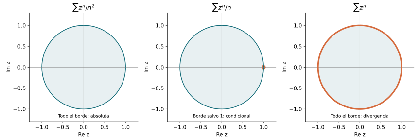
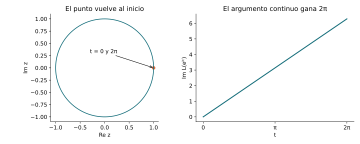
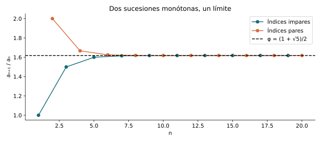
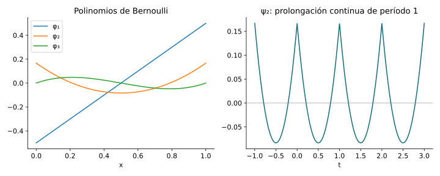
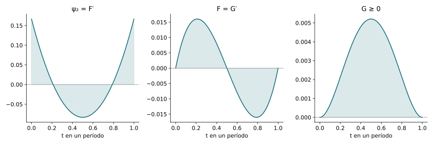
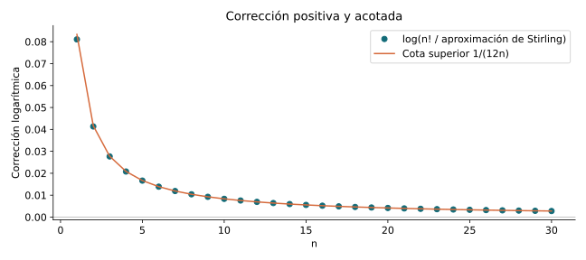

::: {.spivak-nav}

[← Capítulo 26](capitulo-26.qmd) · [Colecciones](../index.qmd#spivak-calculus-cuarta-edición) · [Capítulo 28 →](capitulo-28.qmd)

:::

Spivak, *Calculus*, 4.ª edición · Solucionario explicado · Matemática Abierta

Capítulo completo: **19 problemas y 80 unidades terminales**, sin apéndice. Desarrollo y revisión internos; no constituye dictamen externo. Fuente primaria: pp.555–578, PDF574–597; ejercicios: pp.567–577, PDF586–596. Las fórmulas y demostraciones siguientes son una elaboración propia.

## El paso de las series reales a las complejas {#seccion-832}

La desigualdad que permite trasladar los argumentos es
$$
\max(|\Re z|,|\Im z|)\leq |z|\leq|\Re z|+|\Im z|.
$$
Una sucesión converge precisamente cuando convergen sus dos coordenadas; aplicada a sumas parciales, la misma observación caracteriza las series convergentes. Aplicada a valores absolutos, prueba que la convergencia absoluta compleja equivale a la convergencia absoluta de ambas coordenadas.

Si una serie de potencias converge en un punto de módulo $\rho>0$, sus términos están acotados: $|a_n|\rho^n\leq M$. En cualquier disco más pequeño, de radio $r<\rho$, las series quedan dominadas por $M(r/\rho)^n$, y las series derivadas por expresiones del tipo $Cn^k(r/\rho)^n$. Estas últimas convergen por el criterio del cociente. Así aparecen simultáneamente el disco de convergencia, la continuidad y las derivadas de todos los órdenes.

Vale la pena justificar la primera derivación sin recurrir a un teorema de integración complejo. Fijemos $|z|<r<\rho$ y tomemos $h$ pequeño de modo que $|z|+|h|\leq r$. El binomio o la identidad de diferencias de potencias da, para $n\geq2$,
$$
|(z+h)^n-z^n-nz^{n-1}h|
\leq\frac{n(n-1)}2\,r^{n-2}|h|^2.
$$
Al multiplicar por $|a_n|$ y sumar obtenemos un resto acotado por $C|h|^2$, con $C$ finito e independiente de $h$. Dividiendo por $h$ y pasando al límite,
$$
\left(\sum_{n=0}^\infty a_nz^n\right)'=
\sum_{n=1}^\infty na_nz^{n-1}.
$$
Los intercambios anteriores se apoyan en mayorantes absolutamente sumables. La serie derivada tiene el mismo radio: converge en todo disco interior; si convergiera en un punto exterior no nulo, sus términos estarían acotados y $a_nz^n=(z/n)(na_nz^{n-1})$ quedaría acotado allí, lo que obligaría a la serie original a converger en discos interiores a ese punto, contradiciendo su radio.

En particular, las series de $e^z$, $\sin z$ y $\cos z$ tienen radio infinito. Separando términos pares e impares resulta
$$
e^{iz}=\cos z+i\sin z,\qquad
\cos z=\frac{e^{iz}+e^{-iz}}2,\quad
\sin z=\frac{e^{iz}-e^{-iz}}{2i}.
$$
Estas identidades definen funciones enteras; sus valores complejos no están sujetos a las cotas propias del eje real. Los problemas siguientes estudian precisamente qué se conserva y qué cambia.

## E001 — Cinco series numéricas {#e001}

**(i)** Para $\sum_{n\geq1}(1+i)^n/n!$, los módulos son $(\sqrt2)^n/n!$. El cociente de dos módulos sucesivos es $\sqrt2/(n+1)\to0$: hay convergencia absoluta. La suma es $e^{1+i}-1$.

**(ii)** En $\sum_{n\geq1}(1+2i)/2^n$, la suma de módulos es $\sqrt5\sum2^{-n}<\infty$. Converge absolutamente y su suma es $1+2i$.

**(iii)** La serie $\sum_{n\geq1}i^n/n$ converge, pero no absolutamente. Para probar la primera afirmación sin agrupar de manera ilegítima, las sumas parciales de $i^n$ están acotadas por la fórmula geométrica. La sumación por partes, con $1/n$ decreciente hacia cero, hace que las colas sean arbitrariamente pequeñas: si $A_k=\sum_{j=p}^ki^j$, entonces
$$
\sum_{k=p}^q\frac{i^k}{k}
=\frac{A_q}{q}+\sum_{k=p}^{q-1}A_k\left(\frac1k-\frac1{k+1}\right),
$$
cuyo módulo es a lo sumo $C/p$. La serie de módulos es la armónica.

**(iv)** En $\sum_{n\geq1}((1+i)/2)^n$ la razón tiene módulo $1/\sqrt2<1$. Hay convergencia absoluta y la suma es $i$.

**(v)** La serie cuyo término es $(\log n)/n+i^n(\log n)/n$, $n\geq2$, diverge. La serie oscilante $\sum i^n(\log n)/n$ converge por la misma sumación por partes, porque $(\log n)/n$ decrece para $n>e$ y tiende a cero. En cambio $\sum(\log n)/n$ diverge, por comparación con la armónica a partir de $n\geq3$. Si la suma propuesta convergiera, al restarle la serie oscilante convergente se obtendría una contradicción. Tampoco puede converger absolutamente.

## E002 — Radios por cocientes {#e002}

**(i)** Para $\sum z^n/n^2$, el cociente de módulos es $|z|(n/(n+1))^2\to|z|$. Por tanto converge absolutamente si $|z|<1$ y sus términos no tienden a cero si $|z|>1$: $R=1$.

**(ii)** Para $\sum z^n/n$, el cociente es $|z|n/(n+1)\to|z|$ y da el mismo radio $R=1$.

**(iii)** Para $\sum z^n$ el cociente es exactamente $|z|$; de nuevo $R=1$.

**(iv)** Para $\sum(n+2^{-n})z^n$, el cociente de los coeficientes es
$$
\frac{n+1+2^{-n-1}}{n+2^{-n}}\longrightarrow1.
$$
El criterio del cociente da $R=1$.

**(v)** Para la serie lacunaria $\sum2^nz^{n!}$ hay que comparar los términos escritos, no coeficientes consecutivos que en su mayoría son cero. Si $z\ne0$,
$$
\left|\frac{2^{n+1}z^{(n+1)!}}{2^nz^{n!}}\right|
=2|z|^{n\,n!}.
$$
Tiende a cero dentro del círculo unidad y a infinito fuera. En $z=0$ todos los términos son cero. El radio es $1$.

## E003 — Radios por raíces {#e003}

En cada inciso usamos la raíz correspondiente al exponente efectivo de $z$.

**(i)** Los coeficientes son $a_{2k-1}=2^{-k}$ y $a_{2k}=3^{-k}$. Sus raíces tienden respectivamente a $1/\sqrt2$ y $1/\sqrt3$; el límite superior es $1/\sqrt2$. El radio es $\sqrt2$.

**(ii)** Para $a_n=n/2^n$, se tiene $a_n^{1/n}=n^{1/n}/2\to1/2$; luego $R=2$.

**(iii)** Para $a_n=n!/n^n$, el límite de las raíces es $1/e$, de modo que $R=e$. Este cálculo no necesita la fórmula de Stirling que probaremos al final: el logaritmo de la raíz es
$$
\frac{\log n!}{n}-\log n
=\frac1n\sum_{k=1}^n\log(k/n)\longrightarrow\int_0^1\log t\,dt=-1.
$$
Para controlar el extremo impropio, se pueden usar directamente las cotas por integrales de la función creciente $\log t$ en $[1,n]$; dan $\log n!=n\log n-n+O(\log n)$.

**(iv)** Para $a_n=n^2/2^n$, la raíz es $n^{2/n}/2\to1/2$: $R=2$.

**(v)** En $\sum2^nz^{n!}$, los coeficientes no nulos cumplen $|a_{n!}|^{1/n!}=2^{n/n!}\to1$ y los restantes son cero. Su límite superior es $1$, así que $R=1$.

{#fig-spv4-c27-f01 fig-alt="Capítulo 27: Discos y frontera"}

## E004 — Fórmula de Cauchy–Hadamard {#e004}

Escribamos $c_n=|a_n|^{1/n}$ para $n\geq1$ y $L=\limsup c_n$. El coeficiente constante no afecta al radio.

**(a)** Si $L|z|<1$, elijamos $q$ con $L|z|<q<1$. Para $z\ne0$, la definición de límite superior implica $c_n|z|\leq q$ a partir de cierto índice; por tanto $|a_nz^n|\leq q^n$. La serie converge absolutamente. Para $z=0$ sólo queda el término constante. El argumento incluye $L=0$.

**(b)** Si $L|z|>1$, elijamos $q$ con $1<q<L|z|$. Hay infinitos índices para los que $c_n|z|>q$, y en ellos $|a_nz^n|>q^n$. Los términos son no acotados; no se afirma que todos ellos crezcan. Esto prueba la divergencia fuera del radio.

**(c)** Si los $c_n$ no están acotados, cualquier cola tampoco está acotada. Para $z\ne0$ hay infinitos índices crecientes con $c_n|z|>2$; allí $|a_nz^n|>2^n$. Sólo converge en cero y $R=0$. Con las convenciones $1/0=\infty$ y $1/\infty=0$, todos los casos se reúnen en
$$
\boxed{R=\frac1{\limsup_{n\to\infty}|a_n|^{1/n}}}.
$$
El criterio no decide por sí mismo lo que sucede sobre $|z|=R$.

## E005 — Tres comportamientos en la frontera {#e005}

Para $|z|=1$, la serie $\sum z^n/n^2$ converge absolutamente porque sus módulos suman $\sum1/n^2$. La serie $\sum z^n$ no converge en ningún punto del círculo, pues el módulo de cada término es $1$. Finalmente $\sum z^n/n$ diverge en $z=1$ y converge en $z=-1$ por el criterio alternante. De hecho converge en todos los puntos de la frontera salvo $1$, por sumación por partes y la cota geométrica $|\sum_{k=p}^qz^k|\leq2/|1-z|$. Así, un mismo radio permite comportamientos muy distintos en el borde.

## E006 — Leyes de adición {#e006}

**(a)** Las dos series exponenciales son absolutamente convergentes. Su producto de Cauchy tiene coeficiente de grado total $n$
$$
\sum_{k=0}^n\frac{z^kw^{n-k}}{k!(n-k)!}
=\frac{(z+w)^n}{n!}.
$$
La suma doble de módulos es $e^{|z|}e^{|w|}$, finita, lo que justifica reagrupar por diagonales. Resulta $e^ze^w=e^{z+w}$ para todos $z,w\in\mathbb C$.

**(b)** Sustituyendo las expresiones exponenciales de seno y coseno, la ley anterior da
$$
\sin(z+w)=\sin z\cos w+\cos z\sin w,\qquad
\cos(z+w)=\cos z\cos w-\sin z\sin w.
$$
Por ejemplo, al sumar los dos productos de la primera identidad se cancelan los términos $e^{i(z-w)}$ y $e^{-i(z-w)}$, y quedan $(e^{i(z+w)}-e^{-i(z+w)})/(2i)$. La resta en la segunda deja su semisuma. No se requiere que los argumentos sean reales.

## E007 — Circunferencia y módulo exponencial {#e007}

**(a)** Si $w=u+iv$ tiene módulo uno, existe un ángulo real $y$ con $\cos y=u$, $\sin y=v$: podemos elegir $y=\arccos u$ cuando $v\geq0$ y $y=-\arccos u$ cuando $v<0$. La identidad de Euler da $w=e^{iy}$.

**(b)** Por E006, $e^{x+iy}=e^xe^{iy}$. Como $|\cos y+i\sin y|=1$ y $e^x>0$, resulta $|e^{x+iy}|=e^x$.

## E008 — Valores de exponencial y seno {#e008}

**(a)** La exponencial nunca vale cero porque $e^ze^{-z}=1$. Dado $w\ne0$, escribamos $w=re^{i\theta}$ con $r>0$. Entonces $z=\log r+i\theta$ satisface $e^z=w$. Su imagen es exactamente $\mathbb C\setminus\{0\}$.

**(b)** Para resolver $\sin z=w$, pongamos $u=e^{iz}$. La ecuación se transforma en
$$
u^2-2iwu-1=0.
$$
Existe una raíz compleja por la fórmula cuadrática y E006 de C26; ninguna raíz es cero porque el término constante es $-1$. Por (a), elegimos $\ell$ con $e^\ell=u$ y ponemos $z=\ell/i$. La ecuación cuadrática implica $(u-u^{-1})/(2i)=w$, de modo que $\sin z=w$. El seno toma todos los valores complejos.

## E009 — Tres primeros términos no nulos {#e009}

Usamos las ramas analíticas en cero de raíz y logaritmo, normalizadas por $\sqrt1=1$ y $\log1=0$. Los cocientes con $z$ o $z^2$ se prolongan por su límite en cero.

**(i)** Al dividir $z-z^3/6+z^5/120+\cdots$ por $1-z^2/2+z^4/24+\cdots$, obtenemos
$$
\tan z=z+\frac{z^3}3+\frac{2z^5}{15}+O(z^7).
$$
En efecto, multiplicar el resultado por la serie del coseno reproduce la del seno hasta grado cinco.

**(ii)** El binomio da $(1-z)^{-1/2}=1+z/2+3z^2/8+\cdots$, así que
$$
z(1-z)^{-1/2}=z+\frac{z^2}2+\frac{3z^3}8+O(z^4).
$$

**(iii)** Hay una cancelación que hace necesario llegar hasta grado cuatro antes de dividir. Sustituyendo $\sin z=z-z^3/6+\cdots$ en $1+s+s^2/2+s^3/6+s^4/24+\cdots$ resulta
$$
e^{\sin z}=1+z+\frac{z^2}2-\frac{z^4}8+O(z^5).
$$
Los términos cúbicos $-z^3/6$ y $z^3/6$ se anulan. En grado cuatro deben incluirse tanto $-z^4/6$ de $s^2/2$ como $z^4/24$ de $s^4/24$: suman $-z^4/8$. Por ello
$$
\frac{e^{\sin z}-1}{z}=1+\frac z2-\frac{z^3}8+O(z^4).
$$

**(iv)** Sustituir $u=z^2$ en $\log(1-u)=-\sum_{n\geq1}u^n/n$ da
$$
\log(1-z^2)=-z^2-\frac{z^4}2-\frac{z^6}3+O(z^8).
$$

**(v)** Al elevar al cuadrado $\sin z/z=1-z^2/6+z^4/120+\cdots$,
$$
\frac{\sin^2z}{z^2}=1-\frac{z^2}3+\frac{2z^4}{45}+O(z^6).
$$

**(vi)** Tenemos $\sin(z^2)/z=z-z^5/6+\cdots$ y $1/\cos^2z=1+z^2+2z^4/3+\cdots$. El producto da
$$
\frac{\sin(z^2)}{z\cos^2z}=z+z^3+\frac{z^5}2+O(z^7).
$$

**(vii)** Si $f=A+Bz^2+Cz^4+\cdots$, la identidad $(3-2z^2+z^4)f=1$ da $3A=1$, $3B-2A=0$, $3C-2B+A=0$. Así,
$$
\frac1{z^4-2z^2+3}=\frac13+\frac{2z^2}9+\frac{z^4}{27}+O(z^6).
$$

**(viii)** Primero $\sqrt{1+z}-1=z/2-z^2/8+z^3/16-5z^4/128+\cdots$. Al exponenciar se obtiene
$$
e^{\sqrt{1+z}-1}-1=\frac z2+\frac{z^3}{48}-\frac{5z^4}{384}+O(z^5),
$$
y por tanto
$$
\frac{e^{\sqrt{1+z}-1}-1}{z}
=\frac12+\frac{z^2}{48}-\frac{5z^3}{384}+O(z^4).
$$
También aquí el término siguiente al constante es cuadrático, pues el coeficiente lineal se cancela. El coeficiente de grado cuatro antes de dividir es $-5/128+5/128-1/64+1/384=-5/384$.[^secundaria]

[^secundaria]: El cotejo posterior con las respuestas impresas da dos discrepancias: E009(iii) aparece con $-z^3/6$ y E009(viii) con $-3z^3/64$. Faltan contribuciones en las composiciones exponenciales. Aquí se conservan los coeficientes calculados directamente, $-1/8$ y $-5/384$, comprobados también mediante expansión simbólica.

## E010 — De ecuaciones complejas a soluciones reales {#e010}

**(a)** Sea $f=u+iv$ y sean $U,V$ las restricciones de sus coordenadas al eje real. El límite que define $f'(x)$ puede tomarse a lo largo de incrementos reales; separando coordenadas,
$$
f'(x)=U'(x)+iV'(x).
$$
Esto coincide con la identidad de Cauchy–Riemann establecida en C26.

**(b)** Cuando existen las derivadas complejas hasta orden $k$, aplicamos (a) sucesivamente a $f,f',\ldots,f^{(k-1)}$. Por inducción,
$$
f^{(k)}(x)=U^{(k)}(x)+iV^{(k)}(x).
$$
No hace falta suponer un teorema nuevo sobre funciones holomorfas: basta la existencia de las derivadas que se usan.

**(c)** Si los coeficientes $a_j$ son reales, al sustituir (b) en $f^{(n)}+\sum_{j=0}^{n-1}a_jf^{(j)}=0$, las partes real e imaginaria dan, por separado, la misma ecuación para $U$ y para $V$. La realidad de los coeficientes es lo que evita mezclarlas.

**(d)** Si $P(\alpha)=0$ y $\alpha=b+ci$, entonces $f(z)=e^{\alpha z}$ verifica $P(D)f=P(\alpha)e^{\alpha z}=0$. Sobre el eje real sus coordenadas son $e^{bx}\cos(cx)$ y $e^{bx}\sin(cx)$. Ambas satisfacen la ecuación por (c), incluido el caso $c=0$, cuando la segunda es idénticamente cero.

## E011 — Logaritmos y potencias multivaluadas {#e011}

Aquí la base $a$ es siempre distinta de cero. Si $a=re^{i\theta}$, todos sus logaritmos son
$$
L_k=\log r+i(\theta+2\pi k),\qquad k\in\mathbb Z,
$$
y $a^b$ designa el conjunto $\{e^{bL_k}:k\in\mathbb Z\}$.[^base]

**(a)** La exponencial no es inyectiva: $e^0=e^{2\pi i}=1$.

**(b)** Por E007, $e^{x+iy}=w$ obliga a $e^x=|w|$, es decir $x=\log|w|$. Dividiendo por este módulo resulta $e^{iy}=w/|w|$: $y$ es un argumento de $w$. El razonamiento inverso prueba la suficiencia.

**(c)** Supongamos que existe un logaritmo continuo $L$ en la circunferencia. Para $0\leq t\leq2\pi$,
$$
L(e^{it})-it\in2\pi i\mathbb Z.
$$
El miembro izquierdo es continuo. Una función continua de un intervalo a este conjunto discreto es constante: si tomara dos valores, su parte imaginaria tomaría por el teorema intermedio un valor que no es múltiplo de $2\pi$. Pero en los extremos $e^{i0}=e^{i2\pi}$, y la diferencia cambia en $-2\pi i$. Contradicción. Tampoco existe tal función en todo el plano perforado.

{#fig-spv4-c27-f02 fig-alt="Capítulo 27: Una vuelta y sus logaritmos"}

**(d)** Si $m\in\mathbb Z$, entonces $e^{mL_k}=r^me^{im\theta}e^{2\pi imk}=r^me^{im\theta}$. Hay un único valor, que coincide con la potencia entera usual, incluidos cero y los exponentes negativos.

**(e)** Tomemos $n\geq1$ y $m\in\mathbb Z$. Las raíces $n$-ésimas de $a$ son
$$
\beta_j=r^{1/n}e^{i(\theta+2\pi j)/n},\quad 0\leq j<n.
$$
Por tanto $\{\beta_j^m\}$ coincide exactamente con $\{e^{(m/n)L_k}\}$, ya que basta reducir $k$ módulo $n$. Puede haber valores repetidos si $m,n$ tienen divisor común. Un denominador entero negativo se reduce a éste cambiando ambos signos.

**(f)** Si $a\in\mathbb R\setminus\{0\}$ y $b$ es real irracional, dos índices distintos no pueden dar el mismo valor: su cociente sería $e^{2\pi ib(k-\ell)}=1$, lo que obligaría a $b(k-\ell)\in\mathbb Z$. Esto haría racional a $b$. Hay infinitos valores incluso si $a>0$.

**(g)** Los logaritmos de $i$ son $i(\pi/2+2\pi k)$; de aquí
$$
i^i=\{e^{-\pi/2-2\pi k}:k\in\mathbb Z\}.
$$
Todos estos valores son reales positivos.

**(h)** Los valores de $1^i$ son $e^{-2\pi k}$. Sus logaritmos son $-2\pi k+2\pi i\ell$, y por ello
$$
(1^i)^i=\{e^{-2\pi\ell}e^{-2\pi ik}:k,\ell\in\mathbb Z\}
=\{e^{-2\pi\ell}:\ell\in\mathbb Z\}.
$$
En cambio $1^{i\,i}=1^{-1}=\{1\}$. Así se pierde la ley usual de potencia de potencia.

**(i)** Un valor $e^{bcL}$ de $a^{bc}$ pertenece a $(a^b)^c$: basta tomar $u=e^{bL}$ y elegir para $u$ el logaritmo $bL$. La igualdad con la intersección propuesta es falsa. Tomando $a=1$ y $b=c=i$, ambos conjuntos iterados son $\{e^{-2\pi k}\}$, mientras que $a^{bc}=\{1\}$. Por ejemplo $e^{-2\pi}$ pertenece a la intersección y no al conjunto de la izquierda.

[^base]: La definición mediante logaritmos exige $a\ne0$, condición que se hace explícita también en los incisos sobre bases reales. El caso $a=0$ requiere convenciones separadas y no forma parte de esta definición.

## E012 — La primitiva real escondida entre logaritmos {#e012}

**(a)** Para todo $x\in\mathbb R$, pongamos $\theta=\pi/2-\arctan x\in(0,\pi)$. Como
$$
\cos\theta=\frac{x}{\sqrt{1+x^2}},\qquad
\sin\theta=\frac1{\sqrt{1+x^2}},
$$
podemos elegir
$$
L_+(x)=\tfrac12\log(1+x^2)+i\theta,\qquad
L_-(x)=\tfrac12\log(1+x^2)-i\theta
$$
como logaritmos de $x+i$ y $x-i$. La fórmula cubre también $x\leq0$ sin introducir el salto de $\arctan(1/x)$.

**(b)** Sustituyendo estas elecciones,
$$
\frac{L_-(x)-L_+(x)}{2i}
=-\theta=\arctan x-\frac\pi2.
$$
Su derivada es $1/(1+x^2)$; difiere de la primitiva habitual sólo en una constante. Elegir otros logaritmos continuos a lo largo de estas rectas cambia únicamente esa constante.

## E013 — Completitud y reordenamientos {#e013}

**(a)** Si $a_n=b_n+ic_n$, las desigualdades iniciales aplicadas a $a_m-a_n$ muestran que una sucesión de Cauchy compleja tiene ambas coordenadas de Cauchy. Recíprocamente, dado $\varepsilon>0$, si cada diferencia coordenada tiene módulo menor que $\varepsilon/2$ cuando $m,n\geq N$, entonces $|a_m-a_n|<\varepsilon$.

**(b)** Por completitud real, $b_n\to b$ y $c_n\to c$. La misma desigualdad prueba $a_n\to b+ic$. Todo Cauchy complejo converge.

**(c)** Demos las dos pruebas directamente en el plano complejo. Si $\sum|a_n|<\infty$, sus colas satisfacen
$$
\left|\sum_{k=p}^qa_k\right|\leq\sum_{k=p}^q|a_k|\longrightarrow0.
$$
Las sumas parciales son de Cauchy y convergen por (b), digamos a $S$. Sea ahora $\pi$ una permutación de los naturales. Elegimos $N$ con $\sum_{k>N}|a_k|<\varepsilon$, y luego $M$ de modo que $\pi(1),\ldots,\pi(M)$ contengan $1,\ldots,N$. Para $m\geq M$, la diferencia entre $\sum_{j=1}^ma_{\pi(j)}$ y $S$ sólo contiene una parte de la cola original; su módulo es a lo sumo $\varepsilon$. Para formalizarlo, comparemos primero con una suma original finita que contenga todos esos índices y hagamos tender su extremo a infinito. Así la serie reordenada converge a $S$. No hemos utilizado un teorema de reordenación de series reales.

## E014 — Sumas trigonométricas finitas {#e014}

**(a)** Si $x\notin2\pi\mathbb Z$, la suma geométrica y la identidad $1-e^{iu}=-2ie^{iu/2}\sin(u/2)$ dan
$$
\sum_{k=1}^ne^{ikx}
=e^{ix}\frac{1-e^{inx}}{1-e^{ix}}
=\frac{\sin(nx/2)}{\sin(x/2)}e^{i(n+1)x/2}.
$$
Para $x\in2\pi\mathbb Z$, la suma vale $n$; los cocientes se interpretan por prolongación continua, no por división por cero.[^denominador]

**(b)** Tomando las dos coordenadas,
$$
\sum_{k=1}^n\cos kx
=\frac{\sin(nx/2)\cos((n+1)x/2)}{\sin(x/2)},\qquad
\sum_{k=1}^n\sin kx
=\frac{\sin(nx/2)\sin((n+1)x/2)}{\sin(x/2)}.
$$
Usar $2\sin A\cos B=\sin(A+B)+\sin(A-B)$ y $2\sin A\sin B=\cos(A-B)-\cos(A+B)$ produce las formas equivalentes de C15. En $x\in2\pi\mathbb Z$ los valores son respectivamente $n$ y $0$.

[^denominador]: Se añade la restricción de los denominadores en la fórmula del original y se resuelve por separado el caso excluido.

## E015 — Fibonacci y su radio de convergencia {#e015}

**(a)** Todos los $a_n$ son positivos. Al dividir $a_{n+2}=a_{n+1}+a_n$ por $a_{n+1}$ obtenemos $r_{n+1}=1+1/r_n$, donde $r_n=a_{n+1}/a_n$.

**(b)** Tenemos $1\leq r_n\leq2$ por inducción. Si existe el límite $r$, es positivo y la continuidad da $r=1+1/r$. Las raíces son $(1\pm\sqrt5)/2$; sólo la positiva es admisible:
$$
\phi=\frac{1+\sqrt5}2.
$$

**(c)** La aplicación $T(t)=1+1/t$ es decreciente y fija $\phi$. Como $r_1=1<\phi<r_2=2$, los términos impares quedan por debajo y los pares por encima. Además
$$
T(T(t))=\frac{2t+1}{t+1},\qquad
T(T(t))-t=-\frac{t^2-t-1}{t+1}.
$$
En $[1,\phi)$ esta diferencia es positiva; en $(\phi,2]$ es negativa. Así los impares crecen y los pares decrecen, ambos acotados. Sus límites $L,U$ cumplen $U=T(L)$ y $L=T(U)$, luego $L=T(T(L))$, es decir $L^2-L-1=0$. Por positividad $L=U=\phi$. Por tanto converge la sucesión completa.

**(d)** Para $z\ne0$,
$$
\left|\frac{a_{n+1}z^{n+1}}{a_nz^n}\right|
=r_n|z|\longrightarrow\phi|z|.
$$
El radio es $1/\phi=2/(1+\sqrt5)=(\sqrt5-1)/2$. Como comprobación independiente, la función generadora correcta es
$$
\sum_{n=1}^\infty a_nz^n=\frac{z}{1-z-z^2}.
$$
Se obtiene multiplicando por $1-z-z^2$ y usando la recurrencia. El numerador no se cancela en sus dos polos.[^fibonacci]

{#fig-spv4-c27-f03 fig-alt="Capítulo 27: Cocientes de Fibonacci"}

[^fibonacci]: El comentario del original escribe $-1/(z^2+z-1)$ para esta serie que comienza en $n=1$. Falta un factor $z$ en el numerador. El radio señalado en el original sí es correcto.

## E016 — Números de Bernoulli y tangente {#e016}

Definimos $B(z)=z/(e^z-1)$ por prolongación en cero, con $B(0)=1$, y escribimos $B(z)=\sum_{n\geq0}b_nz^n/n!$.

**(a)** La identidad
$$
B(z)=-\frac z2+\frac z2\frac{e^z+1}{e^z-1}
$$
se comprueba llevando a denominador común. Además $(e^{-z}+1)/(e^{-z}-1)=-(e^z+1)/(e^z-1)$, por multiplicación de numerador y denominador por $e^z$. Por tanto $B(z)+z/2$ es par. Comparar coeficientes da $b_1=-1/2$ y $b_n=0$ para todo impar $n>1$.

**(b)** El coeficiente de $z^n$ en $B(z)(e^z-1)=z$ es $\sum_{k=0}^{n-1}b_k/[k!(n-k)!]$. Para $n>1$ es cero; multiplicando por $n!$,
$$
\sum_{k=0}^{n-1}\binom nk b_k=0,\qquad
b_{n-1}=-\frac1n\sum_{k=0}^{n-2}\binom nk b_k.
$$
La recurrencia demuestra racionalidad por inducción. Con los impares ya anulados:
$$
1-\frac32+3b_2=0,\quad
1-\frac52+10b_2+5b_4=0,
$$
$$
1-\frac72+21b_2+35b_4+7b_6=0,\quad
1-\frac92+36b_2+126b_4+84b_6+9b_8=0.
$$
Resultan $b_2=1/6$, $b_4=-1/30$, $b_6=1/42$, $b_8=-1/30$.

**(c)** La parte par de $B$ es $(z/2)(e^{z/2}+e^{-z/2})/(e^{z/2}-e^{-z/2})$. Sustituyendo $z$ por $2iz$, el cociente exponencial es $\cos z/(i\sin z)$; al multiplicarlo por $iz$ queda $z\cot z$. Así,
$$
z\cot z=\sum_{n=0}^\infty\frac{b_{2n}}{(2n)!}(-1)^n2^{2n}z^{2n}.
$$
Se entiende prolongada en cero y converge para $|z|<\pi$.

**(d)** Por las fórmulas de ángulo doble,
$$
\cot z-2\cot2z
=\frac{\cos^2z-\cos2z}{\sin z\cos z}
=\frac{\sin^2z}{\sin z\cos z}=\tan z.
$$
La identidad vale donde están definidos los cocientes y después por prolongación en los puntos removibles.

**(e)** Dividimos (c) por $z$ y restamos dos veces la expresión con argumento $2z$. Los términos $1/z$ se cancelan y para $n\geq1$ queda el factor $1-2^{2n}$. Por tanto
$$
\tan z=\sum_{n=1}^\infty
\frac{b_{2n}}{(2n)!}(-1)^{n-1}2^{2n}(2^{2n}-1)z^{2n-1},
\qquad |z|<\frac\pi2.
$$
Aquí se usa, como permite el enunciado, el teorema anunciado en el capítulo sobre desarrollos de funciones holomorfas: los polos no removibles más cercanos de $B$ son $\pm2\pi i$, los de $z\cot z$ son $\pm\pi$, y los de $\tan z$ son $\pm\pi/2$. El cálculo de coeficientes anterior sólo requiere las series locales.

## E017 — La suma de potencias desde una identidad finita {#e017}

**(a)** Para un polinomio $f$, Taylor es una identidad finita. En
$$
\sum_{k\geq0}\frac{b_k}{k!}\,[f^{(k)}(x+1)-f^{(k)}(x)]
$$
el coeficiente de $f^{(j)}(x)$, para $j\geq1$, es
$$
\sum_{k=0}^{j-1}\frac{b_k}{k!(j-k)!}
=\frac1{j!}\sum_{k=0}^{j-1}\binom jk b_k.
$$
Vale $1$ si $j=1$ y $0$ si $j>1$, por E016(b). Luego toda la expresión es exactamente $f'(x)$. No se está sustituyendo un operador en una serie infinita sin justificar convergencia: para un polinomio sólo sobreviven finitos términos.

**(b)** Sumamos la identidad anterior en $x=0,1,\ldots,n$. Cada diferencia telescopa:
$$
\sum_{j=0}^nf'(j)
=\sum_{k\geq0}\frac{b_k}{k!}
[f^{(k)}(n+1)-f^{(k)}(0)].
$$

**(c)** Sea $f$ una primitiva polinómica de $g$. El término $k=0$ es $f(n+1)-f(0)=\int_0^{n+1}g(t)\,dt$, y para $k\geq1$ se tiene $f^{(k)}=g^{(k-1)}$. Así,
$$
\sum_{j=0}^ng(j)=\int_0^{n+1}g(t)\,dt+
\sum_{k\geq1}\frac{b_k}{k!}
[g^{(k-1)}(n+1)-g^{(k-1)}(0)].
$$

**(d)** Para $g(x)=x^p$, con entero $p\geq1$, aplicamos (c) al intervalo de suma $0,\ldots,n-1$. El término con $k=p+1$ se anula porque la derivada de orden $p$ es constante. Para $1\leq k\leq p$ la derivada de orden $k-1$ en cero es cero y
$$
\frac1{k!}g^{(k-1)}(n)
=\frac1k\binom p{k-1}n^{p-k+1}.
$$
En consecuencia,
$$
\sum_{j=1}^{n-1}j^p=\frac{n^{p+1}}{p+1}
+\sum_{k=1}^p\frac{b_k}{k}\binom p{k-1}n^{p-k+1}.
$$
Al añadir $n^p$ y usar $b_1=-1/2$,
$$
\sum_{j=1}^{n}j^p=\frac{n^{p+1}}{p+1}+\frac{n^p}2
+\sum_{k=2}^p\frac{b_k}{k}\binom p{k-1}n^{p-k+1}.
$$
Para $p=0$ la suma vale simplemente $n$; no se debe aplicar sin adaptación el argumento sobre el valor de $x^p$ en cero.

## E018 — Euler–Maclaurin con resto {#e018}

**(a)** Definimos
$$
\varphi_n(x)=\sum_{k=0}^n\binom nk b_{n-k}x^k.
$$
Evaluar en cero da $\varphi_n(0)=b_n$. Evaluar en uno da $\varphi_n(1)=b_n$ para $n>1$, porque los restantes sumandos se anulan por E016(b). Derivando y usando $k\binom nk=n\binom{n-1}{k-1}$ resulta $\varphi_n'=n\varphi_{n-1}$.

Para probar la simetría, los casos $n=0,1$ se verifican con $\varphi_0=1$, $\varphi_1=x-1/2$. Si ya vale para $n-1$, las derivadas de $\varphi_n(x)$ y $(-1)^n\varphi_n(1-x)$ coinciden. Su diferencia es constante. Para $n>1$, en cero la diferencia es $b_n-(-1)^nb_n=0$: si $n$ es par es inmediato, y si es impar usamos $b_n=0$. Queda
$$
\varphi_n(x)=(-1)^n\varphi_n(1-x).
$$
En particular $\varphi_2=x^2-x+1/6$ y $\varphi_3=x^3-3x^2/2+x/2$.

**(b)** Supongamos $N\geq1$ y $f\in C^{N+1}[x,x+1]$. Definimos el resto $R_m^k(x)$ por
$$
f^{(k)}(x+1)-f^{(k)}(x)
=\sum_{j=1}^{m}\frac{f^{(k+j)}(x)}{j!}+R_m^k(x).
$$
Se permite $m=0$, con suma vacía. Tomamos $m=N-k$ para $0\leq k\leq N$, multiplicamos por $b_k/k!$ y sumamos. El mismo cálculo triangular de E017 deja sólo $f'(x)$ en la parte sin restos, pues los órdenes totales son $1,\ldots,N$. Despejando,
$$
f'(x)=\sum_{k=0}^N\frac{b_k}{k!}
[f^{(k)}(x+1)-f^{(k)}(x)]
-\sum_{k=0}^N\frac{b_k}{k!}R_{N-k}^k(x).
$$

**(c)** La forma integral de Taylor da
$$
R_{N-k}^k(x)=
\int_x^{x+1}\frac{(x+1-t)^{N-k}}{(N-k)!}f^{(N+1)}(t)\,dt.
$$
Al sumar bajo esta integral finita, el factor que acompaña a $f^{(N+1)}$ es
$$
\frac1{N!}\sum_{k=0}^N\binom Nk b_k(x+1-t)^{N-k}
=\frac{\varphi_N(x+1-t)}{N!}.
$$
Esto prueba la fórmula del resto pedida, incluido el término $k=N$, para el que Taylor es de orden cero.

**(d)** Sea ahora $g\in C^N[x,x+n+1]$, con $n$ entero no negativo, y elijamos una primitiva $f$ de $g$. Aplicamos (b)–(c) en cada intervalo $[x+j,x+j+1]$, $0\leq j\leq n$. Las diferencias de las derivadas de $f$ telescopan, y el término $k=0$ es la integral de $g$. Obtenemos
$$
\sum_{j=0}^ng(x+j)
=\int_x^{x+n+1}g(t)\,dt+
\sum_{k=1}^N\frac{b_k}{k!}
[g^{(k-1)}(x+n+1)-g^{(k-1)}(x)]+S_N(x,n),
$$
$$
S_N(x,n)=-
\sum_{j=0}^n\int_{x+j}^{x+j+1}
\frac{\varphi_N(x+j+1-t)}{N!}\,g^{(N)}(t)\,dt.
$$
La derivada del resto es de orden $N$ sobre $g$, porque lo era de orden $N+1$ sobre su primitiva.

**(e)** Extendamos $\varphi_N|_{[0,1)}$ con período uno y llamemos $\psi_N$ al resultado. En el interior de cada intervalo de (d), $x+j+1-t$ y $x-t$ difieren en un entero. Podemos reunir las integrales:
$$
S_N(x,n)=-\int_x^{x+n+1}\frac{\psi_N(x-t)}{N!}g^{(N)}(t)\,dt.
$$
Si $x$ es entero, la periodicidad y simetría dan, salvo en puntos aislados,
$$
S_N(x,n)=(-1)^{N+1}\int_x^{x+n+1}
\frac{\psi_N(t)}{N!}g^{(N)}(t)\,dt.
$$
Para $N>1$ los extremos empalman y $\psi_N$ es continua. Para $N=1$, $\psi_1(t)=\{t\}-1/2$ tiene saltos: su imparidad falla exactamente en los enteros, donde vale $-1/2$, pero la identidad integral sigue siendo válida.[^periodica]

{#fig-spv4-c27-f04 fig-alt="Capítulo 27: Polinomios y prolongación periódica"}

[^periodica]: La afirmación del original sobre la imparidad de las prolongaciones impares necesita esta excepción para $\psi_1$ con la convención $0\leq t<1$. Las integrales no cambian al modificar finitos valores.

## E019 — Stirling y el signo de su resto {#e019}

En todo este problema $n$ es un entero positivo. Ponemos
$$
I_n=\int_n^\infty\frac{\psi_2(t)}{2t^2}\,dt.
$$
Primero construiremos su existencia; después probaremos su signo, que no se deduce sólo de una cota absoluta.

**(a)** Aplicamos Euler–Maclaurin con $N=2$, $g(t)=\log t$, desde $1$ hasta $n$, sumando los puntos $1,\ldots,n-1$. Para $n=1$ todas las sumas e integrales son vacías y la identidad es inmediata. Como $b_1=-1/2$, $b_2/2!=1/12$ y $g''=-1/t^2$, resulta
$$
\sum_{j=1}^{n-1}\log j
=\int_1^n\log t\,dt-\frac12\log n+
\frac1{12}\left(\frac1n-1\right)
+\int_1^n\frac{\psi_2(t)}{2t^2}\,dt.
$$

**(b)** La integral elemental es $n\log n-n+1$. Añadimos $\log n$ para obtener $\log(n!)$ y reunimos términos:
$$
\log\frac{n!}{n^{n+1/2}e^{-n+1/(12n)}}
=\frac{11}{12}+\int_1^n\frac{\psi_2(t)}{2t^2}\,dt.
$$
El $11/12$ procede de $1-1/12$, no de una nueva constante de integración.

**(c)** La función $\psi_2$ es continua, periódica y acotada; en concreto $|\psi_2|\leq1/6$. La integral
$$
\beta=\int_1^\infty\frac{\psi_2(t)}{2t^2}\,dt
$$
converge absolutamente por comparación con $1/(12t^2)$. Definamos $\alpha=\exp(\beta+11/12)>0$. Al restar $\log\alpha$ en (b) queda
$$
\log\frac{n!}{\alpha n^{n+1/2}e^{-n+1/(12n)}}=-I_n.
$$
Como $I_n\to0$, se sigue ya que $n!\sim\alpha n^{n+1/2}e^{-n}$.

**(d)** Usamos el límite obtenido en C19–E041(d),
$$
\sqrt\pi=\lim_{n\to\infty}\frac{(n!)^2\,2^{2n}}{(2n)!\sqrt n}.
$$
Sustituimos la equivalencia de (c) para $n!$ y $(2n)!$. Los factores exponenciales $e^{1/(12n)}$ tienden a uno, al igual que los errores multiplicativos. El cociente principal se simplifica a
$$
\frac{\alpha^2n^{2n+1}e^{-2n}2^{2n}}
{\alpha(2n)^{2n+1/2}e^{-2n}\sqrt n}
=\frac{\alpha}{\sqrt2}.
$$
Luego $\alpha/\sqrt2=\sqrt\pi$, es decir $\alpha=\sqrt{2\pi}$. Este paso determina la constante a partir de un límite anterior; no usa Stirling para demostrar ese límite.

**(e)** En $0\leq x\leq1$, una primitiva de $\varphi_2$ que se anula en cero es
$$
P(x)=\frac{x^3}3-\frac{x^2}2+\frac x6
=\frac{x(2x-1)(x-1)}6.
$$
Se anula en $0,1/2,1$, es positiva en $(0,1/2)$ y negativa en $(1/2,1)$. Así $\int_0^{1/2}\varphi_2=\int_0^1\varphi_2=0$. Si
$$
F(x)=\int_0^x\psi_2(t)\,dt,
$$
cada período tiene integral cero, de modo que $F(m+x)=P(x)$ para enteros $m$ y $0\leq x\leq1$. En particular $F(m)=0$.

**(f)** El cambio $x\mapsto1-x$ da $P(1-x)=-P(x)$, y por tanto $\int_0^1P=0$. La segunda primitiva es
$$
G(x)=\int_0^xF(t)\,dt=\frac{x^2(x-1)^2}{12}
\quad(0\leq x\leq1).
$$
Es no negativa, estrictamente positiva en el interior, y se anula en los extremos. Como la integral de $F$ en cada período es cero, $G$ también es periódica, acotada y satisface $G(m)=0$. Esto explica por qué la conclusión vale en toda la recta.

{#fig-spv4-c27-f05 fig-alt="Capítulo 27: Dos primitivas que controlan el signo"}

**(g)** Integramos dos veces por partes entre enteros $n$ y $M>n$. Los términos de borde se anulan porque $F$ y $G$ se anulan en los enteros:
$$
\int_n^M\frac{\psi_2(t)}{2t^2}\,dt
=\int_n^M\frac{F(t)}{t^3}\,dt
=3\int_n^M\frac{G(t)}{t^4}\,dt.
$$
Pasamos a infinito; las integrales convergen absolutamente por acotación de las funciones periódicas. Resulta
$$
I_n=3\int_n^\infty\frac{G(t)}{t^4}\,dt>0,
$$
pues $G>0$ en todo intervalo abierto entre enteros.

**(h)** Por otra parte, $\psi_2(t)\leq1/6$, con desigualdad estricta fuera de los enteros. Por ello
$$
0<I_n<\int_n^\infty\frac1{12t^2}\,dt=\frac1{12n}.
$$
La desigualdad estricta se debe a que la diferencia de integrandos es positiva en intervalos de longitud positiva.

**(i)** De (c)–(d),
$$
\log\frac{n!}{\sqrt{2\pi}\,n^{n+1/2}e^{-n}}
=\frac1{12n}-I_n.
$$
Usando (h) y exponenciando,
$$
\boxed{\sqrt{2\pi}\,n^{n+1/2}e^{-n}
<n!<
\sqrt{2\pi}\,n^{n+1/2}e^{-n+1/(12n)}}.
$$
El cociente entre las dos cotas tiende a uno. La fórmula de Stirling y una cota relativa explícita quedan demostradas para todos los enteros positivos.

{#fig-spv4-c27-f06 fig-alt="Capítulo 27: Corrección logarítmica de Stirling"}

La fórmula de Euler–Maclaurin es exacta con su resto finito. Aumentar indefinidamente el número de correcciones no garantiza una serie convergente. Lo que sí hemos demostrado es que, con un orden fijo, la integral del resto permite estimar el error y, en este caso, determinar incluso su signo.

## Cobertura y continuidad {#seccion-32258}

Se desarrollan E001–E019, incluidos los incisos con asterisco y doble asterisco. Las pruebas introductorias son apoyo expositivo y no aumentan el denominador de ejercicios. El inventario separa los incisos terminales de sus resultados internos, y el cierre documenta los controles efectuados.

---

::: {.spivak-nav}

[← Capítulo 26](capitulo-26.qmd) · [Colecciones](../index.qmd#spivak-calculus-cuarta-edición) · [Capítulo 28 →](capitulo-28.qmd)

:::

Soluciones originales de Alevi Peña · Matemática Abierta. [Licencia GFDL 1.3 o posterior](/COPYING.FDL).
