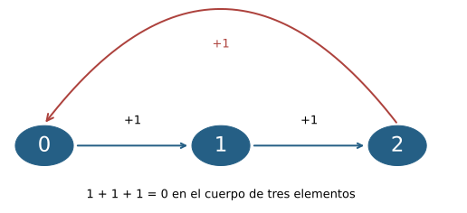
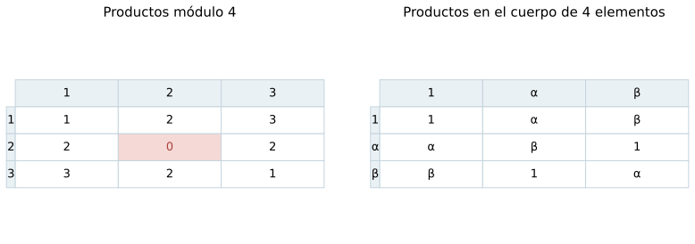
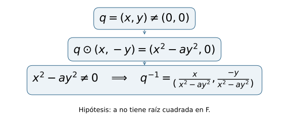
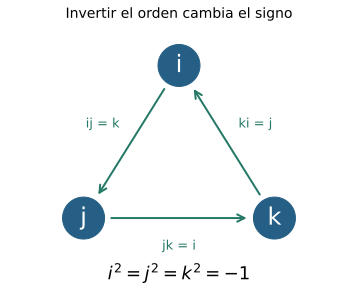

[← Capítulo 27](capitulo-27.qmd) · [Colecciones](../index.qmd#spivak-calculus-cuarta-edición) · [Capítulo 29 →](capitulo-29.qmd)

Alevi Peña · Matemática Abierta · Solucionario explicado

Problemas procedentes de Michael Spivak, *Calculus*, cuarta edición, capítulo 28, pp. 585–587. Las formulaciones conservan el contenido matemático necesario; las soluciones y figuras son propias.

## Qué permanece cuando cambia la aritmética {#seccion-255}

En los racionales, sumar uno repetidamente produce elementos distintos. En el cuerpo de dos elementos, en cambio, la segunda suma vuelve a cero. La igualdad $1+1=0$ convive allí con las reglas que permiten resolver ecuaciones lineales, cancelar factores no nulos y distribuir productos. Para trabajar en un cuerpo cualquiera necesitamos reconocer qué operaciones dependen sólo de esas reglas y cuáles utilizan además propiedades especiales de los reales.

Un cuerpo $F$ tiene una suma asociativa y conmutativa con neutro $0$ y opuestos, y un producto asociativo y conmutativo con neutro $1\ne0$ e inversos para los elementos no nulos; el producto distribuye sobre la suma. La resta significa sumar un opuesto, y $a/b$ significa $ab^{-1}$, siempre con $b\ne0$. De la distributividad obtenemos $a0=a(0+0)=a0+a0$; cancelar un sumando da $a0=0$. Si $ab=0$ y $a\ne0$, multiplicar por $a^{-1}$ da $b=0$. Usaremos esta ausencia de divisores de cero sin introducir ningún orden.

El símbolo $n1$ denotará la suma de $n$ copias de $1$ en $F$, con $01=0$. El número natural $n$ y el elemento $n1$ cumplen funciones distintas: varios naturales pueden producir el mismo elemento del cuerpo. Cuando una fórmula contenga $2$ o $4$ como coeficientes dentro de $F$, significarán $1+1$ y $1+1+1+1$, respectivamente.

## E001 — Aritmética módulo tres {#e001}

**Problema · SPV4-C28-E001.** En $F=\{0,1,2\}$ se suma y multiplica tomando el resto módulo $3$. Verificar que es un cuerpo y que no admite un orden compatible con sus operaciones. Referencia: p. 585.

**Solución.** Denotemos por $r(t)$ el resto de un entero $t$ al dividirlo por $3$. Las operaciones son $a\oplus b=r(a+b)$ y $a\odot b=r(ab)$. Si dos enteros tienen el mismo resto, su diferencia es múltiplo de $3$; al sumarle un entero o multiplicarla por él, la diferencia sigue siendo múltiplo de $3$. Por tanto,
$$
r(r(a+b)+c)=r(a+b+c),\qquad r(r(ab)c)=r(abc).
$$
Estas identidades permiten trasladar la asociatividad de los enteros a las operaciones reducidas. Su conmutatividad se traslada de igual modo, y la distributividad procede de
$$
r(a(b+c))=r(ab+ac)=r(r(ab)+r(ac)).
$$
La reducción siempre produce un elemento de $F$, así que también hay cierre.

Los neutros son $0$ y $1$, que son distintos. Los opuestos son $-0=0$, $-1=2$ y $-2=1$. Los inversos no nulos son $1^{-1}=1$ y $2^{-1}=2$, pues el resto de $4$ es $1$. Quedan verificadas todas las condiciones de cuerpo.

Para estudiar el orden, supongamos que existe un conjunto de positivos $P$ con las propiedades de tricotomía y cierre por suma y producto. Como $1\ne0$, uno de $1,-1$ es positivo; su cuadrado es $1$, luego necesariamente $1\in P$. El cierre por suma obliga entonces a que $1+1$ y $(1+1)+1$ sean positivos. La última suma es cero en este cuerpo, contradiciendo que $0\notin P$. Ninguna elección alternativa de positivos evita el argumento.

{#fig-spv4-c28-f01 fig-alt="Capítulo 28: Sumar uno en el cuerpo de tres elementos recorre un ciclo que vuelve al cero."}

*Figura 28.1.* Las flechas representan sumar $1$; la vuelta al cero impide que estas sumas formen una cadena estrictamente creciente.

## E002 — Por qué módulo cuatro falla {#e002}

**Problema · SPV4-C28-E002.** Con las operaciones dadas por los restos módulo $4$, mostrar que $\{0,1,2,3\}$ no es un cuerpo. Referencia: p. 585.

**Solución.** El elemento $2$ es distinto de cero, pero $2\cdot2=0$. Si tuviera inverso, la igualdad daría
$$
2=2\cdot1=2(2\cdot2^{-1})=(2\cdot2)2^{-1}=0,
$$
una contradicción. También podemos comprobar la falla directamente: los cuatro productos de $2$ por $0,1,2,3$ son $0,2,0,2$; ninguno es $1$.

El problema está en la multiplicación escogida. E003 construirá un cuerpo con cuatro elementos usando otras operaciones.

## E003 — Un cuerpo de cuatro elementos {#e003}

**Problema · SPV4-C28-E003.** Verificar que las siguientes operaciones convierten $F=\{0,1,\alpha,\beta\}$ en un cuerpo. Referencia: p. 585.

| $+$ | $0$ | $1$ | $\alpha$ | $\beta$ |
|---|---|---|---|---|
| $0$ | $0$ | $1$ | $\alpha$ | $\beta$ |
| $1$ | $1$ | $0$ | $\beta$ | $\alpha$ |
| $\alpha$ | $\alpha$ | $\beta$ | $0$ | $1$ |
| $\beta$ | $\beta$ | $\alpha$ | $1$ | $0$ |

| $\cdot$ | $0$ | $1$ | $\alpha$ | $\beta$ |
|---|---|---|---|---|
| $0$ | $0$ | $0$ | $0$ | $0$ |
| $1$ | $0$ | $1$ | $\alpha$ | $\beta$ |
| $\alpha$ | $0$ | $\alpha$ | $\beta$ | $1$ |
| $\beta$ | $0$ | $\beta$ | $1$ | $\alpha$ |

**Solución.** La tabla aditiva puede leerse mediante dos coordenadas con valores en el cuerpo de dos elementos $\mathbb F_2$. Identifiquemos
$$
0=(0,0),\quad1=(1,0),\quad\alpha=(0,1),\quad\beta=(1,1).
$$
La suma de la tabla es la suma coordenada a coordenada. Esto demuestra su asociatividad y conmutatividad, identifica el neutro y muestra que cada elemento es su propio opuesto.

La regla $\alpha^2=\beta=1+\alpha$ sugiere cómo describir también el producto. Para $u,v,r,s\in\mathbb F_2$ definamos
$$
(u,v)(r,s)=(ur+vs,\ us+vr+vs).
$$
La fórmula reproduce la tabla: $\alpha^2=(1,1)=\beta$, $\alpha\beta=(1,0)=1$ y $\beta^2=(0,1)=\alpha$; los productos con $0$ y $1$ son los indicados, y la fórmula es simétrica entre ambos factores. Hay cierre, conmutatividad y unidad $(1,0)$.

Para verificar la asociatividad sin esconderla en una inspección de la tabla, tomemos un tercer par $(t,w)$. Al desarrollar cualquiera de los dos productos agrupados, la primera coordenada es
$$
urt+vst+usw+vrw+vsw,
$$
y la segunda es
$$
urw+ust+vrt+vst+usw+vrw.
$$
En esta segunda coordenada aparecen dos términos $vsw$ que se anulan porque estamos calculando en $\mathbb F_2$. Así ambas agrupaciones coinciden para todos los pares. Cada coordenada de la fórmula del producto es además lineal en las coordenadas de cualquiera de los factores: distribuir las sumas de $\mathbb F_2$ demuestra ambas distributividades.

Por último, los tres elementos no nulos tienen inversos:
$$
1^{-1}=1,\qquad\alpha^{-1}=\beta,\qquad\beta^{-1}=\alpha.
$$
Todas las condiciones están verificadas. La diferencia con E002 se aprecia en el producto de los elementos no nulos: aquí siempre permanece no nulo y cada fila no nula contiene el $1$.

{#fig-spv4-c28-f02 fig-alt="Capítulo 28: Comparación de los productos no nulos módulo cuatro y en el cuerpo de cuatro elementos."}

*Figura 28.2.* Tener cuatro elementos permite aritméticas diferentes. En la tabla izquierda, $2\cdot2=0$; la derecha conserva inversos para todos los elementos no nulos.

## E004 — Duplicación en característica dos {#e004}

**Problema.** En un cuerpo $F$, (a) deducir $a+a=0$ para todo $a$ de $1+1=0$; (b) probar la recíproca si $a+a=0$ para algún $a\ne0$, y concluir que entonces $b+b=0$ para todo $b$. Referencia: p. 585.

**(a) · SPV4-C28-E004-a.** La distributividad da
$$
a+a=a1+a1=a(1+1)=a0=0.
$$
Por unicidad del opuesto, esto equivale a $-a=a$.

**(b) · SPV4-C28-E004-b.** De $a+a=0$ obtenemos $a(1+1)=0$. Como $a\ne0$, podemos multiplicar por su inverso y concluir $1+1=0$. Aplicando (a) a un elemento arbitrario $b$, resulta $b+b=0$.

La condición $a\ne0$ es indispensable: $0+0=0$ ocurre en todos los cuerpos y por sí sola no informa sobre $1+1$.

## E005 — La característica es un primo {#e005}

**Problema.** (a) Probar $(m1)(n1)=(mn)1$ para naturales $m,n$. (b) Si alguna suma positiva de copias de $1$ es cero, demostrar que la menor longitud de una suma así es prima. Referencia: p. 586.

**(a) · SPV4-C28-E005-a.** Al distribuir, cada una de las $m$ copias de $1$ del primer factor multiplica a las $n$ del segundo. Cada producto vale $1$; la asociatividad permite reunir los $mn$ términos resultantes:
$$
(m1)(n1)=\sum_{i=1}^{m}\sum_{j=1}^{n}1=(mn)1.
$$
La fórmula sólo cuenta términos de una suma finita. También vale si alguno de los índices es cero con la convención de suma vacía.

**(b) · SPV4-C28-E005-b.** Sea $p$ el menor natural positivo con $p1=0$. Ese mínimo existe por el buen orden de los naturales y satisface $p>1$, porque $1\ne0$. Si $p$ fuera compuesto, podríamos escribir $p=rs$ con $1<r,s<p$. Por (a),
$$
(r1)(s1)=p1=0.
$$
La minimalidad de $p$ asegura que ambos factores son distintos de cero, en contradicción con la ausencia de divisores de cero. Por tanto $p$ es primo; es la característica de $F$.

Cuando ninguna suma positiva vuelve a cero, se dice que el cuerpo tiene característica cero. Esta convención no significa que una suma de cero términos sea la primera repetición positiva. En un cuerpo ordenado, $1>0$ y todas sus sumas positivas son positivas; por eso todo cuerpo ordenado tiene característica cero.

## E006 — Repetición en un cuerpo finito {#e006}

**Problema.** Si $F$ es finito, (a) encontrar naturales distintos $m,n$ con $m1=n1$; (b) deducir que $k1=0$ para algún natural positivo $k$. Referencia: p. 586.

**(a) · SPV4-C28-E006-a.** Si $F$ tiene $N$ elementos, la lista
$$
1,\ 2 1,\ 3 1,\ldots,\ (N+1)1
$$
contiene $N+1$ términos en un conjunto de $N$ elementos. Dos términos coinciden: existen $1\le n<m\le N+1$ con $m1=n1$.

**(b) · SPV4-C28-E006-b.** Como $m1=n1+(m-n)1$, cancelar $n1$ en la igualdad anterior da
$$
(m-n)1=0.
$$
El natural $k=m-n$ es positivo. E005 prueba entonces que la característica del cuerpo es un primo. En particular, ningún cuerpo finito puede ser ordenado. No hemos afirmado que la característica sea igual al número de elementos: el cuerpo de E003 tiene cuatro elementos y característica dos.

## E007 — Un sistema lineal sobre cualquier cuerpo {#e007}

**Problema · SPV4-C28-E007.** Para $a,b,c,d\in F$ con $\Delta=ad-bc\ne0$, resolver
$$
ax+by=\alpha,\qquad cx+dy=\beta
$$
para cualesquiera $\alpha,\beta\in F$. Referencia: p. 586.

**Solución.** Eliminar $y$ usando la primera ecuación multiplicada por $d$ y la segunda por $b$ produce
$$
\Delta x=d\alpha-b\beta.
$$
Eliminar $x$ usando la segunda por $a$ y la primera por $c$ produce
$$
\Delta y=a\beta-c\alpha.
$$
El único elemento que necesitamos invertir es $\Delta$, garantizado no nulo. Los candidatos son, por tanto,
$$
x=\frac{d\alpha-b\beta}{\Delta},\qquad
y=\frac{a\beta-c\alpha}{\Delta}.
$$
Para demostrar la existencia, sustituimos ambos a la vez:
$$
ax+by=\frac{ad\alpha-ab\beta+ab\beta-bc\alpha}{\Delta}=\alpha,
$$
$$
cx+dy=\frac{cd\alpha-bc\beta+ad\beta-cd\alpha}{\Delta}=\beta.
$$
Las eliminaciones iniciales obligan a cualquier solución a tener esos valores, así que también hay unicidad. El argumento permite $a=0$ o $d=0$, y sigue siendo válido en característica dos: allí las restas se interpretan según los opuestos del cuerpo.

## E008 — Cuántas raíces cuadradas puede haber {#e008}

**Problema.** En un cuerpo $F$, (a) contar las raíces cuadradas de cero; (b) si $a\ne0$ tiene una raíz cuadrada, contar todas sus raíces distinguiendo $1+1=0$ de $1+1\ne0$. Referencia: p. 586.

**(a) · SPV4-C28-E008-a.** Cero es raíz de cero. Si $b^2=0$, la ausencia de divisores de cero aplicada a $bb$ fuerza $b=0$. Hay exactamente una raíz.

**(b) · SPV4-C28-E008-b.** Sea $b^2=a\ne0$, por lo que $b\ne0$. Si $c$ es otra raíz, la factorización
$$
0=c^2-b^2=(c-b)(c+b)
$$
da $c=b$ o $c=-b$. Ambos candidatos efectivamente son raíces, pues $(-b)^2=b^2$.

Cuando $1+1\ne0$, los dos candidatos son distintos: $b=-b$ implicaría $b+b=b(1+1)=0$, imposible porque ambos factores serían no nulos. Hay exactamente dos raíces. Cuando $1+1=0$, E004 da $-b=b$; ambos candidatos coinciden y hay exactamente una raíz. Esta última conclusión se refiere a los elementos que tienen raíz; no asegura que todos los elementos de cualquier cuerpo de característica dos tengan una.

## E009 — La división que falta justificar {#e009}

**Problema.** (a) Examinar la fórmula $x=(-b+r)/2$ para $x^2+bx+c=0$ cuando $r^2=b^2-4c$. (b) Identificar por qué esa receta falla para $x^2+x+1$ en $\mathbb F_2$, aunque todos los elementos de ese cuerpo tienen raíz cuadrada. Referencia: p. 586.

**(a) · SPV4-C28-E009-a.** La fórmula está definida y proporciona una solución bajo la hipótesis adicional $2=1+1\ne0$.[^cuadratica] Con esa hipótesis, $4=2^2$ tampoco es cero y podemos calcular
$$
\begin{aligned}
x^2+bx+c
&=\frac{(-b+r)^2+2b(-b+r)+4c}{4}\\
&=\frac{r^2-b^2+4c}{4}=0.
\end{aligned}
$$
No se ha utilizado orden ni positividad del discriminante: sólo su raíz dentro del cuerpo y la posibilidad de dividir por $2$.

**(b) · SPV4-C28-E009-b.** En $\mathbb F_2$ tenemos $2=0$ y $4=0$. Para $b=c=1$, el discriminante vale $1$ y tiene raíz $r=1$, pero la expresión propuesta se convierte en $0/0$, que no está definida. Evaluar el polinomio en los dos elementos muestra que
$$
f(0)=1,\qquad f(1)=1+1+1=1.
$$
No hay raíz en $\mathbb F_2$. La existencia de una raíz del discriminante no corrige la división por cero. En cambio, el elemento $\alpha$ de E003 sí satisface $\alpha^2+\alpha+1=0$: al ampliar el cuerpo de dos a cuatro elementos aparece una raíz del polinomio.

[^cuadratica]: En Spivak, cap. 28, problema 9(a), la condición $2\ne0$ se omite deliberadamente: el apartado (b) pide detectar la falla. Se incorpora aquí a la afirmación válida sin clasificar esa omisión didáctica como errata accidental.

## E010 — Adjuntar una raíz cuadrada {#e010}

**Problema.** Sea $a\in F$ sin raíz cuadrada en el cuerpo $F$. En $F'=F\times F$ definamos
$$
(x,y)\oplus(z,w)=(x+z,y+w),
$$
$$
(x,y)\odot(z,w)=(xz+ayw,yz+xw).
$$
(a) Probar que $F'$ es un cuerpo; (b) comprobar que $x\mapsto(x,0)$ conserva las dos operaciones; (c) hallar una raíz de $(a,0)$. Referencia: pp. 586–587.

**(a) · SPV4-C28-E010-a.** La fórmula del producto resulta natural si pensamos provisionalmente en un símbolo $\theta$ con $\theta^2=a$:
$$
(x+y\theta)(z+w\theta)=(xz+ayw)+(yz+xw)\theta.
$$
Esta escritura motiva la definición de los pares, pero todavía tenemos que probar las reglas que los convierten en un cuerpo.

Hay cierre porque cada coordenada se obtiene por operaciones de $F$. La suma es asociativa y conmutativa coordenada a coordenada, su neutro es $(0,0)$ y el opuesto de $(x,y)$ es $(-x,-y)$. El producto es conmutativo por su fórmula, tiene neutro $(1,0)\ne(0,0)$, y distribuye sobre la suma. Para ver esta última afirmación de manera explícita, si $q=(x,y)$, $r=(z,w)$ y $s=(u,v)$, las coordenadas de $q\odot(r\oplus s)$ son
$$
xz+xu+ayw+ayv,\qquad yz+yu+xw+xv,
$$
que son exactamente las de $(q\odot r)\oplus(q\odot s)$. La otra distributividad procede de la conmutatividad.

La asociatividad multiplicativa se comprueba desarrollando las coordenadas de los dos productos agrupados. Para los mismos tres pares, tanto $(q\odot r)\odot s$ como $q\odot(r\odot s)$ tienen coordenadas
$$
xzu+aywu+ayzv+axwv,
$$
$$
yzu+xwu+xzv+aywv.
$$
Cada cambio de orden o agrupación dentro de estas expresiones está justificado en el cuerpo base $F$.

La existencia de inversos es el punto en que se usa que $a$ no tiene raíz en $F$. Multiplicar un par por el que tiene cambiada la segunda coordenada elimina esa coordenada:
$$
(x,y)\odot(x,-y)=(x^2-ay^2,0).
$$
Sea $(x,y)\ne(0,0)$. Si $x^2-ay^2=0$ y $y=0$, tendríamos $x^2=0$, luego $x=0$, contradicción. Si $y\ne0$, dividir por $y^2$ daría $(x/y)^2=a$, contradiciendo la hipótesis. Por consiguiente, $D=x^2-ay^2\ne0$ y el par
$$
(x,y)^{-1}=\left(\frac{x}{D},-\frac{y}{D}\right)
$$
está definido en $F'$. Su producto con $(x,y)$ es $(1,0)$; por conmutatividad es inverso por ambos lados. Quedan demostradas todas las condiciones de cuerpo, incluso si $F$ tiene característica dos.

**(b) · SPV4-C28-E010-b.** La aplicación $\iota(x)=(x,0)$ es inyectiva porque la igualdad de pares implica la igualdad de sus primeras coordenadas. Además,
$$
\iota(x)\oplus\iota(z)=(x+z,0)=\iota(x+z),
$$
$$
\iota(x)\odot\iota(z)=(xz,0)=\iota(xz).
$$
También envía los neutros a los neutros y conserva opuestos e inversos. Su imagen es una copia de $F$ dentro de $F'$; identificarla con $F$ significa usar esta correspondencia explícita.

**(c) · SPV4-C28-E010-c.** El par $\theta=(0,1)$ satisface
$$
\theta\odot\theta=(a,0)=\iota(a).
$$
No está en la imagen de $\iota$, porque su segunda coordenada es $1\ne0$. Todo par tiene la expresión única $\iota(x)\oplus\iota(y)\odot\theta$, que abreviamos como $x+y\theta$.

La hipótesis de ausencia de raíz impide exactamente la aparición de divisores de cero. Si por el contrario $a=b^2$ en $F$, los pares no nulos $(b,1)$ y $(b,-1)$ tendrían producto $(b^2-a,0)=(0,0)$, incluso cuando en característica dos ambos pares coinciden. La misma construcción de pares dejaría de ser un cuerpo.

{#fig-spv4-c28-f03 fig-alt="Capítulo 28: La multiplicación por el conjugado reduce un par a una primera coordenada que debe ser no nula."}

*Figura 28.3.* La condición sobre $a$ permite invertir $x^2-ay^2$ para todo par no nulo. La notación $\theta$ abrevia el par $(0,1)$ ya construido.

## E011 — Cuaterniones: división sin conmutatividad {#e011}

**Problema.** En $\mathbb R^4$ se suma coordenada a coordenada y se define
$$
\begin{aligned}
(s,t,u,v)(w,x,y,z)=(&sw-tx-uy-vz,\\
&sx+tw+uz-vy,\\
&sy+uw+vx-tz,\\
&sz+vw+ty-ux).
\end{aligned}
$$
(a) Verificar todas las condiciones de cuerpo salvo la conmutatividad del producto. (b) Para $i=(0,1,0,0)$, $j=(0,0,1,0)$ y $k=(0,0,0,1)$, obtener los nueve productos de pares de $i,j,k$. Referencia: p. 587.

**(a) · SPV4-C28-E011-a.** Hay cierre porque las cuatro coordenadas son reales. La suma hereda de $\mathbb R$ la asociatividad y conmutatividad, tiene neutro $\mathbf0=(0,0,0,0)$ y opuestos coordenados. El producto tiene unidad $\mathbf1=(1,0,0,0)$ por sustitución directa. Cada coordenada del producto es lineal en las coordenadas de cualquiera de sus factores, de modo que al distribuir en $\mathbb R$ se obtienen las dos leyes distributivas.

La asociatividad merece una prueba, pues una regla bilineal cualquiera no tiene por qué ser asociativa. Podemos organizar el cálculo con matrices complejas de dos filas. Para $q=(s,t,u,v)$ pongamos
$$
A=s+ti,\qquad B=u+vi,\qquad
M(q)=\begin{pmatrix}A&B\\-\overline B&\overline A\end{pmatrix},
$$
donde en esta representación $i$ es la unidad de los números complejos ya construidos. La aplicación $M$ es inyectiva: las partes reales e imaginarias de su primera fila recuperan las cuatro coordenadas.

Sean $r=(w,x,y,z)$, $C=w+xi$ y $D=y+zi$. Multiplicar las matrices da
$$
M(q)M(r)=
\begin{pmatrix}
AC-B\overline D&AD+B\overline C\\
-\overline B C-\overline A\,\overline D&-\overline B D+\overline A\,\overline C
\end{pmatrix}.
$$
La entrada superior izquierda tiene partes real e imaginaria
$$
sw-tx-uy-vz,\qquad sx+tw+uz-vy,
$$
y la superior derecha tiene partes
$$
sy+uw+vx-tz,\qquad sz+vw+ty-ux.
$$
Las dos entradas inferiores son el negativo del conjugado de la superior derecha y el conjugado de la superior izquierda, respectivamente. Hemos comprobado, por tanto, la identidad $M(qr)=M(q)M(r)$ para el producto concreto del problema.

El producto de matrices es asociativo por las sumas finitas que lo definen: para matrices $P,Q,R$ de dos filas, la entrada $(h,\ell)$ de $(PQ)R$ y de $P(QR)$ es en ambos casos
$$
\sum_{m=1}^{2}\sum_{n=1}^{2}P_{hn}Q_{nm}R_{m\ell}.
$$
La distributividad y asociatividad de $\mathbb C$ justifican esa igualdad. Así,
$$
M((qr)p)=(M(q)M(r))M(p)=M(q)(M(r)M(p))=M(q(rp)).
$$
La inyectividad de $M$ da $(qr)p=q(rp)$, que era la obligación pendiente.

Para obtener inversos volvemos a las coordenadas reales. Definamos
$$
\overline q=(s,-t,-u,-v),\qquad N(q)=s^2+t^2+u^2+v^2.
$$
Sustituir en la regla del producto muestra que
$$
q\overline q=\overline q q=(N(q),0,0,0).
$$
Por ejemplo, la segunda coordenada de $q\overline q$ es $-st+ts-uv+vu=0$; las otras dos coordenadas imaginarias se anulan del mismo modo. Si $q\ne\mathbf0$, al menos una coordenada es no nula y $N(q)>0$. Por tanto
$$
q^{-1}=\frac{1}{N(q)}(s,-t,-u,-v)
$$
está definido y satisface $qq^{-1}=q^{-1}q=\mathbf1$. Multiplicar todas las coordenadas por un escalar real conmuta con los productos por su fórmula bilineal. La existencia de inversos queda demostrada por ambos lados, sin suponer conmutatividad.

**(b) · SPV4-C28-E011-b.** La sustitución de las tres unidades en la fórmula da los nueve productos:

| Primer factor $\backslash$ segundo factor | $i$ | $j$ | $k$ |
|---|---|---|---|
| $i$ | $-1$ | $k$ | $-j$ |
| $j$ | $-k$ | $-1$ | $i$ |
| $k$ | $j$ | $-i$ | $-1$ |

En particular, $ij=k$ mientras $ji=-k$, y esos elementos son distintos porque sus cuartas coordenadas son $1$ y $-1$ en $\mathbb R$. El producto no es conmutativo. El conjunto construido es el anillo de división de los cuaterniones, denotado $\mathbb H$.

{#fig-spv4-c28-f04 fig-alt="Capítulo 28: Productos cíclicos de las unidades de los cuaterniones; invertir el orden cambia el signo."}

*Figura 28.4.* En el sentido $i\to j\to k\to i$, el producto de dos unidades distintas es la tercera; en el sentido contrario aparece su negativo. Los tres cuadrados valen $-1$.

---

[← Capítulo 27](capitulo-27.qmd) · [Colecciones](../index.qmd#spivak-calculus-cuarta-edición) · [Capítulo 29 →](capitulo-29.qmd)

Soluciones originales de Alevi Peña · Matemática Abierta. [Licencia GFDL 1.3 o posterior](/COPYING.FDL).
