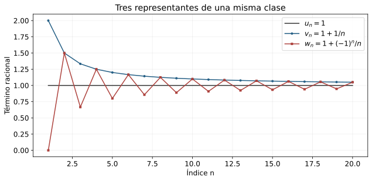
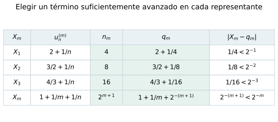
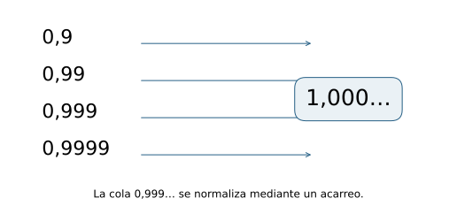
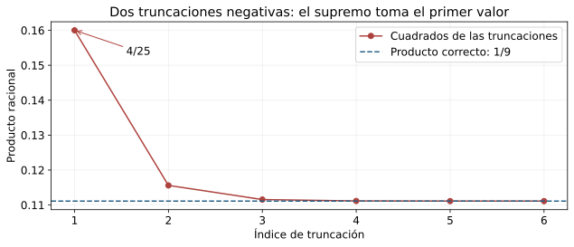

::: {.spivak-nav}

[← Capítulo 28](capitulo-28.qmd) · [Colecciones](../index.qmd#spivak-calculus-cuarta-edición) · [Capítulo 30 →](capitulo-30.qmd)

:::

Alevi Peña · Matemática Abierta · Solucionario explicado

Problemas procedentes de Michael Spivak, *Calculus*, cuarta edición, capítulo 29, pp. 598–600. Se conservan sus dos problemas y ocho incisos; las demostraciones y las figuras son propias. Los símbolos $\mathbb R_C$ y $\mathbb R_D$ distinguirán las construcciones mediante sucesiones de Cauchy y mediante decimales.

## Aproximar un número antes de disponer de él {#seccion-374}

Las sucesiones racionales $1,1,1,\ldots$ y $1+1/n$ son distintas término a término, aunque su diferencia acaba siendo menor que cualquier racional positivo. Si usamos sucesiones para construir números, necesitaremos decidir qué diferencias merecen desaparecer en la construcción. La relación de equivalencia del primer problema hará precisamente ese trabajo: reunirá en un mismo objeto todas las aproximaciones que se separan por una sucesión nula.

El cuidado fundamental consiste en no invocar la convergencia de sucesiones racionales hacia un real todavía inexistente. Diremos que una sucesión racional $u=(u_n)$ es **nula** cuando, para cada $\varepsilon\in\mathbb Q$ positivo, existe $N$ tal que $|u_n|<\varepsilon$ para todo $n\ge N$. Diremos que es **de Cauchy** cuando, para cada racional $\varepsilon>0$, existe $N$ tal que $|u_n-u_m|<\varepsilon$ para todos $n,m\ge N$. Ambas condiciones sólo hablan de racionales, naturales y desigualdades ya disponibles en $\mathbb Q$.

Toda sucesión racional de Cauchy está acotada. En efecto, eligiendo un índice $N$ a partir del cual $|u_n-u_N|<1$, tenemos $|u_n|<|u_N|+1$ en la cola; basta aumentar esa cota para incluir los primeros $N-1$ términos. También usaremos que un racional positivo multiplicado por $2^{-n}$ o $10^{-n}$ acaba siendo menor que cualquier racional positivo dado. Esto procede de la propiedad arquimediana de $\mathbb Q$, asumida como punto de partida del capítulo.

## E001 — Clases de sucesiones de Cauchy {#e001}

**Problema · SPV4-C29-E001.** Sobre el conjunto $\mathcal C$ de sucesiones racionales de Cauchy, definir $u\sim v$ cuando $u-v$ es nula. (a) Verificar que es una equivalencia; (b) probar que sus clases son iguales o disjuntas; (c) construir suma y producto sin depender de los representantes; (d) obtener un cuerpo; (e) definir sus positivos; (f) probar la convergencia de toda sucesión de Cauchy de elementos del cuerpo construido. Referencia: pp. 598–599.

### (a) La equivalencia — SPV4-C29-E001-a

La diferencia $u_n-u_n$ es cero para todo $n$, así que $u\sim u$. Si $u\sim v$, la igualdad $|v_n-u_n|=|u_n-v_n|$ demuestra $v\sim u$.

Para la transitividad, supongamos $u\sim v$ y $v\sim w$, y fijemos un racional $\varepsilon>0$. A partir de cierto índice, ambas diferencias tienen módulo menor que $\varepsilon/2$. Por la desigualdad triangular,
$$
|u_n-w_n|\le |u_n-v_n|+|v_n-w_n|<\varepsilon.
$$
Por tanto $u\sim w$. La elección de un índice común se obtiene tomando el máximo de los dos índices proporcionados por las hipótesis.

### (b) Qué contiene una clase — SPV4-C29-E001-b

Escribamos $[u]=\{v\in\mathcal C:v\sim u\}$. Si $[u]\cap[v]\ne\varnothing$, elijamos $w$ en la intersección. Tenemos $u\sim w\sim v$, luego $u\sim v$. Si $z\in[u]$, entonces $z\sim u\sim v$, por lo que $z\in[v]$. La misma prueba intercambiando $u,v$ da la inclusión opuesta: $[u]=[v]$.

Cada sucesión pertenece a su propia clase, y dos clases con un elemento común coinciden. Las clases forman así una partición de $\mathcal C$. Definimos $\mathbb R_C=\mathcal C/{\sim}$. Un elemento de $\mathbb R_C$ es una clase completa; una sucesión escogida dentro de ella es un representante.

Por ejemplo, las sucesiones constantes $u_n=1$ y $v_n=2$ pertenecen a clases distintas, pues su diferencia constante no es nula. En cambio, $u_n=1$ y $w_n=1+1/n$ pertenecen a la misma clase. El valor que construiremos puede tener representantes que cambian, que oscilan o que permanecen constantes.

{#fig-spv4-c29-f01 fig-alt="Capítulo 29: Tres sucesiones distintas con diferencias nulas representan un mismo elemento."}

*Figura 29.1.* Las sucesiones $1$, $1+1/n$ y $1+(-1)^n/n$ son distintas; cualquier diferencia entre dos de ellas tiende racionalmente a cero.

### (c) Operaciones bien definidas — SPV4-C29-E001-c

Proponemos
$$
[u]+[v]=[u+v],\qquad [u][v]=[uv],
$$
donde $(u+v)_n=u_n+v_n$ y $(uv)_n=u_nv_n$. Hay dos obligaciones: las sucesiones obtenidas deben pertenecer a $\mathcal C$, y cambiar representantes debe conservar la clase del resultado.

Para la suma, si las oscilaciones de $u$ y $v$ son menores que $\varepsilon/2$ en una cola común, entonces
$$
|(u_n+v_n)-(u_m+v_m)|<\varepsilon.
$$
Para el producto, elijamos cotas racionales $A,B\ge1$ con $|u_n|\le A$ y $|v_n|\le B$ para todos los índices. Restar y sumar el término $u_nv_m$ permite aislar las oscilaciones de los factores:
$$
|u_nv_n-u_mv_m|
\le A|v_n-v_m|+B|u_n-u_m|.
$$
Basta hacer las dos diferencias menores que $\varepsilon/(2A)$ y $\varepsilon/(2B)$, respectivamente. El producto es de Cauchy.

Sean ahora $u\sim u'$ y $v\sim v'$. La suma de las dos diferencias nulas demuestra $u+v\sim u'+v'$. Para el producto usamos
$$
u_nv_n-u'_nv'_n=u_n(v_n-v'_n)+v'_n(u_n-u'_n).
$$
Las sucesiones $u$ y $v'$ están acotadas, y cada diferencia del miembro derecho es nula. Una sucesión acotada por $M\ge1$ multiplicada por una nula vuelve a ser nula: para obtener error menor que $\varepsilon$, se exige a la segunda error menor que $\varepsilon/M$. Por tanto $uv\sim u'v'$. Las dos operaciones dependen únicamente de las clases.

### (d) El inverso de una clase no nula — SPV4-C29-E001-d

Denotemos por $\widehat r$ la clase de la sucesión constante $r,r,\ldots$, para $r\in\mathbb Q$. Las clases $\widehat0$ y $\widehat1$ son distintas, porque la sucesión constante $1$ no es nula. Las identidades asociativas, conmutativas y distributivas de las operaciones se verifican término a término en $\mathbb Q$ y después se toman clases. Por ejemplo,
$$
([u][v])[w]=[(uv)w]=[u(vw)]=[u]([v][w]),
$$
$$
[u]([v]+[w])=[u(v+w)]=[uv+uw]=[u][v]+[u][w].
$$
Los neutros son $\widehat0$ y $\widehat1$, y el opuesto de $[u]$ es $[-u]$. La suma satisface también su asociatividad y conmutatividad por las igualdades correspondientes de sucesiones. Falta construir los inversos multiplicativos.

Una sucesión de Cauchy que no es nula permanece separada de cero en una cola. Para demostrarlo, sea $u$ no nula. Existe un racional $\varepsilon_0>0$ tal que en toda cola aparece algún término con $|u_k|\ge\varepsilon_0$. Tomemos $N$ para que $|u_n-u_m|<\varepsilon_0/2$ si $n,m\ge N$, y escojamos uno de esos $k\ge N$. Entonces
$$
|u_n|\ge |u_k|-|u_n-u_k|>\varepsilon_0/2
\qquad(n\ge N).
$$
Todos estos términos tienen además el mismo signo que $u_k$: el intervalo de radio $\varepsilon_0/2$ alrededor de $u_k$ no cruza el cero. Fijemos un racional $\delta>0$ que sirva de cota inferior para sus módulos.

Definamos $v_n=1/u_n$ para $n\ge N$, y pongamos $v_n=0$ antes de $N$. Las divisiones de la cola están justificadas, y
$$
|v_n-v_m|=\frac{|u_n-u_m|}{|u_nu_m|}
\le\frac{|u_n-u_m|}{\delta^2}
$$
prueba que $v$ es de Cauchy. El producto $u_nv_n$ vale $1$ desde $N$, de modo que $uv$ equivale a la sucesión constante $1$. Así $[u][v]=\widehat1$.

Modificar un número finito de términos no cambia una clase. Esto permite definir los primeros términos del inverso sin dividir por ceros que quizá aparezcan allí. Una vez que existe el inverso, su unicidad en un cuerpo asegura que otra elección de representante o de términos iniciales produce la misma clase inversa. Hemos construido un cuerpo.

### (e) Un orden que no cambia al escoger representante — SPV4-C29-E001-e

Declaramos positivo a $[u]$ cuando existen un racional $\delta>0$ y un índice $N$ tales que
$$
u_n\ge\delta\qquad(n\ge N).
$$
La separación uniforme respecto del cero es necesaria. La sucesión $1/n$ tiene todos sus términos positivos y, sin embargo, su clase es $\widehat0$.

Si $u\sim v$ y $u_n\ge\delta$ en una cola, entonces $|u_n-v_n|<\delta/2$ en otra cola, y $v_n\ge\delta/2$ desde un índice común. La positividad está bien definida. La clase cero no es positiva. El argumento de (d) muestra que toda clase distinta de cero tiene un representante eventualmente separado de cero y con signo constante; por tanto ella o su opuesta es positiva. No pueden serlo ambas: las dos cotas positivas impondrían simultáneamente $u_n>0$ y $u_n<0$ en una cola.

Si $[u]$ y $[v]$ son positivas con cotas $\delta,\eta>0$, la suma tiene cota $\delta+\eta$ y el producto tiene cota $\delta\eta$. El conjunto $P$ de clases positivas satisface las tres condiciones del capítulo anterior y convierte a $\mathbb R_C$ en un cuerpo ordenado. Definimos $X<Y$ cuando $Y-X\in P$.

La aplicación $r\mapsto\widehat r$ conserva suma, producto y orden, y es inyectiva porque una constante no nula no puede ser una sucesión nula. Podemos identificar $\mathbb Q$ con su imagen, sin olvidar cómo se realizó la inclusión.

Necesitaremos dos consecuencias del orden. Si $u_n\le v_n$ eventualmente, entonces $[u]\le[v]$: la desigualdad contraria exigiría una separación positiva de $u_n-v_n$ en una cola. Además, si $X=[u]$ y $\varepsilon\in\mathbb Q$ es positivo, la condición de Cauchy permite escoger un término racional $r=u_N$ tal que
$$
|X-\widehat r|\le\widehat{\varepsilon/2}<\widehat\varepsilon.
$$
En efecto, $|u_n-u_N|<\varepsilon/2$ en la cola elegida y se aplica la consecuencia anterior. Todo elemento construido admite así aproximaciones racionales con error racional arbitrariamente pequeño.

La acotación de un representante da un entero $M$ con $|X|<\widehat M$; por eso los naturales son no acotados en $\mathbb R_C$. También hay racionales entre dos elementos distintos: si $X<Y$, su diferencia tiene una cota racional positiva $\widehat\delta\le Y-X$; aproximar $X$ por un racional con error menor que $\delta/8$ y después sumar $\delta/4$ produce un racional estrictamente entre ambos. Estas propiedades se obtienen de la construcción, sin suponer completitud.

### (f) Construir el límite de una sucesión de clases — SPV4-C29-E001-f

Sea $(X_m)$ una sucesión de Cauchy en el cuerpo ordenado construido. Para cada $m$, la aproximación racional de (e) permite escoger $q_m\in\mathbb Q$ con
$$
|X_m-\widehat{q_m}|<\widehat{2^{-m}}.
$$
Cada $q_m$ se elige de una aproximación distinta; esa elección es la diagonal que transformará una sucesión de clases en una sola sucesión racional. Tomar simplemente el término $m$ del representante de $X_m$ puede fallar: la sucesión $u^{(m)}_n$, igual a $1$ para $n\le m$ y a $0$ para $n>m$, representa siempre la clase cero, pero sus términos diagonales $u^{(m)}_m$ forman la sucesión constante $1$. El control $2^{-m}$ evita esa dependencia de los representantes.

Para verificar que $q=(q_m)$ es de Cauchy, fijemos un racional $\varepsilon>0$. Cuando $m,n$ son suficientemente grandes, las dos potencias $2^{-m},2^{-n}$ y la distancia $|X_m-X_n|$ son menores que $\varepsilon/3$. Por la desigualdad triangular en $\mathbb R_C$,
$$
|\widehat{q_m}-\widehat{q_n}|
\le |\widehat{q_m}-X_m|+|X_m-X_n|+|X_n-\widehat{q_n}|
<\widehat\varepsilon.
$$
La inclusión racional conserva el orden; por tanto $|q_m-q_n|<\varepsilon$ en $\mathbb Q$. La clase $X=[q]$ existe.

Demostremos que es el límite buscado. Para cualquier racional $\varepsilon>0$, la condición de Cauchy de $q$ da $N$ tal que $|q_n-q_m|<\varepsilon/2$ si $n,m\ge N$. Fijado $m\ge N$, la comparación eventual de (e), aplicada a la sucesión $q_n-q_m$, produce
$$
|X-\widehat{q_m}|\le\widehat{\varepsilon/2}.
$$
Aumentando $m$ hasta que $2^{-m}<\varepsilon/2$, obtenemos
$$
|X-X_m|\le |X-\widehat{q_m}|+|\widehat{q_m}-X_m|<\widehat\varepsilon.
$$
Esto prueba convergencia para tolerancias racionales. Si la tolerancia es un elemento positivo cualquiera $E$ del nuevo cuerpo, (e) proporciona un racional $0<\widehat\varepsilon<E$; la misma estimación prueba convergencia con tolerancia $E$. Toda sucesión de Cauchy de $\mathbb R_C$ converge.

{#fig-spv4-c29-f02 fig-alt="Capítulo 29: La elección de un racional de cada clase produce una sucesión racional de Cauchy y su clase límite."}

*Figura 29.2.* La cota $2^{-m}$ controla el error de cada elección. No basta tomar sin control el término $m$ de un representante arbitrario de $X_m$.

### Del límite de Cauchy al supremo

Para comprobar que hemos construido un cuerpo completo también en el sentido de C28, sea $S\subset\mathbb R_C$ no vacío y acotado superiormente. Por la propiedad arquimediana podemos elegir racionales $l_0<u_0$ tales que $\widehat{u_0}$ sea cota superior de $S$ y $\widehat{l_0}$ no lo sea: basta tomar una cota racional por encima de una cota dada y otra por debajo de algún elemento de $S$.

Bisecamos el intervalo racional $[l_n,u_n]$. Si su punto medio es cota superior de $S$, lo elegimos como $u_{n+1}$ y conservamos $l_n$; si no lo es, lo elegimos como $l_{n+1}$ y conservamos $u_n$. Así las cotas superiores $u_n$ decrecen, los $l_n$ nunca son cotas superiores y
$$
u_n-l_n=2^{-n}(u_0-l_0).
$$
Las dos sucesiones racionales son de Cauchy y equivalentes, por lo que determinan una misma clase $L$. La comparación eventual da $\widehat{l_n}\le L\le\widehat{u_n}$ para cada $n$, y ambos extremos convergen a $L$.

Si algún $s\in S$ fuera mayor que $L$, para $n$ grande tendríamos $\widehat{u_n}<s$, contradiciendo su condición de cota superior. Si $Y<L$, para $n$ grande se cumple $Y<\widehat{l_n}$; como $\widehat{l_n}$ no es cota superior, existe $s\in S$ con $Y<\widehat{l_n}<s$. Por tanto $Y$ tampoco es cota superior. Hemos probado $L=\sup S$.

## E002 — Construcción mediante decimales {#e002}

**Problema · SPV4-C29-E002.** Considerar pares $\alpha=(a,(b_n))$, con $a\in\mathbb Z$, $b_n\in\{0,\ldots,9\}$ y $(b_n)$ no eventualmente igual a $9$. (a) Ordenarlos por la parte entera y, si coincide, por el primer dígito distinto; demostrar la propiedad del supremo. (b) Para las truncaciones racionales
$$
\alpha_k=a+\sum_{n=1}^{k}b_n10^{-n},
$$
y su representación decimal finita $\alpha_k'$, construir la suma mediante $\sup_k(\alpha_k+\beta_k)'$ y completar las operaciones hasta obtener un cuerpo. Referencia: pp. 599–600.

### (a) El supremo por elección de dígitos — SPV4-C29-E002-a

La comparación indicada es un orden total. Dos pares distintos tienen partes enteras diferentes o sus secuencias de dígitos difieren en algún lugar; el conjunto de posiciones donde difieren tiene un menor elemento. Para la transitividad, si $\alpha<\beta<\gamma$ y las partes enteras coinciden, sean $r,s$ los primeros lugares donde cambian las dos comparaciones. Hasta $\min(r,s)-1$ los tres decimales coinciden; en ese lugar, si $r<s$, el dígito de $\alpha$ es menor que los otros dos; si $s<r$, los dos primeros son menores que el tercero; y si $r=s$, se encadenan las dos desigualdades de dígitos. En cada caso $\alpha<\gamma$. Las comparaciones con partes enteras distintas son transitivas por el orden de $\mathbb Z$.

Una fracción decimal finita $r=a+j10^{-n}$, con $0\le j<10^n$, tiene una representación única con $n$ dígitos seguidos de ceros; la llamamos $r'$. Esta escritura usa la parte entera inferior incluso para cantidades negativas: $-1/4$ se escribe $(-1,(7,5,0,\ldots))$, cuya expresión racional finita es $-1+0,75$.

Sea $S\subset\mathbb R_D$ no vacío y acotado superiormente en el orden lexicográfico. Las partes enteras de sus elementos forman un subconjunto no vacío de $\mathbb Z$ acotado superiormente, y por ello tienen un máximo $a$. Entre los elementos de $S$ con esa parte entera, elijamos el mayor primer dígito posible $d_1$. Entre los que tienen ese primer dígito, elijamos el mayor segundo dígito posible $d_2$, y continuemos. Cada elección se hace en un conjunto finito no vacío y deja al menos un elemento de $S$ con el prefijo elegido.

Pongamos $l_0=a$, $u_0=a+1$ y, para $n\ge1$,
$$
l_n=a+\sum_{j=1}^{n}d_j10^{-j},\qquad u_n=l_n+10^{-n}.
$$
No estamos sumando infinitamente: $l_n,u_n$ son racionales. Todo elemento de $S$ tiene parte entera o algún dígito anterior menor que el prefijo máximo, o comparte ese prefijo; en todos los casos es estrictamente menor que $u_n'$. Además, existe $s_n\in S$ con ese prefijo y por tanto $l_n'\le s_n$. Estas dos propiedades guían la prueba del supremo.

Si los dígitos $d_n$ no son eventualmente $9$, el par $\delta=(a,(d_n))$ es admisible. Ningún elemento de $S$ puede superarlo: un primer dígito mayor contradiría la elección máxima en esa posición, y una parte entera mayor contradiría la elección de $a$. Si $\beta<\delta$ tiene parte entera menor, ya $l_1'>\beta$. Si la parte entera coincide y el primer dígito distinto está en $r$, entonces $d_r$ es mayor que el dígito de $\beta$, de modo que $l_r'>\beta$. Como $l_r'\le s_r$ para algún $s_r\in S$, $\beta$ no es cota superior. Así $\delta=\sup S$.

Puede suceder que los dígitos elegidos sean todos $9$ a partir de una posición: el ejemplo $0,9;0,99;0,999;\ldots$ obliga a tratar esa posibilidad. Si $d_j=9$ para todo $j>N$, la identidad de sumas finitas da, para $n\ge N$,
$$
l_n=u_N-10^{-n},\qquad u_n=u_N.
$$
Tomemos como $\delta$ el decimal finito $u_N'$, realizando los acarreos finitos necesarios. Es admisible y es cota superior de $S$ porque todos sus elementos son menores que $u_N'$.

Para probar que es la menor, sea $\beta<u_N'$. Escojamos $J$ de modo que $u_N$ sea un múltiplo entero de $10^{-J}$ y escribamos $t_m$ para las truncaciones racionales de $\beta$. La comparación lexicográfica entre decimales finitos coincide con su comparación racional: el primer dígito distinto domina la suma finita de los posteriores. Como $t_J'\le\beta<u_N'$, los dos racionales de la malla satisfacen $t_J+10^{-J}\le u_N$.

Los extremos $t_m+10^{-m}$ no crecen. Además, cuando el siguiente dígito de $\beta$ es menor que nueve, el extremo disminuye estrictamente, pues
$$
(t_m+10^{-m})-(t_{m+1}+10^{-(m+1)})
=(9-b_{m+1})10^{-(m+1)}.
$$
Hay una posición posterior a $J$ con dígito menor que nueve, por la condición impuesta a $\beta$. Por tanto existe $m\ge J$ con $r=t_m+10^{-m}<u_N$. En el orden lexicográfico $\beta<r'$: $r'$ es el sucesor del prefijo de longitud $m$, con los acarreos finitos correspondientes, mientras que $\beta$ conserva ese prefijo. Para $n$ grande, $10^{-n}<u_N-r$ en $\mathbb Q$, luego $l_n>r$ y $l_n'>\beta$. Como $l_n'\le s_n$ para algún $s_n\in S$, $\beta$ no es cota superior. También en este caso $\delta=\sup S$.

La normalización de la cola de nueves es indispensable: sin ella, el procedimiento produciría a veces un objeto excluido de $\mathbb R_D$.

{#fig-spv4-c29-f03 fig-alt="Capítulo 29: El supremo de las truncaciones 0,9; 0,99; 0,999 es el decimal canónico 1,000, no una cola admisible de nueves."}

*Figura 29.3.* Elegir dígitos máximos puede producir una cola de nueves; el acarreo devuelve el resultado al conjunto de decimales admitidos.

### (b) Operaciones y verificación de los axiomas — SPV4-C29-E002-b

La definición de suma mediante truncaciones evita decidir un acarreo infinito de derecha a izquierda. Para demostrar todas sus propiedades usaremos el cuerpo $\mathbb R_C$ ya construido en E001: construiremos explícitamente una correspondencia con él y verificaremos que transporta exactamente la suma prescrita. No supondremos el teorema de unicidad de los reales del capítulo siguiente.

**La correspondencia.** Si $\alpha=(a,(b_n))$, su sucesión de truncaciones racionales es de Cauchy, porque para $m>n$,
$$
0\le\alpha_m-\alpha_n
\le9\sum_{j=n+1}^{m}10^{-j}=10^{-n}-10^{-m}<10^{-n}.
$$
Definimos $\Phi(\alpha)=[(\alpha_n)]\in\mathbb R_C$. Al comparar una truncación fija con las posteriores obtenemos
$$
\widehat{\alpha_n}\le\Phi(\alpha)
\le\widehat{\alpha_n+10^{-n}}.
$$
La segunda desigualdad es estricta. Como los dígitos no son eventualmente $9$, existe $m>n$ con $b_m\le8$. Para todas las truncaciones posteriores a $m$, la cola pierde al menos $10^{-m}$ respecto de la cola máxima de nueves, de modo que
$$
\Phi(\alpha)\le\widehat{\alpha_n+10^{-n}-10^{-m}}
<\widehat{\alpha_n+10^{-n}}.
$$
También $\widehat a\le\Phi(\alpha)<\widehat{a+1}$, por el mismo argumento desde la parte entera.

Estas cotas prueban que $\Phi$ conserva estrictamente el orden. Si las partes enteras de $\alpha<\beta$ son distintas, entonces
$$
\Phi(\alpha)<\widehat{a+1}\le\widehat c\le\Phi(\beta).
$$
Si coinciden y el primer dígito distinto está en $n$, las truncaciones satisfacen $\alpha_n+10^{-n}\le\beta_n$, y por tanto
$$
\Phi(\alpha)<\widehat{\alpha_n+10^{-n}}
\le\widehat{\beta_n}\le\Phi(\beta).
$$
En particular, $\Phi$ es inyectiva. Para un decimal finito $r'$, sus truncaciones son eventualmente constantes e iguales a $r$, así que $\Phi(r')=\widehat r$.

Para demostrar que todo $X\in\mathbb R_C$ tiene un decimal, la propiedad arquimediana proporciona el único entero $a$ con $\widehat a\le X<\widehat{a+1}$. Partimos de $l_0=a$ y elegimos recursivamente el mayor $b_n\in\{0,\ldots,9\}$ para el cual
$$
\widehat{l_{n-1}+b_n10^{-n}}\le X,
\qquad l_n=l_{n-1}+b_n10^{-n}.
$$
Hay al menos una elección, $b_n=0$, y la maximalidad conserva
$$
\widehat{l_n}\le X<\widehat{l_n+10^{-n}}.
$$
Si $b_n<9$, el extremo superior está excluido por la maximalidad; si $b_n=9$, ese extremo coincide con el de la etapa anterior, que ya era estrictamente mayor que $X$.

Los dígitos obtenidos no pueden ser eventualmente $9$. Si lo fueran después de $N$, tendríamos $l_n=l_N+10^{-N}-10^{-n}$ para $n\ge N$. Las cotas forzarían $X=\widehat{l_N+10^{-N}}$, pues una diferencia positiva respecto de ese racional superaría algún racional positivo y acabaría siendo mayor que $10^{-n}$. Esto contradice la desigualdad estricta en la etapa $N$. El par $\alpha=(a,(b_n))$ es admisible y las mismas cotas prueban $\Phi(\alpha)=X$. Así $\Phi$ es una biyección que conserva y refleja el orden.

**La suma prescrita.** Los racionales $s_n=\alpha_n+\beta_n$ crecen y están acotados por un entero, porque las partes fraccionarias de ambas truncaciones están entre $0$ y $1$. Por (a), existe $\sigma=\sup_n s_n'$ en $\mathbb R_D$. Una biyección de órdenes conserva supremos: las imágenes de las cotas superiores son exactamente las cotas superiores de las imágenes, y la menor se corresponde con la menor. Por tanto
$$
\Phi(\sigma)=\sup_n\widehat{s_n}
=\Phi(\alpha)+\Phi(\beta).
$$
La última igualdad puede comprobarse sin ningún intercambio de límites: para todo $n$, la suma de las cotas anteriores da
$$
\widehat{s_n}\le\Phi(\alpha)+\Phi(\beta)
\le\widehat{s_n+2\cdot10^{-n}}.
$$
Toda cantidad menor que la suma queda por debajo de alguna $\widehat{s_n}$, eligiendo $n$ con $2\cdot10^{-n}$ menor que la diferencia positiva. Así la suma definida en el problema satisface exactamente
$$
\alpha+\beta=\Phi^{-1}\bigl(\Phi(\alpha)+\Phi(\beta)\bigr).
$$

**El producto y los signos.** Definimos, para cualesquiera signos,
$$
\alpha\beta=\Phi^{-1}\bigl(\Phi(\alpha)\Phi(\beta)\bigr).
$$
Para decimales no negativos, esto coincide con la receta análoga por supremum:
$$
\alpha\beta=\sup_n(\alpha_n\beta_n)'.
$$
En efecto, sus truncaciones son no negativas y crecientes. Si están acotadas por enteros positivos $A,B$, la diferencia entre el producto de sus imágenes y el producto truncado cumple
$$
0\le\Phi(\alpha)\Phi(\beta)-\widehat{\alpha_n\beta_n}
\le\widehat{(A+B)10^{-n}},
$$
usando $XY-xy=X(Y-y)+y(X-x)$ y las cotas $X\le A$, $y\le B$. El error decrece hasta ser menor que cualquier diferencia positiva. Se demuestra así la igualdad con el supremo, incluidos los casos con un factor cero.

Para extender esa receta se definen los opuestos y se aplica la regla de signos. No se puede usar sin más el supremo de los productos de truncaciones para dos números negativos.[^producto] Por ejemplo, si $\alpha=\beta=(-1,(6,6,\ldots))$, sus truncaciones satisfacen $\alpha_n=-1/3-(2/3)10^{-n}$, por lo que $\Phi(\alpha)=\widehat{-1/3}$, mientras que $\alpha_1=-2/5$ y $\alpha_1^2=4/25>1/9$. El supremo de los productos contendría ya un valor mayor que el producto buscado.

{#fig-spv4-c29-f04 fig-alt="Capítulo 29: Los cuadrados de las truncaciones inferiores de un número negativo pueden sobreestimar su cuadrado."}

*Figura 29.4.* Para $\alpha=-1/3$, las truncaciones inferiores crecen hacia $\alpha$, pero sus cuadrados decrecen hacia $1/9$. Su supremo desde el primer índice es $4/25$.

La definición mediante $\Phi$ da el opuesto $-\alpha=\Phi^{-1}(-\Phi(\alpha))$. Puede escribirse directamente con dígitos. Si todos los dígitos de $\alpha$ son cero, el opuesto es $(-a,(0,0,\ldots))$. Si los dígitos no son eventualmente cero, es
$$
-\alpha=(-a-1,(9-b_1,9-b_2,\ldots)).
$$
Esta nueva secuencia no es eventualmente $9$. Si los dígitos son eventualmente cero y $b_N$ es el último no nulo, se toma parte entera $-a-1$, dígitos $9-b_n$ para $n<N$, dígito $10-b_N$ en $N$ y ceros después. Las fórmulas se verifican sumando sus truncaciones: las sumas son iguales a cero en el caso finito y difieren de cero por $-10^{-n}$ en el caso infinito, diferencia nula en $\mathbb R_C$. Quedan descritos los acarreos y la normalización de los opuestos.

**Los axiomas y los inversos.** Denotemos por $0_D$ y $1_D$ los decimales finitos de cero y uno. Sus imágenes son $\widehat0$ y $\widehat1$, que son distintas. Las igualdades de cuerpo se transportan y se verifican aplicando $\Phi$. Por ejemplo,
$$
\Phi((\alpha+\beta)+\gamma)
=(\Phi(\alpha)+\Phi(\beta))+\Phi(\gamma)
=\Phi(\alpha)+(\Phi(\beta)+\Phi(\gamma))
=\Phi(\alpha+(\beta+\gamma)).
$$
La inyectividad demuestra asociatividad de la suma. La misma cadena con productos demuestra asociatividad del producto; con los dos factores intercambiados demuestra las dos conmutatividades. La distributividad se obtiene de
$$
\Phi(\alpha(\beta+\gamma))
=\Phi(\alpha)\bigl(\Phi(\beta)+\Phi(\gamma)\bigr)
=\Phi(\alpha\beta+\alpha\gamma).
$$
Las identidades $\Phi(\alpha+0_D)=\Phi(\alpha)$ y $\Phi(\alpha1_D)=\Phi(\alpha)$ verifican los neutros. La fórmula del opuesto da $\alpha+(-\alpha)=0_D$.

Si $\alpha\ne0_D$, la inyectividad asegura $\Phi(\alpha)\ne\widehat0$. Su inverso ya existe por E001(d). La sobreyectividad proporciona el decimal único
$$
\alpha^{-1}=\Phi^{-1}\bigl(\Phi(\alpha)^{-1}\bigr),
$$
que puede obtenerse por la selección de dígitos demostrada arriba. Al multiplicar sus imágenes resulta $\widehat1$, y la inyectividad da $\alpha\alpha^{-1}=1_D$. La existencia del inverso queda justificada incluso cuando su expansión es infinita.

Finalmente, los decimales mayores que $0_D$ corresponden a los positivos de $\mathbb R_C$. Por eso satisfacen tricotomía y cierre por suma y producto. Hemos obtenido un cuerpo ordenado cuya propiedad del supremo se demostró directamente en (a). Las dos construcciones cumplen las propiedades requeridas sin presuponer que los reales ya existieran.

[^producto]: Spivak, cap. 29, problema 2(b), indica que la multiplicación se define de modo análogo, sin dar una fórmula para todos los signos. Aquí se precisa esa indicación: el supremo directo de productos de truncaciones se usa para factores no negativos y se extiende mediante la regla de signos. No se atribuye al original la fórmula indiscriminada que el contraejemplo refuta.

---

::: {.spivak-nav}

[← Capítulo 28](capitulo-28.qmd) · [Colecciones](../index.qmd#spivak-calculus-cuarta-edición) · [Capítulo 30 →](capitulo-30.qmd)

:::

Soluciones originales de Alevi Peña · Matemática Abierta. [Licencia GFDL 1.3 o posterior](/COPYING.FDL).
