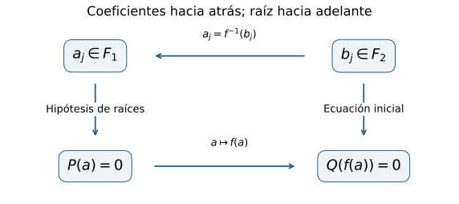
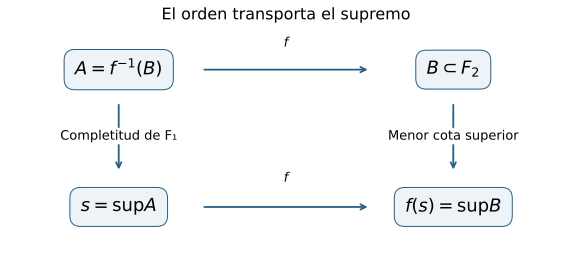
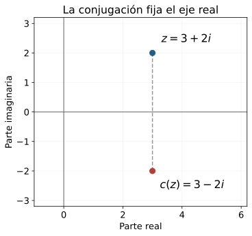

::: {.spivak-nav}

[← Capítulo 29](capitulo-29.qmd) · [Colecciones](../index.qmd#spivak-calculus-cuarta-edición)

:::

Alevi Peña · Matemática Abierta · Solucionario explicado

Problemas procedentes de Michael Spivak, *Calculus*, cuarta edición, capítulo 30, p. 606. Las formulaciones conservan el contenido matemático necesario; las soluciones y figuras son propias.

## Conservar las operaciones al cambiar de representación {#seccion-250}

Una sucesión de Cauchy, una cortadura de racionales y una expansión decimal son objetos distintos. En los problemas de C29 desarrollamos las construcciones mediante sucesiones y decimales, y comprobamos sus operaciones. Para compararlos hay que precisar qué debe conservar una correspondencia: una biyección permite emparejar elementos, pero la suma y el producto sólo se reconocen en ambos lados si la función los respeta.

Un **isomorfismo de cuerpos** $f:F_1\to F_2$ es una biyección tal que
$$
f(x+y)=f(x)+f(y),\qquad f(xy)=f(x)f(y).
$$
Las operaciones de cada miembro se realizan en su cuerpo correspondiente. Cuando los cuerpos son ordenados, exigimos además que $x<y$ implique $f(x)<f(y)$. Esta última condición también refleja el orden: si $f(x)<f(y)$, la tricotomía descarta $x=y$ y $y<x$, de modo que $x<y$.

El teorema central del capítulo, demostrado en pp. 603–605, asegura que todo cuerpo ordenado completo es isomorfo a $\mathbb R$. Los ejercicios estudian qué información conserva esa correspondencia y hasta qué punto queda determinada. La existencia de distintos modelos se mantiene; lo que se identifica es su estructura de cuerpo ordenado.

## E001 — Neutros, opuestos e inversos {#e001}

**Problema.** Para un isomorfismo $f:F_1\to F_2$, probar (a) que conserva cero y uno; (b) que conserva opuestos y, para elementos no nulos, inversos. Referencia: p. 606.

### (a) — SPV4-C30-E001-a

Distinguiremos los neutros escribiendo $0_1,1_1$ y $0_2,1_2$. Por aditividad,
$$
f(0_1)=f(0_1+0_1)=f(0_1)+f(0_1).
$$
Cancelar $f(0_1)$ en el grupo aditivo de $F_2$ da $f(0_1)=0_2$.

Como $1_1\ne0_1$ y $f$ es inyectiva, $f(1_1)\ne0_2$. La multiplicatividad da
$$
f(1_1)=f(1_1\cdot1_1)=f(1_1)^2.
$$
Multiplicar por el inverso del elemento no nulo $f(1_1)$ produce $f(1_1)=1_2$. La inyectividad es la justificación necesaria para efectuar esta división.

### (b) — SPV4-C30-E001-b

Aplicar $f$ a $a+(-a)=0_1$ da
$$
f(a)+f(-a)=0_2.
$$
Por unicidad del opuesto, $f(-a)=-f(a)$ para todo $a$, incluido cero.

Si $a\ne0_1$, la inyectividad y (a) aseguran $f(a)\ne0_2$. De $aa^{-1}=1_1$ resulta
$$
f(a)f(a^{-1})=1_2,
$$
por lo que $f(a^{-1})=f(a)^{-1}$. En particular,
$$
f(a-b)=f(a)-f(b),\qquad
f(a/b)=f(a)/f(b)\quad(b\ne0_1).
$$
Conservar las operaciones originales obliga a conservar también las operaciones derivadas; no hace falta agregarlas como nuevas condiciones a la definición.

## E002 — Transportar propiedades de un cuerpo {#e002}

**Problema.** Sean $F_1,F_2$ cuerpos isomorfos mediante $f$. Probar el transporte de (a) una raíz de $x^2+1$; (b) la existencia de raíces para todas las ecuaciones mónicas de un grado positivo $n$; (c) la igualdad $m1=0$; (d) la completitud, cuando los cuerpos son ordenados, $f$ conserva el orden y $F_1$ es completo. Referencia: p. 606.

### (a) — SPV4-C30-E002-a

Si $a\in F_1$ satisface $a^2+1_1=0_1$, entonces E001 y las dos operaciones que conserva $f$ dan
$$
f(a)^2+1_2=f(a^2)+f(1_1)=f(a^2+1_1)=f(0_1)=0_2.
$$
Así $f(a)$ es una raíz en $F_2$. Se transporta la raíz junto con la ecuación que satisface.

### (b) — SPV4-C30-E002-b

Fijemos $n\ge1$ y supongamos que toda ecuación
$$
x^n+a_{n-1}x^{n-1}+\cdots+a_0=0_1,
\qquad a_j\in F_1,
$$
tiene una raíz en $F_1$. Sea ahora una ecuación arbitraria del mismo grado en $F_2$:
$$
y^n+b_{n-1}y^{n-1}+\cdots+b_0=0_2.
$$
La sobreyectividad permite elegir $a_j\in F_1$ con $f(a_j)=b_j$ para cada coeficiente. Aplicamos la hipótesis a la ecuación formada con esos $a_j$ y obtenemos una raíz $a\in F_1$.

Por inducción, la multiplicatividad y E001 implican $f(a^j)=f(a)^j$ para todo entero $j\ge0$; el caso $j=0$ usa $f(1_1)=1_2$. La aditividad se extiende a cualquier suma finita, también por inducción. Al aplicar $f$ a la ecuación de $a$, obtenemos
$$
f(a)^n+b_{n-1}f(a)^{n-1}+\cdots+b_0=0_2.
$$
Por tanto $y=f(a)$ resuelve la ecuación arbitraria en $F_2$. El argumento vale para cada grado positivo que satisfaga la hipótesis; si ésta se cumple para todos los grados positivos en $F_1$, se cumple para todos en $F_2$.

La elección de los coeficientes usa sobreyectividad; transportar una ecuación ya elegida usa conservación de operaciones. Son obligaciones diferentes, y ambas intervienen en la prueba.

{#fig-spv4-c30-f01 fig-alt="Capítulo 30: Transportar primero los coeficientes hacia F1 y luego la raíz hacia F2."}

*Figura 30.1.* Para una ecuación arbitraria en $F_2$, primero se toman preimágenes de sus coeficientes; la imagen de una raíz de la ecuación obtenida satisface la ecuación inicial.

### (c) — SPV4-C30-E002-c

Si la suma de $m\ge1$ copias de $1_1$ es cero, la aditividad finita y E001 dan
$$
\underbrace{1_2+\cdots+1_2}_{m\text{ veces}}
=f\!\left(\underbrace{1_1+\cdots+1_1}_{m\text{ veces}}\right)
=f(0_1)=0_2.
$$
También se conserva la condición de no anularse: si la suma en $F_2$ fuera cero, la inyectividad obligaría a que la suma de $m$ unidades en $F_1$ fuese cero. Por tanto los naturales positivos que anulan la unidad son exactamente los mismos en los dos cuerpos. Si hay un mínimo, coincide en ambos; si no hay ninguno, ambos tienen característica cero.

### (d) — SPV4-C30-E002-d

Sea $B\subset F_2$ no vacío y acotado superiormente. Para usar la completitud de $F_1$ debemos llevar a ese cuerpo tanto el conjunto como sus cotas. Definamos
$$
A=f^{-1}(B)=\{a\in F_1:f(a)\in B\}.
$$
La sobreyectividad y la no vacuidad de $B$ aseguran que $A$ no es vacío. Si $u\in F_2$ es cota superior de $B$, existe $v\in F_1$ con $f(v)=u$. Para $a\in A$ se cumple $f(a)\le f(v)$, y la reflexión del orden da $a\le v$. Por tanto $A$ está acotado superiormente.

Existe $s=\sup A$ en $F_1$. Afirmamos que $f(s)=\sup B$. Si $b\in B$, su preimagen $a$ pertenece a $A$, de donde $a\le s$ y $b=f(a)\le f(s)$. Así $f(s)$ es una cota superior de $B$.

Para demostrar que es la menor, sea $u$ cualquier cota superior de $B$. Su preimagen $v=f^{-1}(u)$ es cota superior de $A$, por el argumento anterior. Entonces $s\le v$ y $f(s)\le f(v)=u$. Hemos demostrado las dos condiciones que definen el supremo, y por tanto $F_2$ es completo.

{#fig-spv4-c30-f02 fig-alt="Capítulo 30: Un isomorfismo de orden hace corresponder un conjunto, sus cotas superiores y su supremo."}

*Figura 30.2.* Las cotas superiores de $B$ son exactamente las imágenes de las cotas superiores de $A=f^{-1}(B)$. Sus menores elementos se corresponden.

## E003 — Composición de isomorfismos {#e003}

**Problema · SPV4-C30-E003.** Si $f:F_1\to F_2$ y $g:F_2\to F_3$ son isomorfismos, demostrar que $g\circ f:F_1\to F_3$ también lo es. En cuerpos ordenados, conservar asimismo el orden. Referencia: p. 606.

**Solución.** Si $g(f(x))=g(f(y))$, la inyectividad de $g$ da $f(x)=f(y)$ y la de $f$ da $x=y$. La composición es inyectiva. Si $z\in F_3$, la sobreyectividad de $g$ proporciona $y\in F_2$ con $g(y)=z$, y la de $f$ proporciona $x\in F_1$ con $f(x)=y$. Así $g(f(x))=z$, lo que demuestra sobreyectividad.

Para las operaciones,
$$
\begin{aligned}
(g\circ f)(x+y)
&=g(f(x)+f(y))\\
&=g(f(x))+g(f(y)),\\
(g\circ f)(xy)
&=g(f(x)f(y))\\
&=g(f(x))g(f(y)).
\end{aligned}
$$
Si los cuerpos son ordenados y ambos isomorfismos conservan el orden, $x<y$ implica $f(x)<f(y)$ y luego $g(f(x))<g(f(y))$. Quedan verificadas todas las condiciones.

Usaremos también que la inversa de un isomorfismo es un isomorfismo. La inversa existe por biyectividad. Si $u=f(x)$ y $v=f(y)$, entonces
$$
f^{-1}(u+v)=f^{-1}(f(x+y))=x+y=f^{-1}(u)+f^{-1}(v),
$$
y la misma sustitución demuestra la conservación del producto. La reflexión del orden establecida al principio muestra que la inversa también conserva el orden cuando corresponde.

## E004 — Por qué el isomorfismo real es único {#e004}

**Problema · SPV4-C30-E004.** Si $F$ es un cuerpo ordenado completo, demostrar que existe un único isomorfismo de cuerpos ordenados de $\mathbb R$ sobre $F$. Referencia: p. 606.

**Solución.** La existencia procede del teorema del capítulo. Sean $f,g:\mathbb R\to F$ dos isomorfismos y consideremos
$$
h=g^{-1}\circ f:\mathbb R\longrightarrow\mathbb R.
$$
E003 y la propiedad de la inversa prueban que $h$ es un isomorfismo ordenado. Basta demostrar que cualquier isomorfismo ordenado de $\mathbb R$ en sí mismo fija todos los reales.

Por E001, $h(0)=0$ y $h(1)=1$. La aditividad implica $h(n)=n$ para todos los naturales; conservar opuestos extiende la identidad a los enteros. Para $m\in\mathbb Z$, $n\in\mathbb Z\setminus\{0\}$, conservar productos e inversos da
$$
h(m/n)=h(m)h(n)^{-1}=m/n.
$$
Por tanto $h$ fija cada racional.

Sea $x\in\mathbb R$. Si $x<h(x)$, la densidad de $\mathbb Q$ proporciona un racional $q$ con $x<q<h(x)$. Como $h$ es creciente,
$$
h(x)<h(q)=q,
$$
en contradicción con $q<h(x)$. Si $h(x)<x$, elegimos un racional $q$ con $h(x)<q<x$; de $q<x$ obtenemos
$$
q=h(q)<h(x),
$$
que también es una contradicción. Las dos desigualdades estrictas quedan descartadas y $h(x)=x$ para todo $x$.

Así $g^{-1}(f(x))=x$ y, aplicando $g$, resulta $f(x)=g(x)$ para todo real $x$. El argumento usa la densidad racional de $\mathbb R$, disponible desde C08; no supone continuidad de $h$ ni intercambia una función con un límite sin justificación.

## E005 — Una simetría no trivial de los complejos {#e005}

**Problema · SPV4-C30-E005.** Encontrar un isomorfismo de cuerpos $\mathbb C\to\mathbb C$ distinto de la identidad. Referencia: p. 606.

**Solución.** La conjugación compleja
$$
c(x+iy)=x-iy,\qquad x,y\in\mathbb R,
$$
cambia el signo de la coordenada imaginaria. Está bien definida porque las coordenadas real e imaginaria son únicas.

Aplicarla dos veces recupera el número inicial: $c(c(z))=z$. Por tanto es inyectiva, pues de $c(z)=c(w)$ se obtiene $z=w$ al conjugar, y es sobreyectiva, pues todo $w$ es la imagen de $c(w)$.

Sean $z=x+iy$ y $w=u+iv$. La suma cumple
$$
c(z+w)=(x+u)-i(y+v)=c(z)+c(w).
$$
Para el producto,
$$
zw=(xu-yv)+i(xv+yu),
$$
y por consiguiente
$$
c(zw)=(xu-yv)-i(xv+yu)=(x-iy)(u-iv)=c(z)c(w).
$$
La conjugación es un isomorfismo de cuerpos. Difiere de la identidad porque $c(i)=-i\ne i$.

{#fig-spv4-c30-f03 fig-alt="Capítulo 30: La conjugación refleja un número complejo respecto del eje real y conserva el producto."}

*Figura 30.3.* El punto $3+2i$ se corresponde con $3-2i$. Los puntos del eje real permanecen fijos.

Este ejemplo no contradice E004: allí se probó la rigidez de un cuerpo ordenado completo. Los complejos no admiten un orden compatible con sus operaciones, como se vio en C28. Tampoco hemos afirmado que la identidad y la conjugación sean todos los automorfismos de $\mathbb C$; el problema pide exhibir uno distinto de la identidad.

---

::: {.spivak-nav}

[← Capítulo 29](capitulo-29.qmd) · [Colecciones](../index.qmd#spivak-calculus-cuarta-edición)

:::

Soluciones originales de Alevi Peña · Matemática Abierta. [Licencia GFDL 1.3 o posterior](/COPYING.FDL).
